# Stirling cycle engines for recovering low and moderate temperature 2 heat: a review

Kai Wanga,b, Seth R. Sandersc, Swapnil Dubeya, Fook Hoong Chooa, Fei Duanb,∗

aEnergy Research Institute @ NTU, Nanyang Technological University, Singapore 637141 bSchool of Mechanical and Aerospace Engineering, Nanyang Technological University, Singapore 639798 cDepartment of Electrical Engineering and Computer Sciences, University of California, Berkeley, Berkeley, CA 94720, USA

## 8 Abstract

A review is presented for the research development of Stirling cycle engines for recovering low and moderate temperature heat. The Stirling cycle engines are categorized into four types, including kinetic, thermoacoustic, free-piston, and liquid piston types. The working characteristics, features, technological details, and performances of the related Stirling cycle engines are summarized. Upon comparing the available experimental results and the technology potentials, the research directions and the possible applications of diferent Stirling cycle engines are further discussed and identified. It is concluded that kinetic Stirling engines and thermoacoustic engines have the greatest application prospect in low and moderate temperature heat recoveries in terms of output power scale, conversion eficiency, and costs. In particular, kinetic Stirling engines should be oriented toward two directions for practical applications, including providing low-cost solutions for low temperatures, and moderate eficient solutions with moderate costs for medium temperatures. Thermoacoustic engines for low temperature applications are especially attractive due to their low costs, high eficiencies, superior reliabilities, and simplicities over the other mechanical Stirling engines. This work indicates that a cost efective Stirling cycle engine is practical for recovering small-scale distributed low-grade thermal energy from various sources.

9 Keywords: Stirling engine, waste heat, low temperature, thermoacoustic, Fluidyne

## 10 Contents

## 11 1 Introduction

12 2 Classifications of Stirling cycle engines 4   
13 2.1 Arrangement of pistons . . 4   
14 2.2 Drive system . 4   
15 3 Kinetic Stirling engine 5   
16 3.1 Configurations and features 5   
17 3.2 LTD Stirling engine 6   
18 3.2.1 Small LTD Stirling engine 7   
19 3.2.2 Large LTD Stirling engine 7   
20 3.2.3 Solar-driven LTD Stirling engine 8   
21 3.3 Moderate temperature kinetic Stirling engine 9   
22 3.4 Summary 12   
23 4 Thermoacoustic Stirling engine 12   
24 4.1 Configurations and features 13   
25 4.2 Multi-core thermoacoustic Stirling engine 14   
26 4.3 Looped-type multi-stage thermoacoustic Stirling engine 16   
27 4.4 Standing-wave thermoacoustic engine 16   
28 4.5 Summary 17   
29 5 Free-piston Stirling engine 18   
30 5.1 Configurations and features 18   
31 5.2 Piston-displacer free-piston Stirling engine 19   
32 5.2.1 Small free-piston Stirling engine 19   
33 5.2.2 Large free-piston Stirling engine 19   
34 5.3 Diaphragm Stirling engine 20   
35 5.4 Summary 21   
36 6 Liquid piston Stirling engine 21   
37 6.1 Configurations and features 22   
38 6.2 Fluidyne engine/pump 22   
39 6.3 Two-phase liquid piston thermofluidic engine 23   
40 6.4 Solid-liquid hybrid piston Stirling water pump 24   
41 6.5 Summary 25   
42 7 Discussions 26   
43 8 Conclusions 27   
44 9 Acknowledgments 27   
46 The continuous exhaustion of fossil fuels and the associated environmental impact have   
47 driven a growing interest in increasing energy eficiency and exploiting renewable energy   
48 sources. A large amount of low and moderate temperature heat is released from various

industrial processes. It was reported that more than one third energy consumption in the world is used by industries [1], of which about 20-50% is finally exhausted as the waste heat into atmosphere [2]. Low temperature renewable heat resources, such as geothermal and solar energy, are huge in quantity all over the world. Exploiting these low-grade waste and renewable energies provides significant opportunities for addressing the energy related problems, such as energy safety and shortage, greenhouse gas emission, and water dissipation, etc.

Due to the great capability of recovering low-grade heat with potentially high eficiencies, Stirling cycle engines have attracted increasing attention in recent decades. They operate with a closed regenerative thermodynamic cycle that has the same theoretical thermal eficiency of the Carnot cycle. The compressible working fluid in a Stirling cycle engine, such as air, helium, hydrogen, and nitrogen, etc., experiences periodically compression and expansion at diferent temperature levels to convert thermal energy into mechanical work. The lack of valves and absence of periodic explosions in Stirling cycle engines enable them to be operated more quietly than other piston engines. In Stirling cycle engines, the thermal energy is externally supplied through recuperative heat exchangers. Therefore, they have a great flexibility to be powered by any kind of heat sources at any temperature levels. The Stirling cycle engines working at low and moderate temperatures with simple constructions and low costs have a wide application prospect for recovering small-scale distributed low-grade thermal energy.

In the previous study by Kongtragool and Wongwises [3] in 2003, the general principles and a number of research works on the technological developments of Stirling cycle engines, solar-powered Stirling engines, and low temperature diferential (LTD) Stirling engines were reviewed. The Stirling cycle engines described were mainly focused on the kinetic type engines working at relatively high temperatures. Stirling cycle engines for low temperature operations were briefly discussed and only several papers were covered. In 2008, Thombare and Verma [4] presented the fundamental information and detailed review of the past eforts taken for the developments of Stirling cycle engines and techniques used for engine analysis. They concluded that a Stirling cycle engine working with relatively low temperatures is potentially attractive for the future.

In this paper, a large number of research works with emphasis on Stirling cycle engines operating at low and moderate temperatures will be presented. Various types and configurations of Stirling cycle engines will be introduced and reviewed to provide an insight of the technological details and system performances. The research directions and possible applications of diferent Stirling cycle engines are further discussed and identified for recovering low and moderate temperature heat.

## 2. Classifications of Stirling cycle engines

## 2.1. Arrangement of pistons

Stirling cycle engines can be categorized into alpha, beta and gamma types from the aspect of the arrangement of the pistons, as shown in Figure 1.

Alpha type: Alpha Stirling engines have two power pistons in separate cylinders installed at either side of the cooler, regenerator and heater, as depicted in Figure 1(a). Both pistons need to transfer the work and have to be sealed to contain the high pressure working gas. The alpha type Stirling engine can be arranged in a double-acting configuration by interconnecting several alpha units in a series to form a loop. The power pistons of the adjacent units are merged into one, so that the power piston acts as not only the expansion piston for one unit but also the compression piston for the next unit.

Beta type: Beta Stirling engines have one power piston and one displacer installed in the same cylinder, as shown in Figure 1(b). The displacer does not transfer work, and its only role is to displace the gas between the hot and cold spaces through the heat exchangers and the regenerator to complete the working cycle. The displacer does not have obvious pressure diference between both ends, but has a large temperature gradient along it. Therefore, it is typically made of a thin-wall cylinder with a low thermal conductivity. High temperature Stirling engines even need radiation shields placed inside the displacer to reduce the radiation loss. The variation of the expansion space is only determined by the movement of the displacer while that of the compression space is controlled by the power piston and the displacer simultaneously.

Gamma type: Gamma Stirling engines have a similar piston-displacer configuration as beta type engines but are distinguished by having the power piston and the displacer placed in diferent cylinders, as shown in Figure 1(c). The compression space is split between two cylinders with a connecting tube. The gamma configuration has the disadvantage of reduced specific power due to the larger void volume in the compression space. The advantage is that it is more flexible for the drive system as the cylinders are separated. Besides, it is possible to design the displacer and the power piston with a large diference in dimensions for a gamma Stirling engine. This is critical for designing a LTD Stirling engine, as the displacer usually needs a much larger diameter to displace more gas flowing through the regenerator and heat exchangers.

## 2.2. Drive system

There are several types of drive systems that ensure the appropriate movements of the working gas to complete the Stirling cycle. From this perspective, Stirling engines can be classified into kinetic, thermoacoustic, free-piston, and liquid piston types.

In kinetic Stirling engines, the mechanical pistons shown in Figure 1 are driven by kinetic drive mechanisms, such as the simple crank-slider, rhombic drives, and the others. The drive system is designed in such a way that the movement of the piston at the hot end should always leads that at the cold end.

Thermoacoustic Stirling engines are a special variant of conventional Stirling engine. The movement of the working gas is accomplished by using the acoustic wave in thermoacoustic Stirling engines. The mechanical pistons in conventional Stirling engines are completed eliminated by connecting the both ends of the regenerator with appropriate acoustic transfer tubes. Dummy gas pistons driven by the acoustic wave can be imagined to displace the working gas flowing through the regenerator and heat exchangers. Therefore, a thermoacoustic Stirling engine can be regarded as an acoustic wave drive system from this perspective.

In free-piston Stirling engines, the mechanical pistons do not have any mechanical linkages. The movements of the pistons are self-adapted to the required conditions by using appropriate piston-spring resonant mechanisms. The thermodynamic process is strongly coupled to the piston-spring dynamics.

Diferent from the kinetic and free-piston Stirling engines that have mechanical pistons, the liquid piston Stirling engine adopts liquid columns as the pistons. The oscillations of the heights of the liquid columns result in the displacements of the working gas between the hot and cold spaces.

The configurations and features of diferent types of Stirling cycle engines will be introduced in detail in the following sections.

## 3. Kinetic Stirling engine

The reciprocating pistons in a Stirling engine should move in relationship to one another so that the volume variation in the expansion space leads that in the compression space. In a kinetic Stirling engine, the pistons are mechanically connected to a kinetic drive mechanism. The movements of the pistons are in approximate sinusoidal shapes with constant phase diference determined by the mechanical arrangements of the kinetic drive mechanism. Kinetic Stirling engines operating at high temperatures have been commercialized for applications in automobile, solar/dish system, submarine propulsion, and combined heating and cooling systems, etc. Since 1980s, especially in the last ten years, the kinetic Stirling engines operating at lower temperatures have acquired increasing interests for their potentials in applications of low-grade, waste, and renewable energy utilizations. Lots of work was conducted on LTD Stirling engines, which are typically operated below $1 0 0 ~ ^ { \circ } \mathrm { C }$ . The low temperature working capability brings about many studies in low-cost low-tech solar-powered kinetic Stirling engines. Some researchers devoted into the developments of kinetic Stirling engines with better performances for medium temperature applications.

## 3.1. Configurations and features

Many diferent kinetic drive mechanisms have been adopted to control the movements of the mechanical pistons in Stirling engines, including the crank-slider, Ringbom, rhombic, swash-plate, and Ross-yoke drives, etc., some of which are illustrated in Figure 2. The crank-slider drive mechanism is the most common drive for Stirling engines. The rhombic drive is typically used in single cylinder beta-type Stirling engines working at high pressures. The swash-plate drive is mainly adopted for four-cylinder double-acting Stirling engines for automobiles. The Ross-yoke drive is mostly used in small Stirling engines.

Most of the previous LTD Stirling engines are the crank-slider drive gamma type, having a large and short displacer and a much smaller power piston. Some LTD Stirling engines only have the power piston linked to the crankshaft, while the displacer moves freely in response to the pressure diference between the inside of the engine and the atmosphere. This is also known as the LTD Ringbom Stirling engine. The Ross-yoke drive has been applied in some moderate temperature Stirling engines. However, no Stirling engines for low and medium temperature heat sources have ever been developed using Rhombic or swash-plate drives due to the complexity of the mechanical structures.

The main features of kinetic Stirling engines are listed as follows,

Kinetic Stirling engines operating at high pressures need lubrication for moving components and special seals for pistons and rods to prevent gas leakage and oil pollution.

The linear reciprocating motions of pistons are all converted into rotation motions using diferent kinds of kinetic drives.

The phase diference of the power piston and displacer are mechanically fixed by the kinetic drive.

The displacements of pistons are fixed at any working conditions due to the constraints of mechanical linkages. Swash-plate drive Stirling engine with a variable plate angle is an exception.

The only way of adjusting power output of most kinetic Stirling engines except the swash-plate one is to vary the rotating speed.

An initial excitation should be provided to start kinetic Stirling engines if the heating temperature is suficient high.

## 3.2. LTD Stirling engine

Most kinetic Stirling engines operating at low temperature diferences are implemented in a gamma configuration and driven by the crank-slider or Ringbom drive mechanism. The gamma configuration enables the engines to have a large displacer and much smaller power piston arranged in diferent cylinders. As temperature diference is very low in these engines, the heat exchangers tend to have large surface areas for heat transfer, and the displacer is often very short. Many LTD Stirling engines use annular gap between displacer and cylinder rather than porous media as the regenerator. The detailed characteristics of LTD Stirling engine can be found in Ref. [3].

Simple formulas based on empirical coeficients are usually used to assess the possible performance of Stirling engines at the initial design phase. Kongtragool and Wongwises [5] reviewed and discussed the available formulas for calculating the power output of Stirling engines, including Malmo formula [6], Schmidt formula [7], West formula [8], Beale formula [6], and mean pressure power formula [9–11]. It is concluded that the mean pressure power formula is the most appropriate and simplest for estimating the power output of a gammaconfiguration, LTD Stirling engine.

## 3.2.1. Small LTD Stirling engine

The developments of LTD Stirling engines started from Kolin [12] since 1980s. He built a number of small LTD Stirling engines, one of which was able to operate at a temperature diference of only $1 5 ~ ^ { \circ } \mathrm { C }$ . Senft was also one of the pioneers of LTD Stirling engines. In 1991, Senft built a Ringbom LTD Stirling engine running with an ultra-low temperature diference of only $0 . 5 ~ ^ { \circ } \mathrm { C }$ [13], which was the lowest temperature diference ever reported. After the pioneering work of Kolin and Senft, various model engines have been developed and even commercialized for demonstration and teaching purposes. In general, the commercial small LTD Stirling engine models typically have power output in the order of 1 to 10 mW, speed under 500 rpm with thermal eficiencies below 0.1% [14]. For example, a test on a commercial gamma-type LTD Stirling engine model conducted by Jung and Won [15] showed that it started to run at a temperature diference of $6 . 5 ~ ^ { \circ } \mathrm { C }$ The rotating speed ranged from 48 rpm to 150 rpm, and the output power was about 0.3 mW-2.5 mW when the temperature diference ranged from $6 . 5 ~ ^ { \circ } \mathrm { C }$ to $1 9 ~ ^ { \circ } \mathrm { C }$

Robson [16] developed a LTD Ringbom Stirling engine based on a third order numerical analysis method. The experimental engine had a swept volume of 16 $\mathrm { c m ^ { 3 } }$ and four regenerator embedded inside the displacer. It started to run at a temperature diference of $6 2 ~ ^ { \circ } \mathrm { C }$ . The engine speed ranged around 200-220 rpm when the temperature diference was in the region of $8 0 ~ ^ { \circ } \mathrm { C }$

Cinar et al. [17] investigated the efect of displacer material on the performance of a LTD Stirling engine. The engine was tested with two diferent displacers made of aluminum alloy and medium density fiberboard. The results indicated that the engine with the displacer made of medium density fiberboard had a better performance in the aspects of power output and torque. It started to run at the heating temperature of $2 3 5 ~ ^ { \circ } \mathrm { C }$ with aluminum alloy displacer and only $1 1 5 ~ ^ { \circ } \mathrm { C }$ with the medium density fiberboard displacer. The highest power provided by the medium density fiberboard displacer was 3.06 W at $1 6 0 ~ ^ { \circ } \mathrm { C }$ , while the power achieved by the aluminum alloy displacer was 2.59 W at $3 2 0 ~ ^ { \circ } \mathrm { C }$ The performance improvement was because of the lower thermal conductivity and lower density of the nonmetallic displacer.

## 3.2.2. Large LTD Stirling engine

The LTD Stirling engines discussed in the previous section are relatively small in output powers, which were typically in the scale of milliwatts. Some researchers tried to scale up the LTD Stirling engines to get much larger power outputs. Iwamoto et al. [18, 19] built a 300 W class LTD Stirling engine. A maximum output power of about 146 W was reported at a rotating speed of about 143 rpm when the heat source temperature was

$1 3 0 ~ ^ { \circ } \mathrm { C } .$ The indicated eficiency achieved 5% when it operated at the maximum output power. It reached approximately 50% of the Carnot eficiency at its rated speed. Later, they developed an even larger LTD Stirling engine at the power range of 1 kW. It was an alpha-type engine with two power pistons coaxially arranged. The diameter of the cylinder was 400 mm and the total weight of the engine was up to 2 tons. According to the reported data, it reached nearly 700 W under a temperature diference of only 80 ◦C [20–22]. Their results showed that it is technically possible for LTD Stirling engines to be scaled up to have power outputs of practical uses.

Lloyd and his team [23, 24] proposed a LTD Stirling engine with heat exchangers and regenerators radially arranged in a drum-shaped vessel. A rotatory displacer occupied one third of the space in the drum-shaped vessel, and was actuated by a stepper motor to rotate back and forth to displace the gas through the wedge shaped regenerator and heat exchangers. The engine was aimed to generate an output power of 1 kW with a temperature diference of only $3 0 ~ ^ { \circ } \mathrm { C }$ . A test engine was later constructed. However, only preliminary tests were conducted and no further results on the performance have been reported.

Many companies have also shown their interests in developing large scale LTD Stirling engines up to hundreds to kilowatts for utilizing geothermal energy, solar energy, lowgrade industrial waste heat, etc. However, few scientific literatures about the design and performances have been disclosed probably due to the commercial considerations.

## 3.2.3. Solar-driven LTD Stirling engine

The low temperature operating capability of the LTD Stirling engine makes it a good alternative for low-temperature solar power applications. Several concept design and numerical works have been conducted on solar-powered LTD Stirling engines since 2005. In the review paper of Thombare and Verma [4] about the technological development in Stirling cycle engines, it was noted that solar-powered double-acting LTD Stirling engines working at relatively low temperatures with helium as the working fluid were potentially attractive engines for the future. Abdullah et al. [25] presented the design considerations for a four-cylinder double-acting Stirling engine for solar applications at the heating temperature of ${ 7 0 \ } ^ { \circ } \mathrm { C } .$ Shazly et al. [26] carried out a thermal analysis of a small solar-powered LTD Stirling engine based on a heat transfer model and the Beale formula. Kerdchang et al. [27] conducted a conceptual design and numerical study of a solar-powered beta-type Stirling engine for the applications of circulating water for aeration. The unique features of the design were that R-11 was used as working fluid and check valves were employed for controlling the flow direction of fluid.

More experimental solar-powered LTD Stirling engines were constructed and investigated. Tavakolpour et al. [28] built and tested a solar-powered LTD Stirling engine with two cylinders connected on one shaft. A flat-plate solar collector which reached a heating temperature of around $1 0 0 ~ ^ { \circ } \mathrm { C }$ was employed as the in-built heat source. A finite heat transfer model was first used to calculate the gas temperatures in the hot and cold spaces. Classical Schmidt theory was then employed to evaluate the theoretical output work and optimize phase angle according the obtained temperatures. It was indicated that the thermal eficiency can be efectively increased if the regenerator efectiveness is increased from zero to one. Experiments were then conducted on the engine without a regenerator, i.e. annual gap between displacer and cylinder as the regenerative passage. A maximum power of 0.27 W was reported on the engine operating at 14 rpm with a collector temperature of $1 1 0 ~ ^ { \circ } \mathrm { C }$ and sink temperature of $2 5 ~ ^ { \circ } \mathrm { C }$

In the past ten years, Kongtragool and Wongwises conducted a series of work on LTD Stirling engines for solar energy utilizations. In 2005, they theoretically investigated the optimum absorber temperature of a once-reflecting full-conical concentrator for maximizing the overall eficiency of a solar-powered LTD Stirling engine [29]. In 2007, a twin power piston LTD Stirling engine was built [30]. It had two power pistons with a total swept volume of $8 9 3 ~ \mathrm { c m ^ { 3 } }$ , and one displacer with a swept volume of $6 3 9 4 ~ \mathrm { c m ^ { 3 } }$ . The displacer also functioned as a moving regenerator which used stainless steel pot scourer as the regenerative matrix. The performance of the engine with ambient air as the working gas was first tested with a tungsten halogen lamp as the solar simulator. Maximum output powers ranged from 0.88 W to 1.69 W when the heating temperature was within the range of $1 2 6 ~ ^ { \circ } C  { \mathrm { ~ - ~ } } 1 6 3$ $^ \circ \mathrm { C } .$ The corresponding thermal eficiencies and speeds were around 0.5% and 50 rpm, respectively. When the engine was powered by a LPG burner, a maximum shaft power of 11.8 W at 133 rpm was achieved at $3 1 6 ~ ^ { \circ } \mathrm { C }$ . Later, they built a similar LTD Stirling engine with four power pistons and much bigger swept volume [31, 32]. Similar levels of performance were obtained. In 2008, they constructed and tested a small single piston LTD Stirling engine driven by actual solar energy by using a parabolic-dish concentrator [33]. A small DC generator was connected to the engine to generate electricity. A maximum electric power of 2.3 W with an overall eficiency of around 0.1% was reported.

Boutammachte and Knorr [34] constructed two solar driven gamma-type LTD Stirling engine aiming for water pumping in developing countries with a simple, robust and low cost solution. One of the engines with a tubular cooler was depicted in Figure 3. The other engine had a similar configuration, but with a flat plate cold heat exchanger which had a much larger contact area with the working fluid, i.e. ambient air. Aluminum plate was used as the material of the radiation absorber for the hot end at the top of the engine. When the absorber received a radiation power of 1575 W at the solar radiation of 900 $\mathrm { W / m ^ { 2 } }$ both engines pumped about $6 \mathrm { m ^ { 3 } }$ water per day for 10 m height. The corresponding power was 20.44 W with an eficiency of 1.3%. Measurements of the pressure-volume diagrams indicated that the engine with flat plate cold heat exchange had a larger cycle area, showing that a good cooling performance at the cold end had a positive efect. It was also found that the cover on the absorber was critical for minimizing the heat losses from the convection.

## 3.3. Moderate temperature kinetic Stirling engine

Moderate solar concentration to temperature levels of $2 5 0 { } ^ { \circ } \mathrm { C } - 4 5 0 { } ^ { \circ } \mathrm { C }$ may be of interest for power generations using solar/Stirling systems with lower costs compared to those of high temperature solar concentrations. Diferent from the low-cost LTD Stirling engines that do not have regenerators and use ambient air as working gas, most of the moderate temperature Stirling engines have regenerators made of porous media and use pressured gas as working fluid to get better performances.

The efects of regenerator types and materials on the performances have been intensively investigated for moderate temperature Stirling engines. In 2008, Isshiki et al. [35] experimentally studied and compared the performances of a beta-type Stirling engine using layered-plate type and stainless wire-mesh type regenerators. The results indicated that the layered-plate type regenerator showed better performance compared to the wire-mesh one. It was explained that the flow resistance through layered-plate was much smaller because the flow through layered-plate was laminar while that through the wire-mesh became middle region of laminar flow and turbulent flow. The enlarged heat transfer area of layered-plate compared to that of the wire-mesh was considered to be the other reason. The achieved shaft power ranged from about 22 W to 91.4 W when the temperature diference was in the range of $1 8 0 \ { } ^ { \circ } \mathrm { C } \mathrm { ~ - ~ } 3 3 0 \ { } ^ { \circ } \mathrm { C }$

Karabulut et al. [36–38] designed and manufactured a beta-type Stirling engine with a displacer driven by a novel lever mechanism, as shown in Figure 4. The engine was aimed for low and moderate temperature energy sources at the ranges of $2 0 0 \ { } ^ { \circ } \mathrm { C } \mathrm { ~ - ~ } 5 0 0 \ { } ^ { \circ } \mathrm { C }$ Two diferent displacer cylinders, including the one with a smooth inner surface and the other one with rectangular slots augmented inner surface, were tested and compared as the regenerative channels. The results showed that the engine with the slotted cylinder provided about 50% higher power than that of the smooth cylinder due to the enlarged heat transfer area. Maximum power output was obtained as about 52 W at 453 rpm when it worked at $2 0 0 ~ ^ { \circ } \mathrm { C }$ with 2.8 bar air [37]. The thermal eficiency reached as high as 15%, corresponding to 41% of the Carnot eficiency. When the engine was charged with helium, the minimum heating temperature for the engine to run was measured to be $1 1 8 ~ ^ { \circ } \mathrm { C }$ [38]. The maximum power was measured as 183 W at 4 bar charge pressure and $2 6 0 ~ ^ { \circ } \mathrm { C }$ heating temperature. It was reported that the motion of the displacer governed by the lever mechanism was able to have a better approach to theoretical Stirling cycle. Comparisons with the crank-drive and Rhombic-drive engines based on thermodynamic analysis indicated that the lever-drive engine has the highest work per cycle at the same charge pressure [36].

Chen et al. [39] built a prototype helium-charged twin power piston gamma-type Stirling engine, as shown in Figure 5. Annular gas between the displacer and its cylinder was first adopted as the regenerative channel for the prototype engine. A numerical investigation showed that the regeneration efectiveness posed crucial impact on the engine’s performance. Running the prototype engine at a heating temperature of $2 0 0 ~ ^ { \circ } \mathrm { C }$ gave a power output of 3.6 W at a speed of 104 rpm in the experiment. Later, they modified the displacer into a moving regenerator, and carried out experimental studies on efects of several regenerator parameters on the overall performances [40]. It was found the copper stacked-woven screen was a superior regenerator material than the stainless steel one for their Stirling engine. They pointed out that how the regenerator matrices were placed relatively to the direction of gas flow was an important factor afecting the overall performance. Better performance was found when the screens were installed perpendicular to the screen surfaces. The output power of the engine ranged from about 10 W to 100 W at the heating temperature range of $2 0 0 \ ^ { \circ } \mathrm { C } \ - \ 4 0 0 \ ^ { \circ } \mathrm { C } .$ . The eficiency ranged approximately from 1% to 10%. Recently, they developed a three-dimensional compressible computational fluid dynamics code to study the heat transfer characteristics of the twin power piston Stirling engine [41]. It was found that the impingement was the dominant heat transfer mechanism in the expansion and compression spaces, and temperature distribution across the engine volume at any moment was highly non-uniform. Their results showed that the heat transfer was so complex that the treatment of constant heat transfer coeficients by some zero- or one-dimensional models was inadequate to reflect the reality.

Gheith et al. [42] experimentally studied the performances of an air-charged gammatype Stirling engine with diferent regenerator materials. The piston and the displacer were connected to a shaft with a phase diference of $9 0 ^ { \circ }$ , as shown Figure 6. Performances of the engine with four diferent materials including stainless steel, copper, aluminum, and Monel 400 were characterized. The stainless steel was proved to be the best regenerator material in consideration of the performance and the problem of oxidation. By optimizing the porosity of the stainless steel regenerator, the engine produced brake powers of 200 W - 300 W at the heating temperatures of 300 $^ { \circ } \mathrm { C } \mathrm { ~ - ~ } 5 0 0 ~ ^ { \circ } \mathrm { C }$ . The maximum relative Carnot eficiency reached more than 20% at $3 0 0 ~ ^ { \circ } \mathrm { C }$

Sripakagorn and Srikam [43] designed and experimentally investigated a prototype betatype Stirling engine aiming for concentrating solar power generation, as depicted in Figure 7. The heating temperature was designed between $3 5 0 ~ ^ { \circ } \mathrm { C }$ and $5 0 0 ~ ^ { \circ } \mathrm { C }$ , which is the typical temperature range available from the parabolic trough solar collector. The displacer was designed to have a length to diameter ratio of 1.35, which was between the typical values of LTD Stirling engines (less than unity) and the high temperature ones (3-4). Stainless steel mesh of $\# 8 0$ was filled in the annual regenerator as the regenerative material. The engine was tested to have a maximum power of 26.6 W and a highest eficiency of about 5.5% with 7 bar air at the heating temperature of $3 5 0 ~ ^ { \circ } \mathrm { C }$ . When the heating temperature was increased to $5 0 0 ~ ^ { \circ } \mathrm { C }$ , the maximum output power and eficiency reached 95.4 W and 9.35%, respectively. Their comparisons of the dimensionless West numbers and the specific powers of previous prototypes showed that the developed moderate temperature Stirling engine had a comparable specific power over some of the high temperature ones with simpler and less costly development.

Aside from the above experimental work, a number of design works of moderate temperature Stirling engines for solar thermal applications were conducted by Tlili et al. [44] and He et al. [45, 46].

## 3.4. Summary

Kinetic Stirling engines operating at low and moderate temperature diferences have been reviewed. Table 1 collects the reported experimental results, including those of LTD Stirling engines and moderate temperature Stirling engines. All the reported LTD Stirling engines were in gamma configurations and typically used ambient pressure air as the working gas. The working temperature diferences were around or less than $1 0 0 ~ ^ { \circ } \mathrm { C }$ As the temperature and working pressure were very low, the rotating speeds were typically within 300 rpm. Most of the reported LTD Stirling engines were small in size with power outputs of less than 10 W and eficiencies below 1%. This is mainly because that they were manufactured with low-cost materials, assembled with low accuracy and filled with low pressure air. Several larger LTD Stirling engine prototypes filled with pressurized air showed that it is possible to achieve the power output up to several hundred watts with much higher eficiencies. Although the performance of the developed LTD Stirling engines is relatively limited, the low requirements for heat source temperature and the low costs for manufacturing make them attractive for low temperature heat recoveries, especially when the price is first priority. To achieve a large power and a good eficiency, LTD Stirling engines should be designed with a large size and filled with pressurized working gas.

Most of the kinetic Stirling engines operating at medium temperatures used charged helium or air as working gas. The rotating speed typically ranged from 300 rpm to 600 rpm. The power outputs and eficiencies were both much higher than those of LTD Stirling engines. They have made a compromise between the low performances of LTD Stirling engines and the high prices of the high temperature ones. They have potential applications in solar power generations at low concentration ratios. Compared to advanced and expensive high temperature solar concentration technology, the average concentration solution to temperature levels around $2 5 0 ~ ^ { \circ } \mathrm { C } ~ \cdot ~ 4 5 0 ~ ^ { \circ } \mathrm { C }$ has economic advantages and much lower requirements for high temperature materials.

## 4. Thermoacoustic Stirling engine

Conventional Stirling engines need mechanical parts to maintain the Stirling cycle and to produce work. In 1979, Ceperley [47, 48] recognized that the phasing between the pressure and velocity of the working gas in the regenerator of a Stirling system is the same as that in a traveling acoustic wave, i.e. near zero. He proposed to use acoustic wave rather than moving pistons to provide the control of the gas motion and gas pressure for a Stirling cycle, and presented the earliest concepts of thermoacoustic Stirling engines [49, 50]. The thermoacoustic Stirling engine is also known as the traveling-wave thermoacoustic engine. The practical thermoacoustic Stirling engine was first realized by Yazaki et al. [51] but had a very low eficiency. Backhaus and Swift [52] made a breakthrough in the development of thermoacoustic Stirling engine in 1999. The engine was capable of converting thermal energy into acoustic power with an eficiency of 30%, corresponding to 41% of Carnot eficiency. The demonstrated great features of lacking hot moving parts and potentially high eficiency of thermoacoustic Stirling engines have attracted worldwide interest into the field since then [53–62]. Up to now, thermoacoustic Stirling engines have achieved the highest eficiency up to 49% of Carnot eficiency [63] and acoustic power up to tens of kilowatts [55].

## 4.1. Configurations and features

The earliest thermoacoustic Stirling engine developed by Yazaki et al. [51] is a looped type, as illustrated in Figure 8(a). It is also named as pure traveling-wave thermoacoustic engine sometimes. It consists of a looped tube with a thermoacoustic core placed inside. The thermoacoustic core includes a hot heat exchanger, a regenerator, and a cold heat exchanger. The looped tube connecting both sides of the thermoacoustic core places the same roles of pistons in conventional Stirling engines. The length of the tube is typically one-wavelength at the first oscillation mode. Spontaneous gas oscillation occurs when the temperature diference across the regenerator exceeds a certain value. The acoustic oscillation reaches a saturated state when the power generation from the thermoacoustic core is balanced by the power dissipated in the tube and extracted from a load if any. The process from stationary to a stable oscillation state is called the onset process and the minimal temperature required is the onset temperature. The looped type thermoacoustic Stirling engine had very limited performances, mainly due to the large viscous losses caused by the high flow velocity in the regenerator.

Another type of thermoacoustic Stirling engine, which is invented by Backhaus and Swift [52, 64], is shown in Figure 8(b). The traveling-wave loop is placed near the velocity node of the standing-wave resonator, resulting in the efective reduction of viscous losses in the regenerator and the great improvement of performances. Therefore, it is also called the traveling-standing wave hybrid thermoacoustic engine. The acoustic power flows from the cold side to the hot side of the regenerator and gets amplified by the energy conversion efect of the Stirling cycle. A portion of the amplified acoustic power feeds back again to the regenerator through the loop tube, while the rest goes into the resonator and the load as the output power.

Except for the above thermoacoustic Stirling engine based traveling-wave phasing, a thermoacoustic engine based on standing-wave phasing (near 90◦) has much simpler structure [65, 66], as shown in Figure 8(c). The engine is in a straight line configuration with thermoacoustic core placed near one end. Deliberate imperfect heat exchange between the gas and the solid wall of the channels in the stack is required in order to have the right time delay between the gas motion and heat exchange to realize the energy conversion. It is therefore instinct irreversible and does not actually undergo the reversible Stirling cycle. Standing-wave thermoacoustic engine can be regarded as a simplified version of the thermoacoustic Stirling engine that does not have any feedback mechanism of the work. Though the eficiency of a standing-wave thermoacoustic engine is not as high as a thermoacoustic Stirling engine, it shares the similar working characteristics and advantages but with simpler configurations. Therefore, the previous works on the standing-wave thermoacoustic engines operating at low temperatures are also included in this review.

The configurations of thermoacoustic engines are not limited to the above three types. Various acoustic networks can be designed to create the appropriate working conditions for thermoacoustic core. The thermoacoustic engines shown in Figure 8 do not illustrate any acoustic load to extract the power, and the generated acoustic power is therefore dissipated in the resonators. Heat-driven refrigeration without any moving parts can be realized if a regenerative refrigerator is connected to the engine [57, 67, 68]. Another promising application of the thermoacoustic engine is to drive acoustic-electric convertors to generate electricity, such as linear alternators [69–73], loudspeakers [74, 75], piezoelectric transducers [76, 77], turbines [78], etc. Linear thermoacoustic theory [79] is widely adopted in designing and characterizing various types of thermoacoustic heat engines. A thermoacoustic software DeltaEC [80] developed by Los Alamos Laboratory based on the frequency-domain linear thermoacoustic theory can be used as the platform to build thermoacoustic models.

The main features of thermoacoustic engines are listed as follows,

They are free of mechanical moving components at non-ambient temperatures. Only tubes and several heat exchangers are needed to fabricate the engine. No precise fabrication and assemble of the components are required.

Lubrication and oil pollution problems that trouble conventional Stirling engines do not exist in thermoacoustic engines.

They have very high reliability and low cost, due to the elimination of moving components.

They achieve self-excited oscillation if heating temperature exceeds the onset temperature, which is a critical parameter indicating the lowest temperature that a thermoacoustic engine can utilize.

The oscillation frequency is mainly determined by the geometries of the engine and the acoustic speed of the working gas.

The onset temperatures of thermoacoutic engines are typically around $1 0 0 \ { } ^ { \circ } \mathrm { C } \mathrm { ~ - ~ } 3 0 0 \ { } ^ { \circ } \mathrm { C }$ Some thermoacoustic engines can even start to work at as low as dozens of degrees Celsius. They are therefore considered as a promising technology for low-grade heat recovery with low costs and high reliabilities. Most of the early prototypes were designed to operate at relative high temperatures at the range of $4 0 0 \ { ^ \circ } \mathrm { C } \mathrm { ~ - ~ } 7 0 0 \ { ^ \circ } \mathrm { C } .$ . More recently, increasing eforts have been directed toward developing thermoacoustic engines for low temperature heat sources.

## 4.2. Multi-core thermoacoustic Stirling engine

Thermoacoustic engines typically have only one thermoacoustic core for high temperature operations. However, it is challenge to achieve a high performance at low operating temperatures if only one core is adopted. Some researcher proposed to place multiple thermoacoustic cores in a thermoacoustic Stirling engine to enhance the thermoacoustic conversion efect and reduce the required onset temperature.

Biwa et al. [81] experimentally studied the efect of multiple cores on the onset temperature of a hybrid thermoacoustic Stirling engine. The quality factors at diferent numbers of thermoacoustic cores were measured to predict the onset temperature. It was demonstrated that the installation of the multiple thermoacoustic cores at suitable positions along the feedback loop can remarkably enhance acoustic power production while overcoming energy dissipation. The onset temperature diference decreased from $2 2 6 . 5 \ ^ { \circ } \mathrm { C }$ for one thermoacoustic core to only $5 6 . 6 ~ ^ { \circ } \mathrm { C }$ using five cores. It was concluded that use of multiple cores ofers an easy and efective method to decrease the onset temperature and was beneficial for operating at low temperatures.

de Blok [82] pointed out that utilizing low temperature diferences from solar vacuum tube collectors or waste heat in the range of $7 0 ~ ^ { \circ } \mathrm { C } \mathrm { ~ - ~ } 2 0 0 ~ ^ { \circ } \mathrm { C }$ seems to be the most promising field of applications for thermoacoustic systems. He proposed a novel acoustic configuration for thermoaoustic Stirling engines, as shown in Figure 9. A bypass tube is added in the loop tube, and two thermoacoustic cores are placed in the traveling-wave phase spot. In order to reduce the flow rate in the cores to suppress the viscous losses, the diameters of the cores are enlarged. The two-stage amplification of the acoustic power and the efective control of viscous losses enable the system to have a much lower onset temperature over the previously developed thermoacoustic engines. When the ambient air was used as the working gas, an onset temperature diference of only $6 5 ^ { \circ } \mathrm { C }$ was demonstrated in a prototype engine. The measured acoustic power flowed through the feedback tube was about 78 W at the temperature diference of $1 2 8 ~ ^ { \circ } \mathrm { C }$

In 2013, de Blok [83] built a low-cost thermoacoustic Stirling electric generator for rural and developing areas, as shown in Figure 10. The system had two thermoacoustic cores placed closely in a loop tube. A low-cost loudspeaker was installed in the loop tube to convert the acoustic energy into electricity. The onset temperature of the thermoacoustic Stirling electric generator was about $1 4 0 ~ ^ { \circ } \mathrm { C }$ with air at 200 kPa as the working gas. The system provided a net output acoustic power of 52 W at the heating temperature of 330 $^ \circ \mathrm { C }$ . The loudspeaker converted the acoustic power into 22 W electricity with a conversion eficiency of 41%. The overall eficiency of the system achieved only 2% due to the modest eficiency of the loudspeaker.

Hasegawa et al. [84] performed a numerical calculation for a thermoacoustic refrigerator driven by a three-cores thermoacoustic Stirling engine, as shown in Figure 11. The objective of the work was to design a configuration that enables a low temperature operation with high eficiency. Their results showed that the system started to work at a temperature diference of $1 1 0 . 8 \ ^ { \circ } \mathrm { C }$ . Maximum eficiency of the whole system can achieve over 21% of Carnot eficiency when the temperature diference was $2 1 7 . 4 \ ^ { \circ } \mathrm { C }$ , which was equivalent to levels typically found in industrial waste heat.

## 4.3. Looped-type multi-stage thermoacoustic Stirling engine

In 2010, de Blok [60] proposed a novel four-stage thermoacoustic Stirling engine in a looped configuration, as shown in Figure 12. It is similar to double-acting Stirling engines with four same units connected by double-acting pistons. The diference is that the four-stage thermoacoustic Stirling engine uses acoustic waves sustained by the 1/4 wavelength feedback tubes to act as the double-acting pistons. The cross-sectional areas of the thermoacoustic cores are increased relatively to those of the feedback tubes to reduce the viscous losses.

As multiple amplifications of the acoustic power are employed in the engine, the system can work eficiently at low temperature ranges. In one demonstrative prototype with ambient air as the working gas, a maximum power output of 18 W was obtained at the temperature diference of $1 3 2 ^ { \circ } \mathrm { C }$ [60]. The eficiency was estimated to be 8%, corresponding to 27% of the Carnot eficiency. In another prototype engine pressurized with argon gas at $2 . 1 \mathrm { M P a } .$ , the onset temperature diference reached as low as $3 0 ~ ^ { \circ } \mathrm { C } .$ . When using helium as the working gas, the acoustic power in the loop was measured to be 250 W. They later built a larger looped-type thermoacoustic Stirling engine with three stages as the prime movers while the last one as the refrigerator [85]. It was reported that the engine successfully converted 20 kW waste heat into 1.64 kW acoustic output power dissipated by the refrigerator at the heating temperature of only ${ 9 9 ~ ^ { \circ } } \mathrm { C }$ . The corresponding eficiency was up to 38% of Carnot eficiency, showing a good perspective in low-grade heat recovery for this type of system. Based on the proven four-stage concept, a thermoacoustic power generator capable of converting 100 kW waste heat at $1 3 0 \ { ^ \circ } \mathrm { C } \mathrm { ~ - ~ } 1 5 0 \ { ^ \circ } \mathrm { C }$ from a paper plant into 10 kW electricity was reported to be under construction.

Although only several demonstrative prototypes have been built up to now, the impressive results demonstrated by the looped-type multi-stage thermoacoustic Stirling engine show great potentials for this type of system to be practically used in low temperature heat utilizations. Currently, it is becoming a new direction that attracts many groups involved into developing similar multi-stage thermoacoustic Stirling engines.

## 4.4. Standing-wave thermoacoustic engine

The standing-wave thermoacoustic engine is also possible for recovering low and moderate temperature thermal energy. In 1988, Migliori and Swift [86] built a standing-wave thermoacoustic one using liquid sodium as the working fluid. The engine was able to produce 18 W of acoustic power with 990 W of heat for an eficiency of 1.8% at $3 6 0 ~ ^ { \circ } \mathrm { C }$ temperature diference across the stack. As liquid sodium was used, a magnetohydrodynamic transducer can be directly coupled to the engine to transform the acoustic power into electric power with high eficiency.

Some researches focused on developing miniature thermoacoustic engines to drive piezoelectric devices to convert waste heat into electricity. In 2008, McLaughlin [76] coupled a piezoelectric transducer to a high frequency standing-wave thermoacoustic engine. The system was tuned to be resonant at 1.58 kHz by adjusting geometries of the engine and the installation of piezoelectric element. The coupled generator was able to produce an output electric power of 2 mW at $1 5 5 ~ ^ { \circ } \mathrm { C } .$ The corresponding eficiency of heat to sound of the miniature engine was reported to be 20% of the Carnot eficiency at the maximum power output.

Jensen and Raspet [87] investigated the potential of a simple high frequency, air filled, standing-wave thermoacoustic engine to be competitive with other small generator technologies such as thermoelectric devices for waste heat power conversions. They designed a miniature thermoacoustic generator with a unimorph piezoelectric transducer installed at the middle of a thermoacoustic engine pair, as illustrated in Figure 13. The calculations indicated that the system can generate 0.42 W electric power with an input power of 16 W at $1 0 0 ~ ^ { \circ } \mathrm { C }$ . The eficiency is around 10% of the Carnot eficiency, which is competitive with currently available thermoelectric generators.

Mumith et al. [88] presented an assessment and design of a large scale standing-wave thermoacoustic engine to utilize waste heat from baking ovens in biscuit manufacturing. Their calculations showed that it is possible to recover waste heat to deliver an output acoustic power of 1022.2 W with a thermal eficiency of 5.38% at a comparatively low temperature of $1 5 0 ~ ^ { \circ } \mathrm { C }$

The working fluid has significant efect on the low-temperature operation of the standing-wave thermoacoustic engines. Noda and Ueda [89] measured the onset temperatures of a standing-wave thermoacoustic engine working with dry air, water vapor mixed air and ethanol vapor mixed air. The experimental results showed that the onset temperature diferences for the above conditions were $2 9 0 \ ^ { \circ } \mathrm { C } , \ 5 6 \ ^ { \circ } \mathrm { C }$ and $4 7 \ ^ { \circ } \mathrm { C } ,$ respectively. Furthermore, the lowest temperature diference while maintaining the thermoacoustic oscillations was only $4 2 ~ ^ { \circ } \mathrm { C }$ and $2 1 ~ ^ { \circ } \mathrm { C }$ under the second and third conditions, respectively. Their studies provided a good direction for designing thermoacoustic engines working at low temperatures from the aspect of working fluid.

## 4.5. Summary

The thermoacoustic engine has been considered as a good candidate for low-grade heat recoveries since its invention. However, most of previous researches were focused on developing high performance thermoacoustic systems operating at relatively high temperature ranges of $4 0 0 \ { } ^ { \circ } \mathrm { C } \mathrm { ~ - ~ } 7 0 0 \ { } ^ { \circ } \mathrm { C }$ . Nowadays, it becomes a trend to design various types of thermoacoustic systems for low temperature operations. The experimental results of the related works have been summarized in Table 2.

Applying multiple thermoacoustic cores in the thermoacoustic Stirling engines has been proven to be an efective way of decreasing the working temperatures. The looped type multi-stage configuration of thermoacoustic Stirling engines proposed by de Blok [60] showed the greatest potentials for high-eficient economical utilizations of very low temperature thermal energy. Miniature standing-wave thermoacoustic power generations using piezoelectric transducers are very simple, cheap and reliable. They may be useful to provide the small amount of electric power for small electronic elements using the waste heat. Last but not least, employing special working fluid such as vapor, sodium is also beneficial for low-temperature thermoacoustic engines.

Compared with the mechanical Stirling engines, the thermoacoustic systems are much simpler in construction, more reliable and cheaper. The thermoacoustic engines for low and moderate temperature heat recoveries will be a very promising direction for the thermoacoustic field. More eforts need to be made to improve the eficiency and power outputs, and explore more eficient ways of extracting the generated acoustic power.

## 5. Free-piston Stirling engine

Kinetic Stirling engines use the kinematic drive mechanisms to couple the reciprocating elements. Instead, reciprocating elements are coupled to springs in a free-piston Stirling engine and move entirely in response to spring forces acting upon them. Free-piston Stirling engine is therefore a dynamic resonant system. The resonant frequency is determined by the mass of the moving elements and the stifness provided by the springs. Although it seems mechanical simple, free-piston Stirling engine is the most dificult and complicated to put it into practice. For low and moderate temperature applications, the simplicity and costs of the technology are usually the greatest concerns. Therefore, much fewer free-piston Stirling engines have been built to operate at low and moderate temperatures.

## 5.1. Configurations and features

There are numerous variants of the configurations of free-piston Stirling engines [90]. The unique feature that they share is the use of springs to provide the reciprocating force for the moving elements. One of the common piston-displacer configurations is shown in Figure 14. The spring connected to the displacer and power piston can be either gas spring or mechanical spring, or even the both. The mass-spring mechanisms are elaborately designed to make the displacer and power piston oscillating resonantly with a leading phase of the displacer. The type shown here is actually a beta free-piston Stirling engine. There are also alpha and gamma types in free-piston Stirling engines. If the power piston is replaced by a diaphragm, it is a special free-piston Stirling engine called the diaphragm Stirling engine.

The main characteristics of the free-piston Stirling engines are as follows.

The free-piston Stirling engine is a resonant system operating at a more or less constant frequency.

It has self-starting capability. When it is heated up, the system changes into an unstable equilibrium state and starts to oscillate automatically without any requirement for external excitation.

Displacements of moving pistons change accordingly with the load. If more loads are added, the displacements decrease.

674 Both displacer and power piston move linearly inside the cylinders. No side thrust is   
675 exerted by the reciprocating elements against cylinder walls.

The requirement for lubrication is reduced to the level that working gas rather than oil is used as the lubricant. Oil-free operation eliminates the problem of regenerator contamination.

Cylinders are hermetically sealed thereby eliminating entirely the problems of dynamic seals of kinetic Stirling engines.

Its operation is more quiet and stable compared to kinetic Stirling engines.

## 5.2. Piston-displacer free-piston Stirling engine

## 5.2.1. Small free-piston Stirling engine

Nakajima et al. [91] developed two micro Stirling engines with the dimensions of several centimeters and weights of about 10 g. A relatively large and short displacer and a much smaller power piston in a gamma arrangement which are similar to the LTD Stirling engine were used. The displacer was connected to the power piston through a spring while the other side of the power piston was exposed to ambient air or connected to a load if necessary. Aside from the spring connected, the displacers were either connected to another spring or embedded with a magnet to provide an additional restoring force. One engine with a swept volume of 11 $\mathrm { c m ^ { 3 } }$ had an output power of about 20 mW with an operating frequency of about 10 Hz when the heating and cold walls were kept at $1 0 0 ^ { \circ } \mathrm { C }$ and $0 \mathrm { { } ^ { \circ } C }$ respectively. The other engine, with a swept volume of $\mathrm { 0 . 0 5 ~ c m ^ { 3 } }$ , had an output power of about 10 mW at 10 Hz with the same operating temperatures. The comparisons between the power-to-weight ratios of the micro Stirling engines and the other actuators showed that micro Stirling engines had potentials for a number of micro-actuator or micro-heat pump applications.

Kwankaomeng et al. [92] investigated the stabilities and performance of a beta freepiston Stirling engine with ambient air as working gas. The cylinders were made of stainless steel, while the power piston and displacer were made of brass and aluminum respectively for low friction. The piston was designed to have a maximum swept volume of $\mathrm { 1 7 . 2 ~ c m ^ { 3 } }$ The engine was then tested with a linear alternator connected to the piston rod to generate electricity. The hot end temperature was maintained at the range of $1 2 0 \ ^ { \circ } \mathrm { C } \mathrm { ~ - ~ } 1 5 0 \ ^ { \circ } \mathrm { C }$ . The tests showed that the engine operated at frequencies of 5.9-7.0 Hz. The maximum power of 0.68 W with the maximum eficiency of 5.6% was achieved at 6.4 Hz.

## 5.2.2. Large free-piston Stirling engine

In 1987, Dochat [93] from Mechanical Technology Incorporated (MTI) presented the experimental results of a 25 kWe-scale free-piston Stirling engine designed for space power generation. The Stirling engine was composed of two 12.5 kWe-scale units in an opposed configuration, as shown in Figure 15. Each unit consisted of a free-piston Stirling engine and a moving-magnet linear alternator. Molten salt was used as the heat transfer fluid to circulate through the shell side of the shell-tube hot heat exchangers. The cold heat exchangers were kept at about $4 2 ~ ^ { \circ } \mathrm { C }$ . The system was designed to operate at a frequency of 105 Hz with 150 bar helium as the working gas. The results showed that the engine achieved a piston PV power of 19 kW at $3 5 7 ~ ^ { \circ } \mathrm { C }$ with a thermal eficiency of 19.1%. The highest eficiency reached about 28% with a PV power of about 7 kW at this temperature. They also demonstrated that the engine was capable of operating at much lower temperatures. When the heating temperature was $2 3 7 \ ^ { \circ } \mathrm { C } ,$ the engine generated a photovoltaic powers of 5.35 kW with an eficiency of 11.3%. This work showed that large and more carefully designed free piston Stirling engines for low temperatures could achieve a fairly well performance. However, very little work has been done on high performance free-piston Stirling engines operating at low temperatures due to the great complexity and high cost for the development.

## 5.3. Diaphragm Stirling engine

If the power piston in a free-piston Stirling engine is replaced by a diaphragm, the mechanical friction and wear are eliminated. This kind of special free-piston Stirling engine is called the diaphragm Stirling engine, invented by Cooke-Yarborough in the 1960s as a long-lived radioisotope power generator with a substantially higher eficiency than thermoelectric systems at the time [90, 94]. The disadvantage of diaphragm Stirling engine is the low power density because of the much smaller swept volumes of diaphragms compared to those of pistons. Several prototypes using propane or strontium-90 titanate as the heat sources were developed at the time. The power outputs of these engines were dozens of watts and the eficiencies were around 10%. One of the prototypes generated 10.7 W electrical power with an eficiency of 13.7% when the heat source was at $2 9 2 ~ ^ { \circ } \mathrm { C }$ [90]. It was reported that the prototype engines had together total 126,000 hours of operation without any failure of the critical flexing components including the diaphragm and displacer spring, showing the good reliability of the metal diaphragm structures.

In 2014, Steiner and Archibald [95] developed a diaphragm Stirling engine as shown in Figure 16. The diaphragm was connected to the drive shaft through a folded spring tube with a large stifness. Two flexure structures with tuned resonant frequency acted as the displacer. The main feature of the engine was the lack of high tolerance sliding seals which enabled it to have a low cost and long life. The displacement of the diaphragm was within 1 mm which was one or two orders smaller than those of pistons in traditional Stirling engines. In order the make the power density comparable with traditional Stirling engines, high pressure at 9 MPa and high operating frequency at 500 Hz were adopted. They underlined that the inertance of the working gas was not negligible at the high pressure and high frequency. Therefore, the traditional Stirling engine analysis methods were not applicable to model the system. Instead, a thermoacoustic model built with DeltaEC was successfully adopted to characterize the engine as a traveling-wave thermoacoustic engine (or thermoacoustic Stirling engine) with mechanical resonators. Experimental results showed that the engine started to oscillate at $8 0 ~ ^ { \circ } \mathrm { C }$ above the ambient temperature. More than 400 W mechanical power with an eficiency of about 13% was achieved at $3 0 0 ~ ^ { \circ } \mathrm { C }$ heating temperature. When it was operated at $5 0 0 ~ ^ { \circ } \mathrm { C }$ , the engine obtained a thermal eficiency of 21% and an output power of 580 W.

There are also several studies using silicone as the diaphragm material [96–98]. However, the system can only withstand ambient filling pressure, and had very limited power outputs. The above studies indicate that high frequency and high pressure are critical approaches for improving the power outputs of diaphragm Stirling engines for practical uses.

## 5.4. Summary

Previous experimental results of diferent types of free-piston Stirling engines working at low and moderate temperatures are consolidated in Table 3. It shows that the operating frequencies are typically less than 10 Hz when ambient pressure air is used as working gas. The power outputs and eficiencies are limited to less than ten watts and 10%, respectively. However, the systems that used the high pressure helium gas and operated high frequencies showed much better performances. The power densities were remarkably increased. The obtained power were more than hundreds watts with eficiencies of more than 10% at 200 ${ } ^ { \circ } \mathrm { C } \mathrm { ~ - ~ } 3 5 0 ~ { } ^ { \circ } \mathrm { C }$

Free-piston Stirling engines working at high heating temperatures have been commercially or militarily applied in micro-CHP systems, solar power generations, space power generations, etc. The reviewed studies show that it is also possible to develop a free-piston Stirling engine with a good output performance for low and moderate temperature heat recoveries, in which a metal-diaphragm Stirling engine working at high pressure and high frequency is of particular interest. However, as the simplicity and costs are usually greatest concerns for practical applications at low and moderate temperatures, free-piston Stirling engines may face great challenges in these aspects.

## 6. Liquid piston Stirling engine

A liquid piston Stirling engine is a type of Stirling engine in which water columns play the role of pistons. One type of the liquid piston Stirling engine is the well-known Fluidyne engine, invented by West [100] in 1969. The volume variations inside the engine are only accomplished by liquid pistons in a Fluidyne engine or Fluidyne for short. The liquid pistons move freely in response to the gravity and the pressure acting on them. Some liquid piston Stirling engines have both liquid and solid pistons, which can be regarded as the combination of Fluidyne and kinetic LTD Stirling engines. As the water is typically used as the liquid piston, most of the liquid piston Stirling engines were built for water pumping, particularly for irrigation or drainage pumping in developing countries or in circumstance where electricity may not be available. Liquid piston Stirling engines have very simple structures and can be built with very low cost materials. The operating temperatures can be as low as several tens degrees Celsius in some cases. Therefore, the recoveries of low-grade heat with very low costs may be realized for liquid piston Stirling engines.

## 6.1. Configurations and features

Figure 17 shows a basic configuration for the Fluidyne engines. If the liquid column in the displacer cylinder is set into oscillation, it forces the working gas above to oscillate between the hot and cold spaces. The temperature variations of the working gas result in the pressure oscillations, which further drive the liquid column in the output tube to move up and down. The applied heat is therefore converted into work in the form of the periodical motion of the output liquid column. The length of the hot end column in the displacer is shorter than the cold end one. Consequently, the hot end column responds more quickly and the phase of the movement at the hot end always leads that of the cold end, which is exactly the required phase relation for the Stirling cycle.

Liquid piston Stirling engines have dry and wet operation modes, which are distinguished by whether substantial evaporation occurs from the liquid in the hot cylinder. When the vapor component of the working fluid is dominant in the cycle, and it is called wet operation mode [101, 102]. Otherwise, it is dry mode. The power output of liquid piston Stirling engine at the wet operation mode may be increased by a factor of two or three at the expense of decreasing eficiency [103].

If check valves are adopted in the output column, the oscillating motion of the liquid column can be converted into the pumping actions. Figure 18 shows two simplest ways to extract the energy for water pumping.

The main features of liquid piston Stirling engine are summarized as follows,

Liquid pistons avoid the sliding mechanical seal and accurately dimensioned cylinders, which provide great flexibility in mechanical design with much simpler constructions.

The frequency of liquid piston Stirling engine is typically within 2 Hz, due to the low nature frequency of the liquid pistons. West stated that the upper limit of frequency set by liquid surface instabilities for reasonable strokes may be in the range of 8 Hz - 16 Hz [8].

The mean pressure is usually 1 bar with air as the working gas. Increasing the mean pressure may eject the liquid out of the output tube. A double-acting liquid piston Stirling engine in which three or four U-tubes are connected in series can be filled with higher pressure and operates at higher frequency [103].

Liquid piston Stirling engine can attain self-excited oscillations when a suficient temperature diference is achieved between its hot and cold spaces. The operating temperatures are typically within 100 ◦C.

Small diameter tube instead of regenerator is typically used in a liquid piston Stirling engine for heat regeneration between the hot and cold cycles.

## 6.2. Fluidyne engine/pump

The working principles and dynamics of Fluidyne engines have been theoretically explained by West [103–105], Elrod [106], Geissow [107], Stammers [108], Ozdemir and¨ Ozg¨u¸c [109]. One of the earliest experimental Fluidyne pumps was built by West [104] in¨

1971. It was the liquid coupled type, and constructed from copper and brass pipes. A maximum pumping rate of 0.37 m3/hour was achieved with a head of 1.6 m at the heating power of 530 W, corresponding to an output power of about 1.6 W. The highest eficiency was about 0.35% at the heating temperature of ${ 9 0 ~ ^ { \circ } } \mathrm { C } .$ The technology was later transferred to Metal Box Company of India Ltd. for commercial applications of irrigation pumping in developing countries. The machine with a concentric cylinder operating at dry mode was reported to have a pumping rate of $9 . 5 ~ \mathrm { { m ^ { 3 } / h o u r } }$ at a head of 3 m with an eficiency of 7% [103]. Based on the Fluidyne engine designed by West, more similar prototypes were later built and tested [102, 110]. The largest one had a throughput of more than 15 m3/hour and a head of almost 4 m [111].

Mosby [112] tested a small scale Fluidyne pump in the loaded and unloaded configuration to evaluate the efect of geometric changes on the operating characteristics. A pumping rate of 0.37 l/min through a head of 0.25 m with an overall eficiency of 0.15% was achieved. The operating temperature and the frequency were about $7 0 – 9 0 \ ^ { \circ } \mathrm { C }$ and 1.2 Hz, respectively. Bell [113] built and tested a solar-powered Fluidyne pump for irrigation water pumping. A maximum pumping rate of about 1.9 l/min with a head of 1.22 m and a highest eficiency of 0.18% were achieved. In 2011, Stevens constructed a liquid piston Stirling engine powered by $\mathrm { ~ a ~ } 1 . 2 ~ \mathrm { m } ^ { 2 }$ Fresnel lens concentrating solar energy [114]. The engine operated at the heating temperature of around $9 3 ~ ^ { \circ } \mathrm { C }$ and the cold end temperature of about $8 5 ~ ^ { \circ } \mathrm { C }$ with a frequency of 1.06 Hz.

Recently, Yang et al. [115] proposed an integrated, two-cylinder Fluidyne engine, as shown in Figure 19. They utilized computer aided design and one-step, planar machining to precisely fabricate the rectangle tubing. Spontaneous oscillation was achieved at a constant 2.2 W heating power per cylinder. Maximum peak amplitude of 10.5 mm was obtained in the output column at 7 W per cylinder. The tested operating frequency was around 2.53 Hz. A periodical variation of the amplitude was observed due to the diferences in the resonant frequencies of the left and right cylinders. They also observed that the amplitudes of oscillation at the liquid pistons increased by 23% when the output column was sealed, which was explained to result from an improved matching of the load to the internal resistances of the engine. The pumping operation of the Fluidyne engine showed that the two-cylinder engine reached flow rates of 23 ml/min for a zero head, and 19 ml/min for a head of 5 cm. The eficiency of the engine was 0.1% when provided with 4 W of heat per cylinder, and 0.016% when operated for pumping.

## 6.3. Two-phase liquid piston thermofluidic engine

In 2004, Smith [116–118] proposed a novel two-phase “Non-Inertive-Feedback Thermofluidic Engine” which is similar to a wet Fluidyne engine but does not rely on fluid inertia to operate. A series of theoretical and experimental work was later done by Markides and Solanki et al. to investigate the dynamics [119, 120], heat transfer [121, 122], losses [123], pumping characteristics [124], and working fluid selection [125] for the engine. The schematic of the engine is shown in Figure 20. The working fluid experiences periodical evaporation and condensation at the heat exchangers when the pressure variations drive the liquid to oscillate through a feedback system. Even though the thermodynamic cycle of the engine is not strictly based on Stirling cycle, we categorize it into liquid piston Stirling engine because its configuration and critical operating characteristics are very similar to those of liquid piston Stirling engines. The operating frequency was also at low values of about $0 . 1 ~ \mathrm { H z } \mathrm { ~ - ~ } 0 . 4 ~ \mathrm { H z }$ . The phase change characteristics permit the system to have the potential of higher power densities. However, the close arrangements of the hot and cold heat exchangers cause a large amount of heat loss, and limit the overall eficiency. The engine has been experimentally demonstrated to have an operating temperature diference as low as $5 0 ~ ^ { \circ } \mathrm { C }$ [116].

## 6.4. Solid-liquid hybrid piston Stirling water pump

Some liquid piston Stirling engines have both solid and liquid pistons. Orda and Mahkamov [126] developed three prototypes of liquid piston Stirling engines for water pumping, as shown in Figure 21. The first prototype used a piston-actuator connected to a spring to enhance the stability of the operation of the Fluidyne engine. The working temperature in the hot cylinder varied between $7 5 ~ ^ { \circ } \mathrm { C }$ and $9 5 ~ ^ { \circ } \mathrm { C }$ , and the mean pressure changed in the range of 0.8 bar - 1.6 bar. The maximum pumping rates of $0 . 5 ~ \mathrm { m ^ { 3 } / h o u r }$ $1 . 5 ~ \mathrm { m ^ { 3 } / h o u r }$ , and $2 ~ \mathrm { { m ^ { 3 } / h o u r } }$ had been achieved when the heating powers were 0.8 kW, 2 kW and 3 kW, respectively. The thermal eficiency ranged from 0.2 % to 0.5%. Based on the first prototype liquid piston Stirling engine, another two engines that were coupled with solar collectors were then developed. The water in the hot cylinder was circulated through the solar collectors to transfer the absorbed thermal energy at about $7 5 ~ ^ { \circ } \mathrm { C } \mathrm { ~ - ~ } 9 5$ $^ \circ \mathrm { C }$ to power the liquid piston Stirling engines. For the second prototype, the pumping rate ranged from 0.22 $\mathrm { m ^ { 3 } / }$ hour to $0 . 6 5 ~ \mathrm { m ^ { 3 } / }$ hour when the intensity of the solar radiation changed from 660 $\mathrm { W / m ^ { 2 } }$ to 750 $\mathrm { W / m ^ { 2 } }$ The third prototype was able to pump water with a rate of $0 . 7 ~ \mathrm { m ^ { 3 } / }$ hour at a head of 1.5 m when the radiation intensity was 850 $\mathrm { W / m ^ { 2 } }$ . In their tests, they observed that the pulsating motion of the water increased the eficiency of the solar collectors by 10% due to the enhancement of heat transfer.

Although Orda and Mahkamov’s liquid piston water pumps have solid pistons, the displacer and the power piston contacting the working fluid are still liquid columns. Whereas, some solid-liquid hybrid piston Stirling engines adopt both types of pistons to shift the working gas [127–130]. Kl¨uppel and Gurgel [131] developed a solid-liquid hybrid piston Stirling pump, as shown in Figure 22. The solid displacer shifts the working gas between the hot and cold ends which experiences heating and cooling periodically. The temperature variations change the pressure inside the chamber and drive the liquid piston below to pump water. The engine is actually a combination of Fluidyne engine and normal solid-piston Stirling engine, in which the liquid piston acts as the power piston. Their experimental engine operated at the hot and cold temperatures of $9 2 ~ ^ { \circ } \mathrm { C }$ and $2 8 ~ ^ { \circ } \mathrm { C }$ with air as working gas. The frequency varied between 0.36 Hz and 0.14 Hz. It was observed that the performance was decreased after about 1 hour of work due to a slow dissolution of the working gas in the pumped water. They suggested the water may be separated from the working gas by an oil floating film or a diaphragm at the liquid surface.

Klerk and Rallis [132] built a LTD gamma-type Stirling engine for rural water pumping. The system consisted of two LTD Stirling engines with their displacer cylinders connected to either side of a water-filled U-tube. The two LTD Stirling engines operated out of phase to each other due to the reverse motions of the two surfaces of the U-shaped liquid piston. A diaphragm pump connected to the cold gas chamber was used to convert the generated pressure variations into water pumping. The prototype was heated by means of two 100 W light bulbs that resulted in a temperature diference of about 35 ◦C. Maximum power was achieved at a head of just over 1 m and a flow rate of 54 l/hour.

Jokar and Tavakolpour-Saleh [133] proposed a solar-powered active LTD Stirling pump with a liquid power piston and a solid controllable displacer, as illustrated by Figure 23. A flat plate solar collect was used as the heat source of the pump. The reciprocating movement of the solid displacer was actively controlled by a controllable DC geared motor, which was proposed to be powered by a small solar panel. The generated pressure variation in the gas chamber was transferred through a tube to drive the liquid power piston to pump water. As the displacer was actively controlled, the movement of the liquid piston can be tuned into the resonance state to have a better pumping capacity. Besides, discontinuous motion of the displacer was possible so that a better heat transfer was acquired. An experimental prototype was constructed, and tested under solar radiation intensity of about $7 2 0 \ \mathrm { W / m ^ { 2 } }$ The collector temperature and the cooling temperature were about $1 1 7 ~ ^ { \circ } \mathrm { C }$ and $2 1 ~ ^ { \circ } \mathrm { C }$ respectively. The results showed that the motor speed had an optimum value for a more pumping capacity. The tested pumping powers were at the range of 1.6 W-4.3 W. The maximum pumping rate of 3.16 m3/hour was achieved at the head of 0.5 m.

## 6.5. Summary

Table 4 lists the experimental results of some of the reported liquid piston Stirling engines. Most of the liquid piston Stirling engine was tested for pumping water. It shows that the practical liquid piston Stirling engines operate at relatively low temperatures and low frequencies. The achieved power output was less than 20 W, and the eficiency was less than 5%. It is dificult to pressurize the system, as the liquid may be spilled out.

Liquid piston Stirling engines can be simply constructed with low cost materials and assembled with very low precision. The good features of simple structure, low cost, easy construction partly overcome the disadvantages of low power and eficiency. They are possible for applications in recovering free or low-cost low-grade heat, such as irrigation water pumping in rural districts using solar power, industrial waste heat or biomass energy.

## 7. Discussions

The developments of Stirling cycle engines for recovering low and moderate temperature heat have been reviewed. The available experimental results of the powers and thermal eficiencies of the developed Stirling cycle engines are collected in Figure 24.

The kinetic Stirling engines attained the most research attentions. Numerous kinetic Stirling engines with powers from milliwatts to kilowatts were developed at diferent ranges of temperature diferences. They showed good flexibility to the temperatures of heat sources. According to the reviewed work, two promising directions for kinetic Stirling engines have been identified for practical applications. The first one is to develop low-pressure large-scale LTD kinetic Stirling engines with low cost materials and simple fabrication processes for relatively low temperature heat sources, such as geothermal energy, hot water from solar collector, etc. The eficiencies of the LTD Stirling engines might be not as high as the high-temperature pressurized Stirling engines. However, it could still be attractive when the low-grade heat is abundant and inexpensive, and the overall investments of the systems are relatively low. Another direction for the kinetic Stirling engines might be oriented toward the applications for medium temperature heat at the ranges of $2 5 0 \ ^ { \circ } \mathrm { C } \ - \ 4 5 0 \ ^ { \circ } \mathrm { C } .$ . The solar concentrating systems with moderate concentration achieving the above moderate temperatures are much cheaper than the strong concentration systems which call upon an advanced and heavy technology. Besides, lots of industrial processes also exhaust the waste heat at these temperatures. If the kinetic Stirling engines are designed and operated with moderate eficiencies and costs for recovering the above heat sources, they may fill the gap between the cheap but low-eficient Stirling solutions for low temperature heat sources and the high-eficient but expensive solutions for high temperature heat sources.

Development of thermoacoustic engines for low and moderate temperatures has been just started recently. Several configurations proposed recently have showed their great potentials in recovering the low-grade heat with very scalable powers. The greatest feature of thermoacoustic systems is the lacking of hot moving components, which enables them to have simple structure, high reliability, and low cost. They may be of particular interest for recovering heat sources with temperature less than 100 ◦C from industrial processes and solar power. The thermoacoustic engines can be used to directly drive a thermoacoustic heat pump or refrigerator to realize heating or cooling without any mechanical moving parts with minimum maintenance. They can also be used to convert the input heat to electricity by coupling acoustoelectric conversion devices. More work should be conducted to investigate the efective ways of extracting the generated acoustic power.

Much less work was conducted on free-piston Stirling engines for low and moderate temperature applications, probably due to the dificulties and costs for the design and fabrication of such high-tech systems. The free-piston Stirling engines have much larger specific power with higher eficiencies. For low and moderate temperature applications, the cost is a great concern, which might be the biggest obstacle for the free-piston Stirling

engines.

The liquid piston Stirling engines have the capability to operate at very low temperatures. They are extremely simple and robust and can be easily built with cheap materials in daily life. However, the power output of liquid piston Stirling engine is typically limited to several watts with a very low eficiency, which limits the potentials for practical applications. Liquid piston Stirling engines are typically used for pumping water. They are more appropriate for low flow rate irrigation water pumping in rural districts using heat sources with little or no cost, such as solar power, biomass energy, etc.

## 8. Conclusions

A detailed literature review of the research eforts made on Stirling cycle engines focused on low and moderate temperatures has been performed. The aim is to provide comprehensive information about Stirling cycle engines which are possible for low-grade heat utilizations. The Stirling cycle engines of interest are categorized into kinetic, thermoacoustic, free-piston, and liquid piston types from the aspect of the drive mechanism to complete the Stirling cycle. Based on the reviewed technological details and the potentials identified, it is concluded that the kinetic and thermoacoustic Stirling engines appear to have considerable potentials in providing cost-efective and energy-eficient solutions for recovering low and moderate temperature heat. Further developments of kinetic Stirling engines with large dimensions made from low-cost materials are encouraged for low-temperature waste heat. Moderate eficient kinetic Stirling engine operating at moderate temperatures may find applications for low-concentration solar thermal heat utilization. Several configurations of thermoacoustic engines have demonstrated good capability to recover low temperature heat around 100 ◦C with scalable power outputs with the advantages of great simplicity and high reliability. Low-grade heat recoveries will be an important and promising research and application orientation of thermoacoustic engines. More eforts should be put in exploring eficient ways of extracting the acoustic power generated in the thermoacoustic engines. The main challenges for free-piston Stirling engines in the applications of low temperature heat recovery lie in the dificulty of development and the relatively high costs. Diaphragm type free-piston Stirling engines operating at high pressure and high frequency may provide a possible way out of the above problems. Though liquid piston Stirling engines have the simplest structure and lowest costs for construction, their low power density and limited eficiency remain the biggest barrier for large-scale applications. Small-scale water pumping using costless heat for irrigation in rural districts seems more realistic for liquid piston Stirling engines.

## 9. Acknowledgments

The authors would like to thank National Research Foundation (NRF), Energy Innovation Programme Ofice (EIPO), and Energy Market Authority (EMA) of

Singapore for their full support to work carried out in this paper under a research grant no. NRF2013EWT-EIRP001-017.

[1] Brueckner S, Mir?L, Cabeza LF, Pehnt M, Laevemann E. Methods to estimate the industrial waste heat potential of regions - A categorization and literature review. Renew Sustain Energy Rev 2014;38:164-71.

[2] Johnson I, Choate W. Waste heat recovery: technologies and opportunities in the U.S. industry. Technical Report. BCS Incorporated supported by the US Department of Energy Industrial Technologies Program, 2008.

[3] Kongtragool B, Wongwises S. A review of solar-powered Stirling engines and low temperature diferential Stirling engines. Renew Sustain Energy Rev 2003;7(2):131- 54.

[4] Thombare DG, Verma SK. Technological development in the Stirling cycle engines. Renew Sustain Energy Rev 2008;12(1):1-38.

[5] Kongtragool B, Wongwises S. Investigation on power output of the gammaconfiguration low temperature diferential Stirling engines. Renew Energy 2005;30(3):465-76.

[6] Reader G, Hooper C. Stirling engines. London: Spon Press; 1983.

[7] Schmidt G. Theorie der Lehmannschen calorischen maschine. Zeit Des Vereines deutsch Ing 1871;15(1-12):97-112.

[8] West CD. Principles and applications of Stirling engines. New York: Van Nostrand Reinhold Company Inc.; 1986.

[9] Walker G. Elementary design guidelines for Stirling engines. In: Proceedings of 14th Intersociety Energy Conversion Engineering Conference, Boston, MA, USA; 1979. p. 1066-8.

[10] West C. Theoretical basis for the Beale number. In: Proceedings of 16th Intersociety Energy Conversion Engineering Conference, Atlanta, GA, USA; 1981. p. 1886-7.

[11] Senft J. A simple derivation of the generalized Beale number. In: Proceedings of 17th Intersociety Energy Conversion Engineering Conference, Los Angeles, CA, USA; 1982. p. 1652-5.

[12] Kolin I. Stirling motor: history, theory, practice. Dubrovnik: Inter University Center; 1991.

1055 [13] Senft JR. Ringbom Stirling engines. Oxford: Oxford University Press, USA; 1993.

[14] Aragn-Gonzlez G, Cano-Blanco M, Canales-Palma A, Len-Galicia A. Developing and testing low cost LTD Stirling engines. Rev Mex Fis 2013;59(1):199-203.

[15] Jung PS, Won MY. Analysis of the operation of a low temperature diferential model Stirling engines. Trans Korean Soc Mech Eng B 2005;29(4):519-25 (in Korean).

[16] Robson AP. A third order analysis of a low temperature diferential Ringbom-Stirling engine [PhD thesis]. Edinburgh, Scotland: Edinburgh Napier University; 2007.

[17] Cinar C, Aksoy F, Erol D. The efect of displacer material on the performance of a low temperature diferential Stirling engine. Int J Energy Res 2012;36(8):911-7.

[18] Iwamoto S, Toda F, Hirata K, Takeuchi M, Yamamoto T. Comparison of low-and high-temperature diferential Stirling engines. In: Proceedings of the 8th International Stirling Engine Conference 1997. p. 29-38.

[19] https://www.nmri.go.jp/eng/khirata/stirling/kiriki/yama1/300pfrm.html. [accessed 14.05.2015].

[20] https://www.nmri.go.jp/eng/khirata/stirling/kiriki/yama2/index.html. [accessed 14.05.2015].

1071 [21] http://www.suction.co.jp/stirling/ya2.html. [accessed 14.05.2015].

[22] Kolin I, Koscak-Kolin S, Golub M. Geothermal electricity production by means of the low temperature diference Stirling engine. In: Proceedings World Geothermal Congress Kyushu, Tohoku, Japan; 2000. p. 3199-203.

[23] Lloyd CC. A low temperature diferential Stirling engine for power generation [Master Thesis]. Christchurch, New Zealand: University of Canterbury; 2009.

[24] Gaynor PT, Webb RY, Lloyd CC. Low temperature diferential stirling engine based power generation. In: Sustainable Energy Technologies, 2008 ICSET 2008 IEEE International Conference on, 2008. p. 492-5.

[25] Abdullah S, Yousif BF, Sopian K. Design consideration of low temperature diferential double-acting Stirling engine for solar application. Renew Energy 2005;30(12):1923-41.

[26] Shazly JH, Hafez AZ, El Shenawy ET, Eteiba MB. Simulation, design and thermal analysis of a solar Stirling engine using MATLAB. Energy Convers Manag 2014;79:626- 39.

[27] Kerdchang P, MaungWin M, Teekasap S, Hirunlabh J, Khedari J, Zeghmati B. Development of a new solar thermal engine system for circulating water for aeration. Sol Energy 2005;78(4):518-27.

[28] Tavakolpour AR, Zomorodian A, Golneshan AA. Simulation, construction and testing of a two-cylinder solar Stirling engine powered by a flat-plate solar collector without regenerator. Renew Energy 2008;33(1):77-87.

[29] Kongtragool B, Wongwises S. Optimum absorber temperature of a once-reflecting full conical concentrator of a low temperature diferential Stirling engine. Renew Energy 2005;30(11):1671-87.

[30] Kongtragool B, Wongwises S. Performance of a twin power piston low temperature diferential Stirling engine powered by a solar simulator. Sol Energy 2007;81(7):884-95.

[31] Kongtragool B, Wongwises S. Performance of low-temperature diferential Stirling engines. Renew Energy 2007;32(4):547-66.

[32] Kongtragool B, Wongwises S. A four power-piston low-temperature diferential Stirling engine using simulated solar energy as a heat source. Sol Energy 2008;82(6):493-500.

[33] Kongtragool B, Wongwises S. Testing of a low-temperature diferential Stirling engine by using actual solar energy. Int J Green Energy 2008;5(6):491-507.

[34] Boutammachte N, Knorr J. Field-test of a solar low delta-T Stirling engine. Sol Energy 2012;86(6):1849-56.

[35] Isshiki S, Sato H, Konno S, Shiraishi H, Isshiki N, Fujii I, et al. The experimental study of atmospheric Stirling engines using pin-fin arrays’ heat exchangers. J Power Energy Syst 2008;2(5):1198-208.

[36] Karabulut H, Aksoy F, Ozturk E. Thermodynamic analysis of a beta type Stirling engine with a displacer driving mechanism by means of a lever. Renew Energy 2009;34(1):202-8.

[37] Karabulut H, Yucesu HS, Cinar C, Aksoy F. An experimental study on the development of a beta-type Stirling engine for low and moderate temperature heat sources. Appl Energy 2009;86(1):68-73.

[38] Karabulut H, Cinar C, Ozturk E, Yucesu HS. Torque and power characteristics of a helium charged Stirling engine with a lever controlled displacer driving mechanism. Renew Energy 2010;35(1):138-43.

[39] Chen WL, Wong KL, Po LW. A numerical analysis on the performance of a pressurized twin power piston gamma-type Stirling engine. Energy Convers Manag 2012;62:84-92.

[40] Chen WL, Wong KL, Chen HE. An experimental study on the performance of the moving regenerator for a gamma-type twin power piston Stirling engine. Energy Convers Manag 2014;77:118-28.

[41] Chen WL, Wong KL, Chang YF. A computational fluid dynamics study on the heat transfer characteristics of the working cycle of a low-temperature-diferential γ-type Stirling engine. Int J Heat Mass Tranf 2014;75:145-55.

[42] Gheith R, Aloui F, Nasrallah SB. Determination of adequate regenerator for a Gammatype Stirling engine. Appl Energy 2015;139:272-80.

[43] Sripakagorn A, Srikam C. Design and performance of a moderate temperature diference Stirling engine. Renew Energy 2011;36(6):1728-33.

[44] Tlili I, Timoumi Y, Ben Nasrallah S. Analysis and design consideration of mean temperature diferential Stirling engine for solar application. Renew Energy 2008;33(8):1911-21.

[45] He M, Sanders S. Design of a 2.5 kW low temperature stirling engine for distributed solar thermal generation. In: Proceedings of 9th Annual International Energy Conversion Engineering Conference, San Diego, California; 2011. p. 07-31.

[46] He M, Beutler N, Loeder D, Sanders S. Testing of 2.5 kW low temperature stirling engine for distributed solar thermal generation. In: Energytech, 2012 IEEE, 2012. p. 1-6.

[47] Ceperley PH. A pistonless Stirling engine-The traveling wave heat engine. J Acoust Soc Am 1979;66(5):1508-13.

[48] Ceperley PH. Gain and eficiency of a short traveling wave heat engine. J Acoust Soc Am 1985;77(3):1239-44.

[49] Ceperley PH. Traveling wave heat engine. US Patent 4114380A; 1978.

1142 [50] Ceperley PH. Resonant travelling wave heat engine. US Patent 4355517A; 1982.

[51] Yazaki T, Iwata A, Maekawa T, Tominaga A. Traveling wave thermoacoustic engine in a looped tube. Phys Rev Lett 1998;81(15):3128-31.

[52] Backhaus S, Swift GW. A thermoacoustic Stirling heat engine. Nature 1999;399(6734):335-8.

[53] Garrett SL, Backhaus S. The power of sound - Sound waves in ”thermoacoustic” engines and refrigerators can replace the pistons and cranks that are typically built into such machinery. Am Sci 2000;88(6):516-25.

[54] Ueda Y, Biwa T, Mizutani U, Yazaki T. Acoustic field in a thermoacoustic Stirling engine having a looped tube and resonator. Appl Phys Lett 2002;81(27):5252-4.

[55] Wollan JJ, Swift GW, Backhaus SN, Gardner DL. Development of a thermoacoustic natural gas liquefier. No LA-UR-02-1623, Los Alamos National Laboratory; 2002.

[56] Garrett SL. Resource letter: TA-1: Thermoacoustic engines and refrigerators. Am J Phys 2004;72(1):11-7.

[57] Dai W, Luo EC, Hu JY, Ling H. A heat-driven thermoacoustic cooler capable of reaching liquid nitrogen temperature. Appl Phys Lett 2005;86:224103.

[58] Nijeholt JALA, Tijani MEH, Spoelstra S. Simulation of a traveling-wave thermoacoustic engine using computational fluid dynamics. J Acoust Soc Am 2005;118(4):2265-70.

[59] Yu ZB, Li Q, Chen X, Guo FZ, Xie XJ. Experimental investigation on a thermoacoustic engine having a looped tube and resonator. Cryogenics 2005;45(8):566-71.

[60] de Blok K. Novel 4-Stage Traveling wave thermoacoustic power generator. In: Proceedings of ASME 2010 3rd Joint US-European Fluids Engineering Summer Meeting, Montreal, Canada; 2010. p. 73-9.

[61] Wang B, Qiu LM, Sun DM, Wang K, Yang WJ, Zhou JH. Visualization observation of onset and damping behaviors in a traveling-wave thermoacoustic engine by infrared imaging. Int J Heat Mass Tranf 2011;54(23-24):5070-6.

[62] Xie XJ, Gao G, Zhou G, Li Q. Open-air traveling-wave thermoacoustic generator. Chin Sci Bull 2011;56(20):2167-73.

[63] Tijani MEH, Spoelstra S. A high performance thermoacoustic engine. J Appl Phys 2011;110:093519.

[64] Backhaus S, Swift GW. A thermoacoustic-Stirling heat engine: Detailed study. J Acoust Soc Am 2000;107(6):3148-66.

[65] Swift GW. Analysis and performance of a large thermoacoustic engine. J Acoust Soc Am 1992;92(3):1551-63.

[66] Swift GW. Thermoacoustic Engines. J Acoust Soc Am 1988;84(4):1145-80.

[67] Qiu LM, Sun DM, Yan WL, Chen P, Gan ZH, Zhang XB, et al. Investigation on a thermoacoustically driven pulse tube cooler working at 80K. Cryogenics 2005;45(5):380-5.

[68] Chen GB, Tang K, Jin T. Advances in thermoacoustic engine and its application to pulse tube refrigeration. Chin Sci Bull 2004;49(13):1319-28.

[69] Backhaus S, Tward E, Petach M. Traveling-wave thermoacoustic electric generator. Appl Phys Lett 2004;85(6):1085-7.

[70] Sun DM, Wang K, Zhang XJ, Guo YN, Xu Y, Qiu LM. A traveling-wave thermoacoustic electric generator with a variable electric R-C load. Appl Energy 2013;106:377-82.

[71] Wu ZH, Zhang LM, Dai W, Luo EC. Investigation on a 1 kW traveling-wave thermoacoustic electrical generator. Appl Energy 2014;124:140-7.

[72] Wu ZH, Yu GY, Zhang LM, Dai W, Luo EC. Development of a 3 kW double-acting thermoacoustic Stirling electric generator. Appl Energy 2014;136:866-72.

[73] Wang K, Sun DM, Zhang J, Xu Y, Zou J, Wu K, et al. Operating characteristics and performance improvements of a 500 W traveling-wave thermoacoustic electric generator. Appl Energy 2015;Available online.

[74] Yu ZB, Jaworski AJ, Backhaus S. Travelling-wave thermoacoustic electricity generator using an ultra-compliant alternator for utilization of low-grade thermal energy. Appl Energy 2012;99:135-45.

[75] Kang HF, Cheng P, Yu ZB, Zheng HF. A two-stage traveling-wave thermoacoustic electric generator with loudspeakers as alternators. Appl Energy 2015;137:9-17.

[76] McLaughlin BJ. Study and development of high frequency thermoacoustic prime movers with piezoelectric transducers [PhD thesis]. Salt Lake City, Utah, USA: The University of Utah; 2008.

[77] Smoker J, Nouh M, Aldraihem O, Baz A. Energy harvesting from a standing wave thermoacoustic-piezoelectric resonator. J Appl Phys 2012;111:104901.

[78] de Blok K, Owczarek P, Francois MX. Bi-directional turbines for converting acoustic wave power into electricity. 2015. <http://www.aster-thermoacoustics.com/wpcontent/uploads/2015/01/Bi-directional-turbines-Riga.pdf>[accessed 14.05.2015].

[79] Swift GW. Thermoacoustics : a unifying perspective for some engines and refrigerators. Melville, NY: Acoustical Society of America through the American Institute of Physics; 2002.

[80] Clark JP, Ward WC, Swift GW. Design environment for low-amplitude thermoacoustic energy conversion (DeltaEC). J Acoust Soc Am 2007;122(5):3014.

[81] Biwa T, Hasegawa D, Yazaki T. Low temperature diferential thermoacoustic Stirling engine. Appl Phys Lett 2010;97:034102.

[82] de Blok K. Low operating temperature integral thermo acoustic devices for solar cooling and waste heat recovery. J Acoust Soc Am 2008;123(5):3541-.

[83] de Blok K. On the design of near atmospheric air operated thermoacoustic engines. 2013. <http://www.aster-thermoacoustics.com/wpcontent/uploads/2013/09/Design-and-build-of-a-50W-thermacousticgenerator2.pdf>[accessed 14.05.2015].

[84] Hasegawa S, Yamaguchi T, Oshinoya Y. A thermoacoustic refrigerator driven by a low temperature-diferential, high-eficiency multistage thermoacoustic engine. Appl Therm Eng 2013;58(1-2):394-9.

[85] de Blok K, Systemen AT. Multi-stage traveling wave thermoacoustics in practice. In: 19th International Congress on Sound and Vibration, Vilnius, Lithuania; 2012. <http://www.aster-thermoacoustics.com/wp-content/uploads/2013/02/Multi-stagetraveling-wave-feedback-thermoacoustics-in-practice-Kees-de-Blok.pdf>[accessed 14.05.2015].

[86] Migliori A, Swift GW. Liquid-sodium thermoacoustic engine. Appl Phys Lett 1988;53(5):355-7.

[87] Jensen C, Raspet R. Thermoacoustic power conversion using a piezoelectric transducer. J Acoust Soc Am 2010;128(1):98-103.

[88] Mumith JA, Makatsoris C, Karayiannis TG. Design of a thermoacoustic heat engine for low temperature waste heat recovery in food manufacturing: A thermoacoustic device for heat recovery. Appl Therm Eng 2014;65(1-2):588-96.

[89] Noda D, Ueda Y. A thermoacoustic oscillator powered by vaporized water and ethanol. Am J Phys 2013;81(2):124-6.

[90] Walker G, Senft JR. Free Piston Stirling Engines. Springer-Verlag Berlin Heidelberg; 1985.

[91] Nakajima N, Ogawa K, Fujimasa I. Study on microengines: miniaturizing Stirling engines for actuators. Sens Actuators 1989;20:75-82.

[92] Kwankaomeng S, Silpsakoolsook B, Savangvong P. Investigation on stability and performance of a free-piston Stirling engine. Energy Procedia 2014;52:598-609.

[93] Dochat GR. Stirling space power demonstrator engine test/analytical comparison. Acta Astronaut 1987;15(6?):341-6.

[94] Cooke-Yarborough EH. A proposal for a heat-powered non-rotating electrical alternator. AERE-M1881, UKAEA Atomic Energy Research Establishment, Harwell, UK; 1967.

[95] Steiner TW, Archibald GDS. A high pressure and high frequency diaphragm engine: Comparison of measured results with thermoacoustic predictions. Appl Energy 2014;114:709-16.

[96] Der Minassians A, Sanders SR. Multiphase stirling engines. J Sol Energy-Trans ASME 2009;131(2):021013.

[97] Der Minassians A. Stirling engines for low-temperature solar-thermal-electric power generation [PhD thesis]. Berkeley, California, USA: University of California, Berkeley; 2007.

[98] Formosa F, Badel A, Lottin J. Equivalent electrical network model approach applied to a double acting low temperature diferential Stirling engine. Energy Convers Manag 2014;78:753-64.

[99] Vichaidit N, Aksornpromrat N, Kijswang S. Design and Construction of Free - Piston Type Stirling Engine. Final year project report, Department of Mechanical Engineering, Siam University; 2009.

[100] West CD. Hydraulic heat engines. AERE-R-6522, UKAEA Atomic Energy Research Establishment, Harwell, UK; 1970.

[101] Reader GT, Lewis PD. Modes of operation of a jet-stream Fluidyne. In: Proceedings of 14th Intersociety Energy Conversion Engineering Conference, Boston, MA, USA; 1979. p. 1098-102.

[102] Bell AJ, Goldberg LF. The Fluidyne engine. Final-year laboratory project, University of the Witwatersrand; 1976.

[103] West CD. Liquid piston Stirling engines. New York, USA: Van Nostrand Reinhold Company Inc.; 1983.

[104] West CD. The Fluidyne heat engine. AERE R6775, UKAEA Atomic Energy Research Establishment, Harwell, UK; 1971.

[105] West CD. Dynamic analysis of the Fluidyne. In: Proceedings of 18th Intersociety Energy Conversion Engineering Conference, Orlando, Florida, USA; 1983. p. CONF-830812-49.

[106] Elrod HG. The Fluidyne heat engine: How to build one, how it works. Ofice of Naval Research Report: AD-A006 367, UK; 1974.

[107] Geissow AD. The onset of oscillations in a lossless Fluidyne. AERE M-2840, UKAEA Atomic Energy Research Establishment, Harwell, UK; 1976.

[108] Stammers CW. The operation of the Fluidyne heat engine at low diferential temperatures. J Sound Vib 1979;63(4):507-16.

[109] Ozdemir, ¨ Ozg¨u¸c. A simple mathematical model to analyse a fluidyne heat machine. ¨ Proceedings of the Institution of Mechanical Engineers, Part A: Journal of Power and Energy 2003;217(1):91-100.

[110] Goldberg LF, Rallis CJ, Bell AJ, Urieli I. Some experimental results on laboratory model Fluidyne engines. In: Proceedings of 12th Intersociety Energy Conversion Engineering Conference, Washington, D.C., USA; 1977.

[111] West CD. Stirling engines and irrigation pumping. ORNL/TM-10475, Oak Ridge National Laboratory, USA; 1987.

[112] Mosby DC. The Fluidyne heat engine [Master thesis]. Monterey, CA, USA: Naval Postgraduate School; 1978.

[113] Bell GC. Solar powered liquid piston Stirling cycle irrigation pump. NASA STI/Recon Technical Report N, USA; 1979.

[114] Mason JW, Stevens JW. Design and construction of a solar-powered Fluidyne test bed. In: Proceedings of ASME 2011 International Mechanical Engineering Congress and Exposition, Denver, Colorado, USA; 2011. p. 9-20.

[115] Yang N, Rickard R, Pluckter K, Sulchek T. Integrated two-cylinder liquid piston Stirling engine. Appl Phys Lett 2014;105:143903.

[116] Smith TCB. Power Dense Thermofluidic Oscillators for High Load Applications. In: Proceedings of 2nd International Energy Conversion Engineering Conference, Providence, Rhode Island; 2004.

[117] Smith TCB. Asymmetric heat transfer in vapour cycle liquid-piston engines. In: Proceedings of 12th International Stirling Engine Conference, Durham, UK. 2005. p. 302-14.

[118] Smith TCB. Thermally driven oscillations in dynamic applications [PhD thesis]. Cambridge, UK: University of Cambridge; 2006.

[119] Markides CN, Smith TCB. A dynamic model for the eficiency optimization of an oscillatory low grade heat engine. Energy 2011;36(12):6967-80.

[120] Solanki R, Galindo A, Markides CN. Dynamic modelling of a two-phase thermofluidic oscillator for eficient low grade heat utilization: Efect of fluid inertia. Appl Energy 2012;89(1):156-63.

[121] Markides CN, Osuolale A, Solanki R, Stan GBV. Nonlinear heat transfer processes in a two-phase thermofluidic oscillator. Appl Energy 2013;104:958-77.

[122] Solanki R, Galindo A, Markides CN. The role of heat exchange on the behaviour of an oscillatory two-phase low-grade heat engine. Appl Therm Eng 2013;53(2):177-87.

[123] Solanki R, Mathie R, Galindo A, Markides CN. Modelling of a two-phase thermofluidic oscillator for low-grade heat utilisation: Accounting for irreversible thermal losses. Appl Energy 2013;106:337-54.

[124] Markides CN, Gupta A. Experimental investigation of a thermally powered central heating circulator: Pumping characteristics. Appl Energy 2013;110:132-46.

[125] Markides CN, Solanki R, Galindo A. Working fluid selection for a twophase thermofluidic oscillator: Efect of thermodynamic properties. Appl Energy 2014;124:167-85.

[126] Orda E, Mahkamov K. Development of ”low-tech” solar thermal water pumps for use in developing countries. J Sol Energy-Trans ASME 2004;126(2):768-73.

[127] West CD, Cooke-Yarborough EH, Geisow JCH. Improvements in or relating to Stirling cycle heat engines. British Patent No. 1329567; 1970

[128] Martini WR, Hauser SG, Martini MW. Experimental and computational evaluations of isothermalized Stirling engines. In: Proceedings of 12th Intersociety Energy Conversion Engineering Conference, Washington, D.C., USA; 1977. p. 1496-503.

[129] Goldberg LF, Rallis CJ. A prototype liquid-piston free-displacer Stirling engine. In: Proceedings of 14th Intersociety Energy Conversion Engineering Conference, Boston, MA, USA; 1979. p. 1103-8.

[130] Leigh SW, Lorhman PC, Swerdlow R. The design, manufacture, operation and preliminary testing of a liquid piston, free displacer, back-to-back, gamma type Stirling engine., Final-year Laboratory Project, University of the Witwatersrand; 1979.

[131] Kl¨uppel RP, Gurgel JM. Thermodynamic cycle of a liquid piston pump. Renew Energy 1998;13(2):261-8.

[132] Klerk GB, Rallis CJ. A solar powered, back-to-back liquid piston Stirling engine for water pumping. J Energy South Afr 2002;13(2):36-42.

[133] Jokar H, Tavakolpour-Saleh AR. A novel solar-powered active low temperature diferential Stirling pump. Renew Energy 2015;81:319-37.

[134] West CD, Pandey RB. A laboratory prototype Fluidyne water pump. In: Proceedings of 16th Intersociety Energy Conversion Engineering Conference, Atlanta, GA, USA; 1981.

[135] Reader GT, Ivett tab1G, Gill P, Lewis PD. Modelling the jet-stream Fluidyne. In: Proceedings of 16th Intersociety Energy Conversion Engineering Conference, Atlanta, GA, USA; 1981. p. 1909-15.

## 1350 Table captions

1351 Table 1: Experimental results of low and moderate temperature kinetic Stirling engines 1352 (∆T: temperature diference; $T _ { h } { \mathrm { . } }$ : heating temperature).

1353 Table 2: Experimental results of low and moderate temperature thermoacoustic engines 1354 (∆T: temperature diference; Th: heating temperature).

1355 Table 3: Experimental results of low and moderate temperature free-piston Stirling

1356 engines (∆T: temperature diference; $T _ { h }$ : heating temperature).

1357 Table 4: Experimental results of liquid piston Stirling engines. (∆T: temperature

1358 diference; Th: heating temperature).

<table><tr><td colspan="7">Table 1: Experimental results of low and moderate temperature kinetic Stirling engines (∆T: temperature difference; Th: heating temperature).</td></tr><tr><td>Reference Notes</td><td></td><td>Working gas</td><td>Rotating speed1 , rpm</td><td>Temperature,°C</td><td>Output power2,W</td><td>Efficiency2</td></tr><tr><td>Kolin[12]</td><td>LTD, gamma type, crank-slider drive</td><td>Air, 0.1 MPa</td><td>N/A N/A</td><td>∆T = 15 ∆T = 0.5</td><td>N/A N/A</td><td>N/A N/A</td></tr><tr><td>Senft[13] Jung and Won[15]</td><td>LTD, gamma type, Ringbom drive LTD, gamma type, crank-slider drive</td><td>Air, 0.1 MPa Air, 0.1 MPa</td><td>48-150</td><td>∆T=6.5-19</td><td>0.0003-0.0025</td><td>N/A</td></tr><tr><td>Robson[16]</td><td>LTD, gamma type, Ringbom drive</td><td>Air, 0.1 MPa</td><td>200-220</td><td>∆T ≈ 80</td><td>N/A</td><td>N/A</td></tr><tr><td>Cinar et al.[17]</td><td>LTD, gamma type, crank-slider drive</td><td>Air, 0.1 MPa</td><td>215</td><td>∆T = 135</td><td>3.06</td><td>N/A</td></tr><tr><td>Iwamoto et al.[18]</td><td>LTD, gamma type, scotch-yoke drive</td><td>Air, 0.1 MPa</td><td>142</td><td>∆T = 90</td><td>145</td><td>6.4%(28.7% Carnot)</td></tr><tr><td>Iwamoto et al.[22]</td><td>LTD, gamma type, special yoke drive</td><td>Air, ≤0.8 MPa</td><td>170</td><td>∆T ≈ 80</td><td>740</td><td>N/A</td></tr><tr><td>Tavakolpour et al.[28]</td><td>LTD, gamma type, crank-slider drive,</td><td>Air, 0.1 MPa</td><td>14</td><td>∆T = 85</td><td>0.27</td><td>N/A</td></tr><tr><td></td><td>powered by flat-plate solar collector</td><td></td><td></td><td></td><td></td><td></td></tr><tr><td>Kongtragool and Wongwises[30]</td><td>LTD, gamma type, crank-slider, twin power pistons, powered by solar simulator</td><td>Air, 0.1 MPa</td><td>52.1</td><td>∆T = 129</td><td>1.69</td><td>0.645%(2.2% Carnot)</td></tr><tr><td>Kongtragool and Wongwises[32]</td><td>LTD, gamma type, crank-slider, four</td><td>Air, 0.1 MPa</td><td>20</td><td>∆T = 132</td><td>6.1</td><td>0.44%(1.5% Carnot)</td></tr><tr><td></td><td>power pistons, powered by solar simulator</td><td></td><td></td><td></td><td></td><td></td></tr><tr><td>Kongtragool and Wongwises[33]</td><td>LTD, gamma type, crank-slider drive, powered by parabolic-dish solar concentrator</td><td>Air, 0.1 MPa</td><td>N/A</td><td>N/A</td><td>2.3</td><td>0.1%</td></tr><tr><td>Boutammachte and Knorr[34]</td><td>LTD, gamma type, crank-slider drive,</td><td>Air, 0.1 MPa</td><td>≈30</td><td>∆T ≈ 47.5</td><td>20.44</td><td>1.3%(9.7% Carnot)</td></tr><tr><td></td><td>solar powered, used for water pumping</td><td></td><td></td><td></td><td></td><td></td></tr><tr><td>Isshiki et al.[35] Isshiki et al. [35]</td><td>Crank-slider drive, beta type</td><td>Air, 0.1 MPa</td><td>300-600 0-900</td><td>∆T=180-330 ∆T ≈150-354</td><td>22-91.4</td><td>4.2%</td></tr><tr><td>Karabulut et al.[37]</td><td>Ross-yoke drive, alpha type</td><td>Air, 0.1 MPa Air, 0.28 MPa</td><td>453</td><td>∆T = 173</td><td>0.3-3.4 52</td><td>N/A</td></tr><tr><td>Karabulut et al.[38]</td><td>Lever drive, beta type Lever drive, beta type</td><td>Helium, 0.4 MPa</td><td>590</td><td>Th=260</td><td>183</td><td>15%(41% Carnot) N/A</td></tr><tr><td>Chen et al.[40]</td><td>Crank-slider drive, gamma type, two power pistons</td><td>Helium, 0.3 MPa</td><td>420-650</td><td>△T=175-375</td><td>32-104</td><td>2.6%-9.3%(7%-16.7% Carnot)</td></tr><tr><td>Gheith et al.[42]</td><td>Crank-slider drive, gamma type</td><td>Air, 0.5 MPa</td><td>340</td><td>∆T = 288</td><td>222</td><td>10.3%(20.5% Carnot)</td></tr><tr><td>Sripakagorn and Srikam[43]</td><td>Scotch-yoke drive, beta type</td><td>Air, 0.7 MPa</td><td>265</td><td>∆T = 310</td><td>26.6</td><td>5.47%(11% Carnot)</td></tr></table>

ngspeed is at the maximum outpu

We denote acoustic power and electric power r , denote thermal-acoustic eficiency and thermal-electric eficien
<table><tr><td colspan="8">Table 2: Experimental results of low and moderate temperature thermoacoustic engines (∆T: temperature difference; Th: heating temperature).</td></tr><tr><td>Reference</td><td>Notes</td><td>Working gas</td><td>Frequency,Hz 119</td><td>Temperature,°C</td><td>Output power 78 Wa</td><td>Efficiency2 N/A</td><td></td></tr><tr><td>de Blok[82]</td><td>Double cores in a loop-branched thermoacoustic Stirling engine</td><td>Air, 0.1 MPa</td><td></td><td>∆T = 128(Onset at 35)</td><td></td><td></td><td></td></tr><tr><td>Biwa et al.[81]</td><td>Five cores in the loop of loop-branched</td><td>Air, 0.1 MPa</td><td>31</td><td>Onset at ∆T = 56.6</td><td>N/A</td><td>N/A</td><td></td></tr><tr><td>de Blok[83]</td><td>thermoacoustic Stirling engine Double cores in a looped thermoacoustic</td><td>Air, 0.2 MPa</td><td>N/A</td><td>∆T = 310(Onset at 120)</td><td></td><td>52 Wa; 22 We</td><td>T-A: 4.9%(9.5% Carnot);</td></tr><tr><td>de Blok[60]</td><td>Stirling electric generator Looped-type four-stage thermoacoustic</td><td>Air, 0.1 MPa</td><td>N/A</td><td>∆T = 132(Onset at ≈70)</td><td>18 Wa</td><td></td><td>T-E: 2%(3.9% Carnot) T-A: 8%(27% Carnot)</td></tr><tr><td>de Blok[60]</td><td>Stirling engine Looped-type four-stage thermoacoustic</td><td>Argon or Helium, 2.1 MPa</td><td>N/A</td><td>∆T = 90(Onset at 30 with Argon;</td><td></td><td>140 Wa with Argon; N/A</td><td></td></tr><tr><td>de Blok and Systemen[85</td><td>Stirling engine Looped-type three-stage thermoacoustic</td><td>Helium, 0.75 MPa</td><td>70-80</td><td>Onset at 42 with Helium) ∆T = 79</td><td>1.64 kWa</td><td>250 Wa with Helium</td><td>T-A: 8.2%(38% Carnot)</td></tr><tr><td>Migliori and Swift[86]</td><td>Stirling engine Liquid sodium standing-wave</td><td>Liquid sodium, 9.7 MPa</td><td>910</td><td>∆T = 360</td><td>18Wa</td><td></td><td>T-A: 1.8%(3.7%Carnot)</td></tr><tr><td>McLaughlin[76]</td><td>thermoacoustic engine Miniature standing-wave thermoacoustic</td><td>Air, 0.1 MPa</td><td>1580</td><td>∆T = 125</td><td></td><td>49 mWa; 2 mWe</td><td>T-A: 3.2%(20% Carnot);</td></tr><tr><td>Noda and Ueda[89]</td><td>Standing-wave thermoacoustic engine</td><td>water-air, or</td><td>171</td><td>Onset at ∆T = 56 with water-air;</td><td>N/A</td><td>N/A</td><td>T-E: 0.22%(1.38% Carnot)</td></tr><tr><td></td><td>with vapor as working gas</td><td>ethanol-air, 0.1 MPa</td><td></td><td>Onset at ∆T = 47 with ethanol-air</td><td></td><td></td><td></td></tr></table>

<table><tr><td colspan="6">Table 3: Experimental results of low and moderate temperature free-piston Stirling engines</td></tr><tr><td>Reference</td><td>Notes</td><td>Working gas</td><td>Frequency,Hz</td><td>Temperature,°C</td><td>(∆T: temperature difference; Th: Output power,W</td><td>Efficiency</td></tr><tr><td>Nakajima, et al.[91]</td><td>Snap-action spring?type displacer, annual gap regenerator, swept volume of 0.11 cm³</td><td>Air, 0.1 MPa</td><td>10</td><td>∆T = 100</td><td>0.02</td><td>N/A</td></tr><tr><td>Nakajima, et al.[91]</td><td>Magnet-embed type displacer, annual gap</td><td>Air, 0.1 MPa</td><td>10</td><td>∆T = 100</td><td>0.01</td><td>N/A</td></tr><tr><td></td><td>regenerator, swept volume of 0.05 cm3</td><td></td><td></td><td></td><td></td><td></td></tr><tr><td>Vichaidit et al.[99]</td><td>Swept volume of 46.65 cm³</td><td>Air, 0.1 MPa</td><td>4</td><td>∆T = 123</td><td>4.69</td><td>N/A</td></tr><tr><td>Kwankaomeng et al.[92]</td><td>Swept volume of 17.2 cm³</td><td>Air, 0.1 MPa</td><td>≈6.4 105</td><td>Th=120-150</td><td>0.68</td><td>5.6% 11.3%-19.1%</td></tr><tr><td>Dochat[93]</td><td>Dual-opposed engine, annual stacked screen regenerator</td><td>Helium, 15 MPa</td><td></td><td>△T=195-315</td><td>5350-19000</td><td>(29.6%-38.2% Carnot)</td></tr><tr><td>Cooke-Yarborough[94]</td><td>Diaphragm type</td><td>Helium, N/A MPa</td><td>N/A</td><td>Th = 292</td><td>10.7</td><td>13.7%</td></tr><tr><td>Steiner and Archibald[95]</td><td>Diaphragm type</td><td>Helium, 9 MPa</td><td>500</td><td>∆T = 270</td><td>400</td><td>13%</td></tr><tr><td>Formosa et al.[98]</td><td></td><td>Air, 0.1 MPa</td><td>36</td><td>Onset at Th =145.1</td><td>N/A</td><td>N/A</td></tr><tr><td></td><td>Double-acting diaphragm type</td><td></td><td></td><td></td><td></td><td></td></tr></table>

al results of liquid piston Stirling engines. (∆T: temperature diference;Th: he
<table><tr><td colspan="2">1able 4: Experimental resurts of liquid piston Stiriing engines. heating</td><td colspan="4">(1: temperature e difference; Th:</td></tr><tr><td>Reference</td><td>Notes</td><td>Frequency,Hz</td><td>Temperature,°C ∆T = 300</td><td>Output power,W</td><td>Efficiency</td></tr><tr><td>West and Pandey[134]</td><td>Fluidyne pump, dry mode</td><td>0.55</td><td></td><td>14</td><td>4.7%(9.4% Carnot)</td></tr><tr><td>West[103]</td><td>Fluidyne engine, dry mode</td><td>N/A</td><td>Onset at ∆T = 25</td><td>N/A</td><td>N/A</td></tr><tr><td>West[104]</td><td>Fluidyne pump, wet mode</td><td>0.85</td><td>∆T = 63</td><td>1.6</td><td>0.35%(2% Carnot)</td></tr><tr><td>Reader, et al.[135]</td><td>Fluidyne pump, wet mode</td><td>0.85</td><td>∆T = 63</td><td>0.2</td><td>0.5%(2.9% Carnot)</td></tr><tr><td>Mosby[112]</td><td>Fluidyne pump, wet mode</td><td>1.2</td><td>∆T = 63</td><td>0.02</td><td>0.15%(0.86% Carnot)</td></tr><tr><td>West[100]</td><td>Fluidyne pump, wet mode</td><td>1.2</td><td>∆T = 63</td><td>0.03</td><td>N/A</td></tr><tr><td>Reader and Lewis[101]</td><td>Fluidyne engine, wet mode</td><td>N/A</td><td>Onset at ∆T = 20</td><td>N/A</td><td>N/A</td></tr><tr><td>Bell[113]</td><td>Fluidyne engine, solar powered</td><td>N/A</td><td>N/A</td><td>0.38</td><td>0.18%</td></tr><tr><td>Yang et al.[115]</td><td>Integrated two-cylinder Fluidyne pump</td><td>2.53</td><td>N/A</td><td>0.004</td><td>0.1%</td></tr><tr><td>Klüppel and Gurgel[131]</td><td>Solid-liquid hybrid piston Stirling water pump</td><td>0.14-0.36</td><td>∆T = 64</td><td>N/A</td><td>N/A</td></tr><tr><td>Klerk and Rallis[132]</td><td>Solid-liquid hybrid piston Stirling water pump</td><td>N/A</td><td>∆T = 35</td><td>0.15</td><td>N/A</td></tr><tr><td>Orda and Mahkamov[126]</td><td>Solid-liquid hybrid piston Stirling water pump</td><td>N/A</td><td>Th=75-95</td><td>10.2</td><td>0.43%</td></tr><tr><td>Orda and Mahkamov[126]</td><td>Solid-liquid hybrid piston Stirling water pump, solar powered</td><td>N/A</td><td>Th=75-95</td><td>4.2</td><td>0.08%</td></tr><tr><td>Jokar and Tavakolpour-Saleh[133]</td><td>Solid-liquid hybrid piston Stirling water pump, solar powered</td><td>0.02-0.15</td><td>∆T = 96</td><td>1.6-4.3</td><td>N/A</td></tr></table>

1376 Figure 8: Basic types of thermoacoustic engines: (a) looped type thermoacoustic 1376 1377 Stirling engine (pure traveling-wave type); (b) Loop-branched thermoacoustic Stirling 1377 1378 (traveling-standing wave hybrid type); (c) standing-wave thermoacoustic engine. 1378

1394 Steiner and Archibald [95], Copyright 2013 from Elsevier). 1394

## 1359 Figure captions

1360 Figure 1: Three basic types of arrangements of pistons in Stirling engines (C: cooler; R: 1361 regenerator; H: heater; DP: displacer; PP: power piston).

1362 Figure 2: Kinetic drive mechanisms used for Stirling engines: (a) crank-slider drive; (b) 1363 Rhombic drive; (c) swash-plate drive; (d) Ross-yoke drive.

1364 Figure 3: Solar driven low temperature diferential Stirling engine by Boutammachte and 1365 Knorr (Reprinted from Boutammachte and Knorr [34], Copyright 2012 from Elsevier).

1367 (a) schematic; (b) photograph (Reprinted from Karabulut et al. [38], Copyright 2009 1368 from Elsevier).

1369 Figure 5: Twin power piston gamma-type Stirling engine by Chen et al.: (a) schematic; 1370 (b) photograph (Reprinted from Chen et al. [39], Copyright 2012 from Elsevier).

1371 Figure 6: Gamma-type Stirling engine used in Ref [42] (Reprinted from Gheith et al. 1372 [42], Copyright 2014 from Elsevier).

1374 schematic; (b) photograph (Reprinted from Sripakagorn and Srikam [43], Copyright 2010 1375 from Elsevier).

1381 Figure 10: Thermoacoustic Stirling electric generator using two cores (Reprinted from 1382 de Blok [83], Copyright 2013 from Aster Thermoacoustics).

1383 Figure 11: Thermoacoustic refrigerator driven by multi-core thermoacoustic Stirling 1384 engine (Reprinted from Hasegawa et al. [84], Copyright 2013 from Elsevier).

1385 Figure 12: Four-stage thermoacoustic Stirling engine proposed by de Blok (Reprinted 1386 from de Blok [60], Copyright 2010 from ASME).

1387 Figure 13: Standing-wave thermoacoustic engines driving a unimorph piezoelectric 1388 transducer (Reprinted from Jensen and Raspet [87], Copyright 2009 from Acoustical 1389 Society of America).

1390 Figure 14: Typical configuration of free-piston Stirling engines.

1391 Figure 15: 25 kWe-scale free-piston Stirling engine for space power generation 1392 (Reprinted from Dochat [93], Copyright 1987 from Elsevier).

1393 Figure 16: Diaphragm Stirling engine built by Steiner and Archibald (Reprinted from

1395 Figure 17: Basic configuration of liquid piston Stirling engine (Fluidyne engine).

1396 Figure 18: Basic concepts of Fluidyne pump: (a) liquid coupled; (2) gas coupled.

1397 Figure 19: An integrated, two-cylinder Fluidyne engine developed by Yang et al.

1398 (Reprinted from Yang et al. [115], Copyright 2014 from AIP Publishing LLC).

1399 Figure 20: Non-Inertive-Feedback Thermofluidic engine (Reprinted from Markides et al. 1400 [121], Copyright 2012 from Elsevier).

1401 Figure 21: Liquid piston Stirling water pumps built by Orda and Mahkamov: (a) first 1402 prototype: co-axial type; (b) second prototype: U-type coupled with solar collectors; (c)

1403 third prototype: co-axial type coupled with solar collectors (Reprinted from Orda and 1404 Mahkamov [126], Copyright 2004 from ASME).

1405 Figure 22: Solid-liquid hybrid piston Stirling pump proposed by Kl¨uppel and Gurgel 1406 (Reprinted from Kl¨uppel and Gurgel [131], Copyright 1998 from Elsevier).

1407 Figure 23: Solar-powered active LTD liquid piston Stirling pump developed by Jokar 1408 and Tavakolpour-Saleh (Reprinted from Jokar and Tavakolpour-Saleh [133], Copyright 1409 2015 from Elsevier).

1410 Figure 24: Available experimental results of (a) power and (b) thermal eficiency of the 1411 developed Stirling cycle engines.

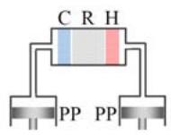  
(a) alpha

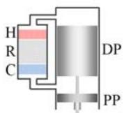  
(b) beta

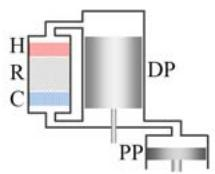  
(c) gamma  
Figure 1: Three basic types of arrangements of pistons in Stirling engines (C: cooler; R: regenerator; H: heater; DP: displacer; PP: power piston).

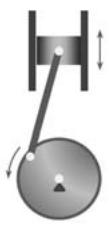  
(a)

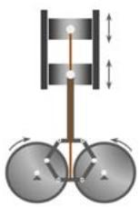  
(b)

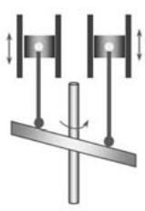  
(c)

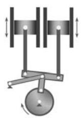  
(d)  
Figure 2: Kinetic drive mechanisms used for Stirling engines: (a) crank-slider drive; (b) Rhombic drive; (c) swash-plate drive; (d) Ross-yoke drive.

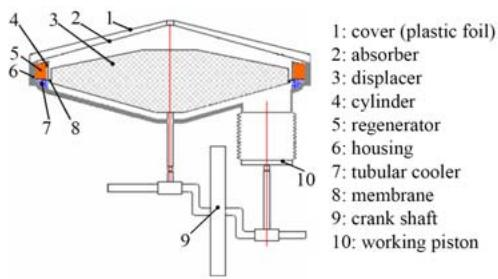  
Figure 3: Solar driven low temperature diferential Stirling engine by Boutammachte and Knorr (Reprinted from Boutammachte and Knorr [34], Copyright 2012 from Elsevier).

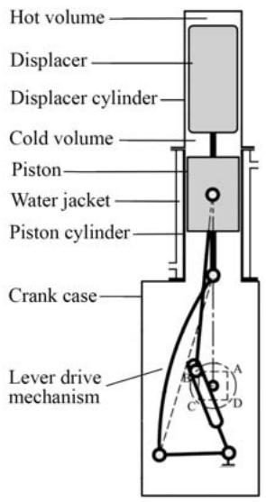  
(a)

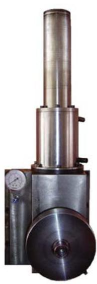  
(b)  
Figure 4: Lever-drive low and moderate temperature Stirling engine by Karabulut et al.: (a) schematic; (b) photograph (Reprinted from Karabulut et al. [38], Copyright 2009 from Elsevier).

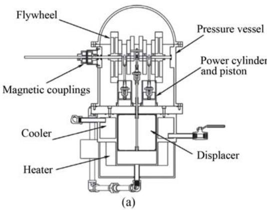

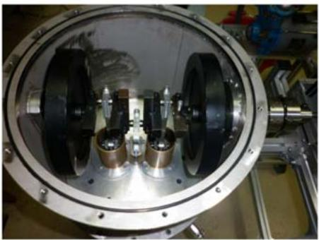  
(b)  
Figure 5: Twin power piston gamma-type Stirling engine by Chen et al.: (a) schematic; (b) photograph (Reprinted from Chen et al. [39], Copyright 2012 from Elsevier).

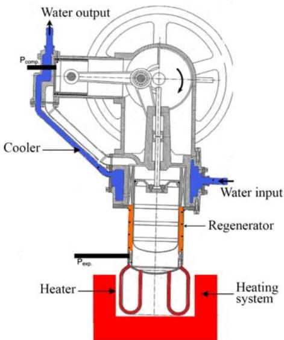  
Figure 6: Gamma-type Stirling engine used in Ref [42] (Reprinted from Gheith et al. [42], Copyright 2014 from Elsevier).

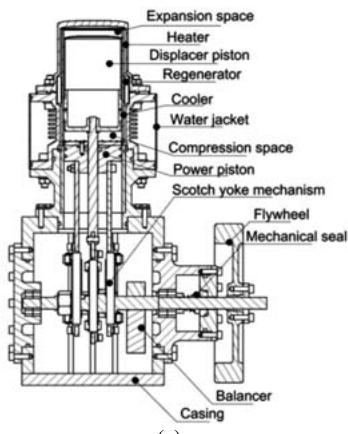  
(a)

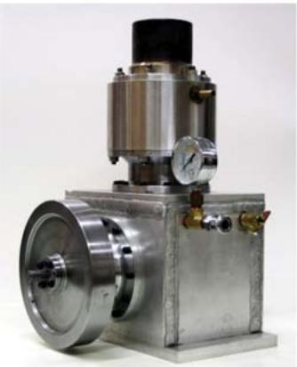  
(b)  
Figure 7: Moderate temperature Stirling engine by Sripakagorn and Srikam: (a) schematic; (b) photograph (Reprinted from Sripakagorn and Srikam [43], Copyright 2010 from Elsevier).

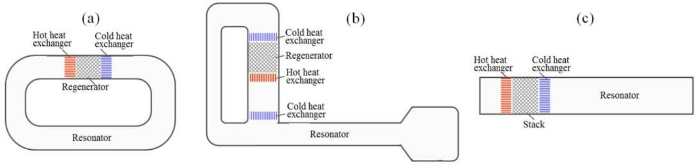  
Figure 8: Basic types of thermoacoustic engines: (a) looped type thermoacoustic Stirling engine (pure traveling wave type); (b) Loop-branched thermoacoustic Stirling (traveling-standing wave hybrid type); (c) standing-wave thermoacoustic engine.

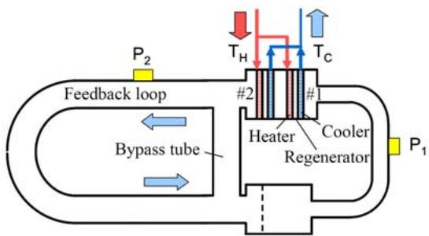  
Figure 9: Low operating temperature thermoacoustic Stirling engine proposed by de Blok (Reprinted from de Blok [82], Copyright 2008 from Acoustical Society of America).

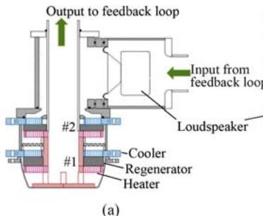

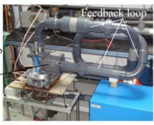  
(b)  
Figure 10: Thermoacoustic Stirling electric generator using two cores (Reprinted from de Blok [83], Copyright 2013 from Aster Thermoacoustics).

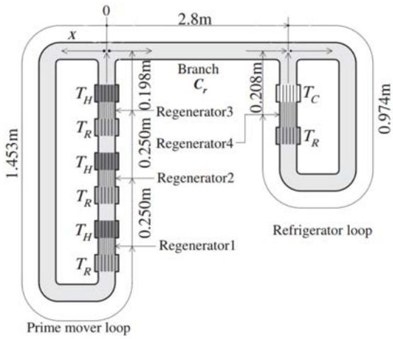  
Figure 11: Thermoacoustic refrigerator driven by multi-core thermoacoustic Stirling engine (Reprinted from Hasegawa et al. [84], Copyright 2013 from Elsevier).

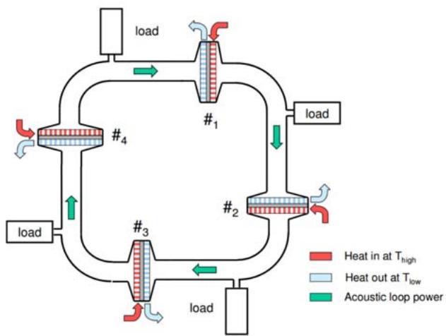  
Figure 12: Four-stage thermoacoustic Stirling engine proposed by de Blok (Reprinted from de Blok [60], Copyright 2010 from ASME).

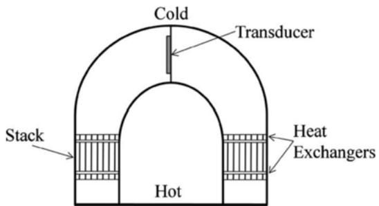  
Figure 13: Standing-wave thermoacoustic engines driving a unimorph piezoelectric transducer (Reprinted from Jensen and Raspet [87], Copyright 2009 from Acoustical Society of America).

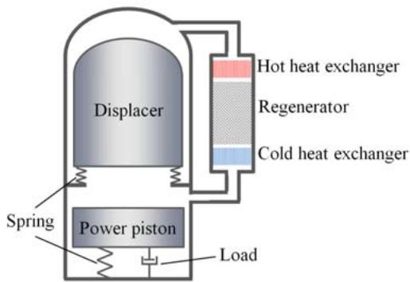  
Figure 14: Typical configuration of free-piston Stirling engines.

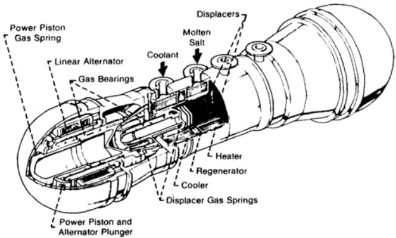  
Figure 15: 25 kWe-scale free-piston Stirling engine for space power generation (Reprinted from Dochat [93], Copyright 1987 from Elsevier).

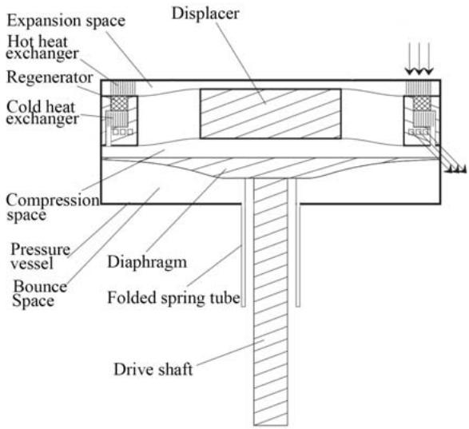  
Figure 16: Diaphragm Stirling engine built by Steiner and Archibald (Reprinted from Steiner and Archibald [95], Copyright 2013 from Elsevier).

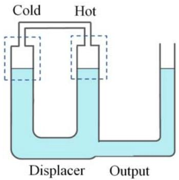  
Figure 17: Basic configuration of liquid piston Stirling engine (Fluidyne engine).

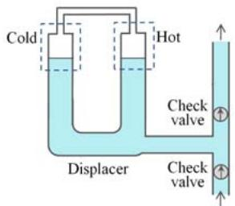  
(a)

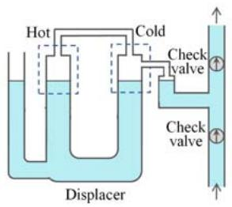  
(b)  
Figure 18: Basic concepts of Fluidyne pump: (a) liquid coupled; (2) gas coupled.

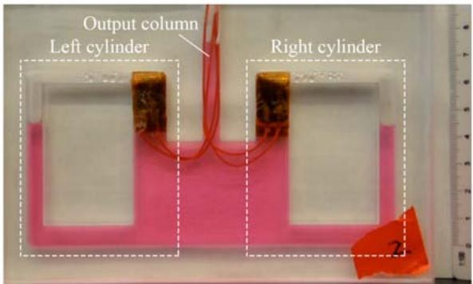  
Figure 19: An integrated, two-cylinder Fluidyne engine developed by Yang et al. (Reprinted from Yang et al. [115], Copyright 2014 from AIP Publishing LLC).

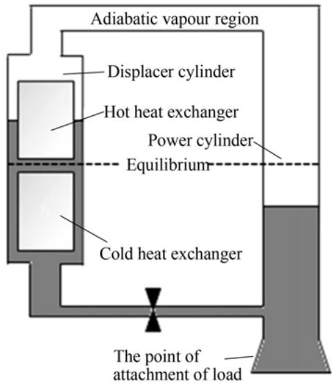  
Figure 20: Non-Inertive-Feedback Thermofluidic engine (Reprinted from Markides et al. [121], Copyright 2012 from Elsevier).

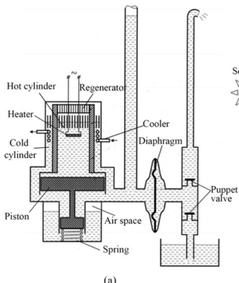  
(a)

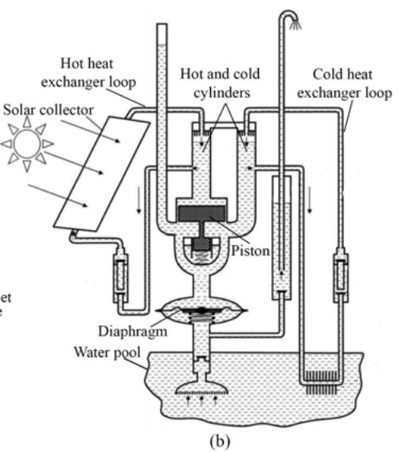

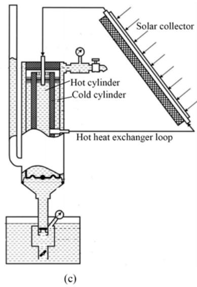  
Figure 21: Liquid piston Stirling water pumps built by Orda and Mahkamov: (a) first prototype: co-axial type; (b) second prototype: U-type coupled with solar collectors; (c) third prototype: co-axial type coupled with solar collectors (Reprinted from Orda and Mahkamov [126], Copyright 2004 from ASME).

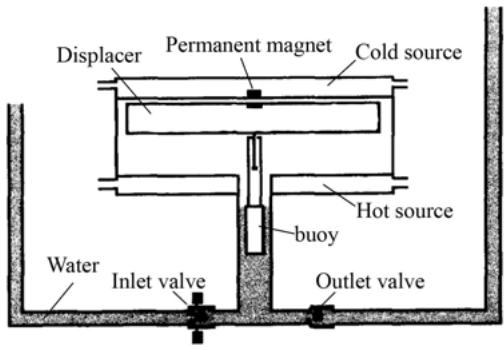  
Figure 22: Solid-liquid hybrid piston Stirling pump proposed by Kl¨uppel and Gurgel (Reprinted from Kl¨uppel and Gurgel [131], Copyright 1998 from Elsevier).

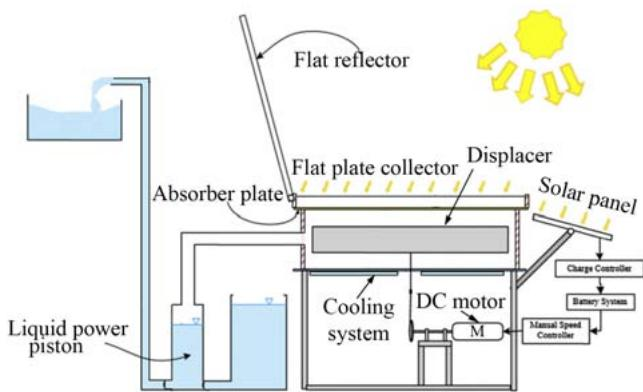  
Figure 23: Solar-powered active LTD liquid piston Stirling pump developed by Jokar and Tavakolpour-Saleh (Reprinted from Jokar and Tavakolpour-Saleh [133], Copyright 2015 from Elsevier).

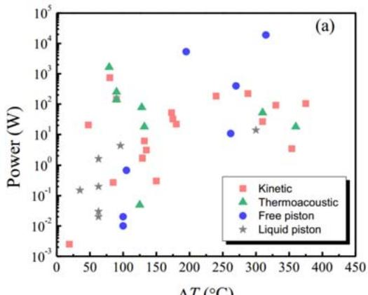  
∆T(°C)

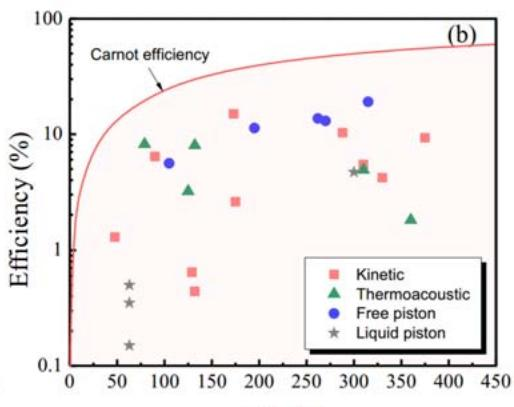  
∆T(C)  
Figure 24: Available experimental results of (a) power and (b) thermal eficiency of the developed Stirling cycle engines.
