<!-- MinerU 批次 1：原 PDF 第 1–150 页 -->

热声学

# -一种适用于某些发动机和制冷机的统一方法

G.W.Swift 著 罗二仓 译

# 凝集态物理和热物理研究组

# Los Alamos 国家实验室

第四稿

1999 年秋

LA-UR-99-895

2001 年 6 月

中国科学院理化技术研究所

## 目 录

序言....V
主要符号表....IX
第一章 绪论....1
1. 引言....1
1.1 长度尺寸....9
1.2 例子....12
    1.2.1 驻波发动机....12
    1.2.2 驻波制冷机....14
    1.2.3 热声斯特林发动机....14
    1.2.4 小孔脉冲管制冷机....17
1.3 常见的陷阱....17
1.4 热声学和常规技术....20
1.5 符号....22
1.6 计算(DeltaE)....25
1.7 动画....26
1.8 大纲....28
1.9 一般的参考资料....30
第二章 声波....31
2.1 无损失的声学 (理想的共振管)....31
2.2 大通道内的粘性和热的效应....38
    2.2.1 粘性阻力....38
    2.2.2 热驰豫传导....44
2.3 无粘边界层的热声学....48
2.4 基础热声学....51
    2.4.1 数学....51
    2.4.2 思路....57
第三章 声功....68
3.1 声功....69
    3.1.1 在时声功耗散....72

3.1.2 声功-普通热声学（μ=0）....75
3.2 总功....80
3.2.1 行波....86
3.2.2 驻波....87
3.3 对计算的一点看法....88
3.4 例子....90

第四章 效率....93
4.1 损失的有用功和熵产....93
4.2 火用....99
4.3 例子....106

第五章 超出 Rott 热声学理论以外的问题....110
5.1 弯弯曲曲的多孔介质....113
5.2 湍流....117
5.2.1 微小损失....122
5.3 进口效应和汇合条件....127
5.3.1 进、出口效应....127
5.3.2 连接、汇合情况....128
5.4 声流....135
5.4.1 Geoden 声流（直流）....137
5.4.2 Rayleigh 声流（瑞利声流）....143
5.4.3 喷射驱动的管内声流....147
5.4.4 回热器或者热声堆内的声流....149
5.4.5 人工声流....149
5.5 高次谐波和激波....157
5.6 无因次量....160
5.6.1 看法....162
5.6.2 经验的关联式....163
5.6.3 比例模型....163

第六章 硬件....165
6.1 首先，气体本身....165
6.2 热声堆和回热器....166
6.2.1 驻波....167
6.2.2 行波....172

6.3 热交换器....174
6.3.1 通常的布置....174
6.3.2 热声学的选择....176
6.4 热缓冲管和脉冲管....180
6.5 共振管....181
6.5.1 耗散....181
6.5.2 尺寸、重量和压力容器的安全....182
6.5.3 高次谐波的抑制....184
6.6 电声换能器....184

第七章 测量....190
7.1 简单的测量....190
7.1.1 压力和频率....191
7.1.2 平均温度....193
7.2 功率的测量....194
7.2.1 声功....194
7.2.2 热量....197
7.3 困难的测量....200
7.4 一些看法....200
7.4.1 自然的信赖....201
7.4.2 证据....203
7.4.3 性能....205
7.4.4 热声的观点....208

附录....220

驻波发动机

驻波制冷机

热声斯特和发动机

小孔脉冲管制冷机

索引....222

参考目录....231

## 序 言

我为最近在热声发动机和制冷机的功率密度和效率方面所取得的进展而激动，而且我还为热声学领域的最近的进展所吸引：即人工附加的稳态流动[1]以及利用振荡热扩散的方法来进行混合物的分离[2]。在晚上的时候，我经常梦想一个热声波被广泛应用的未来世界，其中一个梦想是：在Phoenix城，有一半家庭的屋顶上的热水加热器是线性电机驱动的热声热泵-而它屋里所产生的一点冷量则是一种很好的副产品。另一个梦想则是想像在我们当地医院后面的液氮杜瓦和液氧杜瓦附近有一个小的热声系统，这个系统有一个热声发动机，它是用燃烧的天然气来加热，然后，这个热声发动机驱动若干个脉冲管制冷机，用这个制冷机提供空气液化所需要的冷量，通过分馏液化空气生产出纯氧的纯氮，并将这些纯的气体液化贮存在杜瓦里。第三个梦想是有成百上千的燃烧驱动的热声天然气液化器排列在靠近海岸的场地上，这些设备是用天然气（甲烷）本身作为热声的工作气体，用这些设备液化出来的液化天然气则贮存在一个真空给热的超级贮槽里，运往遥远的岸上。还有一个梦是在火星上有许多的热声机械-一个由拉反主板驱动产生 声功的热声发动机，通过管道连接到热声混合分离器和热声制冷机上，它们将周围的二氧化碳和埋在地下的冰水分解成纯氢和纯氧，并进一步将纯氢和纯氧液化，用以供应这许多的围绕于为人类建筑的永久居所而奔忙的机器人的燃料电池。

这些梦是不同的，但它们有一些共同的特征，首先，它们看起来都是一些低技术工艺的硬件：大管子，热交换器；焊接的钢材，常见的壳管式的热交换器，成形的塑料等等。其次，我认识到这个简单性是靠不住的，因为设计这些易于制作的硬件和挑战性是巨大的，最后，没有人在这些梦里，因为我知道目前很少有人精于热声工程，于是我惊醒了，我害怕所有的这些在将来都不会发生，害怕集成的热声工艺工程是一个没有机会的东西，因此，我起床并写下了这本书的另外一些章节，希望能帮助新学者尽快地掌握基本的热声学，以使他们能继续设计、建造、调试各种各样具有惊人性能的热声系统。

这是一本介绍性的书籍，它并不包括当今热声领域的全面的工作，它是基于我在 1999 年 3 月在柏林声学会议所作的一个短期培训班的基础写成的。书中所用的用于解释基本原理的这里硬件是在LosAlamos 实验室研制的或者是与我们关系密切的合作者，而气体动力学和功论的数学处理方法则基本是按照热声学驱 N.Po 比的思路（时间的压力使得我选择我最熟悉的课题，Los Alamos 所采用的热声方法的确是相当成功的！）本书将介绍热声学的许多方面，并尝试帮助读者获得直观的理解以及设计、制作和调试一个硬件性能的能力。

在 Los Alamos，我们发现，在保持（主张）主张包括声学变量的相位分析（示图），气体运动的一种直观是引入注目的图解以及基于热力学第二之律的熵产观点的同时，集中精力实验和研究的硬件是一种最为有效的途径。直觉是很重要的，因为它可以帮助人们组织思想，而且它允许我们定量地构建和扩展我们知识，但是实验是一切真理的源泉，所以在 Los Alamos 实验是我们最重要和最费时间的工作（活动），在把直觉、数学以及实验结果编入本书时，我特别强调地数学，因为没有这个共同语言（词汇）我们哪里也去不了，此外，我将把直觉置于第二重要的地位，并在介绍（入门）性处理予以介绍，实验的结果则放在最后一位，但是请记住在这里所给出的数学及直观的讨论实际上基于是全世界各地在几十年里许多实验精华。

许多的读者将会发现，他们只具备学习热声学的部分背景、机械工程师放化学工程师也许没有足够的声学知识，这样他们学习一下由Kinslex 等人编著《基础声学》第5至 10 章的入门处理，相反，声学也许需要学习由 Van Wglen等人编著的经典热子基础的前半部分，而那些对表达式不熟悉的人需要从工程数学里复数运算开始化，例如由Kregszig 编著的《高等工程数学》，有许多的知识需要学习，所以请耐心一些。

目 前 ， 这 本 书 的 稿 可 以 自 由 地 复 制 ， 而 且 可 以 从www.Lanl.gov/thernoaconslrcs(由 Bill Ward, email ww @ Lanl.gov 维护)网站免费下载，切记同时下载本书及其书中的动画演示 没有动画的演示学习这本材料可能会困难而低效，就象不看图画学习工程文字一样，在网站上，这本书是Pdf格式的文档，它可以用Acroleat Reader软件来阅读和打印，第1 章至第6章的图片是彩色的，所以你可以用彩色打印机打印某些而。

当你发现本书有错误时，请你把这些错误告诉我，以便这本书将来的版本能避免读者们不必要的混淆，非常感谢Nate Weiland 已经发现了许多错误！

我们衷心地感谢美国能源部基础能源科学局（办公室）从 20 年前由刚 John wheatlej 第一次带给我们在基础热声学研究这一方向起一直稳定的、持久的和决定性的经费支持。与OBES/POE所支持的优秀的博士后们一起在 Los Alamos 研究这些振荡的热力学系统-Vince

Kotsu to, John Brisson, Jeff Oeson, Mike Hoyden, phile Spoor, BobHieler 以及 Scott Backhans，教会了我许多热声学的知识以及人们是如何研究这一困难的课题，Bill ward, Paved Gardner 以及 Chris Espinone的工程和技术创造力以及Biel 的高超的计算技巧是不可缺少的，这些促进了迅速的进展并使我们实实在在实验系统的热声学有很好的理解。

最后，感谢 Sharo Dogruel 灵机一动的、持持的鼓励和耐心，没有周末也没有假期，我希望我能保证这种事以后再也不会发生了。

Greg Swift, 1999

Email Swift @lan gov

## 主要符号表

方程的数字指出了变量的定义，这个变量最初的使用，或者这个变量在文中定义，如果第二个方程数字给出，澄清或者内容可能不同，MKS单也提供。

英文字母

A 面积，m2，Eq.(21)

a 声速，m/s， Eq.(1.10)加速度，m/s， Eq.(7.8)

B 磁场强度，T，Eq.(6.7)

b 和 k 依赖于 T 的指数，Eq.(5.76)单位质量的流动可用能，Eq.(4.16)

C 声容，m3/Pa，Eq.(2.3) 常数或函数，Eq.(1.27)

$C _ { 1 }$ 阀门流动系数，Eq.(5.34)

$c$ 单位长度的声容， m2/Pa， Eq.(2.77)

COP 性能系数， Eq.(1.6)

$C _ { \mathrm { p } }$ 单位质量的高压比热，J/kg.K，Eq.(1.14)

$D$ 直径，m，Eq .(5.43)

$\dot { E } _ { 2 }$ 声功，W，Eq.(3.2)

$e$ 连续方程中的因子，Eq.(2.80)，等于 2.71828

$F$ 函数， Eq. (2.16)力，N，在 Eq.(2.14)下面

f 频率，Hz，Eq.(1.13) 空间平均的热粘函数，Eqs. (2.55) (2.65) 磨擦因子，Eq.(5.13)

g 重力加速度， $\mathrm { m } / \mathrm { s } ^ { 2 }$ ，Eq.(6.5)

$\dot { H } _ { 2 }$ 总能流功率，W，Eqs. (3.18) (5.8)

$h$ 热粘函数，Eqs. (2.54) (2.67) 单位质量的焓，J/kg，Eqs. (2.54) (2.67)

I 电流，安培， Eq. (6.7)

i 虚数单位，等于 1 ，Eq. (1.7)J Bessel 函数， Eq.(2.60)j 电流密度，Amp/m2，Eq .(4.13)K 微损失系数，Eq. (5.28)k 热导率，W/m.K，Eqs. (1.14) (2.24)波矢，m-1，Eq.(1.39)弹簧常数，N/m，Eq.(6.8)L 声感， kg/m4，Eq. (2.6)电感，享利，Eq.(6.7)l 单位长度的声感，kg/m5，Eq.(2.73)长度，m，在方程(6.7)下面M 摩尔质量，kg/mol，Eq.(1.19)m 质量，kg， Eq.(6.8)湍流粘性耗散的乘数，Eq.(5.24)m 质量流密度， kg/s.m2，Eq.(5.63)$N _ { \mathrm { R } }$ Reynolds 数，Eq. (5.12) (5.14)n 丝网目数，通常为英寸-1, Eq.(5.10)p 压力，Pa，Eq.(1.7)Q 热量，J，Eq.(1.1)共振品质因子，练习 3.2, 6.12è 热传输速度，W，Eq .(4.1)q 热流密度，W/m2，Fig. 3.4R 声阻 Pa.s/m2，Eqs.(2.22), (2.37)电阻，欧姆，Eq.(6.7)机械阻力，kg/s， Eq. (6.7)半径，m气体常数，J/kg.K， Eqs. (1.19) (1.22)$R _ { \mathrm { u n i v } }$ 通用气体常数，J/mol.K， Eqs. (1.22) (1.23)r 单位长度的声阻，Pa.s/m4， Eqs. (2.74) (2.78)半径，m，Eq.(2.9)径向坐标，m， Eq.(2.60)S 熵，J/K, 方程(4.10)熵产率，J/K.s，方程(4.10)

表面积，m2，Eq.(2.22)

s 单位质量的熵，J/kg.K，Eq. (3.23)

应力，Pa，Eq.(6.3)

T 温度，K，Eqs. (1.3) (2.12)

t 时间，s，Eq. (1.7)

壁厚，m，Eq. (6.3)

U 体积流率，m3/s，方程 (2.1)

u 速度的 x 分量，m/s，Eqs. (1.8) (2.11)

V 体积，m3，Eq.(2.3)

电压，伏特，Eq.(6.7)

矢量速度，m/s，Eq.(1.35)

v 速度的 y 分量，m/s，Eqs. (5.78) (5.79)

W 功，J，Eq.(1.1)

W 机械功率，W，Eq.(4.1)

X 无用能，J，Eq.(4.21)

电抗，Ohm，Eq.(6.7)

机械阻抗，kg/s，Eq. (6.8)

X 无用能流率，W，Eqs. (4.21) (5.9)

x 声传播方向的，Eq.(2.1)

声传播方向位移，m，Eq.(2.1)

Y Neuman 函数，Eq.(2.1)

y 与声传播方面垂直的座标，m， Eq.(2.11)

z 声阻，Pa.s/m3，Eqs(2.7)(2.19) (2.34)

垂直声传播的方向的座标， m，Eq. (2.18)

比声阻，kg/m2.s=Pa.s/m，Eq.(2.84)

希字母

a 衰减常数，m-1, Eq.(1.18)

β 热胀系数，K-1，Eq.(3.19)

γ 等压的热与等容比热之比，Eqs.(1.20), (2.1)

Δ 大的差别，Eq.(2.1)

δ 穿透深度，m，Eqs.(1.14), (1.15)

小的差别，Eq.(4.9)单位张量，对 i=k 时为 1，对 i≠k 为 0，Eq.(5.2)ε 表面粗糙度，Eq.(5.25)单位质量的内能，J/kg, Eqs.(3.17), (5.3)n 效率，Eq.(1.5)θ 相角，Eqs. (5.50) (5.76)k 热导扩散率，m2/s，Eq.(1.14)λ 波长 m，Eq.(1.13)μ 动力粘度系数，kg/m.s，Eqs.(1.15), (2.14)v 运动粘度系数，m2/s，Eq.(1.15)任意变量，在方程(1.4) Eq. (5.63)下面湿周，m，Eq.(2.9)π 3.1459ρ 密度，kg/m3，Eq.(1.8)电阻率，欧姆，Ohm，Eq.(4.13)σ Prantl 数，Eq.(1.16)橡胶摩擦系数，N/m2 在 4.1 节的表中τ 转换系数，N/Amp=伏特/(m/s)，Eqs.(6.7)(6.8)φ 粘性耗散函数，s-2，Eq.(4.13)θ 相角，Eq.(1.27)体积孔隙度，Eq.(5.10)几何角度，Eq.(5.76)Rott 的连接函数，m3/s2，Eq.(5.47)ω 等于 2 f，角频率，s-1,Eq.(1.7)下标C 冷的，Eq.(1.2)H 热的，Eq. (1.1)h 水力的，Eq.(2.9)即r 为水力半径L 左边的，图5.11M 莫迪 Moddy, Eq. (5.20)m 平均的，Eqs. (1.7) (1.27)p 平行的，Eq.(2.23)R Reynolds, Eq. (5.14) (用 N )右边的，图5.11S 串联的，Eq.(2.23)

k 热导的，Eq.(1.14)V 粘性的，Eq.(1.15)0 “环境的”或“室温的”， Eq.(1.1)1 一阶的，Eqs. (1.7) (1.27)2 二阶的，Eqs. (3.2) (5.63)acoust 声学的，Eq.(6.9)crit 临界的，Eq.(2.45)dimless 无量纲的，Eq.(5.111)elec 电的，Eq.(6.7)entr 进口的，Eq.(5.42)gen 产生的，Eq.(4.10)mech 机械的，Eq.(6.8)ml 微损失的，Eq.(5.73)pt 脉冲管的，图2.19reg 回热器的，Eq.(5.69)trans 传感器的，Eq.(6.12)univ 通用的，Eqs.(1.22)(1.23)(R ≈8.3J/mol.K 是摩尔气体常数)

## 特殊的符号

Im[] 虚部的，Eq.(2.74)

Re[] 实部的，Eqs.(1.7), (1.28)

<> 垂直 x 进行空间平均化的，Eq.(2.16)

|| 复数的幅值，Eq.(1.29)

(.) 时间导数的，Eqs.(3.2)(5.64)，练习 4.15

(-) 时均运算的，练习2.1 和方程(3.7)

(\~) 复共轭运算的，练习2.1 方程(3.1)

## 第一章 绪 论

根据热力学，我们知道，热机（有时也称为原动机）吸收高温热源的热量产生功，而制冷机则消耗功产生泵热。这些设备如图1.1 所示，该图中间的圆圈代表设备，它们运行在两个不同温度的热源之间。对于热机，它从高温热源 $\mathrm { T _ { H } }$ 吸收热量 $\mathrm { Q _ { H } }$ ，在做功的同时将废热 $\mathrm { Q } _ { 0 }$ 排放到热源 $\mathrm { T _ { 0  } }$ 。对于制冷机，输入功将热源 $\mathrm { T _ { C } }$ 处的热量 $\mathrm { Q _ { C } }$ 吸入的 同时将废热 $\mathrm { Q } _ { 0 }$ 排放到热源 $\mathrm { { T _ { 0 } } }$

热学定律规定了这些设备的热效率极限。

热力学第一定律就是能量守恒定律，它表述为：如果设备处于稳定的运行状态，那么有多少能量进入系统，就必须有多少能量输出系统。因此，进入这些设备的总能量必须等于流出这些设备的总能量。

对于发动机，有：

$$
Q _ {H} = W + Q _ {0}\tag{1.1}
$$

对于制冷机，则有：

$$
Q _ {0} = W + Q _ {c}\tag{1.2}
$$

热力学第二定律则认为，整个宇宙的熵只能增大或保持不变，它不可能减小。这里的宇宙（有时称之为孤立系）包括三个东西：两个热源和设备本身。如果设备（热机）处于稳定的运行状态，那么它的熵是不随时间而变化的，而功是没有熵的。由于这个孤立系只包含两个热源，因此，对热机来说，低温热源的熵增 $\mathrm { Q } _ { 0 } / \mathrm { T } _ { 0 }$ 必须大于或者等于高温热源的熵增，即：

$$
\frac {Q _ {0}}{T _ {0}} \geq \frac {Q _ {H}}{T _ {H}}\tag{1.3}
$$

类似地，对制冷机，有：

$$
\frac {Q _ {0}}{T _ {0}} \geq \frac {Q _ {c}}{T _ {c}}\tag{1.4}
$$

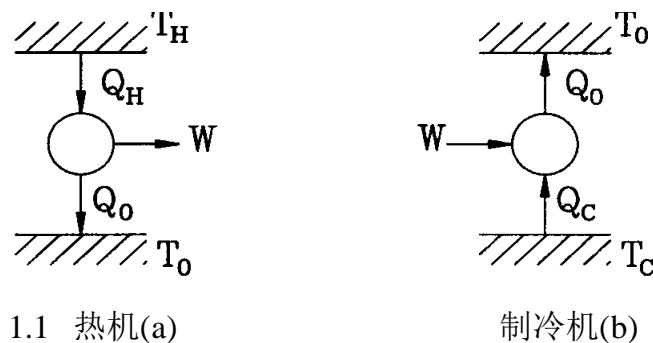  
图 1.1 热机(a)  
（图中给出能量流的方向和热源）

合并(1.1)、(1.3)两式消去不感兴趣的变量 $\mathrm { Q } _ { 0 }$ ，可以得到热效率的不等式，这个效率定义为得到的除以你所消耗的。

对热机来说，热效率等于产生的功除以热源提供的热量：

$$
\eta = \frac {W}{Q _ {H}} \leq \frac {T _ {H} - T _ {C}}{T _ {H}}\tag{1.5}
$$

在上式中，右侧的温比称为卡诺效率，它是所有热机中可能达到效率的上限。

类似地，对于制冷机，性能系数 COP 等于制冷量除以所消耗的功：

$$
C O P = \frac {Q _ {c}}{W} \leq \frac {T _ {c}}{T _ {H} - T _ {c}}\tag{1.6}
$$

上式中，右侧的温比称为卡诺制冷系数COP，它规定了所有制冷机实际性能系数COP的上限。

现实中，图 和图 中的设备通常是采用一种理想气体或者其它的液体通过一个或几个热力循环来实现其功能。图1.2 中的卡诺循环是卡诺用来导出著名的卡诺效率极限所采用的循环，这个循环是教科书中喜欢采用的一个例子，因为它宜于分析并且可以达到最高的可能的效率。Stirling（斯特林）循环也能达到卡诺效率，但是这里我们不想推导理想的 Stirling 循环或者教科书中的其它循环，因为真正的 Stirling发动机和制冷机[8、9、10]是如此的复杂。象卡诺循环一样，Stirling循环本身仅是一种学术兴趣。在真正的Stirling机器里，不同部位的气团经历了完全不同的热力循环，如 Ani Tashe/a 所展示的那样，这个动画展示了一个两活塞的 Stirling 发动机，它具有运动的活塞，依靠活塞推动气体进行压缩，向右移动、膨胀和向左移动的热力循环。在两个活塞之间是两个热交换器，用不同的颜色来表示两个活塞，温度分别为 $\mathrm { T _ { H } } { = } 6 0 0 ^ { \circ } \mathrm { C }$ 和 $\mathrm { T } _ { 0 } { = } 3 0 ^ { \circ } \mathrm { C }$ 。两个热交换器之间是回热器。两个活塞上面的椭圆是“指示器”，用于跟踪每一个活塞的压力随体积的变化情况，而蓝色椭圆区的面积则是这部分气体在一个循环内所做的净动W。在每个热交换器下面的红色箭头则表明了在一个循环中这部分气体传出或吸入的热量 $\mathrm { Q _ { H } }$ 和 $\mathrm { Q } _ { 0 }$ 。在回热器内三条运动的蓝颜色和竖线标志着三块运动的气团。包括活塞的端面在内，这幅动画清楚地表明，与热机的长度相比，这些气体的运动幅度是很小的。一个典型的气体微团，例如由中心的一条蓝色竖线所指示的一个，它从不会与任何一个换热器相接触，因此它的热力循环是不可能象教科书中关于热机的分析来进行的，此外，气体的运动和压力随着时间光滑的变化关系完全与教科书中把它分成4 个分离的步骤不同。

因此，经典热力循环四步骤的存在意味着在两个或更多个现象之间需要有合适的相位。在图1.2所示的卡诺循环里，相关的现象是压力的变化和与热源的热接触，这种机制来源于工作介质与热源的热接触得到进行以及断开，这是值得我们作进一步的考虑和想像。通常的热机和制冷机（例如Stirling）是同时用两个活塞来产生压力的变化，并推动工作气体通过热交换器。气体压力变化的相位以及与热交换器的热接触是由两个活塞的运动来决定的，如 Ani Tashe/a 所显示的那样。而热声发动机和制冷机则是用气体的运动来控制热交换器内气体的热接触情况，运动和压力之间的相位则是由声场来决定的。

图 1.3 给出了一个世纪以前一台典型的Stirling发动机的设计图。它有许多的远动部件：转动的曲柄、运动的连杆和往复运动的活塞。在这个早期的 Stirling 机器中，从体积、重量及可见的印象方面看，机械零件占据了主要的热力部件。

在这世纪交替的年代里，工程师们一直在寻求通过消除运动部件来简化这样的发动机和制冷机。1969 年，William Beale 考虑了运动活塞由于气体可压缩性产生的反弹所导致的共振效应，而且他还认识到在正确设计的情况下，作用在连杆上的力是很小的，与此同时，活塞仍能继续正确的运动，这个发明导致了所谓的自由活塞 Stirling 发动机和制冷机的出现，如图1.4所示。在这张图里，运动的活塞在共振的情况下被气体弹簧所弹回，因而另外的运动部件如连杆和曲杆轴被取消了。另外一种消除运动部件的方法是液体活塞 Stirling发动机，被称之为 Fluidyne 发动机[13]，如图 1.5 所示。在 Fluidyne 发动机里，两段 U型管里的液体作为常规Stirling发动机的两个活塞，用于限制和推动气体，这一共振现象与自由活塞 Stirling 发动机类似，但是重力和液体的密度对共振的有效弹簧常数有贡献。更近一些，PeterCeperley[14,15]认识到 Stirling 机器内热力元件中压力和速度的相位与行波声场中压力和速度的相位相同，因此他提出了采用声学的手段来控制气体的运动和压力，以消除所有运动（除了工作气体之外）部件。图 1.6 给出了这样一个装置，它有两个热交换器和一个回热器，但没有活塞或其它任何运动部件。

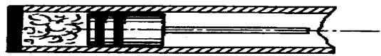

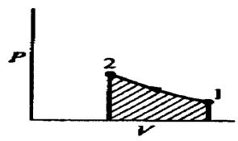

(a)  
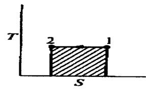

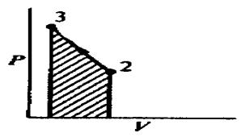  
(b)

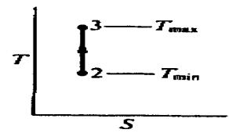

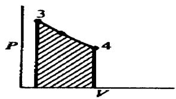

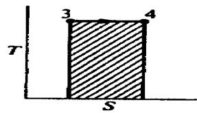  
(c)

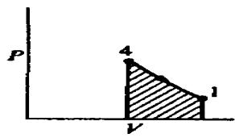

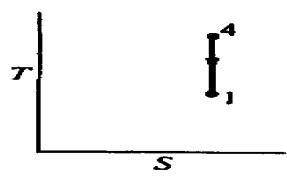  
(d)

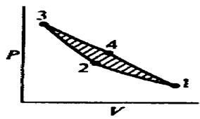

(e)  
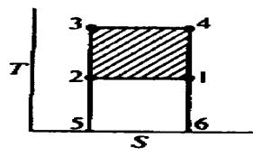  
图 1.2 卡诺机和循环

(a)-(d)是四个独立的步骤，分别是等温压缩、等熵压缩、等温膨胀和等熵膨胀。图(e)为(a)-(d)四个步骤组成的一个完整的热力循环，PV图所包含的面积为热机所产生的净功。本图从Walker[8]复制。

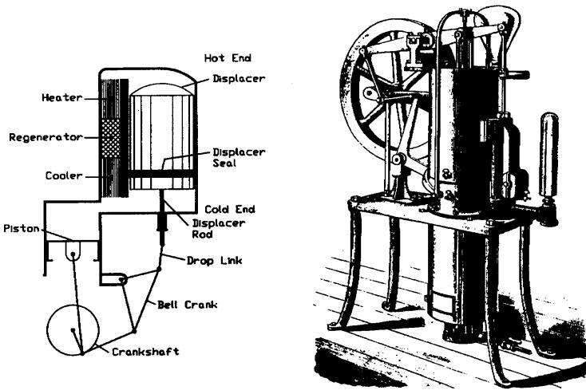  
图 1.3 早期的 Stirling 热机（从 Senft[11]复制）

Ceperley的工作表明，在 Stirling这样一个若干重要变量如压力p和速度 u的变化都强烈且连续地依赖于气体运动位置的装置中，需要考虑其声波的行为，除了气体流动阻力的效应外，还有气体的惯性和压缩效应。

简单声波的行为是容易得出的。在声学里，我们经常用复数记号来表达随时间作正弦变化的量，例如压力。

对压力 $p$ ，把它表示为平均压力 $p _ { m }$ 加上一个复数与 $e ^ { i w t }$ 乘积的实部。我们将用这种记号贯穿于全文。

$$
p (x, t) = p _ {m} + \mathrm{Re} [ p _ {1} (x) e ^ {i \omega t} ]\tag{1.7}
$$

对沿X方向传播的声波，最简单的声学关系式可以从三个简单的方程开始。

第一个方程是动量方程：

$$
i \omega \rho_ {m} u _ {1} = - \frac {d p _ {1}}{d x}\tag{1.8}
$$

上式表明，作用于气团上的力是压力梯度，按照牛顿定律它必须等于质量密度与加速度的乘积。

第二个方程是连续性方程：

$$
\mathrm{i} \omega \rho_ {1} + \rho_ {m} \frac {d u _ {1}}{d x} = 0\tag{1.9}
$$

它表达了质量守恒定律，即在任一点密度随时间的导数，来源于质量的密度梯度。

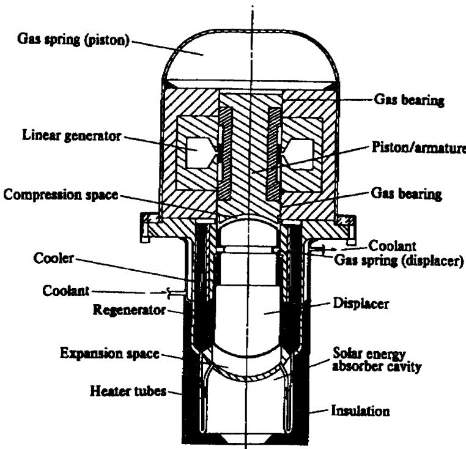  
图 1.4 典型的自由活塞斯特林发动机。从Walker[8]复制

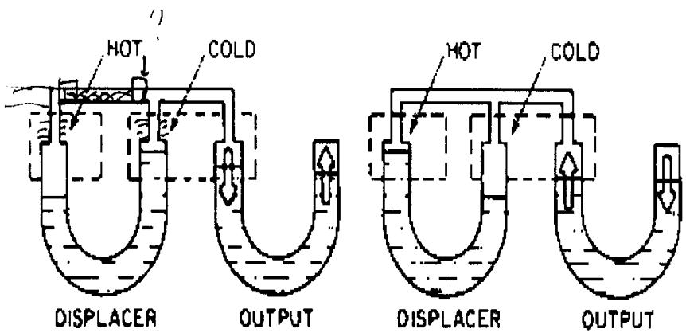  
图 1.5 Fluidyne（液体）斯特林发动机，从 West[13]复制。

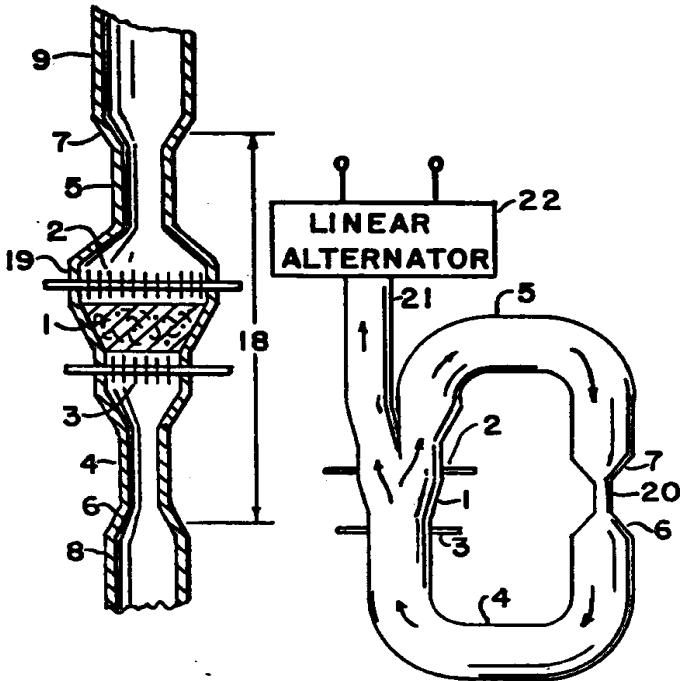  
图 1.6 行波发动机的概念，从Ceperley的专利复印。

第三个方程是气体状态方程：

$$
\frac {p _ {1}}{\rho_ {1}} = \left(\frac {\partial p}{\partial \rho}\right) _ {s} = a ^ {2}\tag{1.10}
$$

它给出了比例常数 $a ^ { 2 } \cdot$ -声速的平方。在绝热条件它联系着压力变化与密度变化。把这三个方程合并，消去 $u _ { I }$ 和 $p _ { I }$ 可得到一个简单的波动方程：

$$
p _ {1} + \frac {a ^ {2}}{\omega^ {2}} \frac {d ^ {2} p _ {1}}{d x ^ {2}} = 0\tag{1.11}
$$

其解是x 的正弦和余弦函数。严格地讲，这是一个Helmholtz方程，因为时间导数被写成了 $\omega _ { s } ^ { \prime }$

这个简单的波动方程适用于空间温度均匀而在时间上作绝热变化的平面波。换一种方式讲，即气体的平均温度不随x 的变化而变化，而且声波振荡时气体与其环境没有热交换。令人吃惊的是，仅仅在

30 年前，人们才导出在声波传播方向有温度梯度且气体与管壁有显著的热交换条件下的正确的声传播方程，这个方程如下[17]：

$$
[ 1 + (\gamma - 1) f _ {k} ] p _ {1} + \frac {\rho_ {m} a ^ {2}}{\omega^ {2}} \frac {d}{d x} \left(\frac {1 - f _ {\mu}}{\rho_ {m}} \frac {d p _ {1}}{d x}\right) - \frac {a ^ {2}}{\omega^ {2}} \frac {f _ {k} - f _ {\mu}}{1 - \sigma} \frac {1}{T _ {m}} \frac {d T _ {m}}{d x} \frac {d p _ {1}}{d x} = 0\tag{1.12}
$$

它是在 1969 年由N.Rott发表的，你可以观察到方程(1.11)的部分项存在于这个方程中，而这个方程的系数 $f _ { k }$ 和 $f _ { u }$ 来源于气体与管壁的热粘作用。

通常我们将方程(1.11)和(1.12)描述的声波称为压力和速度耦合的小振幅声波。对于令人很难受的声音，例如 120db（分贝），相当于 $2 0 ~ \mu \mathrm { P a }$ ，是一种微小的振荡，因为 $\left| p _ { 1 } \right|$ |约等于 $0 . 0 0 0 2 p _ { m }$ 。幸运的是，对于热声发动机和热声制冷机所碰到的大幅度振荡，这些方程也仍然是基本合理而准确的。在热声发动机和热声制冷机里，典型的振荡$| p _ { 1 } | \ – 0 . 1 p _ { m }$ ，此时 $\left| p _ { 1 } \right|$ |高于 $1 0 ^ { 5 } \mathrm { P a }$ ，相当于 195dB。

在本书里，我们尝试通过物理的、数学的以及直觉的手段，把上述的线索聚合成一幅连贯的图像。我们尝试采用Rott所发展的数学方法以及 Beale、 West，特别是 Ceperley 的工作来阐述这些热机和制冷机的物理图像。这些热机和制冷机的特点在于尽可能消除运动部件以获得高度简单的机构，但同时仍能保持最高的可能的热效率。

正如图 1.7所描述的那样，这样的聚合将会涉及到气体所占据的空腔，它们可能是决定气体运动和压力关系的声学共振器，可能是与外热源进行换热的热交换器，以及在热交换器之间作为驻波型热声发动机的热声堆或者作为热声斯特林机器的回热器。

有一点可以说，热声机器比基于曲轴运动的系统更令人感兴趣。这些曲轴系统如图1.3所示的那样，它们的部件的运动完全可以由设计来确定，气体的运动则由直接施加的控制来决定。但在热声系统里，包括线性电机、自由活塞 Stirling 系统在内，振荡的压力梯度导致振荡的运动，而振荡的运动又导致振荡的压力梯度，分析这样互相耦合作用的动力系统是极富有挑战性的。

$$
\begin{array}{r l} & \text {   } + \text {   Rott   } + \text {   Beale   } + \text {   West   } + \text {   Ceperley   } + \dots \\ & = \text {   Thermoacoustic   engines   and   refrigerators   } \end{array}
$$

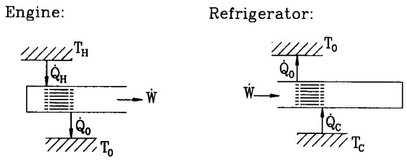  
图 1.7 本书所考虑的设备的各种类型

## 1.1 物理尺度

在热声波发动机和热声制冷机里，重要的长度尺度如图1.8 所示。在沿声波的传播方向x 上（气体的运动方向），声音的波长为：

$$
\lambda = \frac {a}{f}\tag{1.13}
$$

这里f是声波振荡的频率。波长是一个重要的尺度，当气体的惯性提供共振特性时，装置的总长在典型的情况下是半波长或者四分之一波长，但是当质量很大的机械部件参与有意义的共振特性时，像自由活塞 系统内，系统的尺寸通常远小于声波长。在所有的情况下，换热器部件的长度远小于声波长。

另外一个在 x 方向上的重要的长度尺度是气体的位移幅度|x1|，它等于气体的速度除以声波的角频率 $\omega = 2 \pi f$ 。气体的位移通常为热声堆或者回热器长度的几分之几，而且可能比在热声堆或回热器两端的换热器的长度大。气体位移总是小于声波长的。

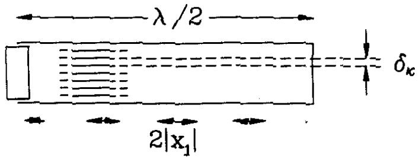  
图 1.8 热声装置中重要的物理尺度

在垂直气体运动的方向上，特征尺寸是热穿透深度和粘性穿透深度：

$$
\delta_ {k} = \sqrt {\frac {2 k}{\omega \rho c _ {p}}} = \sqrt {\frac {2 \kappa}{\omega}}\tag{1.14}
$$

$$
\delta_ {\mu} = \sqrt {\frac {2 \mu}{\omega \rho}} = \sqrt {\frac {2 \nu}{\omega}}\tag{1.15}
$$

k和 k是气体的热导率和热扩散率， $\mu$ 和 v 是气体的动力黏度及运动黏度， $\mathrm { C _ { p } }$ 是气体的定压比热。这些特征尺度告诉我们声波振荡在π分之一个周期的时间内横向上热量和动量能扩散多远。对于远离固壁的气体，它与固壁边界的距离远大于这些穿透深度，因此，声波感觉不到与固壁有热的交换或者粘性的交换。对于横向尺寸与这些穿透深度相当的部件，其中的气体则会同时感觉到边界层的热粘效应。

显然，热声系统中的热交换器的横向尺度应与热穿透深度相当或更小，以保证工作气体的热交换。

这两个穿透深度比值的平方：

$$
(\frac {\delta_ {\mu}}{\delta_ {k}}) ^ {2} = \frac {\mu c _ {p}}{k} = \sigma \leq 1\tag{1.16}
$$

上式中频率和密度被消去，剩下粘性乘以热容再除以热导率，这个比值称作气体的普朗特数（Prandtl Number）。对通常的气体，普朗特数接近1，因此粘性穿透深度和热穿透深度是相当的，这样，热声发动机和制冷机总是伴随着很大的粘性效应。

在日常的可听声学里，气体的位移远远小于热穿透深度和粘性穿透深度，当然就更小于声波长了。在热声发动机和热声制冷机里，气体的位移通常远大于这两个穿透深度，但仍远远小于声波长，即：

$$
\delta_ {k} <   <   \left| x _ {1} \right| <   <   \lambda\tag{1.17}
$$

顺便指出，对无界声波的体衰减系数的标准表达式，可以容易地用粘性穿透深度和热穿透深度表达出来。从Kinsler 等人所著（3rd ed）[3]中的方程 7.36 可得：

$$
\alpha = \pi^ {2} \frac {\omega}{a} [ \frac {4}{3} \frac {\delta_ {\mu} ^ {2}}{\lambda^ {2}} + (\gamma - 1) \frac {\delta_ {k} ^ {2}}{\lambda^ {2}} ]\tag{1.18}
$$

上式中， 是等压比热与等容比热之比。从上式可以看出，如果

粘性穿透深度与声波长相比很小的话，那么声波由于粘性作用的体衰减是很小的。同理，如果热穿透深度与波长相比很小的话，那么声波由于热扩散所导致的衰减也是很小的。热穿透深度及粘性穿透深度与波长之比与频率有显著的依赖关系，因为波长正比于 $1 / f ,$ 而穿透深度正比于 $1 / f ,$ ，因此，低频长波的无界衰减不大。然而，由于热声发动机和制冷机中共振器、热交换器的固体边界的存在而由此引起的边界层的衰减远远超过无界空间的体衰减。

为了尽快地简单地估计一下有关的热声尺度，记住一些理想气体的关系式是有益的。

$$
p = \rho R T\tag{1.19}
$$

$$
a ^ {2} = \gamma R T\tag{1.20}
$$

$$
c _ {p} = \frac {\gamma}{\gamma - 1} R\tag{1.21}
$$

$$
R = R _ {u n i v} / M\tag{1.22}
$$

以及一些常数，

$$
R _ {u n i v} \approx 8. 3 1 4 J / m o l. K\tag{1.23}
$$

$$
\mu \approx (2. 0 \times 1 0 ^ {- 5}) (\frac {T}{3 0 0}) ^ {0. 7} (k g / m. s)\tag{1.24}
$$

$$
\gamma \approx 5 / 3 \mathrm{对单原子气体}; 7 / 5 \mathrm{对双原子气体}\tag{1.25}
$$

$$
\sigma \approx 2 / 3 \quad \text {对纯气体；对混合物，更小一些}\tag{1.26}
$$

再加上方程(1.16)、(1.13)、 (1.15)及(1.14)对 $\sigma$ ， $\lambda$ ， $\delta _ { \mu }$ ， $\delta _ { k }$ 的定义式。

在上述方程中，R是单位质量的气体常数（对每一种气体是不同的）。 $R _ { u n i \nu }$ 是通用气体常数，M 是摩尔分子量， 是等压比热与等容比热比。

## 1.2 例子

几乎在本书的每一个章节，我都要反复使用四个相同的热声机械的例子，这里简要地介绍一下它们。在后续的章节中，我们在合适的地方还要更为仔细地研究考查它们的不同方面，把这些页作一下标记（用夹子或胶带等），以便你可以容易地再找到它们作为参考。这四个例子包括两个发动机和两个制冷机，它们是两个驻波系统和两个行波系统，其中的两个处于研究阶段，而另两个系统则是将热声通向更为实用阶段的系统。本章简要地介绍一下这四个例子，并讨论一下它们的目的、整体的功能以及特征尺度（关键尺寸）。

## 1.2.1 驻波型热声发动机

这个驻波发动机是泰克公司在 1994 年研制的热驱动的低温制冷机的一部份，如图 1.9、1.10 所示，这个系统的研制目的是为了给电子元件提供一个小冷量的低温制冷。采用烧红的电加热器来驱动，因而这个系统没有任何运动部件。共振管水平地位于这些图中，在它的两端是两个驻波型的热声发动机，靠右侧一端向上的部份与一个两级的脉冲管制冷机相连接，水冷却的管线可以从图 中边缘伸出的部份看到，它把发动机和制冷机的废热排走。本书里我们关注的焦点是这台热驱动的发动机和共振器能输出达到 1KW 的声功给脉冲管制冷机。在合适的工况点，这个热声发动机能以23%的卡诺效率输出500W的声功给脉冲管制冷机（这里的效率是用输出到脉冲管制冷机的声功除以两个发动机加热器上的加热量，温度是用加热器的温度和冷却水的温度），我们希望制造的这个系统尽可能的小巧而且高效，这样它所需要的电功率可以从通常的墙壁上的插座供给，工作气体是 30 个大气压的氦气。氦气在室温下的声速大约是1000 米/秒左右。图1.9、1.10 中共振管的长度大约为1米，因此你可以预计到在这个系统中的半波长共振器的共振频率会接近500Hz。实际情况中，这个系统运行在 350Hz，在这个压力和频率条件下，氦气的热穿透深度大约为0.2mm。相应地，热交换器部件的间距大约为1mm。

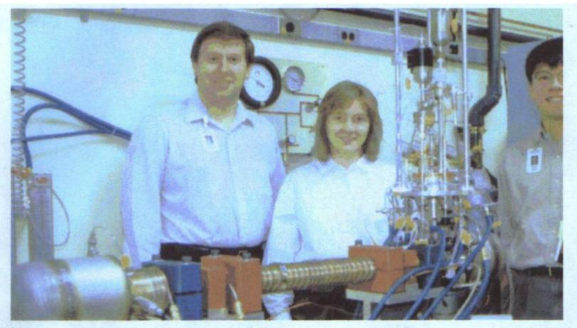  
图 1.9 驻波发动机的例子

泰克公司研究的一个热驱动的制冷机，1995。共振器是水平放置的，在它的每一端有一个驻波型的热声发动机，在右端是一个垂直放置的两级脉冲管制冷机，站在中间的是Kim Godshalk。

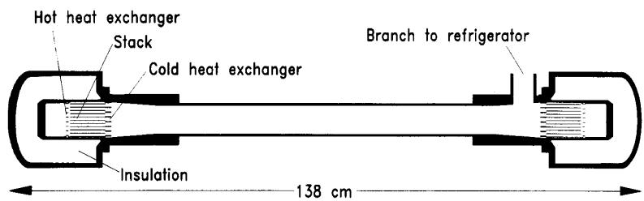  
图 1.10 泰克公司的共振管和驻波发动机的比例图

“冷”的热交换器处于环境温度，在每一端的圆环形的空腔是绝热部分，热声堆和换热器的间距没有按比例给出，在右端向上开口的部分是与两级脉冲管制冷机的接口。

在这个和其它一些驻波发动机里，关键的思想是热声堆里的气体在压力变高时要经历热膨胀而在压力变低要进行热收缩，因此对每一次声循环，在热声堆里的气体都做功，它以驻波的形式产生声功。 这个驻波交替地提供振荡的压力和振荡的运动，用于引起热声堆内的气体经历一个振荡的温度，此振荡的温度导致热膨胀和热收缩，在沿着热声温度梯度方向上，气体的运动速度与压力的相位不同相，为90，这样气体与热声堆之间不完全的热交换是必需的，以保证热膨胀和热收缩与振荡的压力是同相的，当热声堆热端温度较高时，这些复杂的相互耦合的振荡同时出现。

## 1.2.2 驻波制冷机

图 1.11和 1.12 所示的驻波型制冷机是Bob Reid 建立的，它是用来研究一个驻波型热声制冷机的振荡流动，再叠加上一个稳定的直流的工作情况。这个制冷机用四个扬声器驱动，被图1.11 显而易见的铅架所包围。左边和右边的一对扬声器以 ℃的相位运行，在一个实质上为一个全波长的弯管回路里产生一个驻波。在共振器的顶部和下部的中央是压力的节点，靠近扬声器的部位是压力腹点。

在这个共振系统中充入3个大气压的92%氦+8%氩的混合气，其共振点出现在 94Hz.。通过热交换部件，从顶部到底部引入一个稳定的混合物的流动，使其叠加在热声振荡上，在共振器底部的压力产生制冷并离开共振器（注：通过一个热交换器和风机又返回到上部的压力节点），热交换器部件的换热间距大约为 ，比这种气体的热穿透深度大几倍。

在这个和其它驻波制冷机系统中，关键的思想是热声堆中的部分气体经历绝热的温度振荡，与这个驻波系统中振荡的压力同相，而振荡位移又与压力振荡同相，因此，在图 1.12 中当气体往下运动时，它只受到微小的冷却，而往上运动时，也只稍微热一些，不完全的热交换保证在运动的两个极端位置进行（在这个特殊的装置中叠加上的稳定流动远远小于驻波的振荡速度，我们将在第 章中讨论） 。

## 1.2.3 热声斯特林发动机

图中 和图 所示的热声斯特林发动机是作为行波发动机的例子，它是Scott Backhaus 建立的用于验证没有运动部件的斯特林循环的热力学 一个混合的热声斯特林发动机，用以研究影响效率的各个方面[20,21]。热量采用电加热的方式提供，而废热用冷却水带走，发动机产生的声功率输出到共振器，部份声功耗散在共振管中，但大部份声功则输出到一个可变的声负载上，如图 1.13 靠近中部的那个小的垂直的园桶。这个发动机可以以42%的卡诺效率输出声功到共振器。这里的效率是采用输出到共振器至接头的右侧的声功与发动机所用的电热量，温度用热端换热器的温度和冷却水的温度。包括换热器在内的弯曲回路里微小的稳定流动的抑制是获得高效率的关键，这一点我们将在第 5 章中加以讨论。这个系统充入 30 个大气压的氦气，在 80HZ下发生振荡。这个共振器基本上是一个二分之一波长的装置，在共振器右端扁平的末端与左端包括换热器在内的弯曲通道的压力相位相差180℃左右。

这个系统和其它行波系统的关键思想是，当压力升高时，回热器内的气体经历热膨胀过程，而当压力下降时，回热器内的气体要经历热收缩的过程，因此，对每一个声循环，回热器内气体都要做功，产生的声功进入声波之中，这个声波依次提供两个东西，振荡的压力和振荡的运动以促使回热器内气体热膨胀和热收缩过程。在回热器热端温度足够高时，这些复杂的相互耦合的振荡同时出现。沿着回热器的温度梯度方向，气体的运动速度实质上与压力振荡同相，因此回热器与气体之间良好的热交换是保证热膨胀和热收缩与压力同相的必要条件，这个良好的热交换可以通过使回热器通道的尺寸远小于热穿透深度来达到。

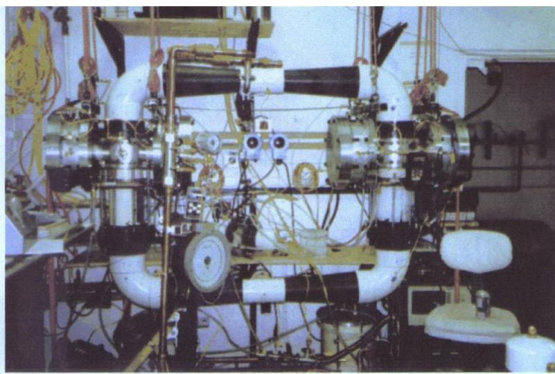  
图 1.11 驻波制冷机的例子

(扬声器驱动的研究装置用于研究一个外加的直流在振荡的热声流的工作情况。)

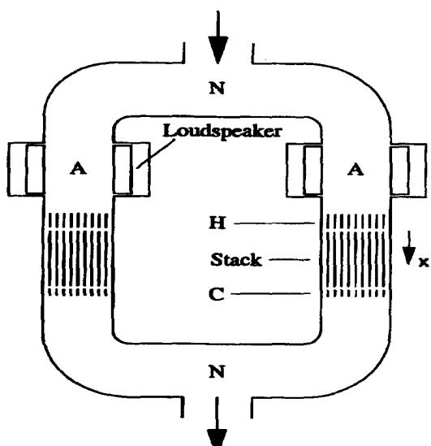  
图 1.12 驻波制冷机的原理示意图  
(用 $^ { 6 6 } \mathrm { H } ^ { \prime \prime }$ 标注的热交换器通过水冷却而保持在室温。)

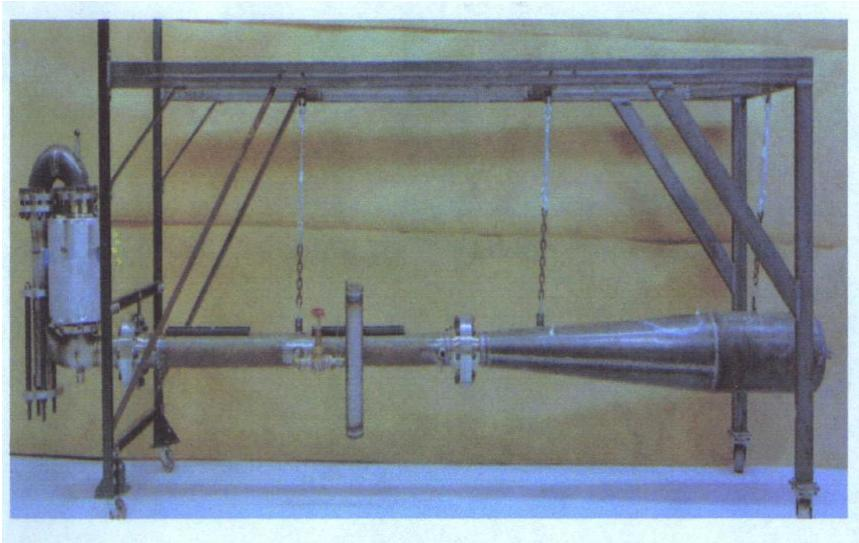  
图 1.13 行波发动机的例子，一个建于Los Alamos 用于初步研究热声斯特林发动机的装置。

## 1.2.4 小孔脉冲管制冷机

最后，图 1.15 和图 1.16 中所示的小孔脉冲管制冷机是一个行波制冷机的例子，它由 Cryenco 公司建立，用于天然气的液化[22，23 ]。在 3 个大气压下，天然气（甲烷）在120K液化，这个制冷机在120K提供了 2kW 的制冷量，COP 达到了卡诺循环的 23%。这里的 COP是用从甲烷取走的热量除以图中提供给冷却器后的声功，所用的温度是液化的甲烷的温度和冷却水的温度。热声系统的工作气体是 30 个大气压的氦气，该制冷机由一个 40Hz 的热声发动机通过其共振器来驱动，热声发动机在本图中没有显示出来。图中所示部件的尺寸远远小于声波的波长25m。

本例和其它的斯特林、脉冲管或行波制冷机的关键思想是，靠近冷端换热器的气体必须移动到脉冲管或者冷端活塞的空间，并且被绝热地冷却，然而通过冷端换热器返回，在冷端换热器吸收负荷的热量，这里的声波必须提供所需相位的振荡压力和振荡的位移。

## 1.3 常见的不足（缺陷）

在建立了很多热声发动机和制冷机并帮助别人建了更多的机器的过程中，我不至一次犯过和看到过一些人为的错误。在今后，应尽力避免在热声学和所有的研发实验中的再犯这些错误。

计算机中毒：不要花过份多的时间用计算机模拟设备，你必须留出足够多的时间来设计实际的硬件，加工、组装、测量、有意义的调试和反复多次工作。

多个供应商的网络：你必须依赖于许多加工车间、传感器供货商等等，这些供应商又依次依靠其它的供应商如材料供应商。如果数量很大的话，要及时获得这些东西的可能性很低，因此尽量在日程需要之前尽可能多地发出订货。对关键的部分，可以从不同的供应商重复订够一些以防止延误。

乐观主义：当你花很多天用计算机进行模拟设计和多个晚上想象结果是何等的辉煌时，你可能会肯定地相信所做出的硬件也会很好地工作。不要高兴得太早！很可能在第一次什么结果都没有，或者在定性与你期望的差不多，但在定量上（尤其是大振幅时）却差得很远。从开始时就要有这种沮丧的心里准备，在组装整个系统之前测试一下子系统。在你需要之前就设计好诊断功能，留出一些传感器的孔，即使你没有足够的传感器，这样你可以交换一下测量位置。计划作一些低振幅的测量，确信声学近似是有效的。首先，在时间表和预算中留出一些机动空间，以应付那些没能预料到的问题。

设计与加工的分离：亲自组装或者在别人组装时仔细观察，以确定你能准确地知道正在建立的系统。在组装过程中，测量和记录下各种尺寸，（如果你使用 DeltaE软件，那么测量每一个硬件尺寸，检查或者修正对应的尺寸），密切注意你的技术工人也许不知道的细节，这是重要的，如部件之间的间距和体积，不需要的湍流发生器、配合等。随时照下各阶段的图片。

失误：一个典型的热声学系统可能会有100 个关键尺寸或其它参数，如果其中之一出现与你设计的大不一样时，那么这么系统的运行对你来说就是一个谜，所以，认识你的自然错误率，尽可能使其小于1%，反复检查，并让他人帮助检查，休息一会再重新全部检查。

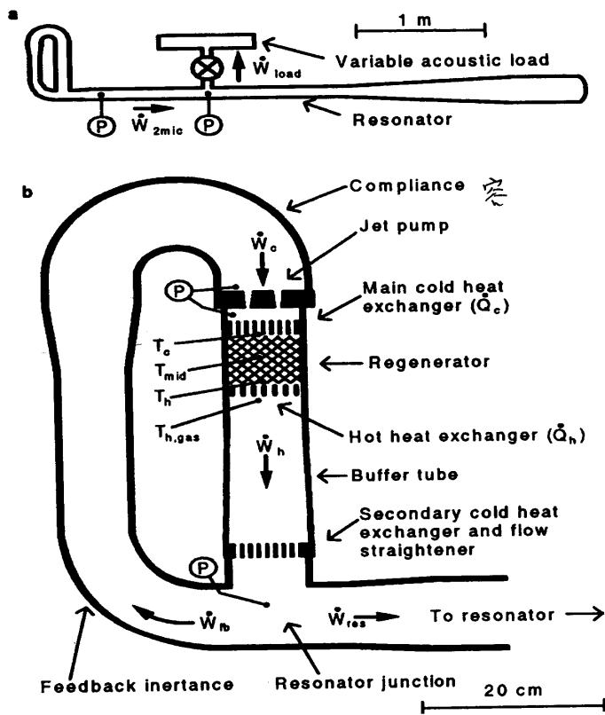  
图 1.14 热声斯特林发动机

(a)整体图，如图片中的那样；(b)发动机的关键部分，两个标有“冷”的热交换器用流动的水来保持在环境温度。

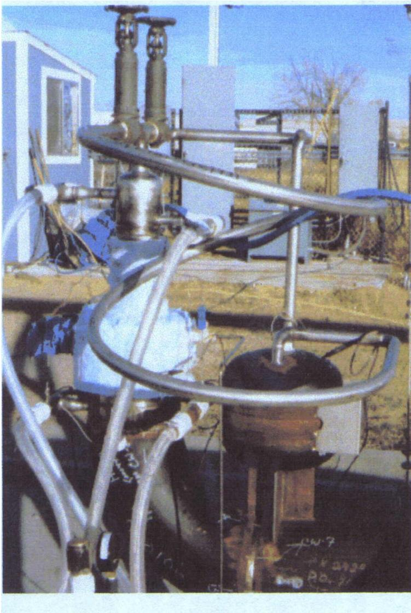  
图 1.15 行波制冷机的例子 Cryenio 2-kw 的脉冲管制冷机

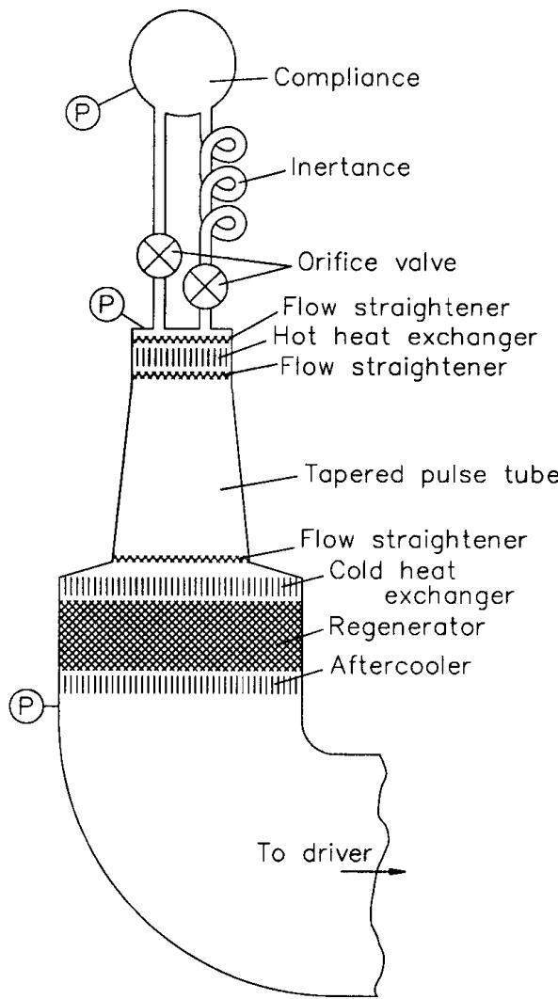  
图 1.16 Cryeno 公司的小孔脉冲管制冷机的示意图。“P”代表压力传感器的位置，标有“hot”的热交换器和冷却器用流动的水来保持在环境温度。

## 1.4 热声器件和常规的技术

记住上面所述的四个热器设备的例子，考虑一下与目前在广泛应用的能量转换系统，如内燃机、蒸汽机、逆朗肯（Rankine）或蒸汽压缩制冷循环、气轮机等等与这些热声器件相比有什么优点和缺点。

这些常见的系统有运动部件，从这点上讲，人们或许认为它们与热声器件相比不可靠且昂贵，然而，几十年工程发展的投资已使这些设备具备了很高的可靠性。此外，几十年的制造经验使它们的造价也很低了。由于热声器件没有运动部件、没有腐蚀材料、没有密封，因此热声器件似乎在高可靠性和低价格还是有一定的优势，认识到这一点是我们面对工作之一。

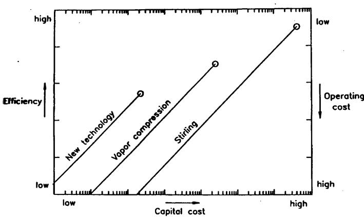  
图 1.17 不同的技术在费用和效率之间表现出不同的平衡。

几十年在常规的能源转换设备工程中的投资使它们有很高的效率，今天汽车发动机以30%的效率将燃烧热转化成轴功，柴油发动机能达到 40%的热效率，蒸汽压缩或制冷系数获得高于50%的效率是很普通的事。热声器件目前还没有达到这么高的效率，因此提高热声机器达到这样的效率是我们的另一个挑战性的工作。重要的是要认识到，一项新技术也能在商业上获得成功，即使它的效率没有超过老的技术，这一观点在图1.17 中有所表示。斯特林制冷机是相当古老的，从原理上讲，它能达到卡诺循环的COP，然而，它的高的COP系数，必须付出高昂的代价，如大量的热交换金属材料，高质量的润滑油等等，这一切使造价太大的了。举例来说，斯特林的效率与投资就如图1.17 所示的那样，要达到一个高效率，你就得愿意花费很大的经费来建造它，然而，在商业世界中，能源费用目前是很低的，谁也不会选择投资如此高的资金来获得这样高的效率，取而代之的是，在现实的制冷系统中，蒸汽压缩式制冷得到广泛的应用，因为在获得可接受的效率范围，它比 Stirling 制冷机的投资小多了。在原则上，蒸汽压缩式制冷的COP永远不会达到Stirling制冷机效率的上限，但这并不重要。另外，每一项应用都要权衡建造费和效率。例如，在 Phonix 城大型办公楼的蒸汽压缩与空调系统的效率可能就会高于在Seatte饮料销售机内的蒸汽压缩制冷机。如果热声器件在效率-费用曲线位于现有技术的左侧的话，那么它将在一些商业市场获得成功，热声器件的性能价格的曲线的终点是高于或者低于老技术，并不像在中等效率时的投资那么重要。

## 1.5 符号

我们现在停一下来仔细地建立贯穿于本书的时变量如压力的符号。在前四章，我们假定所有的时变量都是以频率为f作正弦变化的物理量，这样，这些变量如压力可以如下表示：

$$
p (x, t) = p _ {m} + C (x) \cos [ \omega t + \phi (x) ]
$$

(1.27)

仔细地分析一下这个表达式，它表示压力是一个由一个与位置x和时间t均无关的平均压力 $p _ { m }$ 及一个在时间上的以角频率ω变化的振荡部份相加。振荡幅度C(x)和相位Ф(x)是位置x 的函数。

可以将方程（1.27）更方便地记为：

$$
p (x, t) = p _ {m} + \mathrm{Re} [ p _ {1} (x) e ^ {i \omega t} ]\tag{1.28}
$$

p1(x)是如下的复函数

$$
\left| p _ {1} (x) \right| = C (x)\tag{1.29}
$$

$$
\phi (p _ {1} (x)) = \phi (x)\tag{1.30}
$$

这种记号是方便的，因为用一个带下标的符号可以同时表达出幅值和相位，而且所有复数运算的简便方法都可以应用（但要仔细！）。本书中，所有带下标“1”的变量都是复数。

有时我们偷懒或者忘了，我们就不把 Re[ ]清楚地写出来，我们只是说 $p _ { 1 } ( x )$ 是振荡压力，但是我们真正的意思总是认为 ${ \mathrm { R e } } [ p _ { 1 } ( x ) e ^ { i \omega t }$ 1是振荡压力，而 $p _ { m } + \mathbf { R e } [ p _ { 1 } ( x ) e ^ { i \omega t } ]$ 是压力。有时我们进一步将振荡压力简记为 $p _ { 1 }$ ，把它与x 有关的事实放在记忆里。

在热声学里，最初会混淆的原因之一是这些声学变量同时是位置和时间都是波动的函数。记住在声学近似里，时间变化关系是假设为完全正弦的，空间上不一定是正弦的，但有时在整个装置中，这些物理量的幅值在空间分布上也可能很接近正弦关系。当谈到这样一种波的相位时，很少需要明显地讲空间相位来识别时间变化的相位。

为清楚地记住这种记号，我们将回顾一下连续方程（1.19）。考虑气体在沿x 方向上没有温度梯度作绝热振荡的无粘声波，我们可以如下写出压力p，密度 $\rho$ 和速度u：

$$
p (x, t) = p _ {m} + \mathrm{Re} [ p _ {1} (x) e ^ {i \omega t} ]\tag{1.31}
$$

$$
\rho (x, t) = \rho_ {m} + \mathrm{Re} [ \rho_ {1} (x) e ^ {i \omega t} ]\tag{1.32}
$$

$$
u (x, t) = \mathrm{Re} [ u _ {1} (x) e ^ {i \omega t} ]\tag{1.33}
$$

方程（1.33）中没有平均速度表明在振荡流中没有叠加的稳定流动，定义 $\boldsymbol { a } ^ { 2 }$ 作为联系绝热密度和绝热压力的比例常数：

$$
a ^ {2} d \rho = d p\tag{1.34}
$$

我们可以简化这个最常见的连续方程：

$$
\frac {\partial \rho}{\partial t} + \nabla . (\rho V) = 0\tag{1.35}
$$

在一维情况下，有：

$$
\frac {\partial p}{\partial t} + a ^ {2} \frac {\partial}{\partial x} (\rho u) = 0\tag{1.36}
$$

将我们的复数表达式(1.31)\~(1.33)代入(1.36)中，忽略与其它保留项相比小得多的 $\rho _ { 1 }$ 和 $u _ { 1 }$ 的乘积项，有：

$$
\operatorname{Re} \left[ i \omega p _ {1} (x) e ^ {i \omega t} \right] + \rho_ {m} a ^ {2} \frac {\partial}{\partial x} \operatorname{Re} \left[ u _ {1} (x) e ^ {i \omega t} \right] = 0\tag{1.37}
$$

注意到我们可以自由地交换空间和时间导数的运算次序，并交换导数和求实算子的运算顺序，这样我们可以以更简洁的形式写出方程(1.37)：

$$
i \omega p _ {1} + \rho_ {m} a ^ {2} \frac {d u _ {1}}{d x} = 0\tag{1.38}
$$

这个表达式在数学上是没有问题的，在物理上它是方程(1.37)的简化形式。

为了对这种复数记号更清楚一些，让我们分析一些简单的波动，如动画 Ani. Wave/t显示的那样，沿x 方向上有一个传播的行波，用复数符号记作如下：

$$
p _ {1} (x) = C e ^ {- i k x}\tag{1.39}
$$

这里|C|是振荡幅度，k 是波失。复数 C 的相位定义为在时刻 $\scriptstyle \mathbf { t } = 0$ 时整个空间相位。动画Ani Wave/s 显示的驻波可以用如下复数表示：

$$
p _ {1} (x) = C \cos k x\tag{1.40}
$$

复数用图示的方法表示被称之为相位图。复变量可画在水平的实轴和垂直的虚轴上。通常地，箭头从原点起到这个复数，我们这里也将采用如图 1.18 所示的这种惯例。如果你假定一个相量 $\xi _ { 1 }$ ，在相图上以角频率 $\omega$ 逆时针旋转，那么时变量 $\mathrm { R e } [ \xi _ { 1 } ( x ) e ^ { i \omega t } ]$ 在水平实轴上的投影就代表这个物理量。

(a)  
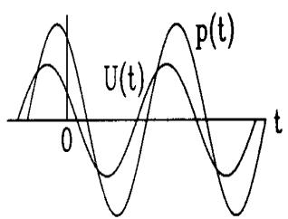  
(b)

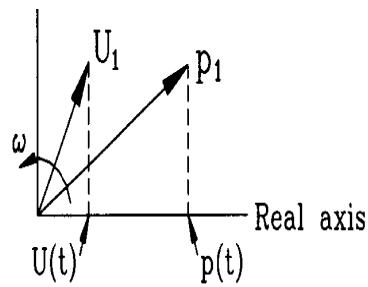

图 1.18 在复平面上复变量的表示。(a)两个随时间作正弦变化的量 $p ( t )$ 和 $U ( t )$ ， $U ( t )$ 超前 $p ( t )$ 的相位为 $3 0 ^ { \circ }$ ；(b)这两个量的相量表示可以想象为两个幅值为p和 U的以角频率ω逆时针旋转的两个矢量，这两个量真正的随时间变化的值是这些旋转向量在实轴上的投影。

相图在表达复杂热声学系统，特别是对表达我们将在以后看到的行波系统中许多物理量的幅值和相位的关系时是极其有用的。例如，如果第二个变量正比于第一个变量i 倍，那么第二个量就要从第一个量开始在方向上逆时旋转 $9 0 ^ { \circ }$ ，此时我们说第二个量领先第一个量$9 0 ^ { \circ }$ 。我们如此频繁地使用相位，以致于我们常常忽略标出实轴和虚轴，经常地我们只表达变量之间相对的幅度和相位，而不是实际的幅值，因此我们通过表达在同一张图中上的物理量有不同的单位，为表达相位的信息不必用比例而导致图示的混乱，正如图 1.19 中的 $p _ { 1 }$ 和$U _ { 1 }$ 表达了方程(1.39)和(1.40)中的简单无损声波。

## 1.6 计算（DeltaE）

本书的大部份内容强调直觉的发展、集总元件阻力的估计以及某一观点的深入，然而，在每天的热声实践中，我花费了大部份的时间用 DeltaE 进行热声学方程的数值模拟，可以说没有这样的软件要热声学方面取得今天这样的进展是不可想象的。

任何一种一维的形如方程(1.11)或者(1.12)的声学波动方程，在进行了必要的处理后，都可以由动量方程(1.8)和连续性方程(1.9)得到。注意到动量方程和连续方程可以分别解出 $d p _ { I } / d x$ 和 $d u \textmu { } / d x$ ，这是一种很容易的数值积分： $p _ { 1 } \left( x \right)$ 可以通过对 积分动量方程而得到，同时，$U _ { 1 } \left( x \right)$ 可以通过积分连续方程而得到。在以后的章节中我们可以看到，在热声堆中的平均温度随x 的变化关系是微妙的，它可以通过能量对热声板叠的能量流守恒方程的考虑而得到，这是第三个基本的微分方程，结合另外两个方程可以积分得到 $T _ { \mathrm { m } } ( x )$ 。

在几何结构给定的情况下，即由用户给定了一系列的单元，如管道、声容、声电转换器、热声堆或者回热器的情况下，DeltaE就积分这些一维的方程。对每一单元， 采用当地相应的动量、质量及能量方程，这些方程由当地参数（例如面积或周长）和全局参数（例如频率和平均压力）表达，解出每一单元的 $p _ { 1 } \left( x \right) , U _ { 1 } \left( x \right)$ 和 $T _ { \mathrm { m } } ( x )$ ，并结合整个装置中两个部件相连接点的匹配从而得到整个装置的 $p _ { 1 }$ $( x ) , U _ { 1 } \left( x \right)$ 和 $T _ { \mathrm { m } } ( x )$ 。显然，如果给定一个实的和两个复数边界条件，那么 $T _ { \mathrm { m } } ( x ) , p _ { 1 } \left( x \right) , U _ { 1 } \left( x \right)$ 就唯一地被确定，原因是控制方程组由一个实数及两个复数这样相互耦合的一阶方程组成。无论是一个单元还是一连串的单元通过相互串联组成的系统，这一点都是正确的。如果所有的边界条件都在初始单元的入口知道的话，那么这种积分是最简单的。但是，经常的情况是边界条件的某些部份是在其它地方知道，在这种情况吓，DeltaE采用试射法，即通过猜测和调整一个入口边界条件未知的量来计算，直到达到与给定边界条件相同。 的用户可以享受在选择什么变量作为边界条件以及什么变量作为计算变量的极大自由。例如，在一个简单平面波的共振管中，DeltaE能计算为频率函数的输入阻抗，或者一个已知结构和气体种类的共振频率，或者给定共振频率所需要的长度，甚至一个给定几何结构中给定共振频率的二元混合物的浓度。

我希望这本书的有用性能大大地超过第四版本的DeltaE，所以我把反复要在本书检验的四个例子放在了本书附录中的 的输入输出作为示例。对于感兴趣的读者，这些例子给出如何构建一个DeltaE 的简单文件，而且在某些情况下可参考为一个装置的具体尺寸。我们发现，如果特别详细的细节包括在 DeltaE 的文件中，那么和实验就符合得很好。经常地，在一个文件中，我们有超过50 个单元来说明所制作的硬件的细节。为了避免吓唬着新手，在附录中的前两个文件就去掉了这样的细节，它们仅仅使用了描述这个硬件所必需的关键单元。第三个用于描述热声斯特林发动机的文件，包括了全部丑陋的细节，是我们在 Los Alamos 实验室研究的一个典型的例子。如果你对 DeltaE 或者热声学陌生的话，就跳过它。第四个文件是关于小孔脉冲管制冷机的例子，它只包含了实际系统的25%的组成，以保护Cryenco 公司的知识产权信息。

DeltaE 的 用 户 参 考 手 册 可 以 从 网 址 www.Lane.gov/thermoacoustics 上下载。在学习本书时可以偶而参考一下，这个软件的β版本可以从Bill Ward 那里得到。使用DeltaE进行本书中的数值积分对我来说是容易的，因为它是我经常使用的热声学符号。但是，我相信其它一些程序，例如Gedeon编写的sage，由Tominaga编写的 Themoacoustica 以及 Radebaugh 的小组开发的 Regen.3 对描述热声学设备也是精确和有用的，虽然每一种程序各有优缺点，但在基本原理上都是一致的。

## 1.7 动画片

前面讨论的计算机的动画显示“Ani Wave”是用在本书中的许多动画片的第一个，学习它们是很重要的。

这些动画可以在 Win95, Win98 以及 Window 计算机中的全屏幕的 DOS以及 DOS系统下运行。在老的386 计算机上，它们运行得就慢一些，除非使用DOS的协处理器，否则Macs 机就不是选择。

(a)  
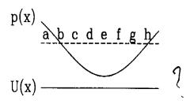  
(b)

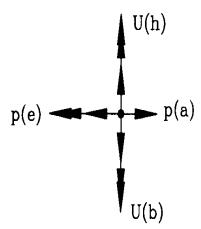

(c)  
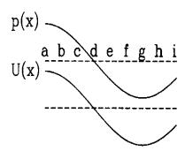

(d)  
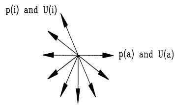  
图 1.19 驻波和行波在不同位置的相位。压力 $p _ { 1 }$ 和体积流 $U _ { 1 }$ 的相位如图所示。(a)在动画 Ani Wave/s 显示的波对应于方程(1.40)中 8 个标有 $^ { 6 6 } \mathrm { a } ^ { \prime \prime }$ 到 $^ { 6 6 } \mathrm { b } ^ { \prime \prime }$ 的点等间距点在某一特定时刻随x 位置的关系。(b)对应于方程 的动画 的相图，压力相图沿实轴，体积速度流量的相图沿垂直轴。(c)对应于方程(1.39)中的动画 Ani Wave/t的波动在某一时间随x 的函数，从(a)到(i) 等距离地标有9个点。(d)方程(1.39)的动画Ani Wave/t的相图，在每一个位置，压力相位和体积速度相位是同相的。

记住使用“文件/选项”形式的命令行。例如，在DOS操作系统下，“Wave/t”就从显示行波的波动动画开始，“Wave/s”就从驻波的波动动画开始。（如果你没有键入选项启动动画，你会发现这个动画显示自动地从我常用在讲座中的选择顺序开始）。

对 Win95或 98 的机器，在你下载后把它们保存在硬盘上同样的子目录结构下，这样在 Win95-98 的文件夹中就可以直接地找到执行文件，打开 Win95-98 的文件夹并双点击一个快捷图标，就可以运行合适的动画。例如，点击“Wave-s”就执行 DOS命令行“Wave/s”。

对 Win3.1 系统，可在 DOS窗口下运行这些程序，或退出 Windos在 DOS 系统下运行，在 DOS 操作系统下运行， $^ { 6 6 } \mathrm { C D } ^ { \prime \prime }$ 进入 DOS 目录，并键入带选项的程序名，如（e.g/./s），大写和小写都是接受的。

注意：如果在动画中显示的文本看起来扭曲或者位置不对，那么说明你的 DOS 窗口没有使用缺省的字形或者设置为全屏。设置好字形、屏幕的缺省值，并切换到全屏幕的DOS窗口（Alt-Enter），最好是不要从 DOS 窗口来启动动画以避免这个问题。如果你使Window3.1，退出 DOS 然后改变目录到动画所在的地方。如果你用Win95 或 98，那么就从“Start-Programs-MS-DOS Prompt”开始来启动 DOS并改变到动画所在的地方。这些方法显然地导致 Windows 打开窗口的缺省值（这种混乱的出现是由于这些动画是 QBasic 写的，QBS使用 DOS的设备和字形来定位和显示文本，因此，在动画中的出现在屏幕上的文本的座标系统取决于DOS的字形设置）。

## 1.8 要点（大纲）

本书给出一种独特的描述方法，用以理解驻波及行波型的热声发动机和制冷机。为简洁起见，我把这些感兴趣的设备称为“热声发动机和制冷机”，虽然我真正的含义是指“周期性的发动机和制冷机---包括 Stirlng 发动机，Stirling 制冷机，脉冲管制冷机和本质不可逆的驻波发动机和制冷机---用独特的热声学方法研究”。换句话说，热声学是指一种理论框条，而不是狭义上的一类设备。

但是，热声的描述是如此的复杂以致于人们对于简单的部件要同时地掌握所有的细节是很困难的，我想最好的是我们希望在热声方法的范畴能从一种可处理的观点很快地而又不费力换到另一外一种，因此，我基于 6点将本书安排为6 个章节，每一章节是可以操作的。

第 2 章 波动。考察振荡的压力和速度。与本章相关的内容包括普通声学的基础，在共振器中的共振现象以及波传播通道中的粘性阻力及热接触效应，这些现象是 Rott 声波方程(1.11)的基本东西。学完波动方程这一章节后，你应说可以想像和理解一个热声部件中完整的声波行为。这个过程涉及思考装置所有尺寸与 ， $\delta _ { \phantom { } _ { k } }$ ， $\delta _ { \mu }$ 的比较，

识别压力p 和速度 $p _ { 1 }$ $U _ { 1 }$ 的节点和腹点，识别装置的哪一部份力是声感和声容，识别哪一部份为粘性阻力或者与热驰效所影响，并近似地预测整个装置中压力 $p _ { 1 }$ 和速度 $U _ { 1 }$ 的相位，初步地认定通过一过程用笔和眼就可以达到定性的水平，定量上的结果可以通过对动量方程和连续方程的数值积分来达到。

第 2 章中的观点（当然也包括后续的章节）取决于某些选择。我选择了 $e ^ { i \omega ~ t }$ 而不是 ${ e ^ { - i \omega t } }$ 作为时间依赖关系。我选择 $p _ { 1 }$ 和 $U _ { 1 }$ 作为主要的动态变量，虽然 $\dot { M } _ { 1 } = \rho _ { { } _ { m } } U _ { 1 }$ 或者 $< u _ { 1 } > = U _ { 1 } / A$ 也可以起到 $U _ { 1 }$ 的作用。采用与 Rott同样的思路，我选择 $f _ { \mu }$ 和 $f _ { \kappa }$ 来表达复数形式的粘性和热驰豫效应，但是 $F { = } I { - } f$ 在文献[28]也同样使用。还有其它一些有效的方法，包括的术语有复密度，复粘性以复Nusselt数[29]。我选择电比拟的方法来画阻力图，在力学图中（参见练习2.17）或者声学比拟不完全有效。每一个选择可以准确地抓住热声学重要的物理本质，我决定坚持一种选择并继续进行下面中更为有趣的课题。

功流---包括热流和声功流是热机和制冷机里最感兴趣的量，所以在第 3章中，把这些概念加上压力和速度的讨论。声功，它是压力和速度乘积的时间均值，在发动机里产生声功，在制冷机里消耗声功。总能量，是热力学第一定律的主题，是一个更为重要的量。学习完第3 章后，你应该可以理解基于能量守恒定律上的热声发动机和制冷机中的能量流以及声功的耗散和产生，定量的结果可以从第2章中动态变量的乘积根据需要来获得。

热力学第二定律，它规定了热声发动机和制冷机性能的极限，形成第 章关于效率的基础。关键的概念是熵产，可以根据位置、机理以及火用而加以区分。它提供一个热力设备及其与环境相互作用后的一个定量的评价。综合在一起，这些概念提供了一种标准的、正规的评价效率降低的根源。在学习这章后，你应该可以理解那些超出标准物理课程和大学工程课程的关于热力学效率的问题，而且你应该可以想像和理解热声装置中不可逆的所在与其机理并定量地评价不可逆性。

第 章 超过 热声学理论的专题。介绍许多超出小振幅、单频率近似的专题。这些专题在实际的设备中受到了很大的关注，这些设备通常工作在大振幅下以获得单位体积下高的能量密度。这些专题包括湍流、微小损失、进出口效应、接合处效应以及叠加的稳定流动（声流）以及高次谐波。前面的四章已经处于获得了一个较好的理解阶段，而第 5 章则是目前知识的前沿。象其它工程分支学科一样，变量的无量纲组的使用可以对这些复杂的现象带来简化。

第 6 章 硬件。介绍了一些关于制作热声堆、回热器、热交换器、脉冲管、热缓冲管、共振管和电声换能器等部件的制作工艺，特别是强调我们当有在 Los Alamos 工作的一些工艺。对那些对热声学理论观点更感兴趣以及有大量硬件制作经验的读者，他们可以跳过本章节。

第 7 章 测量。 概要地介绍了最简单的测量技巧，并讨论一些可以使这些简单测量获得有意义结论的观点。

附录给出了一些 DeltaE 的文件，这些文件与本节以前给出的四个硬件例子相配套。随着 DeltaE 在改进之后提供描述在第 5 章节的更多现象的处理后，这些文件也许很快就过时了。

符号表、 参考文献以及索引放在本书的最后

## 1.9 常用的参考书

流体动力学[30，31]

热力学[6，7，32，33，34]

声学[3，16，34]

斯特林发动机和制冷机[39，12]

脉冲管制冷机[40，41，42]

## 第二章 声 波

本章的焦点是关于声波在一个通道或管道内沿x方向传播时其动态参数---压力和速度的变化。采用日益复杂的观点来分析连续性方程，我们将会看到压力是如何与速度在空间方向上的梯度相耦合的。采用日益复杂的观点来分析动量方程，我们将会看到速度振荡又是如何与压力在空间上的梯度相耦合，把这两幅图画结合在一起就产生了波动方程。在开始，我们将考查没有损失情况下惯性和压缩性的概念。然后，我们加入粘性损失到动量方程，加入热弛豫到连续性方程。我们将在严格的数学、物理图象以及计算机动画之间变换，并根据直觉来应用这些定量的工具。从头至尾，我们都假设波动为单一频率的小振幅波动。为简洁起见，所作的小振幅近似我们将称之为“声学近似”。

主要的变量有振荡压力 和振荡的体积速度 $p _ { 1 }$ $U _ { 1 }$ 。体积速度 $U _ { 1 }$ 是沿 方向作振荡的速度 $u _ { 1 }$ 在整个通道 上的截面积分（对“体积速度”这一术语，许多热声学文献称之为“体积速度”或“体积的速度”，这一术语在声学中是一个常用的术语，但在流体力学中则很少用）。在两段管道过渡处， $U _ { 1 }$ 和 $p _ { 1 }$ 被认为是连续的（看一看第5 章中的连接点条件）。例如在第一段管道至第二段管道的过渡处，流出第一段管道的 $U _ { 1 }$ 没有其它地方可走，它必须全部流入第二段管道，因此 $U _ { \mathrm { 1 f } } { = } U _ { \mathrm { 1 s } }$ 。这样，如果两段管道的面积为 $A _ { f }$ 和 $A s$ ，那么任何压力的不连续代表着一个激波前沿，这已超出了声学近似和目前的热声学的范畴了。

## 2.1 无粘声学

对于图2.1a中长度为 $\Delta x$ 截面积为A的通道，声学中连续方程(1.9)或(1.38)的最简单的无损形式的方程可以写为：

$$
p _ {1} = - \frac {\gamma p _ {m}}{i \omega A \Delta x} \Delta U _ {1}\tag{2.1}
$$

$$
= - \frac {1}{i \omega C} \Delta U _ {1}\tag{2.2}
$$

为了得出这些方程，我们用方程(1.10)的 $p _ { 1 }$ 表示 $\rho _ { 1 }$ ，并使用理想气体关系式 $\rho _ { m } a ^ { 2 } = \gamma p _ { m }$ 。该式可以从第一章中的一个练习获得。在方程(2.2)中，通道的声容为：

$$
C = \frac {V}{\gamma p _ {m}}\tag{2.3}
$$

(a)  
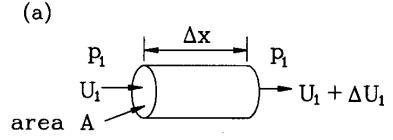

(b)  
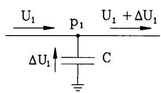

(c)  
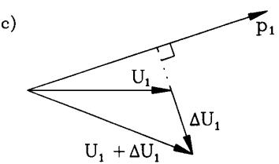

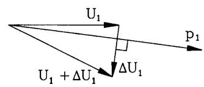  
图 2.1 (a)气体的压缩性具有重要性的一段短管；(b) 这段管道的阻抗图符号 C表示声容；(c)、(d)表示这段通道两种可能的相图。

声容等于体积 V=Aδx 与压缩性 1/ ${ \mathcal { W } } _ { m }$ 的乘积。更大的体积或更大的压缩性意味着更大的声容。这个变量的组合表达了通道内气体的弹性和可压缩性。

类似地，对于图2.2a 所示的一段长度很短的通道，无损的声学动量方程(1.8)可以改写为：

$$
\begin{array}{l} \Delta p _ {1} = - i \omega \frac {\rho_ {m} \Delta x}{A} U _ {1} \\ = - i \omega L U _ {1} \end{array}\tag{2.4}
$$

(2.5)

注意到这段通道与图2.1a 是同一段通道。 这张图的不同仅在于

我们关注过段通道在两种情况不同的特性而已。在方程(2.5)中，

$$
L = \frac {\rho_ {m} \Delta x}{A}\tag{2.6}
$$

被称之为通道的感抗（惯性），它是气体密度 与长度除以横截 $\rho _ { { } _ { m } }$ 面积的乘积，这一变量的组合描述了这段通道内气体的惯性特性。

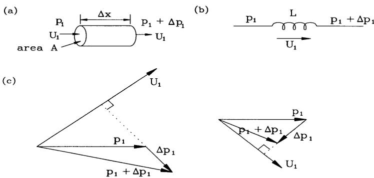  
图 2-2 (a)气体的惯性具有重要性的一段短管。(b)该通道的阻抗图。符号L代表感抗。(c)该通道中两中可能的相位图。

采用这种方法写出连续性方程和动量方程可以进行声学系统与交流电路之间准确的比拟，并获得图 和 所示的符号化的电路阻抗图。振荡压力 P1 类比为交流电路中的电压，而振荡的体积流量 U1 类比为交流电流，声容类比为接地的电容，而声感类比为串联的电感。（注意：“声感”有一点象电工学中的“电感”和力学中的“惯性”）我们将广泛地应用这一方法。我想，一些读者（物理工作者和电力工程师）对交流电路已有一些经验，但是我还注意到另外的工程师和科学家经常对一个他们完全不熟悉的类比没有任何直觉。对那些不熟悉交流电路的读者，只能将“这些图”视为声学阻抗网络中的一种抽象的表示，并仅用声学的术语来解释这些图。当你看到图中关于声感的符号时，就把它想像为一段长管（为简凑起见可力为“盘管”），稠密的气体在通过它时必须加速。当你看到本章中后面关于声阻的符号时，就把它想像为一段扭结的管道，气体在通过它时必须克服粘性阻力。当你看到图 2.1b 中关于声容的符号时，就把它想像为在两种平行的线之间有一层海绵似的垫子，两条线间距的变化对应着压力。

另外一种情况，如果你对电路图、声学阻抗不熟悉的话，那么在学习本章时做一下练习2.17，提出你自己首尾一致的表达声学阻抗的符号。例如声感的实质是质量，因此可以用一块砖或一个球来表达声感。声容的本质是弹性，所以可以用一个弹簧来表示声容。紧靠着我画的阻抗图旁边画出本章中你自己的图，用铅笔画以方便日后作修改。

图 和 给出声容和声感两种可能的相位图。在图 中，注意到 $\vert U _ { 1 } + \Delta U _ { 1 }$ 可能大于 $\mid U _ { 1 } \mid$ 也可能小于 $\vert U _ { 1 } \vert$ ，唯一严格的限制是$\varDelta U _ { 1 }$ 必须滞后 $p _ { 1 } 9 0 ^ { \circ }$ 。类似地，在图2.2c 中，方程(2.5)中唯一的严格要求是 $\varDelta p _ { 1 }$ 必须滞后于 $U _ { 1 } 9 0 ^ { \circ } .$ 。满足了这些要求外，任何情况都是可能的，取决于p 和 $p _ { 1 }$ $U _ { 1 }$ 的相对幅度和相位。

一般情况下，通道的感抗和容抗都同时对声波在管道内的传输有贡献，如图 2.3 所示的一段微元长度 $\Delta { x } _ { \circ }$ 。如前所述， $d p _ { 1 }$ 滞后于 $U _ { 1 } 9 0 ^ { \circ }$ $d U _ { 1 }$ 滞后于 $p _ { 1 } 9 0 ^ { \circ }$ 。

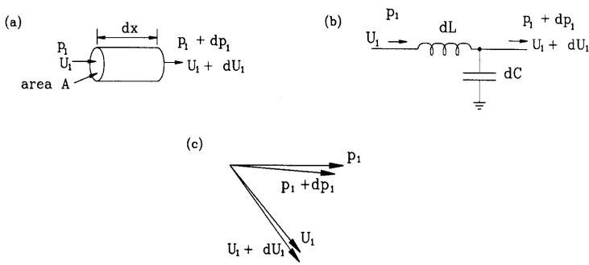  
图 2-3 (a)气体的压缩性和惯性都具有重要性的一段短管。(b)这段通道的阻抗图。(c)该段通道的一种可能的相位图。

复数比 $Z { = } { - } p _ { 1 } / U _ { 1 } ,$ 称之为声阻抗，在讨论声学系统中极其有用。有时候我们指声波在某一位置的阻抗，有时候我们是指一个部件的声阻抗，因此 $Z = - \ { \varDelta p _ { 1 } } / { U _ { 1 } }$ 与部件的压着有关，或者说， $Z { = } { - } p _ { 1 } / \ A U _ { 1 }$ 表示由于部件引起的体积流的变化。在后一种方法中，方程(2.5)给出一段声感的阻抗为 $Z { = } i \omega L$ ，而方程(2.2)表明一段声容的阻抗为 $Z { = } I / i \ \omega C$ 。

图 2.4 中所示的双 Helmholtz 共振器是一个简单的声学共振器，它包括的两个体积为 V的球形腔体，被一段截面积为 A、长度为 $\Delta x$ 的短管连接在一起。由于所有的尺寸都远小于波长，所以集中参数法对于图 2.1 和图 2.2 所示的模型都可直接应用。每一个球形腔的声容为 C，连接两个球形腔的短管的声感为 $\mathrm { L } _ { \circ }$ 。在通常的教材中，对Helmholtz 共振器系统，短管的声容和球形腔的声感可忽略不计。将短管中气体的惯性质量想像在两个球形腔的气体弹簧所施加的作用力下来回作正弦运动。适当地合并方程(2.2)和(2.5)（或者记住，在总阻抗为 0 时，串联的交流电路是共振的），很容易得出p 和 $p _ { 1 }$ $U _ { 1 }$ 非零时，必须有下式成立：

$$
i \omega L + \frac {2}{i \omega C} = 0\tag{2.7}
$$

因此，双Helmholtz共振器系统的共振频率可由下式给出：

$$
(2 \pi f) ^ {2} = \omega^ {2} = \frac {2}{L C} = 2 \frac {\gamma p _ {m}}{\rho_ {m}} \frac {A}{V \Delta x}\tag{2.8}
$$

在这个频率下，方程(2.2)或者(2.5)给出 $p _ { 1 }$ 和 $U _ { 1 }$ 的相对大小及它们相对的相位，相对相位如图 2.4c 中的相位图所示，这里我们将 $U _ { 1 }$ 的相位任意地设为0。

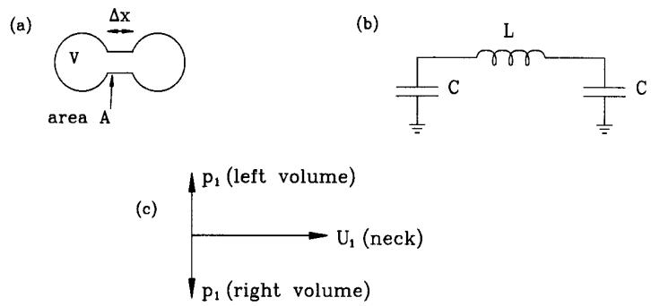  
图 2-4 双 Helmholtz 共振器系统。（a）共振器的示意图，它包含两个球形腔和一段连接管。（b）共振器的阻抗图。（c）相位图。

在比Helmholtz共振器更复杂一点的无损的声学谐振管中，声波是由方程(1.8)和(1.9)两个相互耦合的微分方程来描述。因此，为了描述和理解一段管道或共振管中的无损声波，我们必须随时记住声容和声感的概念。首先考虑Ani wave/s 中的驻波，这幅动画展示了一段截面均匀的管道中一个声波在水平地来回振荡。最上面的动画给出了声波中气体压力随位置和时间的变化，中间的一幅图画给出了气体速度随位置和时间的变化（向右的速度记为正），下面的一幅图画展示了气体在管中的运动和位移。运动的垂直线条随气体而动，可以把这些线条想像为没有质量的玻璃纸片或者随气体运动的薄薄的烟云。

首先让我们来关注一下气体从不运动的速度节点。管道的这个区域从功能上与前面描述的双Helmholtz共振器的球形腔是类似的。由于速度为 0，方程(2.5)表明，在这个区域应该没有空间压力梯度。的确，这个动画片显示，在这个区域的附近振荡的压力没有空间梯度，因此，管道中单位长度的声感在其附近是相互无关的。然而，在这个附近非零的振荡压力 $p _ { 1 }$ 表明方程(2.1)和(2.2)是重要的。管道的这段区域每单位长度存在声容，以使振荡的压力能发生在存在速度空间梯度的情况，这个速度梯度用来提供和移走必要的质量以引起局域密度的增长和下降。方程(2.2)中 i 的存在表明压力振荡和振荡速度梯度之间在时间上有 90的相位， 这个时间相位关系在这个动画片中也是很显然的。

现在我们来关注一下动画片Ani Wave/s 中的一个压力节点。管道上的这段区域类似前述的双Holmoltz共振器的颈部。在这里， $p _ { 1 } \mathrm { = } 0$ 所以方程(2.2)表明速度梯度必须为 0。这段管道的每单位长度的声容是不相关的，但是，这一区域内，非 的振荡速度和方程 表明这里的振荡压力必须有非零的梯度，正如动画片所显示的那样。另外，方程(2.5)和这幅动画片都表明压力梯度和速度在时间上存在 $9 0 ^ { \circ }$ 的相位。

准确地说，在驻波中的压力节点，每单位长度的声容是无关的；在速度节点，每单位长度的声感是无关的；在驻波的其它任何地方，$p _ { 1 }$ 和 $U _ { 1 }$ 都不为 ，单位长度的声感和声容对波的行为都有贡献。事实上，这就是它们使得这是一个波动而不是象双Helmholtz共振器那样可以用集中参数描述的振荡器了。在压力的腹点，单位长度的声容比单位长度的声感更重要。在速度腹点附近，单位长度的声感比单位长度的声容更重要

驻波中声容和声感重要的这些独特的区域是很显然的，而在动画Ani wave/t所示的行波中，每一位置都是其它位置在时间移动后的复制品，每一位置的声容和声感的重要性从时间上交替地表现。如果你将注意力集中在这幅动画，你应该可以看到这种交替。在波的传播中，热物性对声容 $r p _ { \mathrm { m } }$ 以及声感 $\rho _ { m }$ 有贡献，把它们合并一下得到声速$a ^ { 2 } = \sqrt { \gamma p _ { m } / \rho _ { m } }$ C

两种声波的相位图如1.19 图所示。

例子：驻波发动机

图 1.9 和务 1.10 中所示的驻波动动机中的共振器是极其简单的。实际上这是一个二分之一波长的共振器，它的两端是封闭的，所以它的速度节点在两个封闭端而压力节点在中间。它的完整的波形粗略的显示在 Ani standing/k的动画片中。但是，注意在图1.10 中，这个共振器中部的直径稍小于两个封闭端的直径，这个直径的变化有若干作用，多数的作用我们将在第5 章中加以讨论，其中的一个作用是降低共振频率，使其稍低于 $f { \stackrel { } { = } } \alpha / 2 \varDelta x$ ，这里 Δ 是共振管的总长度。这个频率的降低在本章末尾的一个练习中可以定量地分析。但是，采用声容和声感的概念，可以在定性上很容易地看出直径的变化是如何降低共振频率的。半波长的共振器可以粗略地考虑为一个在两个封闭端包括声容而在中间有声感的系统，这样它的共振大致类似于图2.4 中所示的双 Helmoltz 共振器。如果声感的直径减小，那么根据方程(2.6)式，L 就会增加，因此，具有 CLC 回路的共振器的共振频率就会如方程(2.8)式下降。从另外一种角度讲，如果声容的直径增加，按照方程(2.3)式，C 就会增加，同样，这个 CLC 网络的共振频率按照(2.8)式就要下降。在图 1.10 给出的一个带制冷机分支的例子，其共振频率比同长度的二分之一波长的装置的共振频率要降低10%。不过，我们仍然称这样一个共振器为二分之一波长共振器，因为它的相位抓住驻波的最本质特征，压力的最大值在两端而速度最大值在中间。

## 例子：驻波制冷机

图 和图 所示的驻波制冷机的共振管，它采用了变截面的直径（在图1.11 可以看出）来降低共振频率，使其低于这个共振器整个回路长度对应的一个总波长的共振频率。这个装置左右两边对称，使驱动扬声器工作对有 $1 8 0 ^ { \circ } \mathrm { C }$ 的相位差，从而确保压力的节点出现在共振器顶部和下部的中央。因此，这些位置是声感很重要的高速度的位置所在。扬声器附近的共振器部分有高的压力幅度，因此其声容是很重要的，这些声容部分相对于声感部份的直径被放大，因此共振频率被减小了。

## 例子：半波长共振器的集中参数的近似表示法

对图2.5a 所示的具有均匀直径的半波长共振器，最精确的阻抗图是有无穷多个声感 $d L$ 和声容 ，如图 中有很多数目显示的那样，这样就可以产生 $p _ { 1 }$ 和 $U _ { 1 }$ 随x 作正弦变化的曲线。为获得精确的结果，数值积分可有 10 个或 20 段，每一段都采用 Runge-kutta 法以便每一段都可以进一步有效地分割。然而，共振的本质实际上就是图 2.5b所示的相位图。此图中，在两个端部的振荡压力具有相同的幅度但相反的相位。在中间的速度和压力有 $9 0 ^ { \circ }$ 的相位，因此，如果不需要准确数值结果的话，那么其本质可以用图2.5c 中更为简单的阻抗图来反映。在这个图中，中间的部份被认为是共振器的声感，而两端被视为声容，这种粗略近似的准确性可以用 $p _ { 1 }$ 和 $U _ { 1 }$ 梯形分布来近似，它可以与图 2.5a 的正弦曲线比较。要进一步考虑这种粗略估计的准确性，请看一看本章末尾的一个练习。

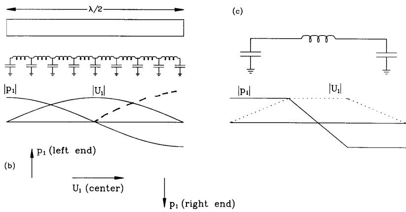  
图 2.5 (a)半波长的共振器， $p _ { I } ( x )$ 和 $U _ { 1 } ( x )$ 具有正弦分布，共振器被适当地看作无穷多个小的声感和声容组成。(b)在两端和中部的相位是极其简单的。(c)两个声容和一个声感抓住了简洁性和本质，但$p _ { 1 }$ 和 $U _ { 1 }$ 在中间其余部份的精度下降。

## 2.2 在大通道内的粘热效应

为了将关键的功耗散和功收益引入我们一直在讨论的无损声波图像中，我们要开始一个简单但完整的热声学问题，即在一个大通道内，由于声波与固体通道壁面的相互作用而使声波在传播过程中产生

的常见的粘热衰减。

考虑声波在横截面积为常数A和周长为П的通道中传播，工作价质为理想气体。水力半径为：

$$
r _ {h} = \frac {A}{\Pi}\tag{2.9}
$$

被定义为横截面积与周长之比。水力半径也可想像为气体体积与气固接触面积之比，或者一个特征微困到最近的固壁的距离。注意，圆管的水力半径为圆管半径的一半！在本节中，我们只考虑 $\delta _ { \mu } < < r _ { h }$ 且

$\delta _ { \boldsymbol { k } } < < r _ { h }$ 的流道，即边界层近似。采用我们常用的用于随时间振荡的物理量的复数记号。对压力 p，温度 T，速度在 x 方向上的分量 u，密度 $\rho$ 等，可写出如下表达式：

$$
p = p _ {m} + \mathrm{Re} [ p _ {1} (x) e ^ {i \omega t} ] + \dots\tag{2.10}
$$

$$
u = \mathrm{Re} [ u _ {1} (x, y) e ^ {i \omega t} ] + \dots\tag{2.11}
$$

$$
T = T _ {m} + \mathrm{Re} [ T _ {1} (x) e ^ {i \omega t} ] + \dots\tag{2.12}
$$

$$
\rho \text {等} = \text {类似于} T\tag{2.13}
$$

其中， μ k 等是常数。本节中，假定流道在空间上是等温的，因此方程(2.12)中的 $T _ { \mathrm { m } }$ 与x 无关。座标y 度量从管壁到流体所在处的距离，取管壁处 $y { = } 0$ ，如图2.6 所示。

## 2.2.1 粘性阻力

为了建立粘性效应的定量理解，我们考虑图2.6 中的情况。为找出气体速度在 x 方向的分量 $U _ { 1 }$ 与 y 的关系，可以利用动量方程在 x方向的分量。在声学近似下有下式：

$$
i \omega \rho_ {m} u _ {1} (x, y) = - \frac {d p _ {1} (x)}{d x} + \mu \frac {\partial^ {2} u _ {1} (x , y)}{\partial y ^ {2}}\tag{2.14}
$$

$U _ { 1 }$ 对 x 的偏导数可忽略不计，因为它们是 $1 / \lambda$ 的量级，远小于 y方向的量级为 $1 / \delta _ { \mu }$ 的导数。这个方程就是一个微元气团牛顿第二定律的一个合理的近似式。左侧是质量乘以加速度，而右侧是力的总和

---压力和粘性力。

方程(2.14)是 $u _ { 1 } ( x , y )$ 关于 y 的常微分方程，利用两个边界条件，$u _ { 1 } ( y { = } 0 ) { = } 0$ 在固体边壁以及当 $y \to \infty$ 时 $u _ { 1 }$ 为有限值，可以得到它的解为：

$$
u _ {1} = \frac {i}{\omega \rho_ {m}} [ 1 - e ^ {- (1 + i) y / \delta_ {\mu}} ] \frac {d p _ {1}}{d x}\tag{2.15}
$$

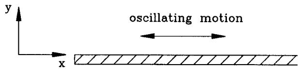

图 2.6 本节中所采用的坐标系，在边界近似条件，这个通道所相对壁面在很大的y 处以致于图中看不到。

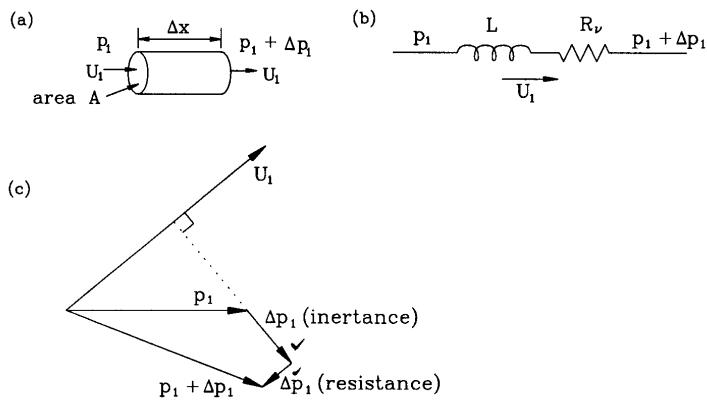

图 2.7 动量方程描述了一个通道内的惯性和阻力效应。(a)一段面积为 A，长度为 $\Delta \textbf { x }$ 的短通道；(b)带有声感 L和声阻 $\mathtt { R } _ { \mu }$ 的阻抗图；(c)这种情况下典型的相位图，它表明在压差 $\Delta \mathrm { P } _ { 1 }$ 是惯性和阻性分量的总和。

这个函数表达了粘性是如何减小了振荡速度的幅值和改变它的相位的。

这种复数记号紧凑且易于应用，但困难在于如何给出直观地解释。为了获得对边界层速度表达式形象的理解，请学习一下动画片Ani Viscous/m。这个动画片演示了粒子位移 $x ( y , t ) = \mathrm { R e } [ u _ { 1 } ( y ) e ^ { i \omega t } / i \omega ]$ 相对应于 $\operatorname { R e } [ ( 1 - e ^ { - ( 1 + i ) y / \delta _ { \mu } } ) e ^ { i \omega t }$ 在垂直的y方向及水平的声振荡x方向的情况。运动的线条可以假想为随振荡气体微团运动的一片很薄的烟云片，在垂直轴方向上标有小钩的间距是粘性穿透深度 $\delta _ { \mu }$ 。比 $\delta _ { \mu }$ 还小的更靠近固体边界的气体几乎是静止的，而比 $\delta _ { \mu }$ 大很多的远处的气团经历无粘剪切运动（这部气体的速度和位移与y 无关。这一无粘的运动是纯惯性的，加速度与力 $\left( - d p / d x \right)$ 同相，因此位移与 $+ d p _ { I } / d x$ 同相。从最靠近固体壁面的气体到厚度与 $\delta _ { \mu }$ 相当的气体以一个与 y有关且相位与y 显著有关的速度运动。

在边界层近似区域，我们通常要在截面积A上作空间平均，得到如方程(2.15)所示的边界层函数 $F ( y )$ 。采用方程(2.9)所定义的水力半径，我们可以写出如下的平均：

$$
<   F > = \frac {1}{A} \int F d A = \frac {1}{\Pi r _ {h}} \int_ {0} ^ {r _ {h}} F (y) \Pi d y \approx \frac {1}{r _ {h}} \int_ {0} ^ {\infty} F (y) d y\tag{2.16}
$$

这样，方程(2.15)的空间平均为：

$$
<   u _ {1} > = \frac {i}{\omega \rho_ {m}} [ 1 - (1 - i) \frac {\delta_ {\mu}}{2 r _ {h}} ] \frac {d p _ {1}}{d x}\tag{2.17}
$$

在前面的章节中，无粘的动量方程导致方程（2-5）以及一个面积为 A、长度为x 的通道中的声感的概念。现在，包括损失在内，方程（2-7）给出了相应的表达式为：

$$
\Delta p _ {1} = - \frac {i \omega \rho_ {m} \Delta x / A}{1 - (1 - i) \delta_ {\mu} / 2 r _ {h}} U _ {1}\tag{2.18}
$$

$$
= - Z U _ {1}\tag{2.19}
$$

$$
= - (i \omega L + R _ {\mu}) U _ {1}\tag{2.20}
$$

因此，粘性增加了粘性阻力 $R _ { \nu } ,$ 与惯性 L 串联构成总的阻抗

${ \cal Z } { = } R _ { \nu } { + } i \omega L$ ，如图 2-7b所示。在边界层近似中，惯性和阻力为：

$$
L \approx \frac {\rho_ {m} \Delta x}{A}\tag{2.21}
$$

$$
R _ {\mu} \approx \frac {\mu \Pi \Delta x}{A ^ {2} \delta_ {\mu}} = \frac {\mu \Delta S}{A ^ {2} \delta_ {\mu}}\tag{2.22}
$$

近似到量级 $\delta _ { \mu } / r _ { h }$ 得到上述表达式。是通道的湿周， $\varDelta S \mathrm { = } \varPi \varDelta x$ 是表面积。注意R和L都是实数，因此，在方程(2.20)中的“i”意味着声感对压差的贡献超前阻力贡献 $9 0 ^ { \circ }$ 相角，如图2.7c 所示。

因此，考虑一段任意长度的管道， 它有来自粘性引起的阻力和质量引起的惯性。对于一段宽流道， $\delta _ { \mu } < < r _ { h }$ ，从而有 $R _ { \nu } < < \omega L$ 。事实上，在这种极限条件下， $\omega L / R _ { \nu }$ 正比于 $A / \Pi \delta _ { \mu }$ ，因此可以想像通道的核心，它的体积为 AΔx，对声感有贡献；而具有损失的通道的表层，它的体积为的 $\Pi \Delta x \delta _ { \mu }$ 的量级，它等于通道的表面积与粘性穿透深度的乘积，对阻力的贡献起主要作用。

## 例子：小孔脉冲管制冷机

把图1.16 中小孔脉冲管制冷机顶部的部件考虑为集中参数元件：一个空腔、一个惯性管和两个阀。这些部件的目的是在脉冲管制冷机的顶部提供一种可调节的声阻抗，这种调节可以由阀门的设置来进行。为使这个例子简单一些，我们将忽略惯性管和空腔的阻力，这样，其网络就如图 中所示的那样。我们分析这个网络工作在 ，压力为 3.1MPa，工作温度为 300K。空腔的体积为 9.8 升，所以根据方程(2.3)有 $C { = } 1 . 9 \times 1 0 ^ { - 9 } \mathrm { m } ^ { 3 } / \mathrm { P a }$ ，它的声容抗为 $1 / \omega C { = } 2 . 1 \mathrm { M P a . s / m } ^ { 3 }$ 。惯性管的长 度为 2.5m，直 径为 2.4cm，所 以根据 方程(2.6)，$\mathrm { L } { = } 2 6 8 0 0 \mathrm { P a } . \mathrm { s } ^ { 2 } / \mathrm { m } ^ { 3 }$ ，它的声感抗 $\omega L { = } 6 . 7 \mathrm { m P a . s / m } ^ { 3 }$ 。为了保持这个例子的简单性，将两个阀视为阻力 $R _ { s }$ 和 $R _ { p }$ ，它们可以从 0到之间调节。因此，总的声阻抗为：

$$
Z = \frac {1}{1 / (i \omega L + R _ {s}) + 1 / R _ {p}} + \frac {1}{i \omega C}\tag{2.23}
$$

根据方程(2.23)，画出所有 $R _ { s }$ 和 $R _ { p }$ 值就可以得到整个复阻抗 Z

的区域，用阴影部份显示在图2.28b 中。

假定这些阀被设定，例如 $R _ { \mathrm { p } } { = } { \infty }$ 而 $R _ { s } { = } 3 . 3 5 m P a . s / m ^ { 3 }$ ，这样由方程(2.23)可得到 $Z { = } ( 3 . 3 5 { + } i 4 . 6 ) m P a . s / m ^ { 3 }$ ，这样 Z的相位 Z为 $5 4 ^ { \circ }$ 。这种情况对应的相位图如 2.8b 所示。在这里，我们任意将 $\mathrm { U } _ { 1 }$ 的相位选择为0。

如果我们用 DeltaE 来描述惯性管，我们能考虑它的串联阻力，对其中的一个工作点，DeltaE模型结果如下：

<table><tr><td>开始</td><td>设置</td><td></td><td></td></tr><tr><td>3.1114E+06</td><td>平均压力p(Pa)</td><td>-98.944</td><td>Ph(U) 0 deg</td></tr><tr><td>42.00</td><td>频率 Hz</td><td>氦气</td><td>气体</td></tr><tr><td>305.00</td><td>温度 K</td><td>理想</td><td>固体</td></tr><tr><td>9.3205E+04</td><td>|P|@ 0 (Pa)</td><td></td><td></td></tr><tr><td>0.000</td><td>Ph(p)deg</td><td></td><td></td></tr><tr><td>4.3536E-02</td><td>|U|m3/s</td><td></td><td></td></tr></table>

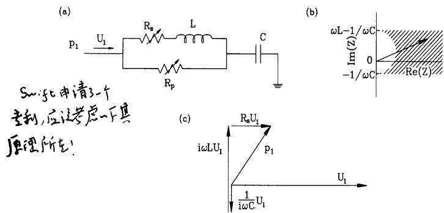  
图 2.8 (a)脉冲管制冷机末端部分的声网络阻抗图；(b)通过调节两个阀可以得出所有可能的带有阴影部份的 Z值；(c)标有 $R _ { \mathrm { p } }$ 的阀关闭后的一种情况的相位图。

我们计算 ${ Z } { = } \Delta p _ { 1 } / U _ { 1 }$ ，这里 $\varDelta p _ { 1 } = ( 2 8 1 - i 7 0 ) k P a$ 是通过惯性管的压差，而 $U _ { 1 } \mathrm { { = } } ( 0 . 0 0 5 5 { + } \mathrm { i } 0 . 0 4 1 6 ) m ^ { 3 } / s$ 是惯性管两端的平均体积流量。这样，$Z { = } ( 0 . 7 8 { + } i 6 . 8 6 )$ ， 于 是 $L { = } 2 7 3 0 0 0 P a . s 2 / m ^ { 3 } , ~ a L { = } 6 . 8 6 \mathrm { m } P a . s / m ^ { 3 }$ 且$R _ { \mathrm { v } } { = } 0 . 7 8 M P a . s / m ^ { 3 }$ 。相对于 我们忽略了R 和合理的，但还不太好。这个计算的 R 大于我们从 $\omega L \delta _ { \mu } / r _ { h }$ 估计的值，因为 DeltaE 包括了我们将在第5章中讨论的湍流效应。我们在前面段落中对L的估算与这

个数值积分的结果仅相差2%。

## 例子：驻波制冷机

考虑图 1.1a 中驻波制冷机中间 T 形中的一部份，这些位置是压力的节点，因此声容（虽然它可以计算）是无关紧要的。这些位置的速度很高，因此声感和串联的电阻是重要的。由于黑色的锥体放进了T形部份，因此通过每一个T形部份的水平通道实际上顺序地包含三段管道：一段长 12.7cm直径为11.2cm的管道位于两段5.7cm长直径为 10.2cm的管道之间。我们计算了在一个典型工况下的每段管道的L和 $R _ { \nu }$ 。这个工况是在温度为300K，运行频率 92 为Hz及在系统中充有平均压力为 324kPa 的 8%的氩和 92%的氦的混合物的条件下计算的，结果是 $L { = } 2 4 . 1 \mathrm { P a . s / m ^ { 3 } } , \omega L { = } 1 2 9 0 0 \mathrm { P a . s / m ^ { 3 } } , R _ { \nu } { = } 7 5 \mathrm { P a . s / m ^ { 3 } }$ 。的确，

$R _ { \nu } { < } { < } \omega L$ ，这正是大直径部件所应该有的结果。这两个T形物及其附近锥形物的部件，对整个波长的共振贡献提供了所需要的惯性，虽然这个共振器并不是一个真正的集中参数元件，但我们可以粗略地把它描述成图2.9 所示的图形。

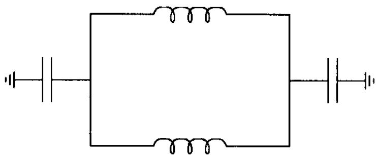  
图 2.9 驻波制冷机共振器最粗略的表示法

## 2.2.2 热驰豫传导

迄今所讨论的粘性效应仅仅是固体边界引起声衰减的原因之一，热驰豫效应在存在压力振荡的情况下也是同等重要的，因它导致了温度的振荡。热传递的通用方程如下[30]：

$$
\rho c _ {p} (\frac {\partial T}{\partial t} + V. \nabla T) - (\frac {\partial p}{\partial t} + V. \nabla p) = \nabla . (k \nabla T) + \text {速度平方项}\tag{2.24}
$$

这个方程表达了温度随时间的变化来源于三种效应的总和：压力变化、热传导和一些在声学近似下没有考虑的速度项。压力引起的温度变化的一个例子可用动画Ani Thermal/w 来显示。这幅动画显示了在半波长共振情况下温度、压力及气体的运动。温度的振荡与压力振荡成比例而且在时间上同相。这种绝热的温度振荡存在于自由空间中的所有声波，虽然对典型“可听声”来说，它们的振幅太小而不容易注意到。

像方程(2.10)-(2.13)那样，采用常见的复数记号来表达相关的量，我们发现方程(2.24)可简化为：

$$
i \omega \rho_ {m} c _ {p} T _ {1} - i \omega p _ {1} = k \frac {\partial^ {2} T _ {1}}{\partial y ^ {2}}\tag{2.25}
$$

与前面得到粘性表达式的思路类似，由于 $T _ { 1 }$ 在 x 方向上的导数为 $1 / \lambda$ 的量级，它远小于在y 方向上的量级（为 $\boldsymbol { l } / \delta _ { k }$ 的导数），因此我们忽略了 $T _ { 1 }$ 在 x 方向上的导数。固体壁面通常有足够大的热容和热导率而保证气体在 $y { = } 0$ 的壁面上有 $T _ { 1 } { = } 0$ 。另外一个必须的边界条件$T _ { 1 } ( \infty )$ 是有限的。方程(2.25)是一个关于 $T _ { 1 } ( y )$ 的常微分方程，它的形式和边界条件与关于 $U _ { 1 } ( y )$ 的方程(2.14)相同。根据这种相似性，可得到如下关于 $T _ { I } ( y )$ 的解：

$$
T _ {1} = \frac {1}{\rho_ {m} c _ {p}} [ 1 - e ^ {- (1 + i) y / \delta_ {\mu}} ] p _ {1}\tag{2.26}
$$

其空间平均值为：

$$
<   T _ {1} > = \frac {1}{\rho_ {m} c _ {p}} [ 1 - (1 - i) \frac {\delta_ {k}}{2 r _ {h}} ] p _ {1}\tag{2.27}
$$

与粘性效应对振荡速度的影响作用类似，方程(2.26)式描述了气体与固体热接触效应是如何减小温度振荡的幅度和改变它的相位。从最近的固体壁面起，那些距离远大于 $\delta _ { k }$ 的气体实际是绝热的，它们经历着绝热的温度振荡 $T _ { 1 } { = } ( 1 / \rho _ { m } C _ { p } ) p _ { 1 }$ ，在相位上与压力振荡 $p _ { 1 }$ 同相（如动画Ani Thermal/w 显示的那样）。而那些距离小于 $\delta _ { k }$ 靠近壁面的气体，其温度的振荡则很小，它被固体的热容锁定为随时间不变化的壁温 $T _ { \mathrm { m } } .$ 。在距离大致为 $\delta _ { k }$ 的气体，它们的温度振荡在幅度上逐渐减小且相位被逐渐调节。在边界层近似区域，方程(2.26)的函数依赖关系如动画 Ani Thermal/y显示的那样。动画中在y 轴上的刻度用 $\delta _ { k }$ 来分度，这幅动画展示了振荡温度随时间和从壁面开始的距离y的函数依赖关系。

$$
T (y, t) = T _ {m} + \frac {1}{\rho_ {m} c _ {p}} \operatorname{Re} \left[ \left(1 - e ^ {- (1 + i) y / \delta_ {k}}\right) p _ {1} e ^ {i \omega t} \right]
$$

(2.28)

气体朝向和离开壁面的运动用左右移动的垂直线条来表示。应用热力关系式：

$$
d \rho = - \frac {\rho}{T} d T + \frac {\rho}{p} d p\tag{2.29}
$$

我们可以得到截面平均的波动密度为

$$
<   \rho_ {1} > = - \frac {\rho_ {m}}{T _ {m}} <   T _ {1} > + \frac {\rho_ {m}}{p _ {m}} p _ {1}\tag{2.30}
$$

现在我们终于要处理连续方程了。对方程(1.9)作截面平均可以得到：

$$
i \omega <   \rho_ {1} > + \rho_ {m} \frac {d <   u _ {1} >}{d x} = 0\tag{2.31}
$$

利用方程(2.30)和(2.27)并且用消去 $\mathrm { C _ { p } }$ 可以得到

$$
c _ {p} = \frac {\gamma}{\gamma - 1} \frac {p _ {m}}{\rho_ {m} T _ {m}}\tag{2.32}
$$

$$
i \omega [ 1 + (\gamma - 1) (1 - i) \frac {\delta_ {k}}{2 r _ {h}} ] \frac {p _ {1}}{\gamma p _ {m}} + \frac {d <   u _ {1} >}{d x} = 0\tag{2.33}
$$

这个方程是在声波存在热松驰效应的情况下，连续方程的声学表达形式。

在前面的章节中，无损失的连续方程导致了方程(2.2)及声容的概念。这里，这个连续性方程导出了方程(2.33)，它同时包括了声容和热松驰效应。对于图 2.10a 中体积 $V { = } A \varDelta x$ 的短通道，其质量连续方程(2.33)可以重新写为：

$$
p _ {1} = - Z \Delta U _ {1}\tag{2.34}
$$

这里Z是一个声容和一个声阻的并联：

$$
\frac {1}{Z} = i \omega C + \frac {1}{R _ {k}}\tag{2.35}
$$

如图2.10b 所示，声容的有效值（量级为 $\mathcal { S } _ { k } / r _ { h } )$ 由下式给出：

$$
C \approx \frac {V}{\gamma p _ {m}}\tag{2.36}
$$

与声容并联的有效声阻 $R _ { k }$ 为：

$$
R _ {k} \approx \frac {2 \gamma p _ {m}}{\omega (\gamma - 1) S \delta_ {k}}\tag{2.37}
$$

因此，想像一下任何一段同时有声容和热松驰声阻的流道，其声容和阻引起从通道的一端到另一端有 $\varDelta U _ { I }$ 的变化。一个 $V { > } > s \ \delta _ { k }$ 的开阔空间 V，有 $\omega C { > } { > } 1 / R _ { k }$ ，因此声容为主要的阻抗。作这样的思考是有益的。对该空间 V的核心部份，它具有绝热的压缩率，对声容有主要贡献；而内壁面附近的区域，其有效体积为s $\delta _ { k }$ ，等于流道的表面积乘以热穿透深度，它有介于绝热和等温之间的中等程度的压缩性，对热松驰阻力起主要作用

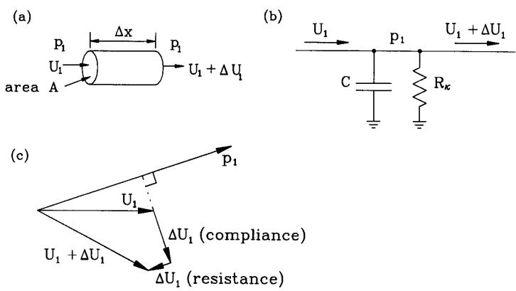  
图 2.10 这个连续性方程描述了通道的容性和阻性的效应

(a)截面积为 A，长度为 $\Delta \mathbf { x }$ 的短管；(b 以声容 C 和并联声阻 $R _ { \mathrm { k } }$ 的阻抗图；(c)典型的相位圈，它表明体积流率变化 $\varDelta U _ { 1 }$ 是容性和阻性分量的总和。

## 例子：驻波发动机

考虑一下外端“高温腔”（热端换热器的外端）（在图 1.10 中驻波发动机），这个位置靠近速度节点，因此其声感和声阻是不重要的。我们计算一下它的声容和它并联的热松驰阻力。在典型的运行工况下： 氦气， 的运行频率， 的温度。每一段高温腔的体积为 $1 2 0 \mathrm { c m } ^ { 3 }$ ，表面积为 $1 3 0 \mathrm { c m } ^ { 3 }$ （适当地考虑其表面积和由于电的引线穿过这个间所占的体积）。由于 $\delta _ { k }$ 仅有 0.2mm，我们可以用边界 层 方 程 (2.36) 和 (2.37) ， 计 算 得 到 $\mathbf { C } { = } 2 . 4 \times 1 0 ^ { - 1 1 } \mathrm { { m } ^ { 3 } / P a , 1 / \Delta } \omega$ $C { = } 1 7  { \mathrm { M P a . s } } /  { \mathrm { m } } ^ { 3 }$ 及 $R _ { k } { = } 2 3 5 0 \mathrm { M P a . s / m ^ { 3 } }$ C

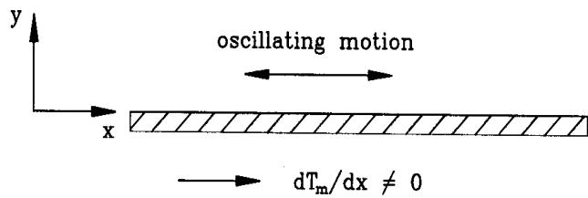

图 2.11 用于本节中的坐标系统。在边界层近似条件，对于壁面$\boldsymbol { y } > > \boldsymbol { \delta } _ { k }$ 的通道部分，由于太大故它不出现在这个图中。

## 例子：小孔脉冲管制冷机

图中1.16 的小孔脉冲管制冷机末端的空腔，其体积为 9.8 升，表面积大致为 $0 . 3 \mathrm { m } ^ { 2 } .$ 。在40Hz、充有 3.1MPa 的氦气的情况下，我们在前几页计算了它的声容 $C { = } 1 . 9 { ^ { \ast } } 1 0 ^ { - 9 } \mathrm { m } ^ { 3 } / \mathrm { P a } , ~ 1 / ~ \omega C { = } 2 . 1 \mathrm { M P a } . \mathrm { s } / \mathrm { m } ^ { 3 }$ 。方程(2.37)表明 $R _ { k } { = } 9 5 0 \mathrm { m P a . s / m } ^ { 3 }$ ，因此与 $\omega C$ 相比， $1 / R _ { k }$ 完全可以忽略。

## 2.3 无粘边界层热声学

现在我们最终进入到在声传播振荡方向上有很大平均温度的热声问题。我知道，对这种简单的问题在实际中是不存在的，因为粘性在这里被忽略了（然而，在实际中，粘性是不能被忽略的，因为粘性穿透深度和热穿透深度在典型的情况下具有同样量级的尺寸）。尽管如此，为了获得关于热声学直观的理解，我们将从这个不真实的无粘

问题的一个简单的分析开始。

考虑一个沿x方向上有一个非零的温度梯度的声振荡，固体边界的位置为 $\scriptstyle { \mathsf { y } } = 0$ ，如图 2.11 所示。从常见的传热方程(2.24)开始，将声学近似的合适的形式代入：

$$
p = p _ {m} + \mathrm{Re} [ p _ {1} (x) e ^ {i \omega t} ]\tag{2.38}
$$

$$
u = \mathrm{Re} [ u _ {1} (x, y) e ^ {i \omega t} ] + \dots\tag{2.39}
$$

$$
T = T _ {m} + \mathrm{Re} [ T _ {1} (x) e ^ {i \omega t} ] + \dots\tag{2.40}
$$

$$
\rho , e t c = T\tag{2.41}
$$

保留一阶量级项以获得合适的传热声学方程：

$$
\rho_ {m} c _ {p} \left(i \omega T _ {1} + u _ {1} \frac {d T _ {m}}{d x}\right) - i \omega p _ {1} = k \frac {\partial^ {2} T _ {1}}{\partial y ^ {2}}\tag{2.42}
$$

这个关于 $T _ { 1 } ( y )$ 的微分方程与方程(2.25)类似，但是多一个非0的$d T _ { m } / d x$ 项。记住我们已经假设了气体的粘度是0，因此 $U _ { 1 }$ 与y 无关。需要的边界条件是 $T _ { 1 } ( 0 ) { = } 0$ 和 $T _ { 1 } ( \infty )$ 是有限的，所得的解为：

$$
T _ {1} = \left(\frac {p _ {1}}{\rho_ {m} c _ {p}} - \frac {u _ {1}}{i \omega} \frac {d T _ {m}}{d x}\right) \left[ 1 - e ^ {- (1 + i) y / \delta_ {k}} \right]\tag{2.43}
$$

这个方程与方程(2.26)相似，由于多了 $u _ { 1 } d T _ { m } / d x$ 这项，因此其形式更复杂，这个解是两个因素的结果。第一个因素给出了在远离固体边界很远距离的振荡温度的整个幅度，而第二个因素描述了靠近固体边界的振荡温度随y 的变化关系。

与y有关的因子与我们在以以前见过的复数形式的边界层函数相同，如方程(2.15)和(2.26)以及动画 Anis Viscous/m 和 Thermal/y 所示的那样。再看一遍动画 Thermal/y 并分析一下图 2.12，它给出了方程(2.43)中第二项因子的实部和虚部。你应该可以看到图 2.12 中的实部和虚部的随着时间作光滑变化的发展情况，即从实部到负的虚部→负的实部→再到虚部→并返回到实部。

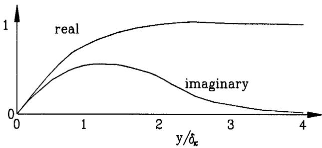  
图 2-12方程（2-43）中与y相关的因子的实部和虚部

方程(2.43)中幅度的因子是两项的总和，每一项都是很容易理解的。第一项是绝热的温度振荡，当压力上升时，温度就上升，当压力下降时，温度就下降。第二项是由于气体沿着具有温度梯度的 x方向运动所引起的温度变化（欧拉的观点），这是我们在流体力学中使用的常见的方程的表达式。在本章节中所有如方程(2.38)\~(2.43)所示的方程中， $( x , y )$ 是指空间中固定的位置。在方程(2.43)中的 u dTm/dx 项反映了这样的参考框架，当气体绝热地通过空间中的这些点时，在这个空间的这些点的温度要发生变化。（另外一种方法，即拉格朗日法，它更加注意一个特点的气体微团的运动，而不是空间中固定的点）。拉格朗日的观点经常能更好地发展直觉的理解，因此对许多的动画片，我们采用拉格郎日法。在拉格朗日法中，一个远离固体边界的气团经历 $T _ { 1 } { = } p _ { 1 } / \rho _ { { \ m } } C _ { p }$ 的温度变化，与它的速度或是否有非零的温度梯度 $d T _ { m } / d x$ 存在无关。

因此，方程(2.43)中的幅度因子就是由绝热压力变化引起的温度振荡与绝热的运动所引起的温度振荡的线性叠加。这个因子是一个复数，它可以有任意的符号和相位，取决于 $p _ { 1 }$ 和 $U _ { 1 }$ 的相对相位及压力相对于运动的幅度。

如果下式成立，

$$
\frac {\left| p _ {1} \right|}{\rho_ {m} c _ {p}} = \frac {\left| u _ {1} \right|}{\omega} \frac {d T _ {m}}{d x}\tag{2.44}
$$

则对驻波声场，方程(2.43)中整个幅度因子可为0。

在特定的情况下，气体的物理性、驻波的阻抗以及温度梯度共同作用，使得压力引起的温度振荡与运动引起的温度振荡幅值相同但相位相反，这种情况如动画Ani Standing/c 所示。这幅动画中上边的一幅显示了在共振器中的一个驻波。共振器的热声堆靠近左端，标有蓝色的线显示了运动的气体。一片在热声堆中的特别的气团则用一个运动的白点而强调，黄色椭圆标记的这个区域在左侧的中央被放大显示，这个区域是同一个气体微团和与它相邻近的两块热声板的一部份。这个气团的体积变化随压力和温度而变。在这个屏幕的左下侧是温度随位置的变化图。在这幅图中，气体的温度用蓝色跟踪，而靠近热声堆附近板叠的气体是白线，这里 $r _ { h } \sim \mathcal { \delta } _ { k }$ ，因此热交换是很差的。这个气团的温度振荡完全是由于绝热的压力变化引起的温度振荡，而且它的温度振荡和运动正好与局部温度梯度 $d T _ { m } / d x$ 相匹配，因此在一个固定的位置上的温度与时间无关。

这种情况对驻波发动机和制冷机来说非常重要，为此，我们给它一个特别的名字---临界温度梯度：

$$
\nabla T _ {c r i t} = \frac {\omega A | p _ {1} |}{\rho_ {m} c _ {p} | U _ {1} |}\tag{2.45}
$$

记号 $( \nabla \mathrm { T } _ { \mathrm { m } } ) _ { \mathrm { c r i t } }$ 虽然更准确一些，但有些捌扭。以后我们会看到，在驻波发动机里 $d T _ { m } / d x { > } \bigtriangledown T _ { c r i t }$ ，而在无粘的驻波制冷机里有 $d T _ { m } / d x <$ $\bigtriangledown T _ { c r i t }$ 。虽然非零的粘性会使这个条件极大地模糊，但是方程(2.45)所定义的 $\bigtriangledown T _ { c r i t }$ 仍提供了一种有用的基准。

方程(2.43)是一个的实实在在的复数。从字面上看“复数”包括实部和虚部。从常见的英文意思讲，“复数”是一个关于 y 的复数函数的组合，其幅度因子可以给任何符号、相位及你所想的所有幅值。在热声学里碰到极其丰富的东西---驻波行为，行波行为，小孔行为…，等等，其根源来自于方程(2.43)的复杂性，它表示了声波与其相邻的固体边界在声波传播方向上的热相互作用。

## 2.4 通用热声学

有了前面对一些无粘的边界层热声学问题以及边界耗散问题的感性认识之后，我们现在可以进行一个完整的热声学动态方程的推导，它们将包括粘性和任何形状和尺寸的通道。

## 2.4.1 数学处理

自然地，这些方程基于声学近似的基础上，相关的量可以如下记出：

$$
p (x, t) = p _ {m} + \mathrm{Re} [ p _ {1} (x) e ^ {i \omega t} ]\tag{2.46}
$$

$$
U = \mathrm{Re} [ U _ {1} (x) e ^ {i \omega t} ]\tag{2.47}
$$

$$
u = \mathrm{Re} [ u _ {1} (x, y, z) e ^ {i \omega t} ]\tag{2.48}
$$

$$
T = T _ {m} (x) + \mathrm{Re} [ T _ {1} (x, y, z) e ^ {i \omega t} ]\tag{2.49}
$$

$$
\rho = \text { 类似 } T\tag{2.50}
$$

$$
\mu = \mu (X)\tag{2.51}
$$

$$
a, k, e t c = \text { 类似 } \mu\tag{2.52}
$$

在本节中，我们最感兴趣的量是 $p _ { 1 }$ 和 $U _ { 1 }$ ，它们由动量方程和连续性方程描述。为清楚起见，在这里我们仅考虑固体热容很大的情况，这样在热声堆固体材料的温度 $T _ { m } ( x )$ ，它与时间、y和 z均无关。同时，我们还继续将我们的注意力局限于理想气体（对有限的固体热容和非理想气体的情况，请参阅[36]）。

非零的 $d T _ { m } / d x$ 对声学近似下的动量方程没有任何影响，因此，我们有下列 x方向上的动量方程：

$$
i \omega \rho_ {m} u _ {1} = - \frac {d p _ {1}}{d x} + \mu \left[ \frac {\partial^ {2} u _ {1}}{\partial y ^ {2}} + \frac {\partial^ {2} u _ {1}}{\partial z ^ {2}} \right]\tag{2.53}
$$

由于 $u _ { 1 }$ 关于x 的导数为 1/λ的量级，远小于对 y或 z的导数，因此它们可以忽略。将方程(2.53)视为关于 $u _ { 1 } ( y , z )$ 的微分方程。在固体表面的边界条件 $u _ { 1 } { = } 0$ ，可以得到如下的解：

$$
u _ {1} = \frac {i}{\omega \rho_ {m}} [ 1 - h _ {\nu} (y, z) ] \frac {d p _ {1}}{d x}\tag{2.54}
$$

这里的 $h _ { \nu } ( y , z )$ 是所考虑情况下的取决于具体几何结构的函数。

对横截面通道 A，对方程(2.54)的两侧进行关于 y 和 z 积分，我们可得到左侧的体积流量 $U _ { 1 }$ , 并将 $h _ { \nu } ( x , y )$ 转化为空间平均函数 $f _ { \nu }$ ，解出 $d P _ { 1 }$ 得到：

$$
d p _ {1} = - \frac {i \omega \rho_ {m} d x / A}{1 - f _ {\mu}} U _ {1}\tag{2.55}
$$

效果上，我们把这个对动量方程的近似当作热声学压力梯度的来源：气体 $U _ { 1 }$ 的运动导致了压力梯度。如果 $f _ { \nu } = 0$ ，由方程(2.55)中的i 所指出，压力梯度完全是感抗的。但是当 $f _ { \nu } \neq 0$ 时，粘性和静止边界的存在对压力梯度增加了一个阻性的分量，同时还有效地改变了感抗贡献的幅度。

函数 $h _ { \nu } ( x , y )$ 和它的空间平均值 $f _ { \nu }$ 对许多几何结构是已知的。复数 $f _ { \nu }$ 对某些几何结构已画在了中 2.13 中。从我们上面所看到的，对于宽流道，边界层近似是适合的：

$$
h = e ^ {- (1 + i) y / \delta_ {k}}\tag{2.56}
$$

$$
f = \frac {(1 - i) \delta}{2 r _ {h}}\tag{2.57}
$$

如果将两块平行板的中心取为 $y { = } O$ ，其间距为 $2 { \mathrm { y } } _ { 0 } { = } 2 r _ { h }$ ，则：

$$
h = \frac {\cosh [ (1 + i) y / \delta ]}{\cosh [ (1 + i) y _ {0} / \delta ]}\tag{2.58}
$$

$$
f = \frac {\tanh [ (1 + i) y / \delta ]}{(1 + i) y _ {0} / \delta}\tag{2.59}
$$

对圆形流道， $R { = } 2 r _ { h }$ ，有：

$$
h = \frac {J _ {0} [ (i - 1) r / \delta ]}{J _ {0} [ (i - 1) R / \delta ]}\tag{2.60}
$$

$$
f = \frac {2 J _ {1} [ (i - 1) R / \delta ]}{J _ {0} [ (i - 1) R / \delta ] (i - 1) R / \delta}\tag{2.61}
$$

这里，坐标 $r = \sqrt { { y } ^ { 2 } + { z } ^ { 2 } }$ 。这些函数对矩形流道 $2 y _ { 0 } X 2 z _ { 0 }$ 也是已知的[28]：

$$
h = 1 - \frac {1 6}{\pi^ {2}} \sum_ {m, n, \text {奇数}} \frac {\sin (m \pi y / 2 y _ {0}) \sin (n \pi z / 2 z _ {0})}{m n C _ {m n}}\tag{2.62}
$$

$$
f = 1 - \frac {6 4}{\pi^ {4}} \sum_ {m. n. \text {奇数}} \frac {1}{m ^ {2} n ^ {2}}\tag{2.63}
$$

这里，

$$
C _ {m n} = 1 - i \frac {\pi^ {2} \delta^ {2}}{8 y _ {0} ^ {2} z _ {0} ^ {2}} (m ^ {2} z _ {0} ^ {2} + n ^ {2} y _ {0} ^ {2})\tag{2.64}
$$

对于沿声振动方向排列的针束，每一个有半径为 $\mathbf { r } _ { 0 }$ ，并被排列为三角形陈列[43]，其中心间距为 $\sqrt { 2 \pi } r _ { 0 } / 4 \sqrt { 3 } \approx 1 . 9 0 5 r _ { 0 }$ ，则 $h _ { \nu }$ 和 $f _ { \nu }$ 为：

$$
h \approx \frac {Y _ {1} (\xi_ {0}) J _ {0} (\xi) - J _ {1} (\xi_ {0}) Y _ {0} (\xi)}{Y _ {1} (\xi_ {0}) J _ {0} (\xi_ {i}) - J _ {1} (\xi_ {0}) Y _ {0} (\xi_ {i})}\tag{2.65}
$$

$$
f \approx - \frac {2 \xi_ {i} Y _ {1} (\xi_ {0}) J _ {1} (\xi_ {i}) - J _ {1} (\xi_ {0}) Y _ {1} (\xi_ {i})}{\xi_ {0} ^ {2} - \xi_ {i} ^ {2} Y _ {1} (\xi_ {0}) J _ {0} (\xi_ {i}) - J _ {1} (\xi_ {0}) Y _ {0} (\xi_ {i})}\tag{2.66}
$$

这里，

$$
\xi = (i - 1) r / \delta
$$

在连续性方程中，要获得空间平均值 ${ < } T _ { 1 } >$ ，需要对振荡温度作关于 $\mathrm { y }$ 和 z的积分。如上所述，在声学近似条件下，它可以从传热的通用方程中得到：

$$
\rho_ {m} c _ {p} \left(i \omega T _ {1} + u _ {1} \frac {d T _ {m}}{d x}\right) - i \omega p _ {1} = k \left[ \frac {\partial^ {2} T _ {1}}{\partial y ^ {2}} + \frac {\partial^ {2} T _ {1}}{\partial z ^ {2}} \right]
$$

将这个方程视为关于 $\mathrm { y }$ 和 z的微分方程，采用与前类似步骤但在这里包括了 $U _ { 1 }$ 对任何通道形状关于 y 和 z 的函数关系，我们可以得到：

$$
T _ {1} = \frac {1}{\rho_ {m} c _ {p}} \left(1 - h _ {k}\right) p _ {1} - \frac {1}{i \omega A} \frac {d T _ {m}}{d x} \frac {\left(1 - h _ {k}\right) - \sigma \left(1 - h _ {\mu}\right)}{\left(1 - f _ {\mu}\right) (1 - \sigma)}\tag{2.67}
$$

$$
<   T _ {1} > = \frac {1}{\rho_ {m} c _ {p}} \left(1 - f _ {k}\right) p _ {1} - \frac {1}{i \omega A} \frac {d T _ {m}}{d x} \frac {\left(1 - f _ {k}\right) - \sigma \left(1 - f _ {\mu}\right)}{\left(1 - f _ {\mu}\right) (1 - \sigma)}\tag{2.68}
$$

这个方程可以与方程(2.26)、(2.27) 特别是(2.43)相比较 。

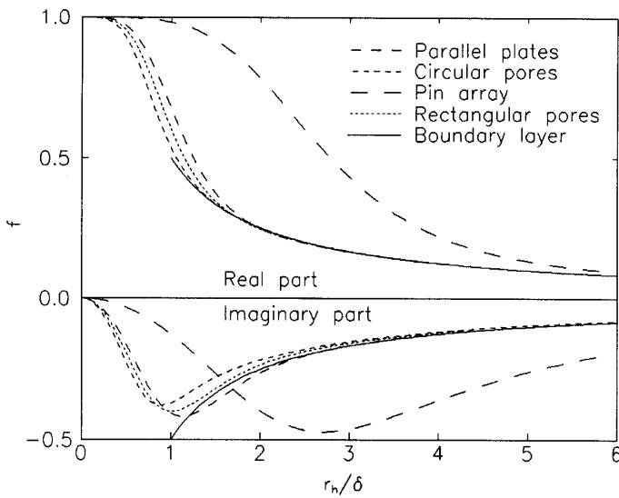  
图 2.13 若干种不同几何结构的空间平均函数 $f _ { \nu }$ 。在图

中，对于矩形，其长宽比为 6:1；对于针束， $r _ { i } / r _ { 0 } = 6$ 。对所有的几何结构，边界层极限可以在 $r _ { \mathrm { h } }$ 很大时达到。

在连续方程中，我们必须包括 $\rho _ { m }$ 关于x 的关系：

$$
i \omega <   \rho_ {1} > + \frac {d}{d x} (\rho_ {m} <   u _ {1} >) = 0\tag{2.69}
$$

将方程(2.68)和(2.30)代入上述方程可以得到：

$$
d u _ {1} = - \frac {i \omega A d x}{\gamma p _ {m}} [ 1 + (\gamma - 1) f _ {k} ] p _ {1} - \frac {(f _ {k} - f _ {\mu})}{(1 - f _ {\mu}) (1 - \sigma)} \frac {d T _ {m}}{T _ {m}} U _ {1}\tag{2.70}
$$

作为对连续方程的一个完整热声学近似，这个表达式可以找到很容易的物理解释。在方程(2.70)中的两项表明， $U _ { 1 }$ 的梯度可以来自于压力或者是有温度梯度的速度。首先考虑压力项，如果 $f _ { k } { = } O$ ，即气体和固体之间没有热交换，因此密度振荡是绝热的。在这种情况下， $1 / r p _ { m }$ 代表压缩性，而长度为 $d x$ 的通道段的声容必为 $A d x / r p _ { m } = d V / r p _ { m } 。$ 。正如我们在方程(2.3)中所发现的那样，在另外一种极限情况，如果 $f _ { k } { = } 1$ 即气体与固体之间的热交换是完善的，那么气体的温度将被锁定为当地的固体温度。在这种情况下，等温压缩率采用 $1 / p _ { m }$ 是合适的。对中等程度的热交换，其有效的压缩率 $[ { I + ( r - I ) } f _ { k } ] / r p _ { m }$ 具有中等的幅度和重要的相位，它描述了密度振荡的空间平均值随压力振荡的关系。接下来我们来考虑速度项，对于无粘极限这种易于解释的情况（ $f _ { \nu } = 0$

$\sigma = 0 )$ ），它等于 $f _ { k } d T _ { m } / d x$ 。如果 $f _ { k } { = } O$ ，即在气体和固体之间没有热接触，这样速度项为0，它表明气体的密度在沿着x方向运动时不发生变化。在另外一种情况，如果 $f _ { k } { = } 1$ ，那么这个气体总是与局部的固体温度相同，因此当它流向高温时，其密度降低而流向低温其密度升高。在更一般、更有趣的中等程度的区域，气体沿温度梯度的振荡运动导致复杂的密度振荡。

方程(2.55)和(2.10)可以应用到许多的热声情况，可以作为两个主要的热声分析工具。本章中前面许多的表达式都是这两个方程的简化形式。下一节中，我们将更仔细地考查由这两个方程所表达的有效的声容、声感和声阻。

[更详细的细节：迄今我们所看到的 $f$ 关于 $r _ { h } / \delta$ 的图形和方程主要是针对驻波热声学感兴趣的几种几何结构。采用同样的分析思路也可以考查常用于斯特林系统中丝网堆积结构的分析。这里给出了从文献[44]得到总结。假设一个具有正弦体积流量的波通过丝网填充的回热器，且在每一时刻采用对稳态流动发表的粘性压力降和传点数据对这种振荡波是合理有效的话，那么就可以得到包含有那些复杂流动压降和传热关系在内的动量方程和连续方程的付里叶变换式。所获得的

$$
f _ {k}
$$

$$
f _ {\nu}
$$

$$
r _ {h} / \delta_ {k}
$$

$$
r _ {h} / \delta_ {\nu}
$$

体积孔隙率以及流动的峰值雷诺数Re的关系式,这些结果仅仅是对于行波设备在具有较小的 $r _ { h } / \delta _ { k }$ 才有效。在定性上，这些结果与图 2.13中在低 $r _ { h } / \delta _ { k }$ 区域相似，对不同孔隙度的丝网床体和不同雷诺数的情况会有一些微小的差别（例如不同的声幅度）。另外一个小的细节你可以在文献[44]中发现，出现在连续性方程 $p _ { 1 }$ 项中的 $f _ { k }$ 实际上与出现在 $U _ { 1 }$ 项中的 $f _ { k }$ 有些不同，请参看第5章中进一步的讨论。

最后，在此我们可以合并方程(2.55)和(2.70)而消去 $U _ { 1 }$ ，从而得到一个关于 $p _ { 1 }$ 的二阶的微分方程：

$$
[ 1 + (\gamma - 1) f _ {k} ] p _ {1} + \frac {\gamma p _ {m}}{\omega^ {2}} \frac {d}{d x} \left(\frac {1 - f _ {\mu}}{\rho_ {m}} \frac {d p _ {1}}{d x}\right) - \frac {a ^ {2}}{\omega^ {2}} \frac {(f _ {k} - f _ {\mu})}{1 - \sigma} \frac {1}{T _ {m}} \frac {d T _ {m}}{d x} \frac {d p _ {1}}{d x} = 0\tag{2.71}
$$

这就是 Rott的波动方程，它是热声学发展史上的一个里程碑。 $\overrightarrow { j } ^ { \mathrm { { I } \varepsilon } }$ 格地讲，我们应该称之为 Helmholtz 方程，因为时间导数项用 1$\omega$ 取代了。对数值计算，可以非常容易地将方程(2.55)和(2.70)分开使用。为了更为直观认识它们，可以分开来考虑方程(2.55)和(2.70)，我们将在下一节中进行。

## 2.4.2 处理思路

前一小节的主要结果是获得了动量方程和连续方程的热声学形式，即方程(2.55)和方程(2.70)：

$$
\begin{array}{l} d p _ {1} = - \frac {i \omega \rho_ {m} d x / A}{1 - f _ {\mu}} U _ {1} \\ d U _ {1} = - \frac {i \omega A d x}{\gamma p _ {m}} [ 1 + (\gamma - 1) f _ {k} ] p _ {1} + \frac {(f _ {k} - f _ {\mu})}{(1 - f _ {\mu}) (1 - \sigma)} \frac {d T _ {m}}{d x} U _ {1} \end{array}
$$

在这一小节，我们按照图 2.14 表达的要点，力图获得这两个方程更深入一些直觉的理解。在这张图中，长度为 $\Delta \mathbf { x }$ 的通道可以从两种途径加以考虑，根据动量方程可以得到它的声感和声阻力，而根据连续性方程可以得到它的声容，热松驰阻力以及温度梯度引起的体积流量源，把这两点结合起来就可以得到热声学完整一幅阻抗图，正如动量方程和连续方程提供了联系p 和 $p _ { 1 }$ $U _ { 1 }$ 的一个完整的描述。

我们从动量方程出发，如果重新改写方程(2.55)为如下形式：

$$
d p _ {1} = - (i \omega l d x + r _ {\mu} d x) U\tag{2.72}
$$

如图 2.14 图中左部份显示的那样，因此每单位通道长度的声感和粘性阻力可写为：

$$
l = \frac {\rho_ {m}}{A} \frac {1 - \operatorname{Re} [ f _ {\mu} ]}{\left| 1 - f _ {\mu} \right| ^ {2}}\tag{2.73}
$$

$$
r _ {\mu} = \frac {\omega \rho_ {m}}{A} \frac {\mathrm{Im} [ - f _ {\mu} ]}{\left| 1 - f _ {\mu} \right| ^ {2}}\tag{2.74}
$$

在本章中前面的关于边界层近似的表达式方程(2.21)和(2.22)就是在 $r _ { h } / \delta _ { k }$ 很大的情况下方程(2.73)和(2.74)的极限形式。

仔细研究方程(2.73)、(2.74)以及图2.13，就可以想像到任何通道都有声感和阻力，其具体情况由 $f _ { \nu }$ 决定的。l 和 $r _ { \nu }$ 都是正的（实的），因此，动量方程决不可能有负的惯性质量也不会有负的流动阻力的行为。在图 2.13 中，对于大的水力半径对应的极限情况，很清楚l 趋向于 $\rho _ { m } / A$ ， 而 $r _ { \nu } \to 0$ 。对小于无穷大但水力半径仍很大的情况， $r _ { \nu }$ 随着在壁面粘性拖拽力重要性增加而增加，而l 随着在粘性穿透深度减小了有用的流通面积而使其在 $\rho _ { m } / A$ 的基础上增加。这是一个在共振管和脉冲管中都感兴趣的一个区域，其比值为；

$$
\frac {r _ {\mu}}{\omega l} = \frac {\mathrm{Im} [ - f _ {\mu} ]}{1 - \mathrm{Re} [ f _ {\mu} ]}\tag{2.75}
$$

可以容易地发现，在 $r _ { h }$ 与 $\delta _ { \mu }$ 相近的区域，声阻抗的阻力和惯性部份有可比的幅度，这是驻波热声机械中热声堆感兴趣的区域。对最小的流道，例如在行波机械中的回热器，阻抗的惯性部份与阻力部份相比是可以忽略。

下面考虑一下连续性方程，我们将方程（2.70）写为下列形式：

$$
d U _ {1} = - (i \omega c d x + \frac {1}{r _ {k}}) p _ {1} + e d x U _ {1}\tag{2.76}
$$

正如图 2.14 中右边部份图示的那样，图中的两种熟悉的符号代表每单位长度的声容抗：

$$
c = \frac {A}{\gamma p _ {m}} (1 + [ \gamma - 1 ] \mathrm{Re} [ f _ {k} ]\tag{2.77}
$$

而每单位长度的热松驰声导，即阻力的倒数，为：

$$
\frac {1}{r _ {k}} = \frac {\gamma - 1}{\gamma} \frac {\omega A \operatorname{Im} [ - f _ {k} ]}{p _ {m}}\tag{2.78}
$$

本章中前面的边界层近似表达式，如方程(2.36)和(2.37)就是方程(2.71)和(2.72)对大的水力半径情况下的极限形式。

仔细研究方程(2.71)、(2.78)和图 2.13，可以发现 C 和 $r _ { k }$ 都是正的（实的）。对于图 2.13 中大通道 $f _ { k }$ 的极限表达式，很清楚在极限情况下 $C {  } A / r p _ { m }$ 且 $r _ { k } \to \infty$ 。在小于无穷大但仍然具有大通道尺寸的情况，$1 / r _ { k }$ 随着在壁面热驰豫重要性的增加而在0的基础上增加，而C则随着壁面热穿透深度对每单位体积贡献比远离壁面更大的压缩性的增加而在高于 $A / r p _ { m }$ 上增加，这是一个对共振器和脉冲管都感兴趣的区域，它们二者之比为：

$$
\frac {1}{\omega r _ {k} c} = \frac {\gamma - 1}{1 + (\gamma - 1)} \frac {\operatorname{Im} \left[ - f _ {k} \right]}{\operatorname{Re} \left[ f _ {k} \right]}\tag{2.79}
$$

可以容易地发现，在 $r _ { h }$ 与 $\delta _ { \phantom { } _ { k } }$ 相当的区域，热松驰阻力和容抗部份是可比的。这是一个驻波设备中热声堆感兴趣的区域。在最小的区域，例如行波设备中的回热器，阻抗中的热松驰阻力部份与容抗相比是可以忽略的。

第三，在阻抗图中的新符号代表一个体积流控源edxU(或者汇，取决于温度梯度的符号)，它与局部体积流率 $U _ { 1 }$ 成正比，比例常数为：

$$
e = \frac {\left(f _ {k} - f _ {\mu}\right)}{\left(1 - f _ {\mu}\right) (1 - \sigma)} \frac {1}{T _ {m}} \frac {d T _ {m}}{d x}\tag{2.80}
$$

它代表了一项复数体积流的增长（或者衰减），来源于通道的一个非零温度梯度的。

连续性方程中的 $e U _ { 1 }$ 项与 $p _ { 1 }$ 没有关系，因此它肯定不代表任何可压缩性。为了理解这项的意义，让 $p _ { 1 } { = } 0$ 以使 C 和 $r _ { k }$ 在本段中主题不相互混淆。 $e U _ { 1 }$ 与 $d T _ { m } / d x$ 的关系是本节的关键。在脉冲管或者其它大

直径的热缓冲管 $f _ { \mathrm { k } }$ 和 $f _ { \nu }$ 是很小的，因此即使 $d T _ { m } / d x \not = 0 ,$ $e \approx 0 _ { c }$ 在这种情况下，连续方程的 $e U _ { 1 }$ 项说明了有多少体积流进就有多少从另一端流出，这种行为实质上与一个具有温度梯度和质量密度梯度的固体活塞的移动是相同的。对另外一种极限情况，如果一个具有很小通孔的具有温度梯度的通道，例如回热器，体积流量源 $e U _ { 1 }$ 项是很重要的。对小流道极限，方程(2.80)是最重要且最容易评价的。对于$r _ { h } < < \delta _ { k }$ 且 $r _ { h } < < \delta _ { \nu } r _ { \nu } \to 0$ ，有：

$$
e U _ {1} \approx \frac {1}{T _ {m}} \frac {d T _ {m}}{d x} U _ {1}\tag{2.81}
$$

在这种情况下，连续性方程中的 $e U _ { 1 }$ 项说明 $d u _ { 1 } / u _ { 1 } { = } d T _ { m } / T _ { m }$ ，即体积流率随温度的升高而成比例的放大（或随温度的下降而成比例的降低）。对于一阶的质量流率 $\rho _ { { } _ { m } } U _ { 1 }$ ，它与 $U _ { \mathrm { { l } } } / T _ { \mathrm { { m } } }$ 是相同的，这一点对理想气体是容易理解的，有多少质量从一端流进就有多少质量从另一端流出。在热交换最好的极限情况下， $T _ { 1 } { = } O$ 。因之在体积 $d V$ 内没有振荡的质量密度。

在 $r _ { h } / \delta \kappa { \sim } 1$ 具有中等程度热交换的更复杂的情况，如驻波系统中热声堆所碰到的情况，可由方程(2.80)的边界层极限得到：

$$
e U _ {1} \approx \frac {1 - i}{2} \frac {1}{1 + \sqrt {\sigma}} \frac {\delta_ {k}}{r _ {h}} \frac {1}{T _ {m}} \frac {d T _ {m}}{d x} U _ {1}\tag{2.82}
$$

在这种情况下，体积流量源正比体积流率，但有 $- 4 5 ^ { \circ }$ 的相移。

如果我们现在合并动量方程和连续性方程，并用向量显示在图2.14 中的下端，就可以获得任何通道的一幅完整的通用的热声学图画。我们可能想像 $p _ { 1 } , ~ U _ { 1 } , ~ T _ { \mathrm { m } } , ~ d T _ { \mathrm { m } }$ 和给定的几何结构中，以使阻抗图作为表达连续性方程和动量方程是如何产生 $d p _ { 1 }$ 和 $d U _ { 1 }$ 的一种提醒手段。

对于一个热声系统中给定位置的多数情况，在这幅通用的阻抗图中，部件的许多部份是可忽略的。记住对理想气体 $\delta _ { \ k _ { k } } \sim \delta _ { \mu }$ ，我们

可以得到如下对不同尺寸和重要性的一张表：

谐振管 $\delta < < r _ { h } , r _ { \mu } < < \omega l , 1 / r _ { k } < < \omega c , e = 0$

脉冲管 $\delta < < r _ { h } , r _ { \mu } < < \omega l , 1 / r _ { k } < < \omega c , e \approx 0$

热声堆 $\delta \approx r _ { h } , r _ { \mu } \approx \omega l , 1 / r _ { k } \approx \omega c , e$ 为复数

回热器 $\delta r _ { h } > > , r _ { \mu } > > \omega l , 1 / r _ { k } < < \omega c , e \approx \nabla T _ { m } / T _ { m }$

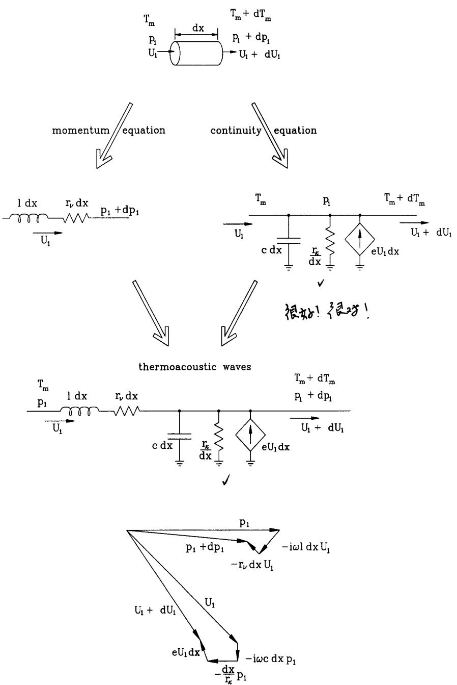  
图 2.14 本章中最重要概念的总结

例子：驻波发动机

图 1.9 和图 1.10 中发动机的热声堆都是平行平板的结构，它们的板间距为 0.01 英寸，因此 $r _ { \mathrm { h } } { = } 0 . 1 3 \mathrm { m m }$ 。板中央的温度大约为 550K，在典型的远行工况下：运行频率 390Hz，3MPa 的氦气。热穿透深度和 粘 性 穿 透 深 度 分 别 为 $\delta _ { \scriptscriptstyle k } = 0 . 1 2 \mathrm { m m }$ 及 $\delta _ { \mu } = 0 . 1 \mathrm { m m }$ ， 因 此 ，

$$
\delta_ {k} / \delta_ {\mu} = 1. 1, r _ {h} / \delta_ {k} = 1. 3
$$

力、声容、热驰豫阻力以及体积流源都可能是重要的。但是，这些热声堆靠近驻波的速度节点，因此声感和粘性阻力与其它三种阻抗相比很可能不太重要。图 2.15 所示的阻抗图也许具有足够的细节来表明这个装置中最重要的特征。整个共振器被描绘成一个在两个声容之间有一段声感的Helmholtz系统，虽然在这个层次上的细节没有显示出这个装置中p 和 $p _ { 1 }$ $U _ { 1 }$ 随 x 关系的波动本质，但是它成功地表明这个装置的左右两半的压力在相位上相关 $1 8 0 ^ { \circ }$ ，且在左半部份压力由于声感的作用而领先于体积流率 $9 0 ^ { \circ }$ ，在右半部份压力滞后于体积流 $9 0 ^ { \circ }$ 通过眼睛来判断图 1.10 可知每一个热声堆中的气体体积与热端管道的体积是可比的，即热声堆的声容与热端管道的声容是可比的，因此，由热声堆声容导致的 $\varDelta U _ { 1 }$ ，近似等于热声堆热端 $U _ { 1 }$ 本身的大小。它表明热驰豫阻力和热声堆中的体积流源对 $| U _ { 1 }$ |仅引起很小的变化，对其相位从热声堆左端到右端仅有 $5 ^ { \circ }$ 的相位差。另外，到制冷机支路的效应是可与之相比较的。

为了获得系统中p 和 $p _ { 1 }$ $U _ { 1 }$ 更为详细的信息，将这个装置一半的所有几何结构-氦气压力-温度等等提供给 DeltaE，选择了一种特定的远行幅度，要求 DeltaE 画出 $p _ { 1 }$ 和 $U _ { 1 }$ 随位置的函数关系，（参看附录的细节）结果如图 2.16 所示。选择 $\mathbf { \boldsymbol { x } } \mathrm { = } \mathbf { \boldsymbol { 0 } }$ 的位置压力 $p _ { 1 }$ 的相位为 $0 _ { \circ }$ 。对于驻波，我们预期压力保持为实数，而且看起来很像x的余弦函数；体积流率为虚数，看起来为x的正弦函数，如图中显示的那样。A与x的关系显示在这张比例画出的图中，导致了偏离完全的三角函数，但是这种偏离用肉眼在这张圆中是看不出来的。对大多数的部份，$d p _ { \mathrm { l } } / d x$ 是由于声感和 $U _ { 1 }$ 引起的，而 $d u _ { \mathrm { l } } / d x$ 是由于声容和 $p _ { 1 }$ 引起的。

但是，有一些小的与 $p _ { 1 }$ 和 $U _ { 1 }$ 不同相的分量，它们被放大20 倍和10 倍，以便使它们清楚地 $\frac { \varTheta } { \mathfrak { N } }$ 示出来。如许多驻波系统中的那样， $p _ { 1 }$ 和 $U _ { 1 }$ 的相位差保持在接近 $9 0 ^ { \circ }$ ，使得相位图在这里没有多大用处。$\mathrm { R e } [ U _ { 1 } ]$ 的阶跃发生在到制冷机的分叉处，这是由于 $U _ { 1 }$ 流进了制冷机的缘故。 $\mathsf { R e } [ U _ { 1 } ]$ 沿热声堆向上倾斜是由于有体积流源项， $\mathrm { I m } [ p _ { 1 } ]$ 向上倾斜是由于在热声堆中有的存在。其它地方 $\mathrm { R e } [ U _ { 1 } ]$ 和 $\mathrm { I m } [ p _ { 1 } ]$ 更小一些倾斜的部份原因来自于 $r _ { k }$ 和 $r _ { \nu }$ 存在以及 C 和 l 与 $\mathrm { I m } [ p _ { 1 } ]$ $\mathsf { R e } [ U _ { 1 } ]$ 的相互作用。

  
图2.15 驻波发动机阻抗示意图

  
图 2.16 驻波发动机中动量方程和连续性方程的数值积分的结果。  
(a)简略阻抗图； (b)装置的比例图； (c) $p _ { 1 }$ ； (d) $U _ { 1 }$

例子：热声斯特林发动机

在图1.13和图1.14中，发动机的回热器是用水力半径为42μm的不锈钢网制成的填充床。在典型的运行工况下：80Hz，3MPa 的氦气，回热器中部的温度为 650K，此时热穿透深度为 $\delta _ { \boldsymbol { k } } = 3 0 0 \mu m$ $\delta _ { \mu } = 2 5 0 \mu m$ ，因此，我们有 $r _ { h } < < \delta _ { k }$ ，所以声感和热驰豫阻力是可忽略的，而体积流源可以用方程(2.8.1)很好地描述。回热器可以用图2.17中标有回热器的三种阻抗分量来充分地建模。热缓冲管的直径为9cm，因此 $\delta < < r _ { h }$ ，这样它的最重要的动力特性是它的声容，如图 2.17显示的那样。反馈回路可粗略地考虑为一个声感（垂直的部份）并顺序地联接着一个声容（在左端的一段 $1 8 0 ^ { \circ } \mathrm { U }$ 型均匀管道）并联接着一个声容（右端的大空腔）。我们忽略与这两个部件有相的阻力。接头右端的谐振管可近似为一段声感，并且并联着一个声容（右端的大空腔）。这两个部件都有相关的阻力。共振系统的这些元件都不是真正的集中参数元件，但这里我们可以忽略那些细微之处。系统中可调负载包括一个可调的阀门和与之相联的空腔，它可以考虑为一个阻力和一个声容。因此，图2.17 的阻抗图表达了这个系统中最重要的特征。

动画片 Tashe/t 表达了这个热声斯特林发动机同样的特征，但动画片中忽略去了谐振管和可调节的负载。同时研究一下这幅动画片和图 。在这幅动画片中，你应该可以明白我们在本章中讨论的许多特征。两个大的声容的作用应该是很显然的，进口的 $U _ { 1 }$ 与出口的 $U _ { 1 }$ 是不相同的。仔细的分析表明 $\Delta U _ { 1 }$ 与 $p _ { 1 }$ 有 90 的相位差。连接条件 $\ -- p _ { 1 }$ 和 $U _ { 1 }$ 在两个部件的过渡处的保守性---应该是显然的，例如在这个惯性管的末端及在三通处。显然，通过具有阻力的回热器的速度与 $\Delta p _ { 1 }$ 是同相的，而速度在通过惯性管后滞后 $\Delta p _ { 1 } 9 0 ^ { \circ }$ 。虽然与回热器有关的声容和休积速度源在这幅动画过程也被正确的考虑，但我得承认它们在这里太微妙而不能分析得很清楚。

例子：驻波制冷机

图2.18给出了图1.11和1.12中驻波制冷机的集中参数的阻抗图，这里的热声堆有 $r _ { h } / \delta \sim 1$ ，因此所有阻抗的分量---声感、粘性阻力、声容、热驰豫阻力、体积流量源---应该是重要的。在上面中的驻波发动机中，我们声明热声堆靠近驻波的速度节点，因而我们忽略它们的惯性和粘性阻力。在这个制冷机里，热声堆不靠近速度节点，因而我们不能忽略这些量对动量方程的贡献。扬声器对动力学有很大的贡献，因此我们至少应该包括运动的质量和弹簧常数。我创作了一些新的符号来表达它们---一块矩形的砖表示质量，而串在一起火车轮代表弹簧常数。

  
图 2.17 斯特林热声发动机的阻抗图

例子：小孔脉冲管制冷机

图 的阻抗图代表了图 、图 中小孔脉冲管制冷机最重要的动力学特征。最右边的声容C就是所谓的声容，临近的声感L和阻力 $R _ { \mathrm { s } }$ 代表了这个制冷机的惯性管和两个阀门。阀门的设置与图2.8 中相关的例子相同，并联的阀门 $R _ { \mathrm { p } }$ 是关闭的，而串联的阀 $R _ { \mathrm { s } }$ 是可调节的，以使 $R _ { s } = \omega L / 2$ 。脉冲管的声容是显著的，被表示为 $C _ { \mathrm { p t } }$ 。在回热器中， $r _ { h } / \delta \sim 0 . 1$ ，它的声容为 $C _ { \mathrm { r e g } }$ 。粘性阻力为 $R _ { \mathrm { r e g } }$ ,体积流量源$\Delta U _ { _ { 1 s } } = - U _ { _ { 1 i n } } ( T _ { i n } - T _ { o u t } ) / T _ { i n }$ ，它代表了回热器的源汇。

从阻抗网络图的右端开始，一直到左端，我用图2.19a 的阻抗图和硬件几何的定量信息来构建图2.19b 的相位图。在图2.8c 中，我们已经完成了部份的工作， $p _ { \mathrm { 1 c } } , \ U _ { \mathrm { 1 o u t } }$ 和 $p _ { \mathrm { l p t } }$ 可以从这张图拷贝过来。脉冲管的声容确定了 $U _ { \mathrm { 1 c o l d } } , C _ { \mathrm { r e g } }$ 和 $\Delta U _ { 1 s }$ ，最后 $R _ { \mathrm { r e g } }$ 决定了 $p _ { \mathrm { l i n } }$

  
图 2.18 驻波制冷机的阻抗图示意图

例子: 不完善的惯性（声感）

有时候使用一段惯性管并不能保证 ${ Z } { = } p _ { 1 } / U _ { 1 }$ 所需要的相位，因为由于不可避免的声容、粘性阻力会引起相反符号的相移，如图 2.20所示。这些变量并不是完全独立的，因为一段管道的横截面积、体积以及表面积并不是独立的。假设这段惯性管单位长度的粘性阻力 $r _ { \nu }$ 、声容C不能忽略，正如图中所示的那样，如需要 $Z _ { \mathrm { i n } }$ 领先于 $Z _ { \mathrm { o u t } } .$ ,图 2.20b表明，即使 l 按正确的方向工作，导致 $p _ { \mathrm { 1 i n } }$ 领先 $p _ { \mathrm { l o u t } }$ ，声容 C 使 $U _ { \mathrm { l i n } }$ 超前 $U _ { \mathrm { { l o u t } } }$ ，那么它们对Z的相位影响也可能有两种符号，取决于l、$r _ { \nu }$ 和 C定量的细节。

(a)  
  
(b)

图 2.19 (a) 小孔脉冲管制冷机的阻抗示意图；(b)相位图（ $U _ { \mathrm { { l o u t } } }$ 的相位假设为0）；(c)同样的相位图，（旋转一下使 $p _ { \mathrm { l p t } }$ 的相位设为 0）。  

(b)  

(c)  

图 2.20 (a)一段有损失的惯性管和一声容，这样的结构也许用在小型脉冲管制冷机的末端。一段长度为 dx 的有损失的声感被着重显示。(b)阻抗图。 在左侧，单位长度的声容可忽略，而右侧的声容则不能忽略。(c)相位图。

## 第三章 功 率

一阶变量（如 $\widetilde { p } _ { 1 }$ 和 $\tilde { U } _ { 1 } )$ ）的乘积表示功率，它们对热声发动机和制冷机来说是极端重要的。入门性的声学教科书告诉我们：

$$
\frac {\omega}{2 \pi} \oint \operatorname{Re} [ p _ {1} (x) e ^ {i \omega t} ] \operatorname{Re} [ V _ {1} (x) e ^ {i \omega t} ] d t = \frac {1}{2} \operatorname{Re} [ p _ {1} \widetilde {V} _ {1} ]\tag{3.1}
$$

上式被称为声功率强度，它表示声波每单位面积的时均功率。对热声学来说，它并非如此简单。我们必须仔细地来判别我们所谈论的功率是哪一种些型，因为在热力学中有许多的能量和功率的形式，如焓、热、吉布斯自由能，等等…。

声功率的概念对声学家来说是如此的熟悉以致于我们在这里也不愿放弃它。因此，本书中，我们将尽可能多地使用一个流道横截面的声功率的积分表达式：

$$
E _ {2} (x) = \frac {\omega}{2 \pi} \oint \operatorname{Re} \left[ p _ {1} (x) e ^ {i \omega t} \right] \operatorname{Re} \left[ U _ {1} (x) e ^ {i \omega t} \right] d t\tag{3.2}
$$

$$
= \frac {1}{2} \operatorname{Re} \left[ p _ {1} \tilde {U} _ {1} \right] = \frac {1}{2} \operatorname{Re} \left[ \tilde {p} _ {1} U _ {1} \right]\tag{3.3}
$$

$$
= \frac {1}{2} \mid p _ {1} \tilde {U} _ {1} \mid \cos \phi_ {p u}\tag{3.4}
$$

这里， $\phi _ { p u }$ 是 $p _ { 1 }$ 和 $\smash { \tilde { U } } _ { 1 }$ 之间的相位角，波浪号表示复数的共轭。

我们称上述乘积为x方向上的声功流，将它用下标2 表示以提醒我们它是二阶的---两个一阶量的乘积。注意到它也是时均的，我们对x方向上瞬时的功率不感兴趣，而仅感兴趣声波在一个周期内功率的时均值。

类似地，机械和化学工程师对焓是非常熟悉的，因为它是流体动力学中的关键能量，在考虑热力学第一定律时经常使用，我们将会看到下面的关系式：

$$
H _ {2} (x) = \frac {1}{2} \rho_ {m} \operatorname{Re} \left[ h _ {1} \tilde {U} _ {1} \right] - \left(A k + A _ {\text { solid }} k _ {\text { solid }}\right) \frac {d T _ {m}}{d x}\tag{3.5}
$$

这里，h 是单位质量的焓，是在x的正方向上总能量的时均值的声学近似。本章和第 4章中，我们对 $E _ { 2 }$ 和 $H _ { 2 }$ 的使用及其含义的理解

将会逐渐深入。

  
图 3.1 (a)在 x方向上，声功率为正值的典型的相位图， $p _ { 1 }$ 和 $U _ { 1 }$ 之间的夹角为锐角；(b)零声功流时的典型的相位图， $p _ { 1 }$ 和 $U _ { 1 }$ 夹角为90°；(c)声功率沾X的方向时典型的相位图， $p _ { 1 }$ 和 $U _ { 1 }$ 夹角为钝角。

## 3.1 声功

声功强烈地取决于 $p _ { 1 }$ 和 $U _ { 1 }$ 的相角。对声功 $E _ { 2 }$ ，不论是采用方程(3.2)、(3.3)还是(3.4)，如果压力和体积流率的相角为 $9 0 ^ { \circ }$ °，例如驻波相位，那么立即可以得到 $E _ { 2 } = 0$ 。对于向右传播的纯行波， $E _ { 2 } > 0$ 对于向左传播的纯行波， $E _ { 2 } < 0$ 。只要 $\mid \phi _ { p u } \mid < 9 0 ^ { \circ }$ ，那么声功流沿 x的正方向；如果这个夹角在 $9 0 ^ { \circ }$ °和 $1 8 0 ^ { \circ }$ 之间，声功流沿 x的负方向传播，如图 3.1中所示。

在声学中使用 $E _ { 2 }$ 在很大程度上是由于从直觉上要求描述机械功通过位置 x 时的流率。这种解释是可行的，因为体积流率 $U _ { 1 } ( x )$ （仅对一阶量）等于一个单元格气体在其平均位置的体积流率。让 V等于气体体积振荡的部份，因此U=dV/dt。

$$
E _ {2} (x) = \frac {\omega}{2 \pi} \oint p U d t = \frac {\omega}{2 \pi} \oint p d V\tag{3.6}
$$

图 3.2 声功流过通道A的示意图，声功在长度 dx 的吸收是令人感兴趣的。

我们可以看出它是一个活塞时均做功率的标准的热力学表达式。因此， $E _ { 2 } ( x )$ 可以用一个微元气团做功来表示，其平衡位置是 x，就好像平衡位置为x的气团是一个固体活塞一样。

这些观点在动画片 Anis.Wave/V 和 Wave/u 中得到图示。动画片Wave/V 是我们在第 1 章中考查的向右传播的行波，但是附加的紫色的椭圆代表了在两个典型位置的 $E _ { 2 }$ 。跟踪这个椭圆的小白点的水平坐标轴相当于刚才讨论中的气体微团的位置，纵坐标是 ，因此，椭圆紫色的面积正比于pdV，这块面积代表了 $E _ { 2 }$ 。跟踪这个小白点逆时针旋转表示 $E _ { 2 } > 0$ 。从图 1.19 中回忆一下，对这幅动画来说 $p _ { 1 }$ 和 $U _ { 1 }$ 是严格的同相， $p _ { 1 }$ 和 $V _ { 1 }$ 则相差 $9 0 ^ { \circ }$ 。我们看到这种情况给出同样幅度

| $p _ { 1 }$ 和 $U _ { \imath }$ |最丰满的可能。

类似地，动画Ani.Wave/u是我们在第1 章中考查的驻波的情况，但是多加了 $p V$ 在两个典型位置的情况。回忆图1.19，可知 $p _ { 1 }$ 和 $U _ { 1 }$ 在这幅动画中相差 $9 0 ^ { \circ }$ ，即 $p _ { 1 }$ 和 $V _ { 1 }$ 严格地同相。我们可以看到 $p V$ 不是椭圆而是往复运动的直线，由于这些线没有包围面积，它们表示 $E _ { 2 }$ $= 0 .$ 。这说明了纯驻波是不传送声功的！

在热声发动机和制冷是所感兴趣的声波既不是纯驻波也不是纯行波。在典型的所谓驻波发动机或者制冷机里，压力和体积流率之间的相位在热声堆中典型的数值在 $8 5 ^ { \circ }$ °至 $9 5 ^ { \circ }$ °之间。这样一个波动图标在动画片 Ani.wave/K 之中。初一看，这个声波与纯驻波没有一点区别，但仔细检查一下存在非零面积的 $p V$ 椭圆，即声功被传播到了右端。另外，可以看到没有真正的压力或者速度的节点；这些原先表现为节点的位置实际上是一些有微小非零振荡幅度的区域。

$$
E _ {2}
$$

$$
d E _ {2} / d x = 0
$$

道壁的相互作用导致 $d E _ { 2 } / d x \neq 0$ 。正如第2章中的那样，我们考虑声波在理想气体中沿横截面积为A的通道中沿 x方向上传播，如图3.2所示。我们采用常见的复数记号表达随时间作正弦变化的振荡量，即方程(2.10)-(2.13)。为了找出在通道长度为 $d x$ 内时均声功 $d E _ { 2 }$ 变化的表达式，我们写出方程：

$$
\frac {d E}{d x} = \int \frac {d (p u)}{d x} d y d z\tag{3.7}
$$

这里，上横线表示对通道面积A积分的时均值。重新用复数记号写出方程(3.7)并展开在x向上的导数得到：

$$
\frac {d E _ {2}}{d x} = \frac {1}{2} \operatorname{Re} \left[ \tilde {U} _ {1} \frac {d p _ {1}}{d x} + \tilde {p} _ {1} \frac {d \tilde {U} _ {1}}{d x} \right]\tag{3.8}
$$

这里，波浪号表示复数共轭。我们可以从动量方程和连续方程中得到 $d p _ { 1 } / d x$ 和 $d U _ { 1 } / d x$ 的表达式。方程(2.72)和(2.76)提供了一个方便的形式，代入这些关系式后，得到：

$$
\frac {d E _ {2}}{d x} = - \frac {r _ {\mu}}{2} | U _ {1} | ^ {2} - \frac {1}{2 r _ {k}} | \tilde {p} _ {1} | ^ {2} + \frac {1}{2} \operatorname{Re} [ e \tilde {p} _ {1} U _ {1} ]\tag{3.9}
$$

当你看一下一个热声部件的阻抗图时，例如图 2.14 中通用的阻抗图，可以认识到方程(3.9)仅表达5 个阻抗分量中的3个对声功的影响：声感和声容对声功没有直接的影响，它们仅引起 $p _ { 1 } ( x )$ 和 $U _ { 1 } ( x )$ 变化以保证 $\frac { 1 } { 2 } \mathrm { R e } [ p _ { 1 } \widetilde { U } _ { 1 } ]$ 与 x 无关。

方程(3.9)中的前两位总是负值：第1 项给出了声波的粘性耗散；而第二项给出不太直观的热驰豫耗散；第3项，可正可负，它是热声发动机和制冷机中最令人感兴趣的。我们将用这一节的其余部份来解释这三项。

## 3.1.1 $d T _ { m } / d x { = } 0$ 时声功耗散

当 $d T _ { m } / d x { = } 0$ 时，方程(3.9)退化为：

$$
\frac {d E _ {2}}{d x} = - \frac {r _ {\mu}}{2} | U _ {1} | ^ {2} - \frac {1}{2 r _ {k}} | \widetilde {p} _ {1} | ^ {2}\tag{3.10}
$$

这个表达式给出了流道中每单位长度声功耗散常见的情况。幸运的是，由于它很简单所以容易解释。上式中右边的两项都是负的，因此这两项总是代表耗散。如果声功沿 的正方向流动，那么$\vert E _ { 2 } ( x + d x ) \vert < \vert E _ { 2 } ( x ) \vert$ ； 如 果 声 功 沿 x 的 负 方 向 流 动 ， 那 么$| E _ { 2 } ( x )$ |<| $E _ { 2 } ( x + d x ) \mid \circ \ d E _ { 2 }$ 中的这两项独立于 $E _ { 2 } ( x )$ ，即 $p _ { 1 } \widetilde U _ { 1 }$ 本身，它表明声功的耗散与声功的输送无关。在粘性耗散和热驰豫耗散上有明显的不同： 第一项是描述粘性耗散的，它正比于 $| \widetilde { U } _ { 1 } | ^ { 2 }$ ，与热导率没有关系； 第二项是描述热驰豫耗散的，它正比于 $p _ { 1 } \mid ^ { 2 }$ ，与粘性没有关系。

在边界层近似范围，即流道的所有尺寸远大于穿透深度的情况下，方程(3.10)可以写为：

$$
\frac {d E _ {2}}{d S} = - \frac {1}{4} \rho_ {m} \left| \frac {U _ {1}}{A} \right| ^ {2} \delta_ {\mu} \omega - \frac {1}{4} \frac {\left| p _ {1} \right| ^ {2}}{\gamma p _ {m}} (\gamma - 1) \delta_ {k} \omega\tag{3.11}
$$

这里 是通道的表面积。这个表达式给出了声功在流道内声功耗散的常见的情况，基于能量密度是易于记忆的。单位体积内平均运动动能 $\rho _ { m } \vert \tilde { U } _ { 1 } / A \vert ^ { 2 } / 4$ 乘以 $\delta _ { \mu }$ ，该项大致等于单位表面积在一个粘性深度范围的气体的运动能。这项粘性耗散表明这部份能量是由于粘性剪切引起的，并以 $\omega$ 的平均速率耗散。类似地，热驰豫项表明，在单位体积内的气体，其时均的绝热压缩能 $p _ { 1 } \mid ^ { 2 } 4 r p _ { m }$ 在靠近壁面厚度为 $\delta _ { k }$ 的区域以 $( \gamma - 1 ) \omega$ 的平均速率耗散，多出的因子 出现是因为热耗散正比于等温压缩和绝热压缩之间的差别。

粘性项来源于方程(3.8)中的 $\mathsf { R e } [ \tilde { U } _ { 1 } \frac { d p _ { 1 } } { d x } ]$ 项，它可以通过考虑动画片 Ani.Viscous/m得到更好的理解。仔细考查一下这幅动画可以发现，远离固体边界的气体的运动与 $d p _ { 1 } / d x$ 是同相的，因此远离固体壁面的速度 $u _ { 1 } ( \infty )$ 与 $d p _ { 1 } / d x$ 相差 $9 0 ^ { \circ }$ 。因此，远离固体壁面的气体，在这里 的动 力学特 性是 纯惯 性的， 有 $\mathrm { R e } [ \widetilde { U } _ { 1 } d p _ { 1 } / d x ] = 0$ ， 对$\left| d E _ { 2 } / d x \right.$ 没有任何贡献。在靠近固体壁面的区域， $\smash { \tilde { U } } _ { 1 }$ 的相位由于粘性与壁面的相互作用而改变，因此这项耗散逐渐增长。简单地说，当我观看动画片 Ani.Viscous 时，我认为一层气体相对于另一层气体滑动，由于粘性摩擦力使层间的机械能转化为热能。

例子：驻波制冷机

在第2章中，我们计算了这个驻波制冷机下端中央环形的粘性阻力为 $R _ { \mu } = 7 5 P a . s / m ^ { 3 }$ 。在典型的运行工况点， $\mid U _ { 1 } \mid = 0 . 1 6 m ^ { 3 } / s$ 。因此，由于粘性的作用这个部件耗散1.0W的声功。在这一部件中， $p _ { 1 }$ 是可以忽略的，因此可以忽略热驰豫耗散。这一耗散小于扬声器提供给共振系统总声功的2％。这个部件的中心是这个装置对称的中心，因此，必有 $E _ { 2 } = 0$ 。 因此从每一侧必有0.5W的声功流入。设 x的正方向为右，我们可以说环左侧的 $E _ { 2 } = 0 . 5 W$ ，而环右侧的 $E _ { 2 } = - 0 . 5 W$

例子：小孔脉冲管制冷机

靠近图 2.8，我们介绍了这个小孔脉冲管制冷机末端的阻抗网络图 。 在 这 里 有 $R _ { s } = 3 . 3 5 M P a . s / m ^ { 3 }$ 。 在 典 型 的 运 行 工 况 点 ，$\mid U _ { 1 } \mid = 0 . 0 4 m ^ { 3 } / s$ ，这个流动阻力 $R _ { \mathrm { s } }$ 耗散了 2700W 的声功。这个阻抗网络消耗了提供给这个制冷机9000W声功中相当大的一部分。

与粘性耗散相比，由热驰豫引起的声功耗散就更难评价一些.由于热耗散当 $| U _ { 1 }$ 无关，我们可以通过考虑速度 $U _ { 1 } { = } 0$ 的位置来加以说明.考虑动画片 Thermal/e，它给出了在边界层近似下靠近壁面的一个波（注意在这幅中y 方向是水平的，以住每一样东西出现在屏幕上）。如我们在第 2章中看到的那样，远离壁面的温度振荡与 $p _ { 1 }$ 是同相的。靠近壁面的地方，壁的热容提供了一个热沉，这个热沿降低了温度振荡的幅度并且改变了它的相位。

为了考虑在这个区域中声功的耗散，可以假想一个随气体运动的活塞，并且计算活塞对它左边气体所做的功。由活塞所做的功为。在这幅动画中，这个小点穿过了压力线和介于壁面与假想活塞之间体积的交叉处，因此这个运动的点所画的小椭圆的面积正比于。那个扁瘦的椭圆面积代表了由这个假想的活塞对它与壁之间的气体所做的功。它不为0，因为气体与壁面之间有热驰豫，特别是靠近壁面的气体经历了等温的密度和压力振荡，它是完全弹性的。远离固体表面的气体经历了绝热的密度和压力振荡，也是完全弹性的。介于固体这两者之间的气体，在距壁面 $\delta _ { k }$ 厚度左右的气体，在响应压力振荡时，经历一个复杂的滞后的密度变化：首先，由于声波的准绝热压缩，密度有一个增加。然后，由于声波的准绝热膨胀，密度有一个下降，最后由于壁面的热驰豫将热传给气体导致密度的进一步下降。由于这个气体在低压下进行膨胀，而在高压下进行压缩，因此，它从声波中吸收声功。从壁面算起厚度近似为 $\delta _ { k }$ 的这部分气体，在从声波中吸收声功是最为有效的。同时，在这种情况下，靠近壁向的这部份气体的粘性耗散也是最大的。

动画片 Ani.Thermal/e 最下端的部分给出了这样一部份功的面积随假想活塞到壁面距离的函数关系。在 $y / \delta _ { k } \approx 1$ 的区域，这条曲线最陡，它表示在距壁面 $\delta _ { k }$ 厚度的气体耗散了最多的声功。

例子：驻波发动机

在第 2 章中，我们计算了驻波动机热端管道的热驰豫阻力$R _ { \mathrm { k } } { = } 2 3 5 0 \mathrm { M P . s } / \mathrm { m } ^ { 3 }$ 。在典型的运行工况点， $p _ { 1 } | { = } 3 0 0 \mathrm { k P a }$ ，热驰豫耗散的声功为 $p _ { 1 } | ^ { 2 } / 2 R _ { \mathrm { k } } { = } 2 0 \mathrm { W }$ 。因此，如果这部份损失在两段热端管道中都可以消除的活，那么提供给制冷机的1kW声功可以提高4％。

## 例子：小孔脉冲管制冷机

在小孔脉冲管制冷机顶部的振荡压力仅为 $| p _ { 1 } | { = } 9 0 \mathrm { { k P a } }$ ， 因此，既使它有 $0 . 3 \mathrm { m } ^ { 2 }$ 的表面积，根据方程(3.11)关于第二项计算热驰豫损失的表达式，其大小仅为5W。

## 3.1.2 声功---通用热声学 $( \mu = 0 )$

前面两节中，方程(3.9)为：

$$
\frac {d E _ {2}}{d x} = - \frac {r _ {\mu}}{2} | U _ {1} | ^ {2} - \frac {1}{2 r _ {k}} | \tilde {p} _ {1} | ^ {2} + \frac {1}{2} \operatorname{Re} [ e \tilde {p} _ {1} U _ {1} ]
$$

我们在前面的章节中刚刚考查了前两项，它们总是耗散声功的，并且与 x方向的任何温度梯度无关，它们分别代表了粘性耗散和热驰豫耗散。下面我们来考查第 3 项，我们称之为源/汇项，因为如果$d T _ { m } / d x \neq 0$ 时，它可能产生声功也可能消耗声功。这一项很难完全理解，特别是因为 $d U _ { \mathrm { 1 s } }$ 包含了 $f _ { \mathrm { k } }$ 和 $f _ { \mathrm { v } }$ 。为了建立对这一项的理解，我们在这一小节的讨论中将忽略 $d U _ { \mathrm { 1 S } }$ 中的粘性，这可以通过令 $f _ { \mathrm { v } } { = } 0$ 而得到。在这种极限情况下，方程(3.9)中的第3项可以写为：

$$
\begin{array}{l} \frac {1}{2} \operatorname{Re} [ e \tilde {p} _ {1} U _ {1} ] = \frac {1}{2} \frac {1}{T _ {m}} \frac {d T _ {m}}{d x} \operatorname{Re} [ \tilde {p} _ {1} U _ {1} ] \operatorname{Re} [ f _ {k} ] \\ + \frac {1}{2} \frac {1}{T _ {m}} \frac {d T _ {m}}{d x} \operatorname{Im} [ \tilde {p} _ {1} U _ {1} ] \operatorname{Im} [ - f _ {k} ] \end{array}\tag{3.12}
$$

$$
\frac {1}{2} \frac {1}{T _ {m}} \frac {d T _ {m}}{d x} E _ {2} \operatorname{Re} \left[ f _ {k} \right] + \frac {1}{2} \frac {1}{T _ {m}} \frac {d T _ {m}}{d x} \operatorname{Im} \left[ \tilde {p} _ {1} U _ {1} \right] \operatorname{Im} \left[ - f _ {k} \right]\tag{3.13}
$$

上式表明在行波发动机和制冷机中，Re[f]对声功的产生是重要的，此时 ${ \sf R e } [ p _ { 1 } \widetilde U _ { 1 }$ 应该大；而 $\operatorname { I m } [ - f _ { \mathrm { k } } ]$ 对驻波发动机和制冷机是重要的，此时 $\mathrm { R e } [ p _ { 1 } U _ { 1 }$ 应该大。

行波

我们从考虑一个行波发动机的回热器开始。为了利用方程(3.12)或者(3.13)右侧第一项的大部份，我们应该使Re[f]尽可能地大。考查图 2.13 表明，这可以在 $\mathrm { R e } [ p _ { 1 } U _ { 1 }$ 时达到，此时Re[fk]\~1。 在这样的

条件下，热驰豫阻力 是可以忽略的，如方程(2.78)所表示的那样。 $r _ { k }$

为了产生（不是耗散）声功，需要 $d T _ { \mathrm { m } } / d x$ 和 $E _ { 2 }$ 有同样的符号，即回热器内的温度梯度的必须沿声功的传播方向上升。这种情况在动画片Ani.Tashe/s 中得到了说明。动画片 Tashe/s 给出了一个行波发动机的一个全貌，即给出一个经典的斯特林制冷机的工作情况。pV 椭圆循环的方向表示声功从左侧流向右侧，温度在声功流的方向上增加，因此方程(3.12)或者(3.13)中的第一项表明声功应该从左侧到右侧逐渐增加。的确，右边椭圆的面积比左侧椭圆的面积大，表明了这种声功的增加。如果这两个活塞被连接到一个共同的曲轴上，这个曲轴就会将声功提供给左侧的气体并把它从右侧的气体移走。多出的声功由左右两侧椭圆面积的差别来表示，它表示该发动机产生的净功，可以用来做功，例如发电。

动画片 Tashe/r 给出了回热器动画片Ani.Tashe/s 内一个放大的特写镜头。一小片气体微团被突出地显示，它在经历压力振荡时左右振荡。压力和运动之间的相位主要是行波声场：当压力升高时气体向右运动，当压力降低时气体向左运动。因此，声功从左边流向右边。温度显示在左下侧的曲线图中，在这张图中，被强调的这个气体微团的温度用蓝线显示，这个温度被锁定为当地的固体温度。固体温度用白线表示。它表明 $r _ { h } < < \delta _ { k }$ 等价于 $f _ { \mathrm { k } } { = } 1$ 。被强调显示的气体微团的体积显示在右下侧图中的水平轴上，其压力画在垂直轴上。这片气体向右运动时膨胀，因为它的温度下降，这种物理效应来源于在行波动机中体积源 $e U _ { 1 }$ 。净的效应 $- - p U$ 图以逆时针旋转---表示声功的产生，因为气体在高压时膨胀，在低压时收缩。右侧活塞和左侧活塞功的差别（在动画片 Tashe/s）是回热器中所有气体微困产生的总声功，每一个气体微团的行为如动画片Ani. Tashe/r 所示。

## 例子：热声斯特林发动机

图 1.13 和图 1.14 中的热声期特林发动机遵循前面两幅图所讨论的热力学循环，但它没有活塞，声网络起到了两个活塞的功能，它们的曲轴被示意地显示右动画片 中。在若干个关键位置的声功用紫色的椭圆表示，这些 $p V$ 椭圆的大小和符号显示了声功是如何在回热器中产生的。所产生声功的一部份向右流出了屏幕，而其余部份通过惯性管流回到回热器的左侧。在这幅动画中，我们假定回热器是声功产生或者消耗的唯一所在，因此，下边两个 $p V$ 椭圆的面积和流向左侧的 $p V$ 椭圆的面积是相同的。相同面积形状的变化是由于C 和 L 的缘故。类似地，在热缓冲管两端的两个 $p V$ 椭圆的面积也是相等的，其形状的变化是由于介入的声容 $C _ { \circ }$ 。右边三通 $p _ { 1 }$ 和 $U _ { 1 }$ 的连续性保证了从右边流出屏幕的 $p V$ 椭圆的面积等于热缓冲管右端 $p V$ 椭圆的面积与惯性管右端 $p V$ 椭圆的面积之差。

对图1.13和图1.14中实际的发动机的典型的运行工况，有1250W的声功流入回热器室温端，有 3150W 的声功从回热器的热端流出。方程(3.12)中 $d T _ { \mathrm { m } } / d x$ 的表示这两声功的比值为2.5。在理想的情况下，应该为这个发动机热端与室温端温度之比（1000K/300K）3.3。方程(3.9)中的其它两项，特别是粘性项，导致了回热器中声功的损失。另外，400W 的声功由于粘性和热驰豫效应损失在惯性管和空腔中，它们的声网络图在动画片 Ani.Tashe 屏幕中的末端，这些损失在理想的情况下没有显示出来。

行波制冷机的回热器与行波发动机的回热器是很相似的，主要的差别在于：在制冷机，平均温度沿声功流的正方向下降，因此在方程(3.9)中的第三项是负的，因此这一项消耗了声功。对于发动机，Re[f]应该尽可能地大，因此我们需要 $r _ { \mathrm { h } } { < } { < } \delta _ { \mathrm { k } }$ 。这种情况在动画 Anis.Ptr/s和 Ptr/sr 中得以表示。动画片Ptr/s 给出了一个斯特林制冷机的全貌。$p V$ 图椭圆循环的方向表明声功从左流到右。在声功流的方向上平均温度降低，因此方程(3.12)中的第一项表明，声功从左到右应该降低。的确，如果这两个活塞联接到一个共同的曲轴上，曲轴应该对左侧的气体提供声功并把它从右侧的气体移走。这两个功的差别由左右两个椭圆面积的差别来表达，它是制冷机所需要的净功，由外在的手段如电动机提供。

动画片Ptr/r给出了动画片Ani.Ptr/s中回热器的一个局部放大图。其中的一个气体微团被突出地显示，在压力振荡时它左右来回振荡。压力与运动之间的相位主要是行波：压力升高时，气体向右运动，压力降低时，气体向左运动，因此声功从左流向右。温度显示在左下图。被强调的气体微团的温度用蓝色的轨迹表示，它总是被锁定为当地的固体温度，固体的温度用白线表示，它表明了 $r _ { \mathrm { h } } { < } < \delta _ { \mathrm { \scriptsize ~ k } }$ ，等价于 $f _ { \mathrm { k } } { = } 1$ 被强调的气体微团的体积显示在右下图的水平轴上，压力为垂直轴。气团向左运动时膨胀，因为它的温度升高；气团向右运动时收缩，因为它的温度降低。 $p V$ 图逆时针旋环（净效应）为声功的消耗，因为膨胀发生在气体的低压而收缩发生在高压。动画Ani.Ptr/s 中左右活塞做功的差别是回热器中所有气体消耗的总声功，每一个微困的行为如动画 Ani.Ptr/r 所示。

## 例子：小孔脉冲管制冷机

图 和图 中的小孔脉冲管制冷机遵循在前面两幅图中讨论的循环，但没有活塞，允许这个装置遵循的声学网络图显示于Ain.Ptr/p 中。在若干关键位置的声功用蓝色的椭圆表示， $p V$ 椭圆的大小和符号表示了声功是如何由从左侧流入系统（利用外部的手段，如电动机带动的活塞或者一个热声发动机），并在回热器中以及图中右端的 LRC阻抗网络所吸收。两个在热缓冲管末端的椭圆的面积（例如脉冲管）是相等的。

对于图 1.15 和图 1.16 中实际制冷机的一个典型的运行工况，有8800W 的声功流入回热器的室温端，有 3000W 的声功从回热器的冷端流出。方程（3.12）中 $d T _ { \mathrm { m } } / T _ { \mathrm { m } }$ 因子给出这两个功的比值 2.9。在理想情况下，这个比值应为这个制冷机热端与冷端的湿度比(300K/120K)＝2.5。对方程(3.9)中的另外两项，特别是粘性项，导致了回热器中多出声功的吸收。

## 驻波

下面我们将考虑驻波发动机和制冷机中的热声堆，并继续假设零粘性条件以使在 $d E _ { 2 } / d x$ 中的源／汇项简单一些。在方程(3.12)或者(3.13)中的第一项，对驻波场来说为 0。为了最大程度地利用方程（3.12）或者（3.12）中的第 2 项，我们应该使 Im[-f]尽可能大，图2.13 表示在 $r _ { \mathrm { h } } { \sim } \delta _ { \mathrm { k } }$ 时可以达到，此时 $\mathrm { I m } [ - f _ { \mathrm { k } } ] { \sim } 0 . 4 $ 。方程(2.18)表明在这种情况下 $R _ { \mathrm { k } }$ 是不能忽略，因此我们应该同时考虑方程(3.9)中源／汇项和热驰豫项。忽略粘性，从方程(3.12)、(3.9)和(2.78)中可以得到：

$$
\frac {d E _ {2}}{d x} = - \frac {1}{2} \left| p _ {1} \right| ^ {2} \frac {(\gamma - 1) \omega A \operatorname{Im} \left[ - f _ {k} \right]}{p _ {m}} + \frac {1}{2} \frac {1}{T _ {m}} \frac {d T _ {m}}{d x} \operatorname{Im} \left[ \widetilde {p} _ {1} U _ {1} \right] \operatorname{Im} \left[ - f _ {k} \right]\tag{3.14}
$$

利用方程(2.45)和(2.32)并重新排列这个表达式。假设为驻波声场，可得；

$$
\frac {d E _ {2}}{d x} = - \frac {1}{2} | p _ {1} | ^ {2} \frac {(\gamma - 1) \omega A \operatorname{Im} [ - f _ {k} ]}{\gamma p _ {m}} (\frac {d T _ {m} / d x}{\nabla T _ {\text {crit}}} - 1)\tag{3.15}
$$

这里，

$$
\nabla T _ {c r i t} = \frac {| p _ {1} | / \rho_ {m} c _ {p}}{| U _ {1} | / A \omega}
$$

上式为我们首先在第2章方程(2.45)中碰到的临界温度梯度，

对 $d T _ { \mathrm { m } } / d x = \nabla T _ { \mathrm { c r i t } }$ 的情况，方程 表明既没有声功产生也没有声功吸收，这一情况显示在动画片 Ani.Standing／中。屏幕中左上角部份为热声堆的情况，用蓝色标记的线条表示运动的气体。热声堆中有一片气团用白色加以强调。黄色的卯形标记在屏幕的中央用以显示放大的部份，它代表同样的运动气团和之相邻的两块热声堆一小部份区域。这个微团的体积随着压力和温度的变化而变化。在屏幕的底端是这个气团的压力、体积以及温度随位置变化的曲线图。在温度图中，气团温度为蓝色的轨迹，靠近板的温度是白色的。在前面行波的动画片中，蓝色轨迹和白色的轨迹有重叠，这是因为小的 能保证气体与 $r _ { \mathrm { h } }$ 固体之间有良好热接触。而这里， $r _ { \mathrm { h } } { \sim } \delta _ { \mathrm { k } }$ ，因此热接触不太好。气体和固体温度线平行仅仅是由于我们选择了 $d T _ { \mathrm { m } } / d x = \nabla T _ { \mathrm { c r i t } }$ 。气体温度的振动荡完全是由于绝热的压力振荡引起的，它的温度振荡和运动正好与局端的温度梯度精确地相匹配。由于气体振荡是绝热的， $p V$ 图的轨迹就是一条往复的直线，所以这个气团既不产生声功也不吸收声功。这种运行条件不会出现在有用的热声发动机和制冷机中。

$d T _ { \mathrm { m } } / d x = \nabla T _ { \mathrm { c r i t } }$ 仅仅是学术上的兴趣，因为它分开了驻波制冷机驻波发动机的工作区域。

动画片 Standing/e 又给出了一个驻波发动机的全貌。这幅图基本上与前面讨论的动画片Ani.standing/c 一样，但是它的温度梯度更陡，有 $d T _ { \mathrm { m } } / d x > \nabla T _ { \mathrm { c r i t } }$ ，以使方程(3.15)表示的声功是产生的。这个陡峭的温度梯度意味着气团的绝热温度振荡和运动与当地的固体温度不相同（匹配），因此在气体和固体之间发生了振荡的传热，如在放大的热声堆图中随时间变化而运动的红色箭头。相移发生在高压时的热膨胀和低压时热收缩，因此结果是pV椭圆顺时针循环，表明这个气体微团产生声功。热声堆中所有气团产生的声功即是这个发动机产生的总声功，可用来对外做功。

类似的，动画片 Ani.Standing/r 给出了一个驻波制冷机的全貌。这幅图基本上与上面的动画片 Ani.Standing/r 和 Ani.Standing/e 讨论的情况相同。但是，这里的温度梯度较平缓，有 $d T _ { \mathrm { m } } / d x < T _ { \mathrm { c r i t } }$ ，以使方程(3.15)所表达的声功是被吸收。这个平缓的温度梯度意味着气体绝热温度振荡和运动与当地固体温度梯度不一致，因此在气体与固体之间产生了振荡的传热，这一情况用热声堆中放大的图中的随时间变化的箭头来表示。相位的变化发生在低压膨胀和高压收缩的阶段，因此结果是 $p V$ 椭圆按逆时针循环，表明气团产生声功。热声堆中所有气团吸收的声功必然等于外在机构提供的机械功，例如由如一个扬声器提供的声功。

## 例子：驻波发动机

图 1.9 和 1.10 中的驻波发动机正如 Ani.standing/e 讨论的那样运行，但是用 300Hz代替了动画中0.1Hz的频率。对一个典型的工况点，每个热声堆产生大约700W的声功。在这些条件下，热声堆中的温度梯度取决于 x，但是近似等于 $( T _ { \mathrm { H } } { - } T _ { 0 } ) \quad / \ A x { = } 6 0 \mathrm { K } / \mathrm { c m }$ 。这个温度梯度的确比我们用方程(2.45)估计热声堆中点的临界温度梯度要大。

## 3.2 总功

声功在热声学中并不是仅有的重要的能量形式，总能量也许更重要一些。 因此我们必须准确地考虑热声学中所讨论的能量。

工程师们长期使用“控制容积”的概念来考虑热力系统中能量平衡的课题。一个控制容积就是一个由我们所定义的假想边界所包围的一个空间，对它我们可应用热力学第一定律和类似的原理[33]。

（英语的抱歉：我们没有简短而清楚的术语来表示“功的速率”或者“传热速率”。多数热力学教科书尽可能坚持采用焦耳单位而不是瓦特来回避个这问题，但我更愿意将精力在集中在功率的考虑上。因此，为简单洁性和可读性起见，我的一些词汇可能会有一些模棱两可，当你感到疑惑时，看一下这些物理量：那些上面加图点的W Q，$E _ { 2 }$ 和第4 章中的 $X _ { 2 }$ 是功率。但为简结情起见，我就将W称为功， Q称为热。）

图 3.3 引入了总能流的课题，并给出了热声学中两个典型的令人感兴趣的控制容积。考虑图3.3a、3.3b 中的热声冷机，它由活塞或者扬声器驱动，除热交换器外，其余地方均绝热，这样和外界的热交换仅发生在两个热交换器，而和外界的功交换仅发生活塞。我们可以将能量守恒原理应用于图3.3a 用点标出的控制容积。在稳定的运行状态下，控制体内部的能量在一个声学循环周期内，其时均值不会变化，因此流入控制体的能流速率必须等于流出控制体的能流速率。流入的能量显然为活塞做功的时均值（等于从活塞的表面流入气体的声功）。这个能流必然等于两个流出功的总和，用热流和总能流表示标记，热量很容易理解，它就是热。讨论一个通过固体传导的热流最容易的，因而我喜欢将控制容积的边界设想金属壳以内，它将热声气体与外界分隔开来。流过热声堆的能流该则更微妙一些：它不是声功，不是热，也不是功。但是我们最好能理解它，因为它是能量守恒方程中最重要的量。

另外一个典型的重要的控制容积显示在图 中，它将一个热声或者回热器在两个位置截开，其侧面绝热。这里仅有的能流是流进出这个控制体两个端面的能流，对这个控制体应用能量守恒原理（同样为稳定状态和时均值），表明流入的总能流等于流出的总能流。因此，在热声堆或者回热器内，总能流与x无关，它必定为一个与 x无关的常量，尽管声功流强烈地依赖于x，如我们在前面章节看到的那样。

Merkli 和Thomann[48]1975的实验也可以帮助启发对总能流的讨论。如图3.4 所示，一个用振荡的活塞驱动的半波长的声学共振管，在共振管的壁面安装了灵敏的温度计。Merkli 和 Thomann 发现中部的温度计降温了，这个位置单位长度声功耗散最大的地方。当我们理解了总能流和声功之间的重要区别后，这个现象似乎并不令人吃惊。

因此，总能流含义的是什么呢？在运动的气体（或者液体）中，焓是要考虑的正确的能量[30]，这是因为，流体力学中的能流密度为：

$$
V (\rho v ^ {2} / 2 + \rho h) - k \nabla T - V. \sum\tag{3.16}
$$

这里h是单位质量的焓， $\frac { 1 } { 2 } \rho \boldsymbol { u } ^ { 2 }$ 是动能密度， 是粘性剪切张量。焓是这些能量的总和：

$$
h = \varepsilon + p / \rho\tag{3.17}
$$

这里，是单位质量的内能，因此能流密度可视为三种能流密度的和：动能、内能和 $^ { 6 6 } p / \rho ^ { \prime \prime }$ 。看一下图 3.5，你能想像前两项是气体所具有的，它们可以速度 $\vec { V }$ 随气体一起对流。你可以将压力项想像为在气困前面的气体推动它所做的功，你可以把热导项想像为热量通过横截面所传递的热量，而最后一项可以大致地视为粘性剪切力通过截面所做的功。任何热力学或流体力学的教材都应该对此给予更为详尽的解释。

图 3.3 驻波制冷机除热交换器外其余地方都绝热，(a)热声学中的控制容积，其左端是封闭的。(b)另一个有用的控制容积，它包围了部份的热声堆。(c)制冷机中的 $E _ { 2 }$ 和 $H _ { 2 }$ $H _ { 2 }$ 的不连续是由于在热交换器有热量的传递。

  
图 3.4 Merkli 和 Thomann的实验，用来测量驻波腹点的制冷。沿共振管壁面布置的温度计用来测量温度，这些温度用来推测热流传入或者传出壁面的热量。在共振器中央附近q 值为负表示制冷。

  
图 一个不规则的气体微团通过一个在空间位置固定的开口矩形截面。当这个气体微团通过这个矩形时，有若干种能量通过了这个假象的开口矩形。气体的动能和内能随气体微团对流。为了通过这个矩形截面，在这个气体微团前面的气体微团的压力对它做功，就象它把自己后面的气团推开需要做功一样。

为了将其简化为可用的形式，我们取出方程(3.16)在 x 方向上分量，代替我们通常的声学近似方程(2.46)\~(2.52)。对所有的变量，保留到二阶，取时间平均，并在流通的整个横截面上积分。通常，粘性剪切项远小于其它保留项。我们称得到的结果为 $H _ { 2 }$ ，把它简记为总能量在道正 x方向的声学近似，该结果为：

$$
H _ {2} (x) = \frac {1}{2} \rho_ {m} \int \operatorname{Re} \left[ h _ {1} \tilde {u} _ {1} \right] d A - \left(A k + A _ {\text { solid }} k _ {\text { solid }}\right) \frac {d T _ {m}}{d x}\tag{3.18}
$$

这个对总能量在x方向得到的声学近似是足够用的，直到我们在第 5 章中碰到声流以后。第二项就是热传导项，它包括了气体和所有固体材料（例如热声堆或者回热器）的导热。第一项是焓流（符号上的提醒：许多关于脉冲管制冷机的文献用 $H _ { 2 }$ 仅代表焓流，而导热项被单列出来，有时采用另外一个变量来代表总和）。

Thomann[49]认为，这个能量方程像一个万花筒，每一次摇动后都会看到不同的形状（通过重新排列这些项）。有很多方法可以很好地考查一下方程(3.18)中的 $\dot { H } _ { 2 }$ 。

首先，如果我们知道 $\dot { H } _ { 2 }$ 和功的话，我们就可以推量出热声发动机和制冷机热交换器传递的热量，如图3.3a 所示。或者，如果我们知道功和热的话，我们就可以推导出 $\dot { H } _ { 2 }$ 。

其次，将焓作为温度和压力的函数：

$$
d h = c _ {p} d T + \frac {(1 - T \beta)}{\rho} d p\tag{3.19}
$$

$$
= c _ {p} d T\tag{3.20}
$$

采用第二种形式，它适用于理想气体，我们发现方程(3.18)变为：

$$
\dot {H} _ {2} (x) = \frac {1}{2} \rho_ {m} c _ {p} \int \operatorname{Re} \left[ T _ {1} \tilde {u} _ {1} \right] d A - \left(A k + A _ {\text { solid }} k _ {\text { solid }}\right) \frac {d T _ {m}}{d x}\tag{3.21}
$$

这一点对 $\dot { H } _ { 2 }$ 的计算有用的，特别对于考虑接近理想回热器的情况，此时 $T _ { 1 } { = } 0$ 。例如，考虑动画片 Ani. Ptr/c 中 Stirling 制冷机黄颜色点划线所包围的控制体容积。对理想的回热器来说，回热器固体填料的热容很大，在小孔隙中有很好的热交换，在这里的每一个位置可以保持在时间等温的条件，因此 $T _ { 1 } { = } 0$ 。 如果忽略回热器的轴向热传导，方程(3.21)表明 $H _ { 2 } { = } 0$ 。因此，制冷机的时均制冷量必然等于冷端活塞排除的时均机械功。也就是说，如果采用合适的单位，冷端活塞 $p V$ 椭圆的面积必然等于冷端热交换的红色箭头所示的时均宽度。

对 $T _ { 1 }$ 和 $U _ { 1 }$ 采用方程(2.67 和和(2.54)，我们可以完成方程(3.21)的积分，得到：

$$
\begin{array}{l} H _ {2} = \frac {1}{2} \left[ p _ {1} \tilde {U} _ {1} \left(1 - \frac {\left(f _ {k} - \tilde {f} _ {\mu}\right)}{(1 + \sigma) \left(1 - \tilde {f} _ {\mu}\right)}\right) \right] + \frac {\rho_ {m} c _ {p} | U | ^ {2}}{2 A \omega (1 - \sigma^ {2}) | 1 - f _ {\mu} | ^ {2}} \\ \operatorname{Im} \left(f _ {k} + \sigma \tilde {f} _ {\mu}\right) \frac {d T _ {m}}{d x} - \left(A k + A _ {\text {solid}} k _ {\text {solid}}\right) \frac {d T _ {m}}{d x} \end{array}\tag{3.22}
$$

此式最先由 Rott 获得[50]。

如果 $d T _ { \mathrm { m } } / d x { = } 0$ ，例如一个水套包起来的共振器部件，方程（3.2）给出 $H _ { 2 } ( x )$ 。在这种情况下， $d H _ { 2 } / d x$ 表达了单位长度的能量是如何存储在水套或者从水套中移走的。

第三，将焓作为熵和压力的：

$$
d h = T d s + d p / \rho\tag{3.23}
$$

图 3.6 在绝热的热声堆或者回热器中， $H _ { 2 }$ 与 x 无关，由此可确定热声堆或者回热器的温度分布。

总能流可以写为：

$$
\dot {H} _ {2} = \frac {1}{2} \operatorname{Re} \left[ p _ {1} \tilde {U} _ {1} \right] + \frac {1}{2} \rho_ {m} T _ {m} \int \operatorname{Re} \left[ s _ {1} \tilde {u} _ {1} \right] d A - \left(A k + A _ {\text { solid }} k _ {\text { solid }}\right) \frac {d T _ {m}}{d x}\tag{3.24}
$$

$$
= \dot {E} _ {2} + \frac {1}{2} \rho_ {m} T _ {m} \int \operatorname{Re} \left[ s _ {1} \tilde {u} _ {1} \right] d A - \left(A k + A _ {\text { solid }} k _ {\text { solid }}\right) \frac {d T _ {m}}{d x}\tag{3.25}
$$

第一项是声功流，第二项为 $T _ { \mathrm { m } }$ 乘以二阶的水力熵流，最后一项是导热项。我们很多人发现识别出后两项的和对直观理解是有帮助的。

$$
H _ {2} - E _ {2} = \frac {1}{2} \rho_ {m} T _ {m} \int \operatorname{Re} \left[ s _ {1} \tilde {u} _ {1} \right] d A - \left(A k + A _ {\text { solid }} k _ {\text { solid }}\right) \frac {d T _ {m}}{d x}\tag{3.26}
$$

将其作为热声的泵热， $s _ { 1 } \widetilde { u } _ { 1 }$ 项通常是最大的贡献者。我们许多在

驻波热声方面工作了十多年的人不严格地将这项称为“热声热流”，而我们的这种处理受到了那些懂热力学的仔细的人们的批评。这些人们正确地指出，一个水力学熵流与 $T$ 的乘积并不是热流。动画Ani.standing 的显示表明，驻波中的热声“热输运”象我们经常描述的那样如“接力赛”进行。的确，在热声循环的一部份时间内，热量从板流到气体，在时间经过 $1 8 0 ^ { \circ }$ 以后，热量从气体流向的板叠。但是细心的人们正确地指出，说气体将热从一个位置输送到另一个位置是不准确的，因为这整个过程还有更多关于气动热力学的内容，而不仅仅是热容。因此当和专家讨论时，我不再使用这个粗糙的词汇以免双方的矛盾和错误的理解。另一个方面，我还是继续经常使用这个粗糙的词汇[36]，更多的原因是因为它允许热声学新手在现解这个物理现象时不要陷于细节的泥团。

在宽的等温流道中，例如许多共振器的部件，大部份气体经历绝的振荡， $s _ { 1 }$ 在整个面积 A 上的大部份接近 $0 _ { \circ }$ 。因此，方程（3.24）表明，在这种情况下，总能流和声功流近乎相等。这样，通过分析临近热声堆中的总能流和管道中的声功，我们就可以得出热交换器的换热量。

## 3.2 1 行波

像一个万花筒一样，将能量方程稍作变化，你将看到一幅新的图像。如果通过回热器的总能流近似为 0，那么 $\frac { 1 } { 2 } \rho _ { m } T _ { m } \int \mathrm { R e } [ s _ { 1 } \widetilde { u } ] d A _ { 1 }$ 必然近似地等于声功 $\frac { 1 } { 2 } \mathrm { R e } [ p _ { 1 } \widetilde { U } _ { 1 } ]$ ，但符号相反。这是另外一种来想像Stirling制冷机产生制冷量的“原因”所在---由于有较大的声功通过回热器，加上通过回热器的总能流接近0这一事实。在动画Ani.Ptr/r 中给出了小孔脉冲管制冷机内回器器中的一幅完整的图像。红色的箭头表示气体微困中热的流进和流出。这些热流导致了振荡的熵流 $s _ { 1 }$ ，相对 $u _ { 1 }$ 有相移，因此导致 $\mathrm { R e } [ s _ { 1 } \widetilde { u } _ { 1 } ]$ 不等于 0。

在脉冲管或者热缓冲管中， $s _ { 1 }$ 几乎完全是由于 $( u _ { 1 } / i \omega ) d s _ { { \scriptscriptstyle m } } / d x$ 因此， $\mathrm { R e } [ s _ { 1 } \widetilde { u } _ { 1 } ] \approx 0$ 。 这样，在脉冲管或者热缓冲管中， $\dot { H } _ { 2 } \approx \dot { E } _ { 2 }$

在行波系统的回热器中， $T _ { 1 } { \approx } 0$ ， 因此， $\dot { H } _ { \scriptscriptstyle 2 } \approx 0$ 。所以，如果一个热交换器被放置在回热器和脉冲管或者热缓冲管之间，或者放置在回热器和共振管之间，那么热交换器的换热量和流入它的声功流必然近似相等。相反，对驻波系统， $\dot { H } _ { 2 }$ 没有这样的限制，因此，热交换器的换热器比声功可能大很多。

## 3.2.2 驻波

对于驻波声场，方程(3.22)的无粘极限为：

$$
H _ {2} \approx \frac {1}{2} | p _ {1} \| U _ {1} | \operatorname{Im} \left[ - f _ {k} \right] \left(\frac {d T _ {m} / d x}{\nabla T _ {\text {crit}}} - 1\right) - \left(A k + A _ {\text {solid}} k _ {\text {solid}}\right) \frac {d T _ {m}}{d x}\tag{3.27}
$$

这个方程是简单而有趣的，特别是当考虑它与方程(3.24)中驻波形式协调时：

$$
H _ {2} = \frac {1}{2} \rho_ {m} T _ {m} \int \operatorname{Re} \left[ s _ {1} \tilde {u} _ {1} \right] d A - \left(A k + A _ {\text { solid }} k _ {\text { solid }}\right) \frac {d T _ {m}}{d x}\tag{3.28}
$$

方程(3.27)中的第一项类似于方程(3.15)中得到的关于 $\dot { H } _ { 2 }$ ，它与f 和 $d T _ { \mathrm { m } } / d x$ 有同样的关系。因此，去除那些不是特别令人感兴趣的纯导热项，总能流和声功的变化率在驻波场中对流通的几何结构有同样的依赖关系。当 $d T _ { \mathrm { m } } / d x { = } \nabla T _ { \mathrm { c r i t } }$ 时，这两项均为 $0 { : }$ ；当 $d T _ { \mathrm { m } } / d x { > } \nabla T _ { \mathrm { c r i t } }$ 这两项为正；当时 $d T _ { \mathrm { m } } / d x { < } \nabla T _ { \mathrm { c r i t } }$ ，这两项为负。

进一步，这项必须确认为用方程(3.28)中用 $\mathrm { R e } [ s _ { 1 } \widetilde { u } _ { 1 } ]$ 表达的水力熵输运项。动画片Standing/r 解释了在驻波制冷机中 $\mathrm { R e } [ s _ { 1 } \widetilde { u } _ { 1 } ]$ 对总能流的贡献。这个气体微团在它运动到右端的极限位置时，它从固体壁面吸收一些热量，如红色箭头所示，将熵输运到左边。在它运动到左端的极限位置时，它将热量还给固体壁面，返回到右端后熵减速减少。在这种情况下， $\dot { H } _ { 2 }$ 是负值。在向左运动时，气体沿温度梯度升高的方向运动，因此它将热存储到一个比它在吸热的壁面具有更高温度的固体壁面。粗略地讲，沿着关温度升高的方向，气体将热量由右边移到左边。因此，这是一个制冷机，它将热从低温移到高温。总起来讲，在整个热声堆中的每一个气体微团，在每一个循环中，都从固体壁吸收一些热量，并向左边移动，将热量储在一个更高温度的固体壁面，然后返回右方。在热声堆中部的气团就像水捅链（接力赛）中部的成员，将热量传递过去。在两个末端的气体微团在热声堆和其中一个热交换器之间振荡。在右端，这个气团从冷端热交换器吸收热量并将此热量储存在热声堆中；在右端的气团，它吸收热声堆的热量，并将此热量储存在室温的换热器中，因此，净效应是从冷端的热交换器吸收热量，并将热通过室温的换热器排放到环境之中。

这个由动画片 Ani.Standing/r 显示的发生在驻波制冷机的过程是针对 $d T _ { \mathrm { m } } / d x { < } \nabla T _ { \mathrm { c r i t } }$ 的情况。如果热声堆中的温度梯度更陡，那么所有传热的符号将要改变，正如动画Ani.Stad/e 中驻波发动机显示的那样。在这种情况下，即便是气团在向左运动时被绝热的加热，在它运动到左边的极限位置时，它也不能热到与当地的固体湿度相适应的温度。即当气体到达最左边时，在高压状态，它仍然比固体的温度低，因此热将从固体流进气体，它的熵增加了。类似地，在最右边的位置，热从气体流给固体，气体的熵减小了。因而，这些气体实际上将热量由热端输运到冷端，自左至右，沿温度梯度下降的方向，此时， $\dot { H } _ { 2 }$ 是正的。

## 3.3 关于计算方面的一些看法

在第 2 章中，我们给出了关联 $U _ { 1 }$ 和 $d p _ { 1 } / d x$ 的动量方程，如方程(2.55)或(2.72)所示。动量方程可以用两种思路来解释，即它表达了流动是如何导致压力梯度或者压力梯变是如何导致流动的，这两种理解都有用的。在稳定流动的水力学中，在给定的情况下采用那种观点是很显然的：水从一个坝向泄洪道流出是由于引力性的压力梯度所引起的，而一个发动机中从流道泵出的油压力梯度是来源于正位移油泵的体积流率。在声学中，所谓“正确”的观点更微妙一些，如动量方程与 $U _ { 1 }$ 和 $d p _ { 1 } / d x$ 有关，而同时连续性方程与 $p _ { 1 }$ 和 $d U _ { 1 } / d x$ 相关。

类似地，热声学中关于总能流的两种解释也是有用的、可行的，或者用方程(3.12)、（3.21）、(3.22)或者(3.24)。在其中一种解释中，温度梯度 $d T _ { \mathrm { m } } / d x$ （以及所有其它相关的量，例如通道的几何结构， $p _ { 1 } U _ { 1 } )$ 导致了总能流 $\dot { H } _ { 2 }$ 流过热声堆或者回热器。另外一种解释， $\dot { H } _ { 2 }$ 以及所

有其它变量，导致了热声堆或者回热器中的温度梯度。两种观点都是有用的，例如，如果你把一个固定加热器放在图 1.10 中驻波发动机中的热端交换器中，那么这个能量无处可走，只有通过热声堆，因此它就确定了热声堆中的温度梯度，并与这个声波中的许多变量协调作用。另外一方面，如果给这个加热器用恒温瓶设置在固定的温度 $T _ { \mathrm { H } }$ ，那么热声堆的这个温差就确定了流过这个热声堆的功率，因此也就确定了所要提供的加热量。

总能流的第一种解释特别重要，因为它表明总能流方程可以视为热声堆或者回热器关于 $T _ { \mathrm { m } } ( \mathbf { x } )$ 的一阶微分方程。如果p ， $p _ { 1 }$ $U _ { 1 }$ 和几何结构是已知的话，这一点在图 3.3b 中的控制容积中是很显然的，它表明总能流 $\dot { H } _ { 2 }$ 必须为一个常数与 x 无关的常数，只要在通过热声堆或者回热器时是绝热的，在方程(3.22)中的其它变量假设从第 2 章中的考虑是已知的。虽然在热声堆或者回热器中两端的温度通常是已知的，但也没有更好的方法来计算中间某一处x位置的温度分布，如图3.6 所示。

DeltnE中的数值积分按照总能流、动量和连续方的第一种解释进行。 同时完成 方向上的动量、质量和总能量方程的积分，如下：

$$
H _ {2} = \frac {1}{2} \rho_ {m} T _ {m} \int \operatorname{Re} \left[ s _ {1} \tilde {u} _ {1} \right] d A - \left(A k + A _ {\text { solid }} k _ {\text { solid }}\right) \frac {d T _ {m}}{d x}\tag{3.28}
$$

$$
d p _ {1} = F _ {m o m} (T _ {m}, \tilde {U} _ {1}; \omega , \text {气体物性,几何结构}) d x\tag{3.29}
$$

$$
d U _ {1} = F _ {\text { cont }} (T _ {m}, p _ {1}, U _ {1}; \omega , \text { 气体物性,几何结构 }) d x\tag{3.30}
$$

$$
d T _ {m} = F _ {p o w} \left(T _ {m}, p _ {1}, U _ {1}; H _ {2}, \omega \text {, 气体物性, 几何结构}\right) d x \tag {3.31}
$$

来解出 $p _ { 1 } ( \mathbf { x } ) , U _ { 1 } ( \mathbf { x } )$ 和 $T _ { \mathrm { m } } ( \mathbf { x } )$ 。这些复杂的函数 $F _ { \mathrm { m o m } } , F _ { \mathrm { c o n t } }$ 和 $F _ { \mathrm { p o w } }$ 是动量、质量以及总能流方程合适的函数形式。在方程(3.31)中，对热声堆或者回热器， $\dot { H } _ { 2 }$ 被处理为与 x 无关，它的值从相邻的热交换器的换热给定或者自然给定，一旦 $p _ { 1 } ( \mathbf { x } )$ $U _ { 1 } ( \mathbf { x } )$ 和 $\mathrm { T } _ { \mathrm { m } } ( \mathbf { x } )$ 得到的话，其它的结果如 $\dot { H } _ { 2 }$ 就很容易了。

## 3.4 例子

## 例子：驻波发动机

在画出驻波发动机中关于 $p _ { 1 }$ 和 $U _ { 1 }$ 的曲线图 2.16 时，DeltaE 也计算了 $T _ { \mathrm { m } } ( x )$ 和能量流，结果如图3.7 所示。在热声堆中，因为壁面是绝热的，根据热力学第一定律，总能流 $\dot { H } _ { 2 }$ 是常数，为 2380W。它的大小与热端换热器中加热器提供的热量相同。DeltaE 用这个 $\dot { H } _ { 2 }$ 和总能流方程来确定热声堆中的 $T _ { \mathrm { m } } ( x )$ ，它明显地偏离直线。

$$
\dot {E} _ {2}
$$

$$
p _ {1} (x)
$$

$$
U _ {1} (x)
$$

意 $\mathrm { R e } [ p _ { 1 } ] \mathrm { I m } [ U _ { 1 } ]$ 对 $\dot { E } _ { 2 }$ 没有任何贡献。非零的声功来源于 $\mathsf { R e } [ p _ { 1 } ]$ 乘以小的 $\mathsf { R e } [ U _ { 1 } ]$ 以及 $\operatorname { I m } [ U _ { 1 } ]$ 乘以小的 $\mathrm { I m } [ p _ { 1 } ]$ 。通过热声堆后，有670W的声功产生。有 500W的声功从右边流到左边（在这张图的右端，从图1.10中的另一个热声发动机）。1170W 的声功被消耗在其余的地方，大部份用于制冷机的支路，在这里有 1000W 的功输送。耗散在其它地方的声功更微妙，这可用通过共振器的 $\dot { E } _ { 2 } ( x )$ 微小的负的坡度看出。这个负的坡度在两个热交换器要大一些。在这张图中，除了在 $\mathrm { x } { = } 0 . 0 5 \mathrm { m }$ 之间线条的宽度有一点变化之外，几乎看不出来在热端的管道中，$\dot { E } _ { 2 } ( x )$ 从热声堆的左侧到热端的换热器所存在微小坡度。估计在上面3.1.1 节的末端有20W的功耗散。

  
图 3.7 声功流 $E _ { 2 }$ 、总能流 $\dot { H } _ { 2 }$ 以及平均温度 $T _ { \mathrm { m } }$ 在驻波发动机中随 x的函数关系。（与图2.16 有相同的条件）。

例子：小孔脉冲管制冷机

对小孔脉冲管制冷机，DettaE 数值积分的结果的曲线显示在图3.8 中，计算条件与图2.1a 相位图相似。

在回热器和脉冲管中， $T _ { \mathrm { m } } ( x )$ 通过积分总能流方程得到。对于总能流，在回热器中 $\dot { H } _ { \scriptscriptstyle 2 } = 0 . 4 8 k W$ ；在脉冲管中， $\dot { H } _ { \scriptscriptstyle 2 } = 2 . 9 2 k W$ 。在回热器中，这个结果只是稍稍偏离 $T _ { \mathrm { m } } ( \mathbf { x } )$ 的直线分布。0.48kW是通过计算后自然得到的，即为了保证回热器从 292K 的环境温度到 128K 的冷端温度。在这个问题中，对于回热器，方程(3.21)中的两项对 $\dot { H } _ { \scriptscriptstyle 2 }$ 都有贡献，这个总和与其它能量流相比是小的。脉冲管的半径远大于 $\delta _ { \mathrm { k } }$ ，因此我们可以期望 $\dot { H } _ { 2 } \approx \dot { E } _ { 2 }$ ，如图中所示的那样，这二者之间微小的差别主要是由于 $A _ { \mathrm { s o l i d } } K _ { \mathrm { s o l i d } } d T _ { \mathrm { m } } / d x$ 所致。在三个换热器的每一个位置，$\dot { H } _ { 2 }$ 有很大的变化，代表了热交换器中的换热量。在128K的制冷量为2.92-0.48=2.44kW。

8.77kW声功中的2／3消耗在回热器中，1／3消耗在这个制冷机末端的 LRC网络图中的流动阻力。这些能量流由 $p _ { 1 } ( \mathbf { x } ) , \ U _ { 1 } ( \mathbf { x } )$ 的计算值得到，它们与图 2.19 中在某些位置给出的 $p _ { 1 } , \ U _ { 1 }$ 的相位是一致的。少量的声功也消耗在两个最大的热交换器中。在脉冲管以及到所有热交换器部件的大管道中的声功耗散可以忽略不计。

  
图3.8 图1.16中小孔脉冲制冷机中的平均温度 $T _ { \mathrm { m } \setminus }$ 、总能流 $\dot { H } _ { 2 }$ 以及声功流 $\dot { E } _ { 2 }$ 。图中水平尺寸与图中相应的位置一致。

## 3.5 练习（略）

## 第四章 效 率

原始的效率和卡诺系数都可以用来作为最简单的热力系统（如本书中图 1.1 所示的简单的发动机或者制冷机，这些图又重新在这里用图 4.1a 所示）效率的评价。原始效率等于你所得到的除以你所花费的。在第一章中，我们回顾了卡诺循环温度之比下的原始效率的极限，它可以很快地由热力学第一定律和第二定律得到。因此采用卡诺系数是很自然的，它是实际的原始效率与由热力学定律所充许的最大的原始效率之比。物理学家的理想是100％，但对实际情况，这一极限效率要大大地降低。典型的情况是，已经设计在运行的用以获得高效率的热声发动机和制冷机的运行在卡诺循环的 20％或高一些，我们希望今后这个效率能增加到40％。

卡诺系数对这些简单的系统是合适的，但是更复杂的系统就需要更完善的评价标准。例如考虑如图 4.1b 所示的系统，它从大气温度和压力下吸进空气，分离并将空气冷却用以产生液氧、液氮、液氩、固态二氧化碳以及液态水。这台机器在一些动力驱动下运转，并将废热排放于大气之中，我们应该如何来评价这样一个复杂系统的效率？这里，我们想做的事和为了做这件事必须花费的东西甚至没有相同的单位（例如，每加伦的英里数、每千瓦小时低温液体的吨数，等等）。我们如何才能明白由两个热力学限定的这样一个系统性能的极限？本章中将介绍可以用来回答这些问题的高级的热力学概念。

## 4.1 损失功和熵的产生

在用来评价复杂热力系统[32，51]效率的一种常见的强大的方法中，所有的损失都以等价的有用功来度量。温度 被标定为一个特别的温度，即环境温度。任何多的无用热量可以在此温度下自由地交换。如果两个不同的环境温度存在，那些无价值的热量可以自由的交换，那么在它们之间就可能运行一台发动机产生无限的功，即从无价值的热量产生有价值的功。因此一个单一的环境温度的规定并不是任意的。我们从这节开始，用若干个例子来解释这种评价方法的使用。

首先考查一个图4.2a 所示的简单的发动机。这个发动机冷端的温度用下标“0”标识，用来特指排出废热的环境温度。我们可以将发动机的功写为输入的热量乘以卡诺效率并减去我们称之为损失功的东西：

$$
W = Q _ {H} (1 - \frac {T _ {0}}{T _ {H}}) - W _ {l o s t}\tag{4.1}
$$

根据我们在第1 章中回顾的热力学第一、第二定律对效率极限的限定，上式中第一项是一个理想的发动机的最大输出功。如果这个发动机不是如此理想的话，那么它实际能做的功必然减少，我们称这二者之间的差别为损失功 $W _ { \mathrm { l o s t } }$ 。类似地，对于图 4.2b 所示的简单的制冷机，所需要的功是一个理想的制冷机需要的最少的功加上我们称之为 $W _ { \mathrm { l o s t } }$ 的总和：

$$
W = Q _ {C} \frac {T _ {0} - T _ {C}}{T _ {C}} + W _ {l o s t}\tag{4.2}
$$

图 4.1 (a)最简单的发动机和制冷机，因为它们足可以用来测量最简单的效率。(b) 一台空气分离液化器，要评价它的效率需要更多复杂的方法。

第三个例子是图4.2c 所示的一个很简单关于损失功的例子。这个机器在环境温度因磨擦力耗散了功，很显然这个功是损失，因此有：

$$
W _ {l o s t} = W _ {f r i c}\tag{4.3}
$$

  
图 4-2 若干解释损失功的例子。(a)一个简单的发动机。(b)一个简单的制冷机。(c)在环境温度 $T _ { 0 }$ 下的摩擦。(d)在温度 $T { < } T _ { 0 }$ 下的摩擦。(e)通过一个微小热阻的传热。

第四个图 4.2d 所示的例子更微妙一些，它开始展示了这个观点是如何的富于挑战和强大。图 4.2d 给出了一个制冷机，这个制冷机的一些摩擦耗散发生在比环境温度 $T _ { 0 }$ 更低的温度 $T _ { \mathrm { C } }$ （这种耗散可能来源于制冷机冷端部份的阻力），有多少损失功可以归结到这个摩擦耗散呢？假定这个摩擦力是这个系统中仅有的非理想的特征，那么这个系统可以像一个具有卡诺 COP 的理想制冷机来对待，它由一个具有摩擦的驱动系统供给动力，这个驱动系统工作在冷端温度 $T _ { \mathrm { C } }$ ，如

$$
\dot {W}
$$

$$
T _ {\mathrm{C}}
$$

份驱动这个理想的制冷机，它必须将摩擦热以及外加制冷负荷 $\dot { Q } _ { c }$ 从低温泵到环境温度。由于理想制冷有卡诺循环的COP，故有：

$$
\dot {W} - \dot {W} _ {f r i c} = (\dot {Q} _ {C} + \dot {W} _ {f r i c}) \frac {T _ {0} - T _ {C}}{T _ {C}}\tag{4.4}
$$

它可以重新记为：

$$
W = Q _ {C} \frac {T _ {0} - T _ {C}}{T _ {C}} + W _ {f r i c} \frac {T _ {0}}{T _ {C}}\tag{4.5}
$$

因此，在这个系统中损失的功为：

$$
W _ {l o s t} = W _ {f r i c} \frac {T _ {0}}{T _ {C}}\tag{4.6}
$$

的确，这个损失的功比摩擦耗散大，它看起来是合理的。这个放大的因子取决于温度。从直觉看，我们可以预料在低温下的耗散功应该比在室温下的耗散更糟，即如果功在低温下损失了，那么要将这个功耗散的热泵到室温需花费更多的功

第五个例子是不完善的热交换情况，如图4.2e 所示。有两个在几乎相同温度 $T \mathrm { + } \delta T \mathrm { , } T$ 的热源，它们被一个热阻连接，所传递的热量 $\dot { Q } _ { c }$ 。

在这个过程中的损失功等于一个理想的发动机驱动一个理想的热泵所产生的多余的功，这个发动机运行温度 $T \mathrm { + } \delta T$ 和 $T _ { 0 }$ 之间，热泵运行在 T和 $T _ { 0 }$ 之间，在这两个热源之间有同样的热交换量 $\dot { Q }$

$$
\dot {W} _ {l o s t} = \dot {W} _ {e n g i n e} - \dot {W} _ {p u m p}\tag{4.7}
$$

$$
= \dot {Q} (1 - \frac {T _ {0}}{T + \delta T}) - \dot {Q} (1 - \frac {T _ {0}}{T})\tag{4.8}
$$

$$
\approx \dot {Q} \frac {T _ {0} \delta T}{T ^ {2}}\tag{4.9}
$$

如果温差 $\delta T$ 小的话，这个量也是小的。（这里，我们假设 $T > T _ { 0 } { \mathrm { : } }$ 但是同样的结论也可以从假设 $T { < } T _ { 0 }$ 等到）热交换器中不完善的热交换产生这种类型的损失功。

这些观点是很重要的，因为损失可以表示为环境温度 $T _ { 0 }$ 与这个系统中的熵产总和的乘积：

$$
W _ {l o s t} = T _ {0} \sum S _ {g e n}\tag{4.10}
$$

这个结果称为 Gouy-Stodola 定理[33]。这个定理在物理文献[51]中清楚地给出来，但在 Gouy 和 Stodola 早期的工作没有作为参考。我们在这里不想证明这个定理，但是我们用图4.2 中的一些例子来解释它。首先：图 4.2e 中因不完善热损失的熵产必然为低温热源获得的熵 $\dot { Q } / T$ 与高温热源失去的熵 $\dot { Q } / ( T + \delta T )$ 之差，展开为 $\delta T$ 的最低阶，这人差值等于 $\dot { Q } \delta T / T ^ { 2 }$ ，将它乘以 $T _ { 0 } .$ 。的确可以得到方程(4.9)给出的损失功。第二，图 4.2c 所示在温度为 T 的摩擦，熵产必然为产生的热量，它正好等于 $W _ { \mathrm { f r i c } }$ 除以 $T _ { \circ }$ 。按方程(4.10)给的那样用 $T _ { 0 }$ 乘以它，可以得到：

$$
W _ {l o s t} = W _ {f r i c} \frac {T _ {0}}{T}\tag{4.11}
$$

上式与方程(4.3)和(4.6)是一致的。

这个方法和定理是重要的，因为熵是一种广延量。方程(4.10)中的求和可以按多种方法来进行。求和可以对一整个实验装置的部件逐个进行，划分出多少熵产生在每一个换器、热声堆、振谐管，等等。另外，求和甚至可按一个部件的位置求进行，例如，确定是否是热声堆的热端、热声堆的中央或者热声堆的冷端为损失最大的位置。求和也可以换过程来进行，画出每一个部件或整个系统内粘性过程、热过程、摩擦过程等等产生了多少熵。对如何来分解这个和似乎没有什么限制，人们甚至可以要求在一个位置上，在 方向上由于热扩散产生了多少熵，以及在y方向上由于热扩散立生了多少熵。这个求和也可以根据时间而不是位置或者过程，例如，要研究回热器内的热驰豫产生的熵是主要由于循环的压缩和膨胀阶段还是循环的气体运动阶段。

考虑这种极限，这个观点可以让我们写出下式：

$$
\dot {S} _ {g e n} = \frac {\omega}{2 \pi} \int_ {0} ^ {2 \pi / \omega} \int_ {V} \rho \dot {s} _ {g e n} d V d t\tag{4.12}
$$

上式中，单位体积内的熵产率是：

$$
\rho \dot {s} _ {\text { gen }} = \frac {\mu}{T} \phi + \frac {k (\nabla T) ^ {2}}{T ^ {2}} + \frac {j ^ {2} \rho}{T} + \text { 摩擦力 } + \text { 化学 } +...\tag{4.13}
$$

这里 ${ \mathcal { P } } )$ 是电阻率，j 是电流密度。这个式子给出了一装置中整个体积熵产的时均产生率，这些瞬态的熵产率产生的总效应来源于粘性的、热的、电的、摩擦的、化学的，等等这些不同的过程。记住这样可以让我们思考一个系统中效率的下降是从哪里以及如何产生的。从文献[51]引述关于这种方法的评述“与熵是一种广延量相一致，对一个伴有不同不可逆损失的一个完整的运行系统，其每种过程产生的独立的 $T _ { 0 } \dot { s } _ { g e n }$ 可以相加得到总的 $T _ { 0 } \dot { S } _ { g e n }$ 。这种操作允许我们将这些独立的项拿出来…，作为一种相应一个完整运行系统中特定的不可逆过程所导致的有势功损失的量度”。这是一条重要的原理，因为它可以让我们不必对整个运行作分析而确定出来源于任何一种特定原因所导致的效率降低”。

<table><tr><td>源</td><td> $\dot{W}_{lost}$ (宏观的)</td><td> $\rho\dot{s}_{gen}$ (微观的)</td></tr><tr><td>电的</td><td> $I^{2}RT_{0}/T$ </td><td> $j^{2}\rho/T$ </td></tr><tr><td>摩擦的</td><td> $\dot{W}_{fric}T_{0}/T$ </td><td> $v\sigma/T$ (单位面积的)</td></tr><tr><td>粘性的</td><td> $U\Delta pT_{0}/T$ </td><td> $\mu\Phi/T+\xi(\nabla.\vec{V})^{2}/T$ 这里 $\Phi$ 是耗散函数</td></tr><tr><td>不完善传热的</td><td> $\dot{Q}T_{0}\delta T/T^{2}$ </td><td> $k(\nabla T)^{2}/T^{2}$ </td></tr><tr><td>漏热</td><td> $\dot{Q}(T_{H}-T_{C})T_{0}/T_{H}T_{C}$ </td><td> $k(\nabla T)^{2}/T^{2}$ </td></tr><tr><td>热混合</td><td> $\dot{m}c_{p}T_{0}\log[(x+\tau(1-x)]/\tau^{1-x}$ </td><td>这里 $\dot{m}=\dot{m}_{1}+\dot{m}_{2}$  $x=\dot{m}_{1}/\dot{m}_{2},\tau=T/T_{2}$ </td></tr><tr><td>自由膨胀</td><td> $\dot{m}c_{p}T_{0}\log[p_{final}/p_{initial})$ </td><td></td></tr><tr><td>质量混合</td><td></td><td></td></tr><tr><td>质量扩散</td><td></td><td></td></tr><tr><td>化学反应</td><td></td><td></td></tr><tr><td>等等</td><td></td><td></td></tr></table>

上面的这个表给出了热声学中所碰到的一些耗散过程的功损失的和熵产的表达式（如果宏观的一栏用于时均的热声学情况，则要注意两个因素）。例如，如果直流电功的损失是由电阻耗散的，则耗散的电功率为 $I ^ { 2 } R$ ，损失有用功为 $T _ { 0 } / T$ 乘以这个耗散功。微观上讲，熵的产生是由于单位体积的热产生率 $j ^ { 2 } \rho$ 除以热产生所在的温度。熵产生对整个电阻的体积积分并乘以温度 $T _ { 0 } ,$ ，就可以将熵产生转化为用能的损失，即得到了宏观上的功损失。第二例子是管内的粘性流动，如果我们不关心流动的细节问题，即流动是层流还是湍流，那么我们用宏观的表达式计算有用能的损失。反之，如果我们关心微观的细节，或者要了解热声堆通道内损失的分布，那么我们可使用微观的表达式，这张熵产过程的清单可以扩展 有许多的机制对宇宙的熵的增加都有贡献！

不完善的传热是发动机和制冷机中最重要的损失机制，所以这里更详细的考虑一下 $k ( \nabla T ) ^ { 2 } / T ^ { 2 }$ 。如果 $k { = } 0$ ，即完全绝热，那么没有熵产生。在另一个极端， $k { = } \Delta \infty$ ，此时，也没有损失，因为在这种情况$\varDelta T$ 为 0。仅仅介于二者之间的情况有损失。遗憾地是，所有真实的气体、材料都具有非零的有限的热导率，因而所有情况都是有损失的！在驻波系统中，这种情况更为严重，因为我们依靠这种有限程度的热交换来达到有用的热力学行为，这种有限的热交换在声波中的每一个循环中，在整个热声堆热穿透深度区域内不可逆传输热量。由于这个原因，驻波系统有时也称为“固有不可逆”系统[52]。

在我们 Los Alamos 所经历的研究中，热声发动机和制冷机有下列一些重要的过程具有不可逆性。

1.发生在任何一个驻波系统中热声堆内的热驰豫，因为在驻波系统中，为了获得非零的声功，那么在热声堆中由Im[f]0 表征的不完善的热交换是必须的。在行波系统中，这些损失从原理和实践中都是很小的，表明了行波系统比驻波系统有更高固有效率的优势；

热声堆和回热器中，粘性损失对驻波和行波系统中都是重要的。有些粘性损失是不可避免的，因为除液体金属外[53]，所有物质的 Prantl 数都是1的量级，因此粘性穿透深度和热穿透深度是同一量级。

3.在 x方向上从热端到冷端沿热声堆和回热器的常见的热传导从概念上讲是一种很简单的损失。但是，它是不可忽略的，特别对压力容器的管壁。

热驰豫损失和粘性损失不仅发生在热声堆和回热器中，在共振管的壁面和热交换器也同样存在。

5.严重的热的瓶领可能发生在热交换器的任何部位，可能在固体部份，也可能在形如将热量带入或者带出系统外的流体之中。

6.当使用电声换能器时，由于电的耗散和某些活塞的摩擦耗散，这些换能器也会对系统产生很显著的损失。

7.最后，还有我们一些不理解的东西。我们的系统从来不会像我们设想的那样去工作。另外，超出声学近似的效应在这个清单上加入了许多严重的损失项目，例如其振管中的湍流增加了那里的粘性损失。

## 4.2 火用

考虑图 4.3所示的装置，操作一种质量流量为 的流体从一个温度压力到另一个温度和压力。氮或者甲烷的液化就是这样一种典型的流程。这个系统消耗的功为 $\dot { W }$ ，在温度 $T _ { 0 }$ 排除废热 $\dot { Q } _ { 0 }$ ，热力学第一定律指出进入这个系统中的总能量必须等于流出这个系统的总能量：

$$
\dot {W} + \dot {m} h _ {i n} = \dot {Q} _ {0} + \dot {m} h _ {o u t}\tag{4.14}
$$

注意，上式中使用了焓，它是热力学第一定律对开口系统应用正确的能量。

正如第 3 章中进行了简洁讨论以及广泛地在热力学教村中[33]的热力学第二定律所指出那样，离开系统的熵，必须等于进入系统的熵与在系统内产生的熵的总和：

图 4.3 一个用功将一股质量为 的物质从一种输入状态泵送到输出状态的热力系统，这个装置在温度 $T _ { 0 }$ 下排除废热。

$$
\frac {Q _ {0}}{T _ {0}} + m s _ {\text { out }} = m s _ {\text { in }} + \sum S _ {\text { gen }}\tag{4.15}
$$

在这个系统内，熵源 $\dot { s } _ { g e n }$ 为前面章节讨论的粘性、摩擦以及其它耗散过程所产生。将这两个方程合并，消去不感兴趣的量 $\dot { Q } _ { 0 }$ 可以得到：

$$
W = m [ (h - T _ {0} s) _ {o u t} - (h - T _ {0} s) _ {i n} ] + T _ {0} \sum S _ {g e n}\tag{4.16}
$$

上式表明， $h – T _ { 0 } s$ 是另外一种在热力问题重要的而特别的能量。如果这个系统是理想的，即如果在这个系统中没有熵产过程，则 $\dot { s } _ { g e n } = 0$ ，那么，需要处理单位质量流体的功就等于进出这个系统的 $h { - } T _ { 0 } s$ 的差别。任何一个真正的系统都必然用更多的功来完成这个过程。物理学家指出：这个能量并非 Gibbs（吉布斯）自由能 $h – T s$ 每单位质量的这种能量 $b { = } h { - } T _ { 0 } s$ 被称之为流动可用能，对机械工程师特别是化学工程师来说这是众所周知的。在评价诸如图 4.1b 所示的系统，要完成一个复杂的过程所需要的最小功系统对热力学分析来说是极其有价值的。

我们可以采用类似的思想[33]来获得Gouy-Stodola 定理的声学近似下的表达式，并且引入一种重要的火用能的概念。这种火用能是一种当在热源温度 $T _ { 0 }$ 可自由接近时具有做出有用功的能力。考虑图4.4所示热声系统的一个通用部份的示意图。如果这部份处于稳定的运行状态，热力学第一定律表明进入的能流与流出的能流之差必须为0。

$$
0 = H _ {2 o u t} + W - H _ {2 i n} - Q _ {0} - \sum Q _ {i}\tag{4.17}
$$

图 4.4 热声装置的一个通用部件。x 方向是水平的，这个部件的长度为 $\varDelta \ v { x }$ ，有声功流 $\operatorname { E } _ { \cdot } ^ { \mathfrak { N } }$ 和总能流 $\dot { H } _ { 2 i n }$ 从左边开口端流入部件，有声功 $\dot { E } _ { 2 o u t }$ 和总能流 $\dot { H } _ { 2 o u t }$ 从右端流出。在其间，这个部件产生（或者接收）的时均功为 $\dot { W }$ ，吸收（或者）的热量在温度 $T _ { 0 }$ 为 $\dot { Q } _ { 0 }$ ，并在一个或多个其之温度 $T _ { \mathrm { i } }$ 下吸收（或者放出）的热量为 ${ \dot { Q } } _ { i }$ 。符号惯例如箭头所指。

热力学第二定律指出，流出这个部件的熵与流入这个部件熵的差别必须等于这个部件内部的熵产：

$$
S _ {g e n} = \frac {H _ {2 o u t} - E _ {2 o u t}}{T _ {m o u t}} - \frac {H _ {2 i n} - E _ {2 i n}}{T _ {m I n}} - \frac {Q _ {0}}{T _ {0}} - \sum_ {i} \frac {Q _ {i}}{T _ {i}}\tag{4.18}
$$

在方程(4.18)中，我们采用 $( \dot { H } _ { 2 } - \dot { E } _ { 2 } ) / T _ { m }$ 作为方程(3.26)所给出的二阶熵流。在那里，第一项为 $T _ { \mathrm { m } }$ 乘以的阶的水力学熵流，而第二项为气体和固体沿x方向的导热，合并方程(4.17)和(4.18)后消去热量$\dot { Q } _ { 0 }$ 后，可以很容易地得到：

$$
\begin{array}{l} T _ {0} S _ {\text {gen}} = \frac {T _ {0}}{T _ {m I n}} E _ {2 I n} + (1 - \frac {T _ {0}}{T _ {m I n}}) H _ {2 I n} - \frac {T _ {0}}{T _ {m O u t}} E _ {2 O u t} \\ - (1 - \frac {T _ {0}}{T _ {m O u t}}) H _ {2 O u t} - W + \sum_ {i} Q _ {i} (1 - \frac {T _ {0}}{T _ {i}}) \end{array}\tag{4.19}
$$

上式按火用可写为：

$$
T _ {0} S _ {g e n} = X _ {2 I n} - X _ {2 O u t} - X _ {W} + \sum_ {i} X _ {Q _ {i}}\tag{4.20}
$$

在 x方向上时均火用流 $\dot { X } _ { 2 } ( x )$ （管道内）的声学近似为：

$$
X _ {2} = \frac {T _ {0}}{T _ {m}} E _ {2} + (1 - \frac {T _ {0}}{T _ {m}}) H _ {2}\tag{4.21}
$$

类似的，与功相关的火用流为功流 $\dot { W }$ 本身：

$$
X _ {W} = W\tag{4.22}
$$

与从温度T下进行的热流 $\dot { Q }$ 有关的火用流为：

$$
X _ {Q} = Q \left(1 - \frac {T _ {0}}{T}\right)\tag{4.23}
$$

上面三个关于火用流的表达式给出在存在热源 $T _ { 0 }$ 时可以做出功的能力。如果 $\dot { S } _ { g e n } = 0$ ，这些表达式描述功、热量以及时均振荡的水动热力学功是如何自由地在热力学第一定律和第二定律规定的界限

内相互之间转换。

回忆第 3章中关于总能流方程的讨论可知，声学近似的总能量方程(4.21)就像一个万花筒，不同的摇动就给出不同的图像，我们来看一些情况。

在与外侧绝热的固定不动的热声堆、回热器或热缓冲管中，与x方向垂直的方向上没有火用流出，这样我们得到一个 Gouy-Stodola定理在声学近似下的表达式：

$$
T _ {0} \frac {d \sum S _ {\text { gen }}}{d x} = - \frac {d X _ {2}}{d x}\tag{4.24}
$$

这个方程表达了热声学中热力学第一定律和第二定律的合并形式，表明：

$$
\frac {d X _ {2}}{d x} \leq 0\tag{4.25}
$$

正如 $d \dot { H } _ { 2 } / d x = 0$ 总是表达了热声堆、回热器或者热缓冲管中的热力学第一定律，当且仅当没有熵产时，火用是守恒的。

如果 $T _ { \mathrm { m } } { = } T _ { 0 }$ ，那么方程(4.21)表明 ${ \dot { X } } _ { 2 } = { \dot { E } } _ { 2 }$ 。简单地说，在 $T _ { 0 }$ 温度下的声功从热力学的意义上代表做功的能力，这与我们在方程(3.6)中用活塞做功的 $\dot { E } _ { 2 }$ 的解释是一致的。对这种最简单的情况，损失的功和熵产可以用最直接的方式关联：

$$
- \frac {d X _ {2}}{d x} = T _ {0} \frac {d \sum S _ {\text { gen }}}{d x} = - \frac {d E _ {2}}{d x}\tag{4.26}
$$

现在假设 $T _ { \mathrm { m } } { \neq } T _ { 0 }$ ，并且考虑 $\dot { H } _ { 2 } = 0$ 的一个理想的回热器，这样，$\dot { X } _ { 2 } = \dot { E } _ { 2 } T _ { 0 } / T _ { m }$ 。因此，在一个时间上等温的空间（如回热器）的声功，在温度 $T _ { \mathrm { m } } { < } T _ { 0 }$ 时就具有做出比 $\dot { E } _ { 2 }$ 本身大的功的能力（这对声学家来说是不容易理解的，但这是真的，因为有一个温度为 $T _ { 0 }$ 的热源是假定可以利用的。热力学第一定律指出，如果一个具有 $\dot { H } _ { 2 } = 0$ 的理想的回热器有功抽取的话，那么必有一些热源的热量要使用）。类似的，在一个温度 $T _ { \mathrm { m } } { > } T _ { 0 }$ 等温空间传播的声功代表了做功能力的降低。没有其它地方加入火用，所有的 $\dot { E } _ { 2 }$ 不能完全转化为 $\dot { W }$ ，正如 $T _ { \mathrm { m } } { > } T _ { 0 }$ 时热量不能完全化为功一样）。

继续假定 $T _ { \mathrm { m } } { \ne } T _ { 0 }$ 来考虑一个 $\dot { E } _ { 2 } = \dot { H } _ { 2 }$ 的理想的热缓冲管或者脉冲管，那么 ${ \dot { X } } _ { 2 } = { \dot { E } } _ { 2 }$ 与 $T _ { \mathrm { m } }$ 无关。在这种情况下，方程(4.26)仅当 $\dot { S } _ { g e n } = 0$ 时有 $d \dot { E } _ { 2 } / d x = 0$ 。同样， $\dot { E } _ { 2 }$ 代表做功的能力。

这些观点如图4.5 所示，它是针对一个除三个热交换器外，其余的部件均与外界绝热的理想的小孔脉冲管制冷机的情况。

总能量必然为常数，在换热器部位的突变等于那里传递的热量。声功必须是连续的，沿回热器声功的降低并非主要由粘性引起，它主要是由于V随 $T _ { \mathrm { m } }$ 下降所致，其次才是由于粘性产生的流动阻力 R所致。通过回热器的火用流是常数，它在冷端换热器降低了$\dot { Q } _ { c } ( 1 - T _ { 0 } / T _ { c } )$ ，该数值等于因热负荷 $\dot { Q } _ { c }$ 而传出系统之外的火用。沿脉冲管的火用又是一个常数，最终在具有非零的 $\dot { S } _ { g e n }$ 流动阻力R的位置光滑地降低到0。

用方程(4.21)写出 $d \dot { H } _ { 2 } / d x = 0$ 的热声堆、回热器或热缓冲管内关于 $d \dot { X } _ { 2 } / d x$ 的显式表达式，可有：

$$
- \frac {d X _ {2}}{d x} = \frac {T _ {0}}{T _ {m}} \left[ \frac {d E _ {2}}{d x} + \left(H _ {2} - E _ {2}\right) \frac {1}{T _ {m}} \frac {d T _ {m}}{d x} \right.\tag{4.27}
$$

在 $\tt { \neq } \mu { = } 0$ 的无粘极限条件下，并利用第2、第 3章合适的表达式，方程(4.27)变成，

$$
\begin{array}{l} \frac {T _ {m}}{T _ {0}} \frac {d X _ {2}}{d x} = - \frac {1}{2 r _ {k}} | p _ {1} | ^ {2} [ 1 + 2 \frac {d T _ {m} / d x}{\nabla T _ {\text {crit}}} \sin \phi_ {p U} + (\frac {d T _ {m} / d x}{\nabla T _ {\text {crit}}}) ^ {2} ] \\ - (A k + A _ {\text {solid}} k _ {\text {solid}}) \frac {(d T _ {m} / d x) ^ {2}}{T _ {m}} \end{array}\tag{4.28}
$$

  
图4.5 理想小孔脉冲管制冷机的示意图

对任何 $d T _ { \mathrm { m } } / d x$ 及 $\phi _ { \mathrm { { p u } } }$ ，上式总是小于 0 的。 $\phi _ { \mathrm { { p u } } }$ 是 $p _ { 1 }$ 超前 $U _ { 1 }$ 的相位差。方程(4.28)中的第二项的解释（即第二行）已在我们前面章节中关于传热不可逆性的讨论中反复出现。方程中的第一项（即第一行更令人感兴趣。令 $r _ { \mathrm { k } } { = } \infty$ （近似适用于行波系统的情况），这一项可降低为 $0 _ { \circ }$ 。然而，这种不可逆性对驻波系统是显著的，因为 $1 / r _ { \mathrm { k } } { \propto } \mathrm { I m } [ - f _ { \mathrm { k } } ]$ 对驻波系统来说是不可忽略的，否则如方程(3.27)所讨论的那样，驻波系统此时不能产生功。对这种情况，要使方程(4.28)中的第一项为0，唯一办法是使 $\sin \phi _ { p u } = 1$ （即纯驻波)及 $d T _ { \mathrm { m } } / d x = \nabla T _ { \mathrm { c r i t } }$ ，即没有功产生的驻波情况。

至今我还不能得出对 $\mu \neq 0$ 的情况下一个关于 $d \dot { X } _ { 2 } / d x$ 的漂亮的代数式，我希望这个表达式与 $r _ { \mathrm { k } } , ~ r _ { \mathrm { v } }$ 和 $( d T _ { \mathrm { m } } / d x ) / \ : { \cal T } _ { \mathrm { c r i t } }$ 有清楚的依赖关系，因为不可逆性的来源是粘性剪切，不完善的热交换以及洞 x方向的反复出现的导热项。

## 4.3 例子

例子：小孔脉冲管制冷机

以及总能流。用 DetaE计算出 $\dot { H } _ { 2 } , ~ \dot { E } _ { 2 }$ 以及 $T _ { \mathrm { m } } ,$ ，并采用方程(4.21)计算出火用的曲线。从左侧开始，在大直径的管道中，声功流、总能流以及火用流都近似地为 8.8kW。室温处的冷却器在 $T _ { 0 }$ 下放出了 8.3kW的热量，它使总能流减少这个数量，但对火用没有任何影响，因为在温度为 $T _ { 0 }$ 的热没有任何做功的能力。在这个冷却器中，声功流有一些微小的降低，火用也降低了这么多数量，这一数量为温度处于 $T _ { 0 }$ 的通道所要求的。接下来，回热器中的声功显著地下降，但这种降低中只有一部份代表火用的损失（主要是由于粘性），而声功中其余大部份的下降即使在 $\mu { = } 0$ 时也会发生，它来源平均温度梯度。通过冷端换热器后火用流的下降并不代表损失，它是这个系统中热声部件唯一的火用输出并进入到制冷负荷之中。在脉冲管中，火用流有一点点降低，主要是由于脉冲管壁面的热漏所致。在这个装置的末端，火用被小孔中的粘性流所耗散损失。由于小孔、惯性管以及空腔都是绝热的，因而它表明这个火用损失是出现在与之临近的热交换器之中。一句话，小孔和回热器中的损失是可比的 是远大于冷却器中的火用损失。几乎接近一半的火用损失发生小孔中的事实促使我们[54]研究从脉冲管热端加上一反馈回路将声功返回到热交换器的左端，来代替声功耗散在小孔之中。

例子：驻波发动机

图 1.9 种图 1.10 中的发动机可用来作为火用使用的另一个例子。在图 4.7 中，我们加入了用方程（4.21）计算火用的曲线图。在热端换热器，有 的热被加入，导致了 的总量流入热声堆。这个在 温度的热量仅携带了 的火用进入系统，这个火用中的 720W耗散在热声堆之中（由于粘性、不完善的传热以及 x方向上的导热），在这个过程中产生了670W的声功，整个1000W的火用从支路流到制冷机，这是温度在 $T _ { 0 }$ 下的 1000W声功。

在驻波发动机的另一个运行工况点,这个点获得实验和计算的注意。3000W的总电功提供给两个发动机的加热器，有490W的声功产生并用于脉冲管制冷机。损失的功是这二者之间的差值：2510W。虽然我们没有测量它，但我们可以推断这 2510W 的热出现在温度为 $T _ { 0 }$ 的室温的冷却水流中。

为了获得对这个系统在这个运行工况点的不可逆源的了解，我作了一个任意的选择来分解这个损失功：多数是按部件但有些划分是根据过程。作一个部份基于测量、部份基于这个系统的相应的 DeltaE的模型的产生了这个可理解的预测估计表。

  
图 4.6 小孔脉冲管制冷机的示意图

图 4.7 与图 3.7 有相同的运行工况，这个图给出加入火用曲线的驻波发动机的能量图

$$
\begin{array}{c} \dot {W} = 3 0 0 0 \text { Watts } \\ \text { electric   power   in } \end{array} \quad \begin{array}{c} \dot {Q} _ {0} = 2 5 1 0 \text { Watts   waste   heat   out } \\ \dot {W} = 4 9 0 \text { Watts } \\ \text { acoustic   power   out } \end{array}
$$

图 4.8 在其中一个实验工况点，这个驻波发动机接收3000W的电输入功，在 $T _ { 0 }$ 下放出2510W的废热，因此，有 2510W的功损失了。

<table><tr><td>源</td><td> $\dot{W}_{lost}$ </td></tr><tr><td> $I^{2}R$ </td><td>730W</td></tr><tr><td>室温的热漏</td><td>300W</td></tr><tr><td>热端换热器损失声功</td><td>20W</td></tr><tr><td>热端换热器  $\delta T$ </td><td>10W</td></tr><tr><td>热声堆</td><td>950W</td></tr><tr><td>热声堆压力容器热漏</td><td>150W</td></tr><tr><td>冷端换热器损失声功</td><td>10W</td></tr><tr><td>冷端换热器  $\delta T$ </td><td>10W</td></tr><tr><td>谐振管</td><td>35W</td></tr><tr><td>未知因素</td><td>235W</td></tr><tr><td>总和</td><td>2510W</td></tr></table>

这样一个表可以作为考虑改进热声系统的参考，可以帮助确定哪些部件产生损失，进而可帮助决定如何有效花费时间和资金来改进整个系统的效率。对这种情况，从最大的损失源开始考虑：热声堆贡献了 。我相信在设计这个系统时我已经优化了热声堆平行板叠的间距、长度以及它们的位置，因而我怀疑重新建造一个不同间距或者长度的热声堆会很大地提高它的性能，但是，950W 中大部是热驰豫损失，而非粘性损失。在这个系统中，热驰豫的损失是很大的，因为其尺寸为项目的赞助者所限制。如果我们可以自由地使系统更大一些，我们有可能运行在靠近临界温度梯度的区域，从而设计一个具有更高效率的热声发动机，因此，这张表强烈地提示我们应该与赞助者重新谈判一下尺寸的限制。我们或许可以考虑制作一个针状排列的热声堆，因为计算机的计算表明针状排列的热声堆应该比平行平板热声堆的效率高出 20％。然而，建造这样一个复杂的针形排列，并把它支撑好且还对声的传波没有大的阻碍，这似乎极其困难的且昂贵的。表中第二项大的损失是两个发动机中 NiCr 加热器的 I2R 损失，这意味着什么呢？是否表明当 3000W 电功转化为热时有 730W 的了损失发生在 $I ^ { 2 } R$ 了？我们正在将3000W的电功转换为温度为 $T _ { \mathrm { H } }$ 的 3000W的热量。前面表格中的公式表明损失的功为 $I ^ { 2 } R T _ { 0 } / T _ { \mathrm { H } }$ 。在这一过程功被损失了，因为热力学第一定律和热力学第二定律允许有更有效的方法在 $T _ { \mathrm { H } }$ 提供 3000W 的热量。从原理上讲，驱动一个工作在 $T _ { 0 }$ 与 $T _ { \mathrm { H } }$ 之间的卡诺热泵，仅消耗 2270W 的电功就可以提供一个热源温度${ \cal T } _ { \mathrm { H } } { = } 1 2 3 0 \mathrm { K }$ 的 3000W的热量。3000W－2270W的差值就是损失的功。要降低这个来源的损失似乎也是昂贵的。下一个大的损失源似乎令人鼓舞一些，从 $T _ { \mathrm { H } }$ 到室温的漏热产生的损失达到了300W，也许可以简单地通过更好的绝热达到，当然如果赞助者的尺寸限制不是妥协的。不明的机理产生了 的损失，这一项可以作为一项向赞助者要求更多的资金来进行热声学基础研究的理由，从两个热声堆外壳的两个压力容器的热漏产生了150W的损失，它意味着我们可以寻找一个有更高强度或低热导率的大比Incolloy800H价格合理的合金。

## 4.4 练习（略）

## 第五章 超出 Rott 热声学的问题

在主要基于Rott工作的基础上，我们现在已经完成了业已建立好的热声学基础的回顾。如第 2 章中图 2.14 所总结的那样，我们把任何一个热声装置当作一系列的短流道（内部可能有诸如热声堆那样的结构），每个通道用动量方程和连续性方程来分析。这允许我们将一段短的任何热声元件当作一个由五种阻抗要素构成的部件：串联的声感、串联的粘性阻力、并联的声容、并联的热驰豫声阻和一个在温度梯度非零时存在的流控声学恒流源。在这种描述方法中，每一个诸如压力p的动态量，都假设为有一个正弦振荡的分量，这个振荡包含了感兴趣的幅度和相位。只要知道了振荡的压力和振荡的速度，那么其它的振荡量，如温度、密度，就很容易明白了。考虑进去热力学第一定律和热力学第二定律后，声功流 $\dot { E } _ { 2 }$ ，二阶的总能流 $\dot { H } _ { 2 }$ ，时均的热

流 $\dot { Q } _ { 2 }$ （换热内传递的）以及二阶的火用流 $\dot { X } _ { 2 }$ 可以毫无争论地从这些振荡的变量中求出。

如果一台发动机或者制冷机根据这些原理来制作，而且没有错误发生的话（参看第 1 章中的“常见的陷井”），那么这个机器应该像设计的那样工作，但这种设计的合理性仅限于小幅度振荡的范围内。图5.1 解释这一典型的设计过程，它给出早期调试图 1.9 和图 1.10 中驻波发动机时的数据。本例仅用了一个发动机和没有负载的共振器。加热器的功率（用水平轴显示）加入时，所产生的测量到的振荡压力和热端温度用圆圈显示。这些曲线是基于声学近似的基础上用计算的结果，因此它们与第2 章和第3章中的讨论是一致的。在低功率时，测量结果与计算比较一致，但在高功率时，测量的温度和计算的温度几乎相差 $2 0 0 ^ { \circ } \mathrm { C }$ ，测量的压力幅度与计算的相差近 ％。单位体积和单位质量具有实用功率水平的热声发动机和制冷机，必然运行在高的振荡幅度区域，这时，实际行为将大大地偏离声学近似的区域。在早期的热声研究中，我们对声学近似理论在高幅度下还相当接近留下了深刻的印像，但是现在我们的标准更高了：我们希望定量地了解这种偏离。如果我们来自于声学背景，那么我们必须远远地超出我们线性声学的知识和直觉，而要研究在其它水动力学分支学科中遇到的高 Re 数的现象，例如在空气动力学和管道水力学。

图 5.1 压力振荡幅度和热端温度随加热功率的函数。在早期对图 1.19 和 1.10 的驻波热声发动机的调试中，到制冷机的分支路被关闭。在谐振管的一端采用一个螺旋的热声堆或者换热器。在谐振管的另一端没有热声堆或者换热器。He 氦气的工作压力为 3MPa，工作在区。图中的点是测量点，泄漏到室温的 的热量已从加热器功率中扣除。实线是假设在共振器中有层流时用 DeltaE 的计算结果。

本章中，我们将考查一些导致大幅度偏离声学近似的气动力学现象。我们知道涉及基本物理学为气动力学和热力学，相信它们可以包含在动量方程、连续方程和能量方程之中：

$$
\begin{array}{l} \frac {\partial \rho}{\partial t} + \nabla . (\rho V) = 0 \\ \rho [ \frac {\partial V}{\partial t} + V. \nabla V ] = - \nabla p \\ + \frac {\partial}{\partial x _ {k}} [ \mu (\frac {\partial v _ {i}}{\partial x _ {k}} + \frac {\partial v _ {k}}{\partial x _ {i}} - \frac {2}{3} \delta_ {i j} \frac {\partial v _ {j}}{\partial x _ {j}}) ] + \nabla \varsigma (\nabla . V) \end{array}\tag{5.1}
$$

(5.2)

$$
\frac {\partial}{\partial t} (\frac {1}{2} \rho v ^ {2} + \rho \varepsilon) = - \nabla . [ \frac {1}{2} \rho v ^ {2} V + \rho h V - V. \sum - k \nabla T ]\tag{5.3}
$$

以及合适的边界条件及气体物性：

$$
p = \rho R T\tag{5.4}
$$

$$
\mu = \mu (p, T\tag{5.5}
$$

$$
k = k (p, T)\tag{5.6}
$$

$$
\gamma = \text { 常数 }\tag{5.7}
$$

在 x方向上的时均总能流为：

$$
H = \int [ \rho u (v ^ {2} / 2 + h) - k \frac {d T}{d x} - (V. \sum) _ {x} ] d A\tag{5.8}
$$

在 x方向上的时均火用流为[33]：

$$
X = \int \left\{\rho u \left[ \frac {v ^ {2}}{2} + \left(h - h _ {0}\right) \right] - T _ {0} \rho u \left(s - s _ {0}\right) - k \left(1 - \frac {T _ {0}}{T}\right) \frac {d T}{d x} - (V. \sum) _ {x} \right\} d A\tag{5.9}
$$

该表达式的物理含义也是很清楚的。这里， $h _ { 0 }$ 和 $s _ { 0 }$ 是单位质量在所谓基态[33]时的焓和熵。

但是，即使知道所有基本物理内容都包含在这些具有欺骗人的简单方程组对今天的大振幅声学并没有多少用武之地，因为个人计算机和人的大脑不能很快地处理如此复杂的方程组和规律。工作的挑战性在于找出方程(5.1)至(5.9)中描述的规律的相关的方面，并从中精馏出可理解的紧凑的形式，且可用于设计过程和分析过程。我们从第2章到 4 章中的声学近似就是这样的一种精馏过程，它可由计算机程度DeltaE代表。但是展示在图 5.1中的这些数据显示了这种近似忽略了一些重要的现象，一些其它包含了更多物理内容并因而在大振幅下工作得更好一些方面，但是，要这样做需要牺牲一些速度。

本书中前四章的内容是建立在已经描述得很好的基础上，而本章中的许多专题则还是尚待了解的前沿。如果本章看起来有些不雅或者混淆的话，那么这也许是由于这些专题的确是太复杂且还未被很好理解的缘故。也可能这些专题中的某些部份已被那些未在目前这个小小的热声学行业的人们所理解，但我们冒进的、在 Los Alamos 保密得很好的硬件发展途径导致了我们忽视在浩潮如烟的发表在的水力学文献某处相关的信息。因而，如果这章中某些部份证明是错误的，我也不会感到吃惊。

我们这里的方法是基于目前的声学近似理论但又作了一些延伸（你也许会说“笨”），加入不同的现象进入里面。这种方法的优点是：它建立在坚实的基础上。这种方法的弱点是：大多的扩展似乎只对动量方程起到帮助，而不是对传热方程。这种方法的危险是：无论它可能是如何的有趣或者重要，它也决不会找到一种显著地改进的方法。

## 5.1 弯曲的多孔介质

对简单的几何结构，例如排列的园管束中，振荡流的动力学和热力学从理论上已获得了很好的理解，但对许多 Stirling 发动机和制冷机由堆积丝网、随机填充的以及其它弯弯曲曲的回热器中，它们的计算方法仍在发展之中，而且一些基本的数据还很缺乏。Organ[39]指出这一领域目前研究工作中的很多不足之处。然而，基于目前尚不完善的基础，我们也可以作进一步的近似，这些近似在显著改善计算的容易性时又只稍微地降低精度。

为了理解常用于描述弯曲通常多孔介质几何结构的符号，让我们考虑一个长度为x，截面积为A的回热器。孔隙度φ是气体容积与回热器总体积之比，因此，φAx 是回热器中气体的体积。回热器的水力半径 $r _ { \mathrm { h } }$ 是总的气体体积与团气交接处的面积之比（常常称为“湿面积”）。

丝网填充的回热器的水力半径作为孔隙度和丝径函数的表达式是由 Organ 导出的[39]。虽然在编织丝网中的线可以视为正弦的或者倾斜的直线，但通常表明对交错排列直杆的孔隙度的表达式为：

$$
\phi = 1 - \frac {\pi n D _ {w i r e}}{4}\tag{5.10}
$$

这里n是“目数”（单位长度丝的数目）。在合理的填充作用力下，这个表达式基本预测了所能达到的致密度，因此可获得下面一个水力半径简便的定义式：

$$
r _ {h} = D _ {\text {wire}} \frac {\phi}{4 (1 - \phi)}\tag{5.11}
$$

在第二章中，我们提到丝网填充的回热器可以包含中图 2.14 总结的观点之中，它具有等效的 $f _ { \mathrm { v } } , \ f _ { \mathrm { k } }$ 等等[44]。为了将这种复杂的粘性和热特性的丝网堆积几何结构和其它多孔介质加入这个表达式，我们假设所有振荡的量与它们的平均值相比是小的，且有简单时间的依赖关系 $e ^ { i \omega t }$

(a)  

(b)  
  
图 5.2 丝网堆积床是最常见的弯曲通道多孔介质的例子。

(a)两层平面编织丝网的视图，x方向与页面垂直。(b)堆积丝网的断面图，x方向为左到右。

同时，我们作一个重要的假设：在任何时刻，流动没有过去历史的记忆，即穿过多孔介质的气流是如此强烈,以致在气体与多孔介质固体之间的粘性拖拽和传热仅决定于瞬时的速度。速度是随时间变化而无记忆，这肯定要求 $r _ { \mathrm { h } } { < } { < } { | \boldsymbol { x } | } { = } { | U _ { \perp } | } / \phi A \omega$ ，它可以重新写作$r _ { h } < < \sqrt { | { \cal N } _ { R , 1 } | \delta } _ { \nu }$ 。这里，

$$
N _ {R, 1} = \frac {4 <   u _ {1} > r _ {h} \rho}{\mu} = \frac {4 U _ {1} r _ {h} \rho}{\phi A \mu}\tag{5.12}
$$

是复 Re 数幅度。有了这个假设，那么稳态测量的粘性阻力和传热数据就可以提供必要的基本信息。对于堆积丝网的回热器，我们采用 Kays-London[45]中关于粘性和热驰豫效应的摩擦因子和传热数据。（再加上 Lewis 等[57]对 x 方向上等效的固体导热系数的推荐---看下文），但是，这种方法允许使用任何针对丝网和其它弯曲多孔几何结构[58]所得到的稳态摩擦因子和传热关联式，用于谐波分析。(以一种使用整个幅度依赖的自圆其说的方式)。

参考文献 Ref.[44]完整地描述将 Kays-London 关联式,并将其转换成适用于振荡流的形式。这里，我们重复这个推导过程的一个部份，它给出了如何将正弦近似用于动量方程的实部从而得到 $r _ { \mathrm { v } }$ 。在 $| x _ { 1 } | > > r _ { \mathrm { h } }$ 的近似下，瞬态的压力梯度与瞬态的速度的关系与稳态的情况一样，即：

$$
\frac {\partial p (x , t)}{\partial x} = - \frac {1}{2} \rho (t) | <   u (t) > | <   u (t) > \frac {f (t)}{r _ {h}}\tag{5.13}
$$

这里，f是摩擦因子，文献[45]画出了它与 $N _ { \mathrm { R } }$ 数，

$$
N _ {R} = \frac {4 | <   u _ {1} > | r _ {h} \rho}{\mu}\tag{5.14}
$$

和孔隙度的关系。

进一步，我们写出，

$$
f \approx \frac {c (\phi)}{N _ {R}} + C (\phi)\tag{5.15}
$$

它是文献[45]中图 7.9 的一个合理的近似式。在简单的简谐近似下，我们的目标是得到方程(5.13)中基本的付里叶分量的表达式。用方程(5.15)和(5.14)可以以显式写出 $f ( \mathrm { t } )$ ，我们发现方程方程(5.13)变为：

$$
\frac {\partial p (x , t)}{\partial x} = - \frac {\mu (t)}{(N _ {R}) ^ {2}} <   u (t) > (\frac {c (\phi)}{8} + \frac {C (\phi) r _ {h} | <   u (t) > | \rho (t)}{2 \mu (t)})\tag{5.16}
$$

根据我们的目的，我们可以将 $\cdot \mu ,$ 由一阶泰勒级数展开式表示：

$$
\mu (t) = \mu_ {m} + \frac {\partial \mu}{\partial t} [ T (t) - T _ {m} ] + \frac {\partial \mu}{\partial p} [ p (t) - p _ {m} ]\tag{5.17}
$$

类似地，也可表达出 $\rho .$ 。我们在方程(5.16)中采用这些展开式，把方程(2.46)－(2.52)的表达式代入<u(t)>，p(t)和 T(t)，用 $e ^ { - i \omega t } / \pi$ 乘以整个方程，并将其对 t从 0 积分到 2得到最终的表达式，从而得基本的付里叶分量。

在方程的左侧，这个过程给出 $d p _ { 1 } / d x$ ，是希望的结果。在方程的右侧，前两项很容易化简为 $[ \mu _ { \mathrm { { m } } } c ( \mathrm { ~ \phi ~ } ) / 8 { \mathrm { r } } _ { \mathrm { { h } } } { } ^ { 2 } ] < u _ { 1 } >$ 。对第二项，我们忽略下 $T _ { 1 }$ 和 $p _ { 1 }$ ，因为它们的贡献在小幅振荡时是三阶或者四阶的。利用

这个近似，我们最终有：

$$
\frac {d p _ {1}}{d x} = - \frac {\mu_ {m}}{r _ {h} ^ {2}} \left(\frac {c (\phi)}{8} + \frac {C (\phi) | N _ {R , 1} |}{3 \pi}\right) <   u _ {1} >\tag{5.18}
$$

因此，用第2章的记号，单位长度的粘性阻力为：

$$
r _ {\mu} = \frac {\mu_ {m}}{r _ {h} ^ {2} A} (\frac {c (\phi)}{8} + \frac {C (\phi) | N _ {R , 1} |}{3 \pi})\tag{5.19}
$$

显然，这个结果取决于我们对 Kays-London 关于 $f ( N _ { \mathrm { R } } )$ 数据具体的选择。但是，这种方法，即从稳态摩擦因子获得 $d p _ { 1 } / d x$ 的复杂的基本的付里叶分量的方法，对丝网或者其它其任何弯曲的回热器的几何结构， $f ( N _ { \mathrm { R } } )$ 通常是足够使用了。

恰当地解释多孔介质中沿 x 方向上的时均热导传导是另外一个重要的挑战性的问题。在填充的丝网中，在相邻两层之间，少量的点接触起到很好地减小热传导的作用，可低于最简单的估算 $K _ { \mathrm { s o l i d } } A ( I \cdot$ $\phi ) / \vartriangle x ,$ 该值为同样的金属在沿x方向做成柱状时具有的数值。Lewis等人[57]测量了在低温制冷感兴趣的一些条件下丝网回热器的热传导的减小因子，发现这个因子通常为0.1。

## 例子：热声斯特林发动机

图 1.13 和图 1.14 中热声斯特材发动机的回热器是由不锈钢丝网堆积而成的。丝网的丝径为 $6 5 \mu m$ ，丝网是平面编织的 120 目的网（即在两个方向上单位英寸上有120 根丝）。方程（5.10）给出 $\phi { = } 0 . 7 6$ 但实际上这个堆积的丝网此预测的压缩得更紧密一些，ф达到0.72。采用这个实际制作中达到的数值，方程(5.11)给出 $r _ { \mathrm { h } } { = } 4 2 \mu m$ ，大大地小于 $\delta _ { \mathrm { k } }$ ，此热穿透深度的数值从室温到回热器的高温的数值在 $1 5 0 \mu \mathrm { m }$ 至 $4 5 0 \mu \mathrm { m }$ 之间变化。

回热器在x方向上的长度为7.3cm。在高功率运行工况点，气体运动的位移幅度 $\lvert x _ { 1 } \lvert = \lvert u _ { 1 } \lvert / \mathrm { ~ } \omega \mathrm { ~ } \phi A { = } 1 . 4 \mathrm { c m }$ ，对应的振荡的 Re 数的数值为$| \mathrm { N } _ { \mathrm { R , l } } | { \overset { \ll } { = } } 3 0 0$ 。

在 DeltaE 的设计计算中，我们考虑回热器外壳压力容器壁的轴向导热，它可以通过调整前面所述的丝网的纵向热导降低因子，虽然文献[57]推荐这个值为0.1，但我们常常发现这个压力容器的这种贡献达到 0.3。

## 5.2 湍流

图 5.3 是众所周知的园管内稳态流动的摩擦阻力因子图[31]（这里的“稳态”是指 U与时间无关，尽管 $u ( \mathrm { x } , \mathrm { y } , \mathrm { z } , \mathrm { t } )$ 可能剧烈的脉动）。这张图概括了在现实世界中园管内稳态流动关于压降的知识。方程(5.2)包含了所有图 5.3 展示的物理内容，但是方程(5.2)对工程湍流的实践太遥远而在日常的工程实际中没有获得运用。

注意在图5.3 中使用了无量纲的变量组。工程师一直认识到，通过无量纲的变量关联的数据提供了共享这些数据的一条现实而简洁的途径。Re 数 $N _ { \mathrm { R } } { = } \rho { < } u { > } D / \mu$ 是对无量纲速度的度量，这里的 D 是管道的直径，竖直轴是无量纲的莫迪摩擦阻力因子 $f _ { \mathrm { m } } ,$ ，它是压降 $p$ 与$\frac { 1 } { 2 } \rho < u > ^ { 2 } L / D$ 之比。这里 L 是管的长度，无量纲的相对粗糙度是管子内表面的粗糙高度与管径之比。我们经常使用这些无量纲变量，在最后一节，我们将总结一条正式的方法来进行热声现象无量纲变量的选择。

图 5.3 表明在光滑的园管中，稳定流动存在两个区域。当 $N _ { \mathrm { R } }$ 小于 2000 时，流动是层流。在这个区域，在方程(5.2)左侧的 $( \vec { V } . \nabla ) \vec { V }$ 可以忽略，此时方程对分析来说很简单，可以得到一个封闭形式的摩擦阻力因子的解。

$$
f _ {M} = 6 4 / N _ {R}\tag{5.20}
$$

它是图 5.3 中左部位的直线， $\Nu _ { \mathrm { R } }$ 大于 2000 时，流动是湍流，粗糙度在湍流区给出了更大的摩擦阻力因子。

对园管内的稳态流动，两个无量纲参数 $\Nu _ { \mathrm { R } }$ 及足可以将所有可能的流动区别开来，因此对任何稳态流动，通过给它这两个参数就可以从图 5.3 中得到摩擦阻力因子，然而，在振荡流中，需要额外的参数，这个参数可将振荡的频率关联起来。

粘性穿透深度是一个熟知的与频率有关的变量，因此 $R / \delta _ { \mu }$ （R是管道的半径）提供了第三个参数的一种方便的无量纲形式（Womersley数 $D / \sqrt { 2 } \delta _ { \mu }$ 也经常用来作为第三个参数）。振荡园管内振荡流动的三参数空间的一个切面如图 5.4 所示，这个切面是针对 $\scriptstyle \varepsilon = 0$ 的情况，它给出了流动区域与峰值雷诺数 $\begin{array} { r } { | N _ { \mathrm { R , l } } | { = } | U _ { 1 } | D \rho / A \mu . } \end{array}$ $R / \delta _ { \mathrm { k } }$ 的关系曲线。

  
图 5.3 园管中稳态流动情况摩擦阻力与 Re 数的关系。该图从Fox和 McDonald[31]复制。在湍流区，不同的曲线是针对管内不同粗糙度的情况，这张图（以及文献[31]中的其它内容）用Re 来表示水平轴上的雷诺数，但我们用 $N _ { \mathrm { R } }$ 以避免雷诺数与一个变量实部的混淆。

  
图 5.4 在光滑的园管中，振荡流区域间近似的边界与峰值 Re数、移管道半径与粘性穿透深度 $\delta _ { \mu \dot { Z } }$ 比的关系，从文献[60]中改编得到。

图 5.4 比图 5.3 表达了更为复杂的特性，理解这一特性并并绘制这样一张图是许多研究工作[61,62,63,64,65,]的主题。图 5.4 中的层流区域是第二章的主题，已得到了很好的理解。我们相信弱湍流区域，其边界层内与层流具有同样的数学简单性，其湍流仅局限于管的中心，并不影响边界层。过度区域存在与弱湍流与条件湍流之间。在条件湍流区域，热线风速仪的测量[62]表明流动在弱湍流与强烈的湍流之间切换，向湍流的过度发生在峰值速度以及在具有零交叉速度发生的弱湍流的返回时刻。在高雷诺数区域，流动是完全的湍流，与图5.3 中高雷诺下稳定流动的湍流十分相似。我们在第 2 章中发展的数学可能对过渡湍流、条件湍流以及完全湍流区是不适用的，因为在这些区域，湍流深深地、激烈地干扰了的边界层。

要达到高的功率需要高的幅度，因此热声发动机和制冷机的许多部件可能运行在图5.4 显示的所有区域。计算每一个部件典型位置的峰值雷诺数用以确定是否如预期的偏离的声学近似是重要的。脉冲管和热缓冲管通常运行在弱湍流区域，但也可能进入过渡区域。脉冲管制冷机中的惯性管常常是完全湍流的，对其它非园管形状但具有平行壁面的部件，我们仅希望图5.4 给出合理的指导性意见(用R\~2r )。采用这个准则，我们时常发现驻波的热声堆运行在高雷数的层流区，有时间它们的冷端可能会发展为条件湍流，而热交换器可能为除完全湍流外的其它任何区域。许多新的研究 认为图 大大低估了层流到湍流转变的雷诺数。如前节讨论的那样，回热器的丝网填充床通常有 $r _ { \mathrm { h } } / \delta _ { \mu } < < 1$ 及 $| \mathrm { N } _ { \mathrm { R } , 1 } | { \sim } 5 0 0$ ，但是图 对于微观的弯曲的丝网的通道没有任何指导作用。

在第2章到第4章中，我们明白了 $d p _ { 1 } / d x , d u _ { 1 } / d x , d \dot { E } _ { 2 } / d x$ 以及 $\dot { H } _ { 2 }$

（在热发运机和制冷机的任何地方）表达式的用处。在目前的这个方面，我们的知识状态是不能令人满意的。我们仅对图5.4 中的层流区域的表达式可以肯定（以及那儿的进口效应，将在后面讨论以免混淆这个专题），我们相信在第 章建立主的数学表达对弱湍流也是适用的，因为我们相信弱湍流不会强烈地穿越边界层，而且我们有一些实验的证据表明层流边界层的数学理论准确地预测了这种现象。在图5.4 的其它区域，我们目前的知识还很不完整，因而还不能得到定量上准确的预测。

但是，在完全湍流区域，Iguchi 的猜想给出了部份或许是定量上准确的预测。在这个区域，气体的位移幅度 $\left| x _ { 1 } \right.$ |远大于 $\delta _ { \mathrm { k } }$ 和 R，因此Iguchi[60]认为任何时刻的流动对它过去的历史没有记忆：即在每个时刻的流动与其具有同样流速的稳态流动是相同的（由图 5.3 表达）。这个猜想在低频极限时必然是极为正确的，此时 $R / \delta _ { \mathrm { k } }$ 不太大，是一个许多脉冲管制冷机内惯性管达到的极限。我们不清楚对大的 $R / \delta _ { \mathrm { k } }$ 情况下这个假设的符合程度，这在许多共振器中是令人感兴趣的尺度。

为了将 Iguchi 的猜想包括在第2 章中的阻抗图中，我们通过考虑对湍流的修正来获得 $d p _ { 1 } / d x$ 的表达式。如果体积流率和雷诺数 $N _ { \mathrm { R } }$ 随时间作正弦变化，那么从图5.3中得到的瞬态的摩擦阻力因子 $f _ { \mathrm { M } } ( \mathrm { t } )$ 随时间有复杂的时间依赖关系，我们可以通过在峰值雷诺数采用泰勒级来简化这一时间依赖关系：

$$
f _ {M} \approx f _ {M} + \frac {d f _ {M}}{d N _ {R}} | N _ {R, 1} | (\frac {| \mathrm{Re} [ U _ {1} e ^ {i \omega t} ] |}{| U _ {1} |} - 1)\tag{5.21}
$$

这里 $f _ { \mathrm { M } }$ 以及右侧的导数都是用峰值雷诺数来评价的。

$$
\frac {d E _ {2}}{d x} = \frac {\rho | U _ {1} | ^ {3}}{3 \pi^ {3} R ^ {5}} [ f _ {M} - (1 - \frac {9 \pi}{3 2}) | N _ {R, 1} | \frac {d f _ {M}}{d N _ {R}} ]\tag{5.22}
$$

因而，在一个完整的循环上对瞬态的功耗散进行积分是很直接的事，从而可获单位长度声功的时均耗散：

这里， $f _ { \mathrm { M } }$ 和 $d f _ { \mathrm { M } } / d N _ { \mathrm { R } }$ 也是采用峰值雷诺数来评价的。

对于层流，这个表达式为：

$$
\frac {d E _ {2}}{d x} = \frac {\rho | U _ {1} | ^ {2} \omega}{2 \pi^ {2} R ^ {2}} \mathrm{Re} [ \frac {i}{1 - f _ {\mu}} ]\tag{5.23}
$$

显然，单位长度的功耗散对两种情况下的比值M为：

$$
m = \frac {\delta_ {\mu} ^ {2} \left| N _ {R , 1} \right|}{6 \pi R ^ {2}} \frac {\left[ f _ {M} - (1 - 9 \pi / 3 2) \mid N _ {R , 1} \right| d f _ {M} / d N _ {R} ]}{\operatorname{Re} [ i / \left(1 - f _ {\mu}\right) ]}\tag{5.24}
$$

我们可以直接从图 5.3 来评价 $f _ { \mathrm { M } }$ 和 $d f _ { \mathrm { M } } / d N _ { \mathrm { R } }$ 作为 $N _ { \mathrm { R } }$ 和的函数关系，或者从迭代式：

$$
\frac {1}{f _ {M}} = 1. 7 4 - 2 \log_ {1 0} (2 \varepsilon + \frac {1 8 . 7}{N _ {R} \sqrt {f _ {M}}})\tag{5.25}
$$

上式为摩擦阻力因子的一个相当好的近似式(68)。

在足够低的速度下，m1，此时流动是层流。根据方程(5.24)，在层流和湍流之间的边界m=1 的区域大致为：

$$
\mid N _ {R, 1} \mid \approx 2 0 0 0 \text {对于} R / \delta_ {\mu} <   2\tag{5.26}
$$

$$
\frac {| N _ {R , 1} |}{R / \delta_ {\mu}} \approx 1 0 0 0 \text {对于} R / \delta_ {\mu} > 2\tag{5.27}
$$

上式与图5.4 中所示的层流或者弱层流到过渡或条件湍流的转变区域大致是符合的。

在我们有限的关于谐振管和高雷诺数下的惯性管的经验里，在计算中采用 $\varepsilon { \sim } 5 \times 1 0 ^ { - 4 }$ 常常能给出与实验的压降相一致的结果，即使在实际管中的粗糙度认为有更低的值时。

湍流必然还会影响到第 章阻抗图的其它部份：单位长度的声感L，单位长度的声容C，热驰豫阻力 $r _ { \mathrm { k } }$ ，源／汇因子 $e _ { \mathrm { ~ c ~ } }$ 。由于湍流增加了 r ，所以它可能会改变壁面的速度梯度，因而边界层度也许会变化， $r _ { \mathrm { v } }$ 从而改变了管道中间的有效面积，该有效面积是用以输运产生大部份产声感的活塞流。湍流必然还会允许壁面的等温边界条件到达更远的气体，使流道的更多部份为等温并因此增加了声容C，由于更多的体积为热驰豫所影响， $r _ { \mathrm { k } }$ 也许会下降，而e 可能会增加。

这种分析并没有增加我们的信心。实验的证实了上述分析仅对于$r _ { \mathrm { v } } [ 6 0 ]$ 及有限的区域可行。即使在完全湍流区，即 Iguchi 的猜想最可信的区域，我们也没有 $\dot { H } _ { 2 }$ 的表达式，仅有一些关于声感、声容及热驰豫阻力修正的模糊的思路。实验和更多仔细的分析是需要的（为改善这种状态），在边界层及其附近，需要对 $U _ { 1 } ( \mathbf { y } )$ 和 $T _ { 1 } ( \mathrm { y } )$ 作出的精确估计或实验。

例子：驻波发动机

在图5.1 中，我们给出在调试图1.9 和图1.10 中的驻波发动机时获得的一些数据，以及基于第二章和第三章中考虑的基础上所进行数值计算获得的曲线。将刚刚所描述的思路用于发动机谐振管中湍流的算式代入后大大在地改变数值积分的结果。湍流对谐振管的中间位置的计算有最大的效应，这里 $| N _ { \mathrm { R } , 1 } | = 1 0 ^ { 6 }$ 。由于图 5.5 所画曲线的高幅度末端，方程(5.24)给出了 m=2.0，对于 $R / \delta _ { \mathrm { v } } { = } 4 0 0$ ，这是图 5.4中的湍流区。

我们不知道计算和测量之间其它存在的不一致是否是由于湍流计算式的不精确，还是一些其它超出了声学近似的现象。

  
图 5-5 与图 5-1类似，但加入了点划线。给出了根据本节描述的方法考虑了湍流后的计算结果。

## 5.2.1 微小损失

对高雷诺数流动，额外的压降与通道的过渡以及流道方向的变化的有关。这些效应被称之为“微小损失”，因为在长管道系统中，这些转变的确对整个压降的贡献是微小的。然而，运行在大振幅下的热声发动机和制冷机中，这些所谓的微小损失可能成为主要的损失，正如在图 1.13 和1.14 所示的热声Stirling发动机系统中的那样。在这台机器中，在 T 形弯、180 度及 90 度的弯头中，这些微小损失是很严重的。对稳态流动，由微小损失引起压降可由无量纲微小损失数 来表示：

$$
\nabla p = K \frac {1}{2} \rho u ^ {2} = K \frac {\rho U ^ {2}}{2 A ^ {2}}\tag{5.28}
$$

图 5.6 中给出了系数K的表和图，它是从大量几何结构中获得的[68,69]。这些来自湍流和其它类型的“二次”流动的损失如图 5.7 和5.8。

  
图 5-6 典型的微小损失系数图表。从 Fox MacDonald 的文献[31]复制。

对于位移幅度 $\left| x _ { 1 } \right.$ |远大于这个附近所有尺寸的这种大幅度流动，Iguchi 的假设可能是适用的(特别是对速度和加速度有相同符号的振荡流[70])。因而我们可以假设在每一时刻方程（5.28）是成立的，从而有：

$$
\nabla p (t) = K \frac {1}{2} \rho (t) | U (t) | ^ {2}\tag{5.29}
$$

采用正弦变化的速度：

$$
U (t) = \left| U _ {1} \right| \sin \omega t\tag{5.30}
$$

以及常数 K，我们可以很快计算出压力 $p ( \mathfrak { t } )$ 中一阶的基本的付里叶分量：

$$
\Delta p _ {1} = - \frac {4}{3 \pi} \frac {K \rho_ {m}}{A ^ {2}} | U _ {1} | U _ {1}\tag{5.31}
$$

由微小损失引起的功耗散为：

$$
\Delta \dot {E} _ {2} = \Delta p (t) U (t) = \frac {2}{3 \pi} \frac {K \rho_ {m}}{A ^ {2}} | U _ {1} | ^ {2}\tag{5.32}
$$

因此，根据第 2 章中关于阻抗的观点，如果我们可将K视为与速度无关的常数，那么对每一个微小损失的位置，我们可以得到一个粘性流动阻抗：

$$
R _ {\mu} = \frac {4}{3 \pi} \frac {K \rho_ {m}}{A ^ {2}} | U _ {1} | ^ {2}\tag{5.33}
$$

在本书附录中热声期持林发动机所用的 DeltaE 文件中，许多这样的微小损失的阻抗被包括进去了，它们的系数取自于Idelchik大量的关于 K的图表[69]。

  
图 5.7 突然扩张和突然收缩的湍流尾迹的图示，从Idelchik[69]复制。

  
图 5.8 在汇合处及弯曲处湍流的损失及耗散源的示例，从Idelchik[69]复制。

这种阻抗与幅度有关的非线性流动，在小孔脉冲管制冷机中的小孔就存在（通常为可调节的阀）。工具书给出阀门和接头的无量纲压头损失系数 K的典型数值，但是美国的阀门制造商经常用 $C _ { \mathrm { V } }$ 来表征一个阀门的流动阻抗。虽然分类中给出了没有单位的 $C \mathrm { v }$ 值，但它并不是一个无量纲数， $C _ { \mathrm { { V } } }$ 由下述方程定义：

$$
\Delta p = \rho U ^ {2} / C _ {V} ^ {2}\tag{5.34}
$$

对于稳定流动，U p $\rho$ 分别用每分钟加伦、每平方项寸镑以及 $\mathrm { g } / \mathrm { c m } ^ { 3 }$ 表示，因此 $C _ { \mathrm { V } }$ 的单位是：

$$
\frac {g a l}{\min} \sqrt {\frac {g m / c m ^ {3}}{p s i}}\tag{5.35}
$$

这是一个面积为 $2 4 \times 1 0 ^ { - 6 } \mathrm { m } ^ { 2 }$ 的单位。用 $C _ { \mathrm { V } }$ 代替 R（在阀门的分类中）消除了方程中出现面积A是进入阀门的管的内径，或者是阀体最小的流通面积，或是阀“名义”的管的尺寸等产生的模糊。对于稳定流动，可使用下列公式来进行K $C _ { \mathrm { V } }$ 及 $R _ { \mathrm { v } }$ 之间的转换：

$$
K = \frac {2 A ^ {2}}{[ (2 4 \times 1 0 ^ {- 6} m ^ {2}) C _ {V} ] ^ {2}}\tag{5.36}
$$

$$
R _ {\mu} = \frac {\rho U}{[ (2 4 \times 1 0 ^ {- 6} m ^ {2}) C _ {V} ] ^ {2}} = \frac {\sqrt {\rho \Delta p}}{[ (2 4 \times 1 0 ^ {- 6} m ^ {2}) C _ {V} ]}\tag{5.37}
$$

$$
R _ {\mu} = \frac {K \rho U}{2 A ^ {2}} = \sqrt {\frac {K \rho \Delta p}{2 A ^ {2}}}\tag{5.38}
$$

对于正弦流动，可用下列式子：

$$
K = \frac {2 A ^ {2}}{[ (2 4 \times 1 0 ^ {- 6} m ^ {2}) C _ {V} ] ^ {2}}\tag{5.39}
$$

$$
R _ {\mu} = \frac {8 \rho_ {m} | U _ {1} |}{3 \pi [ (2 4 \times 1 0 ^ {- 6} m ^ {2}) C _ {V} ] ^ {2}} = \frac {\sqrt {8 \rho | \Delta p _ {1} | / 3 \pi}}{[ (2 4 \times 1 0 ^ {- 6} m ^ {2}) C _ {V} ]}\tag{5.40}
$$

$$
R _ {\mu} = \frac {4 K \rho_ {m} | U _ {1} |}{3 \pi A ^ {2}} = \sqrt {\frac {4 K \rho_ {m} | \Delta p _ {1} |}{3 \pi A ^ {2}}}\tag{5.41}
$$

不要期望方程(5.39)\~(5.41)有很高的精确度。对多数阀门， $C \mathrm { v }$ 取决于流动的方向，但是制造商仅给出了在他们指定流动方向下的 $C \mathrm { v }$ 值。此外，这些方程仅包合对 $C _ { \mathrm { V } }$ 不可压缩条件下的近似。

我们希望方程(5.33)和它的变形公式能包含对热声学来源关于微损失最重要的特性，然而我们对此的理解还相当地不完整。当这些微小损失的位置靠在一起，例如 T 形接头和图 1.13 中的弯折头，我们就不知道它们的损失是如何相互作用的，因而我们就不知道有效的$R _ { \mathrm { v } }$ 应指定为什么。有时，我们知道这些微损失是很大的，尽管此时 $\left| x _ { 1 } \right|$ 是相当小以致Iguchi 的假设可能不适用，因而方程(5.33)是有问题的。我们不知道由方程(5.33)对粘性阻抗进行修正时是否对每一个位置还要对声感、声容或者热驰豫声阻作一些修正，当 U(t)和p(t)包含有谐波时，方程(5.33)是非常之简单的。

## 例子：驻波发动机

在图 1.9 和图 1.10 中的驻波发动机中，面积减小因子为 0.64 及倾角度为7的渐变园锥，它将冷端热交换器与中部的谐振管相联。典型的运行工况下，在每个园锥角的地方， $| \mathrm { N } _ { \mathrm { R } , 1 } | { \sim } 5 \times 1 0 ^ { 5 }$ ，因此湍流及微小损失可能是不能忽略的。

手册上给出从锥流出时，K\~0.15；对流入 K值要小一些，我们猜想 K\~0.1，对这样一个部件的微小损失是一个好的估计。因此，在典型的工况点，在每一个锥的位置，方程(5.32)预计大约有 4W 的声功被耗散掉，与每个锥常见的边界层的热粘耗散12W相比（第 3章），这个数值虽然小，但不能忽略，它比用Iguch假设预测的湍流校正得出的 2W[方程（5.24）]要大，这些功耗散与 500\~1000W 的净产生声功相比是小的。在典型的工况点，这 500\~1000W 的功假设被传递给驻波发动机支路上的制冷机。

## 例子：热声斯特林发动机

显示在图1.14 下端的热声斯特林发动机90的大T形接头，可能是具有显著的微损失源（由于尾迹边缘和剪切）。定性上，它与图5.8中上部的 T 形是相似的。Idelchik 的手册[69]给出在不同主干与分支速度比的情况下，稳定流动通过T形时的损失。采用Idelchik手册上推荐的数值，我们估算了该热声发动机在T形处的微损失在典型的运行工况点达到了70W，为输送到振管声功的5％。这肯定是一个粗步的估计，因为(a)气体的位移幅度并不比T形的尺寸大，因此，采用稳定流动的数据不能对它进行很好的评价；(b)即使气体的位移幅度更大，但主干到支路的速度有不同的时间相位。尽管如此，这个粗步的估计提醒这个部件需要作出改进，Idechik 大量图表的检验建议重新设计这个角度为 $3 0 ^ { \circ }$ 附近而不是 $9 0 ^ { \circ }$ ，以及选择面积使速度接近相等以提高性能。

## 5.3 入口效应和连接条件

我们声学近似的一个未说出的假设是气体的位移幅度|x |远小于x 方向其它相关的尺寸。

这个假设对运行大振幅下的热声发动机和制冷机是不合适的。的确，在热声发动机和制冷机中，气体位移的幅度通常与热交换器的长度是可比的，也许达到热声堆或者回热器长度的十分之一。

图 5.9 稳定流动时入口效应的图示，从 Fox 和 McDonald[31]复制。流动仅在距离大于从入口向下流至小通道的距离 $X _ { \mathrm { e n t r } }$ 时，才有充分发展的双曲线分布。在小于这个距离时，流动保留着入口上游分布的记忆。

## 5.3.1 入口效应

图 给出稳定流动情况下这种效应的一方面。具有偏平速度分布的流动从一个宽阔的空间自左端进入通道。粘性要花费时间将它在壁面的零速度的边界条件的影响扩散到流体之中，这个时间等于粘流动方向上的距离与其速度之比。对于层流，进口段长度[31]由下式给出：

$$
\Delta x _ {e n t r} \approx 0. 0 6 N _ {R} D\tag{5.42}
$$

有些计算考虑了包括粘性和热效应在内的振荡流的入口效应[71,72,73]，但是实验数据是缺乏的，这个现象还没有被很好地理解。然而，一个粗略的估算是有启发意义的。让我们假设振荡流动的进口长度与稳定流动的进口长度是可比较的，同时有：

$$
D = 4 r _ {h}\tag{5.43}
$$

$$
\mid N _ {R, 1} \mid = \frac {\rho \mid u _ {1} \mid D}{\mu} = \frac {8 r _ {h} \mid x _ {1} \mid}{\delta_ {\mu} ^ {2}}\tag{5.44}
$$

$$
\mid x _ {1} \mid = \mid U _ {1} \mid / \omega A\tag{5.45}
$$

这样，我们有：

$$
\Delta x _ {e n t r} \approx 2 (\frac {r _ {h}}{\delta_ {\mu}}) ^ {2} | x _ {1} | ^ {2}\tag{5.46}
$$

因此，在 $r _ { \mathrm { h } } { \sim } \delta _ { \mathrm { k } }$ 的热声堆中，入口长度也许达到位移幅度的量级。在图 1.9 和 1.10 所示驻波发动机具有 10％这一典型的压力幅度时，热声堆大约有 10％的区域会受到影响。在这一区域，构成第 2 章和第 3 章所有推导式的假设可能都不成立。

图 5.10 脉冲管制冷机内脉冲管的温度分布，从Storch等[74]复制。人们也许会简单地期望有一个光滑的分布（没有末端的过头，在这里，其幅度达到绝热温度振荡幅度的量级）。

## 5.3.2 连接情况（接合处）

一些热声计算算式使用了复压力p、复体积流率 $p \cdot$ $U _ { 1 }$ 以及平均温度的连续性作为接口处的条件，即在穿超两个相邻热声部件的接口处与解相匹配的边界条件（例如，热声堆和一热交换器或者热交换器和脉冲管的接口）。例如，DeltaE[24]使用这些连接条件从一个部件的一端到另一个部件的开始。

我们已经知道有许多这些传统的声学连接条件或许不充分的情况。我们从上面的情况可以看到，如果微损失是重要的话，那么 $p _ { 1 }$ 的连续性就不是合适的。Storch 等人[74]观察到脉冲管两端畸变的温度分布（如图5.10 所示），我们把它归结为脉冲管端部与相邻热交换器平均温度 $T _ { \mathrm { m } }$ 上的一个等效的失配。Swift[75]在驻波发动机中观察到热交换器和相邻管道在温度 $T _ { \mathrm { m } }$ 上的不连续性，这个不连续的温度$T _ { \mathrm { m } }$ 正比于 $\left| p _ { 1 } \right|$ 。一个假想的例子，考查两个相邻的热交换器，它们的距离（在气体振荡的方向上）远小于气体们移幅度，每个热交换器的水力半径远小于热穿透深度 $\delta _ { \mathrm { k } }$ 。如果两个热交换器有相同的温度，那么 $U _ { 1 }$ 在穿过它们的界面时是连续。但是，如果两个热交换器温度相差 $\delta T _ { \mathrm { m } } ,$ 一阶质量流 $\dot { \mathcal { P } } _ { \mathrm { m } } U _ { 1 }$ 的连续性 ${ ( \rho _ { \mathrm { m } } }$ 为气体的平均密度）更准确地描述了穿越界面时的流动。因此， $U _ { 1 }$ 有突变量 $\delta | U _ { 1 } | { \sim } | U _ { 1 } | \delta T _ { \mathrm { m } } / T _ { \mathrm { m } } c$

作为 $U _ { 1 }$ 连续性的一种代替形式，Rott[76,17]提出的 $\psi _ { 1 }$ 连续性：

$$
\psi_ {1} = \frac {\omega}{i} \exp \left[ - \int \frac {\left(f _ {k} - f _ {\mu}\right) d T _ {m}}{(1 - \sigma) \left(1 - f _ {\mu}\right) T _ {m}} \right] U _ {1}\tag{5.47}
$$

$\psi _ { 1 }$ 作为连接处变量的可信性可容易地由一些简单的情况来检验。例如，方程(5.47)变为：

$$
\psi_ {1} = \frac {\omega}{i} [ 1 - \int \frac {f _ {k} d T _ {m}}{T _ {m}} ] U _ {1}\tag{5.48}
$$

对无粘性理想气体，如果积分远小于1的话，那么，对传统声学的绝热极限 $( f _ { \mathrm { k } } { \sim } 0 )$ $\psi _ { 1 }$ 的连续性和 $U _ { 1 }$ 的连续性是等同的，因此 $\psi _ { 1 }$ 的连续条件退化为传统声学 $U _ { 1 }$ 的连接条件。相反，对等温极限情况$( f _ { \mathrm { k } } { \sim } 1 )$ ，方程(5.48)变为：

$$
\left| \psi_ {1} = \frac {\omega}{i} [ 1 + \frac {\delta \rho_ {m}}{\rho_ {m}} ] U _ {1} \right.\tag{5.49}
$$

因此，在这种情况下， $\psi _ { 1 }$ 的连续性与一阶质量流 $\mathcal { \rho } _ { \mathrm { { m } } } U _ { 1 }$ 的连续性是等同的。如我们在前面段落讨论的那样，这对 $r _ { \mathrm { h } } { < } { < } \delta _ { \mathrm { k } }$ 处于不同温度的两个热交换器的连接条件来说是重要的。

虽然在这两种极限情况下， $\psi _ { 1 }$ 的连续性似乎是正确的，但我们不能相信的这是普遍正确的。为了证明这一点，我们将推导图5.1 所学的一个等温空间 $( f _ { \mathrm { k } } { = } 1$ ,例如一个良好的换热器）和一个绝热空间$\scriptstyle ( f _ { \mathrm { k } } = 0$ ，例如脉冲管，热缓冲管或者谐振管）交接面的连接条件，我们寻找最低阶的不连续性的表达式。

因此，我们寻找一个 $\delta T _ { \mathrm { m } }$ 的一阶表达式和 $\delta U _ { 1 }$ 和 $\delta p _ { 1 }$ 的二阶表达式，我们假设在绝热空间是层流化的，正如在脉冲管或者缓冲中有足够的流动层流化（看下面“喷射驱动”的声流）措施来保证。

## 平均温度

基本上按照 Smith Romm [71]（也可以参考 Kittel[78], de Waele等[56]）或者 Steijaert [41], Bauwens [79], Romm 及 Smith[80])的思路，考虑如图 5.11 所示的介于温度为 $T _ { 0 }$ 的等温热交换器和一个气流被层流化的开口空间的界面，忽略粘性并令频率低到声波长远大于任何感兴趣的尺寸。假设有活塞或者其它外在的手段导致通过这个界面在x$= 0$ 处的质量流量（向右为正）精确地为 $\omega M _ { \mathrm { a } } \mathrm { s i n } \omega t$ ，而压力精确地为$p _ { \mathrm { m } } \mathrm { + } \vert p _ { 1 } \vert \mathrm { s i n } ( \omega t - \theta )$ 。假设气体的位移幅度远大于 $\delta _ { \mathrm { k } }$

因为在开口园管中的气体是层流化的，原则上，我们可以跟踪每一片运动的气团，将它的温度、位置等视为时间t 的函数。我们从 $\scriptstyle t = 0$ 时位置为 $x { = } 0$ 的气体微团的温度T(t)考虑，这个特定的气团仅在 $t { = } 0$ $2 ~ \pi { \big / } \omega$ ，4 $\pi / \omega$ 的时刻与热交换器相接触。在这个气团右边的其它气团从来不与热交换器接触，在它左边的气团在部份时间停留在这个热交换器内。t=0时，这个气体微团的温度为 $T _ { 0 }$ ，因为此时它与热交换有热交换，此后，它的温度将绝热地随着压力变化而变化。

$$
T (t) = T _ {0} \left[ \frac {p _ {m} + | p _ {1} | \sin (\omega t - \theta)}{p _ {m} - | p _ {1} | \sin \theta} \right] ^ {(\gamma - 1) / \gamma}\tag{5.50}
$$

对于一阶的压力 $p _ { 1 }$ 考虑为，方程(5.50)变为：

$$
T (t) = T _ {0} \left\{1 + \frac {\gamma - 1}{\gamma} \frac {| p _ {1} |}{p _ {m}} [ \sin (\omega t - \theta) + \sin \theta ] \right\}\tag{5.51}
$$

同时，这片气体精确到一阶的位置为：

$$
x (t) = \frac {M _ {a}}{\rho_ {m} A} (1 - \cos \omega t) = \frac {\left| U _ {1} \right|}{\omega A} (1 - \cos \omega t)\tag{5.51}
$$

(a)  
  
(b)

(c)  

图 5.11 接合处条件的讨论的一个参考。（a）所考虑的几何结构，等温换热器（左侧）与绝热的面积为 A 管道的界面在 $\scriptstyle \mathbf { X } = 0$ 处，向左方向 增加。在管道中，峰峰值气体位移为 $2 | U _ { 1 } | \omega A ,$ ,位置 $^ { 6 6 } L ^ { 9 }$ 和位置“ $R ^ { \prime \prime }$ 正好是这个界面的左侧和右侧。(b)当 $\theta { = } 9 0 ^ { \circ }$ 时，气体的运动本质上就是驻波，此时压力与位移同相，这个特定气团的 $\mathbf { \boldsymbol { x } } ( \mathbf { \boldsymbol { t } } )$ 和

$T ( \mathrm { t } ) – T _ { 0 }$ 正比于 $1 - \cos \omega t _ { \mathrm { c } }$ 。线条的粗细给出了这个气团 $T ( \mathrm { t } )$ 与 x(t)的关系。这个气团右边的气团有类似的 T(t)与 $\mathbf { \boldsymbol { x } } ( \mathbf { \boldsymbol { t } } )$ 的关系，如图所示的平行线。这个气团左边的气体微团在 $\mathbf { \boldsymbol { x } } ( \mathbf { \boldsymbol { t } } ) { > } 0$ 时的部份曲线与这个气团类似，而当 $\mathbf { x ( t ) } { < } 0$ 时 $\mathrm { T } { = } \mathrm { T } _ { 0 \text{ - } }$ （c）对于 $\theta { = } 0 ^ { \circ }$ ，气体的运动实际上就是行波，此时压力与速度同相，这个气体有x(t)∞1-cosωt及 $( \mathrm { T ( t ) \mathrm { - } T _ { 0 } } ) \mathrm { \infty \ s i n { \omega t } _ { c } }$ 粗线条的椭圆给出了 $\mathrm { T ( t ) }$ 与 $\mathbf { \boldsymbol { x } } ( \mathbf { \boldsymbol { t } } )$ 的关系，这个气团右边的气体有类似的 $\mathrm { T ( t ) }$ 与 x(t)的关系，这个气团左侧的气体在 $\mathbf { \boldsymbol { x } } ( \mathbf { \boldsymbol { t } } )$ 时有一个剪切部份椭圆，而 $\mathbf { x ( t ) < 0 }$ 时 $\mathrm { T } { = } \mathrm { T } _ { 0 { \circ } }$ 在(b)和(c)图中，最终的欧拉温度 $T _ { \mathrm { m } } ( \mathbf { x } )$ 为实线所示；外推这个温度从远处的x到 $\mathbf { \boldsymbol { x } } \mathrm { = } \mathbf { \boldsymbol { 0 } }$ 表明在平均温度存在不连续的 $\delta T _ { \mathrm { m o } }$

这里A是开口空间的截面积，这个特定气团的温度 $T ( \mathbf { x } )$ 所走过的路径对两个不同的情况用带箭头的粗实线分别显示于图 5.11b 和5.11c 中，它的平均温度为 $T _ { 0 } + [ ( \gamma - 1 ) \vert p _ { 1 } \vert / \gamma p _ { \mathrm { m } } ] T _ { 0 } \mathrm { s i n } \theta ,$ 它的平均位置为$| U _ { 1 } | / \omega A$

这个特定气团右边的气团基本上共享这种振荡运动和振荡的温度，但与之具有不同的平均值。对于 $\mathrm { x } { > } 2 | U _ { 1 } | \omega A$ 的区域，它们的平均温度的梯度 $d T _ { \mathrm { m } } / d x$ 是由超出本书范围讨论的某种微弱现象所决定的（通常是气体中的导热）。对于我们考虑的左测的气团，它们有复杂的温度历史。在 $\mathbf { x ( t ) < 0 }$ 时有恒定的温度，在 $\mathbf { \boldsymbol { x } } ( \mathbf { \boldsymbol { t } } ) { > } 0$ 时温度为 t三角函数关系变化（一阶）。所有这些气团的净效应产生了一个图 5.11b 和5.11c 所示的平均温度分布。对 $\mathrm { x } { > } 2 | U _ { 1 } | / \omega A$ 的区域不是太显著；对于$\mathbf { x } { < } 2 | \mathbf { U } 1 | / \ \omega A$ 的区域则是相当的复杂，这样一个复杂的温度 $T _ { \mathrm { m } } ( \mathbf { x } )$ 在脉冲管中的实验证据如图5.10 所示。

对 $T _ { \mathrm { m } }$ 的一个合适的连接条件允许在 $\mathbf { \boldsymbol { x } } \mathrm { < } \mathbf { \boldsymbol { 0 } }$ 和 $\mathbf { x } { > } 2 | U _ { 1 } | / \ \omega A$ 解的方便的匹配，后者被外堆到 $\scriptstyle \mathbf { X } = 0$ 。图 5.11(b)和 5.11(c)的考查表明如在 $\scriptstyle \mathbf { X } = 0$ 时有一个不连续的 $\delta T _ { \mathrm { m } } ,$ ，那么这种情况会发生。

$$
T _ {m, R} - T _ {m, L} = \delta T _ {m} = T _ {m} \frac {\gamma - 1}{\gamma} \frac {| p _ {1} |}{p _ {m}} \sin \theta - \frac {| U _ {1} |}{\omega A} \frac {d T _ {m}}{d x}\tag{5.53}
$$

这种不连续在声学幅度上为一阶量，它可有正负两种符号。方程(5.53)与 Storch 的测量[74]以及 Swift[75]的测量基本上是符合的（这是我所谈的）。

只要这些置惯例被遵守：是 $U _ { 1 }$ 起前 $p _ { 1 }$ 的相角， $U _ { 1 }$ 在 x 正方向为正， $d T _ { \mathrm { m } } / d x$ 在 $T _ { \mathrm { m } }$ 沿x 方向增加时为正，那么方程(5.53)对于开口空间不论在右侧[例如图5.11(a)]还是左侧都是成立的。

振荡的体积流率。

为了导出合适的体积流的连接条件，我们必须更仔细地分析前面章节中的这个特定气团左边的气体。我们用t\*来标注每一个当它自右至左通过 $\scriptstyle x = 0$ 的时刻代表这些气体。因此 $\pi < \omega t ^ { * } < 2 \ \pi$ 包括了所有气体，前面一节中所说的特定气团为 $\lvert \omega t ^ { * } = 2 \pi \mathrm { _ c }$ 。每个气团自左至右通过$x { = } 0$ 时的时刻 $t ^ { * }$ 由 $\omega t ^ { * * } { = } 2 \ \pi \cdot \omega ^ { * } t$ 给出。每个微团在 $x { > } 0$ 的区域经历绝热条件，它的压力从 $p _ { \mathrm { m } ^ { + } } \vert p _ { 1 } \vert \mathrm { s i n } ( 2 ~ \pi _ { - } ~ \omega t ^ { \ast } \cdot \theta )$ 变为 $p _ { \mathrm { m } } \mathrm { + } p _ { 1 } \mathrm { | s i n ( } \ \omega t ^ { \ast } \mathrm { - } \theta \mathrm { ) }$ 净的压力变化为 $2 | p _ { 1 } | \cos \theta \sin \omega t ^ { * }$ ，因此，在那个气体进入热交换器前的时刻，它的温度为 $T _ { 0 } \{ 1 { + } 2 [ ( \gamma { - } 1 ) \vert p _ { 1 } \vert / \gamma p _ { \mathrm { m } } ] \mathrm { c o s } \theta \mathrm { s i n } \omega t ^ { * } \}$ 。当它进入热交换器时，它的温度恢复到 $T _ { 0 }$ ，它的体积 $d M / \rho _ { \mathrm { m } }$ 突然变化 $\zeta -$ $2 [ ( \gamma - 1 ) | p _ { 1 } | / \gamma p _ { \mathrm { m } } ] \mathrm { c o s } \theta \mathrm { s i n } \omega t ^ { * } d M / \rho _ { \mathrm { m } } \mathrm { ~ } \mathrm { ~ }$ 。因此，体积流率的不连续可用它除以 dt 得到：

$$
\begin{array}{l} \delta U (t ^ {*}) = 2 \frac {\gamma - 1}{\gamma p _ {m}} \frac {\omega M _ {a}}{\upsilon_ {m}} | p _ {1} | \cos \theta \sin^ {2} \omega t ^ {*}, \pi \leq \omega t ^ {*} \leq 2 \pi \\ \delta U (t ^ {*}) = 0, 0 \leq \omega t ^ {*} \leq \pi \end{array}\tag{5.54}
$$

这个函数的基本付里叶分量为：

$$
\begin{array}{l} \delta U (t) \approx - \frac {8}{3 \pi} \frac {\gamma - 1}{\gamma p _ {m}} \frac {\omega M _ {a}}{\upsilon_ {m}} | p _ {1} | \cos \theta \sin \omega t \\ = - \frac {8}{3 \pi} \frac {\gamma - 1}{\gamma p _ {m}} \frac {\omega M _ {a}}{\upsilon_ {m}} | p _ {1} | \cos \theta \sin \omega t \end{array}\tag{5.55}
$$

因此，体积流的不连续性包含有频率ω的付里叶分量，我们可以正确称它为 $\mathcal { S } U _ { 1 }$ 。这个突变量与体积流率本身的相位相同，因此在$U _ { 1 }$ 的相位上没有突变。 $| U _ { 1 }$ |的突变量为：

$$
\left| U _ {1} \right| _ {R} - \left| U _ {1} \right| _ {L} = \delta \left| U _ {1} \right| = - \frac {8}{3 \pi} \frac {\gamma - 1}{\gamma} \frac {\left| p _ {1} \right\| U _ {1} |}{p _ {m}} \cos \theta\tag{5.56}
$$

$$
= - \frac {1 6}{3 \pi} \frac {\gamma - 1}{\gamma} \frac {\dot {E} _ {2}}{p _ {m}}\tag{5.57}
$$

这里 $\dot { E } _ { 2 } = 1 / 2 \mid p _ { 1 } \mid \mid U _ { 1 } \mid \cos \theta$ 是声功，只要声功流 $\dot { E } _ { 2 }$ 在 x 正方向时为正，那么不论开口空间是在左边还是右边，这个表达式都是可以使用的。注意 $\delta | U _ { 1 } |$ 为二阶幅度的声学量，对驻波场它等于0。因此，在脉冲管和斯特林制冷机中的 $U _ { 1 }$ 大于低幅度的驻波发动机和制冷机。

方程(5.56)的完整形式并不令人吃惊。在所考虑的几何结构中，对开口空间存在一个量级为 $| U _ { 1 } | \omega$ 的体积（与热交换器邻近的地方），那里可以简单地考虑为绝热的。事实上，占有这个体积的气体经历接近等温和绝热的过程。因此，在压力变化时，它必然大致地正比于绝热压缩率和等温压缩率之差：

$$
\delta V \sim \frac {| U _ {\cdot} |}{\omega} \mid p _ {1} \mid (\frac {1}{\gamma p _ {m}} - \frac {1}{p _ {m}})\tag{5.58}
$$

用 $\omega$ 乘以上式将δV转变为 $\delta | U 1 |$ ，用 cos乘以上式消除驻波的影响，我们又得到方程(5.56)的形式。

注意 $\Theta { = } 0 ^ { \circ }$ 和 $d T _ { \mathrm { m } } / d x { = } 0$ 使方程(5.53)中的 $\delta T _ { \mathrm { m } } { = } 0$ 。在这种情况下，方程(5.47)或(5.48)表明 $\psi _ { 1 }$ 的连续性意味着 $U _ { 1 }$ 的连续性，而方程(5.55)或者(5.56)表明 $| U _ { 1 } |$ 有最大的突变（相对于 $\theta )$ ），因此，这里所得到连接条件根本不同于 $\psi _ { 1 }$ 的连续性，我们怀疑这两个连接条件在不同的情况下是可适用的。

振荡压力

与上一节一致，我们期望压力的突变为：

$$
\delta p \sim U _ {1} \delta U _ {1}\tag{5.59}
$$

（在界面处，由于 $( \vec { V } . \nabla ) \vec { V }$ 项存在于动量方程中）。由这个压力的不连续显然为三阶的声学量，因此我们将忽略它，二阶量级的微损失压力突变量由方程(5.31)给出。

声功耗散和熵产

除了由方程(5.32)给出的声功的微小耗散之外，由体积流的不连续性所引起的三阶量级的声功耗散为：

$$
\begin{array}{l} \delta \dot {E} _ {2} = \dot {E} _ {2, L} - \dot {E} _ {2, R} = \frac {1}{2 \pi} \int_ {0} ^ {2 \pi} p (t) | U _ {1} | \sin \omega t d (\omega t) \\ = \frac {4}{3 \pi} \frac {\gamma - 1}{\gamma p _ {m}} | p _ {1} | ^ {2} | U _ {1} | \cos^ {2} \theta \end{array}\tag{5.60}
$$

自然地，这个表达式永远不会有为负值。它表示了由于气体微团自左至右温度不同时到达 $\mathbf { \boldsymbol { x } } = 0$ 的界面时，由于界面处不可逆传热所引起的固有的不可逆性。这种不可逆性由 Smith 和 Romm[77]从熵产的观点进行了讨论。Urieli 和 Berchowitz[12]解释的“绝热模型”包含了这种不可逆性对 Stirling 发动机的分析。将我们的记号和Smith-Romm 的结果结合，可以从热力学第二定律得到每一个循环界面的耗散为 $2 \pi \delta \dot { E } _ { 2 } / \omega = T _ { 0 } S _ { g e n } \circ S _ { \mathrm { g e n } }$ 为每个循环的熵产：

$$
S _ {g e n} = \int s _ {R} d M - \int s _ {L} d M - \frac {1}{T _ {0}} \int d Q\tag{5.61}
$$

这里， $S _ { \mathrm { R } }$ 和 $S _ { \mathrm { { L } } }$ 是界面左侧和右侧单位质量的熵， $d Q { = } c _ { \mathrm { p } } ( T _ { \mathrm { R } ^ { - } } T _ { \mathrm { L } } ) d M$ 是质量 在通过界面时吸收的热量。 和 对单原子理想气体 $\scriptstyle ( \gamma = 5 / 3 )$ 数值积分了方程(5.61)(没有作声学近似)，他们给出了其结果作为和 $\left. p _ { 1 } \right. / \left. p _ { \mathrm { m } } \right.$ 函数的图。我们采用方程(5.60)计算了 $p _ { 1 } | / p _ { \mathrm { m } } { \sim } 0 . 1$ 时情况，表明与他们的结果没有什么显著的不同的，但在 $p _ { 1 } | / p _ { \mathrm { m } } { \sim } 0 . 3$ 与他们更精确的结果相差最达到10％。

在驻波系统中，这种损失机制是可忽略的，这是因为cos是很小的。然而，在大振幅的行波系统中，它代表着一种相当大的损失：

$$
\frac {\delta \dot {E} _ {2}}{\dot {E} _ {2}} \sim \frac {8}{3 \pi} \frac {\gamma - 1}{\gamma} \frac {| p _ {1} |}{p _ {m}} \cos \theta\tag{5.62}
$$

在这种情况下，双原子和多原子气体比单原子气体更高效。

[一个类似于方程(5.60)但 $\scriptstyle \theta = 0$ 的表达式由 Swift[81]不正确地推导出来。那个公式中的错误在 4162 页，在第二行的方程应该为$\delta S { = } \delta Q \delta T / 2 T ^ { 2 }$ 。这个错误通过分析一直传递到方程(27)和(28)，它们应该被 2除]。

小结

这个相当复杂的关系式提供了一个等温通道（一些热交换器，一些层流化元件）和一个层流化的绝热通道（脉冲管、热缓冲管、一些谐振管道）高阶的连接条件，它缺乏实验的证实，而且它也没有提供热声发动机和制冷机所碰到的其它类型流道的接口条件的指导。一些计算（例如文献（71，72）指出了对这些现象的进一步理解。

例子：热声斯特材发动机

图 1.13 和图 1.14 所示的热声斯特林发动机的热缓冲管的上部和回热器的下端的界面可近似为一个等温和一个开口空间的界面。如果电加热的热交换器在声学可视为非常透明，那么界面现象就发生在局域等温的回热器的端面。在典型的大振幅运行工况点，方程(5.60)预测有 70W 的声功耗散来自于这个接合处的不可逆性，大约为发动机传到 T 形处谐振管净功的 5％。在这个区域附近，气体位移幅度$\left| \mathbf { X } _ { 1 } \right| { \sim } 1 \mathrm { c m }$ ，绝热的温度振荡达到 $4 0 \mathrm { { } ^ { \circ } C }$ 的幅度。

## 5.4 声流

在声学中，术语“声流”是指由一阶振荡速度和压力驱动的叠加在一阶振动速度上的二阶的稳定速度[82]。当存在声流时，对每一个循环，将气体的运动想像为一种向前的 102 步和向后的 98 步，等效于一个峰峰值为 100 步的振荡运动再叠加上一个向前稳定漂移的 4步。在热声发动机和制冷机中，声流是很重要的，因为它是对流传热的机制，携带热量的声流即可以是一个不需要的损失机制，也可能是一种重要的传热方法。

脉冲管和热缓冲管通常竖直放置以避免驱动的对流，它是一种叠加在振荡速度上的时均的速度。在这节中，我们将讨论四种不希望的稳定流动，它们称之为声流是因为它们是由一阶的声学现象引起的它们通常是图5.12 所示的不希望的声流。我们把第一种称之为Gedon声流，因为 David Gedeon[83]在发动机配制冷机的这个专题上学了一清楚的文章。Gedon声流是一种净的时均的沿x流过回热器、脉冲管等等的质量流（在脉冲管制冷机文献[48]中，这种声流常常称为 dcflow，但对我来说，这种“dc flow”就是常见的声流，因此用这里描述的任何二阶稳定速度来解释）。我把第二种称为 Rayleigh 声流，因为它与 Rayleigh 著作[85,82]描述的 $\delta _ { \mathrm { k } } < < r _ { \mathrm { h } }$ 中的驻波声流类似。这里，Rayleigh声流是指在脉冲管或者热缓冲管内由壁面边界层效应驱动的随时间不发生变化的弯曲闭合的稳定流动。喷射驱动的声流是第三种类型，它也是一种在脉冲管或者热缓冲管内部弯曲闭合的循环流动，但它是由于在管的末端不足够的层流化所引起的。第四种假定在某些情况下也会发生在回热器或者热声堆内部闭合的流动。

但是，在某些情况下，上述叠加的稳定流对主动的传热可以加以利用。这种稳定的流动可以平行或者垂直 x 方向，如图 5.13 所示。这种流动的目的是输送热量，在热声学中是二阶的，因此我们将这些流动视为二阶的，称它们为声流，并在本节中处理它们。

为了讨论声流，我们将有关的量展开为超出声学近似多一步的微

扰级数系列：

$$
\xi (t) = \xi_ {m} + \mathrm{Re} [ \xi_ {1} e ^ {i \omega t} ] + \xi_ {2, 0} + \mathrm{Re} [ \xi_ {2, 2} e ^ {i 2 \omega t} ]\tag{5.63}
$$

下标 $^ { 6 6 } 2 , 0 ^ { 9 }$ 代表声学项，它与时间无关。（二阶的振荡项，它们以 2ω振荡，在本节中是我们不关心的量，但在下文的“谐波分量”一节中加以考虑）二阶的时均的质量流强度 $\dot { m } _ { 2 , 0 } ( x , y , z )$ 是我们主要关心的，因为它传递着一个时均焓流强度为 $\dot { m } _ { 2 , 0 } c _ { p } T$ 的量。如图 5.12 和5.13 所示，二阶的时均的质量流 $\dot { M } _ { \scriptscriptstyle 2 } = \int \dot { \ m } _ { \scriptscriptstyle 2 , 0 } ( x , y , z ) d A$ 根据不同的情况在 x方向上可能为0也可能不为 $0 _ { \circ }$ 。与二阶时均压力p 关联的梯 $p _ { 2 } ,$ 度也是很重要的，它可能很大也可能很小，取决 $\dot { m } _ { 2 , 0 } ( x , y , z )$ 流过空间的阻抗。

## 5.4 .1 Gedeon 声流(dc flow）

为了防止从热端到冷端存在很大的时均对流焓流 $\dot { M } c _ { p } ( T _ { H } - T _ { 0 } )$ 或者 $\dot { M } c _ { p } ( T _ { 0 } - T _ { C } )$ 流过，时均的质量流 $\dot { M }$ 在沿x方向上流过回热器、脉冲管、热声堆等等应该接近 ，这一点是十分重要的。在制冷机中，这样一个稳定的能流给冷端热交换器上增加了一个不需要的热负荷；在发动机中，它毫无用处地将高温热源的热量输送到室温而没有产生声功，这种形式的声流如图5.12a 所示。

在传统的如图 1.16 所示的小孔脉冲管制冷机或者如图 1.10 所示的驻波型的发动机中， $\dot { M }$ 在稳定的运行状态精确地为0，否则，质量就会在一个封闭的部件中逐渐地堆积或者消耗（取决于符号）。这种现象在双向进气脉冲管制冷机的文献中有广泛地讨论[87]。在双向进气脉冲管制冷机中，因为第二小孔打开了如图5.12a 所示一个具有弯曲形状回路的一个通道，因此 $\dot { M }$ 可能不为0。对排出器活塞没有完善密度的斯特林机器也可能存在这样一种声流，它的微小活塞间隙构成了这种闭合的通道，双向进气阀流动阻力的非对称性或者同步的排出器间隙的晃动可能泵送质量通过这些通道。

为了强迫 $\dot { M } c _ { p } \varDelta T = 0$ ，在 $\dot { M }$ 的扰动展开式中的每一项时均必须为 0，特别是在方程，(5.63)中的 $\dot { M } _ { 2 } = \dot { M } _ { 2 , 0 } = 0$ 。根据密度和体积流的关系，有：

$$
\dot {M} _ {2} = \frac {1}{2} \operatorname{Re} \left[ \tilde {\rho} _ {1} U _ {1} \right] + \rho_ {m} U _ {2, 0}\tag{5.64}
$$

因此，在经典的小孔脉冲管制冷机或驻波发动机／制冷机中，方程（5.64）右侧的两项必须大小相等，方向相反。两一个阶量 $\mathcal { P } 1$ 和$U _ { 1 }$ 从第 2 章的考虑中是已知的，因此令 $\dot { M } = 0$ ，可以确定 $U _ { 2 , \ast }$ 是多少，二阶的时均的动量方程的形式如下：

图 5.12 一些声流类型的图例，通常对热声发动机和制冷机是有害的。箭头代表了时均的流动速度，它是叠加在第2 章中讨论的更大的振荡速度之上的流动。(a)Gedeon声流，(b)瑞利声流；(c)喷射驱动的声流；(d) 在回热器或者热声堆中的声流。

<!-- MinerU 批次 2：原 PDF 第 151–254 页 -->

图 5.13 有益声流的图示，注意对每一种情况都取消了热交换器。(a)通过回热器或者热声堆平行 x 方向上的声流；(b)穿过热声堆或回热器末端垂直于x方向的声流。

$$
" \omega \rho_ {1} \vec {V} _ {1}" +" \rho_ {m} \vec {V} _ {1} \nabla \vec {V} _ {1}" = - \frac {d p _ {2 , 0}}{d x} + r _ {\mu} U _ {2, 0}\tag{5.65}
$$

因此，当 $\dot { M } _ { \scriptscriptstyle 2 } = 0$ 流过回热器或者热声堆时，一个非口的 $d p _ { 2 , 0 } / d x$ 通常是存在的。将 $p _ { 2 } ,$ ，0的存在作为引起通过回热器的粘性流 $U _ { 2 , 0 }$ 是有帮助的。在传统的脉冲管制冷机中，这个微小的时均的压差是自动存在的，因为这个系统硬件结构使 $\dot { M } _ { \scriptscriptstyle 2 } = 0$

然而，如图 5.12 所示，对任何一个具有环形结构的系统（如图1.14 所示的热声斯特林发动机），如果方程(5.64)右侧的两项不平衡时，可能会有 $\dot { M } _ { \scriptscriptstyle 2 } \neq 0$ 。为了估计在 $\dot { M } _ { \scriptscriptstyle 2 } \neq 0$ 时这样一个声流是如何严重地影响一个低温制冷机的时均的对流焓流项，Gedeon[83]指出，在回热器中，

$$
\frac {1}{2} \mathrm{Re} [ \tilde {\rho} _ {1} U _ {1} ] \approx \rho_ {m} \dot {E} _ {2} / p _ {m}\tag{5.66}
$$

这里 $\dot { E } _ { 2 }$ 是常见的通过回热器的声功流。因此， $\frac { 1 } { 2 } \mathrm { R e } [ \widetilde { \rho } _ { 1 } U _ { 1 } ]$ 在行波发动机和制冷机中肯定不为 0。在开口的绝热的空间的情况下，

Bradley[88,89]称这种声流项为“挤塞流”质量输运。令方程(5.64)为0 表明，高效的回热器运行要求：

$$
U _ {2, 0} = - \frac {1}{2} \operatorname{Re} \left[ \tilde {\rho} _ {1} U _ {1} \right] / \rho_ {m} = - \dot {E} _ {2} / p _ {m}\tag{5.67}
$$

忽视这种要求的后果可能会相当地严重。如果 $\dot { M } _ { \scriptscriptstyle 2 } > 0$ ，一个不需要的声流导致的焓流：

$$
\dot {Q} _ {l o s s} \sim \dot {M} _ {2} c _ {p} (T _ {0} - T _ {C})\tag{5.68}
$$

它从室温通过回热器流到低温（如果 $\dot { M } _ { \scriptscriptstyle 2 } < 0$ ，这个焓流从脉冲管的热端流到低温，产生同样的有害的效应 。当 $U _ { 2 , \ 0 } { = } 0$ 时， $\dot { Q } _ { l o s s }$ 与通常回热是的损失 $\dot { H } _ { 2 , r e g }$ 之比是如下的量级：

$$
\frac {\dot {Q} _ {l o s s}}{\dot {H} _ {2 , r e g}} \sim \frac {\gamma}{\gamma - 1} \frac {(T _ {0} - T _ {C})}{T _ {0}} \frac {\dot {E} _ {2}}{\dot {H} _ {2 , r e g}} \sim \frac {\gamma}{\gamma - 1} \frac {(T _ {0} - T _ {C})}{T _ {C}} \frac {\dot {Q} _ {C , g r o s s}}{\dot {H} _ {2 , r e g}}\tag{5.69}
$$

这里， $\dot { Q } _ { c , g r o s s }$ 是毛制冷量，它等于冷端热器的声功流 $\dot { E } _ { 2 }$ （参见第 3 章）在方程（5.69）最终的表达式中。对低温制冷机来说，三项分数都大于 1，因此，它们的乘积远大于 1，而且这个纯粹的由声流所导致的热负荷会远远大于通常的回热器的损失。

在图5.12a 所示的环形结构的通道中，为了保证 $\nabla p$ 沿这个通道的积分为 0，那么在任何位置的 $p$ ，必须唯一地确定。对二阶量，这意味着 $\{ ( d p _ { 2 , 0 } / d x ) d x = 0$ 。方程(5.65)表明，为了在回热器中获得所需要的 $U _ { 2 , 0 }$ ，在回热器中必须存在 $\varDelta p _ { 2 , 0 }$ 。因此，我们必须在这个环路中设计其它部件使它们的累积的 $\varDelta p _ { 2 , 0 }$ 在数值与回热器内的 $\varDelta p _ { 2 , 0 }$ 相等，但在方向上是相反的。

所需的 $\varDelta p _ { 2 , 0 }$ 可以用 Kays 和 London[45]图 7－9 中的低雷诺数极限区域的数据进行估算。对于横截面积为A，水力半径为 $r _ { \mathrm { h } }$ 的丝网回热器，其压力梯度为：

$$
\frac {d p}{d x} \approx \frac {6 U \mu}{A r _ {h} ^ {2}}\tag{5.70}
$$

上式中，U 是体积流率， 是粘度系数（系数因子只是微弱地取决于丝网床的体积孔隙率）.利用方程(5.67)中的 U，可以得到：

$$
\Delta p _ {2, r e g} \approx \frac {6}{A r _ {h} ^ {2} p _ {m}} \int_ {r e g} \mu_ {m} (x) \dot {E} _ {2} (x) d x\tag{5.71}
$$

在 $\dot { M } _ { \scriptscriptstyle 2 } = 0$ 时，它是通过回热器的压差（粘度与 x 有关是由于在回热器中存在温度梯度）。对于图1.13\~1.14 所示的装置，其它平均压力 $p _ { \mathrm { m } }$ 为几十个大气压的行波设备，在 $p _ { 1 } | / p _ { \mathrm { m } } { \sim } 0 . 1$ 的情况下，由方程(5.71)给出的 $^ { \varDelta p _ { 2 , \mathrm { 0 r e g } } }$ 为几个百Pa 的数量级。

在低粘度极限或大管直径且没有湍流的情况下， $p _ { 2 , 0 } ( \mathbf { x } )$ 可以用某些声学形式的伯努利方程来描述。这表明在从回热器一端到另一端的环形的声学理想的通道上，施加在回热器上的压差为 $\varDelta \left[ \rho _ { \mathrm { m } } u _ { \mathrm { 1 } } u _ { \mathrm { 1 } } \right]$ 的量级（这样一个理想的回路包括脉冲管或热缓冲管、惯性管或者传播线、空腔，不包括换热器或其它具有小流道的部件）。这种压力差通常远小于由方程(5.71)给出的要求 $\dot { M } _ { \scriptscriptstyle 2 } = 0$ 时的压差 ${ \varDelta } p _ { 2 , \mathrm { { 0 r e g } } } { \cdot }$ 。因此，为了产生需要的 $\Delta p _ { 2 , \mathrm { { 0 r e g } } }$ ，我们需要附加的物理效应或在环路上增加结构，它们依赖于湍流、粘性或者其它没有包含中伯努利方程中的物理现象。

微损失效应中的非对称性可用来产生这种需要的 $\varDelta p _ { 2 , \mathrm { 0 r e g } }$ [54,20,21]。在一个小直径管倾斜的过渡区， $U _ { 1 }$ |是很大的，而大直径的管道， $| U _ { 1 }$ 是小的，湍流在此时可以避免，伯努利方程仍然成立（如果这个斜度足够平缓的话）。在另外一种极限情况，即突变过渡区域，我们期望 $| U _ { 1 }$ |产生显著的湍流，而且我们期望在过渡区的振荡压力有压降以产生微小损失。因此，这种微损失强烈地取决于在过渡区流动的方向。（在 1990 年代末的一些低温制冷机的会议有这种想法的讨论，在双向进气脉冲管制冷机的“dc flow”的内容中。参见 Cryocoolers10, Plenum Press, 由 R. G. Ross, Jr.编）。

  
图 5.14 在一个小直径管子和一个开口空间过渡区在高雷诺数情况下流动的非对称性。(a)外流，到达开口空间远处的射流，在下游的湍流耗散了动能，(b)具有光滑过度的圆管入流，其耗散很小。

在图 5.14 所示的例子中，一段小直径管子与一个本质上无限大的空间相连。当气体（在管内的速度为U）流出这个小管时，一个射流产生了，动能被损失为下游的湍流， $K _ { \mathrm { o u t } } { = } 1$ 。在相反的情况，气体流入管中，在开阔空间中的流线广泛而光滑地传播， $K _ { \mathrm { i n } }$ 在 0.5 至 0.04之间变化。对光滑边缘的入口且管子直径r较大时取较小的K值。对这样一个非对称过渡，我们必须允许在方程(5.29)的 K 值与时间 t 有关，它变成：

$$
\Delta p (t) = \frac {1}{2 A ^ {2}} K (t) \rho (t) [ U (t) ] ^ {2}\tag{5.72}
$$

如果 $u { = } | u _ { 1 } | \mathrm { s i n } \omega \mathrm { t } ,$ , 我们可通过积分方程(5.72)得到时均的压降：

$$
\begin{array}{l} \Delta p _ {m l} = \frac {\omega}{2 \pi A ^ {2}} \left(\int_ {0} ^ {\pi / \omega} K _ {o u t} \frac {1}{2} \rho | U _ {1} | ^ {2} \sin^ {2} \omega t d t \right. \\ - \int_ {\pi / \omega} ^ {2 \pi / \omega} K _ {i n} \frac {1}{2} \rho | U _ {1} | ^ {2} \sin^ {2} \omega t d t) \end{array}\tag{5.73}
$$

这种 $\dot { M } _ { 2 }$ 的简单控制不是没有损失的，但是，声功的耗散率为：

$$
\begin{array}{l} \Delta \dot {E} _ {2} = \frac {\omega}{2 \pi} \int_ {0} ^ {2 \pi / \omega} \Delta p _ {m l} U d t \\ = \frac {\omega}{2 \pi A ^ {2}} (\int_ {0} ^ {\pi / \omega} K _ {o u t} \frac {1}{2} \rho | U _ {1} | ^ {3} \sin^ {3} \omega t d t - \int_ {\pi / \omega} ^ {2 \pi / \omega} K _ {i n} \frac {1}{2} \rho | U _ {1} | ^ {3} \sin^ {3} \omega t d t) \end{array}
$$

$$
= \frac {1}{3 \pi A ^ {2}} \rho | U _ {1} | ^ {2} | U _ {1} | (K _ {o u t} + K _ {i n})\tag{5.74}
$$

$$
= \frac {8}{3 \pi} \Delta p _ {m l} \left| U _ {1} \right| \frac {K _ {\text { out }} + K _ {\text { in }}}{K _ {\text { out }} - K _ {\text { in }}}\tag{5.75}
$$

这里，A 是小直径管的面积。方程(5.75)表明，最好的产生所需要的 $\varDelta p _ { \mathrm { m l } }$ 的方式是在 $| U _ { 1 }$ |小的位置插入一个部件，设计其形状有尽可能大的 $K _ { \mathrm { o u t } } – K _ { \mathrm { i n } } 。$ 尽管由方程(5.74)和(5.75)给出的声功耗散形式上仅是三阶的，但如果 $U _ { 1 }$ 大到足以产生显著的 $\varDelta p _ { \mathrm { m l } }$ 时，这项损失也是很大的。

我们在 Los Alamos 的实验提供了这里所讨论的大多数特性的定性支持，但定量上与方程(5.73)和(5.71)的符合程度是不好的。这再一次说明，还有一些我们没能很好理解的重要的东西。

## 例子：热声斯特林发动机

在图 1.14 标出的可调节的“引射泵”采用高雷诺数流动的非对称性来抑制 Gedeon 声流。为了保证发动机运行在不变的幅度所需的加热量 $\dot { Q } _ { H }$ 的测量和回热器的中部位置温度的测量与 Gedeon 声流被阻止时是一致的，但仅当的射流器的面积小于由方程(5.73)和(5.74)预测值 2\~3 倍且令 $( K _ { \mathrm { o u t } } – K _ { \mathrm { i n } } ) – 0 . 9$ 时达到。

## 5.4.2 Rayleigh 声流

理想的情况是，在脉冲管或者热缓冲管中的气体起一个长活塞（稍稍可压缩的）的作用，将压力和速度的振荡从一端传递到另一端。这个气柱也应该将管的一端与另一端热绝缘。遗憾的是，在这种管内的对流[90]会将焓从一端输送到另一端，增加了制冷中冷端热交换器的负荷或者浪费发动机中热交换器的热量。如果 Gedeon 声流被消除了，那么就没有通过管内的净的质量流 $\dot { M } _ { \scriptscriptstyle 2 }$ ，但是，由靠近管壁向上

的并从管的中央向下流动的质量流强度 $\dot { m } _ { 2 , 0 } ( r )$ 携带的焓仍有存在的

可能性（或相反）。这种声流可能由于在这个管两端的流动层流不足够导致的一个射流（或多个射流），如下一节所要描述的。但这里我们要回顾一下Rayleigh声流，它是由于在图 5.12c 所示的管壁面的粘性和热边界层现象驱动的局限于管内的对流，根据 Rott[91]早期的工作，在这样一个几何结构中的边界层的计算[66]以及包括变化的截面积 $A ( \mathbf { x } ) { = } \pi [ R ( \mathbf { x } ) ] ^ { 2 }$ 的情况，可以得到一个抑制这种声流的壁面倾角的预测式：

$$
\begin{array}{l} \tan \frac {\phi}{2} = \frac {\pi}{2} \frac {R ^ {3} \omega | p _ {1} |}{\gamma p _ {m} | U _ {1} |} [ 1 + \frac {2 (\gamma - 1) (1 - b \sigma^ {2})}{3 \sigma (1 + \sigma)} \cos \theta \\ + (1 + \frac {2 (\gamma - 1) (1 - b) \sigma}{3 \sigma (1 + \sigma)} \sin \theta ] + \frac {(1 - b) (1 - \sqrt {\sigma})}{6 (1 + \sigma) (1 + \sqrt {\sigma})} \frac {R}{T _ {m}} \frac {d T _ {m}}{d x} \\ \approx (7. 4 \cos \theta + 6. 3 \sin \theta) \frac {R ^ {3} f | p _ {1} |}{p _ {m} | U _ {1} |} + 0. 0 0 2 9 \frac {R}{T _ {m}} \frac {d T _ {m}}{d x} \end{array}\tag{5.76}
$$

(5.77)

在方程(5.77)中， $f$ 是频率，对氦气使用了这些数值： $\scriptstyle \gamma = 5 / 3$ , σ$= 0 . 6 9 , b { = } 0 . 6 8$ 。在方程(5.76)和(5.77)中，是管内声阻抗 ${ \cal Z } { = } p _ { 1 } / U _ { 1 }$ 的相位的负值（一个不幸，由于符号惯例的选择）。

当方程(5.76)或(5.77)满足时，大部份的壁面边界层效应处于精致的平衡之中，一些效应尝试引起沿管壁面向上而从中央向下的声流，而另一些效应则尝试引起从管中央向上而从管壁向下的声流，这种效应可以容易地用图5.15c 来想像和解释。考虑一个离壁距离为边界层厚度的微元气团从管的壁面上下振荡（粘性边界层厚度为 $\delta _ { \mathrm { v } } )$ ）。平均说来，由于与有温度梯度壁面的不完善热交换以及由于绝热的温度振荡与振荡的气体运动和振荡的压力之间具有相位差的缘故，介于这个微团和管壁之间的气体在这个气体微团向上和向下运动期间就会受到不同的粘性拖拽力，从而在向上运动和向下运动期间就有不同的位移。在一个完整的循环之后，这个气团没有回到它的起始点，它经历了一个微小的净的漂移，导致了在它的位置上有一个速度 $u _ { 2 , 0 }$

这个过程可由在导出的非线性方程中与 $^ { b , T _ { 1 } }$ 和 $U _ { 1 }$ 乘积与比例的项表达，它来源于方程(5.76)中b 的存在。

倾角对声流的效应可以参考图5.15d 来想像。通常，靠近壁面的气体微元在向上运动时比向下运动时远离壁面，它是由于边界层内气体的压缩性以及振荡运动和振荡压力之间的相位差。因此，这个运动的气体微团在它向上运动和向下运动期间经受了不同的粘性阻力，从而这个气体微元在一个完整的循环之后没能返回到它的起始点，这种效应可以用导出关系式开始的方程具有 $u _ { 1 }$ 和 $\mathbf { V } _ { 1 }$ 乘积项成比例的项来表达。但是，边界层的连续性方程耦合了 $u _ { 1 }$ 和 $d u _ { 1 } / d x$ ，而 $y$ 平均的连续性方程 $i ~ \omega A { < } \rho _ { 1 } { > } { + } \rho _ { \mathrm { m } } ~ d { < } A u _ { 1 } { > } d x { = } 0$ 耦合了 $d u _ { 1 } / d x$ 和 $d A / d x$ 。因此，图所示的这个过程部份由倾斜的 $d A / d x$ 来控制，它是由于方程(5.76)中 $\phi$ 的存在而引起的。

把所有的二阶声流效应包含在计算中可以允许确定这些情况，它们加在一起为0，由方程(5.76)表达。注意在设计脉冲管制冷机时，方程(5.76)或者(5.77)右侧的所有变量应该是已知的，且在实验上是测量的值。

要获得描述声流的二阶量级的 $p$ 或u的关系式需要的努力远远大于，第 2 章中获得这些变量的一阶关系式。例如，Olson 的计算[66]从通常动量方程在x方向上的分量开始[30]：

$$
\rho \left\lfloor \frac {\partial u}{\partial t} + (\vec {V}. \nabla) u \right\rfloor = - \frac {\partial p}{\partial x} + \frac {\partial}{\partial x} \left[ \mu \left(\frac {4}{3} \frac {\partial u}{\partial x} + \frac {\partial v}{\partial y}\right) + \frac {\partial}{\partial y} \left(\frac {\partial u}{\partial y} + \frac {\partial v}{\partial x}\right) \right]\tag{5.78}
$$

对二阶量，这个方程变为：

$$
\begin{array}{l} \frac {1}{2} \operatorname{Re} \left[ - i \omega \rho_ {1} \tilde {u} _ {1} + \rho_ {m} \tilde {u} _ {1} \frac {\partial u _ {1}}{\partial x} + \rho_ {m} \tilde {v} _ {1} \frac {\partial u _ {1}}{\partial y} \right] \\ = - \frac {d p _ {2 , 0}}{d x} + \rho_ {m} \frac {\partial^ {2} u _ {2 , 0}}{\partial y ^ {2}} + \frac {1}{2} \operatorname{Re} \left[ \frac {\partial}{\partial} \left(\mu_ {1} \frac {\partial \tilde {u} _ {1}}{\partial y}\right) \right] \end{array}\tag{5.79}
$$

这个方程比x 方向上一阶的动量方程远远复杂。特别是，为了获得二阶量级的正确答案，粘性必须保留在方程(5.78)和(5.79)右侧的导数项内。目前的这个问题与声学和流体动力学中的多数问题不同。

  
图 5.15 图(c)和(d)中靠近壁面净的漂流影响了整个管，可能导致一个在层流区显示于图(a)中的一个偏离的质量流密度分布 $\dot { m } _ { 2 , 0 } ( r )$ C

(a)图中符号的选择，在管子中央的向下运动的气体比在它周围向上运动的气体的温度高，因此热量向下输送。坐标 是半径为 的管子的中心与该点的距离，计算是针对 $\delta _ { \mathrm { v } } { < } { < } R$ 的情况，但为清楚起见， $\delta _ { \mathrm { v } }$ 被夸张的显示于图中。(b)声流为倾斜管抑制情况下的质量流密度。虽然在壁面仍有一些声流，因而在管子的其它部份有一个小的偏置的质量流，但它们携带的热量可忽略不计。(c)由在壁面 $\delta _ { \mathrm { v } }$ 内一个过程引起的净的漂流的图示。一个气体微元显示在三个相连续的位置。这里，我们设想粘度与温度的关系是仅有的重要的效应，并假设向上运动比向上运动的温度更低。(d)净漂流由不同的过程所引起，如文中讨论的那样。

在脉冲管内的Rayleigh声流可以如此简单而方便地抑制的事实，其原因是由于一系列幸运的共同起作用的因素的结果。首先，不存在一种既定的保证，即倾斜的管子对声流会有足够大的效应来消除声流的其它导致的情况。其次，可以证明，更大的倾角（例如比 $1 0 ^ { \circ } .$ 或 $2 0 ^ { \circ }$ 还大）是需要的，对这种情况，从管壁的高雷诺数一阶速度的类似射流的流动分离会使整个层流边界层方法失效。第三，大多数的管子运行在振荡流的弱湍流区（见图5.4)，管子的表面粗糙度远小于边界层厚度，因此层流分析在边界层内是足够的。

第四，这种基于扰动展开的计算仅对0或极其弱的声流的情况是效的，这是我们最感兴趣的情况。这种观点是微妙的，强烈的声流（但与振荡的速度相比声流的速度仍很小）严重地扭曲了脉冲管内轴向温度的分布，这与基本的假设相矛盾，那时均的温度、密度等等（在边界层内）可用它们零阶振荡的量 $T _ { \mathrm { m } } ( \mathbf { x } ) , \rho _ { \mathrm { m } } ( \mathbf { x } )$ 等来近似。这些基本的假设要求声流是相当的弱以使脉冲管内的温度分布不被声流所干扰，或者等价地说，这种声微弱到它所携带的热量是可以忽略的，因此，这一计算可以自我一致地预示零声流的情况，但不能依靠它去精确地预测强声流的幅度。

第五，除了 $\dot { m } _ { 2 , 0 } C _ { p } T _ { 2 , 0 }$ 之外还有许多四阶量级的焓流项，从原理上需要加以考虑才能获得一个正式正确的四阶的结果，幸运的是，唯一的大项 $\rho _ { 2 , 0 } C _ { \mathrm { p } } \mathrm { R e } [ T _ { 1 } u _ { 1 } ]$ ]在 $\dot { m } _ { 2 , 0 } C _ { p } T _ { 2 , 0 }$ 为 0的倾角下也为0。此时，其它存在的项，如那些一阶和三阶量的乘积项，对所有的角度都是微小的，因此，对 $\dot { m } _ { 2 , 0 }$ 的抑制是可以抑制所有四阶量级的焓输运。

最后，作为实际情况，声流抑制的倾角与振荡的幅度无关，而与温度梯度仅有微弱的关系，这是十分方便的。

将来，或许有人会使用倾斜的脉冲管在低频“GM型”或者“有阀”的脉冲管制冷机中。在这种机器中，高阶谐波量必然对靠近壁面的 有更多的贡献。虽然方程(5.76)\~(5.77)不再有效，但很可能某些倾角（可由实验来发现）可以抑制边界层之外的Rayleigh声流。

## 例子：小孔脉冲管制冷机

当设计图1.15 和图 1.16 中的脉冲管制冷机时，方程(5.77)表明倾角 $\phi = 1 . 3 ^ { \circ }$ （冷端大于室温端）可以在设计工况点抑制脉冲管内的Reyleigh声流，因此脉冲管被加工成倾斜的并注意保持其内部的粗糙度远远小于 $\delta _ { \mathrm { k } }$ 和 $\delta _ { \mathrm { v } }$ 。当脉冲管运行时[67]，（采用第 7章描述的方法）测量表明 $\dot { H } _ { 2 } / \dot { E } _ { 2 } { = } 0 . 9 6$ （在设计点），因此仅有声动4％的热漏发生在流过脉冲管到LRC声学阻抗网络图，这个数值与设计值非常接近。

设计计算仅包含了管壁的金属热导(2%)和由第三章描述的二阶

的边界层的水力熵流，

$$
\frac {1}{2} \rho_ {m} T _ {m} \int \operatorname{Re} \left[ s _ {1} \tilde {u} _ {1} \right] d A\tag{5.80}
$$

上式小于1%。调节声网络小孔阀 $R _ { \mathrm { s } }$ 和 $R _ { \mathrm { p } }$ 使脉冲管内的复声阻抗的相位仅偏离设计几度（任何方向），可导致测量的 $\dot { H } _ { 2 } / \dot { E } _ { 2 }$ 的数值下降 0.9 以下，因为此时有Rayleigh声流将焓在脉冲管内对流。

## 5.4.3 引射驱动的管内声流

理想情况，脉冲管或者热缓冲管内的气体除了作活塞流振荡外什么也不做，它将 $\dot { E } _ { 2 } = \dot { H } _ { 2 }$ 从一 端传递到另一端。在实际情况中，若干种非理想性会导致 $\dot { H } _ { 2 } \neq \dot { E } _ { 2 }$ 有热量沿温度梯度的输运，常见的导热（在第 3 章中讨论的），常见的沿管壁附近类似接力赛输送熵的热声边界层现象（第 3 章讨论的），Gedeon 声流（本章讨论的）Rayleigh声流（本章讨论的），重力驱使的对流以及引射驱使的对流（这里讨论），同时抑制所有这些热输运机制是重要的。

一个粗糙的估计指出，脉冲管或热缓冲管内的Reyleigh声流或其它内部对流可能破坏了 $\dot { E } _ { 2 } = \dot { H } _ { 2 }$ 。对具有较大管径的管子，例如直径为 100δk，在气体中没有径向的热交换，因此任何时均的从一端到另一端的流动 $\dot { m } _ { 2 , 0 }$ 将输运管子长度的整个T 的热负荷。如果我们需要脉管的效率为98％，这个热量必须仅为 $\dot { E } _ { 2 }$ 的 2％。

$$
\dot {m} _ {2, 0} c _ {p} \Delta T \sim (0. 0 2) \frac {1}{2} | p _ {1} \| u _ {1} |\tag{5.81}
$$

用 $\rho c _ { p } = \gamma p / ( \gamma - 1 ) T$ 并求解 $\dot { m } _ { 2 , 0 } / \rho _ { m }$ 可以得到：

$$
\dot {m} _ {2, 0} / \rho_ {m} \sim 1 0 ^ {- 2} \frac {\gamma - 1}{\gamma} \frac {T}{\Delta T} \frac {| p _ {1} |}{p _ {m}} | u _ {1} |\tag{5.82}
$$

因此，在典型的情况下，我们需要声流的速度 $\dot { m } _ { 2 , 0 } / \rho _ { m } { < } 1 0 ^ { - 3 } \mathrm { m } / \mathrm { s }$ （当 $\lvert u _ { 1 } \lvert = 1 0 \mathrm { m / s } \ \rangle$ ）。以位移考虑，这意味着我们需要在＋x 和－x 方向

上的位移要在 $1 0 ^ { - 4 } \mathrm { m }$ 之内。

我们想要这个“假想”的气体活塞执行活塞流动，但它是一个非常易碎的东西。搅乱这种活塞流的机制有各种各样，它们是列于本节第一段落中的各种声流，而维持这种活塞流的机制则仅是一些微妙的效应。首先，重力和平均密度梯度有利于保持这种易碎的假想活塞的层流化。对于从顶端到末端仅有几个 $k g / m ^ { 3 }$ 的典型的平均密度差别，仅有 $\varDelta p \sim \rho g \varDelta x \sim \ 1 \mathrm { { P a } }$ 的压差可以利用。典型情况下，振荡的压力至少为此数值的 $1 0 ^ { 4 }$ 倍，由 $u _ { 2 , 0 }$ 梯度引起的粘性剪切力也有利于减小$\dot { m } _ { 2 , 0 }$ ，但是从这种方法获得的压差仅为 $\scriptstyle \mu \varDelta x { U _ { 2 , o } } / { R ^ { 2 } }$ 的量级，在通常情况下，远小于1 $\mathrm { P a }$ 。

在管内径向良好的热交换可阻止 $\dot { m } _ { 2 , 0 }$ 携带从一端到另一端的整个 $\varDelta T _ { \circ }$ 实际上允许 Rayleigh 声流或者射流驱动的声流在向上流动和向下流动的气体完成逆流的热交换，因此既使存在一个比上述估计大很多的 $\dot { m } _ { 2 , 0 }$ 的存在时，这个管子也近似有 $\dot { E } _ { 2 } = \dot { H } _ { 2 }$ 。如果 $\dot { m } _ { 2 , 0 } / \rho _ { m } { \sim } 0 . 1$ 且 $\varDelta x { \sim } 0 . 1  { \mathrm { m } }$ ，那么在气体穿越管的长度时有1秒钟是可利用的。如果振荡频率是 100Hz的量级，那么就有 100 个声学周期是可利用的。在这段时间内，热量可扩散大约 $1 0 \delta _ { \mathrm { k } }$ 的厚度。仅仅是最小的制冷机的脉冲管是这样小，然而，需要注意的是，许多脉冲管或者热缓冲管内弱湍流可能增强这种径向的热输运。

如果管两端有小直径的入口，当气体进入时，一个射流可能会流入管中，从而驱动如图5.12d 中所示的管内声流。在自由空间中一个高雷诺数的射流的扩展角[68]近似为 $1 0 ^ { \circ }$ ，因此这样一个射流可延伸到一个很大的距离，而且甚至由换热器出口的流动或者类似的周期性的结构的流动所形成的小射流的陈列需要一些距离来恢复这种活塞流。因此，流动层流化元件通常用来消除这种射流。一个随雷诺数增加而增加的非线性阻抗，例如，在 $| N _ { \mathrm { R } , 1 } | > \sim 1 0 ^ { 3 }$ 时丝网短通道，在层流化射流时是最有效的。在以 $1 0 ^ { \circ }$ 扩展传播的射流会进入管内达到大于$2 | x _ { 1 }$ |的情况下，我们通常采用这样一个流动层流化元件。我们是这样选择流动层流化的阻力 $R _ { \mathrm { s t r a i g h t e r } } ,$ ，即使层流化元件上峰值压降（假设层流化很好得到的 $U _ { 1 } )$ ）等于在其附近最强射流的伯努利压力的 $1 / 5$ 左右。

$$
\left| U _ {1} \right| R _ {\text { straightener }} \sim \frac {1}{1 0} \rho \left[ \frac {\left| U _ {1} \right|}{A _ {j e t}} \right] ^ {2}\tag{5.83}
$$

因为流动层流化元件耗散声功，所以指导对层流元件更定量的设计方法的研究将会有助于提高热声发动机和制冷机的效率。

## 5.4.4 回热器或者热声堆的声流

我们对回热器或者热声堆的声流知之甚少，除了由于同样的原因即 Rayleigh声流应该避免。我们知道声流会发生，因为我们曾经遭受过回热器内有害的闭合声流，它发生在当一个狭窄的射流强烈地吹到回热器室温端的热交换的情况，其原因是由于一段小直径的连接管道到室温热交换器和回热器更大直径的突然过渡。我们担心这些闭合的时均的流动会同时发生，正如当两个或更多的回热器平行运行时所观察到的那样[92]。

## 5.4.5 主动的声流

与其它发动机和制冷机同样，许多热声发动机系统有实际的困难。它们需要热交换器来传递工作流体和工艺流体的热量（通常为空气、燃烧产物或者水）。热交换器是昂贵的，对系统的地效率有很大的贡献，其原因是在工作流体、工艺流体以及常常发生在中间流体之中的温差及粘性效应。这种困难是严重的，例如，历史上斯特林和蒸汽机的衰落以及内燃机和其它内部燃烧发动机的兴起，起其原因正是由于内部燃烧的发动机不需要燃烧温度热交换器（并且在它们的排气中放出废热以代带热交换器）。

对某些应用，我们希望有一些或者所有的热交换器可以从热声系统中取消，这可以通过叠加一传递工艺流体的稳定流动和热力循环所需要的振荡流。我们希望这种想法最终导致热声设备用于压缩空气的干燥、燃烧驱动的空调、燃烧驱动的除湿干燥（例如用于目材）、气体纯化或低温液化这样一些目的。

为了介绍一些带有主动的稳定流动的热声系统具有的一些期望的特征，我们将把注意力集中在一个具体的情况：一个驻波热声空调系统，我们用这个例子解释的思想应该同样地适用于其它驻波和行波热声发动机和制冷机。

平行流

作为一个变更的观点，图 5.16 给出了采用常见驻波热声制冷的空调系统的主要部份，它需要4个热交换器：两个在热声工作气体中，另两个在两股空气气流中。在工作气体热交换器和空气换热器之间的传热（由粗重的黑色箭头表示），可通过热传递回路来完成（例如泵送的水、热管、热虹吸等等）。这四个热交换器和两个热传递回路构成了这个系统投资的大部份。

图 5.17 中的空调系统图示了一个简化情况，它可能用室内本身的气体作为热声气体。室内管道的中间壁将两个声学共振器分开来，两个在 midwall中间的振荡活塞使这两个共振器有 $1 8 0 ^ { \circ }$ 的相位差。选择的驱动频率使声学波长等于中间墙壁长度的两倍，因此在中间壁的末端存在压力节点而且辐射到管道远处的声功是可略的。与这个驻波节点类型相关的热声堆的位置是这样选择以使常见的驻波热声过程将热从右边泵到左边。叠加在这个热声过程上的气体缓慢地通过热声堆从室温到冷端，这样它从处于低温部件的右端离开。

图 1.11 和 1.12 中的这个驻波制冷机有这样的结构，在这张图中的中间壁等价于图 1.11 和 1.12 中弯曲管中央的大的自由空间，它被制作用来研究这种类型的主动的稳定流动[1]。

这种位置的重叠有两个原因使得图 5.17 的系统比图 5.16 中的系统有更高的热效率。首先，两个热交换器以及它们内部的小的传热温差被消除了。第二，一个更微妙的热效率的改进可以获得，因为图5.17 中的这个系统实际上把空气流连续地和串联的制冷机的大部份进行热交换，这是多级制冷机的连续极限。为了明白这一点，首先，想像热声制冷机是理想的，它具有卡诺 ${ C O P } { = } T \mathrm { c } / ( T _ { 0 } { - } T _ { \mathrm { C } } )$ 。因此，在图 5.16 中的情况中，制冷机移走温度 $T _ { \mathrm { C } }$ 下的热量 $\dot { M } c _ { p } ( T _ { 0 } - T _ { C } )$ 需要的功为：

$$
\dot {W} = \dot {M} c _ {p} (T _ {0} - T _ {C}) ^ {2} / T _ {C}\tag{5.84}
$$

这个数量大于对这个工艺过程基于热力学第一定律和第二定律所需要最小功的 倍。所需要的最小功（如我们在第 章中所见到的那样，等于进出口流动火用的差值）为：

$$
\dot {W} = \dot {M} [ (h _ {C} - h _ {0}) - T _ {0} (s _ {C} - s _ {0}) ]\tag{5.85}
$$

$$
= \dot {M} c _ {p} [ T _ {C} - T _ {0} + T _ {0} \ln (T _ {0} / T _ {C}) ]\tag{5.86}
$$

  
图 5.16 一个半波长的驻波热声制冷机，它与两个空气管道进行热耦合而形成空调系统。

  
图 5.17 两个在空气管道中背靠背的半波长的热声制冷机允许空气直接的热声冷却。

第二个表达式的结果是用了理想气体关于 h 和 s 的表达式得到的。采用简单的单级的制冷体的麻烦是它要在温度 $T _ { \mathrm { C } }$ 移速所有的热量，在此每瓦的制冷量需要同样的功。在更高的温度移走同样多的热量是更高效一些，因为在更高的温度 $T _ { \mathrm { ~ C ~ } } ^ { \prime }$ 下的每瓦制冷量所需要的功更少，此时卡诺系数 $C O P { = } T \mathrm { c } ( T _ { 0 } { - } T _ { \mathrm { C } } )$ 更高。这种思想的完善的实现是采用无限多级的理想制冷机，每一级在 $T _ { \mathrm { ~ C ~ } }$ 提供一个有限的制冷量$\dot { M } c _ { p } d T _ { c } ^ { ' }$ 并在 $T _ { 0 }$ 下放出有限的热量。如果我们假设每 dx 长度的热声

堆为一个微小的制冷机单元，它将热量从 $T _ { \mathrm { ~ C ~ } }$ 提高到 $T _ { \mathrm { C } } { + } d T _ { \mathrm { C } } { } $ ，那么图 5.17 中的热声制冷机的流程就有这种理想情况的一些特征。这个流程系统在尽可能高的温度下移走流动气流中的每瓦热量。采用无穷级数的微小制冷机，每一级必须处理所有下游临近的废热以及流动气体中局部的热负荷。遗憾的是，这些微小的制冷机远非理想，它们承受着第 3、4 章讨论的各种不可逆性。

在沿 方向上增加一个非零的平均速度时，气体以一种反复的方式通过这个系统，即以向前走 102 步，然后向后退 98 步的方式（在位置、温度密度以及熵）。这种方式违背了第 2 章和第 3 章中的一个假设，在那里我们假设 $u { = } \mathrm { R e } [ u _ { 1 } e ^ { \mathrm { i } \mathrm { \omega } \mathrm { t } } ]$ 的表达式中没有“ $^ { 6 } U _ { \mathrm { m } } ^ { \mathrm { ~ } , \mathrm { ~ } }$ 。为了推导存在非零的平行稳定流动相对应的结果，我们从动量方程、连续方程和能量方程开始，我们写出：

$$
p = p _ {m} + \mathrm{Re} [ p _ {1} (x) e ^ {i \omega t} ]\tag{5.87}
$$

$$
u = u _ {m} (x, y, z) + \mathrm{Re} [ u _ {1} (x, y, z) e ^ {i \omega t} ] + u _ {2, 0} (x, y, z)\tag{5.88}
$$

$$
v = \mathrm{Re} [ v _ {1} (x, y, z) e ^ {i \omega t} ]\tag{5.89}
$$

$$
T = T _ {m} (x) + T _ {m} ^ {\prime} (x, y, z) + \mathrm{Re} [ T _ {1} (x, y, z) e ^ {i \omega t} ]\tag{5.90}
$$

$$
\rho = \rho_ {m} (x) + \stackrel {\cdot} {\rho_ {m}} (x, y, z) + \mathrm{Re} [ \rho_ {1} (x, y, z) e ^ {i \omega t} ]\tag{5.91}
$$

$$
\mu , k, \text { 等等 } = \text { 类似 } \rho\tag{5.92}
$$

我们考虑 ${ p _ { 1 } / p _ { \mathrm { m } } }$ 和 $\vec { V _ { 1 } } / a$ 是小量，对动量方程和连续方程保留到一阶小量，对能量方程保留到二阶小量。按惯倒，我们认为零阶量 是$d T _ { \mathrm { m } } / d x$ 给定的。我们在下面将会看到，能量方程要求我们将 $U _ { \mathrm { m } } / a$ 考虑为一典型二阶无量纲小量，此时，我们可以想像这是一个假设。

将方程(5.87)\~(5.92)代入到动量方程后，要求与时间无关的量和$e ^ { i \omega t }$ 成比例的量必须单独地相等，这样就获得了与第 2 章中相同的一阶动量方程和时均方程：

$$
0 = - \frac {d p _ {m}}{d x} + \mu \nabla_ {y, z} ^ {2} u _ {m}\tag{5.93}
$$

这个时均方程实际上表达了样一个事实，即粘性和稳定流动导致了一个稳定的压力梯度，它表明 $d p _ { \mathrm { m } } / d x$ 是一个二阶量（与 $u _ { \mathrm { m } }$ 量级相同）。因此，在其它方程中我们可以将 $p _ { \mathrm { m } }$ 视为与x 无关的常数。

在下面的连续方程和能量方程中，我们需要振荡温度和振荡温度在 y和 z上的空间平均值的表达式。从我们在第 2章中的通用传热方程开始，我们可以得到如第 2 章同样的关于 $T _ { 1 }$ 的一阶方程和时均方程：

$$
\rho_ {m} c _ {p} u _ {m} \frac {d T _ {m}}{d x} = k \nabla_ {y, z} ^ {2} T _ {m} ^ {\prime}\tag{5.94}
$$

我们仅用了方程(5.94)是注意到 $T _ { m } ^ { ' }$ 是一个二阶量，因此 $T _ { m } ^ { ' }$ 及类似的 $\rho _ { { } _ { m } } ^ { \mathrm { ' } }$ 、 $\mu _ { { \scriptscriptstyle m } } ^ { \mathrm { ~ \prime ~ } }$ 、 $k _ { m } ^ { ' }$ 等等，在其它方程中可以忽略，因为它们的贡献是可忽略的量级。

接下来我们考虑连续性方程：

$$
\frac {\partial \rho}{\partial t} + \nabla . (\rho \vec {V}) = 0\tag{5.95}
$$

它可相关于y和 z积分得到最低阶的方程：

$$
i \omega A <   \rho_ {1} > + \frac {d (\rho_ {m} U _ {1})}{d x} = 0\tag{5.96}
$$

$$
\frac {d (\rho_ {m} U _ {m})}{d x} = 0\tag{5.97}
$$

同 样 ， 上 述 一 阶 表 达 式 与 第 2 章 的 结 果 相 同 ， 利 用$d \rho = - ( \rho / T ) d T + ( \gamma / a ^ { 2 } ) d p$ ，我们可以表达出最低阶的平均密度梯度为：

$$
\frac {d \rho_ {m}}{d x} = - \frac {\rho_ {m}}{T _ {m}} \frac {d T _ {m}}{d x}\tag{5.98}
$$

将上式代入方程(5.97)可得到：

$$
\frac {d U _ {m}}{d x} = - \frac {1}{T _ {m}} \frac {d T _ {m}}{d x} U _ {m}\tag{5.99}
$$

上式方程可用来预测 $u _ { \mathrm { m } } ( \mathbf { x } )$ 的关系式（在沿x作数值积分时）。

最后，我们像第3章那样考虑能量方程。在那里，我们看到，时均的、横向积分的能量方程中的重要项为：

$$
0 = \frac {d}{d x} \left[ A <   \rho u h > - A <   k \frac {\partial T}{\partial x} > - A _ {s o l i d} <   k _ {s o l i d} \frac {\partial T _ {s o l i d}}{\partial x} > _ {s o l i d} \right]\tag{5.100}
$$

原则上，我们必须每一项精确到二阶量，但在实际中，在我们感兴趣的场合，零阶量对最后两项已足够（正如第 3 章那样）。因此，我们从第一项开始，它的二阶展开式为：

$$
A <   \rho_ {m} u _ {m} h _ {m} > + \frac {1}{2} \operatorname{Re} \left[ \rho_ {1} \tilde {u} _ {1} \right] h _ {m} + \rho_ {m} u _ {2, 0} h _ {m} + \rho_ {m} \frac {1}{2} \operatorname{Re} \left[ \tilde {u} _ {1} h _ {1} \right] >\tag{5.101}
$$

上式中，我们已经将它六项令为0，因为正弦振荡量（例如 $\overline { { \rho } } _ { 1 }$ 或$\overline { { u } } _ { 1 } \ : )$ 的时间平均值为 0。我们将稳定的质量流视为主动的，为$\rho _ { m } U _ { m } = A < \rho _ { m } u _ { m } >$ ，因此，常见的（Gedeon）二阶时均质量流$A < \frac { 1 } { 2 } \mathrm { R e } [ \rho _ { 1 } \widetilde { u } _ { 1 } ] + \rho _ { m } u _ { 2 , 0 } > = 0$ ，因此方程(5.101)退化为：

$$
A <   \rho_ {m} u _ {m} h _ {m} > + \rho_ {m} \frac {1}{2} \operatorname{Re} \left[ \tilde {u} _ {1} h _ {1} \right] >\tag{5.102}
$$

利用 $d h { = } C _ { \mathsf { p } } d T$ ，将它和方程(5.100)的其它显著量结合，我们得到：

$$
\begin{array}{l} \dot {H} _ {2} = \rho_ {m} c _ {p} (T _ {m} - T _ {0}) + \frac {1}{2} \rho_ {m} c _ {p} \operatorname{Re} [ \tilde {u} _ {1} h _ {1} ] > \\ - (A k + A _ {\text { solid }} k _ {\text { solid }}) \frac {d T _ {m}}{d x} \end{array}\tag{5.103}
$$

上式为第三章中方程(3.21)的稳定流动的项 $\rho _ { \mathrm { m } } C _ { \mathrm { p } } ( T _ { \mathrm { m } } { - } T _ { 0 } ) U _ { \mathrm { m } }$ 的总和。

这个方程的形式告诉我们所使用的稳定的质量流 $\mathrm { j } \rho _ { \mathrm { m } } U _ { \mathrm { m } }$ 的幅度，它允许为我们在这里所作的近似，这个质量流必然在热声堆、回热器等等与 x 无关。但是方程（5.103）中的第一项可能随 x 变化，由于

$T _ { \mathrm { m } }$ 与 x 有关。对横向绝热的热声堆、回热器等等 $\dot { H } _ { 2 }$ 与 x 无关，因此$\rho _ { \mathrm { m } } u _ { \mathrm { m } }$ 必须足够小使得第一项随 x 的关系可以由其它一项或两项与之相等但方向相反的量而取消掉。在有用的发动机和制冷机中，$\left( A k { + } A _ { \mathrm { s o l i d } } k _ { \mathrm { s o l i d } } \right) ~ d T _ { \mathrm { m } } / d x$ 项是不需要的讨厌的东西，通常是小的，因此通常新的项 $\rho _ { \mathrm { m } } C _ { \mathrm { p } } ( T _ { \mathrm { m } ^ { - } } T _ { 0 } ) U _ { \mathrm { m } }$ 与热声项有同样的大小（我们在第 3 章中得到的 $1 / 2 \rho _ { \mathrm { m } } C _ { \mathrm { p } } \mathrm { R e } [ T _ { 1 } \tilde { U } _ { 1 } ] d A )$ ）。因此，通常将 $U _ { \mathrm { m } }$ 看为二阶量是方便的，它与上面的讨论的 Gedeon 声流中的 $U _ { 2 , 0 }$ 一样。保持一些记号的差别也许是有用的，前面讨论的来自一阶量的 $U _ { 2 , 0 }$ 在物理上导致它是二阶的，而这里讨论的 $U _ { \mathrm { m } }$ 是外力的，它在实际的设备中可能为任何幅度，但是如果它不大于典型的二阶项，那么我们在此所作的近似是有效的。

由于 $\dot { H } _ { 2 }$ 在热声堆、回热器或者其它热绝缘的通道中与 x 无关，方程(5.103)允许我们在进行沿 x 的数值积分时预测 $T _ { \mathrm { m } }$ 与 x 的关系。当稳定的流动 $U _ { \mathrm { m } }$ 被叠加到热声振荡之后，这种分析应用到前面章节如图 5.12a 所示的不需要的 Gedeon 流以及图 5.13a 和图 5.17 所示的主动的稳定流动。通常，稳定的流动导致 $T _ { \mathrm { m } }$ 显著的弯曲，如从热端到冷端的稳定流动使热声堆或者回热器的中央具有更高的温度，或者从冷端到热端的稳定流动把热声堆或者回热器推向更冷的温度[1,93]。

因此，在平行于x的方向，叠加在我们所熟悉的热声学的稳定流的热声堆或回热器中，那么第三章中末尾所介给的“计算观点”需要修改：p ，U ， $T _ { \mathrm { m } }$ 和 $U _ { \mathrm { m } }$ 随 x的变化可数值从如下形式中的方程得到：

$$
d p _ {1} = F _ {m o m} (T _ {m}, U _ {1}; \omega , \text {气体物性,几何结构}) d x\tag{5.104}
$$

$$
d U _ {1} = F _ {\text { cont }} (T _ {m}, p _ {1}, U _ {1}; \omega , \text { 气体物性,几何结构 }) d x\tag{5.105}
$$

$$
d T _ {m} = F _ {p o w} \left(T _ {m}, p _ {1}, U _ {1}, U _ {m}; \dot {H} _ {2}, \omega , \text {气体物性,几何结构}) d x \right.\tag{5.106}
$$

$$
d U _ {m} = \frac {U _ {m}}{T _ {m}} \frac {d T _ {m}}{d x} d x\tag{5.107}
$$

前面两个方程不会因平均流的存在而改变，第3 个方程由于方程(5.103)中有新项的加入而变化。第4 个方程，一个简单的方程（看方

程(5.99)）完全是一个新的。

例子：驻波制冷机

图1.11和1.12所介绍的驻波制冷机用来定量地测试[1,94]一些平行叠加的稳定振荡流的问题，有 10 个温度传感器从每一个热声堆中间板的中心线排列来检测出 $T _ { \mathrm { m } } ( \mathbf { x } )$ ，响应前面讨论的 $U _ { \mathrm { m } }$ 的 $T _ { \mathrm { m } }$ 的弯曲是明显的(见图 7.5)，与方程(5.105)是合理的一致。

一个电加热器包含在每一个热声堆的冷端。在一组实验中，加入的流动 $U _ { \mathrm { m } }$ 和提供给这两个电阻加热器的热量 $\dot { Q } _ { c }$ 给制冷机提供了显著的负荷。这些测量中，采用增加 $U _ { \mathrm { m } }$ 和减少 $\dot { Q } _ { c }$ 的方法来保持 $T _ { \mathrm { C } }$ 为常数，这些测量表示，总制冷量 $\dot { Q } _ { C } + \rho _ { \mathrm { m } } u _ { \mathrm { m } } C _ { \mathrm { p } } ( T _ { 0 } - T _ { \mathrm { m } } )$ 随着 $U _ { \mathrm { m } }$ 的增加的显著地增加，即使此时提供给制冷机的声功近似为常数。如果你将加入到热声堆冷端的电负荷 $\dot { Q } _ { c }$ 想像为在原理上是由一个假想的热声系

统之外的第二股气流引起的（在两个热声堆冷端的交叉流热交换器将其从温度 $T _ { 0 }$ 冷却到 $T _ { \mathrm { C } \circ }$ 。相对于假想的气流是平行连接的），那么这些细节解释了上述靠近方程 5.68 所讨论的效率提高的原因：因为总的气流从想像的气体调节到实际的贯穿流 $U _ { \mathrm { m } } ,$ ，有更多的总气体流（贯穿流加上假想流）没有增加声功的消耗而从 $T _ { 0 }$ 冷却到 $T _ { \mathrm { { C } } } .$

## 垂直流

至今，我们讨论平行叠加在振荡流上的稳定流动。为了介绍垂直叠加在振荡流上的稳定流动，我们回到图 5.18 中所示的空调器的主题，它给出取消热声系统中所有热交换器的思路。在图 5.17 中，一个中间墙将管道分隔成两个区域，它们以相差 $1 8 0 ^ { \circ }$ 的相位共振。驱动频率的选择使得声波长的 ／ 等于中间墙的厚度，从而使压力腹点位于中间墙左端封闭的硬管，而节点在中间壁开口端的右侧。倾斜墙进一步将这两个共振器分开以给空气的稳定流动导向。这种稳定流动从与硬的闭端相距 1／4 波长的压力节点引入，这样辐射到空气入口管道中的声功是可忽略的。大部份的稳定流动通过热声堆，并在此冷却和去湿，从管道的右端离开。大部份的稳定流动稳健地流过热声堆的热端，与振荡流垂直运动，移走热声系统的废热并将之排放。这部份稳定流从这个共振器的另一个压力节点离开，在存在这样一个垂直的稳定流动的情况下，其定量的振荡流热力学理解是一项有价值和令人激动的挑战。

上面讨论的空调器将附带地除湿空气，返回出冷的干空气，但是对许多重要的干燥应用，需要除湿空气并返回出温暧的干空气。因此，我们还可以考虑在同一个共振器中包括制冷机和热泵的结构，可将从冷的热声堆热端排出的废热返回到空气流之中，这是许多开口热声系统许多可能的结构之一。在这里，多个热声堆起到多个功能，它们共享一个共振器。另外一个例子专业界长期以来一致梦想燃烧驱动的热泵热器能有（第一定律）高于100％的效率，它使用部分的燃烧热来驱动一个发动机，这个发动机，这个发动驱动一个热泵从室温吸收热量并它排给热水。这种设备可以用现有的技术来制造，但仅仅是价格对今天的用户不具有吸引力。我们可能在热声系统中，设想使用开式流动的系统，它有一个脉动燃烧器[95]，热声发动机和热声热泵（在空气流中），所有机器都通过热交换将热传递给热水。

  
图 5.18 两个背靠背的 3／4 波长的热声制冷机，每一个都有一块障板以导向叠加在空气管道内的稳定流动。这种布置允许稳定的空气流的得到直接的热声冷却，并将废热排放给稳定空气流的其余部件，除热声堆外它没有任何热交换器

## 5.5 高次谐波和激波

$$
\operatorname{Re} \left[ p _ {2, 2} e ^ {i \omega t} \right]
$$

$\mathrm { R e } [ p _ { 3 , 3 } e ^ { i 3 \omega t } .$ ]等等而远远偏离低幅度的正弦被 ${ \mathrm { R e } } [ p _ { 1 } e ^ { i \omega t } ]$ ，如图 5.19 所示。这种情况对低频的、“有阀的”也称 GM 型的脉冲管最为剧烈。在这种制冷机中，压力波可能更接近方波而不是正弦波，令人吃惊地是，甚至在这种极端的情况，谐波分析对许多感兴趣的量也可以获得合理的精度，例如对时均功，因为在存在有两种或更多叠加波的情况下，净功率（能量）（不论是声功、总能量或者火用流）通常仅为二阶、四阶、六阶而没有奇数阶项的和，由于像 乘积的时均量为 0，因此，谐波量经常对第3 章、第4 章中的二阶能量有一个四阶量的修正。这个规则的一个重要的例外是由于诸如弯曲的多孔回热器或微损失部份的非线性流动阻力所导致的，此时它们带来一个随时间 作变化的二阶压降。尽管如此，在示波器信中清楚可见的高次谐波对热声发动和制冷机能量的影响很小，2振荡的压力输送的能量仅正比于 $| p _ { 1 } | ^ { 4 }$ 。

在具有声学或者力学共振器的驻波发动机和制冷机中，仔细的考查表明[75] $p _ { 2 , 2 } | \propto | p _ { 1 } | ^ { 2 }$ 如图 5.20 所示，这意味着谐波通常来源于非线性现象，通过表现在水力学或热力学中。基本频率的声波由诸如

$$
\operatorname{Re} \left[ U _ {1} e ^ {i \omega t} \right]
$$

$u d u / d x { \sim } \mathrm { R e } [ u _ { 1 } e ^ { i \omega t } ] , \ d \mathrm { R e } [ u _ { 1 } e ^ { i \omega t } ] / d x \ \sharp \Pi \rho d u / d t { \sim } \mathrm { R e } [ \rho _ { 1 } e ^ { i \omega t } ] d \mathrm { R e } [ u _ { 1 } e ^ { i \omega t } ] / d t$ 表现在动量、连续性方程以及能量方程之中。这些量的相互作用导致2的振荡入通过三角关系式如 $\cos ^ { 2 } \omega t { = } ( 1 { + } \cos 2 \omega t ) / 2$ ，其幅度正比于一阶量的平方。

在迄今为止的 Los Alamos 的热声发动机和制冷机中，我们相信这种高阶谐波对性能的影响不十分显著，可能是由于以下两个原因的相互作用。

首先，正如我们刚才所看到的那样，与它们相关的能量通常为不大于四阶的量，特别是，在我们的驻波系统中，由绝热-等温的连接效应产生的[见方程(5.60)]三阶损失是可忽略的，我们避免了显著的三阶量的微损失[见方程(5.32)]。其次，高阶谐波在它们共振增强时最大

[75]。

但是其它设计考虑（见第6 章）经常保证更高阶的共振模式发生的频率并非的整数倍。

尽管如此，随着热声发动机和制冷机设向着越来越高的幅度设计时，高阶谐波分量将会上升，那么定量地理解它的愿望将会增长。扰动方法的声学近似向更高阶的扩展成为一个严峻的挑战，因为能量的下一个台阶是 4 阶量。将 $< p u >$ 作为一个例子，我们必须将动态变化的物理量扩展至三阶，

$$
p (x, t) = p _ {m} + p _ {2, 0} (x) + \mathrm{Re} [ p _ {1} (x) e ^ {i \omega t} ] + p _ {2, 2} (x) e ^ {i 2 \omega t} + p _ {3, 1} (x) e ^ {i \omega t} ]\tag{5.108}
$$

因为达到四阶的功率表达式需要一些三阶的动态变化量：

$$
\begin{array}{l} p u = (p _ {m} + p _ {2, 0}) (u _ {m} + u _ {2, 0}) + p _ {m} u _ {4, 0} + p _ {4, 0} u _ {m} + \operatorname{Re} [ p _ {1} e ^ {i \omega t} ] \operatorname{Re} [ u _ {1} e ^ {i \omega t} ] \\ + \operatorname{Re} [ p _ {2, 2} e ^ {i 2 \omega t} ] \operatorname{Re} [ u _ {2, 2} e ^ {i 2 \omega t} ] \\ + \operatorname{Re} [ p _ {3, 1} e ^ {i \omega t} ] \operatorname{Re} [ u _ {1} e ^ {i \omega t} ] + \operatorname{Re} [ p _ {1} e ^ {i \omega t} ] \operatorname{Re} [ u _ {3, 1} e ^ {i \omega t} ] \end{array}\tag{5.109}
$$

方程(5.108)还应该包括一个随时间i3t 变化的三阶量，但因为它对四阶的能量没有贡献，因此我们在这里忽略它。导出 $^ { 6 6 } 2 , 2 ^ { , 9 }$ 变量的表达式，例 $p _ { 2 , 2 }$ （以 $\omega$ 频率振荡的在微扰展开中具有二阶的量）是相当困难的，但是推导“ ”变量的表达式 以 ${ \bf \nabla } . \omega$ 频率振荡的具有三阶量大小的量)甚至更为困难。这些以“3,1”为下标的来源于常见声学变量（下标为“1”）以及二阶变量（用下标 $^ { 6 6 } 2 , 0 ^ { \prime \prime }$ 及“2,2”表示）的非线性相互作用。 将涉及到获得一个有效四阶的总功的表达式的努力描述为“一个没有成功希望的工作”[50]，但是现代的符号数学软件可能有一天会使这个成功变成为可能。但与此同时，对于精确的计算，我们可以依靠对任何时间关系的波的计算机程序，如参考文

$$
e ^ {i \omega t},
$$

之内，例如在 DeltaE[24]中，一些非线性效应被“固化”进去，另外的一些非线性采用它的自已的RPNTARG切片而加入。

对非常高幅度谐波的相互作用在驻波中可能形成激波前沿，它可由适当地改变共振器的形状加以控制[96，97]。

  
图 5-19 运行在大振幅下的热声发动机和热声制冷机，它们中产生的谐波可以从示波器上观察压力的振荡而看出。

  
图 5-20 在一个共振器为圆管的祝波发动机中，当没有负载时，图中的上部分显示了压力 $p ( \mathfrak { t } )$ 包含有很强的谐波成分[75]。图的下部分给出了 $p _ { 2 , 2 } | / p _ { \mathrm { m } } \mathrm { v s } \ | p _ { 1 } | ^ { 2 } / { p _ { \mathrm { m } } } ^ { 2 }$ 。

## 5.6 无量纲组

变量的无量纲组在科学和工程中到处使用，它用来减少分析中独立变量的数目，并用于评价不同实验情况之间的相似性。例如，分析一个直径为 D 球以恒定的速度 u 在具有粘度 $\mu$ 和密度 $\dot { } \rho \dag$ 的不可压缩的流体中运动所受到拖拽力。通常，作用在这个球上的力可写为其余四个变量的函数：

$$
F = F _ {g e n e r a l} (D, u, \mu , \rho)\tag{5.110}
$$

为了从实验中给出这个函数的形式，人们会测量每个独立变量的10 个值，或者总共有 $1 0 ^ { 4 }$ 个测量。然而，运用相似性准则组成无量纲量表明，真正独立的变量仅有一个。这个无理纲的独立变量即为众所周知的雷诺数 $\scriptstyle N _ { \mathrm { R } } = u D \rho / \mu :$

$$
\frac {F}{\rho u ^ {2} D ^ {2}} = F _ {\text { dimless }} (N _ {R})\tag{5.111}
$$

这个函数形式现在可以仅有 10 次测量而用实验方法画出，并且通过对一个玻璃球在水里的运动的测量就可以保证得到对一个铱球在熔化的针里所受拖拽力的准确的预测，这些原理经常用于飞机和船支设计的比例模型的检测之中。

正规的采用 Buckingham Pi 定理所作相似性和无量纲分析[98]由Organ应用到斯特林机器之中[39]，由 Olson和Swift用于热声发动机和制冷机之中[99]。 对完整的热声设备，我们经常发现最方便使用的无理纲组为下列一些：

$$
\begin{array}{l} \frac {T (x , y , z , t)}{T _ {0}}, \frac {p (x , y , z , t)}{p _ {m}}, \frac {\vec {V} (, x y , y , z , t)}{a _ {0}}, \frac {U (x , t)}{a _ {0} A _ {0}} \\ \frac {\dot {Q}}{p _ {m} a _ {0} A _ {0}}, \frac {\dot {W}}{p _ {m} a _ {0} A _ {0}}, \frac {\dot {H}}{p _ {m} a _ {0} A _ {0}}, \frac {\dot {E} _ {2}}{p _ {m} a _ {0} A _ {0}} \\ \frac {x _ {j}}{r _ {h , 0}}, \frac {x _ {k}}{\Delta x}, \frac {f \Delta x}{a _ {0}}, \frac {\delta_ {k , 0}}{r _ {h , 0}} \\ \gamma , \sigma_ {0}, b _ {\mu}, b _ {k}, k _ {\text {solid}} / k _ {0} \end{array}\tag{5.112}
$$

这里，下标 $^ { 6 6 } 0 ^ { \prime \prime }$ 代表环境温度， $A _ { 0 } , \ r _ { \mathrm { h , 0 } }$ 为热声堆或者回热器在环境温度端的横截面积和水力半径，其它系统的尺寸用 $x _ { \mathrm { j } }$ 和 $x _ { \mathrm { k } }$ 来代表。理想气体定律确之在 $T \mathrm { neq } T _ { 0 }$ 时气体的物性，对气体的输运物性由$ Ḋ \mu ( \mathrm { T } )  Ḋ = Ḍ  Ḋ \mu Ḍ Ḍ _ { 0 } ( T / T _ { 0 } ) ^ { Ḋ  Ḋ b \mu Ḍ Ḍ }$ 给出，k(T)有类似的关系。

变量的选择，特别是哪些变量可以视为独立变量，哪些变量可以视为相关变量(见第 7 章)，这主要取决于你希望要建造的特定的热声系统的看法。例如，一组对驱动热声制冷机适宜的无量纲组（例如图1.11 中的驻波制冷机或图1.15 所示的脉冲管制冷机）可为：

$$
\left( \begin{array}{l} T (x, y, z, t) / T _ {0} \\ p (x, y, z, t) / p _ {m} \\ \vec {V} (x, y, z, t) / a _ {0} \\ \dot {Q} _ {C} / p _ {m} a _ {0} A _ {0} \end{array} \right) = F _ {3} \left( \begin{array}{l} A _ {0} / r _ {h, 0} ^ {2}, x _ {j} / r _ {h, 0} \\ \gamma , \sigma_ {0}, b _ {\mu}, b _ {k} \\ k _ {s o l i d} / k _ {0} \\ T _ {C} / T _ {0}, \delta_ {k, 0} / r _ {h, 0}, f r _ {h, 0} / a _ {0}, p _ {0} (t) / p _ {m} \end{array} \right)\tag{5.113}
$$

在方程(5.113)中，我们采用这样的观点，环境温 $T _ { 0 }$ 是给定的，一种特定的气体的平均压力 $p _ { \mathrm { m } }$ 是选定的。因此，气体在 $T _ { 0 }$ 的物性（下标 $^ { 6 6 } 0 ^ { 9 } )$ ）是已知的，所有硬件的尺寸是给定的，制冷机在给定的频率$f$ 驱动且在热声堆室温端的压力为 $p _ { 0 } ( \mathfrak { t } )$ ，它的冷端温度是给定的。我们寻找这个装置内的温度分布、每个地方的声学变量 $p$ 和 u及制冷量$\dot { Q } _ { c }$ 。这种观点对一个实验家寻求理解已存在的硬件是适合的，但一个不同的观点也许对设计一个新装置是合适的。

这看起来不过是许多任意的、不可思议的簿记，但事实上它带来有意义洞察、组织，甚至对超出Rott热声近似外的比例模型的检测。

## 5.6.1 洞察

分析这无量纲组的数值有时会给出对了解不多的现象的深入洞察（看法）。举例来说，重新考虑图 5.2 所画的谐波数据，图中二次谐波 $\left| p _ { 2 , 2 } \right|$ 的幅度对许多用在这个装置的气体相对于 $| p _ { 1 } | ^ { 2 }$ 画出。当我们第一次在 Los Alamos 看到这些数据时，我们对这条线的斜率与用于这个装置中气体种类无关感到吃惊。从单原子气体变为双原子气体没有产生差别，因此显然由谐波产生的这个现象与 无关。这表明气体的压缩性是不重要的。改变为一种混合气体，从而改变了 $\sigma = \delta _ { \mathrm { \scriptsize ~ k } } { } ^ { 2 } / \mathrm { \Delta } \delta$ 2的值，但仍没有差别，改变给定气体的平均压力(可影响 $\delta _ { \mathrm { k } }$ 和 ${ \delta _ { \mathrm { v } } } )$ 也没有产生差别，因此，它可能是在 $\delta _ { k }$ 和 $\delta _ { \nu }$ 有丰富影响的热声堆内的现象是不重要的。因此，我们排除了许多作为可能影响 $p _ { 2 , 2 }$ 谐波产生的现象。我们没有排除动量方程中的 udu/dx 项，它可能通过 $u _ { 1 }$ 和它自己的空间导数的相互作用而产生 2 现象，因此，改变某个地方的$u _ { 1 }$ ，但同时保持某它东西不变，可能是下一个好的步骤。

作为第一种原因的第2个例子，分析一下图5.1 所示的测量与声学近似之间的差别。我们也许会问我们自己，在下图中的不一致是否应该解释为与热声过程并行起作用的传热机制的证据，在此增加了给定压力幅度下消耗的计算热量，而且我们会进一步问否多消耗的热量是由于在热声堆内引力驱动的对流（在这些测量中，x是水平的，因此引力可能在热声堆的上部份导致气流从 $T _ { \mathrm { H } }$ 到 $T _ { 0 }$ 。在下部份的通道由 $T _ { 0 }$ 到 $T _ { \mathrm { H } } )$ ），或者是由于我们在前面讨论热声产生的声流机理，将这个装置转到 为垂直方向，重新进行测量可能对这个问题是一种直接的方法，但对大型装置这也许笨拙了些。一个替代的方法是重复这个测量，将发动机的氦气用氩气代替，其平均压力为 0.37 乘以原来的氦气压力。在这个特定的压力下，氩气的热物性、 $\delta _ { \mathrm { k } }$ 、 $\delta _ { \mathrm { v } }$ 与氦气相同，因此这两个系统是热物理相似的。我们然后用无量纲形式画出这两套数据，加热功率用 $\rho _ { \mathrm { m } } a _ { 0 } A _ { 0 }$ 除，而压力幅度用 $p _ { \mathrm { m } }$ 除。如果氩气和氦气的数据在这个图上是一致的（吻合的），我们就可以知道额外消耗的热量的根源是包含在相似分析中的某些东西，这个相似分析包括了列在方程(5.112)中决定这些变量的所有现象，例如热声驱动的声流以及所有其它在本章详细讨论的现象。另外一方面，如果氩气装置的数据不吻合，那么就可以知道额外消耗的热量的根源是那些没有包含在氦气与氩气装置中的相似性，例如重力驱动的对流 重力加速度没有出现在方程 中 ，与结构相关的功损失、辐射到室内的声、可活动或者松散的热声堆的震动，等等。（事实上，我们一直不知道图5.1 所示的测量与计算之间误差的根源，可比较的误差在相当的装置中观察到[99]。

## 5.6.2 经验关联式

大量的数据可以用无量纲的变量组合来简洁地组织和表达，以使其他人能够容易地在他们自己的情况中使用这些结果。例如，图 5.3中的阻力系数图简明地总结了不可压缩流体稳定地流过直的圆管的压降的实践知识，我们就能够容易地使用这张图总结的结果预测任何流体在任何尺寸（甚至我们自己的尺寸可能显著地与图5.3中所使用的原始数据不同）的流动特性。

因此，在设计一个高幅度的热声实验时，在进行实验前利用一些时间考虑一下用无量纲的形式来表达预期的性能是重要的，争取使实验结果获得最大的通用性。早一些选择无量纲变量作为独立变量指导实验设计可以获得这些无量纲变量的最大可能变化。此外，这样的计划可以在无需重复的结果上节约时间和劳动。例如，我们可以跳过氦气、氖气和氮气的实验数据（当进行导致图 的实验时），而不会减少我们获得谐波产生的可能原因的有效结论的努力。

## 5.6.3 比例模型

象在飞机和轮船中比例模型的测试一样，在热声系统中，变量的无量纲变量组的理解可以保证热声发动机和热声制冷机有意义的比例模型的测量。例如，运行在室温低压 p 下的钢的模型可以用来测 $p _ { \mathrm { m } }$ 试运行在高温高压 下的设计中。在那里，耐火的金属或者陶瓷可 $p _ { \mathrm { m } }$ 能必须使用。当装置的所有尺寸保持常数且使用同样的气体时，无量纲组 $f r _ { \mathrm { h , 0 } } / a _ { 0 } \delta _ { \mathrm { k , 0 } } / r _ { \mathrm { h , 0 } }$ （使用理想气体的状态方程）的考察表明的比例要求为 $p _ { \mathrm { m } } { \propto } T _ { 0 } \mathrm { ^ { 0 . 5 + b k } }$ 。另外一种方案，比例模型可通过改变尺寸、气体、平均压力而保持平均压力为常数来达到。我们建造了 Cryoenco 第一个大型的热声天然气液化器部件的一半大的比例模型。完整尺寸的系统是用氦气，但在这个缩小一半的比例模型中使用氩气，其平均压力为 0.8 乘以氦气的压力，以保证热物性尺度 $\delta _ { \mathrm { k } } , \delta _ { \mathrm { v } }$ （在氩气中）为它们在氦气系统中的一半大。

在建造比例模型中需要训练注意力，因为不完善的相似性是很典型的。例如，在使用半比例模型作为对完整尺寸比例氦气性能的测试，在 $\dot { H } _ { 2 }$ 方程中的 $K _ { \mathrm { s o l i d } } T _ { \mathrm { m } } / d x$ 项仅在这种情况下有正确比例，即如果我们建造的氩气模型的螺旋的平板热声堆的固体材料的热导率比氦气系统使用不锈钢螺旋平板热声堆的导热率低8倍。

在对我们感兴趣的高幅度下，我们避免了建造带有这种几何结构的陶瓷热声堆（通过认识这一切是可以忽略的）的需求。但是，从发动机热端通过其陶瓷纤纬与室温热绝缘的热泄漏是不可忽略的，因此，我们必须把它从氩气的测量中扣除，将这个“热声的”结果放大到氦气的尺寸，并适当地加入一些热泄漏，因为绝缘层的热泄漏采用制造商的热绝缘数据是可充满信心地计算且可以独立作为核校来测量，所以这个程序是可工作的。

## 第六章 硬 件

前面的章节分析了理想气体的动力学和热力学，而包围气体的硬件至今仅讨论了它对气体定义的边界条件。这里，我们考虑硬件本身，特别是它在提供热声气体热的、机械的接口和其余世界之间的角色。

硬件专题的讨论可以作一个初学者在建造热声发动机和制冷机必须会碰到的实际问题的一个大纲。这里给出的例子应该为热声学的初学者提供一个起点，但是这些可能并不代表着最好的制作方法。请发明更好的并阅览文献以得到更好的思想。已发表的关于斯特林发动机、斯特林制冷和低温制冷机等方面的会议论文集有许多用于振荡流发动机和制冷机的更为复杂的硬件例子。许多这里采用的设计方法，其来源已有几十年之久。

## 6.1 首先，气体本身

热声发动机或者制冷机的选择涉及到许多方面的拆衷，包括功率、效率和方便性。没有简单的答案，最终的选择取决于装置具体的目标。有如下这些方面将要在本章阐述。

在第5章中各种物理量的无量纲组合，我们看到热声功率通常与$\rho _ { \mathrm { m } } a A$ 成比例。因此对于给定的 $| p _ { 1 } | / p _ { \mathrm { m } } ,$ 高的平均压力和高的声速在单位体积的硬件内会产生高的功率。最轻的气体， $\mathrm { H } _ { 2 }$ $\mathrm { H } _ { \mathrm { e } ^ { - 3 } }$ $\mathrm { H } _ { \mathrm { e } ^ { - 4 } }$ $\Nu _ { \mathrm { e } }$ 有最高的声速（复习一下练习1.1 和 1.6），因此它们可以给出最高的功率。对低温制冷机来，它们是特别需要的，因为更重的气体在低温下会冷凝或凝固，或者至少会表现出了强烈的非理想行为（见下面）。

轻的气体还有高的热导率，从而有更大的，因此允许制作间距更大的热声堆和热交换器，而且它们的制作更容易。然而，高的平均压力减小，因此高功率密度的设备趋向于具有窄的热交换间距，这对制作有合理精度的设备时也许是困难的。

通常，实践者喜欢选用氦气，偶尔也用氢气，并使用合理的制造方法以达到能承受的最高平均压力。氢气必须格外小心地加以操作，因为它是可燃的。双原子气单位摩尔的热容比氢气高，因此在回热时，它需要在回热器内有更好的热交换，尽管如此，对某些应用场合，这个想法还是吸引人的，因为它有高的热导率且三阶的绝热-等温界面耗散小（见第5 章中“连接条件”的末尾）。

原理上，而且在某些实践中，热声发动机或制冷机的效率可以通过在轻的气体中加入少量的重的气体来提高其效率，因为它将普朗特数降低到典型气体2/3 的值以下。例如 20%（摩尔）的氩气加入氦气，其 Prantl 数为 0.4，而 20%的氙气加入氦气，其 Prant 数为 0.2[101]。普朗特数的降低减小了粘性耗散，从而允许驻波热声制冷机的效率有显著的提高[102]。但是，加入的质量降低了声速，因此单位体积内的能量流降低了

这本书仅描述理想气体，但有时也使用非理想气体。例如，液态钠驻波发动机 使用 $p _ { \mathrm { { m } } } { = } 9 . 7 \mathrm { { M P a } }$ 的钠，它远行在 $5 0 0 \mathrm { { ^ \circ C } }$ 至 $1 1 5 \mathrm { { ‰} }$ 之间。钠的临界温度为2700K，临界压力为 40MPa，因此在这个发动机中它远非理想气体，此时 $T _ { \mathrm { m } } \beta$ 从 0.22 到 0.10 变化（对理想气体， $T _ { \mathrm { m } }$ $\beta \equiv 1 )$ ），Prantl 数在 0.005 至 0.010 之间变化。另外一个例子，许多研究小组在脉冲管制冷机中使用2\~3MPa 温度从 2K到环境温度之间的氦气[103]。氦的临界温度是 5.2K，它的临界压力为 0.23MPa，对于使用这种流体的行波设备，非理想气体效应与 Gedeon 声流以及主动的平行声流之间的相互作用应该是有趣的。

## 6.2 热声堆和回热器

热声堆和回热器分别是驻波和行波发动机的心脏，它们提供固体的热容。对大功率的发动机和制冷机，热声堆或者回热器具有很大的横截面积A，为了保证中等（对驻波）或者良好的（对行波）热交换（介于工作气体和具有较大横截面积的固体热容），热声堆和回热器可以精细地分割为许多平行的流道和通孔，其水力半径 $r _ { \mathrm { h } }$ 与热声堆中的 $\delta _ { \mathrm { k } }$ 是可比的，但小于回热器中的 $\delta _ { \mathrm { k } }$ 。

热声堆特别是回热器应该位于|Z|远远大于 $\rho a / A$ 的位置（这里 Z是局部的声阻抗）因为保证小的 $U _ { 1 }$ 可以帮助减小声功粘性耗散的重要性，因此，热声学堆和回热器都应该靠近驻波的腹点。然而，根据方程(3.12)\~(3.13)以及(3.27)，驻波系统产生的声功或泵送的焓流近似与 $\operatorname { I m } [ \widetilde { p } _ { 1 } U _ { 1 } ]$ 成比例，因此在驻波压力腹点严格说来是没有功流的。在大功率和高效率之间的一个拆衷（大功率需要高速度，而高效率低速度），通常是将热声堆放在离最近腹点为 $\lambda / 2 0$ 的位置。相反，回热器产生的功或泵送的熵与 $\mathsf { R e } [ p _ { 1 } U _ { 1 } ]$ 近似成比例，因此，粘性损失的极小化经常需要把回热器放在 $p _ { 1 }$ 与 $U _ { 1 }$ 接近同相地地方，如果通过回热器的压降是可以忽略的话，那么这个位置最好正在波的压力腹点。

  
图 6.1 本图所示的由不太昂贵的金属蜂窝制作的不锈钢六边形蜂窝可商业化地得到。这一片是从 Kentucky Metals 公司购买的。其它 的 供 应 商 可 通 过 查 找 Thomas Register 或 者 在 Internet 网 址“honeycomb, metal”而找到。

重要的是要避免平行于热声堆和回热器的“泄漏”，因为这些“泄漏”（即短路）可能提供与如图 中类似的声流的低阻力的通道，特别是在热声堆或者回热器内。正如第 章所描述的那样，一个非零的 $\varDelta p _ { 2 0 }$ 期望在通过热声堆或者回热器时存在，这个压差将会驱动一个平行于热声堆或者回热器内低阻力泄漏 $\rho _ { \mathrm { m } } U _ { 2 0 }$ ，它进行着不需要的对流换热。这种泄漏最明显的位置是热声堆或者回热器的外直径，在这里，热声堆或者回热器应该舒适地装入它的壳子。我们通常尽可能使这个间隙不大于热声堆或者回热器的水力半径 $r _ { \mathrm { h } \circ }$

## 6.2.1 驻波

在驻波系统中，热声堆为热声气体提供了局域的热容量，使得沿平均温度进行“接力赛”式的熵输运以及非零的 $_ { p d \rho }$ ，它通过时间上的等温边界条件 $T _ { 1 } \mathrm { = } 0 .$ 。在固体壁面，一个好的热声堆为气体提供这种热容，而同时又能使沿温度梯度方向上的常见的纵向漏热及声功的粘性耗散最小。

商业上已成功制作的金属蜂窝（如图 6.1 所示）、陶瓷蜂窝，甚至纸或者塑料蜂窝使得廉价的热声堆可以容易地获得。如果长的蜂窝不易得获得的话，那么几个串联在一起的单元可用来达所需要的热声堆的长度。足够的热容几乎总是可达到的，因此可以选择这种材料具有尽可能小的热导率，以使沿温度梯度方向上的常见纵向漏热最小。

但是，对平行堆放在通道， $\operatorname { I m } [ - f _ { k } ]$ 大于圆形、六方形或者正方形，如图 2.13 所示。因此，平行堆放的通道应该更好。的确，采用数值计算(DeltaE)似乎总是证实采用平板形通道的效率、功率或者其它性质优于蜂窝形状的。因此，许多热声堆制作为类似理想的侧面无限大的平行板叠。

螺旋结构是一种制作近似具有平行板叠几何结构的一种方法。热声堆材料缠绕在间距均匀的螺旋架上，两层螺旋之间的间距形成了几乎平行的热声通道，图6.2 是一种这种螺旋通道一个例子。两层之间的间距是由在每一端的径向肋片来保证的，在两个末端之间没有隔片。当整个热声堆处于环境温度时，层之层之间的间距似乎是很均匀的，但是我们不知道当一端为室温、一端为高温时热应力使如何使其变形的。

图 用在图 和图 中驻波发动机的热声堆，整个直径为 6.3cm不锈钢丝片的厚度为50μm，层与层之间的间距为250μm，每一端用 24 根径向的肋片支撑，每一肋片与螺旋的每一圈的交界处是焊接的。

为了制作这个热声堆，我们把一个7.6cm宽 $5 0 \mu \mathrm { m }$ 厚的不锈钢带和一个 7cm宽 $2 5 0 \mu \mathrm { m }$ 厚的铜带缠绕一起。在图5.1中心可见的5mm直径的柱心，紧紧地握住这个组件，我们切割了24条 $2 4 0 \mu \mathrm { m }$ 宽，1.6mm深（在每一端）的径向槽，并填入 $2 0 \mu \mathrm { m }$ 和 1.2mm宽的不锈钢肋片。如图 6.2 中所见，1/3 的肋片到达了核心，所有延伸出去的24 个肋片通过这种工艺制作。接下来，用一个电子束焊机将每一个肋片和薄板的接口处熔焊在一起。最后，我们把这个组件放入盐酸槽里许多天把铜溶化掉。这是我们曾经制作的最复杂和最精致的一个热声堆。由于电子束的焊接的费用以及腐蚀铜的盐酸溶液的处理，它也是最昂贵的一个热声堆。我们最近又制作了一个类似的热声堆，它不是采用铜作为间隔材料，而且肋片与螺旋板的焊接使用了不昂贵的焊接技巧，如图 6.3 所示（这个例子在本书中没有包括在第1 章中的4 个标准的扩展的例子），廉价且对环境友好的材料可以融化后重新使用，在水中溶解或能清洁地烧掉。

  
图 6.3 螺旋的不锈钢热声堆，它比图 6.2 中的还大，其总体直径为 15cm，层间距为 0.4mm。对这个热声堆，肋片采用常规的氩弧焊接。

螺旋热声堆也可以用平行于 x 方向长的间隔物来制作，Hofler[104,105]描述了采用平行 x 方向长的间隔物来制作热声堆的方法。他是将尼龙的棒（单丝钩鱼线）用胶水粘接到塑料薄，然后卷起来。这种方法制成的热声堆的通道实际上在y-z平面为矩形的横截面，其长宽比为 10:1（且有奇异的角，取决于胶水是如何形成）。包括矩形通道在内的整个系统关于 $f _ { \mathrm { k } }$ 和 $f _ { \mathrm { v } }$ 的计算[24]表明，理想的平板结构可以比这样一个10:1 的矩形通道有更高的效率。

螺旋热声堆还可以用冲击锤冲击热声堆材料来制作，这种冲击用以形成层间的间距（见下面的回热器）。对宽间距的热声堆，每一个bunp 的阴影区可延伸到这个bunp 下游的 $\left| \mathbf { X } _ { 1 } \right|$ |的量纲的距离（沿 x）（见第 5 章的“效应”），因此，如果冲击沿x方向间隔太近，那么平板计算的 $f _ { \mathrm { k } }$ 和 $f _ { \mathrm { v } }$ 也许是不可适用的。

另外一个获得平板结构的近似方法是用间隔物堆积平板箔（是的，那就是我们为什么称之为“热声堆”的原因（1981））。图 6.4 中所示的热声堆[1.94]，它来自于图 1.11 中的行波制冷机，它是这种方法的典型代表。板叠是玻璃纤维，间隔物是尼龙（单丝钩鱼线），这个组合体用环氧胶粘结在一起。最终的通道实际上是矩形，间距2y =0.81mm，宽度为 12.7mm。这个热声堆用两半制成，每一半有半个圆的横截面，以保证沿通道的中央可以仔细地布置许多小的热电偶。

同样，我们尝试了制作不锈钢的热声堆，通过将薄片和间隔物堆在一起类似于图 6.4\~6.6 中的玻璃纤维热声堆。这些薄片是不锈钢，间隔物是镀铜的不锈钢丝，薄片和间隔物之间的焊接可通过将这个组件在氢气环境中加热到铜的熔化点而达到。这样的高温会导致不锈钢片的弯曲，因此，图 6.7所示的最终的热声堆用肉眼看起来不规则了。在发动机中，这种热声堆获得的性能比计算预测的要差 左右。从这件事可以初步看出，如果一个热声堆看起来差的话，其性能也表现得差。

其它热声堆的制作就更不常规了。针束形状的热声堆[104,43]展示有良好的性能，但要精确地制作、特别制作达到微小尺度的气体热穿透深度的尺寸来说是极其困难的（对高压或高频情况）。松散编织的多孔丝网热声堆[107,108]和网状的玻璃碳（RVC）[109]工作得还可以，虽然计算它们在这种不完善的热交换特性似乎很挑战而且 RVC是易碎的。对于高压气体，RVC和针束的热容过低而使它们不能保证在其表面的边界条件有完善的 $T _ { 1 } { \approx } 0$ 。一个割开的用于热泵的平板热声堆[110,111]实际上可以保证整个热声堆处于进口段而强化传热（见第5 章中的入口效应），因为每两片旋转了 $9 0 ^ { \circ }$ ，每一段的长度为 $\scriptstyle { \varDelta } x \sim x _ { 1 } / 3$ 这同时增中了热泵中的 $\dot { H } _ { 2 }$ 和 $\dot { E } _ { 2 }$ ，从而提高了效率，甚至在某些情况下完全取消热声堆也是可能的[112]。

  
图 6.4 图1.11 中制冷机的热声堆。15cm长的热声堆在同样长度的塑料管中，板间的间距为 0.81mm，它太小以致在这张图片中不能看清。

  
图 6.5 一个实践的片段，用来测试图6.4 中热声堆的加工方法。这个热声堆可从变化宽度的板堆积形成外部的圆形轮廓，或者这个圆形可从等宽度板形成的矩形热声堆切割而成）。

  
图 6.6 表现不佳的平板热声堆的端面视图。这个视图展示了线切割的的情况以及在不锈钢片和不锈钢间隔线用炉子钎焊以后的情况。

  
图6-7 运行性能不好的“平行板叠”的端面图

## 6.2.2 行波

许多的斯特林发动机制冷机和脉冲管制冷机采用平面编织的丝网作为回热器。对于小直径的回热器，丝网可以单片地填入到设计的直径并装入其外壳，它与外壳之间应紧密地配合。为了保证沿 x方向上单位长度上回热器有同样均匀数目的丝网（不论每片丝网和其外壳之间的摩擦力如何），必须小心地在加入每片丝网后用预置的力来填压丝网堆。对于更大直径的回热器，由于周边的不规则性只占回热器总面积的更小部份，因此一个更粗、更快切割方法可以考虑。图1.13和1.14中热声斯特林发动机所用的如图6.8所示的回热器是由丝径为65μm的 129 目的丝网构成的，它是采用粗切的尺寸略大的丝网，将这些丝网填充在铝板之间，并把这个铝板-丝网的组件在车床的卡盘和活动的跟刀架（即自由可转动的）挤压到希望的丝网的密度，最后用常用的车床工具将其切割到丝网的直径。图中所示的壳体（不是压力容器）被预先放置在跟刀架上，因此当这个组件仍然在车床上保持所希望的长度时，它可以沿着这个切割的丝网组件滑动。另外，当这个组件控制在所需要的长度时，这个铝板已经插入了位置，以使图中可见末端的肋片可以滑入并且可以焊接到这个薄的壳体上。因此，当这个组件从车床上移出时，它看起来应该像图 ，但是，丝网的弹性施加了足够的力引起了末端的丝网和肋片在中央向外突出了几毫米，因此这个组件在扁平的表面和扁平的端面的作用力下进行退火。一些残余的中间肋片的弯曲仍然可以从图6.8 中看出来。

重要的是要知道回热器的体积孔隙率和水力半径 $r _ { \mathrm { h } }$ 。我们用总重量、总体积以及这种丝网材料的密度来确定体积孔隙率，而且我们用一个很好的机械微分表（千分尺）来核实生产厂家所标出的丝径，因此我们可以用方程(5.11)计算得到的值作为水力半径的实际制作值。

平面编织的丝网还提供了大多数可预测的弯曲流道回热器的特性，因为全世界对斯特林发动机、斯特林制冷机和以及脉冲管制冷机的测量提供了基于Kays-London图7-8、7-9中关于阻力系数和传热数据的计算相一致的结果。然而，一些研究小组使用不太贵的孔介质，例如金属布、压扁的金属布[113]、烧结的金属[39]以及塑料丝网[114]。极低温度的回热器（<20k）通常使用高比热的固体，例如铅球或者稀土材料，这些材料要加工成丝网要么太易碎要么太脆。对这种情况随机填充的球（有时直径达\~0.2mm之小）被使用[45]。

带有波状突起的卷出的螺旋回热器，它们用波状突起保持层与层之间的间距，在斯特林发动机（金属螺旋）以及小温度的斯特林制冷机（塑料和金属螺旋）中获得了成功的应用，然而，这些平板结构的东西至今没有在低温脉冲管制冷机中获得了成功的应用，尽管据说有几个研究组在进行尝试，或者我们会最终认识到平板结构的回热器比丝网回热器更容易受到回热器内部的声流所影响，如图5.12d 所示。

  
图 6.8 图1.13 和图 1.14 中的斯特林热声发动机的回热器。图中的丝网是如此致密以致直径65um的单根丝在这张照片中不能看见。图中的薄圆桶在这里固定丝网并在以后滑入压力容器。在上部交叉排列的肋片提供了回热器和相邻热交换器之间的间隙，以防止在回热器末端的丝网鼓出。

微型工程化的回热器在[58]中有描述，它可以从 Mitchell Stirling公司得到[116]。这些回热器是采用复杂的光化学腐蚀的不锈钢片制作的螺旋圈制而成的，在它的上面有重复的三维的流动图形以增强固体与气体之间的传热，同时使沿x方向上的纵向热导以及流动阻力因子最小。遗憾的是，截至1999 年早期，我听说还没有人能重复文献[58]中所描述的效果。

## 6.3 热交换器

## 6.3.1 常见的布置

热声堆和回热器只是暂时地储存热量，在热声循环的一半周期内从气体吸收热量而另一半个周期将热量放给气体，但热声发动机或者制冷机中的热交换器则要进行将时均的热量传递给外面的热源（例如室温的水）或者从外热源（例如炉子的燃烧产物）将热量传递给气体的这种更为困难的工作。对于小型的低功率的系统来说，这对有些情况下是容易的，但在 Los Alamos 我们经常感兴趣的大功率的情况，这种热交换器的设计是困难的。最根本的设计挑战是提供两股流体间良好的热交换的同时使每股流体的压降最小。

工程们经常地必须将两种气体或者液体进行热交换（这两种流体是具有稳定体积流率的流动），因此许多介绍性的以及高级的教科书（例如[117]）和手册（例如[45,118]）提供了基本的原理，并给出大量几何结构情况下的传热系统和阻力因子的图表。这种方法是考虑热量通过三个串联的热阻进行传递：首先从一种流体的流动平均温度到将两种流体隔开的固体与这种流体的表面温度，其次从固体这个表面温度到固体与第二种流体接触的表面温度，最后再从这个固体的这个表面到第二种流体的流动平均温度。如图6.9 中的交叉流的一个完整结构通常用在传统的传热工程中，它们也适用于热声系统。

遗憾的是手册中的数据是针对稳定流动的，而我们的热声气体经历的是振荡流动。热声气体的位移幅度 x 常常与热交换器的长度(x)是可比的，其水力半径是很大的，因此我们不太肯定Iguchi 的假设（见第 5 章）是适用的，即随时间变化的振荡流的每一瞬仅取决于瞬时速度而与时间历史无关。在驻波系统[71，72]中有一些关于这种振荡传热的数值计算的工作，但是还没有对在一端是热交换器一端的是热声堆 $( r _ { \mathrm { h } } { \ge } \delta _ { \mathrm { k } } )$ 的敞开管道这种重要的情况进行过计算。在行波设备[119]中，有一些相关的实验和计算的工作，但是至今为止，这些计算还不能容易地提供比稳定流动更有用的信息。这种完整的情况由于进口效应的存在而变得复杂化，这种进口效应通常导致这些热声交换器在短的通道上流动阻力和传热系统都有很大的增加。

  
图 6.9 交叉流交换器几何结构的一些例子，从文献[117]中复制。

  
图6.10 用于图1.9和图1.10中驻波发动机热声堆室温端水冷式室温热交换器。铜的肋片沿 方向上有 。在图中所示的热交换器加工程序中，有8 个水管通过外壳和肋片，但管子还未割断到需要的长度。

在 Los Alamo，没有什么好的判别标准，我们习惯上将我们的rms雷诺数代入发表的稳态流动的关联式（例如[45]，在合适的情况下包括端口效应），并用最后得到的传热系数来估计振荡气流和固体表面之间的温差。

DeltaE 使用极其简单的算术来估算固体表面和热声气体之间的时均温差，但是就我们的经历，这种方法总是与上一节中所描述的步骤相一致，误差在2%以内。

## 6.3.2 热声的选择

我们在 Los Alamos 所制作的许多热交换器，要么是热声气体在肋片之间流动的肋片管热交器，要么是热声气体在管内流动的壳管式热交换器。我们将在图 6.10、6.11 和 6.12 中解释这些热声气体-水热交换器。

用于图1.9和1.10中驻波发动机的两个相通的热交换器之一如图6.10 所示。在这个肋片管热交换器中，水在这个外壳周围流动，通过根水管汇集成两族，以使挡住氦气流的面积最小。在每一对肋片之间的小的铜片隔垫（同时也围绕在四根一组的铜管）保正在组装时铜肋片之间的所需要的间距，并提供热声气体一个流线型的环境，以提高铜肋片和管的所有表面之间的传热，代替仅有部份铅管的表面与肋片接触。在这张照片以后，下一步组装工艺是将管与外壳、肋片与间隔物以及（我们希望）间隔物与铜管之间焊接在一起。铜管与壳体的焊接头必须紧一些，其它的焊接要有利于肋片与铜管之间的热交换。对更大直径的热交换器，需要使用更多的铜管，例如图6.11 中所示的热交换器（该图没有在我们第 1章所述4 个标准的的例子的延伸中使用）。

  
图 6.11 六组管子（几乎是垂直的）需要用于这个水冷式的热交换器中。肋片，几乎是水平的，采用 0.5mm厚、间距为 1.3mm 的铜板。有肋片区域的直径为13cm。

图 1.13 中热声发动机所使用的壳管式热交换器，在图 1.14 中用“主要的冷端热交换器”来标识，显示于图 6.12 之中。有 299 根不锈钢管，每根 2cm 长，内径为 2.5mm，它们的每端被焊接在扁平的不锈钢管板上。热声氦气在这 299 根管子中振荡，而冷却水在这些管子的周围垂直地通过壳管流过它们。

这些诸如图 、 和 所示的热交换器的设计是一个对不同要求采取折衷处理的过程：在热声侧需要高的传热系数、低的声功耗散，在热声气体与水之间金属隔板内需要小的传热温差，在水侧需要高的传热系数、低的压降，以及低价格和低风险等。显然，对热声热交换器没有十全十美的最好的设计，因为每一个实验或者实际情况都会对这些互相矛盾的要求施加不同程度的影响。随着我们大家对热声工作原理了解得越来越好，我们将会发明比目前实验室声学设计的越来越高效的热交换器。例如，图 6.13 中的热交换器，它用在一种采用 Stirling 发动机的汽车中，给出了对燃烧侧传热和热膨胀应力进行了仔细考虑的一个例子。

有时（特别是对研究目的来说），我们仅需要用电来加热热声气体，以代替热交换器将热量从另一种气体或者液体流动传递热量。

我们有时通过在靠近热声堆热端附近的共振腔中插入常见的、商用的管式加热器或者套筒加热器来完成这一工作。我们调整这些加热元件的方向，使之垂于x方向，也可以选择增加肋片（通常为镍）来提高对热声气体的传热。然而，当使用这些加热元件达到红热的温度和它们的额定功率时，它们很快地就爆烈，比你基于家用电器使用经验预期还快。因此，对最需要的场合，我们制作大功率的电阻加热器NiCr 带，使其直接曝露在热声气体之中。图6.14 中所示的热交换器，它用于图 和图 中驻波发动机热声堆热端，其 带成 字形的方式缠绕在NiCr 针柱上，这些 NiCr 针柱固定在两个三氧化铝环上面的洞之中（图中的针柱不可见）。这些 NiCr 针柱有利于减小NiCr带回路的热应力（当这些带以 Z字形转过每个角时），否则的话，这些位置的 NiCr 带会比其它部位更加红热，因为这些位置会被圆中心部位激烈的氦气流所挡住。NiCr 带的热膨胀在正常的情况下比陶瓷的要大，因此 12 个梳子（图中可见）可防止红热的、塌陷的NiCr 自己短路，每个梳针对缝可以固定肋带，而且三个垂直于梳针的肋片可以增加梳针的稳定性，两根超出相片的镍线是与 NiCr 带焊接点，作为电引线。在装配之前 NiCr 带被预先在没有孔的钢板上的钢针缠绕字形而成形，孔的位置比氧化铝的间距小十分之几毫米，比保证带没有松驰（当它从钢针移到氧化铝环上的 针上）。在装配期间，氧化铝部件用常规的超级胶水根据需要粘接在一起，以便热交换器在处理时不会下落，然而，这些部件是这样设计的：当热交换器和热声堆安装在共振腔中，当在共振腔内围住一个环和所有的肋片、梳针时，使热声堆围住另一个氧化铝环，以使这种超级胶能在不损失热交换器结构整体性能时在真空中能烘烤掉。现在，我们有了从一片陶瓷制作的梳针、肋片以及一个环的类似的热交换器，它去掉了超级胶水且具有更坚固的结构。

  
图 6.12 图 1.13 和 1.14 中热声斯特林发动机中回热器上部的水冷式热交换器。氦气在其中来回振荡的三角排列的管子是可见的：一根塑料水管线，通过三个不锈钢管给壳体供水，在前面是可见的；一根塑料水管线，通过三个不锈钢管给壳体供水，在前面是可见的；回水管线在后面，具有类似的管路。

  
图 6.13 MTI 公司制作的汽车 Stirling 发动机上的四个热交换器之一。发动机的工作气体在管中振荡，管子弯曲以适应热膨胀，燃烧的气体流过管子的外侧，通常从左边流到右边，在流动下游部份的肋片（相对于燃烧气体）增强了那里的热传递。

图 6.14 图 1.9 和 1.10 中驻波发动机热端换热器中的电阻加热器。1 个 6mm宽，25μm厚的NiCr 带上下缠绕，几乎是不可见的，因为它反射白色的陶瓷和像镜子一样的绿色背景。陶瓷梳子的槽保持相邻的 NiCr 带的间距清晰可见，这些槽的中心距为 1.6mm。三个陶瓷肋与梳针垂直，在肋片的远处联接在一起以使最长的肋片稳固。

## 6.4 热缓冲管和脉冲管

大多数的热缓冲管和脉冲管是大的圆管，它们肯定比峰 峰位移幅度 2|x |大（如果热绝缘可以由一个执行活塞流的振荡流所维持），Ray Radebaugh建议对小型制冷机脉冲管的长度应该近似为 $6 | x _ { 1 }$ |以使振荡流足够长以提供好的热绝缘。

如果你想基于文献[64]的数学束抑制声流的话（总结在第5 章中的“ 声流”），那么请你确保脉冲管运行在层流或者弱湍流区域（图 5.4 所示的，并将内部抛光使表面的粗糙度远远小于。我们在 Los Alamos 通过直接但麻烦的加工来使脉冲管具有一定的锥度，从一根直的厚壁管子开始，并加工它使其外径和内径都有倾斜角。其它标准的并不昂贵的加工锥形管的方法可以容易地采用，特别是在批量生产的时候。）

层流化元件应该在脉冲管或者热缓冲管的一端或者两端都使用，以防止第5章所描述的“喷射驱动的声流”的产生。我们通常使用若干层平面纺织的丝网。

## 6.5 谐振管

## 6.5.1 耗散

谐振管提供储存声能和改变振荡压力或体积流量的幅值或者相位所需要的声感 $L _ { \mathrm { i } }$ 和声容 $C _ { \mathrm { i } }$ ，它连接几个热交换器组成一个完整的、没有运动部件的发动机或者制冷机。遗憾的是，正如我们在第2 章和第 章所看到的，声感通常由粘性声阻所伴随，而声容通常由热驰豫阻力 $( R _ { \mathrm { k } } )$ 所伴随。粘性声阻和热驰豫阻力均耗散声功。谐谐管的一个主要的目的是提供足够的声感和声容，并因此维持所需要的共振频率，并能使声功的耗散最小。

一段直的、等直径的谐振管很少是最好的设计。经常地，在声感显得重要的共振器的部份可能可以缩短并减小直径，在减小粘性耗散和热驰豫耗散发生的表面积的同时维护长度-面积比（见练习6.12）。

对于最低的耗散，介于谐振管之间的过渡段，事实上所有发动机或制冷机的内表面，都应该像飞机外表面那样成流线型。阶梯式、不同轴以及突然的过渡都会产生不必要的湍流。在图 1.10 所示的驻波发动机中，连接室温热交换器和中央的谐振器渐变锥形的内角度选择使微损失最小（因为我们知道如何基于稳态流动的数据[68,69]）并呈现出好的流线。另外一方面，图 1.10 中到制冷机分叉的基体没有成流线型，可能耗散了相当大的声功。类似地，图1.11 中所示的小孔脉冲管制冷机的惯性管有大弯曲半径的 $5 4 ^ { \circ }$ 弯是一个有好的流线和最低耗散的例子。但是两个与它串联的小弯曲半径的拐弯（在右下方，靠近惯性管具有严重的微损失耗散，在这张照片以后不久就被排除了）。

谐振管的不同部份可通焊接、钎焊或橡皮O圈连接在一起。这些方法有时会产生小的与热声气体有微弱连接的不需要的空腔。例如，当 圈槽根据 圈规格推荐切出时，压缩的 圈通常仅填充了槽的体积的 70%。当系统组装压紧时，平均压力将O圈推到槽的外边界，因此 30%的槽的体积形成了与热声气体通过法兰间隙形成了弱连接的声容 C。让R表示缝隙的流动阻力，如果共振管的这部份经历幅度为 $p _ { 1 }$ 压力振荡，这个包含法兰间隙和O圈槽的RC网络将以如下的速率耗散声功：

$$
\dot {E} _ {2} = \frac {\left| p _ {1} \right| ^ {2}}{2 R} \frac {1}{1 + 1 / \omega^ {2} R ^ {2} C ^ {2}}\tag{6.1}
$$

在类似这样的情况，估算R是困难的，因此我们经常作最坏的估算：对于变化的R值，方程(6.1)的最大值为：

$$
\dot {E} _ {2, \max} = \frac {\mid p _ {1} \mid^ {2} \omega C}{4}\tag{6.2}
$$

${ \cal C } { = } V / r p _ { \mathrm { m } } ,$ ，一个 $1 \mathrm { c m } ^ { 3 }$ 以这种试式连接的空腔到30bar 的氦共振管，对 $p _ { 1 } / p _ { \mathrm { m } } { = } 0 . 1$ $f { = } 3 5 0 \mathrm { H z }$ ，它可能耗散 10W的声功（这是针对图1.9 和图 1.10 中驻波发动运行在大振幅工况的情况）。

为了避免这种与橡皮 O 圈相关的偶然的孔穴，可以使 O 圈槽只是比 O圈本身稍大一些。

当需要进行大的焊接时，部份来自共振管的内部、部份来自于外部，这样的空穴也可能发生在焊缝之间。如果内部焊接有一个或多个孔时，它也许会与共振管弱连接在一起。为了避免这种情况，要求一种主动的“滴漏孔”（标准的焊接术语）（通过外部焊接，这样空穴被故意地与室温空气连通，任何在内部焊接而出现的小孔都会因泄漏而识别出来）

热交换器界面的分隔也需要注意。作为一个例子，考虑图中热声斯特林发动机中回热器和上部室温热交换器的界面，两者有相同的外径，但是热交换器有一系列管子，其内部的横截面积仅为回热器的 25%。如果回热器紧紧地靠紧这个热交换器，那么在丝网的最初几层仅有 25%的面积可以利用传递整 $U _ { 1 }$ ，这将导致很大的粘性声功耗散。另外一方面，在热交换器和回热器之间过大的间距又会很大地产生第 5 章和文献[80]所描述的两种附加的绝热-等温界面，它们也耗散声功。我们还没有定量的设计程序来解决这个课题。图 所示的肋条给出我们选择的拆衷方案。作为第二个例子，想像一下图 1.16所示的小孔脉冲管制冷机中的脉冲管和冷端换热器之间界面的类似的考虑，在这里，这个间距必须适应有1/4 的面积的减小，流动层流元件必须使得向上进入脉冲管为活塞流，这个间距的声容可能是可观的，我们总是将这些体积包括在DeltaE的模型中。

## 6.5.2 尺寸、重量和压力容器的安全

半径为R的圆管壁，在壁厚 $t { < } { < } R$ 时由于内压力p在壁上所受的弯曲应力为：

$$
s _ {h o o p} = \frac {R}{t} p\tag{6.3}
$$

它必须保持在安全极限范围内以避免圆桶的爆炸。这样一个圆桶的重量为：

$$
W = \rho_ {s o l i d} g 2 \pi R t \Delta x\tag{6.4}
$$

$$
= \rho_ {s o l i d} g 2 \pi R ^ {2} \Delta x \frac {p}{s _ {h o o p}}\tag{6.5}
$$

如果这个圆桶用作惯性管，那么W可以写为：

$$
W = \frac {\rho_ {s o l i d}}{\rho_ {m}} \frac {p}{s _ {h o o p}} L g 2 \pi^ {2} R ^ {4}\tag{6.6}
$$

对于谐振管尺寸和重量比热交换器部件有些大的典型的情况， $R ^ { 2 }$ 和 $R ^ { 4 }$ 在方程(6.5)和(6.6)的依赖关系表明保持 R 小一些的重要性（特别是惯性管中），以保持系统的重量和体积尽可能的小。包围热声堆、回热器和其它部件的压力容器具有非 0 的 $d T _ { \mathrm { m } } / d x$ 部份也应说尽可能为小的薄壁管，以减小由压力容器携带的漏热。

然而，至关重要的是保证热声发动机和制冷机固体压力边界上的应力在安全极限之内，因为压力容器部件的突然失效将会杀死或者伤害你（见练习6.1）。

一些诸如方程(6.3)所述描的简单的概念是安全压力容器设计的很高级原理的基础[121,122]。这种原理完整的描述可能会占满了你书架的半米之高[123]。热声压力容器的设计由于疲劳失效而特别地具有挑战性，这些疲劳失效来自于声学频率下的振荡应力、带有温度梯度的压力容器的部份膨胀和部分收缩（例如回热器、热声堆、脉冲管和热缓冲管的外壳）以及发动机热端的蠕变和氧化。

在 Los Alamos，我们尽可能按照标准的 US安全设计法来设计和制作我们的热声发动机和制冷机[123]。设计由一个人来进行和成文，并总是由第二个人来校核。设计者和校核者都必须有丰富的相关的经验。加工也是根据法规来进行的。这也许需要材料说明的供应商的证明，由有证书的焊工焊接，或者作焊缝的x射线检查。当一个装置首次组装后，我们打压测试它，根据法规的要求使打压高任何预期的工作压力（或者用水压或者用气压）。如果这个测试用气压，我们准备了最坏的情况，将这个装置放在一个空屋子或者一片地面上进行测试，并在远处升高压力和降低压力以使人员和有价值的设备在预想不到的破裂后得到保护。设计过程包括了在所有情况下其它的工程控制：安全阀、温度和冷却水在关断热源时切断开关（如果温度变得危险地高，等等）。

尽管采取了这些预防措施，在这些年中我们仍有若干次压力容器的事故，幸好没有出现伤害事故。这些事故通常发生在系统已正常使用了数星期或者数月，并且通常是由于一些小部件的失效所致：压力传感器、窗口以及与连接系统和供气源的管道等等，小部件的失效往往放射出细小的、高速喷射物。

在一个实验室随时变化的环境中，你必须总是准备着压力容器的失效，即使在你做了绝对最好的设计和安全地加工以后。因此，最后一条防卫线是离装置尽可能的远地站着（尽可能长的时间），以获得个人的安全（根据1/r2t）。在关键的位置放在 Polycarbonate 板（防弹的“Lexan”）或者其它障板，将可能的抛射物（例如压力传感器朝向地板或墙。首要的是保护好您的眼睛---它们是脆弱的、不可能修复或替代）。

## 6.5.3 高阶谐波的抑制

在水力和热力方程中的非线性项，例如由动量方程中引起的的，会从基频率产生 的振荡，因为 $c o s \omega t c o s \omega t = \left( 1 + c o s 2 \omega t \right)$ 。一且这些的 的波存在，它们就会和基频振荡相互作用，产生 的振荡，因为 cosωtcos2ωt=(cos2ωt+cos3ω)/2。如果谐振管的直径在沿其整个长度Δx 上与 x 无关，那么它的共振频率 $f _ { \mathrm { n } } { = } n a / 2 ~ \varDelta x$ 。这里 n是整数，因此这些高阶谐波产生的振荡伴随着共振一起发生，因此会升高到很高的幅度，如图 5.19 所示。人们可能会想像主动地使用这种高次谐波来提高一些希望的性能，但是在我们的经验中，高次谐波对系统的

## 效率只有害处，应该避免

幸运的是，高次谐波可以通过采用非均匀的面积A(x) [97,124,125]而容易地避免，这种方法是为了使声功的耗散、长度和重量都最小化（见上面）。我们通常基于这三点考虑设计我们的共振管，并通过数值计算在设计过程的最后阶段，简单地核校一些任何不幸的共振频率谐波。在图 1.9\~1.10,1.11\~1.12，以及 1.13\~1.14 中的谐振管就是根据这种方法来设计的，并且没有不需要的谐波共振，不论是计算或者实验。

在圆桶中的径向波也有非简谐的模式，因此径向流过圆柱形的热交换器也可用来避免共振频率的谐波性[126,127]。

## 6.6 电声功率换能器（变送器）

在电驱动的制冷机或者燃烧驱动的电动机中，我们必须将电功转为声功或者将声功转换为电功。有若干种转换机制可以应用，但是最常用的是“电动式的”，即用铜线圈和永磁体。常见的扬声器和线性电机代表了两种实施电动转换机制的方法。

  
图6.15 用于图1.11和1.12中驱动驻波制冷机的四个普通的扬声器之一。

对许多简单的初步的实验，普通的扬声器是很好的，它价格低，容易获得且有许多种类。图6.15 给出了图1.11 和图 1.12 用于驻波发动机中四个扬声器之一。图 给出了这样一个扬声器的零件图。遗憾的是，扬声器的电-声转换效率通常很低，它们锥形的纸盆是脆弱易碎的，它们的位移是有限的，它们声阻抗在高压 $p _ { \mathrm { m } }$ 时与气体很难匹配，没有革命式的改进，压力幅度是有限的。

在低温制冷机和斯特林发动机行业的人们很少会想到用一个扬声器作为驱动器，甚至对一个简单的实验。作为代替，他们通常设计和制造他们自己的电动式线性马达和线性交流发电机，这些东西有运动的线圈和静止的磁铁或者运动的磁铁和静止的线圈。一种商业可获得的[128]动磁式线性电机-交流电机如图6.10 所示。在这张图中，所有可见的部份是大块轭铁结构外部的部份，它形成磁体和线圈之间磁流的通道，一些活动的带用于保证运动活塞和在桶和轭铁中央的磁体。图 6.17 给出了一简单线性电机-交流电动机内部的一些细节，通常是大块的、更重和更高更红（比扬声器）。

脆弱的扬声器和坚硬的线性电动机-交流发电机是两个可能的电动设备的例子，它们大致地由线性的简谐近似的方程[3]：

$$
\Delta V _ {1} = (R _ {e l e c} + i X _ {e l e c}) I _ {1} - \frac {\tau}{A} U _ {1}\tag{6.7}
$$

$$
\Delta p _ {1} = \frac {\tau}{A} I _ {1} + \frac {R _ {\text { mech }} + i X _ {\text { mech }}}{A ^ {2}} U _ {1}\tag{6.8}
$$

这两个相似性的方程分别表达了换能器的欧姆定律（包括了运动的电动力）和牛顿定律。换能器机理的基本物理思想由换能系数来反映，它同时出现在两个方程中。在扬声器中，称为 $^ { 6 6 } B L$ 的乘积”，因为它等于磁场和磁场中线圈长度的乘积。Farady定律将感应电动势与线圈相对磁场的速度相关联，导致了在方程（6.7）中的存在，而电磁力定律导致了它在方程(6.8)中的存在。电阻 $R _ { \mathrm { e l e c } }$ 和电阻抗 $X _ { \mathrm { e l e c } }$ 也出现在方程(6.7)中，由于电感 $L _ { \mathrm { e l e c } }$ 通常 $X _ { \mathrm { e l e c } } { = } \infty L _ { \mathrm { e l e c } }$ 。力阻 $R _ { \mathrm { m e c h } }$ 和力阻抗 $X _ { \mathrm { m e c h } } { = } \omega m { - } K \omega$ 出现在方程(6.8)中，这里的m是运动的质量，K是弹簧常数。

对商业上可获得的扬声器，频率独立的特性是重要的，因此与频率无关的电阻 $R _ { \mathrm { m e c h } }$ 和 $R _ { \mathrm { e l e c } }$ 通常远大于与频率有关的阻抗ωM、K/ω$\omega L _ { e l e c }$ 。在高效率的线性电机和交流发电机中，阻力被最小化，而 MK/ 通常远大于 $R _ { \mathrm { { m e c h } } }$ ，因此，换能器的特性通常由运动的质量和弹簧常数来控制。

为考虑转换效率，我们将把注意力集中在以频率电驱动的热声制冷机上。假设具有换能器的声学设备需要通过换能器的压差为 $\Delta p _ { 1 }$ （当换能器的体积流为 $U _ { 1 } )$ ）。换句话说，声网络的声阻抗为：

$$
\left(R _ {a c o u s t} + i X _ {a c o u s t t}\right) = - \frac {\Delta p _ {1}}{U _ {1}}\tag{6.9}
$$

输入这个换能器的电功可以从方程（6.7）容易地得出：

$$
W _ {e l e c} = - \frac {1}{2} \operatorname{Re} \left[ \Delta V _ {1} \widetilde {I} _ {1} \right] = - \frac {1}{2} \frac {\tau}{A} \operatorname{Re} \left[ U _ {1} \widetilde {I} _ {1} \right] - \frac {1}{2} \frac {R _ {\text {mech}}}{A ^ {2}} \left| U _ {1} \right| ^ {2}\tag{6.10}
$$

类似地，从这个换能器输出的声功，它等于从这个换能器一侧流入的声功与另一侧流出的声功之差，可从方程(6.8)容易地得到：

$$
\Delta \dot {E} _ {2} = - \frac {1}{2} \operatorname{Re} \left[ \Delta p _ {1} \tilde {U} _ {1} \right] = - \frac {1}{2} \frac {\tau}{A} \operatorname{Re} \left[ U _ {1} \tilde {I} _ {1} \right] - \frac {1}{2} \frac {R _ {\text {mech}}}{A ^ {2}} | U _ {1} | ^ {2}\tag{6.11}
$$

(注意在方程(6.7)和(6.8)中常用符号使用的惯例)上式意味着正的功流入换能器。方程(6.10)和](6.11)表明，电功的 $W _ { \mathrm { e l e c } }$ 的一部份被电阻 $R _ { \mathrm { e l e c } }$ 所耗散，其余部份-（/A） $\mathrm { R e } [ U _ { 1 } I _ { 1 } ] / 2$ ，从一个方程转换到另一个方程，这个转换的功的一部份 $\left( R _ { \mathrm { m e c h } } / A ^ { 2 } \right) / | U _ { 1 } | ^ { 2 } / 2$ ，被机械阻力所耗散，剩余部份作为声功输送声网络中。

  
图 6.16 一个高效的2kW的线性电动机-发电机，从Troy NY.的CFIC 公司购买

图 6.17 电动换能器的示意图。左侧为扬声器（从文献[3]复制）。右侧为一个线性电动机-发电机（从文献[129]复制）。两种情况的换能机理是相同的，但是动质量和弹簧对线性电机-发电机更为重要。

取立这两个方程的比例得出了电功到声功的转换效率 $\eta _ { \mathrm { t r a n s } }$ ，将上下用 $| U _ { 1 }$ |2除，可得到：

$$
\eta_ {t r a n s} = \frac {\Delta \dot {E} _ {2}}{\dot {W} _ {e l e c}} = \frac {- (\tau / A) \operatorname{Re} \left[ I _ {1} / U _ {1} \right] - \left(R _ {m e c h} / A ^ {2}\right)}{- (\tau / A) \operatorname{Re} \left[ I _ {1} / U _ {1} + R _ {e l e c} \mid I _ {1} / U _ {1} \right| ^ {2}}\tag{6.12}
$$

这个效率取决于这个换能器所联结的声阻抗 $R _ { \mathrm { a c o u s t } } { + } i X _ { \mathrm { a c o u s t } }$ ，我们根据声阻抗来表达出现在方程(6.12)中的比例 $I _ { 1 } / U _ { 1 }$ ，并利用方程(6.9)：

$$
\frac {I _ {1}}{U _ {1}} = - \frac {A}{\tau} \left(\left(R _ {\text { a   c   o   u   s   t }} + \frac {R _ {\text { m   e   c   h }}}{A ^ {2}}\right) + i \left(X _ {\text { a   c   o   u   s   t }} + \frac {X _ {\text { m   e   c   h }}}{A ^ {2}}\right)\right)\tag{6.13}
$$

将它代入方程(6.12)可得到[130]：

$$
\begin{array}{l} \frac {1}{\eta_ {\text { trans }}} = 1 + \frac {R _ {\text { mech }}}{A ^ {2} R _ {\text { acoust }}} \\ + \frac {R _ {\text { elec }}}{R _ {\text { acoust }}} \frac {A ^ {2}}{\tau^ {2}} \left[ (R _ {\text { acoust }} + \frac {R _ {\text { mech }}}{A ^ {2}}) ^ {2} + (X _ {\text { acoust }} + \frac {X _ {\text { mech }}}{A ^ {2}}) ^ {2} \right] \end{array}\tag{6.14}
$$

显然，方程(6.14)表明，令 $R _ { \mathrm { a c o u s t } } { + } i X _ { \mathrm { a c o u s t } } / A ^ { 2 } { = } 0$ 可以获得更高的效率（如果所有其它变量都保持为常数的话）。由于阻抗 $X _ { \mathrm { a c o u s t } }$ 和 $X _ { \mathrm { m e c h } }$ 强烈地依赖频率，这种情况可容易地解释：系统要工作在“共振”状态以获得最高的效率。对于大功率的线性电动机，经常的情况是 $\omega M$ 远远大于 $K / \omega$ ，因此换能器的弹簧太弱而不能使 $X _ { \mathrm { m e c h } }$ 很小。对这种情况，对 $X _ { \mathrm { a c o u s t } }$ 有贡献的气体弹簧可用来达到共振。但是，通常最好避免使用这样一种强硬的气体弹簧，因为它必然地会导致在换能器上有很大压差，可能会导致在活动的密封上（例子波纹膜盒）速度的应变或者活塞-气缸间的泄漏。因此，最希望的共振条件有两层含义，在声学共振 $X _ { \mathrm { a c o u s t } } { = } 0$ 时，换能器本身也共振 $\omega M { = } K \omega ,$

即使有了共振条件 $R _ { \mathrm { a c o u s t } } { + } i X _ { \mathrm { a c o u s t } } / A ^ { 2 } { = } 0$ ，方程(6.14)仍然很复杂，但是它可以通过选择 $A _ { \mathrm { b e s t } }$ 进一步简化以得到最高的效率。对方程(6.14)求导（相对于A）并令其为0，可得到最优值[130]：

$$
A _ {b e s t} ^ {4} = \frac {R _ {m e c h} ^ {2}}{R _ {a c o u s t} ^ {2}} \left(\frac {\tau^ {2}}{R _ {e l e c} R _ {m e c h}} + 1\right)\tag{6.15}
$$

在这个面积下，效率为：

$$
\eta_ {b e s t} = \frac {\sqrt {c + 1} - 1}{\sqrt {c + 1} + 1}\tag{6.16}
$$

这里，

$$
c = \frac {\tau^ {2}}{R _ {e l e c} R _ {m e c h}}\tag{6.17}
$$

这是一个对换能器容易记忆的性能图像。并不令人吃惊，方程(6.17)表明一个好的电动换能器应该有大的转换系数和小的电-机阻力。

换能器的许多分析可以从方程(6.7)和(6.8)开始，对不同的情况采取不同的步骤，可以得到不同的结论。但是，就热声学本身来说，只要幅度达到不可忽略的数值，真正的情况就远超出了这些线性方程的范围。例如，动圈式换能器的部份线圈可能移动到（在大振幅运动的极端位置）磁体-轭铁极柱面的外部，此时它们对 没有贡献，但对$R _ { \mathrm { e l e c } } [ 1 2 9 ]$ 仍有贡献。作为第二个例子，大电流导致的磁场可能增加永磁体磁场，超出了轭铁能够输远磁流的能力，从而在大电流时降低了$\tau$ 的有效值。

## 第七章 测 量

本章介绍能够多获得对热声设备很好理解的测量方法。

我们不准备考虑高深的测量技巧，这些在许多地方都有详细的描述[131,132，133]。相反，这里所需要描述的是那些我们每天都要用到的、非常简单的测量技巧，主要是平均温度振荡压力和相位的测量

另外，我们也不准备考虑那些在许多地方都详细描述的数据的数学分析技巧[134]。热声测量通常有很高的信噪比，以致统计分析是不必要的。注意到可能的系统错误（可能由于传感器不正确的标定，对硬件尺寸和表面光滑度的不确定性，气体的不纯度等）显然对获得好的结果是需要的，但是对系统误差效应的分析方法在许多地方也有详细的描述。

因此，取代阐述这些测量分析的技巧，我们将在本章的第二部份考虑一些测量的看法。深刻的认识可能对简单的测量获得高级的认识。这些观点可能在教室或者科学、工程的文献中没有得到正式的注意，因此许多研究者仅是无意识地采用和使用一部份观点应用在他们的工作中。如果他们仅选择所有测量中的一部份，肯定地，他们妨碍了他们自己。

## 7.1 容易的测量

对于一个根本全新的热声硬件项目或者一个演讲的示范，我们通常对需要获得物理量在数量级上的掌握。对于热声系统，压力幅度在一半左右，压力相位在正、负10 度、温度在正负 10 几度或者几百度的知识就可基本满足。如果这就足够的话，我们应该从开始就计划它，在硬件的加工和任何测量程序上节约时间和费用。然而，在这一章里，我将假定我们关心一个相对成熟的课题，我们希望在能量上达10%，在压力、相位上达到20%（幅度上为2%，相位为1）在温度上为几度的精确度。在这种水平上的成功的测量需要一些原则和细致。

总的说来，我们对每一件事都有怀凝。对一项重要的测量，我们从来不能仅依靠一个传感器。我们要反复检查每一件东西，在可能的情况下，我们使用多种独立的测量。当这样做容易的话，我们就校核传感器，我们将热电偶放在液氮、干冰、冰水、沸水或者其它一些容易的固定点里（用这种方法我们发现过许多坏的热电偶）。我们用稳态压力来检查压力传感器的灵敏度（我们发现过一个压力传感器由于拧得过紧而产生内部扭曲，由于不正确的安装改变了它的灵敏度）。我们反复地用振荡压力来标定压力传感器，识别出不能工作或者接错线的传感器，等等。

  
图 7.1 一个 Endevco 压阻压力传感器，它拧到了图 1.11 中驻波热声制冷机上一个白色塑料弯肘侧面的小孔里。

## 7.1.1 压力和频率

压力传感器[133]用来测量振荡压力的幅度和相位，偶而测量频率。压电和压阻传感器都是不错的，带整体集成电路放大器的压电传感器通常有高的信噪比，带有直流耦合的压阻传感器，允许测量平均压力或者通过有意改变平均压力来进行容易的标定。

由于历史的原因，我们采用了 Endevco[135]的压阻传感器来进行我们在 的工作，如图 所示。每一个压力传感器拧入到压力容器上的一个扁平的埋头小螺纹孔里，用一个小的O圈将它密封在压力容器外侧所加工出来的平面上。由于没有太多工作，这种方法通常会将压力传感器的表面很靠近压力容器的内壁上，因而传感器会对流动产生一些干扰但很小。实际上，这些传感器是测量传感器表面和其内部孔穴的压差，通过一个小的毛细管来完成。我们经常将这个毛细管通到大气，但也可接到真空或者压力容器的另外一个部份（对于不同的测量）。

要在低温下使用这些压力传感器[136]，这些橡皮 O型圈可用薄的垫代替，并采用一个升高的上端为平面的圆环平台，该平台加工在压力容器的外表面，以使原来为O型圈填充的空间大部份填满。对这种极端情况，传感器必须在它的运行温度下标定。另外一种方法，压力的幅度和相位可以在低温位置或者在极端高温的位置通过一段低的导热管将一个室温下的传感器连接到希望的位置。在这种情况下，我们首先将连接管的热声学模型考虑在内，以确保我们自己相信在传感器位置的压力幅值和相位与这个连接管另一端合理地接近，且显著的焓流不要沿管的表面流过。

这些压力传感器中实际的传感元件是可活动的半导体应变仪，有4 对应变敏感的电阻连接在一个电桥上。一个稳压电源需要连接在这个电桥的两个端子上，另外的两个端子输出信号。如果直流稳压电源的任何一端接地，一个微分放大器或者一个浮动放大器就要用在传感的端子。或者，如果放大器与信号线的一根相连接地，那么这个直流稳压电源就必须浮动。如果两个或者更多的传感器由一个浮动的稳压直流电源供电，那么仅有一个传感器在某一时刻能与地相接。

在 Los Alamos，我们通常使用内置式放大器测量由压阻传感得到的振荡电压的幅值和相位。或者，用压电传感器可以直接将 V(t)用计算机采集，这种传感器有很高的信噪比。

  
图 7.2 一种 K 型凯装式带微接头的热电偶，通过金属的压力使其密封并安装到图1.11 中驻波制冷机的铝材扬声器壳体上。

在一个新的热声系统中，我们经常使用许多的压力传感器，以有助于证实哪些声学特性是正确的。为了了解一个复杂系统的所有细节，例如第 1章所举的四个例子中的任何一个，需要几十个传感器，来保证对每一个惯性管、小孔、热交换器、回热器等复压力差的独立的检查，并且明确在任何两个热声部份不存在由于设计得不好而引起不期望的过大压力差。作为拆衷，我们通常加工几十个尺寸合适的小孔，但在某些位置上实装上压力传感器，其它地方则用螺栓和密封垫将其堵住。因此，当测量进行时，我们发现我们希望知道每一地方的压力，我们可以容易地交换压力传感器而不必将硬件拿到车间去加工。一旦我们建立了我们工作状态有信心的信息，我们就可以进行更加复杂的研究（例如声流的热输运），我们甚至可以移走一些传感器在其它的实验中使用它们。

## 7.1.2 平均温度

我们用热电偶 来测量温度 $T _ { \mathrm { m o } }$ 通常，我们采用商业上可获得改装的，没有接地的带有整体标准电接头的热电偶，如图7.2 所示。铠装式的用不锈钢或者镍铬合金 Inconel、金属配件以及橡皮 O 型配件，对标准尺寸是可以买到的（例如，Swagelok 配件），因此使用这种带用配件的铠装热电偶是容易的，它的配件用来将温度敏感元件针尖密封在压力容器中，而其电接头在外面，如图7.2 所示。不接地的接点可以短时接地用来检测，没有短路这样的问题可帮助我们有信心确认热电偶没有损坏。但是，有时候，如果尺寸的限制排除了使用凯装热电偶或者我们希望点焊两根单独的热偶丝到金属表面以保证到金属的尽可能好的热接触，我们就用热偶丝制作自己的热电偶

根据我们想要研究的系统，我们选择特定的位置安装热偶。如果我们仅关心热声性质的声学近似，我们也许仅需要在热源的地方安装几只热偶（例如：在水流中、传热流体的循环回路中，金属冷端，或者燃烧气流）。另外，系统性能的测量也许需要在每一种传热流体的内侧和外侧有热电偶。然而，为了诊断热声发动机或者制冷机内部的热声性能时（当仔细地考虑超出声学近似的感兴趣的方面），我们有时需要在系统的内部安装许多热电偶。例如：在小孔脉冲管制冷机中惯性管和小孔的声网络阻抗并不是直接由水冷却，因此它们的平均温度的信息有时对精确的模型时是很重要的。沿脉冲管、热缓冲管、热声堆或者回热器轴向平均温度的测量可以帮助诊断 Gedeon 声流和瑞利声流。如果如图5.12d 所示的回热器或者热声堆内部的声流受到怀疑时，许多在回热器或者热声堆内部的热电偶也许是需要的。要仔细地了解热声换热器内部的传热情况（我们在 Los Alamos 还没有尝试过），也许需要在热交换器的热声侧有许多的热电偶，在金属的表面有许多的热电偶，在非热声侧也需要许多的热电偶（例如水流侧）。

在许多情况中，热电偶的安装细节是很重要的。当需要固体表面的温度信息时，我们就直接将一个热电偶贴在金属固体的表面。然而，在热声热交换器、回热器和热声堆上的小孔通常是很小的，因此要不显著地改变其附近的热声流动，这样的热电偶的粘贴工艺是很挑战的。（如果可能的话）在图1.11 和图 1.12 中的驻波制冷机中，热声堆的一个整孔是一条精致的热电偶通道，并有意地堵塞了那个孔

用热电偶测量气体的平均温度比测量固体温度更困难，因为热电偶本身是一段固体表，它完全有能力将 $T _ { 1 } { = } 0$ 的边界条件施加于热声气体上，从而导致有热声焓流沿它的表面传递。因此，如果热电偶平行于 x 方向，那么它的尖就会变热（如果它指向驻波的压力腹带），如果它指向驻波的速度腹点，它就会变冷，最有意义的结果是热电偶的针尖垂直于x方向

## 7.2 功率的测量

## 7.2.1 声功率

当 U 可以有信心地推出时，声功的测量是很容易的。在下面要描述的两个位置， $U _ { 1 }$ 可从压力的测量容易地推导出来。在第三种情况，$U _ { 1 }$ 可从一个运动的固体得到。

## RC 和 RLC 负载

对热声发动机的测量来说，有一个可以容易测量声功耗散的可变声负载是很有用的。小孔脉冲管制冷机也需要一个负载来吸收脉冲管热端的声功率，这个负载可以是调相的惯性管。这些负载可容易地用集中参数阻力元件来建模，如图 1.15 所示的 RLC 负载以及图 7.3 中的RC负载。这里，我们分析确定在这种负载上声功耗散。

空腔的体积可以精确地从它的制作细节得到，r和 $p _ { \mathrm { m } }$ 应该可以准确地知道，因此在孔腔中的体积流率可以很容易地和准确地从空腔$p _ { 1 , \mathrm { C } }$ 的测量中得到，采用：

$$
U _ {1} = i \omega C p _ {1, c} = \frac {i \omega V}{\gamma p _ {m}} p _ {1, c}\tag{7.1}
$$

如果在阻抗中的体积和惯性可忽略的话，那么 $U _ { 1 }$ 在空间中是均匀的，因此方程(7.1)也给出了声网络入口的 $U _ { 1 }$ ，那么流向这个网络的声功为：

$$
\dot {E} _ {2} = \frac {1}{2} \operatorname{Re} \left[ p _ {1, i n} \tilde {U} _ {1} \right] = \frac {\omega V}{2 \gamma p _ {m}} \operatorname{Im} \left[ p _ {1, i n} \tilde {p} _ {1, C} \right]\tag{7.2}
$$

如果声感L=0，很容易得到 $p _ { 1 }$ ，超前 $p _ { \mathrm { 1 c } } 9 0 ^ { \circ }$ ，因此方程(7.2)提供了在一个集中参数元件RC或者RLC负载中关于声功耗散的一个简洁的大致合理的准确值。幸运的是，平均温度完全与这个测量无关。没有必要保证任何一个部件保持在环境温度。然而一些小的误差可能来自若干可能，空腔的表面积 S的热驰豫阻力会改变方程(7.1)，并因此改变方程(7.2)，但是这种效应可以通过制作大的空腔而容易地减小，而且，当 $S ~ \delta _ { \mathrm { { k } } } / V$ 不可忽略时，是很容易建立模型的。惯性管中不可避免的气体体积对声容有贡献（见下面的练习 7.6），这会使进口的 $U _ { 1 }$ 等于出口的 $U _ { 1 }$ 的假设不成立，因此，我们经常通过对整个LRC网络的数值积分来得到准确的估计值 $\dot { E } _ { 2 }$ 。最后，在第 5 章中由靠近方程

(5.56)所描述的在连接处绝热-等温连接的体积流不连续性的效应也可能使在进口处的 $U _ { 1 }$ 与进入空腔的 $U _ { 1 }$ 这个相对的假设不成立（见练习 5.20）。

## 两个微型麦克风的方法

流过一段面积为 的管道的声功可以从两个传感器所测量到的压力幅度和相位而确定。这两个传感器 A 和 B 沿 x 方向上隔开的距离为 $\Delta { x } _ { \circ }$ 。如果 $\Delta x { < } < \lambda$ ，那么这种测量的基本思想是容易理解的。不考虑衰减，速度可以与压力梯度相关联，因此：

$$
U _ {1} \approx \frac {i A}{\omega \rho_ {m}} \frac {p _ {1 B} - p _ {1 A}}{\Delta x}\tag{7.3}
$$

上式给出根据 $p _ { \mathrm { 1 A } }$ 和 $p _ { \mathrm { 1 B } }$ 的两个传感器中间位置的体积流率的近似估计，类似地，给出在两个压力传感器之间中部位置压力的近似估计，因而，声功：

$$
\begin{array}{l} \dot {E} _ {2} = \frac {1}{2} \operatorname{Re} [ p _ {1} \tilde {U} _ {1} ] \approx \frac {A}{2 \omega \rho_ {m} \Delta x} \operatorname{Im} [ p _ {1 A} \tilde {p} _ {1 B} ] \\ = \frac {A}{2 \omega \rho_ {m} \Delta x} | p _ {1 A} | p _ {1 B} | \sin \theta \end{array}\tag{7.4}
$$

  
图 7.3 图 1.13 中热声斯林发动机可变的 $R C$ 负载。红色操作阀是可变的声阻，水的管线缠绕在它的两个连接处以保证它接近环境温度，圆柱形的筒接到它的右边，靠在阀门的背后，是声容，有一个压力传感拧在它上面。

上式中， $\theta$ 是 $p _ { \mathrm { 1 A } }$ 超前 $p _ { 1 \mathrm { B } }$ 的相位角。如将衰减包括在层流边界层近似之中，并且不需要 $\Delta x$ 远小于 λ的条件，用更精确的式子表达的结果为[138]。

$$
\begin{array}{l} \dot {E} _ {2} = \frac {A}{2 \rho_ {m} a \sin (\omega \Delta x / a)} \\ \left(\operatorname{Im} \left[ p _ {1 A} \tilde {p} _ {1 B} \right] \left\{1 - \frac {\delta_ {\mu}}{4 h} \left[ 1 - \frac {\gamma - 1}{\sqrt {\sigma}} + (1 + \frac {\gamma - 1}{\sqrt {\sigma}}) \frac {\omega \Delta x}{a} \cot \left(\frac {\omega \Delta x}{a}\right) \right] \right\} \right. \\ + \frac {\delta_ {\mu}}{8 r _ {h}} \left(\left| p _ {1 A} \right| ^ {2} - \left| p _ {1 B} \right| ^ {2}\right) \left[ 1 - - \frac {\gamma - 1}{\sqrt {\sigma}} + (1 + \frac {\gamma - 1}{\sqrt {\sigma}}) \frac {\omega \Delta x}{a} \cot \left(\frac {\omega \Delta x}{a}\right) \right]) \end{array}\tag{7.5}
$$

上式对常规的计算仍然是十分简单的。

对于高驻波比例的热声发动机和制冷机，方程(7.5)要求对 $p _ { \mathrm { 1 A } }$ 和$p _ { \mathrm { 1 B } }$ 之间的相角的测量有非常的精度，除了选择位置 A和 B使得速度的腹点是这两个位置的中点，这个问题参考一下方程(7.4)后是最容易理解的。在这里，对 $\theta$ 测量 $1 ^ { \circ }$ 的误差对 $\theta { \sim } 9 0 ^ { \circ }$ 的结果和影响很小这是显然的，但是对 $\theta { \sim } 0 ^ { \circ }$ 的情况就有巨大的影响。因此，我们几乎总是采用这种方法，位置很靠近速度的腹点，其它地方， $\left| p _ { \mathrm { 1 A } } \right| ^ { 2 } - \left| p _ { \mathrm { 1 B } } \right| ^ { 2 }$ 项（在方程 7.5 中）非常之大， $\delta _ { \mathrm { v } }$ 的误差（例如，由于对边界层气体温度的信息或知识不足）也会对结果产生显著的误差。

遗憾的是，速度腹点最可能经历边界层湍流，而方程(7.5)是从假设层流边界层得到的。湍流肯定使方程(7.5)得到的结果不成立。尽管如此，我们还是乐观地采用方程(7.5)用于湍流区域（在Los Alamos）（靠近速度腹点），且 $r _ { h } > > \delta _ { \nu }$ ，这个方程所给出的结果总是与其它系统功率测量度计算基本上一致。

在速度腹点， $\left| p _ { 1 } \right|$ |比系统其它地方小，它常常是一个 $\cdot \vert p _ { 2 , 2 }$ |相当大的地方。因此，用两个微型麦克风测量声功的内置放大器应该有良好的抗谐波能力。

## 活塞和扬声器

通常对一个运动活塞或者扬声器的测量可以确定出体积流 $U _ { 1 }$ （如果运动的面 A 以及幅度 $x _ { 1 }$ 是已知的话，那么速度 $u _ { 1 }$ 或者加速度$a _ { 1 }$ 就可以测量）因此，如果在活塞或者扬声器前沿的 p 是可以测量 $p _ { 1 }$ 的话，那么从活塞或者扬声器前沿辐射的声功可由以下任意一个式子给出：

$$
\dot {E} _ {2} = - \frac {\omega A}{2} \mathrm{Im} [ p _ {1} \widetilde {x} _ {1} ]\tag{7.6}
$$

$$
= - \frac {A}{2} \mathrm{Re} [ p _ {1} \widetilde {u} _ {1} ]\tag{7.7}
$$

$$
= - \frac {A}{2 \omega} \mathrm{Im} [ p _ {1} \tilde {a} _ {1} ]\tag{7.8}
$$

Hofler[139]在一个作了较大改动的扬声器的波膜盒密封的驱动表面上采用了一个小的加速度计。面积A是波纹膜盒内部和外部面积的相应的平均值。当采用未改装的扬声器时，面积 A的知识是这种方法最困难的方面，因为运动的圆顶、锥以及周围的面积如此可变，因而什么面积A能真正代表运动的面积并不是十分清楚。这些部件的弯曲可能是由于 $p _ { 1 }$ 或者它们的运动所致。

一个刚性运动的活塞，例如一个线性电动机 发电机，就排除了这种不确定性，加速度计可用于一个运动的活塞，但是我们更经常地选择一个线性变化的微分变换器[133]（可在网上或 Thomas Register40）上寻找“LVDT”，因为活塞的运动质量通常很大，以致这种类型的传感器增加的动质量很小。

活塞通常存在“blowby”泄漏。如果通过这个泄漏的体积流是很大的话，那么由活塞排除的有效的体积流与根据活塞面积和运动计算得到的结果不同。

## 7.2.2 热

图 7.4 给出了一些测量热声系统中从热交换器排出或者输入热交换器热量的测量方法。对这些方法中的大多数，为了确定一股气流在两个或三个位置的焓流 $\dot { H } = \rho c _ { p } T U$ ，需要测量这股气流温度 $T _ { \circ }$ 在测

量温度的位置保证气体在横向很好地进行混合是很重要的（否则，为确定焓流，需要在横向布置多个温度计（或者流速计）。为了确保有良好的混合，我们通常在温度计的上游放置一个、两个或者三个小弯曲半径的弯头，没有两个弯头共享同一个平面，且确信这种离心产生的尾迹[68]将使气流混合得很好。

图 给出这种概念上显而易见的测量一个热声系统中热交换器排出或者加入的热量的方法。这个热量由一个稳态流动的气流，例如流过这个热交换器的水流所携带。这个流动的体积流量由一个流量计来测量，热交换器上下游的温度用热电偶测量。在热交换器和热电偶附近的每一件东西都是绝缘的，从而热量可由下式得出：

$$
Q _ {2} = \rho c _ {p} (T _ {o u t} - T _ {i n}) U\tag{7.9}
$$

这种方法取决于流体密度 $\dot { \rho }$ 和比热 $C _ { \mathrm { p } }$ 的精确的知识，对其精确的测量可能是太不确定了。（你们住楼的循环冷冻水是否包含有防腐蚀添加物或者防冻剂，你问过你们大楼管理人员关于它们的浓度吗？它们的比热吗？它还取决于流量标定的准确度，它可能仅为 5%或 10%（对便宜的模型）。

有时候不太费力的更高精度的测量是可能的，可用图7.4b 或 7.4c中的方法。流体连续地通过热声换热器和一个电加热器，加热器的电功率 $\dot { W } _ { e l e c }$ 可以准确地测量，三个温度 $T _ { \mathrm { i n } }$ ， $T _ { \mathrm { o u t } }$ 和 $T _ { \mathrm { f i n a l } }$ 也可以准确地测量。假设恒定的热容 $\rho c _ { \mathrm { p } } U$ 流通过个组件，加入到气流中的热量（由热声换热器）可由下式：

$$
\tilde {Q} = \pm \dot {W} _ {e l e c} \frac {T _ {o u t} - T _ {i n}}{T _ {f i n a l} - T _ {o u t}}\tag{7.10}
$$

当 $\dot { W } _ { e l e c }$ 与 $\mathfrak { F }$ 可比或大于时，这种方法对温度计的误差不太敏感。

在方程(7.10)中的加号是针对图 7.4b 的，正的热流 $\dot { Q }$ 表示从热声系统进入到流体中，例如典型的环境温度的水冷热交换器。负号是针对图

7.4c 的，正的热流表示从气流到热声系统中，例如在发动机的热端换热器或一个制冷机的冷端换热器。

调节 $\dot { W } _ { e l e c }$ 使 $\lvert T _ { \mathrm { f i n a l } } - T _ { \mathrm { o u t } } \rvert { = } \lvert T _ { \mathrm { o u t } } { - } T _ { \mathrm { i n } } \rvert$ |是一种特别的情况。对于图 7.4b，这允许接入四个热电偶测量 $T _ { \mathrm { f i n a l } } , T _ { \mathrm { o u t } } , T _ { \mathrm { o u t } }$ 和 $T _ { \mathrm { i n } }$ ，适合于串联/反串联（如需要的话，可用热电堆），以使一次从零偏离的总的热电电压的测量可用来主动地控制电加热器，并总是保证， $\dot { Q } = \dot { W } _ { e l e c }$ 。类似地，对图 7.4c，这允许接入两个 $T _ { \mathrm { f i n a l } }$ 和 $T _ { \mathrm { i n } }$ （反串联）的热电偶，以使一次测量从零到总热电电压的偏离可用来控制加热器，且也保证$\dot { Q } = \dot { W } _ { e l e c }$ 。我们用第二种方法测量图1.15 中小孔脉冲管制冷机的冷量作为通过它的天然气气流，没有考虑这种气体乙烷/甲烷的含量或者在它离开热交换器时的气-液比。

图 7.4 四种测量热声换热器排出或者加入的热量。对于精确的测量，图中所示的部件必须热绝缘。(a)传热流体稳定地从左边流到右边，它从热声系统中吸收热量 $\dot { Q }$ ，流量计测量流体的体积流率 $U _ { \circ }$ 。(b)一个电阻加热器代替了流量计。(c)同(b)，但是热量 $\dot { Q }$ 排入到热声系统。(d)一个电阻加热器直接将热量排入到热声系统中。

图 7.4d 给出这个主题一个普通的变形。对某些目的，特别是在研究中，热交换器可能直接由电功率来加热，因此加入到热声系统中的热量显然等于电功。

对于 50 或60Hz的电功，用商业上可得到的“瓦特计”可以容易地测量，例文献[14]所进行的.准确地产生一个 dc 电压或者电流正比于通过它们的交流电功率，在几千瓦以下，这样的功率可以容易地用一个调压器来控制。

## 7.3 困难的测量

使用昂贵的仪器例如激光多谱勒测速仪、热线风速仪和冷线风速仪[131]可测量V(t)和 T(t)。付出极大的努力，这些探针甚至在空间尺度可用于小于 $\delta _ { \mathrm { k } }$ 和 $\delta _ { \mathrm { v } }$ 的测量，这些困难的、昂贵的测量超出了本书的范围。

## 7.4 一些观点

就“一些观点”一词，我的意思是一种思维框架，它是一个人心里中组织实验设计、测量、数据分析和问题解决的思路，以达到期望的目标。例如，假设我的老汽车不能起动了，我的目标是思考为什么以及怎样解决它。一种思维观点可能称之为“历史的”。根据这种思维，我可能试图思考（通过回顾与我车子有关动作的近期的历史）为什么它不能起动？我让它运行在低燃料状态了吗？我让灯开了一整夜吗？我忽略检查油箱几年了吗？另一种思维可称之为“功能性的”。这个问题与电路相关还是与机械或者燃料相关。我有什么样的数据？我还能进行的测试是什么？以把这个问题缩小到这三个问题中的之一。如果打开，但一点声音没有，那么这个问题可能是电路的问题---可能是电池、接线、起动电机等等的问题。嗽叭和前灯能工作吗？如果不能，可能是蓄电池坏了；如果能工作，那么也许是起动电机或者它的电磁阀坏了。

这个简单的例子表明，最成功的问题解决者应用了多种思维，甚至是同时性的[142]。学会应用多种思维方式并有意识地安排计划这些方式，可提高解决问题的技巧和能力

在科学和工程中，这种思维通常最终和最清楚地表达在我们在一张图中对变量的综合选择。我们经常采用这种事实帮助我们很清楚地从一种或更多种试验性的观点（在研究项目中），到指导实验硬件的设计，特别是它的仪器测量。我曾经听到一个机械工程的教授清楚而直率地强调这种思想：他告诉他的一个新学生计划硕士论文中的每一张图---包括所有图的轴线上的单位和幅度---在他制作他实验装置之前。

一篇文章或论文（描述几项工作）也总是在纲要中给出论文（观点）。例如，传统的“引言、装置、测量、结果以及结论”的提纲通常反映了所进行研究工作的时间顺序---历史的观点。在科技写作中时常采用多种观点。例如，功能性的观点可能在一篇论文中有关“实验装置”一节中使用，而这篇论文整体的组织是按照历史的观点。

在这一节中，我们分析四种观点：（1）“自然关系”，它对应于一个实验装置实际的感觉；（ ）“证据”，它是我们采用的一项实验以证明或推翻一种理论；（3）“性能”，它集中在我们所需要的性能；（4）“热声的方法”，它帮助诊断没有预料到的特性。通常很自然和创造性地采用这些观点中的多种。例如，一篇长的杂志发表文章（关于一种新型的热声设备）可能顺序地采用若干观点，从（1）提供读者对这项实验的一个总体理解开始，进行到（2）与理论预计的结果进行比较实验数据，到得出（4）帮助推动未来工作的结论。

在下面的四个例子中，我要简化一下每一个故事，以保持本章中所提到观点的都有一个说明。例如，我将忽略描述原始设计和获得最终数据的设计之间反复来回修改的硬件的说明。对最后一个例子，这种简化是广泛性的，在这个例子中，我跳过了许多重要的细节，略去了 Cryenco 公司的产权资料，并忽略一些重要的事实如三个热交换器之一的不可忽略的压降。这些省略和简化不影响关于阐述“观点”一节的解释。更完整的故事可以在引用的参考文献中找到。

## 7.4.1 自然上的依赖关系

对于这种所谓“自然”的观点，它采用实验中直接的原因、效果作为它主要的关心所在。一些“独立变量”能在实验中容易而自然地得到控制。另一方面，“依赖变量”是它们的结果。当新的硬件或者一项实验在准备的时候，因为我们考虑我们想研究或者证明什么，因此这种观点就会自然地产生。用这种观点可以很直接地诊断和解决问题，因为它将注意力集中在立即的原因-效应的关系上。用这种观点进行结果的交流经常是容易的，因为观众也许具有足够相关的知识来评价这项实验原因，并对其结果作出直观的评价。有时候，最好与实际的实验变量靠得很近，例如，将“传感器的电压”转化为p。但不要走太远，即将压力除以其它变量组成一个无量纲量组。

例如，小孔脉冲管制冷机经常采用一个可调节的小孔或者一个阀门。这个小孔阀门“调节圈数”是一个自然的独立变量，因为当驱动幅度保持常数时，这个变量的调节给出了一个小孔脉冲管制冷机毛制冷量的常规控制手段（例如，活塞位移或压力幅度），在脑中设计一项带有这个变量的实验是显而易见的。当报到研究结果时，其它的研究者就能很快地对这个变量有基本的理解。当报告研究结果时，人们可能会考虑将小孔的圈数转换为 $C _ { \mathrm { v } }$ 或者 R 用以描述与具体使用阀门无关的单位，但这样做可能会冒失去一些听众的风险，他们可能不明白 $\mathrm { M P a } . \mathrm { S } / \mathrm { m } ^ { 3 }$ 甚至 $C _ { \mathrm { v } }$ 的更为古怪的单位。

一些独立与非独立变量的综合随时发生。例如，通常会有若干有趣的事情发生，当一项自然的实验控制被调节以后，因此实验经常由若干非独立的变量和一个独立的变量来包括，实验结果通常由相互交叉的两幅或更多的图来展开，它们有共同的水平轴。有时，在调节最容易控制的变量时，第二个变量被保持固定，然后另外一套数据在第二个变量固定在新的值可得到。这样的数据通常将最容易控制的变量作为水平轴，在一张图上画出一系列曲线或数据点，当多于两个独立的变量涉及时，数据量将会大得惊人，除非实验得到仔细的安排。有时，最好的方法是选择一个参考的情况（基线），在这个参数附近扩展情况（通过在某一时刻改变一个独立变量而其它的独立变量固定为它们参考数据）。

## 例子：驻波发动机

在我们研制图1.9 和图 1.10 中的驻波发动机的一段时间里，我们必须向我们的Tektronix赞助商展示“它是如何工作的”，准备将硬件发给他们（在那段特定的日子里，我们仅完成了两个热声堆中的一个，而且重要的是还得向他们展示一个热声堆是如何与DeltaE预测相关，给他们信心，说明接下来的两个热声堆将会像我们所宣传的那样工作）。这个发动机的热端用电加热，因此加热器的功率 $\dot { Q } _ { H }$ 是最明确的。

这里，加热量可以作为实验中一个自然的独立变量，我们用一个商业化的功率表测量（对这个测量检查伏特计、安培表以及放大倍数）。当某一个加热功率给定后，这个发动机就平衡在一个具体的远行工况点，有具体的 $p _ { 1 } ( \mathbf { x } ) , T _ { \mathrm { m } } ( \mathbf { x } )$ 和运行频率（冷却水的温度 $T _ { 0 }$ 由我们大楼的循环水系统固定了）。 $p _ { 1 } ( \mathbf { x } )$ 和 $T _ { 1 } ( \mathbf { x } )$ 的函数关系可在若干个位置测量，但我们仅选择了几个点来进行测量、分析。我们最关心热端压力容器边界上的过热，因此，热端金属壳的温度用多种不同的热电偶反复测量，并成为已知的 $T _ { \mathrm { H } }$ 。为方便起见，我们决定仅测量在环境温度区域的 $p _ { \circ }$ 。其中，最重要的位置是以后要与制冷机相连接的分叉支路点，有一个压力传感器安装在这个支路上，它靠近环境温度的热交换器。第二个压力传感器最初安装在谐振管的另一端，即作为对半波长共振形状的一个简单的实际检验。初期的测量总是表明了在这两个位置的$p _ { 1 }$ 的达到了预期的复数比，因此，我们不久就停止看第二个压力传感器的数值。

将 $T _ { \mathrm { H } }$ 和 $p _ { \mathrm { 1 , b r a m c h } }$ |作为 $\dot { Q } _ { H }$ 的关系画在图5.1 中，提供了这个发动机是如何工作的一种自然和直观的解释。我们将这些曲线作了一个简单的扩充，即关于另一个不太感兴趣的自然依赖的变量，运行频率 $f$ ，观察到的频率与DeltaE计算的值总是在1%以内。

## 7.4.2 论证性的方法

论证性的方法在要证明某些事时采用。我们也许试图证明一个理论是正确的或者是不正确的，或者一个观点有一些价值或者没有价值。我们或许试图证明我们自己对某事的理解是足够的成熟，以致我们准备开始一个更昂贵的费时的开发项目。对论证性的方法，在心中明白要说服谁将是有益的，这样我们可以想像什么样的论据需要提出以说服他们，我们应该分析什么样的论据是必要的，什么样的论据是充分的。

如果我们试图证明一个理论，这个理论本身通常指导实验和测试仪器的设计。数据的图形表示可能也由一个我们试图要证明的理论来指导，正如常见的情况中实验的数据在一张图上与理论进行比较。有时候我们采用这个理论去计算变量的数值，而变量所用的单位对这个实验是自然的。但是，更经常的情况是我们对实验数据进行处理，把它们变成对这个理论来说比较自然的一种形式---经常为无量纲量，它包含了更多的通用性，并有在第5章末所讨论的所有优点。

除了实验的主要目的之外，我们还试图找出机会去进行那些容易理解或者根据前面建立的理论易于理解的物理量的初步或者辅助性的测量，以建立对实验及其解释的信心。一些辅助性的测量有助于证明实验是否是正确可靠的。

## 例子：驻波制冷机

图 1.11 和图 1.12 中的驻波制冷机的两个目的是：（1）表明一个稳定流动的气体的确可以被叠加在这个流动上的热声振荡流动所冷却，这个稳定流动在这个驻波热声的节点流入和流出；（2）证实（或者反对）总结在“主动声流”理论的一些东西，如第 5章中的平行流。

第一个目的是容易达到的，它可以通过设计这个系统，根据图1.12中系统对称性和两个节点的安排，从第一个节点吹入稳定的气流到另一个节点，并把温度计正好放在节点之外的这个稳定流动（这个系统左右两端的对称性使这个设计很容易实现，因为没有要求设计左右不同的声学网络）。我们决定设计硬件，使其在大气压和 3 个大气压下氦气都能合理的工作（或者是氦-氩气的混合物）。因此，当使用空气时，冷空气可以直接从下面的一个节点排到室内，使参观者能直接感受到，而且表示几乎没有声音从开口中辐射出来。对于高压氦气，该系统可以提供更多的冷量以进行仔细的测量，这样，不可避免的泄漏到室内的热量仅是测量功率的一小部份。

  
图7.5 图1.11和图1.2中的驻波制冷机的数据与第5章中概括的理论的比较。中间的曲线， $U _ { \mathrm { m } } { = } 0$ ；上边的曲线， $U _ { \mathrm { m } } { = } 5 . 2$ 升/秒流向冷端；下边的曲线 $U _ { \mathrm { m } } { = } 5 0$ 升/秒）流向热端。详细的细节可以在文献[1,94]中找到。

在决定这个理论的什么方面需要用这个硬件来测试，我们从这样一个事实开始，即 $p _ { 1 } ( \mathbf { x } )$ 和 $T _ { \mathrm { m } } ( \mathbf { x } )$ 是最容易测量的物理量，而热量则困难一些。第 5 章概括性的理论表明，稳定流对 $p _ { 1 }$ 的影响不大，而对热声堆内的平均温度 $T _ { \mathrm { m } } ( \mathbf { x } )$ 有很大的影响，因为这一点从对焓流方程的数值积分以及这个方程的一个简化的理论分析的近似式可得到预测。因而我们在热声堆内部放置许多的温度计来测量 $T _ { \mathrm { m } } ( \mathbf { x } )$ 。为了建立测试的信心，我们还在整个驻波回路中安装了若干压力传感器以给$p _ { 1 } ( \mathbf { x } )$ 的分布。我们决定了不必将过多的注意力放在扬声驱动器上。

主要的独立变量、因变量的选择是简单的：非零的稳定流动 $U _ { \mathrm { m } }$ 对我们要测试的理论来说是中心的思想，实验上它是很容易控制和测量的。当这个量独立变化时，我们保持所熟知的热声变量 $f ,$ $T _ { 0 }$ $T _ { \mathrm { C } }$ 和 $\left| p _ { 1 } \right|$ |在参考数据，而在热声堆中测量的 $T _ { \mathrm { m } } ( \mathbf { x } )$ 作为我们最感兴趣的依赖变量（因变量），典型的结果如图 7.5 所示。该图给出 $U _ { \mathrm { m } } { = } 0$ 时的$T _ { \mathrm { m } } ( \mathbf { x } )$ （一个建立信心的结果）； $U _ { \mathrm { m } } { > } 0$ （在冷却方向上的稳定流动，这个硬件的目的）； $U _ { \mathrm { m } } { < } 0$ （从热声堆的冷端到室温端的稳定流动，它是实验和理论都容易做的）。这个曲线图同时包括了实验数据和基于理论的数值计算结果。

## 7.4.3 性能

有时候，设计的目标是性能的优化，所进行的一系列测试，其目的是证实系统是否具有预期性能。对这种情况，提供对预期性能定量的“价值图”应该给定。这些性能目标可能是冷量、单位硬件重量的冷量、相对的卡诺效率以及给定制冷量硬件的预期单位批量制作成本[143]。

当一项工作的赞助商给定了多个价值目标，它们不能同时最优化时，最好是获得进一步的信息以确定采取必要拆衷。例如，燃烧驱动的天然气（甲烷）液化器的赞助商可能会要求低的制作成本和高的效率（同时在固定的制冷量），我们知道它们不能同时最优化（见图1.17）。对这种情况，我们会要求赞助商提供进一步的意见。偶而，这个赞助商会用一个定量的、综合的价值函数，例如效率的平方除以费用，来回应我们。但是通常的情况是这个赞助商不会有如此仔细的、对他或她的目标有定量的理解。持续存在的问题也许会引发出更好的意见：“在那个制冷量上，我可能给你10 万美圆的制造费，其效率达80%的液化，20%的燃烧掉，或者给你15 万美圆的制作费，但效率为85%/15%”。你想一想你愿意做哪一个？（这会提醒你和眼科医生的一个约会？）。从这个答案到一系列的这样的问题，一个综合的价值目标就可能由此形成。

一旦我们确定了一个目标函数，我们设计硬件，进行优化，并准备我们的仪表测量及测量这个价值目标的实验程序。通常，我们试图包括许多容易的辅助性的测量以建立信心。

例子：热声斯特发动机

当我们开始设计图1.13 所示的热声斯特林发动机时，我们已经在脑中已有了图 1.14 中的集中参数 LCR 阻抗图的图形结构，我们想要证明它是如何工作的。在我们实验室，仅有一小块地面空间可以利用，这对我们是一重要的约束条件。第二个约束包括费用和时间。我们期望我们的观众包括“有影响”的科学杂志的审稿人以及可能支持制作一个更大型的发动机用于燃烧驱动的天然气液化器的项目管理者[22]。我们发动机的赞助商也许会对我们和这些新观念的成功而感到自豪。我们认为，杂志审稿人更注重评价“相对卡诺系数”，而项目管理者则对原始效率更有兴趣。环境温度一般在 $2 0 \mathrm { { ^ \circ C } }$ 附近，而热端温度由于材料的原因需要限制在 $7 5 0 \mathrm { { ‰} }$ 以内，我们认为同样的硬件设计应该对原始效率和相对卡诺效率均进行优化。因此，我们采用原始效率，功除以热，作为我们价值图。我们最终的目标是大规模的硬件。在这种情况下，谐振器的损失是可以忽略的，因此，我们决定我们所定义的功为从环形的 网络到谐振器输出的声功，而不考虑谐振管的损失。我们也确定不管是杂志的审稿人还是项目管理者，他们并不在意热端的热源是由燃烧热源还是从电热源输入的，因此我们选择了容易测量的电加热器。环境温度的换热器采用水冷，回热器采用丝网，这些都是显然的、实际的选择。回热器的直径选择9cm是任意的。一旦全部的选择确定以后，那么尺寸、压力和其它运行参数都可根据DeltaE 来进行优化。

将效率作为我们的焦点后，最重要的是仪器测试就可以清楚地确定下来：用一个功率计测量 $\dot { Q } _ { H }$ ，压力传感器测量参考位置的 $\left| p _ { 1 } \right|$ ，并

用之得到谐振器入口处的两个麦克风测量的 $\dot { E } _ { 2 }$ 。这两个麦克风的测

量工作预计是带有挑战性的，因为这个位置远离速度的腹点，因此，我们在谐振器上安装另外一些传感器以建立信心。测量 $T _ { 0 }$ 和 $T _ { \mathrm { H } }$ 的热电偶显然也是需要的。如果 声流和 声流没有被控制的话，我们估计它们会降低效率。因此，我们沿回热器和热缓冲管上安排了更多的热电偶测量 $T _ { \mathrm { m } }$ 用以诊断这些声流。我们安装了可调节的引射泵控制Gedeon声流，并且在经过 DeltaE对不太好的选择分析后，我们安装了一个可调节的阻力作为引射泵组件的一部份，实际上与引射泵是串联的，用来控制在热缓管中Z的相位，尝试控制Rayleigh声流。虽然展示该系统的性能是我们的主要目标，但我们还想获得尽可能多的关于这个发动机运行情况的了解，以指导将来向更高功率和效率发展。因此，在这个系统上，还包括了一些其它的压力传感器。就第二个目的来说，我们也得到仔细的了解和信心的建立。

对于这个发动机，大量的测试在文献[21]中有详细的描述。从建立信心的测试开始，到在两个特定运行工况下对整个发动机损失机理关于定量的熵产表格制作的结束，图 7.6 和图 7.7 包括这些结果的例子。

图 7.6 给出了一些建立信心的结果。靠近谐振器入口的压力由两个麦克风测量，得到的声功与附加在谐振器上可变的RC负载声功测量进行了比较。这些曲线的斜率，接近1 附近。在这个装置中表现了两种测量方法的一致性。垂直轴上的位移是谐振管卡耗散作为压力幅度函数的测量，它也用DeltaE进行了计算以检验其合理性。

图 7.7 给出了若干运行工况点的效率，它采用 $T _ { \mathrm { H } }$ 和回热器上方参考位置的压力幅度作为独立变量。上面的曲线是我们选择的价值函数，即声功输出到谐振管的效率，对若干个工作点，效率达到近30%。下面的曲线给出声功输出到负载的效率。

  
图 7.6 对图1.13 和图 1.14 中热声斯特林发动机，在六个不同的压力幅度下，两麦克风测量的声功相对测量的负载声功的比较，曲线为测量值的最小二乘拟合。

  
图 7.7 对图 1.13 和图 1.14 中热声斯特林发动机中，5 个不同压力幅值下效率与 $T _ { \mathrm { H } }$ 的关系（从左至右效率增加），效率可由两种方式定义，输出到水平段谐管的声功（从接口处下面的热交换器）或者输出到负载的声功。

## 7.4.4 热声方法学观点

在描述新型发动机和制冷机的文章和讨论中，经常的情况是关于仔细的计划和设计制作硬件时极大的努力。有时候，虽然花了一些时间来测量性能，但没有投入充足的时间去真正理解、调试和对硬件作反复的调整。有时候，项目末期的日程单、调试和修改被取消。另外一些时候，在一些更高级的活动完成前，项目就被取消了。因此，我们许多人实际上对这些已经发展的最终结果只具有很少的经验，至多我们测量且发表了关于整体系统的性能文章，但我们许多人在修改我们的测量去诊断没有预料到的不良系统性能方面是没有经验的。而且，根据我的经验，最初测量的系统的性能总是不如它应该的那么好，总是不如赞助商喜欢的那样好，总是没有我认为它应该那么好，因此诊断和反复的修改是必要的。

<table><tr><td>(a)</td><td>知道压力相位;</td></tr><tr><td>(b)</td><td>知道制作什么;</td></tr><tr><td>(c)</td><td>从(a)和(b)得出 $\dot{E}_{2}$ , $\dot{H}_{2}$ ;</td></tr><tr><td>(d)</td><td>从(c)和控制体积得到 $\dot{Q}$ ;</td></tr></table>

图 7.8 用热声观点解释测量的提纲。如果计算和测量与(c)、(d)不一致，就进行更小的振幅的测量或者怀疑第5 章中所描述的原因，即“超出Rott热声学的范围”。

当在 Los Alamos 尝试诊断一个热声发动机或者制冷机不良性能或者新的现象时，我们时常用与本书热声观点相并列的实验观点。首先，我们测量整个系统的压力和热交换器的平均温度（这些量的准确测量可以比较肯定），努力去理解这个压力（特别是在低幅度极限内）。对这些量的测试建立信心后，我们可以确信从它们推出的声学近似声功 $\dot { E } _ { 2 }$ 和 $\dot { H } _ { 2 }$ 。基于这一观点，任何测量得到的功与计算得到的 $\dot { E } _ { 2 }$ 、 $\dot { H } _ { 2 }$ 的偏差均是由于超出声学近似以外的现象，这些现象在第 5 章中描述。

当将热声观点引入发动机或制冷机时，常常是远远超出自然的实验的独立的和非独立的变量。采用独立的变量以使热声的考虑变得容易，例如，对一个驱动RC负载的发动机，两个自然的控制变量可能是加热器的功率和包含R的阀门的圈数。但是，如果在参考位置的压力幅度的平方以及RC阻抗图的倒数的实部选择为独立的变量（正比于耗散的声功除以压力幅值的平方），那么进行清楚的热声观点的分析可能更容易。

在进行热声系统测量的过程中，采用这种观点有时会迫使我们以一种很笨拙的方式来处理数据，即调节一个自然独立变量（例如， $\dot { Q } _ { H } ^ { } )$ 直到我们强迫一个非自然的热声变量（例如在参考位置）达到一个希望的值。花费在这样一个非自然数据采集的时间通常可由进行对问题的诊断和结果的清楚描述上减少的时间得到补偿。

一个复杂、有时还比较抽象的理论，例如热声方法学，对思考热声发动机或者制冷机没有如预期工作时是一种重要的指导。因为在这些复杂的系统中，原因和效果强烈地地相互依赖。振荡的压力梯度导致振荡流动，而振荡的流动又导致振荡的压力梯度，它们同时依赖并产生运行频率。同时这些振荡量部份取决于平均温度，它们又取决于振荡，但是这些温度又为声流影响，而声流又是振荡量自己的产物，等等！很自然，实验的因果关系在这里可能对理解这种复杂关系没有多少帮助。

最后的例子：小孔脉冲管制冷机

图 和 中大型小孔脉冲管制冷机的目的是证实用小孔脉冲管制冷机对甲烷的高效液化，其制冷量为任何以前的脉冲管制冷机的大约 30 倍之高，硬件可以低费用地在工厂制造。其次的目的是证实锥形脉冲管可抑制声流，在那段时间仅有一个实验可以证实它[66]，并展示在脉冲管上部的阻抗 Z 的幅度和相位可以适当地采用在 RLC网络中的两个可调阀来变化。

图 7.9 图1.15 和图 1.16 中小孔脉冲管制冷机中仪器测试外观示意图。 $\mathbf { \ddot { \Delta } } ^ { 6 6 } \mathbf { P } ^ { \prime \prime }$ 代表测量 $p _ { 1 }$ 的压力传感器的位置，“T”代表测量 $T _ { \mathrm { m } }$ 的热电偶的位置，制冷机的部件在图1.16 中标出。

在心中记住这些目的之后，最重要的测量步是制冷量 $\dot { Q } _ { c }$ 和冷却器下面的声驱动功 $\dot { E } _ { 2 }$ 。脉冲管上部RLC网络中 $p _ { 1 }$ 的测量以及热交换器排入到水流中的 $\dot { Q } _ { t o p }$ 的测量也是重要的。最终的仪器测量设计如图7.9图所示。由于费用的限制，我们仅安装了三个压力传感器，因为我们相信通过若干个热交换器的压降比通过 RL 网络及回热器的压降要小得多。

我相信采用脉冲管中的压力幅度作为独立变量可以导致对小孔脉冲管制冷机实验的深刻的物理理解，尽管它并不是像冷却器后面的驱动压力p 那样的自然，有若干原因来支持我的想法： $p _ { 1 }$

首先，在气库中对 $p _ { 1 }$ 的测量可以给我们提供进入气库 $U _ { 1 }$ 的准确的知识，并因此得到脉冲热端的 $U _ { 1 }$ 。然后脉冲管的体积和 $p _ { 1 }$ 给我们提供了在冷端换热器对 $U _ { 1 }$ 的可信的预测。毛制冷量 ${ \dot { E } } _ { 2 } ,$ 因此可准确

地知道，它仅取决于脉冲管中压力幅度的测量以及容易确定的 LRC网络的阻抗，但并不直接取决于水冷却器驱动压力。相反回热器的热端是我们对 $U _ { 1 }$ 并不确信且因此也不确定的地方。从那里开始对其它地方的 $p _ { 1 }$ 和 $U _ { 1 }$ 给出并不精确的信息。

其次，对脉冲管压力幅度连续性的关注作为独立变量可导致对降低制冷量的一个清楚概念的获取（例如脉冲管的声流和回热器中的焓流），这些效应导致所需声功的增加（例如回热器的压降）。例如脉冲

$$
\dot {H} _ {2}
$$

焓流）降低了制冷量，并且这种效应仅取决于脉冲管的情况，与回热器或冷却器的情况无关。当我们试图澄清我们对毛制冷量的讨论是基于预测的 p 还是在脉冲管中实际的 p ，传统观点对驱动力的注意导 $p _ { 1 }$ $p _ { 1 }$ 致我们未预料的回热器的压降作为降低制冷量的原因，它混淆了我们对其它降低制冷量原因的分析。

第三，集中于脉冲管压力幅度使我们对火用损失作很好的考虑，如第 4章中所描述的那样。

因此，我们用在脉冲管上部测量的压力幅度作为我们主要的独立变量。按照图 7.8 概括的热声观点，我们分析从图 7.9 的顶部开始的这个制冷机，首先注意相位，然后是声功、制冷量，最终注意沿脉冲管和回热器的焓流。

在气库上的压力传感器给出了气库中的压力，结合已知的气库体积，流入气库的体积流可通过下式得到：

$$
U _ {1, C} = \frac {i \omega V}{\gamma p _ {m}} p _ {1, C}\tag{7.11}
$$

如果在惯性管和阀门中的体积可忽略，那么在脉冲管上面压力传感器位置处的声阻抗Z可以由下式给出：

$$
Z = \frac {p _ {1 , p t}}{U _ {1 C}} = \frac {\gamma p _ {m} p _ {1 , p t}}{i \omega V p _ {1 , C}}\tag{7.12}
$$

  
图 7.10 脉冲管热端的复阻抗。圆形是实验评价的值（其中5个实心圆将在图7.15 中仔细讨论），单独的方形号是最初“设计”的阻抗，根据方程(5.77)曲线上的阻抗应该没有Rayleigh声流。

事实上，我们将这些测量的压力相位输入到一个简单的DeltaE模型中，从惯性管、阀门以及与它们相连的管道进行数值积分，如附录所示，以得到脉冲管上部 的更为准确值。通常，这个值与简化方程(7.12)所得结果相差在10%左右。图 7.12 中的圆圈给出了许多这样“测量”的 Z值（这 5 个点用数字标出，为以后的讨论用）。如希望的那样，通过调节阀门可以获得一个宽广泛围的Z值。我们避免调节更小的 $| Z /$ ，因为我们保守地运行这个发动机以进行测量（驱动制冷机）。

  
图 7.11 通过回热器压降的压力相位图。实心的正方形为冷却器下面的测量值，空心的方形对应 DeltaE 的计算值。圆形为脉冲管的热端，对测量和计算一样。在脉冲管上部的三个压力幅度值的数据被示出。对每一个脉冲管的压力幅度，两套或者三套冷却器的数据被示出，对应于脉冲管中不同的阀门设置。为引导观看，曲线连接同一套数据。

  
图 7.12 对LRC阀门（两个）均关闭时，双麦克风测量的功率与脉冲管中正则化的压力幅值平方的函数关系。实心圆是测量值，空心符号是 的计算值。方形对应于层流谐振管耗散，正立的三角形对应于粗糙度为 $5 \times 1 0 ^ { - 4 }$ 的湍流谐振管耗散，而反立的三角形对应粗糙度为 $1 \times 1 0 ^ { - 3 }$ 的湍流谐振管耗散。

  
图 7.13 对 LRC 阀门调节为正常的运行及 $\scriptstyle { T _ { \mathrm { C } } = 1 3 0 \mathrm { K } }$ 情况下，双压力传感器法测量的功率 $\dot { E } _ { 2 , m i c }$ 与脉冲管中正则化的压力平方值的函数关系。实心圆心测量值，空心的三角形为 DeltaE 的计算值。本图使用制作的几何尺寸和实验的f，pm，p1C， $p _ { \mathrm { l p t } }$ ，T 和 $T _ { \mathrm { C } }$ 来预测两个阀的流动阻力、制冷量及 $\dot { E } _ { 2 , m i c }$

图 7.11 给出了冷却器下面的实验和计算的压力相位的比较。DeltaE所作的计算被强迫与气库和脉冲管上部的压力相位相匹配。这个计算还与实验的频率，平均压力及热交换器的温度相匹配，因此，这张图实际上给出了我们对回热器压力降理解的一个检验，该压力降是由于回热器的流动阻力及通过它的体积流引起的。实验的压降幅度通常比计算得到的压降大 ，实验压降的相位大约比计算得到的压降超前 $1 0 ^ { \circ }$ 。测量中可能的系统误差很小，因此这些差别必然反映了我们制作的东西与 DeltaE 的模型有不一致匹配的地方。可能的误差还包括我们所制作的回热器的体积孔隙率和 DeltaE 关于回热器算术运算的基本性的误差。

至此，基于部份详细的论据，我们建立了对相位理解的一些信心，误差在 10%的水平。因此，随着我们进行声功讨论以后，我们不应该会对测量和计算之间有10%\~20%的误差感到吃惊。

  
图 7.14 脉冲管中制冷量与正则化压力平方值的函数关系。实心符号为测量值，而空心符号为计算值，实心的方形为测量的 $\dot { E } _ { 2 , L R C }$ 而实心的三角形为实际制冷量（排放到甲烷气流中） $\dot { Q } _ { c }$ 的测量值。空心的三角形对应于DeltaE的计算值。

  
图 7.15 脉冲管的 $\dot { H } _ { p t } / \dot { E } _ { 2 , L R C }$ 价值图。水平轴为脉冲管的锥度与O 声流锥度的偏差程度。五个实心圆为测量值，对应于图 7.10 中 5个实心圆，曲线在文中有讨论。

如图 7.9 所示，靠近谐振管压力节点有三个传感器，这样，两麦克有三种方法进行测量，可选择三个任何一对。这三个数值总是一致的，除了在这些传感器之间由于声功功耗可以预料的系统误差之外。今后，我们将这三个测量得到的平均值记作 $\dot { E } _ { 2 , m i c }$ ，它表示由制冷机和谐振管与这些麦克风传感器之间部份所消耗的声功。

$$
\dot {E} _ {2, m i c}
$$

机就不产生制冷，而谐振器的耗散消耗了大部份声功（在流过两麦克风传感器位置）。图 7.12 显示了在脉冲管上部，这些测量随归一化的压力幅度平方的函数关系。如果没有“超出Rott理论”的现象，对本图中座标轴的选择，这些数据将会落到一条直线上。另外，图中还显示了两套 DeltaE 计算的数据，在这里，谐振管和制冷机采用了第 5章关于“湍流”的运算。对谐振管，表面粗糙度因子为 $5 ^ { * } 1 0 ^ { - 4 }$ 到 $1 ^ { * } 1 0 ^ { - 3 }$ 之间。显然，两种粗糙度因子都得到了可接受精度的计算结果，但是层流计算的精度极其不够。这张图有助于建立两麦克风使用的信心以及对整个系统使用DeltaE模型的信心，我们对后来的计算选择 $5 ^ { * } 1 0 ^ { - 4 }$ 作为表面粗糙度因子。

图 7.13 给出了更多关于 $\dot { E } _ { 2 , m i c }$ 的测量，这里制冷机的阀门打开，并调节以在 $\scriptstyle { T _ { \mathrm { C } } = 1 3 0 \mathrm { K } }$ 下产生显著的制冷量。在这些条件下，由制冷机所消耗的声功比谐振管消耗的声功大若干倍。测量与计算之间非常好的一致性表明我们很好地了解了这个系统的“声学”行为。

我们进行数据分析，并试图在下一步了解制冷功率。

与上面方程(7.12)的推导相似，很容易得出在 RLC 中耗散的声功为：

$$
\dot {E} _ {2, L R C} = \frac {\omega V}{2 \gamma p _ {m}} \operatorname{Im} [ \tilde {p} _ {1, C} p _ {1, p t} ]\tag{7.13}
$$

如果惯性管和阀门的气体体积可忽略的话，对目前的这个制冷机，这个一个基本合理的准确的近似表达式，但是我们实际上使用了简单 DeltaE模型（在附录中重新给出）以得到更准确的 $\dot { E } _ { 2 , L R C }$ ，这里将惯性和阀门附近的连接管的气体体积考虑在内。这些“测量”的$\dot { E } _ { 2 , L R C }$ 的值显示在图7.14 之中（我们称这个为“测量”的，因为方程(7.13)和相应的 DeltaE 模型是以实验测量值 $p _ { \mathrm { 1 C } }$ 和p 极其简单而直接 $p _ { 1 }$ 的运算）。这个功是很重要的（忽略在脉冲管上部热交换器的压降），因为它是最初步的毛制冷量：在一个理论上理想的小孔制冷机中，没有通过回热器能流 $\dot { H } _ { r e g }$ ，没有脉冲管的损失，没有外部的热泄漏，整个的 $\dot { E } _ { 2 , L R C }$ 就是可获得的制冷量。这是我们应该追求的理想目标，因为在将来我们要研究降低这些损失。事实上，我们离这个目标还很远，图 7.14 测量的 $\dot { Q } _ { c }$ 值仅为图7.4c 测量的 $\dot { E } _ { 2 , L R C }$ 的大约一半。

为了在将来使 $\dot { Q } _ { c }$ 接近 $\dot { E } _ { 2 , L R C }$ ，我们想明白 $\dot { E } _ { 2 , L R C } - \dot { Q } _ { C }$ 是如何分布为回热器的损失、脉冲管的损失以及热泄漏。为达到这个目标，图7.14所示的三角形是 $\dot { Q } _ { D e l t a E }$ 即 DeltaE计算的结果，该计算使用了制冷机的几何结构、不锈钢和氦气的物性，并用气库和脉冲管中的复数压力去匹配它们的实验值（频率、平均压力、环境温度以及冷头温度也进行匹配）。目前版本的 DeltaE包括了回热器中的（如第5 章中描述的“弯曲的多孔介质”）以及不锈钢脉冲管壁的导热、微小的脉冲管的 He气导热以及微小的脉冲管边界层热传输。图 7.14 中平方与三角符号之 $\dot { E } _ { 2 , L R C } - \dot { Q } _ { C }$ 的主要损失是DeltaE计算的值。目前版本的DeltaE没有包括脉冲管中的声流（即图5.12b 和 5.12c），回热器的内部声流（即图 5.12d）或者通过绝热层的热漏。图7.14 中三角形与圆形之间差别的主要部份可能是由于这些效率中的一种或多种消耗了制冷量。

由制冷机周围的热绝缘的热泄漏很容易估计，对这些测量仅为左右，因此，下一步我们试图研究这种观察到的微小的制冷量差别是否由回热器内部的声流、脉冲管内部的声流引起或者二者兼而有之。

为了探测脉冲管内不需要声流的存在，我们测量了流过脉冲管的总能流，将它与流过脉冲管的声功流相比较。理想情况下，它们是相等的，因此与 1的偏差是测量脉冲管不完善的一种方法。为研究 $\dot { H } _ { p t }$ ，我们考虑图 7.9所示的内部控制表面，它包围了脉冲管制冷机的上部，从脉冲管制冷机本身脉冲管的中部切断但其余部份仍在热绝缘内。由这个表面包围的控制容积处于稳定状态，因此其中的能量变化率为0，仅有三种通过表面： $\dot { H } _ { p t }$ 和在脉冲管顶部的室温热交换器中水流所带进和带出的焓流，因此， $\dot { H } _ { p t }$ 等于这个制冷机由水流所带走的热量$\dot { Q } _ { t o p }$ ，它即为我们在图7.4b 中所用技巧测量的数值。

图 7.15 给出了图 7.10 中标有 1 到 5 的 5 个实验工况点的$\dot { H } _ { p t } / \dot { E } _ { 2 , L R C }$ 的实验值[67]。水平轴为这些运行工况点与 0 声流运行工况点的距离，即这些工况点与图 7.10 中“零声流”有多远的偏离，它们是基于方程(5.77)及所制作制冷机的尺寸所计算的。为了提供一个定量的度量尺度（图7.15 中的水平轴是制作值(1/A)dA/dx（这里A(x)是脉冲管的横截面积）和在选择的工况点由方程(5.77)所产生的(1/A)dA/dx 值之间的差别。工况点 2 和 5，它们最接近“固有”的最佳条件中，有最高的 $\dot { H } _ { p t } / \dot { E } _ { 2 , L R C }$ 值，接近 0.96。运行点与图 7.10 中“零声流”曲线的微小偏离使 $\dot { H } _ { p t } / \dot { E } _ { 2 , L R C }$ 降低 10%，它表示损失的制冷量为 $\dot { E } _ { 2 , L R C }$ 的 10%。

图7.15中的实线（接近 $\dot { H } _ { p t } / \dot { E } _ { 2 , L R C } { = } 0 . 9 7 \rangle$ ）给出DeltaE对 $\dot { H } _ { p t } / \dot { E } _ { 2 , L R C }$ 的计算结果，它仅包括了不锈钢脉冲管壁的导热和热声边界层的热输运，但没有包括声流驱动的对流（设计工况点用空心的圆指示，对应于图 中的空心正方形）。因此，在我们实验关于 $\dot { H } _ { p t } / \dot { E } _ { 2 , L R C }$ 的一个百分点不确度范围内，实验工况点2和 5展示没有声驱动的对流。我们得出结论，我们的层流化元件对防止射流引起的脉冲管的声流是足够的。

图 7.15 中的点画线是考虑了声流驱动对流在内后对 $\dot { H } _ { p t } / \dot { E } _ { 2 , L R C }$ 的一个粗略的估计，它采用对脉冲管中央（轴向）由文献[66]的方程（10）和（11）评价去估计声流质量流作为径向位置的函数，然后假设所有向上的气流处于室温、所有向下的气体处于125K去估计热负荷。这些曲线与数据基本一致，但是它们必须视为一种粗略的估计，因为文献[66]所作的许多假设仅对很小的声流才是有效的，这种声流必须小到对平均温度的影响是很小的。

遗憾的是，时间的限制、糟糕的坏天气（这些实验在室外进行）和不好的构思计划使这个故事有些尴尬。图 7.14 中的数据没有包括图 7.15 中的任何点，因此我们不能准确地知道图 7.14 中损失的制冷量有多少是来自于脉冲管中的Rayleigh声流。我们估计 Rayleigh声流可能导致了图7.14 中损失的制冷量达到 $\dot { E } _ { 2 , L R C }$ 的 10%，大约为测量到$\dot { Q } _ { c }$ 与计算的 $\dot { Q } _ { D e l t a E }$ 差值的1/3。

下一步，我们想得到通过回热器的能流 $\dot { H } _ { r e g }$ 的实验值，想研究一下它是否显著地大于由DeltaE计算的值。分析一下图 7.9 外面的控制表面，它包围了制冷机，从回热器的中央将制冷机本身切断，但其它部份仍在热绝缘内。包围这个表面的控制容积处于稳定运行状态，因此，在其内部的能量变化率为 $0 _ { \circ }$ 。仅有 5种能量通过控制体表面： $\dot { H } _ { r e g }$ 由水流和甲烷气流通过带入和带出的焓流，因此， $\dot { H } _ { r e g }$ 等于这个制冷机由水流带走的热量 $\dot { Q } _ { t o p }$ 和甲烷气体排给这个制冷机的热量 $\dot { Q } _ { c }$ 。对于7.14 中六个最高振幅数据点，平均的 $\dot { H } _ { r e g }$ 为 1700W，平均的 $\dot { Q } _ { t o p }$ 为2700W，因此 $\dot { H } _ { r e g }$ 的平均测量值为1000W（一个合适的讨论要描述这些量的系统不确定度，但是我们在里忽略这个方面）。对这 6 个工况点，DeltaE 对 $\dot { H } _ { r e g }$ 的计算为 450W，因此，计算的和测量的差别为550W，代表了DeltaE尚有不知道的未知的东西——可能是回热器的内部声流。

因此我们最终得出结论，图7.14 中和的差别，即失踪的制冷量可能---部份由于脉冲管内部的声流，部份由于回热器内部的声流所致。

## 附录

在第 1章的“例子”一节贯穿本书其它部份，以下是关于这些范例硬件的部份DeltaE文件。

## 驻波发动机

这个驻波发动机的部件模型从图 1.10 中的右端开始并积分到左端，通过分支到制冷机，并在谐振管中央的压力节点结束。采用在这个特定文件中的目的是：为了使这个制作的硬件在到制冷机的支路运行在 $p _ { 1 } { = } 2 9 7 \mathrm { k P a }$ ，并且提供 1000W的声功给制冷机，那么在热端热交换器需要多少温度和多少加热功率，这个系统将共振在什么样的频率？（在这个简化的模型中，我们假设在左边的发动机能提供 500W的声功，但在 Los Alamos 我们通常完全地包括了左边发动机的细节在模型中）。

## 驻波制冷机

这个驻波制冷机的模型从图1.12 中制冷机一侧的驱动器开始，向下通过热声堆和它相邻的热交换器积分，到谐振管下部支撑腿的中央的压力节点结束。在这个特定文件中的目的是：为了使制作的硬件在靠近驱动器的部件运行在 $p _ { 1 } { = } 6 4 6 7 \mathrm { k P a }$ ，并达到一个实验观察到的冷端温度 285.6K, 那么 $U _ { 1 } ,$ ,f和冷端热交换的热负荷应发生什么情况？

## 热声斯特林发动机

整个热声斯林的模型似乎很复杂，但是在Los Alamos，它事实上是一个在经过很多月份的实验和计算的进展后一个典型的情况。这个模型从图 1.14 的上部开始，即室温热交换器的上部。它从上积分，到左边、再向下、通过声容，到连接处的惯性管，它然后又正好从室温热交换器的上部开始，向下通过回热器、热缓冲管，并第二次到达连接处，这里复数压力 $p _ { 1 }$ 必须匹配。然后积分通过谐振管向前推进。

微损失在这里作为声阻而进入模型，其值根据类似于方程5.33 中的一些东西而计算（在进行至 RPNTARC）。我们对这些现象的理解仍十分不完善，且进展迅速，因此在这个文件的一些细节是不可信的。

（页数和书的数目请参考Backhaus 的实验计录本）

小孔脉冲管制冷机

Cryenco 目前不愿意公开地共享图 1.15 中小孔脉冲管制冷机的制作细节，因此，这个模型仅包括了图 1.16 上部的 LRC 网络。这个模型从气库开始，并正好在脉冲管上部的热交换器结束。这个文件制作的硬件要达到的目的是：为了达到在气库中的 $p _ { 1 }$ （幅度和相位）以及在实验中观察脉冲管上部的压力，那么两个阀门的流动阻力必须为多少？这些阻力中有一个为负值，表明在这个模型中有错误，也许DeltaE对惯性管中湍流的估计是不准确的。

索 引（以单词的外文字母为顺序）

## A

Acoustic approximation (声学近似) 26,37,55 Acoustic impedance (声阻抗) 40,46,50 specific\~ (比声阻抗) 69 Acoustic power (声功) 73 \~measurement (声功测量) 197 \~dissipation (声功耗散) Amplitude (幅度) 27 Aneurysm ( ) 181 Angular frequency (角频率) 14 Animation (动画) 32 Oscwall\~(壁面振荡动画) 69 Ptr\~（脉冲管动画） 81,87,89 Standing \~(驻波动画) 53,82,89 Tashe \~(行波动画) 8,66,79 Thermal\~ (热的动画) 49,53,78,95 Viscous\~ (粘性的动画) 45,69,77 Wave\~ (波的动画) 28, 41,75 Attenuation constant (衰减常数) 16 Bulk\~ (体衰减常数) Availability (可用性) 103 Average (平均的) 45 Spatial\~ (空间平均的) Temporal\~(时间平均的) 67

## B

Blunders (谬误) 25 Boundary layers (边界层) \~approximation (边界层近似) \~dissipation (边界层耗散) 77 \~intergrals (边界层积分) 45 \~temperature (边界层温度) 49，53 \~velocit (边界层速度) 44

## C

Carnot cycle (卡诺循环) 8 Cavity (洞穴) Accident\~ (偶然的空腔) 181 Coefficient of performance (性能系数) 8 Carnot\~ (卡诺性能系数) 8，97 Complex conjugate (复数共轭) 67 Compliance (声容) 37，50，60 Accidental\~ (偶然的声容) 181， \~example (声顺的例子) 46，48，51，63 Compressibility (压缩性) 38，58 Computation (计算) 29，90，223 Conductance (传导) Thermal-relaxation\~ (热松弛传导) Constants (常数) 16 Continuity equation (连续性方程) 28，115 Acoustic\~ (声学连续性方程) 50，57 Lossless acoustic\~ (无损声学的连续性方程) 13，28，37 Thermoacoustic\~ (热声学连续性方程) 57

Control volume (控制容积) 83 Convection (对流) Critical temperature gradient (临界温度梯度) 53,82,89,106

## D

DeltaE (基于声学近似的一个计算程序) 31, 90, 223Discontinuities (突变)Displacement amplitude (位移幅度) 44Dissipation of acoustic power (声功耗散)Accidental cavity\~ (由偶然的空腔引起的声功耗散) 182

Boundary-layer\~ (边界层产生的声功耗散) 77Thermal-relaxation (热驰豫产生的声功耗散) 76Valve\~ (阀门引起的声功耗散) 128Viscous\~(粘性引起的声功耗散) 76

## E

Efficiency (效率) 8 Carnot\~(卡诺效率) 8，97 Electric circuit analog (电路模拟) 38 Energy equation (能量方程) 115 Engine (发动机) 7 Enthalpy (焓) 85 Entrance effects (入口效应) 130 Entropy (熵) 7，87，97，136 Equation of motion (运动方方程) Eulerian and Lagrangian viewpoints (欧拉和拉格朗日观点) 53 Examples (例子) Exergy (火用) 103,117 First law of thermodynamics (热力学第一定律) 7 Flow availability (流动可用能) 103 Fluidyne engine (液体发动机) 119，120 Friction factor (摩擦因子) 119，120

## G

Gas (气体) 165\~constants and identities (常数和恒等式) 16Gouy-Stodoca therorem (GS 定理) 100Acoustic\~ (声学形式的 GS 定理) 103

## H

Harmonics (谐波) 156，184Heat (热量) 7，84，88\~measurement (热的测量) 200

\~capacity (热容) 15 \~engine (热发动机) 7 \~exchanger (热交换器) 84，174 \~pump (热泵) 35 Heat-transfer equation (传热方程) 49 Acoustic\~ (声学形式的传热方程) 52，56 Helmholt resonator (亥姆霍兹共振器) 40 Hydraulic radius (水力半径) 44 Screen\~ (丝网的水利半径) 118

## I

Impedance (阻抗) 40，46，50 Inertance (声感) 46，59 Associated compliance\~(相连空腔的声感) 67 \~example (声感的例子) 46，48，63 Interface condition (接口条件) 131

## J

Jet (引射器) 141，147Joint condition (连接条件) 131

## L

Lagrangian and Eulerian viewpoints (拉格朗日和欧拉观点) 53 Linear motor-alternator (线性电动机-发电机) 184，199 Liquid-piston (液体活塞发动机) 10 Lost work (损失功) 97 Loudspeaker (扬声器) 184，99

## M

Mass flow (质量流出) 138Mass-flux density (质量流密度) 13，138，143Measurements (测量) 193

Mechanical impedance (机械阻抗) 187 Minor loss (微损失) 126 Momentum equation (动量方程) 115 Acoustic\~ (声学动量方程) 44，46，45 Inviscid acoustic\~ (无粘声学动量) 11，38 Thermoacoustic\~(热声学动量方程) 55，59

## N

Navier-Stokes (N-S)Nonlinear acoustics (非线性声学) 115，184Notation (记号) 27Numerical integration (数值积分) 29，90，223

## O

Orifice pulse-tube refrigerator (小孔脉冲管制冷机) \~extended example (延伸例子) \~acoustic power (声功) 81，92 \~acoustic-impedance network (声阻抗网络)46，52，77，78，181 \~animation (动画) 81，107 \~exergy (阻抗图) 66 \~impedance diagram (测量) 211 \~orifice resistance (小孔阻力) 46 \~overview (观点) 147 \~pulse tube (脉冲管) 21，66，92，107 \~Rayleigh streaming (瑞利声流) 147 \~regenerator (回热器) 81 \~thermal-relaxation resistance (热驰豫阻力) 52 \~total power (总功) 92 Penetration depth (穿透深度) 15 \~animation (穿透深度动画) 45，49，53，69 Phase (相位) 27 Phasors (相图) 28 Pitfall (易犯的错误) 23 Porous media (多孔介质) 117，172

Power (功率)Prantl (普朗特数) 15Pressure transducer (压力传感器) 194Pressure vessel (压力容器) 183Prime mover (原动机) 7Pulse tube (脉冲管) 89，131，147，180\~streaming (脉冲管中的声流) 137\~tapered (锥形的脉冲管) 143

## Q

Quality factor (品质因子) 94，190

## R

Refrigerator (制冷机) 7Regenerator (回热器) 80，117，166，172Stacked-screen\~ (丝网填充的回热器) 58，118Resonator (谐振器) 37，68，181\~example (例子) 63Half-wavelength\~ (半波长的谐振器) 43Helmholtz\~ (亥姆豁兹谐振器) 40Reynolds number (雷诺数)Acoustic\~ (声学雷诺数) 118DC-flow\~ (直流雷诺数) 120

## S

Safety (安全) 183 Scale model (比例模型) 161 Screen (丝网) 117，172 Second law of thermodynamics (热力学第二定律) 7 Shock wave (激波) 158 Source/sink, volume-flow-rate (源/汇，体积流率) 60，76 Spatial average (空间平均) 45，56 Specific acoustic impedance (比声阻) 69

Specific heat (比热) 15Speed of sound (声速) 13Stack (热声堆) 82，166Standing-wave engine (驻波发动机) 54，82\~animation (动画) 82\~extended example (扩展例)\~acoustic power (声功) 83，91\~DetaE file (DeltaE 文件) 223\~exergy (无用能) 107\~heat exchanger (热交换器) 176，178\~impedance diagram (阻抗图) 63\~measurement (测量) 204\~overview (小结) 18，63，107\~resonator (谐振管) 45，51，125，129，181，184\~stack (热声堆) 63，83，168\~thermal-relaxation resistance (热驰豫阻力) 51，78\~total power (总能量) 91Standing-wave refrigerator (驻波制冷机) 54，83\~animation (动画) 83\~extended example (扩展例)\~DeltaEfile (DeltaE 文件) 226\~impedance diagram (阻抗图) 66\~measurements (测量) 205\~overview (小结) 18，66，154\~resonator (谐振管) 42，48，184\~resonator resistance (谐振管阻力) 77\~stack (热声堆) 170Stirling engine (斯特林发动机) 8Streaming (声流) 137Gedeon\~ (Gedeon 声流) 138, 196Jet-driven\~(引射驱动的声流) 147Rayleigh\~ (瑞利声流) 143, 196Regenerator\~ (回热器中的声流) 137，148Surface roughness (表面粗糙度) 121

## T

Thermal buffer tube (热缓冲管) 89，131，147，180 \~streaming (热缓冲管中的声流) 137 Thermal conductivity (热导率) 15，56 Thermal expansion coefficient (热膨胀系数) 34 Thermal-relaxation resistance (热驰豫阻力) 51,60,76,77,102,106 \~example (热驰豫阻力的例子) 51，52，78 Thermoacoustic engine and refrigerator (热声发动机和制冷机) 32 Thermoacoustic-Stirling heat engine (热声斯特林发动机) 11 \~animation (动画) 66 \~extended example (扩展的例子) \~acoustic power (声功) 80 \~DeltaE file (DeltaE 文件) 230 \~Gedeon streaming (Gedeon 声流) 143 \~heat exchanger (热交换器) 177 \~impedance diagram (阻抗图) 65 \~interface (界面) 182 \~joining condition (连接条件) 137 \~measurements (测量) 207 \~overview (小结) 20，65 \~regenerator (回热器) 129，184 \~resonator (谐振管) 129，184 Thermocouples (热电偶) 196 Thermal-viscous function (热粘函数) 56 Time average of a product (乘积的时均值) 67 Total power (总功) 116 Transducer, electroacoustic (传感器，电声的) 184，199 Total power (总功) 116 Temperature (温度) 196 Traveling-wave engine (行波发动机) Traveling-wave refrigerator (行波制冷机) Turbulence (湍流) 120，125

## V

Valve floe impedance (阀门流动阻力) 128

Viscous (粘性) 15，55

Viscous resistance (粘性阻力) 46,59,76,102,120 \~example (粘性阻力的例子) 48,63,77

Volume flow rate (体积流率) 37

Volume velocity (体积速度) 37

Wave equation (波动方程) Lossless\~ (无损失的波动方程) 13 Rott’s\~ (Rott 的波动方程) 13，58

Wavelenghth (波长) 14

Waves (波) 11，28，37，75

Wavevectors (波矢) 28，

## W

Website (网址) 6，31

Work (功) 7，84

## 参考文献

[1] R. S. Reid, W. C. Ward, and G. W. Swift. Cyclic thermodynamics with open flow. Phys. Rev. Lett., 80:4617-4620, 1998.

[2] G. W. Swift and P. S. Spoor. Thermal diffusion and mixture separation in the acoustic boundary layer. J. Acoust. Soc. Am., 106:1794-1800, 1999.

[3] L. E. Kinsler, A. R. Prey, A. B. Coppens, and J. V. Sanders. Fundamentals of Acoustics. John Wiley and Sons, 1982.

[4] G. J. Van Wylen and R. E. Sonntag. Fundamentals of Classical Thermodynamics. Wiley, 1965.

[5] E. Kreyszig. Advanced Engineering Mathematics. Wiley, 1979.

[6] H. B. Callen. Thermodynamics and an Introduction to Thermostatistics. Wiley, 1985.

[7] P. M. Morse. Thermal Physics. Benjamin, 1969.

[8] G. Walker. Stirling Engines. Clarendon, Oxford, 1960.

[9] G. Walker. Cryocoolers. Plenum, New York, 1983.

[10] Ivo Kolin. The Evolution of the Heat Engine. Longman, London, 1972.

[11] J. R. Senft. Ringbom Stirling Engines. Oxford University Press, 1993.

[12] I. Urieli and D. M. Berchowitz. Stirling Cycle Engine Analysis. Adam Hilger, Bristol UK, 1984.

[13] C. D. West. Liquid Piston Stirling Engines. Van Nostrand Reinhold, 1983.

[14] P. H. Ceperley. A pistonless Stirling engine-the traveling wave heat engine. J. Acoust. Soc. Am., 66:1508-1513, 1979.

[15] P. H. Ceperley. Gain and efficiency of a short traveling wave heat engine. J. Acoust. Soc. Am., 77:1239\~-1244, 1985.

[16] A. D. Pierce. Acoustics: An Introduction to Its Physical Principles and Applications. Acoustical Society of America, Woodbury, New York, 1989.

[17] N. Rott. Damped and thermally driven acoustic oscillations in wide

and narrow tubes. Z. Angew. Math. Phys., 20:230-243, 1969.

[18] N. Rott. Thermoacoustics. Adv. Appl. Mech., 20:135-175, 1980. and references therein.

[19] K. M. Godshalk, C. Jin, Y. K. Kwong, E. L. Hershberg, G. W. Swift, and R. Radebaugh. Characterization of 350 Hz thermoacoustic driven orifice pulse tube refrigerator with measurements of the phase of the mass how and pressure. Adv. Cryogenic Eng., 41:1411-1418, 1996.

[20] S. Backhaus and G. W. Swift. A thermoacoustic-Stirling heat engine. Nature, 399:335338, 1999.

[21] S. Backhaus and G. W. Swift. A thermoacoustic-Stirling heat engine: Detailed study. submitted to J. Acoust. Soc. Am., ??:??, 1999?

[22] Cryenco manufactures large-scale cryogenic hardware, such as cryogenic tank trucks, storage tanks, and cryogenic vessels for MRI systems. 3811 Joliet, Denver CO 80239.

[23] G. W. Swift. Thermoacoustic natural gas liquefier. 1997. In proceedings of the DOE Natural Gas Conference, Houston TX, March 1997. Also available at http://lib-www.lanl.gov/la-pubs/00412 750.pdf.

[24] W. C. Ward and G. W. Swift. Design environment for low amplitude thermoacoustic engines (DeltaE). J. Acoust. Soc. Am., 95:3671-3672, 1994. Fully tested software and user's guide available from Energy Science and Technology Software Center, US Department of Energy, Oak Ridge, Tennessee. To review DeltaE's capabilities, visit the Los Alamos thermoacoustics web site at www.lanl.gov/thermoacoustics/. For a beta-test version, contact www.lanl.gov (Bill Ward) or swift.lanl.gov (Greg Swift) by email.

[25] D. Gedeon. A globally implicit Stirling cycle simulation. In Proceedings of the 2\~st Intersociety Energy Conversion Engineering Conference, page 550. American Chemical Society, 1986.

[26] A. Tominaga, Institute of Physics, University of Tsukuba, Tsukuba 305, Japan.

[27] J. Gary, A. O'Gallagher, and R. Radebaugh. A numerical model for regenerator performance. Technical report, NIST-Boulder, 1994. Also known as REGEN 3.1 Users Guide.

[28] W. P. Amott, H. E. Bass, and R. Raspet. General formulation of thermoacoustics for stacks having arbitrarily shaped pore cross sections. J. Acoust. Soc. Am., 90:32283237, 1991.

[29] E. S. Jeong and J. L. Smith. An analytic model of heat transfer with oscillating pressure. In M. Jensen, R. Mahajan, E. McAssey, M. F. Modest, D. Pepper, M. Sohal, and A. Lavine, editors, General Papers in Heat Transfer, pages 97-104, 1992. ASMEHTD, Vol. 204.

[30] L. D. Landau and E. M. Lifshitz. Fluid Mechanics. Pergamon, 1982.

[31] R. W. Fox and A. T. McDonald. Introduction to Fluid Mechanics. Wiley, 1985.

[32] A. Bejan. Entropy Generation Minimization: The Method of Thermodynamic Optimization of Finite-Size Systems and Finite-Time Processes. CRC press, 1995.

[33] A. Bejan. Advanced Engineering Thermodynamics, Wiley, second edition, 1997.

[34] P. M. Morse and K. U. Ingard. Theoretical Acoustics. McGraw-Hill, 1968.

[35] A. Tominaga. Fundamental Thermoacoustics. ISBN4-7536-5079-0, 1998. In Japanese.

[36] G. W. Swift. Thermoacoustic engines. J. Acoust. Soc. Am., 84:1145-1180, 1988.

[37] G. W. Swift. Thermoacoustic engines and refrigerators. Physics Today, pages 22-28, July 1995.

[38] G. W. Swift. Encyclopedia of Applied Physics, volume 21, chapter Thermoacoustic engines and refrigerators, pages 245-264. Wiley, for American Institute of Physics, 1997.

[39] A. J. Organ. Thermodynamics and Gas Dynamics of the Stirling Cycle Machine. Cambridge University Press, 1992.

[40] R. Radebaugh. A review of pulse tube refrigeration. Adv. Cryogenic Eng., 35:1191 1205, 1990.

[41] P. P. Steijaert. Thermodynamical aspects of pulse-tube refrigerators. Ph.D thesis, Technische Universiteit Eindhoven (Netherlands), 1999.

[42] G. Walker, L. Bauwens, and E. Bingham. Pulse-tube refrigerators: An introduction. ??, 1996. Available through Stirling Machine World, stirmach@juno.com.

[43] G. W. Swift and R. M. Keolian. Thermoacoustics in pin-array stacks. J. Acoust. Soc. Am., 94:941-943, 1993.

[44] G. W. Swift and W. C. Ward. Simple harmonic analysis of regenerators. J. Thermophysics and Heat Transfer, 10:652-g62, 1996.

[45] W. M. Kays and A. L. London. Compact Heat Exchangers. McGraw-Hill, New York, 1964.

[46] M. Greenspan and F. N. Wimenitz. An acoustic viscometer for gases--I. Technical report, US National Bureau of Standards (now known as National Institute of Standards and Technology), 1953. NBS Report 2658.

[47] G. Huelsz and E. Ramos. On the phase difference of the temperature and pressure waves in the thermoacoustic effect. Int. Comm. Heat Mass Transfer, 22:71-80, 1995.

[48] P. Merkli and H. Thomann. Thermoacoustic effects in a resonance tube. J. Fluid Mech., 70:161-177, 1975.

[49] H. Thomann. Acoustical streaming and thermal effects in pipe how with high viscosity. Z. Angew. Math. Phys, 27:709, 1976.

[50] N. Rott. Thermally driven acoustic oscillations, part III: Second-order heat Aux. Z. Angew. Math. Phys., 26:43, 1975.

[51] R. C. Tolman and P. C. Fine. On the irreversible production of entropy. Rev. Mod. Phys., 20:51-77, 1948.

[52] J. C. Wheatley, T. Hofler, G. W. Swift, and A. Migliori. An intrinsically irreversible thermoacoustic heat engine. J. Acoust. Soc. Am., 74:153-170, 1983.

[53] A. Migliori and G. W. Swift. Liquid sodium thermoacoustic engine. Appl. Phys. Lett., 53:355-357. 1988.

[54] G. W. Swift, D. L. Gardner, and S. Backhaus. Acoustic recovery of lost power in pulse tube refrigerators. J. Acoust. Soc. Am., 105:711-724, 1999.

[55] A. T. A. M. de Waele, P. P. Steijaert, and J. Gijzen. Thermodynamical aspects of pulse tubes. Cryogenics, 37:313-324, 1997.

[56] A. T. A. M. de Waele, P. P. Steijaert, and J. J. Koning. Thermodynamical aspects of pulse tubes II. Cryogenics, 38:32\~335, 1998.

[57] M. A. Lewis, T. Kuriyama, F. Kuriyama, and R. Radebaugh. Measurement of heat conduction through stacked screens. Adv. Cryogenic Eng., 43:1611-1618, 1998.

[58] R. Yaron, S. Shokralla, J. Yuan, P. E. Bradley, and R. Radebaugh. Etched foil regenerator. Adv. Cryogenic. Eng., 41:1339-1346, 1996.

[59] J. R. Womersley. Method for the calculation of velocity, rate of flow, and viscous drag in arteries when the pressure gradient is known. J. Physiology, 127:553-563, 1955.

[60] M. Iguchi, M. Ohmi, and K. Maegawa. Analysis of free oscillating flow in a U-shaped tube. Bull. JSME, 25:1398, 1982.

[61] U. H. Kurzweg, E. R. Lindgren, and B. Lothrop. Onset of turbulence in oscillating flow at lo7N Womersley number. Phys. Fluids A, 1:1972-1975, 1989. and references therein.

[62] S. M. Hino, M. Sawamoto, and S. Takasu. Experiments on transition to turbulence in an oscillatory pipe flow. J. Fluid Mech., 75:193-207, 1976.

[63] M. Ohmi and M. Iguchi. Critical Reynolds number in an oscillating pipe flow. Bulletin of the JSIME, 25:165, 1982.

[64] M. Ohmi, M. Iguchi, K. Kakehashi, and M. Tetsuya. Transition to turbulence and velocity distribution in an oscillating pipe flow. Bulletin of the JSME, 25:365, 1982.

[65] M. Ohmi, M. Iguchi, and I. Urahata. Flow patterns and frictiona losses in an oscillating pipe flow. Bull. JSME, 25:536-543, 1982.

[66] J. R. Olson and G. W. Swift. Acoustic streaming in pulse tube refrigerators: Tapered pulse tubes. Cryogenics, 37:769-776, 1997.

[67] G. W. Swift, M. S. Alien, and J. J. Wollan. Performance of a tapered pulse tube. In R. G. Ross Jr., editor, Cryocoolers 11, pages 315-320. Plenum, New York, 1999.

[68] V. L. Streeter. Handbook of Fluid Dynamics. McGraw-Hill, 1961.

[69] I. E. Idelchik. Handbook of Hydraulic Resistance. Begell House, New York, 3rd edition, 1994.

[70] M. Hino, M. Kashiwayanagi, A. Nakayama, and T. Hara.--Experiments on the turbulence statistics and the structure of reciprocating oscillatory flow. J. Fluid Mech., 131:363-400, 1983.

[71] A. S. Worlikar and 0. M. Knio. Numerical simulation of a thermoacoustic refrigerator I: Unsteady adiabatic flow around the

stack. J. Comp. Phys., 127:424-451, 1996.

[72] A. S. Worlikar, O. M. Knio, and R. Klein. Numerical simulation of a thermoacoustic refrigerator II: Stratified flow around the stack. J. Comp. Phys., 144:299-324, 1998.

[73] N. Cao, J. R. Olson, G. W. Swift, and S. Chen. Energy flux density in a thermoacoustic couple. J. Acoust. Soc. Am., 99:3456-3464, 1996.

[74] P. J. Storch, R. Radebaugh, and J. E. Zimmerman. Analytical model for the refrigeration power of the orifice pulse tube refrigerator. Technical note 1343, National Institute of Standards and Technology, 1990.Conference, pages 5.529-5.532. Society of Automotive Engineers, 1992.

[75] G. W. Swift. Analysis and Performance of a Large Thermoacoustic Engine, J.Acoust. Soc. Am., 92,1552-1563,1992

[76] N. Rott and G. Zououlas. Thermally Driven Acoustic Oscillation: Tube with variable cross section. Z. Angew. Math. Phys. 27,197-224,1976

[77] J. L. Smith and M. Romm. Thermodynamic Loss at Component Interface in Stirling Cycle. In Proceedings of $2 7 ^ { \mathrm { t h } }$ Intersociety of Energy Conversion Engineering Conference. Page 5:529-532. Society of Automotive Engineer, 1992.

[78] P. Kittel. Temperature profile within pulse tubes. Adv. Cryogenic Eng., 43:1927-1932, 1998.

[79] L. Bauwens. Interface loss in the small amplitude orifice pulse tube model. Adv. Cryogenic. Eng., 43:1933-1940, 1998.

[80] M. J. Romm and J. L. Smith. Stirling engine loss in dead volumes between components. In Proceedings of the 28th Intersociety Energy Conversion Engineering Conference, pages 751-758, 1993.

[81] G. W. Swift. A Stirling engine with a liquid working substance. J. Appl. Phys., 65:4157-4172, 1989.

[82] W. L. h/l. Nyborg. Acoustic streaming. In W. P. Mason, editor, Physical Acoustics, Volume IIB, pages 265-331. Academic Press, 1965.

[83] David Gedeon. DC gas flows in Stirling and pulse-tube cryocoolers. In R. G. Ross, editor, Cryocoolers 9, pages 385-392. Plenum, New York, 1997.

[84] C. Wang, G. Thummes, and C. Heiden. Effects of DC gas flow on performance of two-stage 4 K pulse tube coolers. Cryogenics, 38:689-695, 1998.

[85] Lord Rayleigh. Theory of Sound. Dover, New York, 1945. Section 352.

[86] J. R. Olson and G. W. Swift. Suppression of acoustic streaming in tapered pulse tubes. In R. G. Ross Jr., editor, Cryocoolers 11, pages 307-313. Plenum, New York, 1999.

[87] S. Zhu, P. Wu, and Z. Chen. Double inlet pulse tube refrigerators: An important improvement. Cryogenics, 30:514, 1990.

[88] C. E. Bradley. Acoustic streaming field structure: The influence of the radiator. J. Acoust. Soc. Am., 100:1399-1408, 1996.

[89] X. Zhao, Z. Zhu, and G. Du. A note about acoustic streaming: Comparison of C. E. Bradley's and W. L. Nyborg's theories. J. Acoust. Soc. Am., 104:583-584, 1998.

[90] J. M. Lee, P. Kittel, K. D. Timmerhaus, and R. Radebaugh. Flow patterns intrinsic to the pulse tube refrigerator. In Proceedings of the rth International Cryocooler Conference, page 125, Kirtland AFB, NM 87117-5776, 1993. Phillips Laboratory. Phys, 25:417, 1974.

[91] N.Rott. The Influence of Heat Conduction on Acoustic Streaming. Z. Angew. Math. Phys. 25:417,1974.

[92] C. S. Kirkconnell. Experimental investigation of a unique pulse tube expander design. In R. G. Ross Jr., editor, Cryocoolers 10, pages 239-247. Plenum, New York, 1999.

[93] V. Kotsubo, P. Huang, and T. C. Nast. Observation of DC flows in a double inlet pulse tube. In R. G. Ross Jr., editor, Cryocoolers 10, pages 299-305. Plenum, New York, 1999.

[94] R. S. Reid. ?? Ph.D. thesis, Georgia Institute of Technology, Department of Mechanical Engineering, 1999. Almost complete, as of June 1999.

[95] B. Zinn. Pulsating combustion. In F. J. Weinberg, editor, Advanced Combustion Methods, pages 113-181. Academic, London, 1986.

[96] C. C. Lawrenson, B. Lipkens, T. S. Lucas, D. K. Perkins, and T. W. Van Doren. Measurements of macrosonic standing waves in oscillating closed cavities. J. Acoust. Soc. Am., 104:623-636, 1998.

[97] Y. Il'inskii, B. Lipkens, T. Lucas, T. W. Van Doren, and E;. Zabolotskaya. Nonlinear standing waves in an acoustical resonator. J. Acoust. Soc. Am., 104:2664-2674, 1998.

[98] E. Buckingham. On physically similar systems: Illustrations of the use of dimensional equations. Phys. Rev., 4:345, 1914. See also any introductory fluid mechanics textbook.

[99] J. R. Olson and G. W. Swift. Similitude in thermoacoustics. J. Acoust. Soc. Am., 95:1405-1412. 1994.

[100] F. Reif. Fundamentals of Statistical and Thermal Physics. McGraw-Hill, 1965.

[101] F. W. Giacobbe. Estimation of Prandtl numbers in binary mixtures of helium and other noble gases. J. Acoust. Soc. Am., 96:3568-3580, 1994.

[102] S. L. Garrett, D. K. Perkins, and A. Gopinath. Thermoacoustic refrigerator heat exchangers: Design, analysis, and fabrication; In G. F. Hewitt, editor, Heat Transfer 1994: Proc. 10th Int. Heat Transfer Conf., pages 375-380. Inst. Chem. Eng., Rugby UK, 1994.

[103] C. Wang, G. Thummes, and C. Heiden. Experimental study of staging method for two-stage pulse tube refrigerators for liquid 4He temperatures. Cryogenics, 37:857-863, 1997.

[104] T. J. Hofler. Thermoacoustic refrigerator design and performance. Ph.D. thesis, Physics department, University of California, San Diego, 1986.

[105] T. J. Hofler. Concepts for thermoacoustic refrigeration and a practical device. In Chairman Paul Lindquist, editor, Proceedings of the 5th International Cryocoolers Conference, pages 93-101, Wright-Patterson AFB, OH, August 1988. Wright-Patterson Air Force Base. Monterey, California.

[106] \~laster's thesis, US Naval Postgraduate School, Monterey CA, 1996.

[107] lllllll

[108] M. S. Reed and T. J. Hofler. Measurements with wire mesh stacks in thermoacoustic prime movers. J. Acoust. Soc. Am., page 2559, 1996.

[109] J. A. Adeff, T. J. Hofler, A. A. Atchley, and W. C. Moss. Measurements with reticulated vitreous carbon stacks in

thermoacoustic prime movers and refrigerators. J. Acoust. Soc. Am., 104:32-38, 1998.

[110] J. Bijsel, Ch. Trepp, and F. Fourie. An alternative stack arrangement for thermoacoustic heat pumps and refrigerators. J. Acoust. Soc. Am., 106:707-715, 1999.

[111] J. Bosel. Unterszlchungen zllr Erhiihzlng der Leistungsdichte thermoalcustischer Maschinen. PhD thesis, Swiss Federal Institute of Technology, 1998. Dissertation ETH 12530.

[112] W. A. Marrison. U.S. Patent No. 2,836,033 (1958).

[113] D. Gedeon and J. G. Wood. Oscillating-flow regenerator test rig: Hardware and theory with derived correlation for screens and felts. Technical Report 198442, NASA Lewis Research Center, 1996.

[114] J. Gerster, J. Krause, S. Wunderlich, L. Doerrer, F. Schmidl, R. Weidl, M. Thiirk, and P. Seidel. Operation of a high-T, SQUID gradiometer in a nonmetallic one-stage pulse tube cryocooler. In Book Abstracts of the Low Power Cryocooler III Workshop, 3\~ May - 2 June 1999, Venlo, The Netherlands, page 27, 1999.

[115] W. Rawlings, K. D. Timmerhaus, R. Radebaugh, and D. E. Daney. Measurement of performance of a spiral wound polyamide regenerator in a pulse tube refrigerator. In R. W. Fast, editor, Advances in Cryogenic Engineering, page 947. Plenum, New York, 1992.

[116] Mitchell Stirling, Berkeley CA.

[117] F. P. Incropera and D. P. DeWitt. Introduction to Heat Transfer. Wiley, 2nd edition, 1990.

[118] W. M. Rohsenow, J. P. Hartnett, and Y. I. Cho. Handbook of Heat Transfer. McGraw Hill, 1998.

[119] T. W. Simon and J. R. Seume. A survey of oscillating flow in Stirling engine heat exchangers. Technical Report 182108, NASA Lewis Research Center, 1988.

[120] Progressive Technology, Auburn CA.

[121] E. F. hlegyesy. Pressure Vessel Handbook. Pressure Vessel Handbook Publishing Inc., Tulsa, Oklahoma, ninth edition, 1992.

[122] Ht.H:\~Bednar,Pressure Vessel Design Handbook. Van Nostrand Reinhold, New Yor gineers. ASME Boiler and Pressure Vessel Code. American Society of Mechanical Engineers, New York,

1998.

[123] llll

[124] D. F. Gaitan and A. A. Atchley. Finite-amplitude standing waves in harmonic and anharmonic tubes. J. Acoust. Soc. Am., 93:2489-2495, 1993.

[125] A. B. Coppens and J. V. Sanders. Finite-amplitude standing waves within real cavities. J. Acoust. Soc. Am., 58:1133-1140, 1975.

[126] W. P. Arnott, J. A. Lightfoot, R. Raspet, and H. Moosmiiller. Radial wave thermoacoustic engines: Theory and examples for refrigerators and high-gain narrow bandwidth photo-acoustic spectrometers. J. Acoust. Soc. Am., 99:734-745, 1996.

[127] J. A. Lightfoot, W. P. Arnott, H. E. Bass, and R. Raspet. Experimental study of a radial mode thermoacoustic prime mover. J. Acoust. Soc. Am., 105:2652-2662, 1999.

[128] J. A. Corey and G. A. Yarr. HOTS.to WATTS: The LPSE linear alternator system re-invented. In Proceedings of the 27th Intersociety Energy Conversion Engineering Conference, pages 5.289-5.294, Warrendale PA, 1992. Society of Automotive Engineers. No editor; general chairman Buryl McFadden.

[129] A. K. de Jonge and A. Sereny. Analysis and optimization of a linear motor for the compressor of a cryogenic refrigerator. Adv. Cryogenic Eng., 27:631-640, 1982.

[130] R. S. Wadceland. Use of electrodynamic drivers in thermoacoustic refrigerators. J. Acoust. Soc. Am., ??:??, 1999. (submitted).

[131] L. Marton and C. Marton, Editors in Chief. Methods of Experimental Physics: Fluid Dynamics, volume 18. Academic Press, 1981.

[132] L. L. Beranek. Acoustic Measurements. Wiley, 1949.

[133] Jacob Fraden. A\~P Handbook of Modern Sensors: Physics, Designs, and Applications. American Institute of Physics, New York, 1993.

[134] P. R. Bevington. Data Reduction and Error Analysis for the Physical Sciences. McGraw-Hill, 1969.

[135] Endevco, San Juan Capistrano, California.

[136] Ray Radebaugh, personal communication.

[137] Omega Engineering, Stanford Connecticut. www.omega.com.

[138] A. M. Fusco, W. C. Ward, and G. W. Swift. Two-sensor power measurements in lossy ducts. J. Acoust. Soc. Am., 91:2229-2235, 1992.

[139] T. J. Hofler. Accurate acoustic power measurements with a high-intensity driver. J. Acoust. Soc. Am., 83:777-786, 1988.

[140] J. L. Martin, J. A. Corey, and C. hi. Martin. A pulse tube cryocooler for telecommunications applications. In R. G. Ross, editor, Cryocoolers 11, pages 181-189. Plenum, 1999.
