文章编号：0253-4339(2022)04-0012-14  
doi:10.3969/j. issn.0253–4339.2022.04.012

非氟制冷系统专栏

# 热驱动热声制冷技术发展现状与展望

徐静远1,2 罗二仓1,3

(1 中国科学院理化技术研究所低温工程学重点实验室 北京 100190;2 卡尔斯鲁厄理工学院 卡尔斯鲁厄 76344;3 中国科学院大学 北京 100049)

摘 要热驱动热声制冷技术利用热声发动机输出的高强度声波驱动热声制冷机实现制冷，即实现热—声—冷能源转换，是一种环境友好，近零电耗目热源适应性好的新型绿色制冷技术。热驱动热声制冷系统工作温跨大可实现室温至液氦温区不同制冷需求，在多个领域具有广阔的应用前景。本文以热驱动热声制冷技术近三十年来的发展为基础，介绍了热驱动热声制冷原理和分类，从热驱动室温热声制冷机和热驱动低温热声制冷机两个方面综述了研究现状和发展方向，对该技术在室温制冷、余热/冷回收、天然气液化和低温制冷等方面的应用及相关研究进行了归纳分析，并指出未来的研究需要在热声新流程、谐振机构、高效热声转换、低品位能源利用、工程样机实用化等方面实现协同突破，形成效率高、功率大、起振温度低、可实现极低温、稳定可靠的热驱动热声制冷技术，从而推动新型绿色制冷技术的科学发展与应用。

关键词热声制冷;热声发动机;热声；制冷技术

中图分类号：TB61+1;TB66

文献标识码：A

# Heat-driven Thermoacoustic Cooling Technology : A Review and Perspective

Xu Jingyuan¹,2 Luo Ercang1,3

(1. Key Laboratory of Cryogenic Engineering, Institute of Physics and Chemistry, Chinese Academy of Sciences, Beijing, 100190 , China; 2. Karlsruhe Institute of Technology , Karlsruhe, 76344, Germany ; 3. University of Chinese Academy of Sciences, Beijing, 100049, China)

Abstract Heat-driven thermoacoustic cooling technology utilizes the acoustic power generated by a thermoacoustic engine to drive a thermoacoustic cooler to realize thermal-acoustic-cooling energy conversion. It is a new type of green cooling technology that is environmentally friendly , features near-zero power consumption , and demonstrates adaptability to various heat sources. A heat-driven thermoacoustic cooling system features a wide working temperature range, i. e. , from room temperature to liquid helium temperature, and is thus a promising system for a wide range of applications. Based on the development of heat-driven thermoacoustic cooling technology over the past three decades , this paper first introduces its principle and classification. Subsequently, a review of its development based on room-temperature thermoacoustic refrigerators and cryogenic-temperature thermoacoustic cryocoolers is provided. Additionally, the application and rel. evant studies concerning heat-driven thermoacoustic cooling technology in room-temperature refrigeration, waste heat/cold recovery, natural gas liquefaction, and cryogenic cooling are summarized and analyzed. Synergistic breakthroughs in novel thermal-acoustic-cooling processes, robust resonance mechanisms, efficient thermoacoustic conversions, low-grade energy utilizations, and practical engineering prototypes must be achieved to realize a reliable heat-driven thermoacoustic cooling technology that features high-efficiency, high-power, low onset temperature, low achievable temperature, and to promote the development and application of new green cooling technologies.

Keywords thermoacoustic cooling; thermoacoustic heat engine; thermoacoustic; refrigeration technology

随着科学技术和社会文明的进步，制冷技术已经渗入到航天、能源、环境、医疗和工农业等众多领域，成为推动社会生活和科学发展不可或缺的支柱力量。目前，制冷技术不仅在空气调节、食品储存保鲜、冷冻医疗、工农业低温处理、微电子冷却及深空探测器等方面显示出重要作用，而且对“联合国可持续发展目标”中大多数目标的实现也至关重要。美国能源信息署发布的国际能源展望报告指出，目前制冷能耗已经占据全球建筑能源消耗的40%以及全球电能总消耗的17%。考虑到未来人口增长、收入增加、全球变暖和城市化等因素，预计全球对制冷的需求还将迅速增加1]。然而，目前传统蒸气压缩制冷技术通常采用氢氟碳化合物（HFCs）替代破坏臭氧层制冷剂，HFCs 具有高全球变暖潜值（Global Warming Poten-tial, GWP), GWP 是 $\mathrm { C O } _ { 2 }$ 的几千倍，任何泄漏都会对温室效应产生显著影响。因此，推动实现环保和气候友好型制冷转型对全球气候和可持续发展有着至关重要的影响。《蒙特利尔议定书》基加利修正案规定在未来30年将氢氟碳化合物和高 GWP制冷剂的生产和用量减少80%。联合国环境规划署和国际能源署呼吁，如果全球采取协调一致的行动推动实现气候友好型制冷转型，未来40年将避免多达4600亿t温室气体的排放2]。更加值得关注的是，我国颁布了“双碳”目标(“碳达峰”和“碳中和”)的重大部署，力争在2060年前实现温室气体的净零排放。因此，我们需要大力推动下一代气候友好型“绿色制冷”技术，以助力实现“双碳”目标，促进全球可持续发展。

热驱动热声制冷因其独特的优势成为一种气候友好、可靠且极具应用前景的新型绿色制冷技术。热驱动热声制冷技术的原理是利用热声发动机输出的声波驱动热声制冷机从而实现制冷，即获得热—声—冷能源转换。该系统通常采用惰性气体(如氦气、氮气等)做工作介质，并且是一种外燃式的热机，可采用多种低品位能源或太阳能驱动工作，对环境非常友好。此外，热声热机一般由空管段、多孔介质及换热器组成，结构简单、制作成本低且不存在任何机械运动部件，可避免常规热机中因机械摩擦而产生的损失及相关维护，因此具有低振动、高可靠性、长寿命和高潜在效率等优点。这种热驱动热声制冷系统热源适应性好，可采用多种热源驱动工作(太阳能、生物质能、工业余热等），能够满足电力缺乏、条件苛刻的偏远地区的制冷需求。热驱动热声制冷系统工作温跨大，可实现液氢至室温温区(20\~300K)下不同的制冷需求，在液化天然气[3-4]、室温制冷[5-6]、余热/冷回收[7]、多能联供[7]、太阳能利用、深冷制冷[8-9]等领域具有广阔的应用前景。

本文首先介绍了热声制冷原理，然后从热驱动室温热声制冷和热驱动低温热声制冷两个方面介绍近年来热驱动热声制冷的发展现状，并展望未来热驱动热声制冷的发展方向。希望本综述可以为热驱动热声制冷技术在实际应用中的推广及未来发展提供参考和帮助，进而推动“绿色制冷”，助力实现“双碳”目标。

## 1 热声制冷原理及特点

## 1.1 热声效应

热声效应是指可压缩流体的声振荡与固体介质之间由于热相互作用而产生的时均能量效应。按照能量转换方向的不同，热声效应可分为两类：1)用热

能来产生声波，即热致声效应，通常发生在热声发动机内部；2)用声能来产生制冷效应，即声致冷效应，通常发生在热声制冷机内部。

## 1.1.1 热致声效应

在一定的条件下，热声发动机内具有温差的热源会自发地产生声波而形成热致声动力循环(正循环），这是一种非线性的热声自激振荡过程，即热致声效应。图1所示为热声发动机单元示意图，主要由室温换热器、回热器和热端换热器组成。图中左侧为回热器的室温端，右侧为回热器的高温端，即回热器沿轴向方向存在温度梯度，声功自左至右传播并放大。如图1所示，在热声发动机回热器内，每一气体微团进行压缩、放热、膨胀以及吸热等完整的热致声动力循环过程：1)气体微团向高温侧运动同时被压缩，压力增大;2)气体微团温度低于回热器温度进而从回热器吸热，压力和温度均达到最大，体积达到最大压缩；3)气体微团向室温端运动，同时体积膨胀对外做功，压力减小；4)气体微团对回热器放热，压力和温度均达到最小，体积达到最大膨胀。众多气体微团彼此经过接力式的热量传输及协同作用，一步一步地将热端换热器输入的热量转换为声功，不能转换的热量则通过室温换热器排向环境热源。需要说明的是，热声热力循环中存在两个等温过程和两个等压过程，而特林循环存在两个等温过程和两个等容过程。因此，热致声效应是基于一种全新工作原理的热力循环，与斯特林循环存在本质区别[10]。

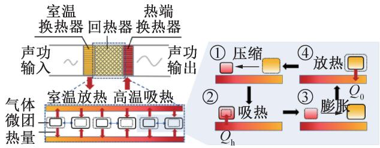  
图1热声发动机热致声效应及内部气体微团  
Fig.1 Thermoacoustic effect of thermoacoustic engine and internal gas micelles

热致声现象的最早发现可以追溯至200多年前。1777年，B.Higgins发现在两端开口中空管子的某些位置中放入可燃性气体的火焰，管中会激发出声音，即“歌焰现象”[11]。这是热致声效应的首次发现，类似的现象在高烟囱、炉膛中以及快速飞行的导弹中也可以观察到。

## 1.1.2 声致冷效应

声波是一种压缩-膨胀波，可以与固体介质作用发生吸热和放热效应。在一定的条件下，声波可以将低于环境温度的热量向环境泵热而形成声致冷循环（逆循环），即声致冷效应。图2所示为热声制冷机示意图，主要由室温换热器、回热器和冷端换热器组成。图中声功自左至右传播并消耗，回热器中热量由冷端换热器侧泵送到室温换热器侧，从而在冷端换热器侧实现制冷。如图2所示，在热声制冷机内，每一气体微团经历压缩、放热、膨胀以及吸热等完整的声致冷循环过程：1）气体微团向室温侧运动，温度升高，压力增大；2)气体微团温度高于回热器温度，对回热器放热；3)气体微团向低温侧运动，温度降低，压力减小；4)气体微团温度低于回热器温度，从回热器吸热。通过声功的消耗，众多气体微团彼此经过接力式的热量传输，逐步将热量从回热器的低温端转移至高温端，从而实现制冷功能。同样地，制冷机回热器内气体微团将经历两个等温过程和两个等压过程，与斯特林循环存在本质区别[12]。

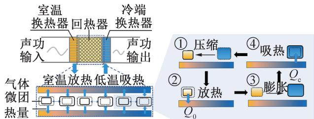  
图2热声制冷机声致冷效应及内部气体微团  
Fig.2 Acoustic to cooling effect of thermoacoustic refrigerator and internal gas micelles

声致冷效应的发现相比热致声效应晚了近两百年。1975年，P.Merkli等13]在存在交变压力波的驻波谐振管中部发现了温度下降的现象，这是历史上首次发现明显的声致冷现象。

## 1.2 热驱动热声制冷技术

综上可知，热声发动机内气体产生自激的压力振荡，热能被转换为声能形式的机械能，而热声制冷机中，声功被消耗将热量从回热器低温端搬运至高温端。热驱动热声制冷技术正是结合了这两种不同的热声效应：利用热声发动机中产生的声能(热致声效应)驱动热声制冷机进行制冷(声致冷效应)，从而实现热能-声能-冷能的能量转换(热致声致冷)。图3所示为热驱动热声制冷系统示意图，它由热声发动机、热声制冷机及调相机构组成。该系统是一个自激振荡系统，热声制冷机不仅消耗发动机声功以产生制冷效应，而且还为热声发动机提供所需的体积流量和相位，因此热声发动机与热声制冷机间需要存在声阻抗耦合匹配。不适合的声阻抗耦合会使制冷性能严重下降，甚至系统不工作。因此，调相机构主要用于调节热声发动机和热声制冷机之间的声阻抗，使两者同时在各自合适的声场下工作，从而提升整机的制冷效率。常见的调相机构包括声容性的空腔、声感性的固体活塞、细长的管道以及液体活塞等。

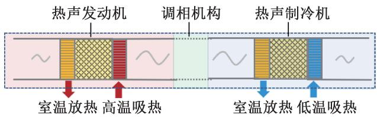  
图3 热驱动热声制冷机示意图  
Fig.3 Schematic diagram of a heat driven thermoacoustic refrigerator

## 1.3 热驱动热声制冷机分类

回热器/板叠和谐振管是热声发动机系统最为核心的部件：前者是系统中最关键的热声转换部件：后者维持系统所需的振荡频率，并起到调节压力波动和体积流率相位关系和传递/储存声能的作用。如图4所示，根据热声发动机回热器/板叠和谐振管中压力波动与体积流率之间的相位关系，热驱动热声制冷机可以分为三类：1)双驻波型。其中热声发动机板叠及谐振管均处于驻波占主的声场；2)行驻波混合型。其中热声发动机回热器处于行波占主的声场且谐振管处于驻波占主的声场；3)双行波型。其中热声发动机回热器及谐振管均处于行波占主的声场。双驻波型热驱动热声制冷机基于内部不可逆的热力学循环，气体工质和板叠之间的本征不可逆换热导致其热力学效率一般较低。行驻波混合型热驱动热声制冷机将驻波谐振管支路引入行波反馈管中，有助于调节行波反馈管换热过程中不可避免的热滞后，实现驻波基于热滞后的热声转换，从而提高热声转换效率。然而，行驻波混合型热驱动热声制冷机中较大尺寸的驻波谐振管显著降低了系统功率密度，进而限制了它们的实际应用。双行波型热驱动热声制冷机中热声发动机回热器和谐振管均需要处于行波声场，在实现高效热声转换的同时实现高效的声功传输，具有潜在效率高、结构紧凑、功率密度大等优点，目前已逐渐成为研究的热点。

此外，热驱动热声制冷系统工作温跨大，可实现液氢至室温温区(20\~300K)广泛的工作温区，在低温和普冷领域有着极大的应用潜力。因此，除了上述按相位关系进行的分类外，通常也根据工作制冷温区将热驱动热声制冷机分为两类：1)热驱动室温热声制冷机。其工作制冷温区在室温温区附近(约300K），应用背景包括空调、冰箱、冷冻柜以及在卡车、冷链运输车、渔船等移动设备上的制冷。其中，如何有效利用低品位能源和工业余热成为热驱动室温热声制冷机值得关注的研究方向；2)热驱动低温热声制冷机。其工作制冷温区主要在低温温区(<120K)，应用背景包括天然气液化，高温超导和低温制冷。研究方向主要围绕如何提升大功率低温制冷和如何追求最低制冷温度。

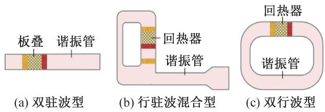  
图4 热驱动热声制冷机分类  
Fig.4 Classification of heat driven thermoacoustic refrigerators

下文将从热驱动室温热声制冷机和热驱动低温热声制冷机两个方面介绍热驱动热声制冷的发展现状。对于上述每种热驱动热声制冷机，将依次介绍双驻波型、行驻波混合型和双行波型制冷系统。

## 2 热驱动室温热声制冷机

## 2.1 双驻波型热驱动热声制冷机

双驻波型热驱动室温热声制冷机的主要特点是热声发动机回热器和谐振管处于驻波声场。1997年，美国海军研究生院建造了一台双驻波型热驱动室温热声制冷机，在25℃的制冷温差下获得91 W的制冷量和0.15的热制冷系数（热声制冷机制冷量与热声发动机加热量的比值)[14]。热声发动机和制冷机的换热器肋片厚度和间距分别为 75 μm 和 125μm，对机械加工精度的要求较高，造价昂贵。随后，该团队研制了一种采用太阳能为热源驱动的驻波型热声制冷机，如图5所示。系统加热温度最高可达450℃,在制冷温度为5℃时获得了2.5W的制冷量[15]。

## 2.2 行驻波混合型热驱动热声制冷机

行驻波混合型热驱动室温热声制冷机的发动机回热器和谐振管分别处于行波声场和驻波声场。2004年，Y.Ueda等[16]设计了一台行驻波混合型热驱动室温热声制冷机，在0℃的制冷温度下获得11W的制冷量。2006 年，Luo Ercang等[17]首次提出双环路行驻波混合型热驱动室温热声制冷机，如图6所示。系统工质为氦气，平均压力为3MPa，工作频率为67.5Hz,制冷机在-22℃制冷温度下获得300W的制冷量，热制冷系数为0.124。2009年，李山峰[18]又重新设计了一台同轴行驻波混合型热驱动室温热声制冷机。在-20℃的制冷温度下，该系统制冷量和系统热制冷系数分别提升至340W和0.16。这项工作为热声制冷在室温温区替代氟利昂制冷迈出了关键的一步。

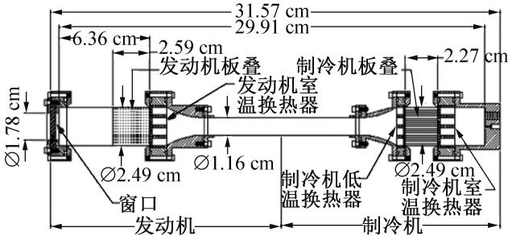  
图5 美国海军研究生院研制的太阳能驱动驻波热声制冷机

Fig.5 Solar-powered standing wave thermoacoustic refrigerator developed by the U. S. Naval Graduate School  
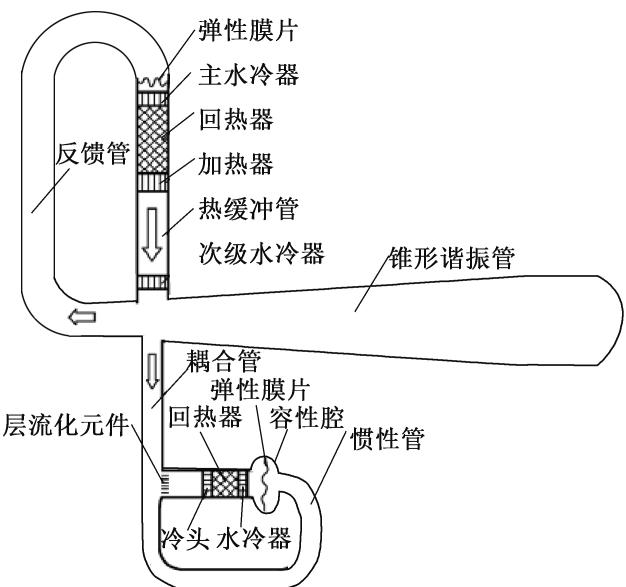  
图6罗二仓等提出的行驻波混合型热驱动热声制冷机  
Fig.6 The traveling-standing wave hybrid heat driven thermoacoustic refrigerator proposed by Luo Ercang et al

2010 年， Kang Huifang 等[19]研制了一台行驻波混合型热驱动室温热声制冷机。该系统的特点是热声发动机和热声制冷机均处于同一个环形管内，热声制冷机连接在热声发动机的出口，因此发动机产生的声功可以直接驱动制冷机。该系统的总长度小于1m，工作频率为234Hz,在0℃的制冷温度下获得了40 W的制冷量。2013年，S. Hasegawa等[20]提出双环路行驻波混合型热驱动室温热声制冷机概念，如图7所示。该结构具有两个主要特点：1)增加热声发动机级数来降低系统的起振温度；2)驻波谐振管末端的声功可以回收利用。该团队考察了不同单元的热声发动机如何布置以实现回热器内合理的声学阻抗，并优化了热声发动机的温度比。2017年，该团队搭建相关实验台，系统起振温度约为 $8 5 ~ \mathrm { { ^ circ C } }$ ,在-50℃的制冷温度下获得0.029[21]的热制冷系数。

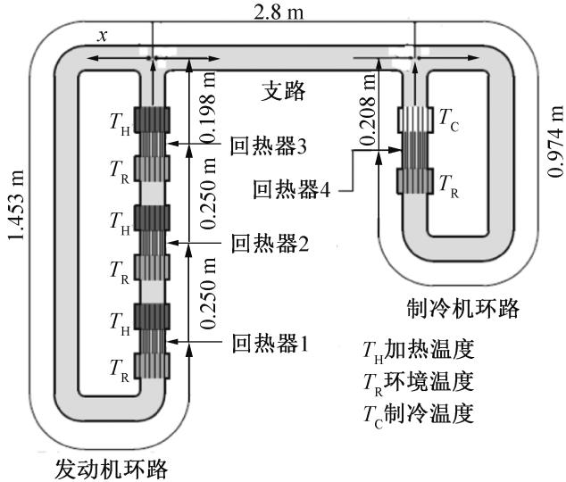  
图 7 S. Hasegawa 等提出的行驻波混合型热驱动热声制冷机  
Fig.7 A hybrid traveling-standing wave heat driven thermoacoustic refrigerator proposed by S. Hasegawa et al

## 2.3 双行波型热驱动热声制冷机

双行波型热驱动室温热声制冷机的发动机回热器和谐振管均处于行波声场。2002年，日本T.Yaza-ki等[22]首次提出双行波环路热驱动室温热声制冷机，如图8所示。该结构无任何运动部件，将热声发动机单元和制冷机单元布置在同一环形管的合适位置，其中热声发动机单元用于声功放大，制冷机单元用于制冷。实验结果表明，当平均压力为0.25MPa，工作介质为86%氦气和14%氩气的混合气体时，系统工作频率为240 Hz,在230 W的加热功率下获得了-27℃的无负荷制冷温度。2004年，日本S.I.Sakamoto等[23]设计了一台双行波环路热驱动室温热声制冷机，将热声发动机单元和热声制冷机单元对称放置在环路管中。系统可实现16℃的温降，研究表明抑制环路中的高次谐波和声流可进一步改善系统性能。

低品位热源的回收利用(80\~250℃）是热驱动室温热声制冷机最有前景的应用领域之一，其中热源包括工业过程废热、太阳能、海洋温差、地热等。2008年，K. De Blok[24]搭建了一台双行波型热驱动室温热声制冷机，通过布置多个热声转换单元来提高功率密度从而更高效地利用低品位余热。实验结果表明，系统在回热器温差仅为65℃时即可起振。K.DeBlok[24]提出四单元双行波型环路热驱动室温热声制冷机，如图9所示。系统工作频率为95Hz，起振温度仅为45℃。当加热温度为 $2 1 0 \mathrm { ~ ‰ ~ }$ ，制冷温度为-40.5℃时，系统制冷量达到95 W，㶲效率接近40%。这种多级双行波型环路结构具有以下显著优势：1)功率密度高，结构紧凑。相比于传统谐振管中直径一般在数百毫米，该结构谐振管直径一般仅为数十毫米，因此显著提高系统的功率密度；2)潜在热效率高。回热器和谐振管均处于行波声场，有利于实现高效的热声转换和声功传输，并且从热声单元出来的声功可被下一级单元回收；3)功率易调节，易实现大功率输出。环路中可串入不同数量的热声核单元以满足不同输出功率的需求，尤其容易实现大功率输出。这种环路多级结构的发现对热驱动热声制冷在低品位能源的利用方面具有重要意义。基于此系统，华中科技大学 Zhang Xiaoqing 等[25]采用数值计算的方法研究了关键参数对起振温差的影响，并对系统声场特性进行了分析。2016年，JinT.等[26]提出一单元双行波型环路热驱动室温热声制冷机，如图10所示。模拟研究表明，热声发动机和热声制冷机的回热器安装位置对系统性能影响很大。当加热温度和制冷温度分别为227℃和-3℃时，系统制冷量为730W，热制冷系数为0.43,热致冷相对卡诺效率为13.4%。

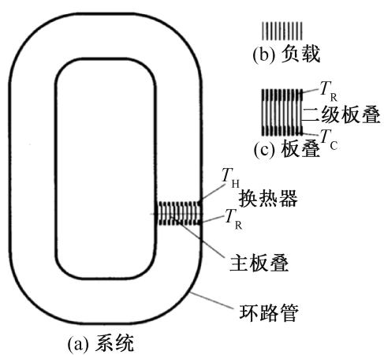  
图 8 T. Yazaki 等提出的双行波型热驱动热声制冷机  
Fig.8 Dual traveling-wave heat driven thermoacoustic refrigerator proposed by T. Yazaki et al

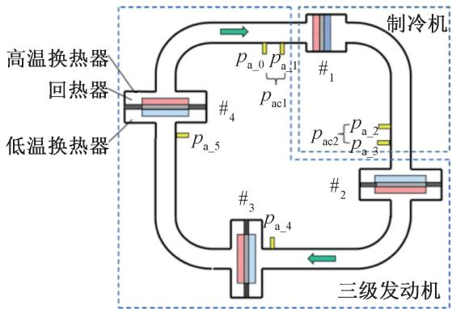  
图 9 K. De Blok 提出的四单元双行波型热驱动室温热声制冷机  
Fig.9 Four-stage double traveling-wave heat driven room temperature thermoacoustic refrigerator proposed by K. De Blok

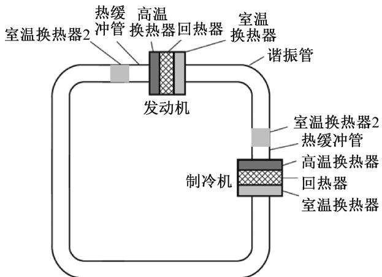  
图 10 Jin T. 等提出的一单元双行波型热驱动室温热声制冷机  
Fig.10 A one-stage double traveling-wave heat driven room temperature thermoacoustic refrigerator proposed by Jin T. et al

2018年，Aster Thermoacoustics 公司[27]提出了THEAC-25热驱动室温热声制冷机，如图11所示。该系统包括两个热声发动机单元和两个热声制冷机单元，其中热声发动机依次连接逐级放大声功，放大后的声功用于驱动两个制冷机依次获得冷量。当加热温度为220℃时，系统在-10℃的制冷温度下获得了18kW的制冷量，热制冷系数为0.18。系统的尺寸为4 m×4 m×0.8 m(长×宽×高)，整机重量为1100kg。系统运行还需要三个泵和一个干式冷却系统，共需要消耗2kW的电能。因为完全无运动部件，无需维护，设计寿命长达30年，且系统功率可从10kW扩展至100kW。该装置的应用背景主要包括移动装置制冷(如新鲜产品制冷、医疗冷链等)，工业过程控制(如食品面包店、压铸金属丝生产等)，建筑空调(如购物中心、学校等)。

2021年，Wang Huizhi 等[28]针对卡车、渔船等移动设备的余热，研制了一台5kW级直连型双行波型热驱动室温热声制冷机，如图12所示。该结构的典型特点是，热声发动机单元和热声制冷机单元直接相连，共用一个室温换热器，省去了传统结构中热声发动机与热声制冷机之间的谐振管，结构更加紧凑。总体装置的尺寸为1.5 m×1.4m×2.0m(长×宽×高)，重量约为220kg。实验结果表明，当加热温度和制冷温度分别为300℃和10℃时，系统总制冷量达到4.0kW,热制冷系数达到0.28,热致冷相对卡诺效率图 12 Wang Huizhi 等提出的直连型双行波型热驱动室温热声制冷机

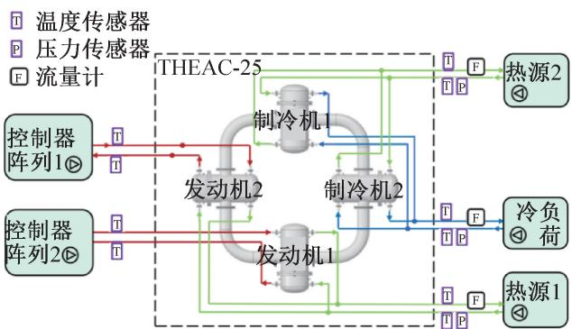  
图 11 Aster Thermoacoustics 公司提出的 THEAC-25 双行波型热驱动室温热声制冷机

Fig.11 THEAC-25 double traveling wave heat driven room-temperature thermoacoustic refrigerator proposed by Aster Thermoacoustics  
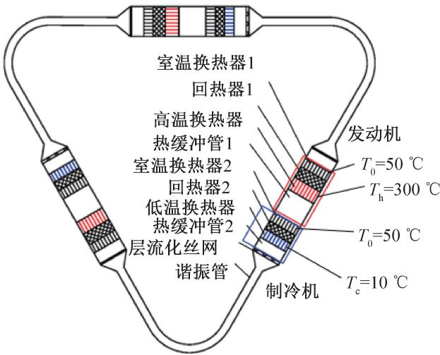  
$T _ { \mathrm { h } }$ 加热温度； $T _ { 0 }$ 环境温度： ${ ; T _ { \mathrm { c } } }$ 制冷温度。

Fig.12 The direct-connected double traveling-wave heat driven room temperature thermoacoustic refrigerator proposed by Wang Huizhi et al

达到9.1%。与先前报道的同类型热驱动室温热声制冷机相比，该系统在热制冷系数和功率密度方面均有显著提升。

2020 年,剑桥大学 Xu Jingyuan等[5]提出一种气液耦合型热驱动室温热声制冷机，如图13所示。该系统同时采用气体和液体作为谐振机构，从而有效利用液体谐振子的高质量惯性声感和气体谐振子的高可压缩性声容形成气液耦合振动热声发动机，在强化声振荡的同时降低工作频率，有利于驱动热声制冷机获得更高的效率和更低的起振温度。计算结果显示，当加热温度和制冷温度分别为147℃和-3℃时，系统总制冷量达到2.7kW，热制冷系数达到0.67。相比传统气体谐振器，采用气液耦合谐振器的系统频率可由 53.3 Hz降至12.3 Hz,压比由 1.06增至1.32，从而使系统起振温差由144.1K降至35.5K。该结果表明，气液耦合型热声制冷系统可以显著提高系统效率并降低系统起振温度，从而可以有效利用低品位热能，具有广阔的应用前景。基于此系统，上述学者们还研究了不同压力和不同工质气体下[29-30]的系统性能。

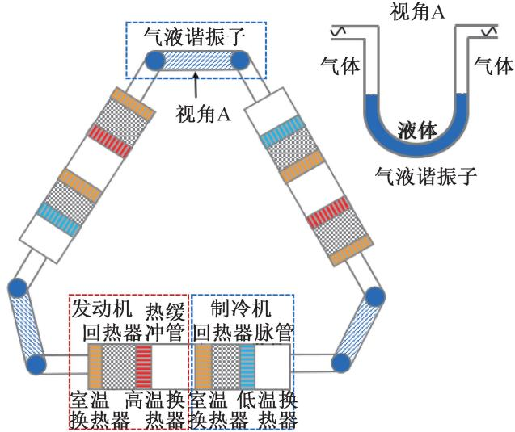  
图 13 Xu Jingyuan 等提出的气液耦合型热驱动室温热声制冷机  
Fig.13 The gas-liquid coupled heat driven room temperature thermoacoustic refrigerator proposed by Xu Jingyuan et al

2021 年,剑桥大学 Xu Jingyuan等[7]提出一种可同时回收余热和液化天然气冷能的热驱动热声冷热电三联供系统，如图14所示。该系统有4个热声转换单元，每个单元中包含热声发动机、热声制冷机和直线发电机和谐振管。其中热声发动机直接和热声制冷机相连，直线发电机旁接于发动机出口处。该系统中热声发动机可以有效实现低品位热能与天然气冷能的温位互补，使两者得以同时有效回收，进而产生热、电、冷的联产联供。计算结果表明，当液化天然气和余热温度分别为-143℃和227℃时，该系统可产生冷能2.19kW（制冷温度为10℃），热能3.55kW和电能2.27kW,整机相对卡诺效率达到24.1%。该项工作表明，热驱动热声系统可应用于分散的、小规模的冷能和余热综合回收领域，同时多能联产形式(冷热电联供、热电联供、冷电联供等)可以满足不同的供能需求。

国内外热驱动室温热声制冷机研究进展如表1所示。与双驻波型和行驻波混合型相比，双行波型热驱动室温热声制冷机在理论和实验上均显示具有更高的热制冷效率和制冷功率，但低紧凑性和高起振温度仍是迫切需要解决的问题。因此，针对中低温余热利用，面向不同工作制冷温区(0\~10℃空调温区；-10\~-20℃冷藏冷冻温区)的需求场合，探索高效、紧凑的双行波型热驱动室温热声制冷机新流程具有重要意义。

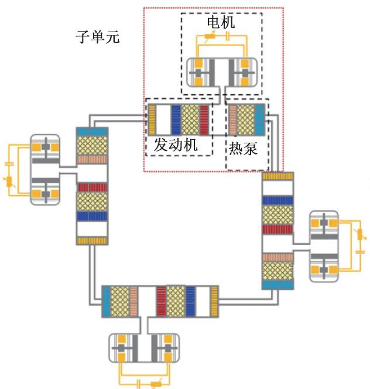  
图 14 Xu Jingyuan 等提出的同时回收余热和液化天然气冷能的热驱动热声冷热电三联供系统  
Fig.14 The thermoacoustic cooling, heating and power triple-generation system that simultaneously recovers waste heat and LNG cold energy proposed by Xu Jingyuan et al

## 3 热驱动低温热声制冷机

## 3.1 双驻波型热驱动热声制冷机

1989 年，美国国家标准技术研究所的 R. Rade-baugh 和 Los Alamos 国家实验室的 G. W. Swift 等[31]联合研制了首台热驱动热声制冷机，如图15所示。该系统采用双驻波型热声发动机驱动小孔型热声制冷机，其中热声发动机长达10m(部分为图中环形结构)。在3kW加热功率下，以氦气为工质时系统工作频率为27Hz，可获得最低制冷温度90K，且在120K的制冷温度下能够获得5W的制冷量。这是世界上首台完全无运动部件的热声低温制冷机，为高可靠性低温制冷机的研究提供了新途径。1995年，Tek-tronix公司[32]设计了一台对称型驻波热驱动脉冲管制冷机。该装置工作频率为350Hz，最终实现0.18的热制冷系数。

表1国内外热驱动室温热声制冷机研究进展  
Tab.1 Research progress of heat-driven room-temperature thermoacoustic refrigerator
<table><tr><td>类型</td><td>研究机构</td><td></td><td>研究方法 加热温度/℃ 制冷温度/℃</td><td></td><td>制冷量/W</td><td>热制冷系数</td></tr><tr><td rowspan="2">双驻波型</td><td>美国海军研究生院(1997)</td><td>实验</td><td>一</td><td>温差为25℃</td><td>91</td><td>0.15</td></tr><tr><td>美国海军研究生院(2000)</td><td>实验</td><td>450</td><td>5</td><td>2.5</td><td>一</td></tr><tr><td rowspan="7">行驻波混合型</td><td>日本名古屋大学(2004)</td><td>实验</td><td></td><td>0</td><td>11</td><td>0.052</td></tr><tr><td>中科院理化所(2004)</td><td>实验</td><td></td><td>-22</td><td>300</td><td>0.124</td></tr><tr><td>中科院理化所(2005)</td><td>实验</td><td>一</td><td>-20</td><td>80</td><td>一</td></tr><tr><td>中科院理化所(2009)</td><td>实验</td><td>一</td><td>-20</td><td>340</td><td>0.16</td></tr><tr><td>北京理工大学(2010)</td><td>实验</td><td>一</td><td>0</td><td>40</td><td>一</td></tr><tr><td>中科院理化所(2011)</td><td>实验</td><td>一</td><td>-20</td><td>340</td><td>0.16</td></tr><tr><td>日本东海大学(2017)</td><td>实验</td><td>85</td><td>-50</td><td>一</td><td>0.029</td></tr><tr><td rowspan="7">双行波型</td><td>日本爱知教育大学(2001)</td><td>实验</td><td>一</td><td>-27</td><td>一</td><td>一</td></tr><tr><td>荷兰 Aster Thermoacoustics 公司(2008)</td><td>实验</td><td>210</td><td>-40.5</td><td>95</td><td>一</td></tr><tr><td>浙江大学(2016)</td><td>模拟</td><td>227</td><td>-3</td><td>730</td><td>0.43</td></tr><tr><td>荷兰 Aster Thermoacoustics 公司(2018)</td><td>实验</td><td>220</td><td>-10</td><td>18 000</td><td>0.18</td></tr><tr><td>中科院理化所(2018)</td><td>实验</td><td>300</td><td>10</td><td>4 000</td><td>0.28</td></tr><tr><td>剑桥大学(2020)</td><td>模拟</td><td>147</td><td>-3</td><td>2 700</td><td>0.67</td></tr><tr><td>剑桥大学(2021)</td><td>模拟</td><td>227</td><td>-143</td><td>2 190</td><td></td></tr></table>

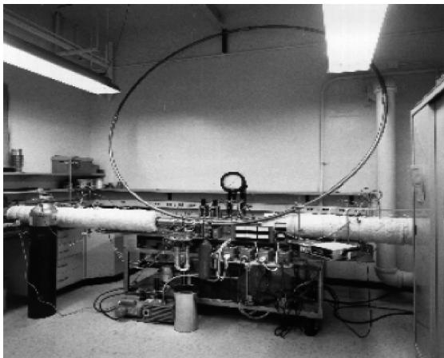  
图 15 G. W. Swift 等提出的首台热驱动低温热声制冷机  
Fig.15 The first heat driven thermoacoustic cryocooler proposed by G. W. Swift et al

热驱动热声制冷机的成功研制引起了广泛关注，人们开始尝试将这种新型制冷技术应用于天然气液化领域。2003年，美国 Los Alamos国家实验室联合Cryoenco公司和美国国家标准与技术研究院成功研制了一台采用天然气作为加热源的小型热声天然气液化装置[33-34]，如图16所示。该系统采用一台驻波型热声发动机驱动一台小孔型热声制冷机，谐振管长达12 mm,工作压力为3MPa,工作频率为40 Hz,整机相对卡诺效率为5.75%。其中，热声发动机自激振荡产生12kW声功传递给热声制冷机，相对卡诺效率为25%;热声制冷机在125K制冷温度下获得了2.1kW制冷量，为首台热声驱动制冷机制冷量的400倍。该装置可以通过燃烧60%的天然气液化其余40%的天然气，标志着热驱动热声制冷技术迈入实用化的新阶段。

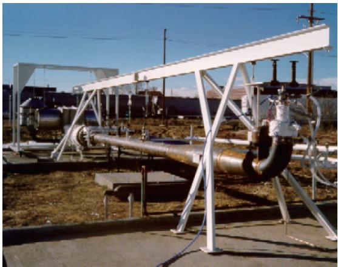  
图 16 美国 Los Alamos 国家实验室提出的热驱动热声天然气液化系统  
Fig.16 Heat-driven thermoacoustic natural gas liquefaction system proposed by Los Alamos National Laboratory

2005 年,浙江大学 Tang K. 等[35]搭建国内首台对称双驻波型热声低温制冷系统。该采用双边驻波热声发动机驱动的双向进气型热声制冷机，最终获得88.6K最低制冷温度。2006年，他们采用声压放大器作为制冷机与发动机之间的耦合机构，获得了79.7K最低制冷温度[36]。2007年，他们采用一台双驻波型热声发动机驱动两级热声制冷机[37]，如图17所示。当加热功率为2kW、平均工作压力为2.8MPa时，发动机压比达到1.17,制冷机获得41.2 K的最低制冷温度[38]。

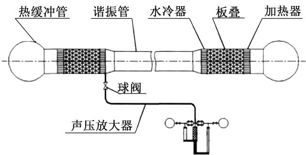  
图 17 Tang K. 等提出的对称双驻波型热声低温制冷系统  
Fig.17 The symmetrical dual standing wave thermoacoustic cryocooler proposed by Tang K. et al

## 3.2 行驻波混合型热驱动热声制冷机

行驻波混合型热驱动低温热声制冷机的研究工作主要集中于如何获取最低制冷温度。2005年，中科院理化所Dai Wei 等[39]采用一台聚能型行驻波混合型热声发动机驱动一台无气库的惯性管型热声制冷机，如图18所示。该系统获得了68.8K最低制冷温度，首次突破液氮温度。同年，浙江大学 Qiu Limin等[9]采用一台行驻波混合型热声发动机驱动U型热声制冷机，获得了80.9K的最低制冷温度。

2007年,Hu Jianying等[8]提出了“二介质耦合声学放大器”，即一种弹性膜分隔技术，在热声发动机中采用氮气作为工质以获得较低的工作频率和较大的压力比，在热声制冷机中仍然采用氦气以确保高效的制冷效应，系统如图19所示。最终，他们在一台聚能型热声发动机驱动的两级热声制冷机上获得了18.1K的最低温度，首次突破液氢温度。2008年，Zhu Shanglong 等[40]研制了一台 300 Hz 双驻波型热驱动热声制冷机，在1.76kW加热功率下获得了69.5K最低制冷温度。

表2列出了以追求最低制冷温度为目标的热驱动低温热声制冷机的研究进展。由表2可知，目前热声驱动制冷机获得的最低制冷温度为18.1K。该温度纪录自2007年以来一直未能得到进一步突破，其原因值得深入的思考探究。研究进展表明，目前电驱动热声制冷机已具备获取液氮温区（4K）的能力[41-44]，因此热声发动机是制约热驱动热声制冷机获得更低制冷温度的关键原因。若要驱动热声制冷机获取更低温区，一方面需要提高热声发动机的输出压比，另一方面需要降低工作频率以减少回热器损失。因此，探究高压比、低频率的热声发动机是热驱动低温热声制冷机获取更低制冷温度的亟待开展的方向之一。

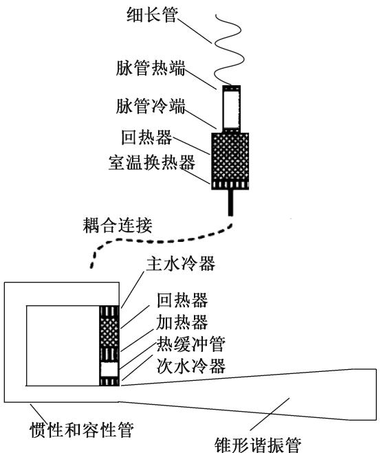  
图 18 Dai Wei 等提出液氮温区热驱动热声制冷机

Fig.18 A liquid nitrogen temperature zone heat driven thermoacoustic refrigerator proposed by Dai Wei et al  
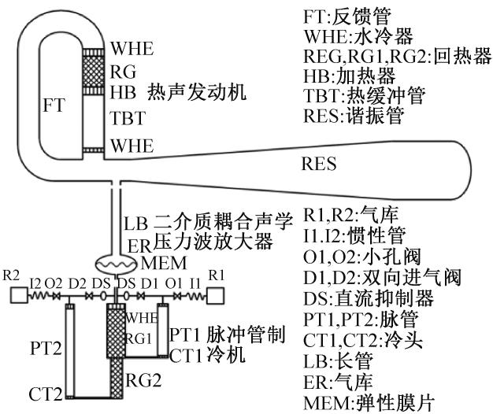  
图 19 Hu Jianying 等提出液氢温区热驱动热声制冷机  
Fig.19 A heat driven thermoacoustic refrigerator in a liquid hydrogen temperature region proposed by Hu Jianying et al

表2以追求最低制冷温度为目标的国内外热驱动低温热声制冷机研究进展  
Tab.2 Research progress of heat-driven cryogenic thermoacoustic refrigerator aiming at the lowest cooling temperature
<table><tr><td>年份</td><td>系统结构</td><td>研究机构</td><td>最低温度/K</td></tr><tr><td>1990</td><td>双驻波型热声发动机+小孔型热声制冷机</td><td>美国国家标准技术研究所</td><td>90.0</td></tr><tr><td>2005</td><td>双驻波型热声发动机+单级热声制冷机</td><td>浙江大学</td><td>88.6</td></tr><tr><td>2005</td><td>行驻波混合型热声发动机+单级热声制冷机</td><td>中科院理化所</td><td>68.8</td></tr><tr><td>2006</td><td>行驻波混合型热声发动机+单级热声制冷机</td><td>浙江大学</td><td>79.7</td></tr><tr><td>2007</td><td>双驻波型热声发动机+单级热声制冷机</td><td>浙江大学</td><td>54.5</td></tr><tr><td>2007</td><td>双驻波型热声发动机+两级热声制冷机</td><td>浙江大学</td><td>41.0</td></tr><tr><td>2007</td><td>行驻波混合型热声发动机+两级热声制冷机</td><td>中科院理化所</td><td>18.1</td></tr><tr><td>2007</td><td>300Hz双驻波型热声发动机+单级热声制冷机</td><td>中科院理化所</td><td>69.5</td></tr><tr><td>2008</td><td>双驻波型热声发动机+两级热声制冷机</td><td>浙江大学</td><td>41.0</td></tr><tr><td>2011</td><td>300Hz双驻波型热声发动机+单级热声制冷机</td><td>中科院理化所</td><td>60.0</td></tr><tr><td>2011</td><td>300Hz双驻波型热声发动机+两级热声制冷机</td><td>中科院理化所</td><td>58.0</td></tr></table>

## 3.3 双行波型热驱动热声制冷机

将环保、可靠、零电耗的热驱动热声制冷技术用于液化天然气具有巨大的应用前景。图20所示为热声天然气液化系统的设想图。该系统可以通过燃烧天然气获得驱动热声发动机的热能，而不需要电力及其他燃料，因此能够很好地满足供电困难的偏远矿区小规模非常规气体的液化需求。双行波型热驱动低温热声制冷机的最新研究工作主要集中于天然气液化领域。

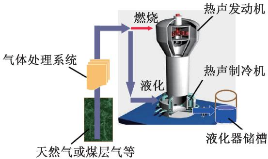  
图20 热驱动热声天然气液化系统  
Fig.20 Thermally driven thermoacoustic natural gas liquefaction system

2015 年，中科院理化所 Xu Jingyuan等[3-4]研制了一种天然气液化温区旁接型环路三级热驱动热声制冷系统，如图21所示。该系统由三个完全相同的热声发动机单元通过谐振管连成环路，每个热声制冷机单元旁接于热声发动机次水冷器出口处。发动机环路内放置了弹性膜隔绝环路直流。该技术将为电力缺乏的天然气液化场合提供一种完全无运动部件的高效、紧凑制冷方案。实验结果表明，当平均压力为 7 MPa,在 130 K的制冷温度下获得1.2 kW 的制冷量，㶲效率为8.0%。

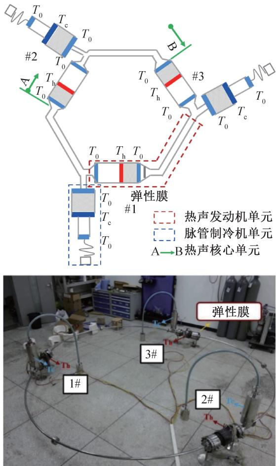  
图 21 Xu Jingyuan 等提出旁接型热驱动低温热声制冷机  
Fig.21 A bypass-type thermally driven low temperature thermoacoustic refrigerator proposed by Xu Jingyuan et al

2019 年,Xu Jingyuan等[45]提出一种串接型热驱动低温热声制冷机，如图22所示。该系统由三个热声发动机单元和一个热声制冷机单元通过谐振管串联成环路。由于系统为非对称结构，各级能量转换单元声阻抗不同，因此采用非等直径的谐振管以实现各单元间阻抗的高效匹配与声功传输。该系统可实现声功的多级放大和集中输出，特别适用于大功率制冷领域。同时，该系统可实现热声制冷机室温端膨胀功的全部回收，其本征效率可达到卡诺效率。实验结果表明，在最高效工况点时，系统可获得378W制冷量和10%相对卡诺效率；在最大功率点时，系统可获得670 W制冷量和8.3%相对卡诺效率[46]。此外还考察了采用变温加热源时的系统性能。当#1\~#3发动机的热源温度分别为873、773、673K时，系统整机相对卡诺效率达9.6%，制冷温度为150 K时可获得607W制冷量。因此，该系统在能量的梯级利用方面显示出较大的发展潜力，有望在工业余热、废热回收等方面获得应用。

表3所示为以天然气液化为目标的热驱动低温热声制冷机的研究进展。由表3可知，目前热驱动低温热声制冷机在天然气液化温区已经实现了千瓦级冷量，热致冷㶲效率最高可达10.0%，在小型天然气液化领域已显示出良好的应用前景。为了实际工业天然气液化需求，需要开展更大功率的热驱动热声制冷系统研究，并且需要进一步研制热声天然气液化装置工程样机。

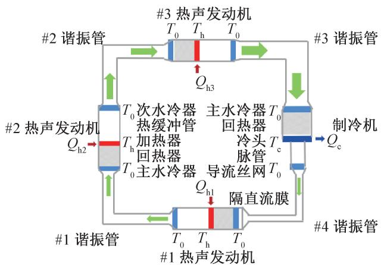  
图 22 Xu Jingyuan 等提出的串接型热驱动低温热声制冷机  
Fig.22 The cascade heat driven thermoacoustic cryocooler proposed by Xu Jingyuan et al

表3以天然气液化为目标的国内外热驱动低温热声制冷机研究进展  
Tab.3 Research progress of heat-driven cryogenic thermoacoustic refrigerator aiming at natural gas liquefaction
<table><tr><td>年份</td><td>机构</td><td>发动机 级数</td><td>平均压力/  $\mathrm { M P a }$ </td><td>频率/Hz</td><td>加热温度/ K</td><td>制冷温度/ K</td><td>制冷量/ W</td><td>热致冷 㶲效率/%</td></tr><tr><td>1998</td><td>美国洛斯阿拉莫斯 国家实验室</td><td>1</td><td>3.0</td><td>40</td><td>一</td><td>125</td><td>2 100</td><td>5.8</td></tr><tr><td>2015</td><td>中科院理化所</td><td>3</td><td>3.5</td><td>一</td><td>923</td><td>130</td><td>100</td><td>3.5</td></tr><tr><td>2016</td><td>中科院理化所</td><td>3</td><td>7.0</td><td>55</td><td>903</td><td>130</td><td>1 200</td><td>8.0</td></tr><tr><td>2018</td><td>中科院理化所</td><td>3</td><td>7.0</td><td>51</td><td>730</td><td>130</td><td>378</td><td>10.0</td></tr></table>

## 4 总结与未来发展趋势

热驱动热声制冷是一种环境友好、可靠且极具应用前景的新型绿色制冷技术。系统结构简单、制作成本低且不存在任何机械运动部件，具有低振动、高可靠性、长寿命和高潜在效率等优点。作为一种外燃式的热机，系统可采用多种低品位能源或余热驱动工作，热源适应性好，零电耗。热驱动热声制冷系统工作温跨大，可实现室温至液氢温区下不同的制冷需求，在液化天然气、室温制冷、余热/冷回收、多能联供、太阳能利用和深冷制冷等领域具有广阔的应用前景。本文以热驱动热声制冷技术三十年来的发展为基础，首先对热驱动热声制冷原理和分类进行了介绍，然后从热驱动室温热声制冷机和热驱动低温热声制冷机两个方面的发展进行了梳理，主要得到如下结论：

根据热声发动机回热器/板叠和谐振管中压力波动与体积流率之间的相位关系，热驱动热声制冷机可以分为三类：双驻波型、行驻波混合型、双行波型。其中，双行波型热驱动热声制冷机可同时实现高效热声转换和声功传输，具有潜在效率高、结构紧凑、功率密度大等优点，目前已成为研究的热点。此外，通常也根据工作制冷温区将热驱动热声制冷机分类为两类：热驱动室温热声制冷机和热驱动低温热声制冷机。其中，热驱动室温热声制冷机工作温区在室温附近(约300K），应用背景包括空调、冰箱、冷冻柜以及卡车等移动设备上的制冷，如何提高制冷量/热制冷效率以及如何有效利用低品位能源是该领域重要的研究方向。热驱动低温热声制冷机工作温区在低温温区(<120K)，应用背景包括天然气液化和低温制冷，现有的研究方向主要围绕如何提升天然气液化功率/效率以及如何追求更低的制冷温度。

热驱动室温热声制冷技术今后重点研究方向为：1)探索本征高效的热驱动热声制冷新流程，以实现发动机与制冷机高效的阻抗匹配和声功回收，进一步提升热制冷效率；2)研究新型谐振机构/回热器，以进一步降低系统起振温度，从而有效利用中低温热源。例如，气液耦合谐振机构相对于传统气体谐振机构，在强化声振荡的同时可以降低工作频率，有利于获得更低的起振温度；湿式热声回热器采用可冷凝蒸气从热量中产生声能，可有效降低起振温度。这些新型谐振机构/回热器是未来研究的重点之一；3)探究热声系统与太阳能热利用/余热回收的高效耦合方式，并考虑热、电、冷的联产联供，以实现低品位能源的有效利用以及能源供给的多元化、清洁化。

热驱动低温热声制冷技术今后重点研究方向为：1)对于以追求更低制冷温度为目标，需要建立新型谐振机构以产生高压比和低频率，以实现更低的制冷温度，扩展热驱动制冷技术在极低温领域的应用；2)对于以天然气液化等大功率制冷为目标，需要开展更大功率天然气液化温区热驱动热声制冷机的研究，以满足实际小型天然气液化装置的需求。其中需要重点探究回热器流动与温度非均匀性问题。此外，需要进一步研制热声天然气液化装置工程样机，将系统与燃气加热的方式相结合，并考虑气体预处理、供气、储存、控制及消防等方面，从而进一步推进热声天然气液化装置的实用化进程。

## 参考文献

[1] United Nations Environment Programme [ EB/OL]. (2020 -01-01)[2022-04-05]. http://conf. montreal-protocol. org/meeting/workshops/energy-efficiency/presession/.

[2] Cooling Emissions and Policy Synthesis Report [ EB/OL]. (2020-01-01)[2022-04-05]. https://wedocs. unep. org/bitstream/handle/20.500.11822/33094/CoolRep. pdf? sequence = 1&isAllowed = y.

[3] XU Jingyuan, ZHANG Limin, HU Jianying, et al. An efficient looped multiple-stage thermoacoustically-driven cryocooler for liquefaction and recondensation of natural gas [J]. Energy, 2016, 101: 427-433.

[4] ZHANG L M, HU J Y, WU Z H, et al. A 1 kW-class multi-stage heat-driven thermoacoustic cryocooler system operating at liquefied natural gas temperature range [ J]. Applied Physics Letters, 2015, 107(3) : 033905.

[5] XU Jingyuan, LUO Ercang, HOCHGREB S. Study on a heat-driven thermoacoustic refrigerator for low-grade heat recovery[J]. Applied Energy, 2020, 271: 115167.

[6] WANG Huizhi, ZHANG Limin, YU Guoyao, et al. A looped heat-driven thermoacoustic refrigeration system with direct-coupling configuration for room temperature cooling [J]. Science Bulletin, 2019, 64(1) : 8-10.

[7] XU Jingyuan, LUO Ercang, HOCHGREB S. A thermoacoustic combined cooling, heating, and power (CCHP) system for waste heat and LNG cold energy recovery[J]. Energy,2021,227：120341.

[8] HU Jianying, LUO Ercang, DAI Wei, et al. A heat-driven thermoacoustic cryocooler capable of reaching below liquid hydrogen temperature [ J ]. Chinese Science Bulletin, 2007, 52(4):574-576.

[9] QIU Limin, SUN Daming, YAN Weilin, et al. Investigation on a thermoacoustically driven pulse tube cooler working at 80 K[J]. Cryogenics, 2005, 45(5) : 380-385.

「10]罗二仓，戴巍，吴张华，等．交变流动热机的介观热力循环理论第二部分发动机回热器的介观热力循环模型及分析[J]. 低温工程，2004(2)：1-10. (LUO Er-cang, DAI Wei, WU Zhanghua, et al. Meso-scope ther-modynamic theory for cyclic flow engines Part Ⅱ : Meso-scope thermodynamic model for a cyclic flow regenerator ofprime movers[J]. Cryogenics, 2004(2) : 1-10.)

[ 11] PUTNAM A A, DENNIS W R. Survey of organ-pipe oscillations in combustion systems [J]. The Journal of the Acoustical Society of America, 1956, 28(2) : 246-259.

「12]罗二仓，戴巍，吴张华，等．交变流动热机的介观热力循环理论第一部分制冷机回热器的介观热力循环模型及分析[J]. 低温工程，2004(1)：1-11. (LUO Er-cang, DAI Wei, WU Zhanghua, et al. Meso-scope ther-modynamic theory for cyclic flow engines Part I : Meso-scope thermodynamic model for cyclic flow regenerator[ J].Cryogenics, 2004(1) :1-11.)

[13] MERKLI P, THOMANN H. Thermoacoustic effects in a resonance tube[J]. Journal of Fluid Mechanics, 1975, 70 (1):161-177.

[14] HOFLER T J. High-efficiency heat-driven acoustic cooling engine with no moving parts : US 5901556[ P]. 1999-05- 11.

[15] ADEFF J A, HOFLER T J. Design and construction of a solar-powered, thermoacoustically driven, thermoacoustic refrigerator[ J]. The Journal of the Acoustical Society of America, 2000, 107(6): L37-L42.

[16] UEDA Y, BIWA T, MIZUTANI U, et al. Experimental studies of a thermoacoustic Stirling prime mover and its application to a cooler[ J]. The Journal of the Acoustical Society of America, 2004, 115(3) : 1134-1141.

[17] LUO Ercang, DAI Wei, ZHANG Yong, et al. Thermoacoustically driven refrigerator with double thermoacoustic-Stirling cycles[ J]. Applied Physics Letters, 2006, 88 (7): 074102.

18]李山峰．行波热声发动机、制冷机及其耦合规律研究[D]. 北京：中国科学院大学，2009. （LI Shanfeng.Study on traveling-wave thermoacoustic engine, refrigeratorand the coupling law in between[ D]. Beijing: Universityof Chinese Academy of Sciences , 2009. )

[ 19] KANG Huifang, ZHOU Gang, LI Qing. Heat driven thermoacoustic cooler based on traveling-standing wave [ J ]. Energy Conversion and Management, 2010, 51(11) : 2103 -2108.

[20] HASEGAWA S, YAMAGUCHI T, OSHINOYA Y. A thermoacoustic refrigerator driven by a low temperature-differential, high-efficiency multistage thermoacoustic engine [J]. Applied Thermal Engineering, 2013, 58(1/2) : 394 -399.

[21] SHARIFY E M, HASEGAWA S. Traveling-wave thermoacoustic refrigerator driven by a multistage travelingwave thermoacoustic engine [ J]. Applied Thermal Engineering,2017,113：791-795.

[22] YAZAKI T, BIWA T, TOMINAGA A. A pistonless stirling cooler[ J]. Applied Physics Letters, 2002, 80 (1) : 157 -159.

[23] SAKAMOTO S I, WATANABE Y. The experimental studies of thermoacoustic cooler[ J]. Ultrasonics, 2004, 42(1 -9):53-56.

[24] DE BLOK K. Low operating temperature integral thermo acoustic devices for solar cooling and waste heat recovery [J]. The Journal of the Acoustical Society of America, 2008,123(5):3541.

[25] ZHANG Xiaoqing, CHANG Jinzhan , CAI Shanshan , et al. A multi-stage travelling wave thermoacoustic engine driven refrigerator and operation features for utilizing low grade energy [ J]. Energy Conversion and Management, 2016, 114：224-233.

[26] JIN T, YANG R, WANG Y, et al. Acoustic field characteristics and performance analysis of a looped travellingwave thermoacoustic refrigerator [ J]. Energy Conversion and Management, 2016, 123: 243-251.

[27] First roof top installation of a thermoacoustic chiller[ EB/ OL]. (2020-04-01)[2022-04-05]. http://www. asterthermoacoustics. com/.

[28] WANG Huizhi, ZHANG Limin, HU Jianying, et al. Study on a novel looped heat-driven thermoacoustic refrigerator with direct-coupling configuration for room temperature cooling[ J]. International Journal of Refrigeration, 2021, 123：180-188.

[29] CHI Jiaxin, XU Jingyuan, ZHANG Limin, et al. Study of a gas-liquid-coupled heat-driven room-temperature thermoacoustic refrigerator with different working gases [J]. Energy Conversion and Management, 2021, 246: 114657.

[30]迟佳欣，徐静远，张丽敏，等．气-液耦合双作用行波 热声制冷系统数值模拟研究[J]. 制冷学报，2021，42 (4) : 50–56. (CHI Jiaxin, XU Jingyuan, ZHANG Limin, et al. Numerical simulation and analysis of gas-liquid coupled double-acting thermoacoustic refrigeration system[ J]. Journal of Refrigeration, 2021, 42(4) : 50–56.)

[31] SWIFT G W, MARTIN R A, RADEBAUGH R. A thermoacoustically driven orifice-pulse-tube cryocooler [ J ]. The Journal of the Acoustical Society of America, 1989, 85 (Suppl. 1) : S47.

[32] OLSON J R, SWIFT G W. A loaded thermoacoustic engine [J]. The Journal of the Acoustical Society of America, 1995, 98(5):2690-2693.

[33] ARMAN B, WOLLAN J J, SWIFT G W, et al. Thermoacoustic natural gas liquefiers and recent developments [C ]//Cryogenic and Refrigeration Proceedings of ICCR. Hangzhou: International Academic Publisher and World Publishing Corporation, 2003:123-127.

[34] ARMAN B, WOLLAN J, KOTSUBO V, et al. Operation of thermoacoustic Stirling heat engine driven large multiple pulse tube refrigerators [ C ]//Cryocoolers 13. Boston: Springer, 2005：181-188.

[35] TANG K, CHEN G B, JIN T, et al. Influence of resonance tube length on performance of thermoacoustically driven pulse tube refrigerator[J]. Cryogenics, 2005, 45 (3):185-191.

[36] BAO Rui, CHEN Guobang, TANG Ke, et al. Thermoacoustically driven pulse tube refrigeration below 80 K by introducing an acoustic pressure amplifier[ J]. Applied Physics Letters, 2006, 89(21) : 211915.

[37] TANG K, BAO R, CHEN G B, et al. Thermoacoustically driven pulse tube cooler below 60 K [ J]. Cryogenics, 2007, 47(9/10):526–529.

「38]汤珂，黄忠杰，林小钢，等．40K温区驻波型热声驱动 两级脉管的制冷特性[J]. 低温工程，2008(4)：1-5. (TANG Ke, HUANG Zhongjie, LIN Xiaogang, et al. Refrigeration characteristic experiment in 40 K region of a two-stage pulse tube cryocooler driven by a standing wave thermoacoustic engine[J]. Cryogenics, 2008(4) : 1-5. )

[39] DAI Wei, LUO Ercang, HU Jianying, et al. A Heat-driven thermoacoustic cooler capable of reaching liquid nitrogen temperature[ J]. Applied Physics Letters, 2005, 86(22) : 224103.

[40] ZHU Shanglong, YU Guoyao, ZHANG Xiaodong, et al. A 300 Hz high frequency thermoacoustically driven pulse tube

cooler[J]. Chinese Science Bulletin, 2008, 53(8) : 1270 -1271.

[41] 曹强.液氦温区多级斯特林型脉管制冷机理研究[D]杭州：浙江大学，2012. （CAO Qiang. Investigation onrefrigeration mechanism of multi-stage stirling pulse tubecryocoolers working at liquid helium temperatures [ D ].Hangzhou : Zhejiang University , 2012. )

[42]植晓琴．深低温区斯特林脉管制冷机理及损失特性研究[D]. 杭州：浙江大学，2014. （ZHI Xiaoqin. Study onrefrigeration mechanism and loss characteristics of Stirlingpulse tube in deep low temperature region[ D]. Hangzhou :Zhejiang University, 2014. )

[43] ZHI X Q, HAN L, DIETRICH M, et al. A three-stage Stirling pulse tube cryocooler reached 4. 26 K with He-4 working fluid[ J]. Cryogenics, 2013, 58: 93-96.

[44] CHEN Liubiao, WU Xianlin, WANG Jue, et al. Study on a high frequency pulse tube cryocooler capable of achieving temperatures below 4 K by helium-4 [ J ]. Cryogenics, 2018,94：103-109.

[45] XU Jingyuan, HU Jianying, LUO Ercang, et al. A cas-

cade-looped thermoacoustic driven cryocooler with differentdiameter resonance tubes. Part I : Theoretical analysis of thermodynamic performance and characteristics[ J]. Energy, 2019, 181:943-953.

[46] XU Jingyuan, HU Jianying, SUN Yanlei, et al. A cascade-looped thermoacoustic driven cryocooler with differentdiameter resonance tubes. Part Ⅱ : Experimental study and comparison[ J]. Energy, 2020, 207: 118232.

## 通信作者简介

罗二仓，男，研究员，中国科学院理化所技术研究所，010-825437350,E-mail：ecluo@ mail. ipc. ac. cn。研究方向：新型制冷技术、热声制冷和热声发电技术及其应用。

About the corresponding author Luo Ercang, male, professor, Technical Institute of Physics and Chemistry , CAS, +86 10-825437350, E-mail: ecluo@ mail. ipc. ac. cn. Research fields: novel refrigeration technology, thermoacoustic refrigeration/power generation technology and their applications.