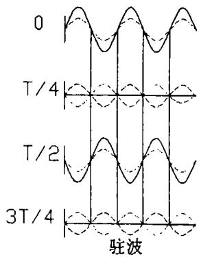
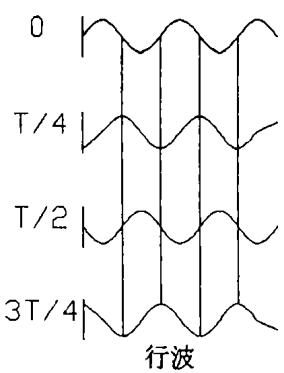
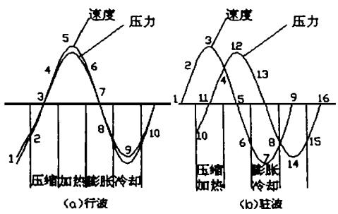
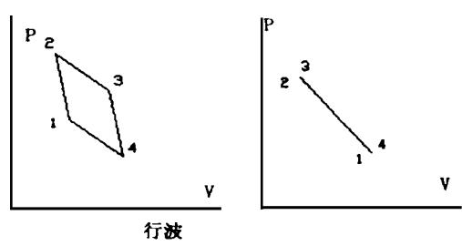
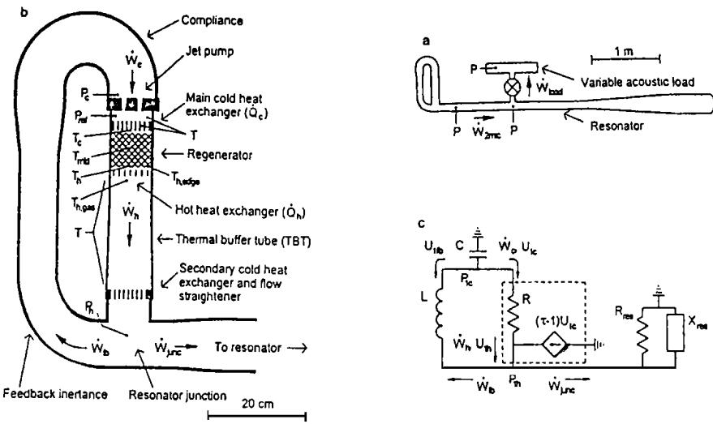

# 关于热声压缩机原理的讨论

石静蕾 陈国邦邱利民

(浙江大学制冷与低温工程研究所，杭州，310027)

摘要：回顾了驻波、行波热声机械的发展历史，分析了行波与驻波热声压缩机的优缺点。介绍行波驻波混合型热声压缩机的工作原理及结构，指出了今后研究的重点和方向。

关键词:热声行波驻波

## 1 前言

声波在流体中的传播不仅伴随着压力和位移振荡，而且还存在着温度振荡。尽管日常生活中的热声现象微弱到难以察觉，但在声场中的固体介质周围，温度振荡，压力振荡和位移振荡三者结合却可产生丰富的热声效应。在过去20多年间，热声压缩机与热声制冷机的研究及应用均取得了实质性进展。热声制冷装置已经成功地用于宇宙飞船、海军舰艇雷达冷却、天然气液化等。在这些"早期"装置中，工作流体(气体或液体)与被称作"板叠(Stack)"的固体介质进行热接触，板叠的空隙尺寸( $\mathrm { \sim 0 . 5 m m ) }$ 与工质在1/4周期(通常约为1个毫秒)内的热渗透距离相当，这种具有温差的不理想热接触提供了热声循环所必须的压缩、膨胀(表现为压力波)与声波位移之间的相位。在周期性的压力波动过程中，只要通过板叠的流体在声循环的适当相位被加热，并在适当的相位被冷却，就能达到强化振动的目的。

在限定空间内，热声循环中的相位与驻波(例如，风琴管中的空气波动)基本相同，其压力波动超前或滞后于速度波动约1/4周期，这样就产生了结构异常简单的热声压缩机和热声制冷机¹-2]。然而，由于工作流体与板叠之间不可逆换热所产生的熵增，以及由于压力波与速度波相位的不合理匹配，限制了驻波热声压缩机效率的提高。结果，实际热声转换效率仅在10%左右，远低于大型发电厂中朗肯循环的热转换效率(约30%～40%)。

七十年代末，Peter Ceperley最早提出了行波热声压缩机的概念[3-4]。他认识到Stirling循环热机回热器中的压力波与速度波相位关系与行波相同，即压力波与速度波同相，建议用行波热声来控制气体的速度波和压力波间的相位，取取消热机中用以调相的运动部件。他还指出，采用空隙尺寸较小的固体介质，即用类似于Stirling循环的回热器代替板叠，可望获得更高的效率。虽然斯特林型行波热声压缩机的理想效率与卡诺循环效率相当，但是Ceperley提出的行波型热声压缩机存在的一些问题使之无法达到其潜在效率，例如:过小的空隙尺寸导致气体流过蓄热器时产生显著的摩擦损失;环形回路结构引起气体在冷、热端换热器之间随意流动，浪费了大量热能。

根据Ceperley的设想，T·Yazaki等于1998年建立了一台新型热声压缩机，该装置由具有加热板叠的环形管路构成。他们在环路中观察到了行波形式的自发气体振荡，该装置是一行波压缩机。他们还从起振温度曲线图中的振荡区与非振荡区之间稳定性边界曲线及声功大小两个方面，对行波压缩机与驻波压缩机进行了比较，指出具有环路结构的行波板叠起行波功率放大器的作用，其起振温度明显低于驻波热声压缩机[5]。此外，2000年初，M·Masada建立了带支路的环状管型热声Stirling制冷机模拟实验台，在支路上采用线性马达驱动，着重研究了回热器在环状管上的位置对声流密度及制冷性能的影响，得出了与其一维数值模拟基本一致的结论[6]。

1999年，Backhaus和 $\mathrm { S w i f t } ^ { [ 7 - 1 0 ] }$ 对行波热声压缩机进行了重要的改进，他们在LosAlamos国家实验室建成了一台热声 Stirling 压缩机，证明了Ceperley提出的行波压缩机理论的正确性7-8]。他们把回热器放在一个靠近驻波谐振器封闭端的环路中，在谐振器的封闭端，气体运动速度很小，但压力波动可以非常大。在声循环的半个周期内，气体从谐振器的开口球体处冲向封闭端，导致压力增大。气体压力的增大减缓气体的流动。由于惯性，气体将超过其平衡位置，带动气体离开封闭端，产生压力最小值。在Backhaus二Swift压缩机的封闭端，压力与体积流率之比(即声阻抗)比驻波压缩机大30倍，因此蓄热器中的摩擦损失大大降低。目前这一Stirling型热声压缩机效率(指所产生的净功与使用的燃料能量之比)可达30%，可以和汽车发动机的效率(25～40%)相媲美。

## 2 行波与驻波压缩机的区别与联系

热声压缩机一般可分为两大类，即以驻波分量为主的驻波型热声压缩机(简称驻波热声压缩机)和以行波分量为主的行波型热声压缩机(简称行波热声压缩机)。行波热声压缩机和驻波热声压缩机一样，都满足Rayleigh准则，即：对做声振动的介质，若在其最稠密的时候向其提供能量，而在其最稀疏时从其中吸取能量，声振动就会加强(热能转变为声能)；反之，若在其最稠密的时候从其中吸收热量，而在其稀疏时向其提供能量，声振动就会衰减(声能转变为热能)。行波热声压缩机和驻波热声压缩机不同的只是其调相手段。接下来，我们就从声学角度和热力学角度来谈谈驻波压缩机与行波压缩机做功与效率的问题。

## 2.1 声学角度

振动形式最简单的声波的声压和振速随时间变化是简谐函数。任意时间函数振动的波可根据傅立叶分析化成简谐函数的级数或积分形式，因此简谐波是一般振动形式波的基础。热声机械中所使用的声学管道的横向尺寸与声波的波长相比小得多，所以可以认为在热声机械中的声波是一种平面波。这样我们就只分析平面简谐波的情况。

我们知道，两列沿相反方向行进的平面波可表示为[11]：

$$
p _ { i } = p _ { i A } e ^ { i ( \omega - k x ) } , p _ { r } = p _ { r A } e ^ { i ( \omega + k x ) }
$$

根据叠加原理，合成声场的声压为 $p ~ = \mathnormal { p } _ { i } + \mathnormal { p } _ { r } = 2 \mathnormal { p } _ { r A } \cosh \mathnormal { \varepsilon } e ^ { i \omega } + \mathnormal { \left( p _ { i A } - \mathnormal { p } _ { r A } \right) } e ^ { i ( \frac { \omega - } { \hbar x } ) }$

pi为入射波，p，为反射波，下标A表示振幅的大小， $\omega _ { , }$ 为波动角频率。由上式可见合成声场由两部分组成，第一项代表驻波场，各位置的指点都作同相位振动，但振幅大小却随位置而异，当 $k x = n \pi$ 即 $\mathbf { \Psi } _ { x } = \mathbf { 0 } \frac { \lambda } { 2 } ( n = 1 , 2 , \cdots )$ 时，声压振幅最大，称为声压波腹，而当 $k x =$ $( 2 n ^ { \pm 1 \pm 1 } \frac { \mp } { 2 } ) ^ { \frac { 1 } { \sqrt { 3 } } x } ,$ 即h $P ( \mathbb { P } 2 , \mathbb { M } , \mathbb { M } ) \mathbb { M } \mathbb { M } \mathbb { M } \mathbb { M } \mathbb { M } \mathbb { M } \mathbb { M } \mathbb { E } \mathbb { M } \mathbb { E } \mathbb { 1 } 2 , \mathbb { 2 } , \mathbb { \ldots } )$ 时，声压振幅为零，称为声压波节。第二项代表向x方向行进的平面波行波，其振幅为原先两列波的振幅之差。对于行波来说，它是没有

  
图1 驻波与行波的叠加波形

波腹和波节的。如图1，T为周期，虚线为两列叠加前的波，黑实线是两列波叠加后的波形。

由质点振动的速度势方程 $v =$ $\frac { 1 } { \mathsf { \Omega } } \int \frac { \partial } { \partial \ v { u } } d t$ 得驻波速度势 $v =$ $\frac { 2 k p _ { \mathit { r } A } } { \Theta \omega } \mathrm { s i n } k x e ^ { i ( \omega - \frac { \pi } { 2 } ) }$ ，行波速度势 $v =$ $\frac { k ( { p } _ { i \mathrm { A } } \ ^ { - } { p } _ { ^ { r \mathrm { A } } } ) } { \beta \omega } e ^ { i ( \omega - k x ) }$

分别比较驻波、行波声场的声压与速度势，我们可以看出驻波的压力

与速度的相位差是 ${ \frac { \pi } { 2 } } ;$ 而行波的压力与速度的相位差是 $0 _ { \circ }$ 再由声功的定义式

$$
W = { \frac { 1 } { 2 } } R e [ p _ { 1 } U _ { 1 } ] = { \frac { 1 } { 2 } } R e [ p _ { 1 } U _ { 1 } ] = { \frac { 1 } { 2 } } \ \vert \ \vert U _ { 1 } \ \vert \ \mathbf { \cos } { \mathcal { O } _ { p U } }
$$

得，在理想情况下，驻波的声功是0，而行波的声功是最大值。其中， $U _ { 1 } = \texttt { u }$ 是体积流速，A是横截面积。表给出了驻波和行波性能的比较。

表| 驻波和行波性能的比较
<table><tr><td rowspan=1 colspan=1></td><td rowspan=1 colspan=1>驻波</td><td rowspan=1 colspan=1>行波</td></tr><tr><td rowspan=1 colspan=1>压波方程 $p$ </td><td rowspan=1 colspan=1> $2 p _ { \mathit { r A } } \cos k x e ^ { i \omega }$ </td><td rowspan=1 colspan=1> $( p { \mathrm { ~ } } i A { \mathrm { ~ } } ^ { - } p { \mathrm { ~ } } r A { \mathrm { ~ } } ) e ^ { i ( \omega - k x ) }$ </td></tr><tr><td rowspan=1 colspan=1>速度势方程 $v = - \ \frac { 1 } { \mathsf { \nabla } \mathsf { \nabla } \mathsf { \nabla } } \int \frac { \partial } { \mathsf { z } } d t$ </td><td rowspan=1 colspan=1> $v = { \frac { 2 k p _ { \mathit { r A } } } { \Theta \omega } } \sin k x e ^ { i ( \omega - { \frac { \pi } { 2 } } ) }$ </td><td rowspan=1 colspan=1> $v { = \frac { k ( p _ { i A } - p _ { r A } ) } { \mathsf { \pmb { \rho } } \mathsf { \pmb { \omega } } } e ^ { i ( \omega - k x ) } }$ </td></tr><tr><td rowspan=1 colspan=1> $p \cdot v$ 的相位差 $\textstyle \mathcal { O } _ { p ^ { U } }$ </td><td rowspan=1 colspan=1> $\pi 2$ </td><td rowspan=1 colspan=1>0</td></tr><tr><td rowspan=1 colspan=1>声功 $\mathbf { \Sigma } _ { W } = \frac { 1 } { 2 } \ : \left| \mathbf { \Sigma } _ { p 1 } \ : \right| \left| U _ { 1 } \ : \ : \right| _ { \mathbf { \Sigma } _ { \mathbf { c o s } } } \mathcal { \bigcirc } _ { p U }$ </td><td rowspan=1 colspan=1>0</td><td rowspan=1 colspan=1> ${ \frac { 1 } { 2 } } \ \not p _ { 1 } \ | \ | _ { U _ { 1 } } \ |$ </td></tr></table>

由表可见在理想情况下，驻波没有声功输出，驻波要有声功输出必需是在非理想的条件下，即依靠热滞后。而非理想的状态必然导致效率低下，所以为获取更高的热力效率，有必要研究行波驱动器。

## 2.2 热力学角度

图2给出了理想情况下(无粘性损失和热滞后)两种热声压缩机的相位分析图 $[ 3 ]$ 。首先，我们定义，当波由冷端向热端传播时的速度为正，反之为负。也就是说，对应于图 $\mathrm { 2 ( \ a ) }$ ，速度曲线位于坐标轴上方的过程为加热过程 $( ~ 3 - 5 - 7 )$ ，下方为冷却过程。由最大几率事件可知，绝大部分的加热发生在过程 $4 - 5 - 6$ 同理可得，绝大部分的冷却发生在 $8 - 9 - 1 0$

对于某一气体微团来说，它振动的位移是微小的，因此，温度的变化也是微小的。由理想 $^ \circ$ 气体状态方程 $P V = R T$ 可知，当压力增加时，比容减小，气体被压缩，如图 $\mathrm { 2 ( \ a ) }$ ，过程1-3$- 5$ 而过程2-3-4的压力变化最大，过程 $1 - 2 , 4 - 5$ 可近似认为压力不变 $\begin{array} { r } { \frac { \partial } { \partial \mathbf { \omega } } \approx \boldsymbol { 0 } } \end{array}$ ，因此过程国知网为压缩过程过程 $\mathsf { \Pi } _ { \mathtt { C } \mathsf { n } \mathsf { K } } ^ { 6 - 7 - 8 } \mathsf { t }$ 为气体膨胀。

图2(a)表示理想行波热声压缩机的压力一速度波动曲线。对任一给定的气团，在一个波动周期中经历了如下四个过程：(1)压缩过程；(2)加热过程；(3)膨胀过程；(4)冷却过程。可见，行波热声压缩机的热力过程同Stirling循环是一致的，它不仅要求发生振荡的流体同回热器填料之间等温接触，而且还保证了压力波和速度波的接近同相，因而它具有比驻波热声压缩机高得多的热致声转换效率。理想驻波热声压缩机的压力一速度波动曲线如图2(b)所示，速度波和压力波的相位差为 $\eta 2$ 速度波的最大回热区( $2 - 3 - 4 )$ 与压力波的最大压缩区(10-11一4)在时间上相重合，其膨胀和冷却过程在时间坐标上也重合。由此我们可以$\mathrm { P } ^ { - } \mathrm { V }$ 图上定性画出理想行波压缩机和驻波压缩机的热力循环图 $3 _ { \circ }$ 显然，理想驻波压缩机不能形成封闭面积，因此，没有功输出。要产生净功，压缩过程和加热过程之间、膨胀过程和冷却过程之间一定要有相位差，这就依赖于气体和填料之间的传热滞后。它是非理想的，必然导致不可逆因素的存在，使得驻波热声机械的效率低下。

  
图2 两种理想热声压缩机的相位分析图

  
图3 驻波、行波热力循环P-V图

## 2.3流体的流动和摩擦损失

在行波中为了实现振荡流体和回热器填料之间的等温热接触而采用的小间隙(大约200目)回热器摩擦损失显著增加，从而影响了效率。而驻波板叠的间隙要大得多(大约10目)，因而摩擦损失较小。

对于纯行波而言 $\cdot [ 9 ]$ ，压力波与速度波振幅的比为 $\smash { p _ { \perp } / U _ { \perp } } \mid = \ell _ { m } c / A$ ，其中 $p 1$ 为波动压力， $U _ { 1 }$ 为体积流量， $\mathsf { P } _ { m }$ 为气体平均密度， $c$ 是波速，A为横截面积。粘性摩擦损失的表达式为 $ { E } _ { \mathrm { { v } _ { s } } } = _ { R } ~ | U _ { 1 } ~ ^ { \sharp } / 2$ ，可见当 $U { 1 }$ 较大时，就有可能造成较大的摩擦损失。而驻波就可以避免这样的问题。因为驻波的压力波与速度波的相位差为 $\eta 2$ ，所以当压力处于波腹时，速度处于波节。只要把板叠置于压力波腹处，就可以实现 $p _ { \mathrm { 1 } } / U _ { \mathrm { 1 } } ~ | > > ~ \mathsf { p } _ { m } c / A$ (也就是说，如果 $U _ { 1 }$ 很小，这是我们所希望的；如果 $U _ { 1 }$ 很大，我们也有足够的动力源 $p$ 1来克服它所引起的摩擦损失)。

此外行波压缩机装置中必存在环路。它不但为行波的形成创造了一个必要条件，也为直流(不振动气体的流动称为直流)提供了一条通路，导致热端换热器和冷端换热器之间的直接热漏，这是我们所不希望发生的。行波环路中直流的存在造成了热能的巨大浪费。行波相比较而言，驻波压缩机中不存在环路，所以它的直流要比行波小得多。

可见，行波和驻波各有利弊：行波的本征可逆性并不决定了它一定是高效；驻波虽要通过热滞寿做功tt俱附加的损要比行波小得多，因此，我们有必要取长补短，把行波驻波结合起来，这就有了混合型热声压缩机。

Backhaus和Swift 提出的行波热声压缩机之所以比一般的驻波或行波热声压缩机效率

## 3 对行波驻波混合型热声压缩机的新探讨

  
图4 行波热声压缩机示意图

图 4给出了由 Backhaus和Sw ift 建立的行波热声压缩机结构简图。图4(a) 为压缩机的总体图，该装置由5米长左右的不锈钢管焊接而成。整个装置主要包括环形回路部分和谐振管部分，此外还包括声功输出装置以及压力和温度测量装置，可变声功负载由一个阀门控制调节。图4(b)给出了环形回路部分的示意图，它主要包括回热器、两个冷端换热器、热端换热器、喷射泵以及一些管径变化的管子。回热器填料为120目不锈钢丝网，其水力半径大约为42m，远小于氦气平均热穿透深度(工作温区) $3 0 0 \mu _ { \mathrm { n } }$ ，从而保证了工作流体和回热器填料之间良好的热接触；缓冲管起到了在热端换热器与第二冷端换热器之间绝热的作用，同时也避免了输出声功处于较高的温区。此外，由于它的内表面光滑且采用渐缩结构，减少了由层流引起的对流换热；两个冷端换热器均为壳管式结构；热端换热器加热方式采用绕在氧化铝框架上的锯齿形镍一镉丝电加热器；锥形喷射泵的尺寸可以微调。

它的工作原理是这样的，当声波从回热器冷端向热端传播时，对于沿途任一流体微团来说，振动周期内流体交替膨胀和压缩并同填料进行热功交换，其结果是声功被放大，因此回热器起到了声功放大器的作用。被放大的声功一部分通过回路的调相机构回到回热器冷端，以维持下一周期的振荡；其余的声功进入谐振管，除了一部分用以维持谐振管中的振动外，其它的部分则通过连接装置用于作功或实现其它形式的能量转换。目前，在该压缩机上获得的最高效率 $\mathfrak { n } { = } 0 . 3 0$ ，其工作参数如表所示。此时压力振幅与平均压力之比 $\left| P _ { 1 } / P _ { m } \right. \left| = 0 \right.$ 60，向谐振管输出声功710W，相当于理想卡诺循环效率的42%，远高于一般驻波热声压缩机的效率。谐振管能够输出的最大声功为890W，此时 $\left| P _ { 1 } / P _ { m } \right. \left| = 0 . 1 0 \right.$ ，热效率为 $\mathfrak { n } { = } 0 . 2 2$ o更高，其主要原因之一在于采用了先进的调相手段，如图 $4 ( \mathbf { \rho } _ { \mathbf { c } } )$ 所示，其行波回路可看作是电容C(由流体的可压缩性引起)和电感L（由流体的惯性引起)的耦合。实际上，任一具有一定管长和管径的管子，其网络模型皆可认为是电阻R、电感L、电容C的耦合，只不过由于尺寸和形状不同，而表现为不同的阻抗特性。在Backhaus和 $\operatorname { S w i f t }$ 的行波声压缩机中， $U _ { 1 , c }$ $= \frac { \mathfrak { s o } L C } { R } \frac { p _ { \mathrm { ~ l ~ } , c } } { 1 + \mathrm { ~ } i \mathfrak { s o } \ / R } \ : , \ : U _ { \mathrm { l } , c }$ 和 $p 1 , c$ 的相位角位于 $0 - \pi / 2$ 接近 $\pmb { \eta } 2$ ，只要使 $L < < R$ ，就可保证压力波P和体积速度波U接近同相；此外，通过改变 $L \ : , C$ 的大小，可使回热器冷端压力波P和体积速度波U比值为一般行波热声压缩机的30倍左右，从而大大减少了回热器的阻力损失。

表Ⅱ 运行效率最高时的工作参数
<table><tr><td rowspan=1 colspan=1>工作压力(bar)</td><td rowspan=1 colspan=1>热端气体温度(℃)</td><td rowspan=1 colspan=1>共振频率(Hz)</td></tr><tr><td rowspan=1 colspan=1>30</td><td rowspan=1 colspan=1>725</td><td rowspan=1 colspan=1>80</td></tr></table>

从上一节我们可以知道影响行波热声压缩机效率的另一个重要因素是直流(streaming)[8]。在行波热声压缩机中，行波回路为直流提供了一条通路，使热端换热器和换热器间产生了很大的热漏，造成热能的巨大浪费。Backhaus和Swift在他们的行波热声压缩机中引入一个喷射泵，它依靠锥形小孔流入和流出的不对称性，利用声来产生克服气体随意流动所必须的背压。喷射泵所产生的压差可以削弱甚至完全抑制了直流，从而提高了热声压缩机的效率。

我们应采用更好的手段来抑制行波热声压缩机中直流的产生，或从新的着眼点出发，考虑积极利用直流现象来提高效率[8]，这可以从Stirling及脉管制冷机的研究中得到启发。行波热声压缩机的频率比较难确定。在T·Yazaki环形行波热声压缩机中，其共振频率大约为基频的两倍，而Backhaus和Swift 行波热声压缩机的共振频率( $8 0 _ { \mathrm { H z } } )$ 目前似平只能由实验确定。我们还应考虑适当降低行波热声压缩机的工作频率，这是因为对于实际的行波热声压缩机来说，降低频率可以保证流体和回热器填料更好的热接触，同时可以减少回热器的摩擦损失；当然频率太低也会导致输出声功率减少。此外，改进热声压缩机中的关键部件也将对提高效率有所帮助，例如可采用变截面缓冲管减少损失等。

## 4 结论

回顾了行波热声压缩机的发展历史，着重从声学角度和热力学角度分析了行波与驻波做功原理，并分析了混合型热声压缩机的优缺点。可以预见，混合型热声压缩机将是未来研究的重点。随着高效行波热声压缩机的不断完善和发展，必将促进行波热声装置的推广和应用，从而实现各种形式能量之间简单而高效的转换。

## 参考文献

[1] Swift G W· Thermoacoustic engines and refrigerators, Encyclopedia of Applied Physics, 1997, 21

[2] Swift G W· Thermoacoustic engines, J· Acoust· Soc· Am· 1988,84:1145

[3] Ceperley P H. A pistonless stirling engine−the traveling wave heat engine, J· Acoust· Soc· Am· 1979,66(5)

[4] Peter H Ceperley· Gain and efficiency of a short traveling wave heat engine, J· Acoust· Soc· Am 中国知网3) https://www.cnki.net

[5] Yazaki T, Iwata A, et al. Traveling wave thermoacoustic engine in a loop tube, Physical Review

Letters, 1998, 81(15)

[6] M asuda M , Study on a thermoacoustic stirling refrigerator in a looped tube w ith a branch, Cryogenic Engineering, 2000,35(1) :22-29

[7] Backhaus S, Swift G W, A thermoacoustic stirling heat engine, Nature, 1999, 399(27)

[8] Sw ift G W· Hybrid thermoacoustic — stirling engines and refrigerators, Proceedings of Symposium on Energy Engineering, 2000,1:2-17

[9] Steven L Garrett, Reinventing the engine, Nature, 1999,399

[10] Richard Fitzgerald. Traveling — wave thermoacoustic heat engines attain high efficiency, Physics Today, 1999, (6) :18

[11] 杜功焕等.声学基础.上海：上海科学技术出版社，1981

# Comparison Of Travelling Wave And Standing Wave

Shi Jinglei, Chen Guobang, Qiu Limin

(Institute of Refrigeration and Cryogenic Engineering, Zhejiang University, Hangzhou, 310027)

ABSTRACT:This paper introduces the history of travelling wave engine and standing wave engine briefly, then focuses on illustrating the working principle of travelling wave and standing wave from both acoustic standpoint and thermodynamics standpoint, and finally discusses a hybrid thermoacoustic engine, which is a kind of promising mechanics and the streaming leading to big losses should be overw helmed.

KEYWORDS:Thermoacoustic engine, Travelling wave, Standing wave

作者简介：石静蕾，女，硕士研究生。主要从事回热式热机的研究，尤其是在热声制冷机、热声压缩机以及热声驱动脉管制冷机等方面的研究。自入学以来，发表论文数篇，发明专利1项。参加过多项国家自然科学基金项目和浙江省自然科学基金项目。