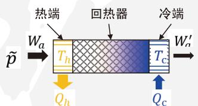
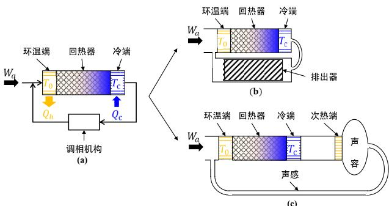
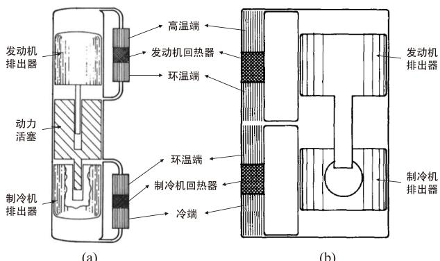
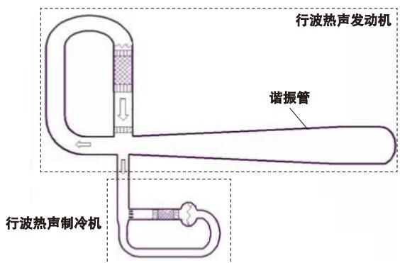
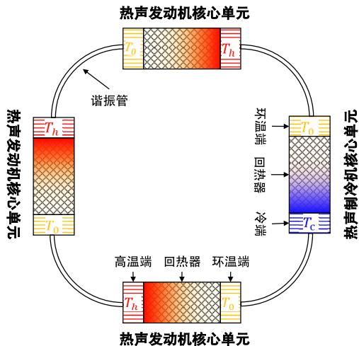
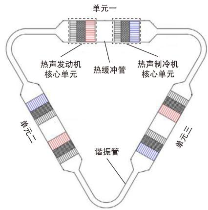
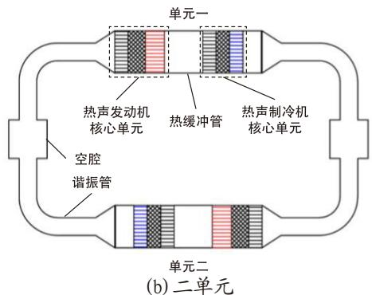

# 具有产业化潜力的新型制冷技术研究进展

# 热声制冷

罗二仓 吴张华(中国科学院理化技术研究所)

双碳目标的提出将推动我国制冷行业的技术变革，是新兴制冷技术发展的重要契机。热声制冷是一种新型的环保制冷技术，其工作原理是可压缩气体在交变压力作用下气体与固体介质复杂的热相互作用（压缩、膨胀、吸热、放热）而产生制冷泵热效应，该效应可用于制冷或热泵。由于工质气体为氦气、氮气等不活泼的自然工质，因此热声制冷是一种环境友好、工作温度范围宽、制冷性能好、完全环保的制冷技术，非常符合双碳背景下的发展要求。

图1所示为热声制冷机核心单元。按照热声学原理，回热器（也称热声换能器）是发生热声效应的场所，其内部工质气体微团在交变压力波作用下，不断经历压缩与膨胀过程，同时气体微团往复运动，与周围固体产生热量交换，最终实现将冷端的热量接力泵送至热端的“泵热效应”。如果热端为环境，利用冷端冷量的机器即为制冷机；如果冷端为环境，利用热端热量的机器则为热泵。驱动热声制冷机的压力波动可由电驱动或热驱动压力波发生器产生，前者通常为直线压缩机，后者为热声压力波发生器。压力波动发生器与热声制冷机结合分别组成电驱动或热驱动的热声制冷机或热泵。

  
图1 热声制冷机核心单元示意图

追求高效率是双碳背景下制冷技术的第二个重要需求。实现高效热声制冷的关键主要有两个方面：1）热声制冷机回热器处于行波为主的声场且声阻抗大，行波声场可使热声制冷机实现可逆的热力循环，而大的声阻抗可以减少回热器损失；2）对热声制冷机核心单元出口声功加以回收。热声制冷机核心单元出口声功大致等于制冷量，且随着制冷温度的升高出口声功占入口声功的比例不断增加，例如在液氮温区该占比约为20%，但在0℃附近该占比将升至80%左右]。可见声功回收对于效率提升的重要性。

本部分主要介绍可回收声功的行波热声制冷机的发展。

## 1 研究进展

行波热声制冷机的声功回收同时伴随着相位的调节，因此常被称作调相机构。按照声功回收方式的不同，行波热声制冷机可分为机械型与声学型两种。机械型声功回收利用固体调相器组件的质量、刚度、面积等实现调相；声学型声功回收利用管道的声感、声容等声学特性实现调相。按照回收声功的用途不同，行波热声制冷机还可分为单作用与双作用两种。单作用行波热声制冷机回收的声功经调相后反馈至自身入口端，与压力波发生器输出的声功汇合后一起进入制冷机核心单元；双作用行波热声制冷机回收的声功经调相后反馈至其它核心单元的入口端。声功回收使得行波热声制冷机在结构上都呈首尾相连的回路形状。

## (1)单作用行波热声制冷技术

图2(a)所示为单作用行波热声制冷机示意图，图中行波热声制冷机核心单元出口声功经调相机构调相后反馈到入口，从而减少了输入功、提高了效率。当调相机构为机械的弹簧振子结构（又称排出器）时，即为图2(b)的自由活塞斯特林制冷机；当调相机构为声学管道时，即为图2(c)的经典行波热声制冷机。

  
图6.1-2 (a)带声功回收的行波热声制冷机；(b)固体自由活塞调相斯特林制冷机；(c)经典行波热声制冷机

在深冷温区，直线压缩机驱动的自由活塞斯特林制冷机替代工作在较低制冷温度的复叠蒸汽压缩制冷技术应用是当前的热点之一。美国StirlingUltracold公司（其前身是荷兰Global Cooling公司）在2010年前后推出了三款基于自由活塞斯特林制冷机的冰箱，可提供低至-80℃的低温环境[2]。同时，该公司比较了采用自由活塞斯特林制冷机及传统复叠制冷机的冰箱能耗，结果表明前者的制冷系数是后者的1.5倍多[3]。日本的Twinbird公司研制了多款基于自由活塞斯特林制冷机的便携式冰箱，制冷温度在-100\~-80℃、制冷量在15\~45W[4]。在国内，宁波华斯特林公司研发了多款便携式冰箱，其制冷温度与制冷量与Twinbird公司产品相似[5]。此外，中科院理化所[6]、中国电子科技集团第16研究所[7]、上海理工大学]等机构也开展了类似的研究，其中中科院理化所研究的在-80℃温区的电驱动自由活塞斯特林热声制冷机的制冷系数可以超过0.5以上，比传统复叠蒸气压缩制冷技术的效率高出40%以上。

热驱动自由活塞斯特林制冷机可利用高温热能实现制冷或热泵，是一种新型分布式供能技术，对于降低一次能源消耗有着重要意义。该系统包含自由活塞斯特林发动机及自由活塞斯特林制冷机，在结构上衍生出了双效自由活塞斯特林制冷机及自由活塞式VM制冷机两种，如图3所示。美国Sunpower公司首先提出了双效自由活塞斯特林机/热泵概念，并开展了一些初步研究[9-12]。2020年，中科院理化所在双效自由活塞斯特林机研究方面取得一定突破，研制的样机在加热温度为500℃，冷端和供热温度分别为-20℃和45℃时，实现热制冷系数0.2、整机性能系数1.39（供热2840W、发电121W）[13]。1992年，德国多特蒙得大学最早提出了自由活塞式VM制冷机概念[14]，此后川崎重工、三洋电气、三菱及三星电子等公司开展了较多的研究工作[15]。近年来，美国ThermoLift公司研制了一台自由活塞VM空调[16]，可实现12kW的制冷量，对应的制冷系数1.0，显示出了很好的应用前景。

  
图3(a)双效自由活塞斯特林制冷机；(b)自由活塞VM制冷机

经典行波热声制冷机利用管道的声学特性进行调相，消除了排出器运动部件，提高了可靠性及寿命。为了追求压力波发生器也无运动部件，经典行波热声制冷机的研究主要集中在热驱动方向，即采用热声发动机作为驱动源。2006年，中科院理化所采用行波热声发动机驱动的行波热声制冷机，实验达到的最低制冷温度为-64.4℃，在-22.1℃制冷温度下获得了250W制冷量，热制冷系数约0.11[17-18]。

  
图4行波热声发动机驱动的行波热声制冷机示意图

## (2)双作用行波热声制冷技术

双作用行波热声制冷的研究主要集中在热驱动方向。同时，为了追求紧凑性，将一个或多个热声发动机核心单元与热声制冷机核心单元布置在同一个回路中，制冷机出口的声功不直接反馈到自身入口，而是经调相后输运至其它发动机或制冷机核心单元加以利用。调相机构可以是管道（谐振管）或者液体振子。与单作用的经典行波热声制冷流程不同，这里的管道或振子质量还决定着系统的工作频率，通常长度较长。

  
图5 热驱动双作用行波热声制冷机

2012年，荷兰的K.DeBlok提出了三个热声发动机核心单元驱动一个热声制冷机核心单元的热驱动双作用行波热声制冷机流程（图5）[19]，并在此基础上研发了25\~40kW冷量的空调产品[20]。2017年，中科院理化所采用相似流程实验获得了130K下670W制冷量、相对卡诺效率8.3%[21]。

  
(a) 三单元

  
图6直连型热驱动双作用行波热声制冷机

为了减少谐振管的声功损失、进一步提高性能，2018年中科院理化所提出了直联型的三单元热驱动双作用热声制冷机流程，将热声发动机核心单元与热声制冷机核心单元通过热缓冲管直接相连，如图6(a)所示。实验在加热温度为300℃、环境温度为50℃、冷端温度为10℃的工况下，获得3.3kW制冷量、热制冷系数0.22[22-23]。在此基础上，2022年又研制了两单元制冷系统，在加热温度为300℃、冷端温度为0℃、环境温度为50℃时，获得3.9kW制冷量、热制冷系数0.31[24-25]。此外，还提出了采用液体振子替代谐振管的方案，进一步减少了谐振管声功损失，同时还可以降低加热温度。实验在加热温度为300℃、冷端温度为0℃、环境温度50℃时，获得制冷量5.14kW、热制冷系数0.455[26]。近期，中科院理化所提出了热驱动液体活塞制冷机新流程，其空调制冷温区或热泵供暖温区的性能有突破性提高，二者在理论上均有达到2.0以上的发展潜力[27-28]。

## 2 关键技术

从热声制冷的发展上看，尽管在技术上已取得很大的发展，但一些关键技术仍需要进一步创新突破，才能达到规模化应用的需求。这些关键技术主要包括两大方面：

1）在电驱动热声制冷方面，自由活塞斯特林制冷机具有效率高、结构紧凑的优势，已经在低温及深冷温区率先获得应用。然而，当冷端温度升至0℃附近的普冷温区时，冷热端温差减小，带来两个问题：一是排出器尺寸难以缩小。由于制冷机核心单元出口声功约占入口声功比重大，现有排出器回收声功方案尺寸难以减小，不利于未来降低成本、提高紧凑性。如何降低回收声功的量是关键之一。二是较大功率直线压缩机技术不成熟。现有电驱动热声制冷都应用在冰箱，功率较小。对于空调应用，通常功率在几千瓦至数十千瓦以上。相关直线压缩机技术还有待进一步完善。

2）在热驱动热声制冷方面，对于带有运动部件的双效自由活塞斯特林制冷机与自由活塞VM制冷机来说，面临着尺寸大、运动部件多的问题，未来减小尺寸、提高可靠性是关键。对于无运动部件的热驱动热声制冷机来说，仍需要进一步提升性能，一方面可通过液体谐振子等来减小谐振机构的声功损失，另一方面还要依赖于整机声场的构建以及流程的创新。

## 3产业化应用

随着双碳目标的提出，我国制冷行业将迎来重大变革，为新技术的发展带来了机遇。针对现有制冷技术工质不环保、工作温区受限、极端条件下制冷性能不高等缺点，热声制冷技术在突破上述关键技术后，有可能在以下场合获得应用：

1）深冷温区电驱动制冷机。现有研究表明，相比已有的复叠制冷技术，热声制冷技术在性能上可提高50%以上。同时，还可以摆脱现有对环境有影响的工质。相关技术国外已经有产品，国内实验室已完成性能技术上的突破，下一步是实现工程化研究。

2）电驱动大温差热泵，包括用于寒冷区域的移动或非移动式电驱动热泵、用于工艺过程的电驱动高温热泵等。大温差热泵应用范围广，节能空间大，但传统蒸气压缩制冷技术难以满足需求，热声制冷技术在实现大温差制冷和供热方面具有优势，是发展的重要方向。

3）燃烧热驱动的高效率热声空气源热泵。相比现有利用天然气等燃料直接燃烧采暖，燃料燃烧热驱动的空气源热泵技术可在满足相同需求下大幅减少燃料消耗，减少一次能源消耗，实现节能与减排。采用新型流程的液态活塞热声制冷和热泵有很大发展潜力，具有实现制冷系数和制热系数2.0以上的发展潜力。

4）中低品位太阳能、动力余热等驱动的热声制冷。太阳能是清洁能源，利用集热器汇集后可得到中低品位的热，进而实现制冷，可以减少一次能源消耗。动力余热利用也可以减少一次能源的消耗。

## 参考文献

[1] Xin Wang, Zhanghua Wu, et al. Traveling-wave thermoacoustic refrigerator for room temperature application [J], International Journal of Refrigeration. 2020, 120: 90-96.

[2] https://www.biolifesolutions.com/storage/stirling-ultra-low/

[3] Berchowitz D M, Kwon Y. Environmental Profiles of Stirling-Cooled and Cascade-Cooled Ultra-Low Temperature Freezers[J]. Sustainability, 2012, 4: 2838- 2851.

[4] https://www.twinbird.jp/fpsc/

[5] https://www.chinastirling.com/fpsc/

[6] 李珂.自由活塞斯特林系统的理论与实验研究[D]. 中国科学院理化技术研究所,2014.

[7] 王波,徐海峰,张文千等.基于气体轴承斯特林制冷机的低温冰箱[J].低温与超导,2017,45(08):26-31.

[8] 陈曦,张华,吴亦农等.200K/40W 自由活塞斯特林制冷机的实验研究[J]. 上海理工大学学报, 2007, 29(4): 337-340.

[9] Penswick B, Urieli I. Duplex stirling machines[C]. Proc., Intersoc. Energy Convers. Eng. Conf. (United States), Sunpower, Inc., Athens, Ohio, 1984, 3.

[10] Berchowitz D M, Shonder J. Estimated size and performance of a natural gas fired duplex Stirling for domestic refrigeration applications[R]. Oak Ridge National Lab., TN (United States), 1991.

[11] Dyson R, Penswick B, Schmitz P, et al. Long-lived Venus lander conceptual design: how to keep it cool[C]. 7th International Energy Conversion Engineering Conference, 2-5 August, 2009, Denver, Colorado.

[12] Dyson R W, Bruder G A. Progress towards the development of a long-lived Venus lander duplex system[R]. National Aeronautics and Space Administration, Glenn Research Center, 2011.

[13]罗开琦.中低品位热源驱动的自由活塞热声斯特林制冷系统的热动力学特性研究[D].中国科学院大学,2021

[14] S. Schulz, B. Thomas. Experimental investigation of a free-

piston Vuilleumier refrigerator[J]. International Journal of Refrigeration, 1995,18(1):51-57.

[15] George Dogkas, Emmanouil Rogdakis. A review on Vuilleumier machines[J]. Thermal Science and Engineering Progress, 2018, 8:340-354.

[16] U.S. Department of Energy. Energy Savings Potential and RD&D Opportunities for Commercial Building HVAC Systems[R]. U.S. Department of Energy, Office of Energy Efficiency and Renewable Energy, 2017.

[17] Dai W, Luo E C. Detailed study of a traveling wave thermoacoustic refrigerator driven by a traveling wave thermoacoustic engine[J]. Journal of Acoustical Society of America, 2006, 119(5): 2686-2692.

[18] Luo E C, Dai W, Zhang Y, et al. Thermoacoustically driven refrigerator with double thermoacoustic-Stirling cycles[J]. Applied Physics Letters, 2006, 88: 074102.

[19] Blok K D. Multi-stage traveling wave thermoacoustics in practices[C]. Proc of the 19th International Congress on Sound and Vibration, Vilnius, Lithuania: International Institute of Acoustics and Vibration (IIAV) and Vilnius University, 2012:1-8.

[20] De Blok. Thermoacoustic cooler (THEAC-25). Sound Energy. Available at: https://www.soundenergy.nl/ourtechnology/.

[21] Zhang L M., Hu J Y, Wu Z H, et al. A 1 kW-class multistage heat-driven thermoacoustic cryocooler system operating at liquefied natural gas temperature range[J].

Applied Physics Letters, 2015, 107(3):033905.

[22] Wang H Z, Zhang L M, Hu J Y, et al. Study on a novel looped heat-driven thermoacoustic refrigerator with directcoupling configuration for room temperature cooling[J]. International Journal of Refrigeration, 2021, 123: 180-188

[23]王慧志.双行波环路热驱动室温热声制冷机的理论及实验研究[D]. 中国科学院大学,2020.

[24] Yupeng Yang, Jiaxin Chi, Zhanghua Wu, et al. A heatdriven combined cooling and heating system based on thermoacoustic technology[J]. Applied Physics Letters, 2022, 120(22): 223902.

[25] Jiaxin Chi, Yupeng Yang, Zhanghua Wu, et al. Numerical and experimental investigation on a novel heat-driven thermoacoustic refrigerator for room-temperature cooling[J]. Applied Thermal Engineering, 2023, 218:119330.

[26] Chi Jiaxin, Xiao Lei, Wu Zhanghua, et al. Experimental study of a highly efficient gas-liquid coupled heat-driven thermoacoustic refrigerator [J]. International Journal of Refrigeration. (Under review)

[27]罗二仓，王军翔，罗开琦等.具有旁通通道的热驱动热声斯特林制冷系统[P]. 中国: CN202222206395.3, 2022-12-16.

[28]罗二仓,胡易伟，罗开琦等.双效液体自由活塞热声斯特林制冷/热泵系统[P]. 中国: CN218915458U, 2023-04-25.