# 室温温区热声制冷机研究

王欣1.2 吴张华1 刘冬冬1.2 张丽敏1 胡剑英1 罗二仓1

(1. 中国科学院低温工程学重点实验室，理化技术研究所，北京100190;2. 中国科学院大学，北京 100049)

摘要热声制冷机作为一种新型制冷技术，具有效率高、可靠性好、环境友好等特点。日前，室温温区热声制冷机存在回热器声功利用量少、出口声功大、回收损失大等问题，本文基于SAGE软件，对室温温区热声制冷机的工作机理进行研究。通过对两级及以上热声制冷机的制冷系数、制冷量以及进出口阻抗相角进行分析，探寻同时提高声功利川率和制冷量的方法。在分别以制冷系数和制冷量为优化计算目标的前提下，得到了室温温区多级热声制冷机的制冷量、制冷系数及声功利用率随级数变化的变化规律。计算结果显示，多级热声制冷机对出口声功的利用率存在最大值。可根据实际需求综合考虑制冷系数及制冷量，以得到较优的制冷工况。

关键词热声制冷机；室温制冷；SAGE软件；相角；制冷系数

中图分类号： TB66 文献标识码：A文章编号：0253-231X(2021)03·0573-06

# Investigation on Thermoacoustic Refrigerator at Room Temperature

WANG Xin1.2 WU Zhang-Hua1 LIU Dong-Dong1.2 ZHANG Li-Min1 HU Jian-Ying1 LUO Er-Cang1

(1. Key Laboratory of Cryogenics, Chinese Acadeny of Sciences, Beijing 100190, China; 2. University of Chinese Academy of Sciences, Beijing 100049. China)

Abstract As a new type of refrigeration technology, thermoacoustic refrigerator shows advantages of efficiency. reliability and environmental friendliness. To date, the thermoacoustic refrigerator at room temperature range has problems such as low power utilization, large outlet acoustic work, and high power recovery losses. In this paper. the working mechanism of the thermoacoustic refrigerator at room temperature range is studied using SAGE software. By analyzing the coefficient of performance (COP), cooling power and phase relationship between pressure and volune velocity waves, the method of improving the utilization rate of acoustic work as well as the cooling power is explored. When COP and cooling power are set as optimization goals respectively, the variation of cooling power, COP and utilization rate of acoustic work are obtained. The results show that the multi-stage thermoacoustic refrigerator has an optinun utilization rate of outlet acoustic work. In order to get better cooling conditions, one should consider both COP and acoustic work according to real requirements.

Key words thermoacoustic refrigerator; room refrigeration temperature; SAGE software; phase angle; coefficient of performance

## 0前言

制冷技术在社会生产和人民生活中发挥着巨大的作用。传统的室温温区制冷方式主要有蒸汽压缩式制冷[1]、吸收式制冷[2]以及吸附式制冷。蒸汽压缩式制冷机效率高，应用最广泛，但运动部件多，易磨损，且多消耗电能为高品位能源，工质存在环保问题。吸收式制冷机，环境友好，但其溶液工质对多受温度或压力的限制[3]。同时，吸收式制冷机的尺寸较大，成本较高[4]，且工质对金属的腐蚀性较强[5]。吸附式制冷机的优点为运行成本低，对环境无污染，但其制冷性能较低，且初投资大，经济性较差[6]。

热声制冷机利用热声效应，消耗声功实现热量从低温端向高温端的输运。相较于传统室温温区制冷方式，热声制冷机具有很多突出的优点。首先，其工质一般为氦气或氮气，对环境无污染。同时，热声制冷机可采用低品位热能驱动，可以得到良好的经济性。其次，热声制冷机，内部无磨损、无润滑油，系统可靠性高，维护要求低。再次，热声制冷机基于可逆的热力循环，本征效率高。目前，热声制冷机多用于低温温区，在室温温区应用较少。1979年，美国George Mason 大学的 Ceperley[7]提出行波热声热机，理论上其效率可接近卡诺效率。1995年，宾州大学热声研究组研制出室温温区热声制冷机，用于冷却军舰上的电子系统，可在277.5K时获得294W冷量，在294.5 K时获得 419 W 冷量[8]。同年，Swift[9]提出声功回收的热声制冷机，解决了之前脉管制冷机效率低、散热困难的问题。2004年，中科院理化所罗二仓课题组在此基础上，研制了热驱动热声制冷机，在251.4K时获得250 W制冷量[10]。同年，美国宾州大学设计的电驱动热声制冷机在 $- 2 0 ^ { \circ } \mathrm { C }$ 获得了 100 多瓦的制冷量，该制冷机被 Ben & Jerry 公司用于保存冰激凌。Biwa研制的热驱动热声制冷机在273.5K时获得了11W制冷量[11]。2009年，罗二仓等[12]研制的热声制冷机在253.5 K时获得 340W制冷量。传统的室温温区热声制冷机为单级制冷机，虽然可以实现较好的制冷量，但声功利用率不高，即用来转化为冷量的声功占输入声功的比重较小、声功回收损耗较大。

为了进一步提高声功利用率、提高热声制冷机的制冷量，本文提出室温温区多级热声制冷机结构，通过增加制冷机级数，实现出口声功的有效利用、提高制冷量。并对室温温区热声制冷机进行模拟计算，探究了其工作机理。

## 1 计算模型简介

如图1所示，多级热声制冷机结构由多个热声制冷机核心单元构成，中间由热缓冲管连接。每个制冷机核心单元由三个部件组成，从入口至出口分别为室温换热器、回热器和冷端换热器。其中，回热器是热声效应发生的场所，用于实现声功和冷量之间的转化。制冷机通过消耗声功，将热量从冷端换热器泵送至室温换热器，在冷端换热器产生冷量。两个制冷机核心单元之间由热缓冲管连接，一方面实现低温到室温的过渡，另一方面调节级间的耦合。

本文对热声制冷机采用 SAGE软件进行模拟计算。SAGE软件可以对热声制冷机、斯特林制冷机等回热式热机进行建模计算，通过热量与质量流将各个部件的模型连接，实现对整机的求解。为模拟实际运行声场，两端活塞采用虚拟活塞，即一个压缩活塞和一个膨胀活塞，是无质量、仅靠调节位移和相位来提供制冷机进出口压力波动和体积流量的模型。在优化过程中，给出限定条件和优化目标，通过调节虚拟活塞进行优化计算。在模型中，定义了几个变量用于研究制冷机的性能：制冷机声功 $W _ { \mathrm { a } }$ 、制冷系数 COP 及声功利用率 $\eta _ { \bullet }$ 每级制冷机的室温换热器温度为313K，冷端换热器温度为273K，系统的工质为氦气，平均压力为6MPa，运行频率为60Hz。主要的结构参数如表1所示。

表 1 制冷机结构参数  
Table 1 Structural parameters of refrigerator
<table><tr><td>部件名称</td><td>直径/mm</td><td>长度/mm</td><td>备注</td></tr><tr><td>室温换热器</td><td>130</td><td>40</td><td>孔隙率11.65%</td></tr><tr><td>回热器</td><td>130</td><td>30</td><td>孔隙率 76.9%， 150 目不锈钢丝网</td></tr><tr><td>冷端换热器</td><td>130</td><td>40</td><td>孔隙率 12.39%</td></tr><tr><td>热缓冲管</td><td>130</td><td>40</td><td></td></tr></table>

声功定义如下

$$
W _ { \mathrm { a } } = 1 / 2 | p _ { 1 } | | U _ { 1 } | \cos \theta _ { \mathrm { p U } }\tag{1}
$$

式中， $\left| p _ { 1 } \right|$ 是压力波动幅值， $| U _ { 1 } |$ 是体积流量幅值， $\theta _ { p U }$ 是压力波动和体积流量之间的相位差，也是声学阻抗相角。

制冷机核心单元制冷系数定义如下

$$
\mathrm { C O P } = Q _ { \mathrm { c } } / ( W _ { \mathrm { i n } } - W _ { \mathrm { o u t } } )\tag{2}
$$

式中， $W _ { \mathrm { i n } }$ 是制冷机入口声功， $W _ { \mathrm { o u t } }$ 是制冷机出口声功。

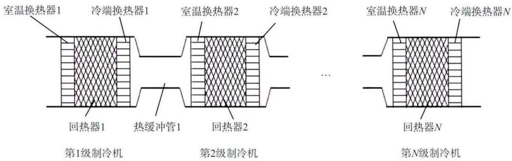  
图1 多级热声制冷机  
Fig. 1 Multi-stage thermoacoustic refrigerator

声功利用率定义如下

$$
\eta = ( W _ { \mathrm { i n } } - W _ { \mathrm { o u t } } ) / W _ { \mathrm { i n } }\tag{3}
$$

## 2 计算结果及讨论

## 2.1 单级热声制冷机

对单级热声制冷机在输入声功为3kW的条件下进行优化计算，以制冷系数为优化目标，可以得到的制冷量为2.09kW，输出声功为2.343kW，制冷机核心单元制冷系数达到3.179，声功利用率0.219。从这个计算结果可以看出，单级制冷机声功利用率较低，输出声功占输入声功的近80%。进一步的，我们通过改变回热器长度以及调整核心单元直径，计算单级制冷机在输入声功3kW的情况下可以达到的最大制冷量。图2、3分别为在输入声功不变的条件下，以制冷量为优化目标时，单级制冷机可达到的最大制冷量以及声功利用率随回热器长度以及核心单元直径的变化关系。从图中我们可以看出，虽然改变了结构参数，但在输入声功一定的情况下最大制冷量仍无法显著提高，均在2.2kW以下，且声功利用率变化不大。换言之，在单级制冷机上无法通过结构参数的改变使得其制冷量及声功利用率得到提升。因此，需要寻找其它技术手段。

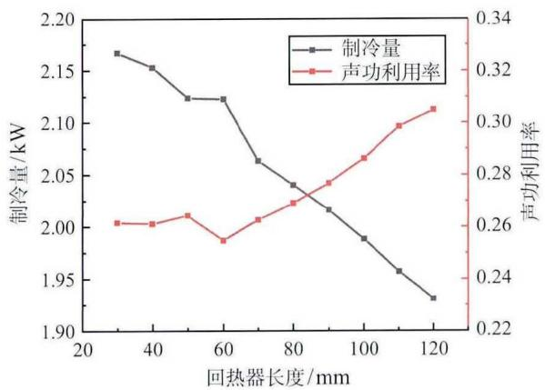  
图2 以制冷量为优化目标时单级制冷机随回热器长度的变化  
Fig. 2 Cooling power optimization results for different regerator lengths of single-stage thermoacoustic refrigerator

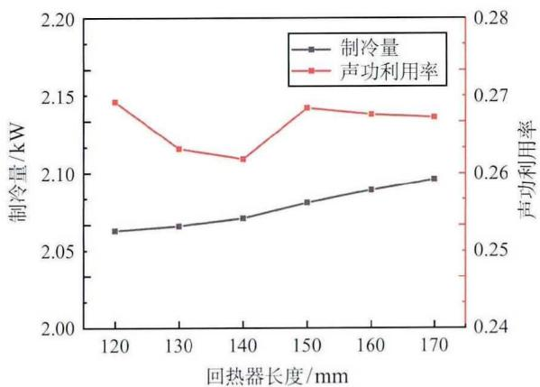  
图3 以制冷量为优化目标时单级制冷机随核心单元直径的变化  
Fig. 3 Cooling power optimization results for different core diameters of single-stage thermoacoustic refrigerator

## 2.2 多级热声制冷机

在单级制冷机的基础上，对多级制冷机进行模拟计算。为了简化计算，多级制冷机采用了和单级一样的结构参数。同时，第一级制冷机入口给定3kW的输入声功，以制冷机的最大制冷系数为优化目标进行计算。计算过程中，平均压力、工作频率等运行参数保持不变。计算仍然通过改变两端活塞的位移和相位来实现优化。

图4给出了多级热声制冷机的声功沿程分布。以两级制冷机的计算结果为例，第一级制冷机入口输入3kW声功，这些声功部分消耗在回热器内，消耗量为0.57kW。在室温换热器、冷端换热器和热缓冲管内有较少损耗，产生了1.95kW冷量。第二级制冷机入口输入2.36kW声功，在回热器内被消耗0.40 kW，在换热器内有较少损耗，产生了1.62kW冷量。在更多级数时，每一级的过程都类似。

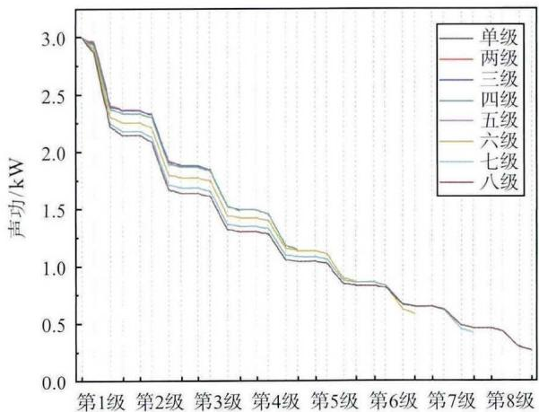  
图4 多级热声制冷机内声功沿程分布  
Fig. 4 Distribution of acoustic work in multi-stage thermoacoustic refrigerator

图5给出了多级热声制冷机中各级制冷机的进出口阻抗相位分布以及两级之间热缓冲管内相位分布，从图5中可以看出，随着整机级数的增多，每一级制冷机的相位增幅减小。在每个制冷机中，各级制冷机单元进出口相位差呈现先增大后减小的趋势。

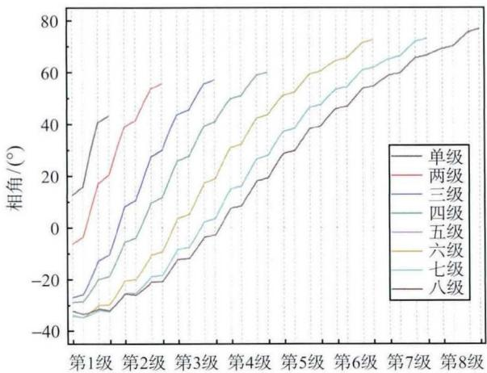  
图5 多级热声制冷机 pU 相位差沿程分布  
Fig. 5 Distribution of phase difference in multi-stage thermoacoustic refrigerator

图6 是不同级数制冷机分别以制冷系数及制冷量作为优化目标，得到的最大制冷系数及最大制冷量计算结果。从图中我们可以看出，随着级数的增加，制冷量呈现先增大后减小的趋势，而非一直增加。且低级数时制冷量增加较快，而后增长速度变慢。六级之后制冷量开始下降。制冷系数随着级数的增多逐渐减小。在实际设计及运行过程中，通常需要兼顾制冷量及制冷系数，因此可根据制冷系数及制冷量的变化图，选择适合运行工况的制冷机级数。

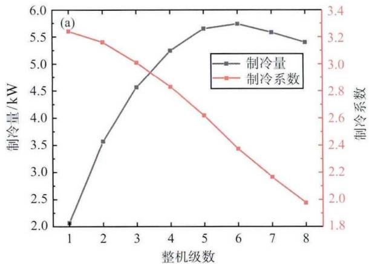

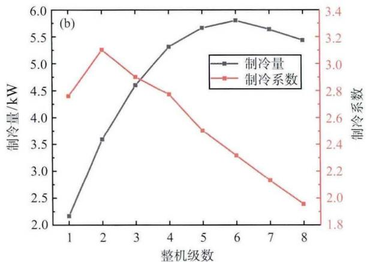  
图6 不同级数制冷机的制冷系数及制冷量(a) 优化 COP(b) 优化制冷量  
Fig. 6 COP and cooling power of refrigerator with different number of stages (a) COP optimization results (b) cooling power optimization results

图7是分别以优化制冷系数和制冷量为目标时，随着整机级数的变化，制冷机声功利用率的变化值。从图中我们可以看出，随着级数的增加，声功利用率明显提高。优化制冷系数时，声功利用率从单级制冷机的0.21可提高到八级制冷机的0.91；优化制冷量时，从单级制冷机的0.26提高到八级制冷机的0.93。根据图6和图7，以两级制冷机为例，在输入声功相同的情况下，优化目标同为制冷系数时，相较于单级制冷机，两级制冷机的制冷量从2.09kW提升到3.567kW，有了较大的提升，COP仅降低0.019，声功利用率从0.219提升至0.376。即在保证制冷系数前提下，两级制冷机可以提升制冷机的制冷量，提高声功利用率，实现功的高效利用，并且减少了输出声功。

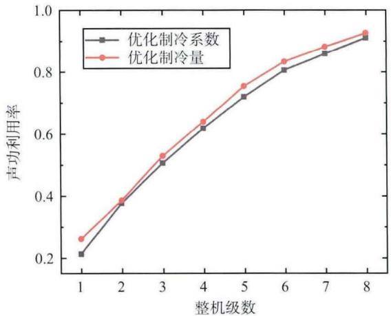  
图7不同级数制冷机声功利用率  
Fig. 7 Utilization rate of acoustic work of refrigerator with different number of stages

图8(a)是以制冷系数为优化目标时，随着整机级数的变化，制冷机进出口阻抗相角的变化曲线。图8(b)是以制冷量为优化目标得到的值。从图中可以看出，室温温区单级热声制冷机的最优情况是入口端阻抗相角大于零，即入口的压力波动相位超前于体积流量相位。随着制冷机级数的增大，对比进出口阻抗相角我们可以发现，入口阻抗相位最终会维持在一40°左右，出口阻抗相位接近于驻波相位，两端相角不会无限向两个方向延伸。且取不同的优化目标时，多级制冷机得到的规律具有一致性。

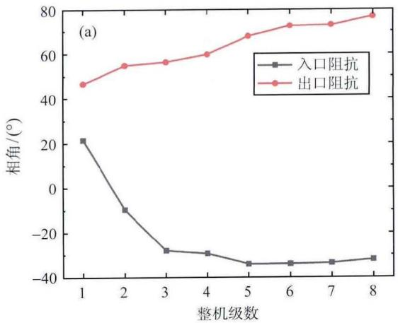

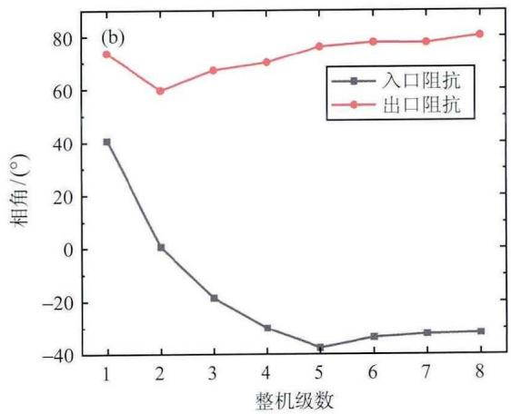  
图8 不同级数制冷机进出口阻抗相角（a）优化制冷系数(b) 优化制冷量  
Fig. 8 Inlet and outlet impedance phase angle of refrigerator with different number of stages (a) COP optimization results (b) cooling power optimization results

从上述分析可以看出，由于制冷机的相位调节，制冷机进出口阻抗相位差不会无限增长。为了进一步探究多级热声制冷机内部的运行工况，我们对多级制冷机中每个核心单元进行分析。图9给出了多级热声制冷机中各级制冷机的制冷量以及制冷系数。从图中可以看出，第1级至第3级制冷机的制冷量随着整机级数的增多而减少，第4级后变化规律不明显。不论整机级数如何变化，由于输入声功逐级减少，各级制冷量逐渐减少，但整机级数大于两级后，各级制冷机核心单元的制冷系数呈现先增大后减小的趋势，而目第一级与最后一级制冷机的制冷量及制冷系数都随着整机级数的增多而减小。因为制冷机的相位调节，在多级制冷机中，某些制冷机核心单元处干较差的工作相位，单级制冷量下降，制冷系数降低，从而影响整机制冷系数。这也是在定输入声功的前提下，制冷机制冷量存在最大值的原因之一。通常来说，室温温区热声制冷机最佳进口阻抗相位位于 $0 ^ { \circ }$ 以上[13]，我们模拟得到的整机中最大制冷系数对应的制冷机核心单元入口阻抗相角也在 $0 ^ { \circ }$ 以上。

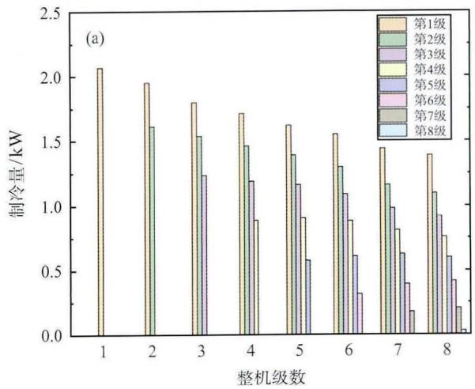

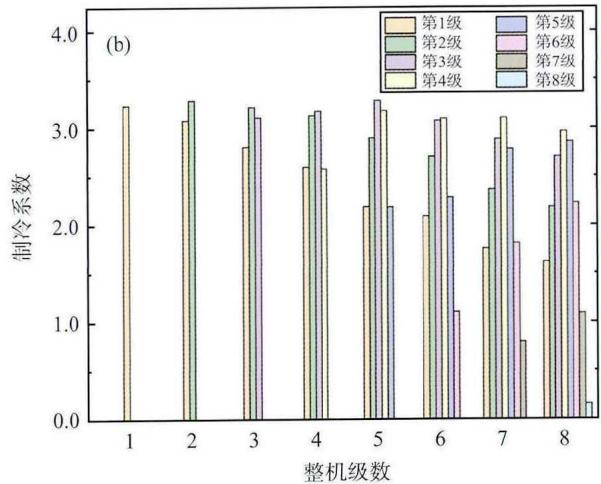  
图9 制冷机各级制冷量(a) 及制冷系数(b)  
Fig. 9 Cooling power (a) and COP(b) for each refrigerator stage

## 3结论

本文针对热声制冷机声功利用率低的问题，对室温温区热声制冷机的工作机理进行探讨。通过计算，我们得到了室温温区热声制冷机的声功沿程分布。此外，还分析了热声制冷机的制冷性能，得到了随着级数变化，制冷机的制冷系数、制冷量以及进出口相角的变化。计算结果显示，单级热声制冷机在室温温区工作时存在声功利用率低的问题，而多级热声制冷机可以有效提高声功利用率，可以从单级制冷机的0.21可提高到八级制冷机的0.91，声功利用率提升4.33倍，制冷量从单级制冷机的2.066kW提高至六级制冷机的 5.736 kW，制冷量提升 2.78倍。

级数增加到一定程度后，会出现某一级或某几级制冷单元处在不合适的工作相位，导致制冷性能较差，例如在八级制冷机中，最后一级制冷机的制冷性能很差，制冷量仅有0.03kW，制冷系数也仅为0.157。这也是多级热声制冷机的局限性。在实际应用中，应结合实验或工程要求对制冷系数及制冷量进行综合考虑，以得到最佳级数，即在提高制冷量的前提下保证制冷系数，并有效提高声功利用率，减少能量损耗。

## 参考文献

[1] SHE Xiaohui, CONG Lin, NIE Binjian, et al. Energyefficient and Economic Technologies for Air Conditioning with Vapor Compression Refrigeration: a Comprehensive Review [J]. Applied Energy, 2018, 232: 157–186

[2] Kang Y T. Kunugi Y, Kashiwagi T, et al. Review of Advanced Absorption Cycles Performance Improvement and Temperature Lift Enhancement [J]. International journal of refrigeration, 2000, 23(5): 388 401

[3] Athanasios I. P, Alexio-Spyridon K, et al. Absorption Refrigeration Process with Organic Working Fluid Mixtures-A Review [J]. Renewable and Sustainable Energy Reviews, 2019, 109: 239–270

[4] Carlos A, Manel V, Mahmoud B. Vapour Absorption Enhancement Using Passive Techniques for Absorption Cooling/Heating Technologies: a Review [J]. Applied Energy, 2018,231:826–853

[5] 李星，徐士鸣，李见波. 基于 R124-DMAC 为工质对的余热 吸收式制冷[J]. 化工学报，2015, 66(5):1883-1890 LI Xing, XU Shiming, LI Jianbo. Absorption Refrigeration Cycle Driven by Waste Heat Using R124-DMAC as

Working Fluids [J]. CIESC Journal, 2015, 66(5): 1883 1890

[6] Ahmed Hamza H Ali. Performance-cost and Global Warming Assessments of Two Residential Scale Solar Cooling Systems Versus a Conventional One in Hot Arid Areas [J]. Sustainable Energy Technologies & Assessments. 2017, 20: 1–8

[7] Ceperley P H. A Pistonless Stirling Engine——the Travelling Wave Heat Engine [J]. Journal of the Acoustical Society of America, 1979, 66(5): 1508–1513

[8] Mckelvey. Shipboard Electronics Thermoacoustic Cooler [J]. Journal of the Acoustical Society of America, 1995, 98(5): 2961

[9] Swift G W, Gardner D L, Backhaus S. Acoustic Recovery of Lost Power in Pulse Tube Refrigerators [J]. Acoust Soe Am, 1999, 105(2): 711 724

[10] LUO Ercang, DAI Wei, ZHANG Yong, et al. Thermoacoustically Driven Refrigerator with Double Thermoacoustic-Stirling Cycles [J]. Applied Physics Letters, 2006, 88(7): 074102

[11] Ueda Y, Biwa T, Mizutani U, et al. Experimental Studies of a Thermoacoustic Stirling Prime Mover and Its Application to a Cooler [J]. Acoust Soc Am, 2004, 115(3): 1134-1141

[12]李山峰.行波热声发动机、制冷机及其耦合规律的研究[D].北京：中国科学院研究生院，2009LI Shanfeng. Study on Traveling-wave ThermoacousticEngine, Refrigerator and the Coupling Law in Between[D]. Beijing: Chinese Academy of Science, 2009

[13] LUO Kaiqi, HU Jianying, LUO Ercang, et al. Theoretical Investigation on the Optimal PU Phase Relationships of Regenerative Cooling Systems with Highest Efficiency [J] Cryogenics, 2019, 98: 5–11