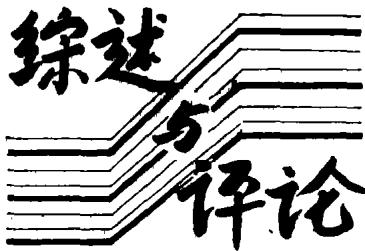
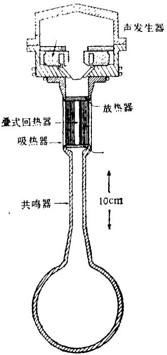
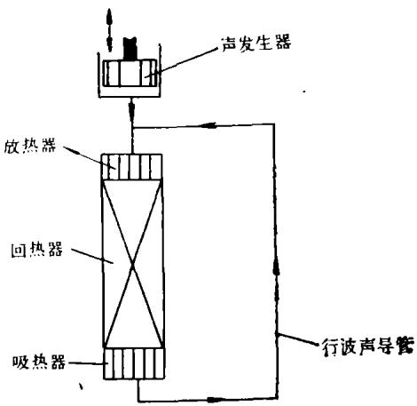
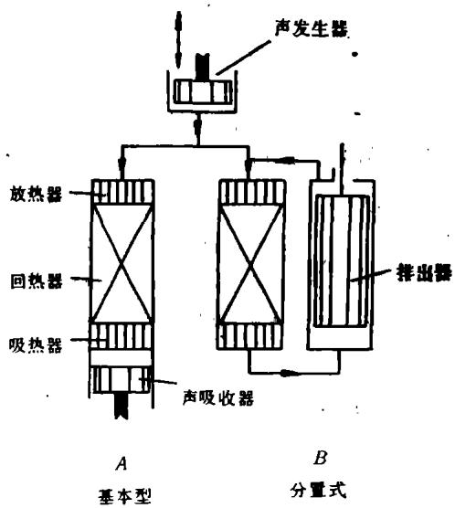
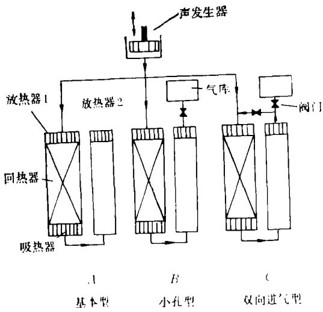

# 热声制冷的基本原理和应用前景

肖家华

(中国科学院低温技术实验中心,北京100080)

1992年9月15日收到

热声制冷，即声波制冷，是八十年代提出的新的制冷原理和方法，热声制冷在冷却红外探测器件、超导电子学器件等低温固体电子器件的微型低温制冷领域具有特殊的优点，同时在普通制冷领域具有成为替代氟里昂制冷的方案的潜在能力，因而受到广泛的关注。本文概要介绍热声制冷的原理和应用前景.

## 一、引 言

我们知道，最基本的热机有两类：发动机和制冷机。发动机将从高温热源吸取的热量部分转化为机械能输出，并向低温热源放出热量；制冷机则消耗外界提供的功从低温热源泵热，并向高温热源放出热量。热机的工作必须不违背基本的热力学原理。热力学第一定律和第二定律规定了热机的能量平衡关系与热功转换效率的上限。

但是热力学原理并没有对热机中功的形式进行限制，它可以是机械能形式的功，也可以是电功、磁功等。声能是一种振荡形式的机械能，如能实现热能和声能的相互转换以及与外热源的热量交换，即可以形成声学热机或热声热机，利用热声效应可以实现声能和热能的相互转换以及与外热源的热量交换，因而利用热声效应可以制成新型热机-热声热机，包括热声发动机和热声制冷机。

现在文献上所称的“热声制冷机”，一般是指Wheatley等人在80年代发展起来的利用较高频率(几百赫兹)驻波声场产生的热声效应来工作的“内在不可逆热声热机或自然热机”。如果我们定义利用热声效应工作的热机为热声热机，那么热声热机的出现和应用实际上已有

应用声学

相当长的历史．只是由于以往一些类型热声热机(如回热式热机)的工作频率较低(几赫兹至几十赫兹)，人们一直沿用准静态、准平衡态的回热式热力循环分析方法和传热学的方法作为其理论基础，分析时注重一个循环的回热效应，却没有意识到，这种回热式热机中的热力学效应实质上也是振荡的可压缩流体(即声)与固体介质的热相互作用所产生的热声效应，因而同样是热声热机.

如果认为所有利用热声效应工作的制冷机均为热声制冷机，则按照我们的定义，目前的热声制冷机包括以下几种主要类型：1.共振型驻波热声制冷机和行波热声制冷机；2. 回热式制冷机，如 Stirling制冷机等；3. 脉冲管制冷机；4. 液体介质热声制冷机等.

## 二、热声制冷的基本原理

热声制冷的基本原理基于热声效应[]. 热声效应是指可压缩的流体的声振荡与固体介质之间由于热相互作用而产生的时均能量效应。与只考虑声波转播的情形不同，产生热声效应时，声波的纵向模和横向模都起着关键的作用。纵向传播模式维持稳定的声振荡和提供产生热声效应所需的声功流，横向模式则产生流体和固体的动量和热量相互作用，正是这些相互作

用引起了热声效应。

一般来讲，对于热声效应的情形，流体中的纵向声传播以及与固体的横向相互作用，与常规情形是不同的。一是因为对一般情形，声场流体中将存在平均的温度梯度，声传播速度是变化的；二是因为对于热声效应，我们除对压力、速度等波动量感兴趣外，还对时均的声功流和热流，以及声能与热能的相互转换感兴趣.

国外的研究者从能量转换观点将一般情形的热声效应分为两类：一是用热来产生声，即热驱动的声振荡；二是用声来产生热流，即声驱动的热传输。我们以固体外壁面与外热源的热接触情况来划分，认为热声效应可以分为以下的三种情形[2]；1.固体外壁面与外热源理想热接触，由于理想热接触的结果，声流体与固体介质的平均温度将与外热源的温度一致，我们称这种情形的热声效应为等温热声效应；2.固体外壁面与外热源理想热绝缘，由于理想热绝缘的结果，工作介质与外界不存在任何形式的能量交换，工作介质中将存在一个纵向的平均温度梯度，以保证纵向总能流不变，我们称这种情形的热声效应为绝热热声效应．3.固体外壁面与外热源存在有限的热交换，由于有限热接触的结果，工作介质既存在一个纵向的平均温度梯度，又存在与外界的热量交换，我们称这种情形的热声效应为一般情形的热声效应，很显然，等温热声效应和绝热热声效应是一般情形热声效应的两个极限情况.

1. 等温热声效应对于等温热声效应，流体纵向波动的传播，与常规情形一样．热声效应的表现是，声功由于介质内在的不可逆性(粘滞系数和导热系数有限)被耗散，同时由于振荡的流体与固体的热相互作用，在距离固体壁面约一个热穿透深度 $\delta _ { K }$ 的薄层内，产生伴随的熵输运热流。这个热流的纵向分量，总是由高声导率比的区域流向低声导率比的区域．而横向热流分量的方向，也与当地声场的声导率比有关．对低 Prandtl数的流体，在实际声导率比小于纵向热流临界声导率比的区域，纵向热流减少，转换为横向热流，向外热源放热；在实际声导率比大于横向热流临界声导率比的区域，由外热源吸热，转换为纵向热流，使得纵向热流增加；在中间声导率比的区域，却不能产生实际的纵向热流与横向热流的相互转换，对于高Prandtl 数的流体，不存在横向热流临界声导率比，只有工作介质耗散功和向外热源横向放热的效应，这时不可逆功耗散占主导地位，低Prandtl数流体的等温热声效应，是热声热机中热交换器的工作机制．很显然，对吸热器，它应工作在高声导区，对放热器，它应工作于低声导区，由于热声效应只发生在距离壁面约为 $\delta _ { \kappa }$ 的薄层内，热交换器的横向特性尺度应当约等于流体的热穿透深度，过大，薄层以外的流体不参与产生热声效应；过小，则会引起强烈的粘性功吸收，均不利．热交换器的纵向长度也要求远小于声波长，否则其声导率比可能跨越两个区域，使得效应相互抵消，

2. 绝热热声效应 对于绝热热声效应的情形，流体纵向波动的传播与常规情形是不同的，声波的传播还受到纵向温度梯度的影响．热声效应的表现是，声功由于介质的内在不可逆性被耗散，同时由于纵向温度梯度的存在，声功可能产生也可能被消耗用于泵热．同样，由于振荡的流体与固体的热相互作用，在距离固体壁面约一个热穿透深度的薄层内产生伴随的熵输运热流．绝热热声效应中，由于工作介质与外界没有任何形式的能量交换，总能流(声功流与热流之和)是不变量，声功流的增加(减少)意味着热流的减少(增加). 声功是产生或消耗与当地的温度梯度有关：在高温度梯度区（实际温度梯度大于功产生临界温度梯度)，工作介质吸收由高温端来的纵向热流的一部分，将其转化为声功，转化得到的声功的一部分用于克服不可逆功耗散，同时使得纵向声功流增加；在低温度梯度区（实际温度梯度小于泵热临界温度梯度)，工作介质除由于不可逆性耗散一部分声功外，还消耗一部分声功，使得净热流由低温端泵向高温端;在中间温度梯度区，工作介质吸收声功而产生热，热流由高温端流向低温端，在这一区产生的时均能量效应不足以补偿不可逆损

12 卷 3 期

失．工作于高温度梯度和低温度梯度区的绝热热声效应，反映了声场中流体与固体的热相互作用而引起的功与热的相互转换的物理机制，它正是热声热机中功与热转换的工作机制．显然，对制冷机，它应工作在低温度梯度区；对发动机，它应工作在高温度梯度区.

在温度梯度一定的情况下，功产生或泵热热流还与声场的性质和流道的布置有关．对于行波声场，热声效应的产生，依赖于工作介质的热力学可逆性，声功流与热流的方向总是相反，在极限情况下，如果工作介质不存在不可逆性，且为理想气体，则声功流与热流不仅方向相反，且大小相等，这时总能流为零。对流道的要求是，流道的横向特性尺度，应小于流体的热穿透深度，这时的情形是流体介质与固体介质之间有良好的热接触，在任一位置的温度波动较小，但对实际情形，流道宽度又不宜太小，过小将导致粘性功吸收的剧烈增加，不可逆性增强。对于驻波声场，热声效应的产生完全依赖于工作介质的内在热力学不可逆性，即其有限的热传导数系数（对热传导系数为零或无穷大的工作介质，在驻波声场中均不产生热声效应)，而热流方向总是由高声导区到低声导区．对流道的要求是，流道的横向特性尺度应大于或与流体的热穿透深度相当，这时的情形是流体与固体有中等程度的热接触，流道尺度过小，会由于驻波引起的温度波动与速度波动同相，使得热声效应减弱。在相同压力波动和体积速度的振幅的情况下，驻波声场所产生热声效应的强度小于行波声场产生的．实际的声场总是介于行波声场与驻波声场之间，我们可将这时的热声效应视作驻波的热声效应与行波的热声效应的复合.

## 3. 热声效应对工作介质的要求 适合于产生热声效应的工作介质应满足以下方面的要求.

对流体介质：（1）是可压缩的，即流体具有有限的声速。声速大的流体，在相同的体积和压力变化下，单位体积内的声能密度也大.(2)有较大的热膨胀系数。不论对功产生或泵热或横向热交换，均要求流体具有较大的热膨胀系数。(3)对要求在较大温差下产生较小能流密度的热声效应场合，流体体积比热要小，反之，对要求在较小温差下产生较大能流密度的热声效应场合，流体体积比热要大.（4）有小的Prandtl数，Prandt1数必须小于一临界值，否则流体不能产生由外热源吸热的效应。Pra-ndtl数越小，粘滞性引起的不可逆耗散越小。

从这些要求看，理想气体(如空气、氮气，特别是氦气)，适用于较大温差，较小能量流密度的场合；在近临界区(不是一般的两相区)的简单液体(如 $\mathrm { C O } _ { 2 } .$ 、简单碳氢化合物 $\mathbf { C } _ { \mathbf { \overline { { \Pi } } } } \mathbf { H } _ { \mathbf { \overline { { \Pi } } } }$ 等),由于仍具有较大的热膨胀性和可压缩性，且有较小的Prandt1数，适用于较小温差，较大能量流密度的场合.

对固体介质：当 $x$ 生等温热声效应时，要求具有较大的热传导系数和体积热容，以实现壁面的局域等温条件和与外热源的良好热接触。当产生绝热热声效应时，要求具有较大的横向热传导系数和体积热容，以实现壁面的局域等温条件和存贮热量，但其纵向热传导系数却要求越小越好，这要靠对固体材料的几何布置来实现（如采用多孔性固体的叠层式结构等).

## 三、热声制冷机

热声制冷机的典型部件从组成上考察热声制冷机，它包括三种主要部件．（1）声换能器．包括声发生器和声吸收器．声发生器将其它形式能转换为声能，实现声功的输人；声吸收器将声能转换为其它形式能量，实现声功的输出．(2)等温热声部件，利用等温热声效应实现纵向热流与横向热流相互转换和与外热源横向热交换的部件，即热交换器，包括从外热源吸取热量的吸热器，它实现热量的输入；向外热源放出热量的放热器，它实现热量的输出，(3)绝热热声部件．利用绝热热声效应实现功(声功)与热(纵向热流)相互转换的部件，即回热器，脉冲管等．声换能器，等温热声部件，绝热热声部件不同的组合和连接，形成不同类型的热声制冷机.

1. 共振型驻波热声制冷机和行波热声制冷机 共振型驻波热声制冷机是在美国 Los Ala-mos国家实验室，由低温物理学家 Wheatley领导的一个小组，从 1983年起，以 Rott 和Thomann关于驻波声场的热声理论[4-6]为指导，成功地发展起来的．驻波热声制冷机是利用管内产生的近共振的驻波声场来产生热声效应进行工作的.其代表性的理论总结可见Swift的精彩评述和总结文章“Thermoacoustic engi-nes”7].代表性的实际制冷装置是 Hofler 制作的驻波热声制冷机8]，它的组成包括以下部件：声发生器，室温放热器，叠式回热器，低温吸热器以及共鸣器，其结构示意图见图1. 声波发生器提供动力产生声振动，在声道中产生一个近共振的驻波声场．由于从吸热器到发声器的长度是1/4声波长，吸热器工作于高声导区，它利用等温热声效应向从低温热源（热负载）吸收热量；这个热量转变为纵向热流，由回热器利用绝热热声效应，消耗声功将热量由低温端泵向高温端（回热器的流道横向尺度约为流体的热穿透深度，声场中驻波分量起决定作用，故热流的方向由高声导区流向低声导区，这里热流方向正好与功流方向相反，即由低温端到高低温端);放热器工作于低声导区，它利用等温热声效应，将由回热器来的热流转换为横向热流，释放给环境．共鸣器中建立的是另1/4声波长的驻波声场．这种制冷机（即目前普遍所称的声波制冷机）只有一个运动部件，即声波发生器，根据最新的报道[9]，Hofler等最近制作的空间用热声制冷机，工作频率是400Hz，在一55℃时制冷量为3W，制冷系数为同温限卡诺循环的16%(实测值).

  
图 1 驻波热声制冷机

共振型行波热声制冷机是美国GeorgeMason 大学的 Ceperley 提出的[10]，行波热声制冷机的组成包括声波发生器和以下部件：室温放热器，回热器，低温吸热器以及行波声导管．这些部件形成一个行波的回路，而回路的长度正好应为一个声波长，它的结构示意图见图2. Cep-erley 的行波热声制冷机的工作原理是这样解释的：声波发生器提供动力产生声振荡，在声回路中产生近共振的行波声场，吸热器利用等温热声效应，从低温热源吸收热量，这个热量，由回热器消耗声功由低温端泵向高温端（回热器的流道横向尺度小于流体的热穿透深度，声场中行波分量起决定作用，热流由低温端到高温端);放热器将由回热器来的热流释放给环境。这种制冷机也只有一个运动部件，即声波发生器。

  
图 2 行波热声制冷机

2. Stirfing 制冷机 Stirling 发动机发明于 1816 年，后来 Kirk [1860] 利用逆向 Sti-rling 循环制冷获得成功。从我们的观点看，Stirling 制冷机实际上是一种带声吸收器的行波热声制冷机。

Stirling 制冷机目前作为 80K 至 20K 温区中小型制冷机应用较广“1]。 它的特点是工作温度范围宽，效率高，结构紧凑等。如果采用分置式结构，体积小，重量轻，特别适合于用于冷却机载设备。

最基本的 Stirling 热机包括以下部件：声发生器，放热器，回热器，吸热器，声吸收器。其结构示意图见图 3a. Stirling 热机中行波声场的建立，是靠声发生器活塞和声吸收器活塞的协调运动来实现，即声发生器活塞运动，超前声吸收器活塞运动一个相角 $\theta ( 0 < \theta < \pi )$ ，当θ约为 π/2 时，其中声场的行波能量达到最大值．如果放热器与高温热源热接触，吸热器与低温热源热接触，即得到 Stirling制冷机；放热器与低温热源热接触，吸热器与高温热源热接触，则得到 Stirling 发动机. 从热声观点来看，Stirling制冷机，声功流的方向由高温端到低温端，吸热器由低温热源吸取热量，这个热量，由回热器消耗一部分声功由低温端泵向高温端(回热器中填充多孔介质，流道的横向特性尺度很小，声场中行波分量起决定作用，故热流方向与功流方向相反)“]，放热器将由回热器来的纵向热流释放给高温热源.对 Stirling 发动机，功流的方向是由低温端到高温端，吸热器从高温热源吸热，回热器利用部分由吸热器来的热流，产生声功使低温端来的功流得以放大并送向高温端，放热器将剩余的热流向低温热源释放.

另一类重要的 Stirling 热机是带排出器结构的，即分置式 Stirling 制冷机和自由活塞Stirling 发动机，其结构示意图见图 3b. 这里

## 应用声学

  
图 3 Stirling 制冷机

重要的是排出器的作用，它在一端吸收声功，而在另一端输出声功，因而它起的是声功流反馈的作用，其余各种部件的作用与基本 Stirling制冷机和发动机中的相同。

3. 脉冲管制冷机 基本型脉冲管制冷机于1963 年由美国的 Gifford 和 Longsworth 提出．脉冲管制冷机近几年得到很大发展，由基本型脉冲管发展到小孔型脉冲管和双向进气型脉冲管制冷机等型式，可达到的最低温度由120 K 到现在的 40 K 左右[“3-15]. 脉冲管制冷机在低温端无运动部件的特点，使它成为一种有发展前途的机型，它实际上是一个行波热声制冷机和驻波热声制冷机的组合[6].

基本型脉冲管制冷机的组成包括以下部件：声发生器，放热器1，回热器，吸热器，脉冲管，放热器2,其结构示意图见图4a.我们注意到如果将它在脉冲管的低温端分为两部分，则带回热器的一部分除缺少一个声吸收器以外完全与一个基本 Stirling 制冷机一样，对这个假想的基本 Stirling制冷机来讲，带脉冲管的这一部分的作用就是它的声吸收器，所吸收的功正是这部分所消耗的功．这样带回热器一端各部件的作用与基本 Stirling 制冷机中的完全一致，其中的高温端向低温端传输的行波起主要作用．对带脉冲管的一部分来讲，带回热器的一部分的作用可以视作一声发生器，所输入的声功正是脉冲管低温端的声功流．这一部分的末端是封闭的，其中建立的主要是驻波声场，驻波声场产生的绝热热声效应，其热流方向是由高声导区到低声导区，这里正好高温端为低声导区．如果脉冲管的温度梯度小于泵热临界温度梯度，则这一部分也产生一部分泵热效应；反之，这一部分附加给吸热器一个热流，部分抵消带回热器部分从低温热源所吸收的热量（制冷量).

小孔型脉冲管制冷机，在基本脉冲管制冷机的基础上，在脉冲管热端放热器2处又增加了一个Helmholtz共鸣器(小孔加气库结构)，它的结构示意图见图 4b.Hclmholtz 共鸣器是一种共振吸声结构，当它工作在共振频率附近时，由于小孔的声阻产生强烈的声吸收作用，声功被吸收耗散为热。Helmholtz 共鸣器所吸收的声功是由声发生器提供的，这样，在制冷机中声场的行波分量得以增强，回热器泵热量增加；而在脉冲管部分，由于小孔的尺度相对管径很小，这里的仍是驻波声场占主导．从总的效果来看，小孔脉冲管制冷机的性能，比基本脉冲管制冷机性能大大改善，其泵热能力和达到的最低温度可接近Stirling制冷机的水平，但行波分量的增强是以共鸣器耗散功为代价，其制冷系数将小于 Stirling 制冷机.

  
图 4 脉冲管制冷机

双向进气型脉冲管制冷机，在小孔型脉冲管制冷机的基础上，用一段旁路管道将脉冲管的热端与回热器热端连接起来，形成所谓“双向进气”结构，它的结构示意图见图4c.旁通管路中气柱相当于一个气体排出器结构．如阻抗匹配适当(否则声功流由旁路管道流向脉冲管，在脉冲管中不能产生适当的驻波声场)，则可通过旁路吸收和反馈回收一部分声功，使制冷能力和效率提高.

## 四、热声制冷的发展趋势与展望

1. 低温电子学器件制冷用高频微型低温制冷机低温电子学器件(如红外探测器件、高温超导微电子器件等)的制冷问题，与常规的制冷相比，有自己独特之点．这些特点是：（1）要求的制冷温度较低(一50℃—一200℃)，制冷量不大(按场合从几十毫瓦到几瓦).(2）要求制冷机的机械振动小．高灵敏度的低温电子系统都是用于精确检测微弱信号，机械振动会干扰器件的工作特性.(3）高可靠性和小型轻量化.低温电子系统器件的微型集成化和高可靠性，与低温制冷系统的大型笨重和较低的工作可靠性，形成尖锐的矛盾，严重妨碍低温电子学应用的推广和发展，以至电子工程师们把低温制冷系统视为无法摆脱的“包袱”．现在国内外所使用的和正在研究的电子学器件制冷用低温制冷机，均采用较低的工作频率（一般低于50赫兹)．要使制冷机进一步小型轻量化，必须采用更高的工作频率(几百至几千赫兹)，热声制冷正好迎合了这一发展趋势．热声制冷不能采用传统的回热式制冷的原理，结构，材料和工艺.我们现在对热声制冷的原理已有一定的了解。一旦在热声制冷器的结构，材料和工艺上有所突破，可以期望热声制冷将在低温电子学器件制冷方面有大的作为.

2. 液体介质家用和工业制冷用热声制冷机热声制冷的一个很有潜力的应用场合，是替代氟里昂制冷用于冰箱、空调等场合．现在的热声制冷机大都采用气体作为声介质．前面已经

12 卷3期

指出，气体由于其中声的能流密度较小，适用于较大温差，较小能量流密度的场合．现在的气体回热式制冷机（如 Stirling制冷机、脉冲管制冷机）其最佳能效比的温区在100K附近，Hofler的驻波共振型热声制冷机的最佳能效比，与氟里昂制冷机相当，温区在一50℃附近，但它们的能流密度只是约为氟里昂制冷机的1/10，显然不适合用于冰箱、空调等场合．解决这一矛盾的办法是采用液体工作介质，它们适用于较小温差，较大能量流密度的场合，可以替代氟里昂制冷用于冰箱、空调等场合.美国LosAlamos国家实验室用近临界区的液态丙烯，在Stirling 制冷机上进行的试验表明“7]，用近临界区的液体介质作为热声制冷机的工作介质是可行的．目前在这方面的主要难点是，临界温度在室温附近的简单液体，其临界压力都较高(较现氟里昂的工作压力高2-5倍)，带来许多技术上的麻烦.

3. 无运动部件的热驱动热声制冷机 热声制冷技术的另一个发展趋势是，无运动部件的热驱动的热声制冷机。利用热声效应制作热声发动机可以实现将高温热能转换为声能，这种声换能器没有运动部件．热声发动机与热声制冷器的组合可以制成热驱动的制冷机，它完全没有运动部件，具有高度的可靠性，从道理上讲，可以作到极高的寿命，特别适合于空间用低温电子学器件冷却的长寿命制冷器；如用液体做工作介质则可以在利用余热制冷方面有所作为.

4. 其它方面 除利用热声效应直接制冷以外，声波技术在制冷领域的其它方面也有用处.如美国 Los Alamos 国家实验室最近开发的驻波制冷压缩机就是一个很好的例子“8]． 这种制冷压缩机，是在一段半波长的管内的一端，采用直线电磁振动电机来驱动一个发声膜片，建立起近共振的驻波声场，在另一端由于正好是波的速度节点，压力波动最大，在此位置放置一组压缩机阀片，低压时进气阀门打开，吸入流体，高压时排气阀门打开，排除流体，由此完成流体的压缩过程。这种制冷压缩机的优点是高效和无油润滑．目前研制出的用于替代氟里昂的新制冷剂，与润滑油的兼容性不好，人们期望这种无需油润滑的压缩机可以解决这一问题，而且与常规制冷压缩机相比，耗电节省约1/4一1/3.

## 参考文献

[1] Wheatley, J.C. et al., J. Acoust. Soc. Am., 74- 1 (1983), 153

[2] 肖家华，中国科学院物理研究所博士论文（1991)

[3] Rott, N., Adv. Appl. Mech., 20(1980), 35

[4] Rott, N., ZAMP, 20(1969), 230

[ 5] Rott, N., ZAMP, 26(1975), 43

[ 61 Merkli, P. and Thomann, H., J. Fluid, Mech., 70Pt. 1(1975), 101

[ 7] Swift, G. W., J. Acousr. Soc. Am., 84-4(1988), 1145

[ 8 ] Hofler, T. J., Ph. D Thesis, Phys. Dept., University of California, San Diego, USA(1986)

[ 9 1 Garrett S. L., Hofler, T. J., Gardner, D. L., 14th ICA, Sept. 1992, Beijing

[10] CeperIey, P. H., J. Acoust. Soc. Am., 77(1979), 1239

[11] Walker, G., Cryocoolers, Plenum Press, New York, USA(1983)

[12] Xiao, J. H., Cryogenics, 32-10(1992), 895

[13] Gifford. W. E. and Longsworth, R. C., Trans. ASME B, 86(1964), 264

[14] Liang, J. T., Zhou, Y. and Zhu, W. X., Cryogenici, 30-1(1990), 49

[15] Zhu, S. W., Wu, P. Y. and Cheng, Z. Q., Cryogenics, 30-9(supp1.) (1990), 514

[16] Xiao, J. H., Proc. 7th Inil. Cryocooler Conf., Nov. 1992, Santa Fe, USA, 1992

[17] Swift, G. W, J. Appl. Phys., 65-11(1989), 4157

[18] New Seientist, 4 April, 1992, No 1815