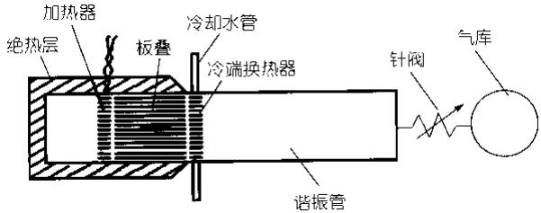
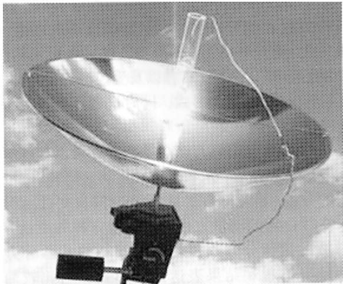
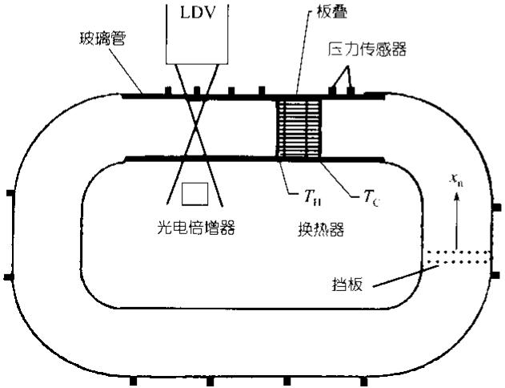
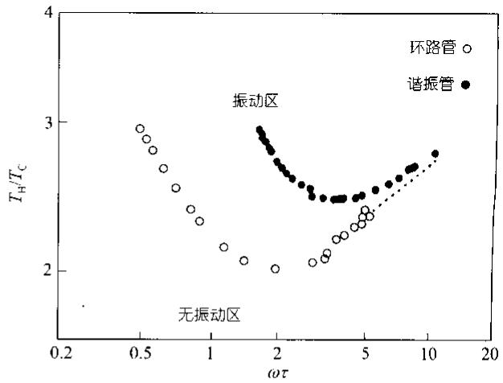
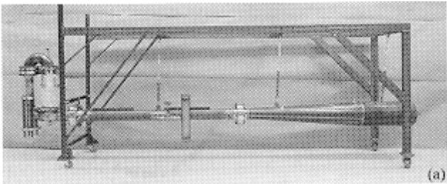
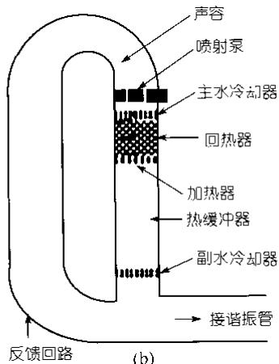
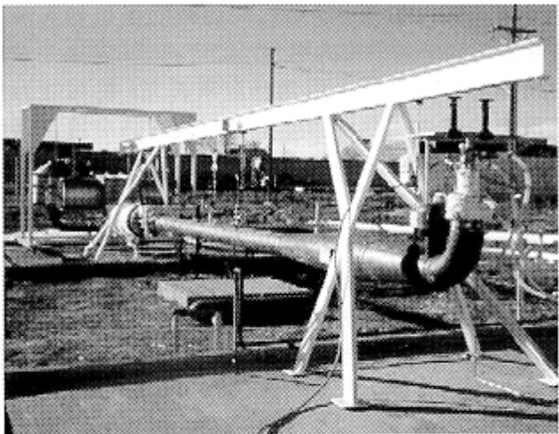
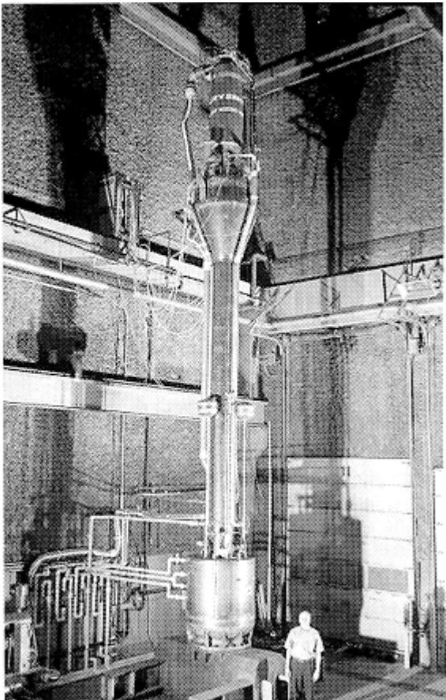
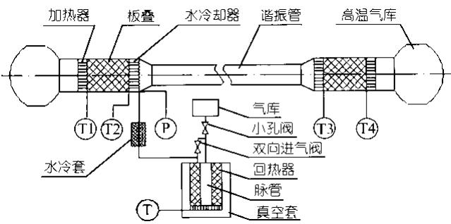

# 热声发动机及其驱动脉管制冷机研究进展

陈国邦 汤 珂 金 滔

(浙江大学制冷与低温研究所, 杭州 310027. E-mail: gbchen@cmee.zju.edu.cn)

摘要 热声驱动脉管制冷作为一种可用热能驱动的完全无运动部件的新型制冷方案已成为制冷与低温领域的研究热点. 回顾了热声学的发展历史, 针对热声发动机及其驱动脉管制冷机研究中的关键技术,综合评述了热声学理论和实验研究的最新进展与典型样机, 并指出了该研究领域今后的发展方向和工业应用的前景.

关键词 热声学 热声机械 脉管制冷机

1999 年, 美国洛斯-阿拉莫斯国家实验室 Backhaus和 Swift 在 Nature 上发表论文报道研制成一台热声斯特林发动机[1], 其热效率高达 0.30, 完全可以同内燃机(0.25\~0.40)和传统的活塞式斯特林发动机(0.20\~0.38)相媲美, 这意味着, 热声机械可望成为 21世纪没有运动部件的新型热机, 引起了各国科研工作者和工业界的强烈关注.

热声机械以热声效应为基本工作原理. 简单地说, 热声效应就是热能与声能之间相互转换的现象.从声学角度讲, 它是由于处于声场中的固体介质与振荡流体之间的相互作用, 结果导致在距固体壁面一定范围内产生沿着(或者逆着)声传播方向的时均热流和时均功流[2]. 按能量转换方向的不同, 热声效应可分为两类: 一是用热能来产生声功, 即由热能驱动的声振荡; 二是用声能来产生热流, 即由声能驱动的热量传输. 对应于该两类热声效应, 热声机械可分为热声发动机(也称作热声驱动器或者热声压缩机)和热声制冷机. 按照热声板叠所处声场的类型, 热声机械又可分为驻波型热声机械和行波型热声机械.

高效率热声发动机的问世, 给长寿命低温制冷机的研究和发展指出了一条新路. 现代工业生产, 空间技术以及军事工程等都对低温制冷机的可靠性和寿命提出了很高的要求, 但传统的低温制冷机, 如:斯特林制冷机和 G-M 制冷机, 由于在室温端和低温端均存在运动部件, 不能很好满足这些要求. 近 20年出现的小孔型脉管制冷机去除了低温运动部件(排出器), 从而避免了低温下的滑动密封 机械磨损等问题, 有望实现长期的稳定可靠运行. 然而, 驱动脉管制冷机的机械式压缩机仍然存在许多运动部件, 这成为其可靠性和寿命的限制因素. 热声发动机的出现为解决这一问题提供了新的方案, 因为热声发动机仅由管件和换热器构成, 利用声场固有的压力和速度振动以及二者间的相位关系结合适当的固体边界条件, 实现热能向机械能的转换, 整机除了振动的工作气体外, 没有任何运动部件. 1990 年, 美国洛斯-阿拉莫斯国家实验室的 Swift 和美国国家标准技术研究所的 Radebaugh 联合提出采用热声发动机代替传统机械式压缩机驱动脉管制冷机[3]. 利用热声驱动的脉管制冷机由于从室温到低温完全没有机械运动部件, 具有结构简单 运行稳定可靠 寿命长等突出优点; 同时, 可以热能(燃气, 太阳能, 废热等)作为驱动源, 可实现对低品位能源的利用, 对于电能缺乏而热能富集的场合具有实用意义; 此外, 由于采用氦氩 氮等气体作为工质, 无环境污染, 顺应了环保制冷的发展趋势.

热声驱动脉管制冷技术具有广泛的应用前景,可用于液化天然气, 提供车用清洁燃料, 实现城市燃气使用的调峰. 还可以用于石油气的液化分离, 回收利用掩埋式垃圾场产生的可燃性气体, 也可用于普冷领域的空调以及食品冷冻冷藏等.

目前, 热声驱动脉管制冷已成为制冷与低温领域的研究热点. 本文在简单回顾热声学的发展历史之后, 针对热声发动机及其驱动脉管制冷机, 重点评述了热声学理论和实验研究的最新进展与典型样机,最后指出了该研究领域今后的发展方向.

## 1 热声学的发展历史

人们对热声现象的认识可追溯到 200 多年之前.早在 1777 年, Byron Higgins就在实验中发现, 将氢火焰放在两端开口的垂直管的适当位置, 管中会激发出声音[4]. 吹玻璃工人则发现当将一个玻璃球连接到一根中空玻璃管上时, 管子的尖端处有时会发出声音[2]. 正是源于这些偶然的发现, 人们开始了热声效应的探索之旅.

1850 年, Sondhauss 首先对连接玻璃球的中空玻璃管中发生的热声现象进行了研究, 后来人们就以他的名字把这种一端封闭 一端开口的热声振荡管命名为 Sondhauss 管[5]. 1859 年, Rijke 在将加热的丝网放到一根两端都开口的垂直空管的下半部分时, 观察到强烈的声振荡, 并对这种以后被称为 Rijke 振荡的现象进行了定性分析[6]. 实际上, Sondhauss 管和Rijke 管分别是驻波型和行波型热声机械的雏形.

1962 年, Carter 和他的同事对 Sondhauss 管进行了有效的改进. 他们在 Sondhauss 管中加入板叠, 大大强化了管内热声效应, 研制出世界上第1台有显著声功输出的驻波型热声发动机, 以 600W的加热功率获得了 27W 的声功率[2,5]. 这是现代实验热声学研究的重要进展, 标志着人们进入了具有实用意义热声机械的研究阶段.

1979 年, 美国 George Mason 大学 Ceperley 意识到 Stirling 机回热器中工质振荡的压力与速度的相位同行波的相位是一致的, 以此为基础提出了行波型热声机械的概念[7]. 由于行波的压力和速度振荡具有相同的相位, 工质微团的压缩膨胀与换热过程自然分离, 消除了驻波热声热力循环利用工质与固体边界的不良热接触协调压缩膨胀与换热过程所造成的不可逆性, 可望获得更高的热力学效率. 虽然Ceperley 在验证实验中, 由于采用了不适当的声学阻抗, 未能实现声功的增益[8], 但行波型热声机械概念的提出, 为提高热声机械的效率提供了新的思路, 对热声机械的后续发展具有方向性的指导意义.

热声学的理论研究源于1868年Kirchhoff关于声在管中由等温固体管壁和维持声波的气体之间的振荡传热引起的衰减量的计算[2]. 1896 年, Rayleigh 首先对热声振荡现象给出了定性的解释[9], 这是人们第一次从理论上对热声现象进行探讨. 他指出: 只要参与热过程的工质运动与热交换之间具有合适的相位角, 就可以维持振荡. 对作声振动的介质, 若在其最稠密处向其提供热量, 而在其最稀疏处吸取能量, 声振动就会得到加强(热能转变为声能). 反之, 若在其最稠密时从其中吸取热量, 而在其最稀疏时向其提供能量, 声振动就会衰减(声能转变为热流), 为了维持声振动, 外界必须对流体作功. 这就是所谓的

Rayleigh 准则. 到目前为止, Rayleigh 准则一直被人们认为是理解热声振荡如何在管中得以维持的一个合理解释.

瑞士苏黎士联邦技术研究所 Rott 于 1969\~1983年间提出的热声振荡定量理论[10\~16], 奠定了现代线性热声理论的基础. 可以说, 他是现代理论热声学研究的开创者, 他提出的理论框架为定量分析热声机械提供了坚实的理论基础.

## 2 研究进展与典型样机

## 2.1 理论研究

(1) 线性热声理论. 在 Rott 的研究工作基础上,线性热声理论迅速发展[2,17\~21]. 1988 年, Swift 等人对线性热声理论进行了系统的阐述和总结[2]. 该理论假设振动的压力 速度 温度等物理参数, 均随时间按正弦规律变化, 并将各物理量表达为如下的统一形式: (以压力为例)

$$
p = p _ { \mathrm { m } } + \mathbf { R e } [ p _ { 1 } ( x ) e ^ { \mathrm { i } w t } ]\tag{1}
$$

其中下标m表示平均值, 下标为 1的量是复数量, 既表示了物理量振幅的空间分布, 又反映各物理量之间的相位关系, eiwt则表示各物理量的时间依存性. 将形如(1)式的各物理量表达式代入线性化后的动量方程 连续性方程和能量方程, 并结合状态方程, 推导得到针对微元管段 dx 的 3 个核心表达式:

$$
\begin{array} { c } { \displaystyle \frac { \mathrm { d } p _ { \mathrm { 1 } } } { \mathrm { d } x } = - \frac { \mathrm { i } W r _ { \mathrm { m } } } { 1 - f _ { n } } \frac { U _ { \mathrm { 1 } } } { A } , } \\ { \displaystyle \frac { \mathrm { d } U _ { \mathrm { 1 } } } { \mathrm { d } x } = - \frac { \mathrm { i } W A } { g ^ { \dag } p _ { \mathrm { m } } } \big [ 1 + ( g - 1 ) f _ { k } \big ] p _ { \mathrm { 1 } } } \\ { \displaystyle \qquad + \frac { f _ { k } - f _ { n } } { ( 1 - f _ { n } ) ( 1 - P r ) } \frac { 1 } { T _ { \mathrm { m } } } \frac { \mathrm { d } T _ { \mathrm { m } } } { \mathrm { d } x } U _ { \mathrm { 1 } } , } \end{array}\tag{2}
$$

(3)

$$
= \frac { \dot { H } _ { 2 } - \cfrac { 1 } { 2 } \mathrm { R e } \left[ p _ { 1 } \tilde { U } _ { 1 } \left( 1 - \cfrac { f _ { k } - \tilde { f } _ { n } } { ( 1 + P r ) ( 1 - \tilde { f } _ { n } ) } \right) \right] } { \cfrac { { r } _ { \mathrm { m } } c _ { \mathrm { p } } \left| U _ { 1 } \right| ^ { 2 } } { 2 A \ b { w } ( 1 - P r ^ { 2 } ) \left| 1 - f _ { n } \right| ^ { 2 } } \mathrm { I m } ( f _ { k } + P r \tilde { f } _ { n } ) - ( A k + A _ { \mathrm { s o l i d } } k _ { \mathrm { s o l i d } } ) } ,\tag{4}
$$

式中 $p _ { 1 }$ 表示压力振幅, $U _ { 1 }$ 表示速度振幅, w为角频率,$r _ { \mathrm { m } } , T _ { \mathrm { m } } , c _ { \mathrm { p } } , \pmb { g } , k , P r$ 分别为工质的平均密度 温度 定压比热容 比热比 热导率和 Prandtl 数, $f _ { n ^ { \dagger } } ^ { \mathrm { ~ i ~ } }$ 和 $f _ { k }$ 分别为黏滞函数和热函数, A 为流道的流通面积, $A _ { \mathrm { s o l i d } }$ 和$k _ { \mathrm { s o l i d } }$ 分别为构成流道的固体的横截面积和热导率,$\dot { H } _ { 2 }$ 为总能流, i 为虚数符号, 上标\~表示取共轭复数.从本质上讲(2)\~(4)式分别为热声学形式的动量方程连续性方程和能量方程, 它们是线性热声理论的关键表达式. 在此基础上, Swift等人进一步引入粘性声阻 热驰豫声阻 声感 声容以及受控源比例系数, 简化了(2)\~(4)式的表达形式, 同时进行了热声部件的声电类比[19].

线性热声理论具有诸多优点. 首先以如(1)式的形式表达各物理量, 从数学本质上讲, 是采用了分离变量的方法, 将空间自变量 x 和时间自变量 t 分开,代入线性化后的动量方程 连续性方程和能量方程,原时域的偏微分方程可转换为频域的常微分方程,使得推导过程和结果表达式的形式相对比较简单,便于学习和运用. 其次, 热声学形式的动量方程 连续性方程和能量方程(2)\~(4)式是针对微元管段的通用表达式, 其完整形式适合于描述热声板叠, 稍加修改, 比如取温度梯度 $\mathrm { d } T _ { \mathrm { m } } / \mathrm { d } x = 0 .$ 就可以用于描述换热器, 谐振管等热声部件. 并且, (2)\~(4)式虽为一维空间形式, 但实际上式中的黏滞函数 $f _ { \pmb { n } }$ 和热函数 $f _ { k }$ 均为流道空间的函数, 并且是流道横截面上的积分值, 它们能够表示出流道空间结构对工质流动和传热的影响, 因此一维形式的表达式(2)\~(4)式就能够反不同流道空间结构的情况, 该理论可以用于预测比较不同热声板叠流道形式的热声转换性能. 同时,结合边界条件组合各热声部件, 数值积分(2)\~(4)式(或者采用差分数值计算), 就可以实现对整个热声机械的模拟, 从而可进行热声机械的设计和理论优化.粘性声阻 热驰豫声阻 声感 声容以及受控源比例系数的引入, 进而进行声电类比, 使用为人们广泛接受的电路知识描述热声系统, 加深了人们对热声现象的理解. Swift 等人对线性热声理论的发展和完善主要体现在初步研究了多孔介质热声板叠的模拟[20],紊流对热声部件粘性流动阻力的影响, 流道截面变化引起的局部损失, 入口效应, 热声部件连接条件[19]以及无量纲化[21]等. 这些研究提高了利用线性热声理论模拟和设计热声机械的准确性. 在此基础之上, Ward和Swift 等编制了一套热声计算程序 DeltaE(Design En-vironment for Low-amplitude Thermoacoustic En-gines)[22], 涵盖了各种常规的几何结构边界条件, 可广泛应用于热声发动机和制冷机的模拟和设计, 对于推广线性热声理论的工程应用具有重要意义.

线性热声理论虽然有很多优点, 但也存在着明显的不足之处. 目前的线性热声理论是基于 Euler 法,通过分析固定位置的热力参数, 进而了解整个系统的热力工作过程. 然而, Euler法对热力循环过程的分析并不直观, 对热声转换过程的物理机制表达不够清晰. 并且, 线性热声理论只能对热声系统进行定态的描述, 无法反映其动态的特性, 对于已在实验中观察到的振幅饱和 频率跳变等显著的非线性热声现象无法进行解释. 正是线性热声理论存在着这些缺陷,催生了非线性热声理论.

(2) 非线性热声理论. 非线性热声理论是非线性声学的一个分支, 在最近 10 年中开始起步发展[23\~33].比较具有代表性的是美国 John Hopkins 大学 Karpov和 Prosperetti 等人的研究工作[24,25,27,29]. 他们从 1997年以来发表的多篇学术论文中通过采用含非线性项的动量方程 连续性方程以及能量方程, 建立并逐步改进针对热声效应的时域非线性数学模型. 他们的非线性模型可以定量描述微小压力波如何通过初始的线性增长进入非线性区, 并最终饱和于有限的振幅, 能够对热声系统的频率跳变现象进行定量理论解释, 并且具有一定的普适性, 可以用于模拟热声发动机 电声驱动热声制冷机以及热声驱动热声制冷机,通过模型的改进还改善了求解模型数值计算的稳定性.

初步发展的非线性热声理论虽然可以描述热声效应的一些动态特性, 解释一些非线性热声现象, 对于深化人们的理解, 改进热声机械的设计具有积极作用, 但现有的非线性热声模型还很不完善, 限于对流道中交变流的流动和传热过程物理机制的有限理解以及求解非线性数学模型的困难, 一些影响因素在现有的非线性模型中并未考虑. 同时, 分析和求解非线性热声模型对数学知识和技巧要求很高, 模拟结果的准确性还有待实验验证.

## 2.2 实验研究与典型样机

(1) 驻波型热声发动机. 美国洛斯-阿拉莫斯国家实验室从上个世纪80年代开始研制热声机械, 图1为 Swift 等人建立的一台驻波型热声发动机示意图,其谐振管内径为 127 mm, 长度为 4320 mm, 以 1.38MPa 的氦气作为工质, 在 7 kW 加热功率条件下, $\vec { r }$ 生了 630 W 的声功, 热效率为 9%[34]. 他们在实验中对加热功率, 板叠热端和冷端温度以及系统中所产生的压力波进行了仔细的测量, 发现在低振幅工况下, 线性热声理论的计算结果同测量值比较符合, 而在高振幅工况下, 则存在明显偏差. Swift 等人的研究工作验证了线性热声理论对于热声发动机小振幅工况良好的适用性, 但同时也表明对于不满足线性化条件的大振幅工况需要发展非线性热声理论才能给出合理的模拟计算结果.

  
图 1 Swift 的驻波型热声发动机示意图[34]

日本大学Matsubara和朱绍伟及周淑亮等人也开展了驻波型热声发动机的研究工作, 他们将两组相同的热声板叠以及热端和冷端换热器布置在谐振管的两端, 建立起双边驱动的驻波型热声发动机[35,36].采用铜丝网代替传统的卷板型热声板叠, 虽然流动阻力有所增加, 但由于丝网片间存在接触热阻, 可有效减小板叠轴向导热所造成的热损失, 同时, 加工制作也变得更为方便. 针对丝网目数的优化实验发现,工作气体的热渗透深度与丝网的水力半径之比约为0.35 时可提供驻波热声效应所需的适当的不良热接触, 获得较好的热声转换性能. 这为驻波型热声发动机的丝网板叠目数选择提供了指导. 在加热功率 加热温度和工作频率分别为 833 W, 700 K 和 73 Hz 条件下, 获得了 26 W 的最大声功输出. 他们在采用较长(8 m)谐振管的实验中观察到了谐波成分的产生和从基频向二阶模式的频率跳变现象, 并认为这与谐振管同热声板叠的长度比例关系以及板叠在谐振管中的安装位置相关. 谐波和频率跳变对于脉管制冷是不利的, Matsubara 等人的研究工作对抑制热声驱动脉管制冷系统中的谐波和频率跳变具有一定的参考意义.

1998 年, 美国 Pennsylvania 州立大学的 Chen 和Garrett 建成了世界上第 1 台太阳能驱动驻波型热声发动机[37,38], 见图 2. 他们以一根 40 cm 长, 一端开口的管作为谐振管, 采用直径为3英尺的透镜将阳光聚焦到陶瓷热声板叠的一端进行加热, 稳定工作时, 产生 1/4 波长模式的气体振荡, 频率为 420 Hz, 在距开口端 1 m 处可测得 120 dB 的声波. 虽然该热声发动机是一台小型的演示性实验装置, 但它验证了热声发动机以太阳能作为驱动源的可行性. 与太阳能利用相结合的热声技术更加显著地体现出清洁 环保节能等优点, 完全符合全球可持续发展战略的要求.

  
图 2 Garrett 的太阳能驱动热声发动机[38]

在国内, 浙江大学陈国邦等人所开展的驻波型热声发动机研究工作比较具有代表性[39\~43]. 他们建立了一台采用黄铜丝网板叠的对称型双边驱动热声发动机, 系统地研究了充气压力 加热功率 加热温度等操作参数, 谐振管长度等结构参数以及工质种类对热声发动机性能的影响[39]. 针对核心部件热声板叠, 着重研究了板叠材料热物性对热声转换的影响, 提出采用考虑了板叠固体热渗透深度的可用热容 $c _ { \mathrm { p } } { \pmb d } _ { k } { \pmb r } \left( c _ { \mathrm { p } } , \qquad \right.$ d 和r分别为板叠材料的定压比热容, 热渗透深度和密度)衡量板叠材料的横向换热能力[40],为热声板叠材料的选择提供了定量的衡量参数. 针对丝网型板叠, 在 Matsubara 等人优化丝网目数的基础上, 进一步提出了丝网板叠填充率的概念(单位长度所装填的丝网片数, 对丝网板叠的轴向和横向传热以及流动阻力等具有综合影响)[41], 实现了丝网板叠的量化装填, 通过优化丝网板叠填充率提高了热声发动机的性能. 在实验研究中, 观察到了热声发动机的起振和消振温度以及起振和消振临界加热功率都存在滞后现象, 针对该特性提出了辅以电加热的低品位能源利用方案(采用电加热帮助系统起振, 然后利用低品位能源维持振荡)[42]. 在理论计算的基础上实验验证了缓冲器的体积和布置方式对驻波型热声发动机谐振频率的影响[43], 为热声系统谐振频率的调节提供了新的方法. 他们研制的驻波型热声发动机以氮和氦为工质均获得了压比约为 1.1 的压力波,其频率分别约为 24 Hz 和 70 Hz, 具备了驱动斯特林

型脉管制冷机的能力.

(2) 行波型热声发动机. 根据 Ceperley 的设想,Yazaki 等人于 1998 年首先实现了环路行波型热声发动机[44], 见图3. 当板叠热端温度超过一定阈值(与平均压力相关)时, 沿环路形成从板叠冷端流向热端的行波型气体振荡. 以空气作为工质, 在大气压条件下,振动频率为 268 Hz, 波长l = L/2, 为二阶振动模式.为了同驻波型热声发动机进行比较, Yazaki等人采用一块刚性板将环路隔断, 原环路就成为一两端封闭的管, 当板叠热端温度超过一定阈值时, 管中可形成驻波型气体振荡, 并且通过调整刚性板在环路中的位置使所形成驻波的频率与前述环路行波相同. 他们通过实验, 以 $T _ { \mathrm { H } } / T _ { \mathrm { C } }$ 和wt 作为纵横坐标, 做出了驻波型和行波型热声发动机的自激振荡边界, 见图 4.$T _ { \mathrm { H } }$ 和 $T _ { \mathrm { C } }$ 分别为板叠热端和冷端的温度, w为角频率,t 为板叠流道的热驰豫时间, $t = r ^ { 2 } / 2 a ,$ r 为流道的横向特征尺寸, a 为热扩散率, 实验中通过改变压力引起工作气体密度变化实现改变热扩散率, 从而控制wt 的变化. 图 4 中驻波型和行波型热声发动机自激振荡边界曲线的右半部分由工作气体与流道固体边界不完全换热引起, 当wt >> 1 时, 二者的自激振荡边界曲线趋于重合. 驻波型和行波型热声发动机自激振荡边界的区别主要体现在曲线的左半部分. 当wt 较小时, 工作气体与流道固体边界具有良好的热接触, 行波型热声发动机曲线左半部分同驻波型热声发动机相比, 明显向左(wt 减小的方向)偏移, 这说明工作气体与流道固体边界的良好热接触对于行波型热声发动机有利, 而驻波型热声发动机则需要非理想的热接触条件. 然而, 随着wt 减小, 工作气体的黏滞边界层会充满整个流道, 黏滞耗散损失增长,因此, 当wt << 1 时, 只有在黏滞耗散损失足够小的情况下才会出现自激振荡.

  
图 3 Yazaki 的环路行波型热声发动机[44]

  
图 4 驻波型与行波型热声发动机自激振荡边界[44]

Yazaki 等人不仅首先建成了环路行波型热声发动机, 并且通过实验比较了行波型和驻波型热声发动机的自激振荡边界, 验证了两种类型热声发动机对工作气体与固体边界热接触条件的不同要求. 在他们的研究工作中, 意识到了环路行波型热声发动机由于板叠处声阻抗低, 工作气体振动速度较大, 造成了严重的黏滞耗散损失, 这已成为限制行波型热声发动机效率的重要原因. 然而, 他们未能对此提出妥善的解决方法. 同时, 他们也没有考虑沿环路的Gedeon 流和由于边界层效应引起的局部的 Rayleigh流等声直流对于环路行波型热声发动机的严重影响.

1999 年, Backhaus 和 Swift 设计制作了一台新型行波热声发动机, 将其称作热声斯特林发动机[1,45,46],见图 5. 他们将环路设置在谐振管的一端(即谐振管驻波声场的压力波腹, 速度波节处), 将热声回热器(由于采用了 120 目的不锈钢丝网作为板叠, 与低温制冷机的回热器类似, 因此也常称作回热器)和热端以及冷端换热器置于环路行波声场之中, 并通过合理设计环路管段的结构尺寸提高热声回热器处的声阻抗. 采用集总参数法的初步计算表明, 该热声斯特林发动机回热器处的声阻抗约为纯行波的 30 倍. 在相同压力振幅条件下, 其速度振幅仅约为纯行波的1/30, 从而可以显著减小黏滞耗散损失. 热声斯特林发动机取得成功的另一关键原因是有效地抑制声直流(主要包括 Gedeon 流和 Rayleigh 流)造成的附加热损失. 具体来讲, Gedeon 流是沿环路的净质量流[47,48],它携带的热量不参与热声转换, 而是直接从热端换热器流向冷端换热器造成热损失. Backhaus 和 Swift在环路中回热器冷端换热器的上方设计安装了一个喷射泵(见图 5(b)), 通过调节喷射泵流道进出口截面积之比改变进出口的流阻系数 $K _ { \mathrm { i n } }$ 和 $K _ { \mathrm { o u t } } ,$ , 从而获得抑制沿环路 Gedeon 流的压力差 $\Delta p$ . 此外, 介于加热器和副水冷却器之间的热缓冲管, 具有较大的温度梯度, 靠近管壁的气体由于与管壁的热接触以及压力波动引起的温度波动, 在振动过程中所经历的温度变化并不相同, 而黏滞系数同温度直接相关, 由此会产生不同的黏滞阻力, 使气体的往复运动产生净位移, 从而形成沿管壁向上然后从管中部回流(或者方向相反)的 Rayleigh 流[49]. Rayleigh 流会将热量从加热器带到副水冷却器, 造成严重的热损失. Swift等人将热缓冲管的内壁做成锥形, 通过流通截面积沿轴向的变化成功地抑制了 Rayleigh 流.

  
图 5 热声斯特林发动机及其环路结构[19]  
(a) 热声斯特林发动机, (b) 环路结构示意图

Backhaus和Swift设计制作的热声斯特林发动机是 Ceperley 的设想同现代热声学理论相结合的产物,实验结果表明其热效率达到 0.30, 能够以 42 的相对Carnot效率向谐振管传送710 W的声功[1], 已可同内燃机(热效率 0.25\~0.4)和传统的活塞式斯特林发动机(热效率0.20\~0.38)相媲美. 热声斯特林发动机是一项开创性的研究成果, Swift 和 Backhaus 因此成果荣获1999年美国“R&D100”奖. 他们所提出的提高声阻抗和抑制声直流的方法对今后新型热声机械的研制具有重要的参考意义.

高效率热声斯特林发动机的研制成功使得行波型热声发动机的研究工作迅速兴起[50\~58]. Matsubara和戴巍等人提出采用对称布置的由弹簧支撑的固体活塞代替谐振管和反馈回路惯性管[54], 为热声斯特林发动机的小型化提供了新思路. 浙江大学邱利民等人研制成一台热声斯特林发动机[55,56], 以氦气作为工质, 在充气压力 2.0 MPa, 加热功率 4 kW条件下,最大压力振幅和压比分别达到 0.18 MPa 和 1.19, 是目前国内产生压力振荡最强烈的热声发动机; 并且在实验研究中采用充放气的外加扰动方法降低了热声系统的起振温度, 这对于热声发动机实现对低品位能源的利用具有重要意义. 中国科学院理化技术研究所罗二仓等人建成了一台同轴型行波热声发动机[57], 将热缓冲管和阻性管套在回热器和容性管中形成同轴布置, 取消了用于引入行波的环形管, 结构更加紧凑, 同时也避免了环路结构造成的局部管道热膨胀空间问题. 他们最近正在开展串级热声系统研究工作[58], 希望利用驻波的高阻抗和局部行波区域建立驻波-行波串级热声发动机, 通过避免环路以及同轴结构等闭合回路产生的声直流损失获得更高的热效率.

(3) 热声驱动脉管制冷机. 1990 年, Swift 与Radebaugh联合开展了采用热声发动机代替传统机械式压缩机驱动脉管制冷机的研究. 所建立的驻波型热声驱动器长达 10 m, 以氦气作为工质, 产生了频率约为27 Hz, 压比约为1.1的压力波, 驱动1台小孔型脉管制冷机达到 90 K, 成为世界上第一台完全无运动部件的低温制冷机[3], 该研究成果荣获美国1990 年“R&D100”奖.

热声驱动脉管制冷机的研制成功引起了工业界的关注. 1994 年, 美国 Cryenco 公司与洛斯-阿拉莫斯国家实验室以及美国国家标准技术研究所合作进行以燃烧天然气作为驱动源的热声驱动脉管制冷机液化天然气研发项目[59](1997 年 Chart 公司收购了Cryenco 公司, 又于 2001 年将该研发项目出售给

  
图 6 驻波型热声驱动脉管制冷样机[60]

Praxair 公司. ). 1998 年, 他们研制成一台热声驱动脉管制冷样机[60], 见图 6, 该样机采用一台驻波型热声发动机驱动一台小孔型脉管制冷机, 谐振管长为 12 m,工作压力为3.0 MPa, 工作频率约为40 Hz. 热声发动机将约 12 kW 的声功传递给脉管制冷机, 脉管制冷机在 130 K 达到 2 kW 制冷量, 可实现约 530 L/d 的天然气液化率. 热声发动机和脉管制冷机的效率分别达到 Carnot 效率的 25 和 23 . 该样机可通过燃烧60 的天然气液化其余 40 的天然气. 这是当时最为先进的完全无运动部件的低温制冷机, 其制冷量约为 1990 年 Swift 与 Radebaugh 合作研制的首台热声驱动脉管制冷机的400倍, 它标志着热声驱动脉管制冷技术可以提供满足实用天然气液化所需的制冷量, 是热声驱动脉管制冷技术实用化进程的重要里程碑. 虽然上述的热声驱动脉管制冷样机取得了巨大的成功, 但其效率还比较低, 相较于现代化的大型天然气液化装置燃烧 10\~15%的天然气液化其余 85\~90%天然气的目标还有较大的差距. 为了提高效率,在目标为燃烧 30%的天然气液化其余 70%天然气,实现 1900 L/d 液化率的第二阶段研发中, 采用热声斯特林发动机代替原驻波型热声发动机[60]. 热声斯特林发动机驱动脉管制冷实验样机于 2000 年建成,见图 7, 由于出现了一些焊接问题, 实验样机已经历了两次较大的设计改进和维修, 目前实验测试工作仍在进行之中, 详细的实验结果未见报道. 同时, 针对燃烧 15%的天然气使其余 85%的天然气液化, 实现 38000 L/d 液化率目标的第三阶段研发工作已经着手进行[60].

图 7 热声斯特林发动机驱动脉管制冷样机[60]  
  
图 8 陈国邦的热声驱动脉管制冷机示意图

浙江大学陈国邦等人于 1998 年开始开展热声驱动脉管制冷机的研究. 他们采用自行研制的对称型双边驱动驻波热声发动机驱动一台单级双向进气型脉管制冷机, 见图 8, 系统地研究了充气压力 加热功率 加热温度等操作参数, 以及脉管制冷机的小孔阀和双向进气阀开度对热声驱动脉管制冷机性能的影响, 并且通过改进热声发动机与脉管制冷机的连接, 优化丝网热声板叠的填充率等方法来提高热声驱动脉管制冷机的性能[61,62] 1). 最具特色的是, 他们开展了混合工质的热声驱动脉管制冷研究[63]. 由于流体的Prandtl数Pr等于粘性渗透深度与热渗透深度之比的平方, 而热渗透深度是热声转换的驱动因素,粘性渗透深度则是动能损失的成因, 因此采用小Prandtl 数的工质可强化热声效应. 理论计算结果表明含有氦气的二元惰性气体混合工质的 Prandtl 数比纯氦小, 可用于提高热声发动机的性能. 计算结果还表明该类混合工质的声速也比纯氦小, 可降低热声系统的谐振频率, 从而改善热声发动机与脉管制冷机的匹配条件. 采用氦氩混合工质的验证实验确实获得了优于纯氦的热声驱动脉管制冷性能[63]. 混合工质的研究工作为提高热声机械的性能提供了新的思路. 2001 年, 他们以纯氦和氦氩混合气体作为热声驱动脉管制冷机的工质分别达到了 119.7 K 和 117.6K 的低温[61]. 最近又通过改进热声板叠的冷端换热器和调整丝网板叠以纯氦作工质达到了 115.4 K的制冷温度[64], 进入了低温温区. 他们在实验中发现, 作为负载的脉管制冷机对热声系统的起振温度有显著影响, 在起振前暂时关闭脉管制冷机双向进气阀可以明显降低热声系统的起振温度, 起振后再将其打开至优化开度使脉管制冷机进入正常制冷过程[64].这个新方法使该装置的起振温度从550 降为340 ,解决了原来高起振温度限制热声驱动脉管制冷机利用低品位热源的瓶颈问题.

## 3 今后的研究方向

热声发动机及其驱动脉管制冷机虽然在理论研究和实验研究方面均获得了巨大的发展, 但仍还存在很多尚未解决的问题. 正是这些存在的问题为下一步的研究工作指明了方向.

(1) 针对小振幅振动的线性热声理论已经比较完善, 非线性热声理论将是今后热声学理论研究的重点. 热声学的研究对象是含有大量流体分子的系统, 系统与固体边界存在能量交换, 当固体边界向系统提供的能量满足一定条件时, 杂乱无章的流体分子热运动会自发地形成有序的时空结构(即热声系统的起振过程), 随着能量输入进一步增长, 已经形成的有序时空结构可能向另一种有序时空结构转变(例如: 谐振频率的跳变). 热声系统的这种从无序状态向有序结构, 以及有序结构间的转变正是现代系统科学中协同学的研究内容[65]. 把协同学, 特别是其最为精髓的自组织理论引入热声学研究, 将可能为建立系统的描述热声自激振荡的非线性热声理论提供帮助. 同时, Swift等人的研究工作已表明热声系统中存在的声直流会严重地影响热声机械的性能. 定量地解释声直流的产生机理和发展过程, 从而提出抑制声直流, 提高热声机械效率的方法, 也是目前非线性热声理论需要集中力量解决的问题.

(2) 现有热声理论多按照层流处理交变流动的流动和传热特性, 然而实际热声机械中部分热声部件内的交变流已经进入了紊流区, 现有热声理论已无法对其进行合理的描述. 研究紊流交变流的传热和流动特性, 建立基于紊流交变流的热声理论具有重要的理论和工程应用意义.

(3) 热声发动机及其驱动脉管制冷机为了满足现代工业以及某些特殊应用场合的要求, 需要沿着大型化和微型化两个方向发展, 这对其整体结构和部件的设计以及加工制造都提出了新的挑战. 同时,无论是大型化还是微型化, 都必须解决好效率问题,能否提供比传统热机更高, 至少是与其相当的热效率已成为决定热声机械是否能够替代传统热机而获得实际应用的关键因素. 从已有的研究成果看, 提高热声发动机及其驱动脉管制冷机的效率可以从优化设计板叠 换热器以及谐振管的结构, 提高板叠处的声阻抗, 抑制声直流, 协调热声发动机与脉管制冷机的匹配, 选用 Prandtl 数较小的工质等方面着手进行研究. 另外, 脉管制冷机在针对空调 冰箱以及冷库的普冷温区工作时, 其膨胀功会明显大于在低温温区值, 采用回收膨胀功的脉管制冷机可望提高普冷温区热声驱动脉管制冷机的效率.

(4) 目前热声发动机及其驱动脉管制冷机的起振温度和稳定工作时的板叠热端温度多在 300\~600 范围, 还很难用一般的低品位能源(如: 太阳能,工业废热)直接驱动. 降低热声系统起振温度和稳定工作时板叠热端温度的研究工作, 将对热声机械实现低品位能源的利用具有重要意义.

## 4 结束语

热声发动机及其驱动脉管制冷机是热机发展史上的一次伟大的革命, 其无运动部件的突出特点将改变人们对热机的传统观念. 随着热声学理论和实验研究的深入, 热声发动机及其驱动脉管制冷机的性能正逐步提高, 相信在本世纪内该可利用低品位能源驱动的无运动部件新型热机能够在现代工业中得以实际应用.

致谢 本工作为全国优秀博士学位论文作者专项基金(批准号: 200033) 高等学校“博士”学科点专项科研基金(批准号: 20010335010)和国家自然科学基金(批准号: 50376055)资助项目.

## 参 考 文 献

1 Backhaus S, Swift G W. A thermoacoustic-Stirling heat engine. Nature, 1999, 399: 335\~338

2 Swift G W. Thermoacoustic engines. J Acoust Soc Am, 1988, 84(4): 1145\~1180

3 Radebaugh R. A review of pulse tube refrigeration. Adv Cryo Eng, 1990, 35(B): 1191\~1205

4 Putnam A A, Dennis W R. Survey of organ-pipe oscillations in combustion systems. J Acoust Soc Am, 1956, 28(2): 246\~259

5 Feldman K T. Review of the literature on Sondhauss thermoacoustic phenomena. J Sound Vib, 1968, 7(1): 71\~82

6 Feldman K T. Review of the literature on Rijke thermoacoustic phenomena. J Sound Vib, 1968: 7(1): 83\~89

7 Ceperley P H. A pistonless Stirling engine — — the traveling wave heat engine. J Acoust Soc Am, 1979, 66(5): 1508\~1513

8 Ceperley P H. Gain and efficiency of a short traveling wave heat engine. J Acoust Soc Am, 1985, 77(3): 1239\~1244

9 Rayleigh L. The theory of sound. UK: Dover Publications, 1896. 322f\~322k

10 Rott N. Damped and thermally driven acoustic oscillations in wide and narrow tubes. Z Angew Math Phys, 1969, 20: 230\~243

11 Rott N. Thermally driven acoustic oscillations, Part : Stability limit for helium. Z Angew Math Phys, 1973, 24: 54\~72

12 Rott N. Thermally driven acoustic oscillations, Part : Second-order heat flux. Z Angew Math Phys, 1975, 26: 43\~49

13 Rott N, Zouzoulas G. Thermally driven acoustic oscillations, Part : Tubes with variable cross-section. Z Angew Math Phys, 1976, 27: 197\~224

14 Zouzoulas G, Rott N. Thermally driven acoustic oscillations, Part : Gas-liquid oscillations. Z Angew Math Phys, 1976, 27: 325\~334

15 Rott N. Thermoacoustics. Adv Appl Mech, 1980, 20: 135\~175

16 Rott N. Thermally driven acoustic oscillations, Part : Excitation and power. Z Angew Math Phys, 1983, 34: 609\~626

17 Xiao J H. Thermoacoustic theory for cyclic flow regenerators, Part : Fundamentals. Cryogenics, 1992, 32(10): 895\~901

18 邓晓辉, 胡晓, 郭方中. 回热器的热声网络模型. 低温工程,1996, 2: 6\~13

19 Swift G W. Thermoacoustics: A unifying perspective for some engines and refrigerators. Condensed Matter and Thermal Physics

Group, Los Alamos National Laboratory, USA, 1999

20 Swift G W, Ward W C. Simple harmonic analysis of regenerators. J Thermophysics and Heat Transfer, 1996, 10: 652\~662

21 Olson J R, Swift G W. Similitude in thermoacoustics. J Acoust Soc Am, 1994, 95(3): 1405\~1412

22 Ward W C, Swift G W. Design environment for low-amplitude thermoacoustic engines. J Acoust Soc Am, 1994, 95(6): 3671\~3672

23 Bauwens L. Oscillating flow of a heat-conducting fluid in a narrow tube. J Fluid Mech, 1996, 324: 135\~161

24 Watanabe M, Prosperetti A, Yuan H. A simple model for linear and nonlinear processes in thermoacoustic prime movers, Part : Model and linear theory, J Acoust Soc Am, 1997, 102(6): 3484\~3496

25 Yuan H, Karpov S, Prosperetti A. A simple model for linear and nonlinear processes in thermoacoustic prime movers, Part : Nonlinear oscillations, J Acoust Soc Am, 1997, 102(6): 3497\~3506

26 Gopinath A, Tait N L, Carret S L. Thermoacoustic streaming in a resonant channel: The time-averaged temperature distribution. J Acoust Soc Am, 1998, 103(3): 1388\~1405

27 Karpov S, Prosperetti A. Nonlinear saturation of the thermoacoustic instability. J Acoust Soc Am, 2000, 107(6): 3130\~3147

28 Hamilton M F, Ilinski Y A, Zabolotskaya F A. Nonlinear two-dimensional model for thermoacoustic engines. J Acoust Soc Am, 2002, 111(5): 2076\~2086

29 Karpov S, Prosperetti A. A nonlinear model of thermoacoustic devices. J Acoust Soc Am, 2002, 112(4): 1431\~1444

30 马大猷. 热声学的基本理论和非线性 . 热声学. 声学学报,1999, 24(4): 337\~350

31 马大猷. 热声学的基本理论和非线性 . 热声管中的非线性声波. 声学学报, 1999, 24(5): 449\~462

32 罗二仓, 刘浩, 吴剑峰. 回热器非线性热声动力学模型的研究.低温工程, 2001, 5: 1\~7

33 Li X M, Luo E C, Yang M, et al. Thermoacoustic model for time-averaged flowing streaming within parallel plate and cylindrical tube subjected to oscillating flow. In: Cryogenics and Refrigeration-Proceedings of ICCR’2003. Beijing: International Academic Publishers, 2003. 136\~139

34 Swift G W. Analysis and performance of a large thermoacoustic engine. J Acoust Soc Am, 1992, 92(3): 1551\~1563

35 Zhu S W, Matsubara Y. Theoretical and experimental study of thermal acoustic engine. In: Proceedings of 7th Int’l Conf on Stirling Cycle Machines, 1995. 579\~584

36 Zhou S L, Matsubara Y. Experimental research of thermoacoustic prime mover. Cryogenics, 1998, 38(8): 813\~822

37 Chen R L, Garrett S L. Solar/heat-driven thermoacoustic engine. J Acoust Soc Am, 1998, 103(5): 2841

38 Garrett S L, Backhaus S. The power of sound. American Scientist. 2000, 88: 516\~525

39 Chen G B, Jin T, Zhao L, et al. Experimental study on a thermoacoustic engine with brass screen stack matrix. Adv Cryo Eng, 1998, 43a: 713\~718

40 汤珂, 孔博, 陈国邦. 黄铜与不锈钢丝网板叠性能比较分析. 低

(2003-11-25 收稿, 2004-03-18 收修改稿)

温工程, 2003, 6: 5\~9

41 邱利民, 蒋宁, 陈国邦. 丝网热声板叠的最佳填充率. 太阳能学报, 2001; 22(3): 322\~326

42 Chen G B, Jin T. Experimental investigation on the onset and damping behavior in the thermoacoustic oscillation. Cryogenics, 1999, 39(10): 843\~846

43 Chen G B, Jiang J P, Shi J L, et al. Influence of buffer on resonance frequency of thermoacoustic engine. Cryogenics, 2002, 42(3/4): 223\~227

44 Yazaki T, Iwata A, Maekawa T, et al. Traveling wave thermoacoustic engine in a looped tube. Physical Review Letters, 1998, 81(15): 3128\~3131

45 Backhaus S, Swift G W. A thermoacoustic-Stirling heat engine: detailed study. J Acoust Soc Am, 2000, 107(6): 3148\~3166

46 Swift G W. Hybrid thermoacoustic-Stirling engines and refrigerators. In: Proceedings of Int’l Symposium on Energy Engineering (SEE 2000), Hong Kong, 2000. 2\~17

47 Gedeon D. DC gas flows in Stirling and pulse tube cryocoolers. In: Cryocoolers 9, Plenum, New York, 1997. 385\~392

48 Swift G W, Gardner D L, Backhaus S. Acoustic recovery of lost power in pulse tube refrigerators. J Acoust Soc Am, 1999, 105(2): 711\~724

49 Olson J R, Swift G W. Acoustic streaming in pulse tube refrigerators: tapered pulse tubes. Cryogenics, 1997, 37(12): 769\~776

50 刘海东, 罗二仓, 梁惊涛, 等. 行波型热声发动机的试验研究.低温工程, 2000, 3: 23\~28

51 金滔, 陈国邦. 行波热声驱动器的性能分析. 低温工程, 2002, 3:16\~22

52 Biwa T, Ueda Y, Yazaki T, et al. Work flow measurements in a thermoacoustic engine. Cryogenics, 2001, 41(5-6): 305\~310

53 张晓青, 李正宇, 伍继浩, 等. 行波热声斯特林机中自激振荡的实验分析: 利用相空间重构方法. 低温工程, 2003, 1: 39\~42

54 Matsubara Y, Dai W, Onishi T, et al. Thermally actuated pressure wave generators for pulse tube cooler. In: Cryogenics and Refrigeration-Proceedings of ICCR’2003, International Academic Publishers, 2003. 57\~60

lishers, 2003. 57\~60

55 邱利民, 孙大明, 张武, 等. 大型多功能热声发动机的研制及初步实验: 第一部分 热声发动机的研制. 低温工程, 2003, 2: 1\~7

56 邱利民, 张武, 孙大明, 等. 大型多功能热声发动机的研制及初步实验: 第二部分 热声发动机的初步实验. 低温工程, 2003, 3:1\~6

57 Yang M, Luo E C, Li X M, et al. Experimental study on a coaxial traveling wave thermoacoustic engine. Cryogenics and Refrigeration-Proceedings of ICCR’2003, International Academic Publishers, 2003. 132\~135

58 罗二仓, 戴巍, 凌虹, 等. 串级热声系统的工作原理 分析及优化: 第一部分 串级热声系统的基本原理. 低温工程, 2003, 6:10\~16

59 Swift G W. Thermoacoustic natural gas liquefier. In: DOE Natural Gas Conference, Houston, 1997. 1\~5

60 Arman B, Wollan J J, Swift G W, et al. Thermoacoustic natural gas liquefiers and recent developments. In: Cryogenics and Refrigeration-Proceedings of ICCR’2003. Beijing: International Academic Publishers, 2003. 123\~127

61 Jin T, Chen G B, Shen Y. A thermoacoustically driven pulse tube refrigerator capable of working below 120 K. Cryogenics, 2001, 41(8): 595\~601

62 Qiu L M, Chen G B, Jiang N. Optimum packing factor of the stack in a standing- wave thermoacoustic prime mover. International Journal of Energy Research, 2002, 26(8): 729\~735

63 汤珂, 陈国邦, 金滔, 等. 采用混合工质的热声驱动脉管制冷实验研究. 太阳能学报, 2003, 24(5): 595\~600

64 Tang K, Chen G B, Kong B. A 115 K thermoacoustically driven pulse tube refrigerator with low onset temperature. Cryogenics, 2004, 44(5): 287\~291

65 Haken H 著. 高等协同学. 郭治安译. 北京: 科学出版社, 1989

## 欢迎访问中国科学网站(scichina.com)

中国科学网站(scichina.com)是中国科学杂志社创办的, 服务于 科学通报 中国科学 (中 英文版)读者和作者的科学信息类网站. 主要提供以下 3 方面服务:

方便 周到的全文阅读服务: scichina.com 拥有 3 种版本(简体中文版 繁体中文版 英文版), 适用于不同地区的读者, 并且使用 3 种形式出版刊物(html 格式 pdf格式 数据库检索形式), 满足不同读者的阅读要求.

细致入微的作者投稿服务: scichina.com 提供了从模板下载到稿件状态查询等一系列服务, 形成流水线式的体系, 服务于作者.

开放 友好的信息发布服务: 用户在scichina.com上可以找到有关中国科学杂志社及 科学通报 中国科学 两刊的许多重要信息, 也可以通过客户服务程序向杂志社提出问题 获得答案. 智能化的信息发布服务把杂志社和用户紧紧地连在了一起.

scichina.com 总是不断创新, 不断进取, 力争为您更好地服务.

欢迎您访问中国科学网站.
