DOI: 10.3901/JME.2009.03.014

# 热声热机技术的研究进展

周远罗二仓(中国科学院理化技术研究所 北京 100080)

摘要：首先简要地介绍热声热机(包括热声发动机和热声制冷机)的基本工作原理和热声技术特点，指出热声热机是基于热致声效应和声制冷效应两类热声效应而工作的，它完全没有机械运动，采用惰性气体工作，是一种可靠性高和环保的新型的能源转换机械。然后重点介绍近十几年来国内外在热声技术研究方面所取得的重要进展，主要包括在热声发动机和热声制冷机两个方面。在热声发动机研究方面，简要回顾热声效应的发现和驻波热声发动机的研究进展，接着介绍行波热声发动机的提出和迅速发展历程，重点介绍热声转换效率达到30%的热声斯特林发动机和压比达到1.3(采用氦气)、效率达到32%的聚能型热声发动机研究工作；在热声制冷技术方面，分别介绍热声驱动脉冲管制冷获取低温的研究工作以及热声驱动室温制冷机获得高效率、大冷量等方面的研究工作，并重点介绍采用声压放大器获得液氢温度以下的完全无运动部件热声驱动脉冲管制冷机(低于20K)，以及在-20℃获得了300W以上的制冷量的双行波流程的热声驱动室温热声制冷机。最后，扼要地介绍热声理论方面的研究进展，并对热声技术的问题和该研究领域的发展方向进行展望。

关键词：研究进展热声技术高效/环保热声发动机/制冷机驻波/行波热声斯特林发动机聚能谐振管声压放大器热声理论 线性/非线性效应

中图分类号：TG156

# Advance in Thermoacoustic Technology

ZHOU Yuan LUO Ercang (Technical Institute of Physics and Chemistry, Chinese Academy of Sciences, Beijing 100080)

Abstract: This paper first briefly introduces the basic working principle and technical features of thermoacoustic technology, points out that the thermoacoustic technology (including thermoacoustic heat en gines and refrigerators) based on thermoacoustic effects has the obvious advantages of high reliability and environmental friendliness due to free of moving mechanical parts and using of inert working gas. Then, the important milestones in the research of the thermoacoustic technology in the recent decades are summarized, mainly including the researches of thermoacoustic heat prime movers and thermoacoustic refrigerators. In regard to thermoacoustic heat prime movers, the paper first gives a brief review of the discovery history of the two kinds of thermoacoustic effects: thermally-induced sound and acoustical-induced refrigeration effects, as well as the research progress in the standing-wave thermoacoustic heat engines. Successively, the suggestion of traveling-wave thermoacoustic heat engine concept and its rapid developments are presented in more detail. Among the important advancements, the researches on the thermoacoustic-Stirling heat engine (TASHE) with a 30% thermoacoustic conversion efficiency and on the energy-focused TASHE with a maximum pressure ratio over 1.3 (with helium as working gas) and a 32% thermal efficiency are highlighted. In the aspect of thermoacoustic refrigerators, several researches on thermoacoustically driven pulse tube cryocooler for achieving cryogenic cooling below 120 K and thermoacoustic room-temperature refrigerators for achieving higher efficiency and large cooling power are reported. In particular, the thermoacoustically-driven two-stage pulse tube cryocooler capable of reaching a lowest temperature below 20 K by using a so-called acoustical pressure amplifier and the heat-driven double thermoacoustic-Stirling refrigerator achieving 300 W at -20℃ with higher efficiency are emphatically introduced. Finally, this paper also gives a brief review of the advancement of thermoacoustic theory, discusses the key scientific and technical issues of the current thermoacoustic technology, and forecasts the future development trends of thermoacoustic technology.

Key words: Research advance Thermoacoustic technology High efficiency and environmental friendliness

Thermoacoustic heat engines/refrigerators Standing/traveling wave Thermoacoustic-Stirling Energy-focused resonator Acoustical pressure amplifier Thermoacoustic theory Linear/nonlinear effects

## 0 前言

热声热机基于热声效应而工作，是一种新型的能源转换机械。热声热机的突出优点是其高可靠性和对自然环境的卓越环保特性。它的高可靠性来源于系统中完全没有运动部件或者运动部件极少；它的环保特性来源于它的工作介质是常见的惰性气体，对大气臭氧层不破坏，没有温室效应也没有可燃性。近十几年来，热声技术研究取得了飞速发展：作为发动机，其转换效率已达到30%以上，完全可以同内燃机(转换效率在25%～40%之间)相媲美；作为制冷机，完全无运动部件的热声驱动脉冲管制冷机已达到液氢温度以下(低于20K)，而热声驱动的室温行波热声制冷机则在-20℃获得了300 W以上的制冷量，显示了热声制冷技术在室温以及深低温制冷领域应用的巨大潜力。这些重要进展推动了热声技术的迅速发展，引起了各国科研工作者和工业界的强烈关注。

## 1 热声技术的研究进展

## 1.1 热声效应的发现

热声效应可分为两类：一类用热能来产生声波，即热致声效应；另一类是用声波来产生制冷效应，即声致冷效应。热致声效应发现得很早。早在1777年，HIGGINS就在实验室中发现，将可燃性气体的火焰放在两端开口的垂直管的适当位置，管中会激发出声音[1]。在18世纪中期，欧洲的吹玻璃工人也发现：当一个高温的玻璃球连接到一根中空玻璃管上时，管子的尖端有时会发出声音[2]。1859年，RIJKE在将加热丝放到一根两端开口的垂直空管的下部分时观察到强烈的声振荡[3]。1949年，TACONIS[4]在研究液氦时，发现了低温界广为人知的Taconis振荡，即一根一端封闭的空管子接触到液氦的液面时，管中将可能发生振荡。这一发现对于正确认识和积极防止低温系统中的振荡问题具有重要的意义。正是源于这些偶然的发现，人们开始了热声效应的探索之旅。

与热致声效应的发现历史相比，声致冷效应的发现则仅有几十年的历史。1975年，MERKLI等[5]发现：在往复运动活塞激励的一端封闭的驻波谐振管中，其中间区域存在温度下降，而两端温度升高的现象，这就是声致冷效应的发现。然而，如果从现代热声学的观点来看，1963年 GIFFORD 等[6]提出并研究的基本型脉冲管制冷机也应该是基于声致冷效应工作的热声制冷机，只是由于他们研究的这种基本型脉冲管制冷机工作频率很低(几赫兹)，声学特性并不是特别显著，在当时并没有被明确地认为是基于声致冷效应的声波制冷机。

## 1.2 热声发动机的研究进展

热声机械中加入板叠结构是热声学历史上的一个重要的里程碑。1962年，CARTER 等[7]发现在Sondhauss管中放入适当的板叠会提高它的振荡效率，这是自1917年以来在 Sondhauss 管振动上所做的首次试验性工作。FELDMAN[8-9]就这个发现作了博士课题研究，他所研制的最有效的振荡器可由600W的热量产生27W的声功。这是现代试验热声学研究的重要进展，标志着人们进入了具有实用意义热声机械的研究阶段。在此之后，试验热声学得到了蓬勃发展。按照所产生声场的特性，可将热声发动机分为驻波热声发动机、行波热声发动机，以及最近出现的串级混合型热声发动机。

## 1.2.1 驻波热声发动机

实用热机研究起源于美国 Los Alamos 国家实验室。20 世纪 80 年代 WHEATLEY 领导的热声研究小组开展了热声机械的研究工作。WHEATLEY等[10]认为声谐振驻波和表面泵热效应的组合能形成一种完全新型的发动机，由于其中的固体介质与气流之间所需的相位差是通过自发的不可逆过程获得，特别是由有限传热得到，因而被称为“天然的发动机”(Natural engines)。1992年，SWIFT[11]研制了一台直径128mm、总长4320mm的热声驱动器(图1)，获得了630 W的声功，热效率为9%，采用He作为工质，压力振幅为平均压力的 3%～10%。他们在试验中对加热功率、板叠热端和冷端温度以及系统中所产生的压力波进行了仔细的测量，发现在低振幅工况下，线性热声理论的计算结果同测量值比较符合，而在大振幅工况下，则存在明显偏差。SWIFT等人的研究工作验证了线性热声理论对于热声发动机小振幅工况良好的适用性，但同时也表明对于不满足线性化条件的大振幅工况需要发展非线性热声理论才能给出合理的模拟计算结果。

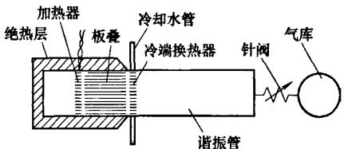  
图 1 1992 年 SWIFT 的驻波热声发动机

1995年，他们和 Tektronix 公司合作研制的对称型驻波热声发动机[12]，作为热驱动的低温制冷机的一部分(图2)，以氦气作工质，运行频率350Hz，能输出1kW以上的声功给脉冲管制冷机，在合适的工作点，最高热效率可以达到18%(相对卡诺效率23%)，输出声功500W。另外，由于液态工质具有密度大、普朗特数低等特点，以它们为工质的热声发动机理论上具有高效率和高功率密度的特点，因此他们提出在热声驱动器中使用液体工质，比如液态钠[13]。但在他们的试验机中，由于高压力振幅下会发生气穴(泡)导致消振，因而在加装磁动力(Magnetic hydrodynamic，MHD)声换能器之前，不能提高加热功率，结果990 W的热量下只输出了18W声功14]，其工作频率910Hz。

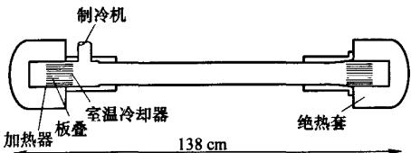  
图 2 Tektronix 公司研制的驻波热声发动机

1998年，美国宾夕法尼亚州立大学的CHEN等[15]研制了第一台太阳能驱动的驻波型热声发动机。他们以40cm长的一端开口的管作为谐振管，用一英尺直径的凹面镜将阳光聚焦到陶瓷热声板叠的一端进行加热，稳定工作时，可测得120dB的声波。虽然该热声发动机是一台小型的演示性的试验装置，但它验证了热声发动机以太阳能作为驱动源的可行性。与太阳能利用相结合的热声技术更加显著地体现了环保、节能等优点。

国内在驻波热声发动机研究方向有代表性的是浙江大学和中科院理化所。浙江大学从20世纪90年代中期开展驻波型热声发动机的研究工作。他们建立了一台对称型双边驱动热声发动机，系统地研究了充气压力、加热功率、加热温度等参数对热声发动机性能的影响[16-19]。

2003年末，中科院理化所罗二仓研究员小组的戴巍博士等[20]建立了一台直径80 mm 的驻波型热声发动机。由于对热端换热器的结构作了改进，换热效率有了很大提高。在热端温度600℃时，该发动机采用氮气作工质，压比可达到1.22以上(即相对振幅10%)，氦气作工质则达到1.15以上。最近他们又建立了一台频率300Hz的高频驻波发动机，以氦气为工质，压比可以达到1.2以上[21]。

## 1.2.2 行波热声发动机

虽然行波热声发动机的试验研究晚于驻波热声发动机，但其概念的提出却并不晚。1979年，美国的 CEPERLEY[22]意识到斯特林热机回热器中的压力波和速度波的相位关系同声波中行波的相位关系是一致的，从而可以利用声波来控制气体运动，消除系统中的机械运动部件，得到无活塞的热声斯特林发动机。行波的压力和速度振荡具有相同的相位，消除了驻波热力循环利用工质与固体边界的不良热接触协调压缩膨胀与换热过程所造成的不可逆性，可望获得更高的热力学效率。遗憾的是，CEPERLEY[23]

## 万方数据

在验证试验中，由于采用了不适当的声学阻抗，未能实现声功的增益。然而行波型热声机械概念的提出，为提高热声机械的效率提供了新的思路，对热声机械的后续发展具有重要的指导意义。

1998年，根据 CEPERLEY的设想，日本的YAZAKI 等[24]首先完成了一台环形管行波热声驱动器的研制(图3)，用于机理的研究。为了同驻波发动机比较，他们用一块刚性板将环路隔断，原环路就成为一段两端封闭的管，通过调整刚性板在环路中的位置使所形成驻波的频率与行波相同，得到了板叠两端的起振温度比 $T _ { \mathrm { H } } / T _ { \mathrm { c } }$ 和ωτ的关系，验证了两类热声发动机对工作气体和固体边界热接触条件的不同要求。如图4，驻波发动机的最低 $T _ { \mathrm { H } } / T _ { \mathrm { c } }$ 值出现在行波的右侧，对应的ωτ较大，表明驻波板叠需要一定的热延迟。当 $\omega \tau \gg 1$ 时，即流道过宽，换热极不完全，两系统的曲线趋于重合；当 $\omega \tau$ 较小时，即气体与流道固体边界有良好热接触，对行波发动机有利，温度比 $T _ { \mathrm { H } } / T _ { \mathrm { c } }$ 大大低于驻波发动机。然而，随着ωτ减小，流体的粘滞边界层会充满整个流道，耗散增长，因此 $\omega \tau \ll 1$ 时，只有在粘滞耗散损失足够小的情况下才会出现自激振荡。YAZAKI等人在研究中意识到了环路行波热声发动机由于板叠处声阻抗低，工作气体振动速度较大，造成了严重的粘性损失，限制了行波热声发动机效率的提高，然而他们也未能提出妥善的解决办法。

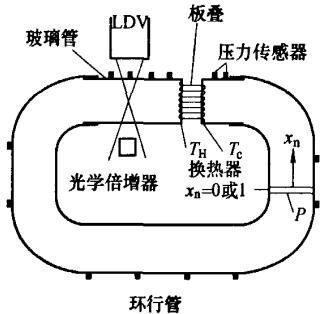

图 3 YAZAKI 的环形管行波热声驱动器  
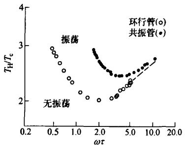  
图4 驻波与行波热声机的自激振荡临界曲线

1999年，BACKHAUS 等[25-26]设计制作了一台新型行波热声发动机，将其称作热声 Stirling 发动机，如图5所示。从声场性质来看，这是一台高效行波热声发动机。该发动机主要由行波环路和谐振管组成，通过合理设计环路管段的结构尺寸使回热器处于行波声场，同时将行波回路布置在谐振管的一端从而提高了回热器处的声阻抗。计算表明，其回热器处的声阻抗为纯行波的30倍，因而该处的粘性损耗大为减少。

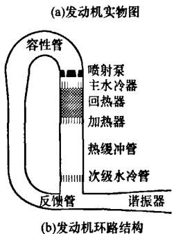  
图 5 SWIFT 的热声 Stirling 发动机

该发动机取得成功的另一关键因素是有效地抑制了环路声直流(Gedeon流)所造成的热损失[27]。他们在环路主水冷器的上方安装了一个喷射泵，通过调节喷射泵流道进出口截面积之比改变其流阻系数，从而获得抑制Gedeon流的压力差。此外，介于加热器和次级水冷器之间的热缓冲管具有较大的温度梯度，很容易引起 Rayleigh 流[28]，为此 SWIFT等人将热缓冲管的内壁设计成锥形，通过流通截面积的变化，成功地抑制了Rayleigh流。正是因为这三项重要改进，该发动机取得了巨大的成功，试验表明其热效率可达到0.30，能够以42%的相对卡诺效率向谐振管传送710W的声功，可以同内燃机(热效率 0.25\~0.40)和传统的活塞式 Stirling 发动机(热效率 0.20\~0.38)相媲美。热声 Stirling 发动机是一项开创性的研究成果，SWIFT 和 BACKHAUS 因此荣获1999年的“R&D100”奖。

中国科学院理化技术研究所的罗二仓等[29]从1998年开始在国际上独立地开展了行波热声发动机的研究，并于1999年9月研制出国内第一台行波工作机制的热声发动机，在500W加热功率下有60W左右的声功输出(当时 SWIFT等的行波发动机的设计方案尚未公布)。他们以氮气为工质，在不同的充气压力和加热功率下对压力和温度特性进行了分析，观察到了频率的“跳变”现象。2002年，世界上第一台同轴型行波热声发动机在这里诞生[30]，为热机的小型化作了试验探索。2004年，罗二仓等[31-32]

## 万方数据

将变径管“共振强声”的概念(Resonant macrosonic)引入到热声试验中，研制了一台聚能型行波热声发动机。在该发动机中，他们采用了一种锥形管作为谐振器(图6)，该锥形管可以抑制高阶谐波的产生，使声波能量有效地集中在基频模态上，从而减少声功的粘性耗散，提高基频的压力幅值。以氦气作工质，平均压力为1.52 MPa时，压比达到了1.30 以上(图7a)。随后他们又使用了另一根更长、锥度更大的谐振管，并以氮气作为工质，压比更是达到了1.4 以上[33](图 7b)，可以说这是目前世界上报道的性能最高的热声发动机。

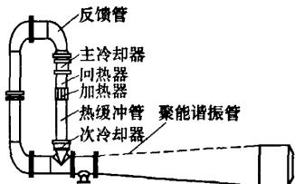  
图6 聚能型行波热声发动机

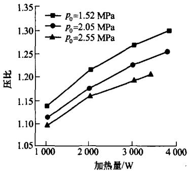  
(a) 以氦气为工作气体时发动机的压比

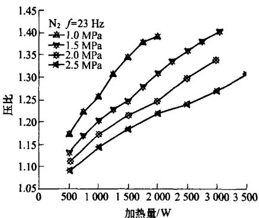  
(b)以氮气为工作气体时发动机的压比  
图7 以氨气和氮气为工作气体时发动机的压比

从2000年以后，国际上兴起了行波型热声发动机的研究高潮。日本名古屋大学的UEDA等[34-35]对发动机内声场进行了系统的测量，对系统振荡模态的选择也进行了深入的研究。法国LIMSI实验室的 FRANCOIS 同浙江大学的金滔博士合作开展了Stirling发动机的研究[17]。华中科技大学的伍继浩等[36-38]根据网络理论也搭建了一台小型高频行波热声热机，并系统地研究了各参数对起振模态的影响。2003年浙江大学邱利民等39]建立了一台大型多功能行波型热声发动机，并在试验中采用充放气的外加扰动方法降低了系统的起振温度，有助于热声发动机对低品位能源的利用[40]。

## 1.2.3 串级热声发动机

虽然热声斯特林行波发动机的效率较高，但是在这样的闭合回路中一般会出现声直流，从而使系统效率大大降低。尽管喷射泵可以抑制一部分声流，但需要以牺牲声功作代价。另外，行波环路中高温端产生的热应力也会带来制造和可靠性方面的问题。目前人们正在研究其他高效的热声系统以解决这一问题，美国 LANL 的 GARDNER 等[41提出的串级发动机就是方案之一，如图8所示。他们创造性地利用驻波管中部行波分量为主的声场，布置回热器，使上一级产生的声功在此放大。由于回热器中气体经历斯特林循环，从而达到提高整体热效率的目的。该发动机在最佳工作状态时，能输出声功2 000 W以上，热声转化效率达20%，相对卡诺效率30%。2003年，中科院理化所的罗二仓等[42-43]分析了串级热声发动机的工作原理，并进行了数值模拟。另外，理化所的另一研究小组也开展了工作频率更高(300\~500Hz)的串级热声发动机的试验研究工作[44-45]。

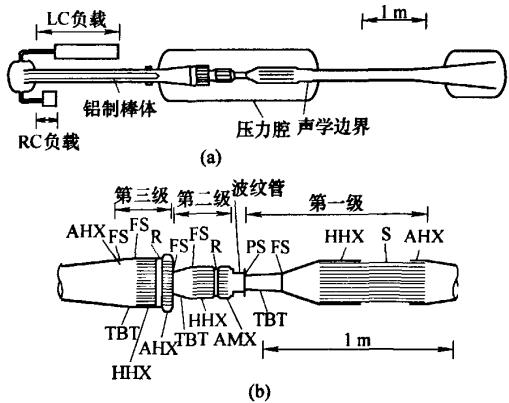  
图 8 Gardner 等人的串级发动机  
AHX——室温换热器 HHX——高温加热器 S——板叠R——回热器 TBT———热缓冲管 FS———层流化元件RC———阻力—声容 IC——惯性一声容

## 1.3 热声发电机

热声发电技术是一种全新的热发电技术，它基于热致声效应而工作，可将热能转化为声能并直接由直线发电机等换能设备产生电能。由于热声发动机无机械运动部件，可实现高效率的声学斯特林循环，且采用外燃式工作，因此，热声发电技术具有可靠性高、制作成本低、热效率高(30%\~40%)以及环保等优点。特别是热声发电技术可利用太阳能、工业余热以及任何燃料燃烧产生的热能来工作，因而热声发电技术正在成为能源动力研究领域里的一项前沿技术，极具发展潜力和应用前景。

美国 Los Alamos 实验室的 BACKHAUS[46]首先开展了热声发电的研究工作。图9为其试验系统结构简图，主要由一个行波环路和两个对称布置的线型发电机组成。发电机除了起到将声功转变为电能的作用外，同时还起到了替代谐振管的作用，大大减少了系统的体积。在合适的工况下，发动机的热声转换效率可以达到24%，发电机的声电转换效率为75%，所以系统总的热电效率为18%。

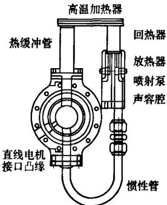  
图 9 Backhaus 的热声发电机

罗二仓所领导的研究小组也开展了热声发电的研究工作，他们用一台聚能型行波热声发动机驱动一台线型压缩机(图10)，成功地获得了100W级的发电量。另外，美国犹他大学也在开展用热声发动机驱动压电晶体进行发电的工作。

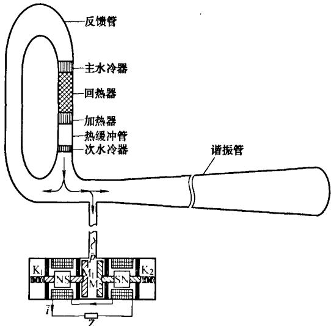  
图 10 中科院理化所的热声发电机

## 1.4 热声制冷机

## 1.4.1 低温温区热声制冷机

低温温区的热声制冷机主要指热声驱动脉冲管制冷机(从热声的观点来看，脉冲管制冷机的制冷过程也是一种热声效应)，它主要由热声发动机、脉冲管制冷机和耦合器组成，通常工作在120K以下。

1990 年，RADEBAUGH 和 SWIFT[47]联合开展了采用热声发动机代替传统机械式压缩机驱动脉冲管制冷机的研究。他们建立的驻波型热声发动机长10m，以氦气为工质，产生了频率约为27Hz，压比约为1.1的压力波，驱动一台小孔型脉冲管制冷机达到了90K的制冷温度，成为世界上第一台完全无运动部件的低温热声制冷机，该研究成果荣获1990年“R&D100”奖。

热声驱动低温制冷机的研制成功引起了工业界的关注。1994 年，美国 Cryenco 公司与 Los Alamos国家实验室以及美国国家标准与技术研究院合作进行以燃烧天然气为驱动源的热声发动机驱动脉冲管制冷机的液化天然气研发项目[48]。1998年，他们研制成一台热声驱动低温制冷机样机[49]，见图11。该样机采用一台驻波型热声发动机驱动一台小孔型脉冲管制冷机，在130 K达到2 kW的制冷量，可实现约 140-gpd (gallon per day)的天然气液化率。热声发动机和脉冲管制冷机的效率分别达到Carnot效率的25%和23%。该样机可通过燃烧60%的天然气液化其余40%的天然气。它表明热声驱动低温制冷机技术可以提供满足实用天然气液化所需的制冷量，是该技术进入实用化阶段的重要里程碑。

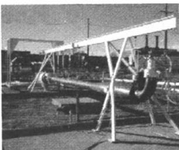  
图 11 140-gpd 热声天然气液化装置

虽然上述的试验样机取得了巨大成功，但其效率还比较低，相比较于现代化的大型天然气液化装置燃烧10%\~15%的天然气液化其余85%\~90%的天然气的目标还有较大的差距。为了提高效率，在目标为燃烧30%的天然气液化其余70%天然气，实现 500-gpd 液化率的第二阶段研发中，采用热声Stirling发动机代替原驻波热声发动机带动三台脉冲管制冷机，计划产生7kW的制冷量。该系统已于2000年建成[50]，如图12所示。由于系统庞大，调试过程进展比较缓慢。目前该系统离设计目标还有一定的差距，更详细的试验结果还未见报道。同时，针对燃烧15%的天然气使其余85%的天然气液化，实现 20 000-gpd液化率目标的第三阶段研发工作已经着手进行。

## 万方数据

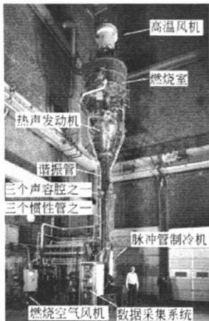  
图 12 500-gpd 热声天然气液化装置

国内最先开展热声驱动低温制冷机研究的是浙江大学的陈国邦等人。他们采用对称型驻波热声发动机驱动单级脉冲管制冷机达到了88.6K[51]的制冷温度，建立了一台热声 Stirling 发动机驱动脉冲管制冷机系统，获得了80.9K的制冷温度[52]。

罗二仓领导的研究小组从 2001 年起也开始了热声驱动低温制冷机的研究[53-54]。2004年，他们通过对热声发动机谐振管的改进，建立一台聚能型Stirling热声发动机，用其驱动脉冲管制冷机可以获得1.2以上的压比，从而使热声驱动低温制冷机的制冷温度一举到达68.8K，在国际上首次突破了液氮温度[32]。在2005年，基于声音的谐振原理，他们发明了一种名为“声学压力波放大器”的耦合器[55-57]。该耦合器安装在热声发动机和脉冲管制冷机之间，当发动机产生的压力波经过该耦合器时，压力幅值可以获得数倍的放大，因而脉冲管制冷机可以获得比发动机内更大的压比。在此基础上，他们在一台两级脉冲管制冷机上获得了41 K的制冷温度。2006年，他们进一步提出了“二介质耦合声学压力波放大器”，该放大器不但具有对压力幅值的放大功能，它还可以使发动机用氮气等低音速气体作为共质，获得较低的工作频率，从而进一步提高了热声发动机和脉冲管制冷机的耦合性能。在一台热声两级脉冲管制冷机上他们成功获得了18.1K的制冷温度，在国际上最先到达了液氢温区[58](图13)。同年，他们研制的300 Hz的热声驱动高频脉冲管制冷机也达到了80 K的制冷温度[21](图14)。

## 1.4.2 室温温区热声制冷机

1986 年开始，美国 Los Alamos 国家实验室的WHEATLEY 教授领导开展了第一台热声制冷机的研究工作。后来该试验的工作转移到了加利福尼亚Monterey 海军研究生院，由 HOFLER[59]继续进行，他在博士期间制成了世界上第一台扬声器驱动的驻波热声制冷机，其工作频率为500Hz，在环境温度为293K时，达到了193K的最低制冷温度。

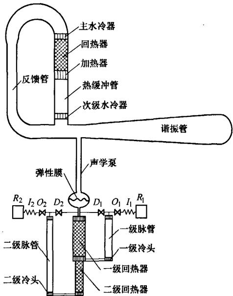

图13 液氢温度低温热声制冷机  
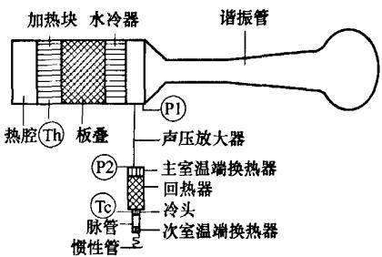  
图 14 300 Hz 的高频低温热声制冷机  
T—热电偶 P—压力传感器

1992年 GARRETT 等[60]所在的热声研究小组，在HOFLER的研究基础上，制成了安装在“发现号”航天飞机上的空间热声制冷机，可达到-57℃的最低温，最大温差为115℃，但制冷量很小仅有几瓦量级。1995年，该研究小组又成功地开发了一台用于冷却海军舰船上电子系统的热声制冷机，制冷能力是前者的近100倍。整机热效率可达17%[61]。

1999 年由美国 Los Alamos 国家实验室的SWIFT博士等[62]建立了一种新型的可实现声功回收的脉管型制冷机，后来被称为行波型热声斯特林制冷机(图 15)。当采用 2.4 MPa的 Ar作工作介质、工作频率为23Hz以及室温端为12℃时，该制冷机冷端达到的最低温为-80℃，在0℃时有50多瓦的制冷量。冷端为-55℃时COP为0.29。由于该制冷机回收声功，相比于脉冲管制冷机，在室温温区可

## 万方数据

以大大提高制冷机的效率，因此有很大的发展前景。

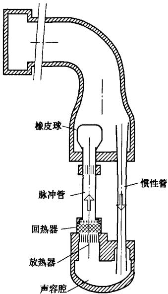  
图 15 声功回收型脉管制冷机

2004年美国宾州大学家用热声制冷机获得了很大进展，如图16所示，他们设计的电声驱动同轴行波热声制冷机在-24.6℃获得了120W的制冷量，相对卡诺效率 0.81。该制冷机即将成为 Ben&Jerry公司新一代保存冰激凌的制冷机，为热声制冷机的实用化进程迈出了一大步。

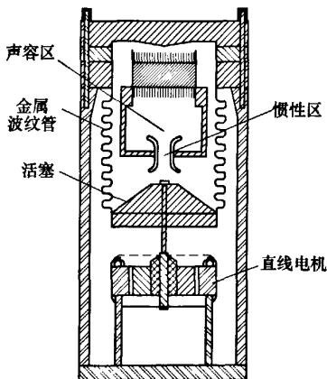  
图16 美国宾州州立大学的同轴型行波热声制冷机

从 2003年开始，罗二仓领导的研究小组开展了行波型热声制冷机的研究工作，已经取得了很大的进展[63-67]。用行波热声发动机驱动的行波热声制冷机(图17)，以氦气为工质在平均压力为 3MPa，工作频率为 67.5Hz、2.2 kW的输入热功率情况下，在-22℃时有300W的制冷量。初步测算，行波热声制冷机的部分的制冷系数在1.5 左右(按输入P-V功计算)，整机的热制冷系数为0.15左右(按输入热声发动机的热量计算)。

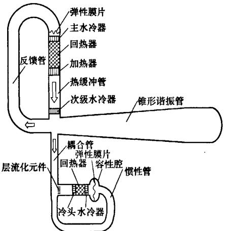  
图17 热驱动室温温区的双行波热声斯特林制冷机

## 2 热声理论的研究进展

，严格说，理论热声学是从KIRCHHOFF[68]开始的。在此之前的热声研究主要是大量试验中的偶然发现或定性推论，这些现象及解释并没有形成系统的理论。1868年，KIRCHHOFF计算了声音在管中由固体等温管壁和维持声波的气体之间振荡的热传导引起的衰减量，研究了热传导对管内声波传播的影响。1896年，RAYLEIGH[69]首先对热声振荡现象给出了定性的解释，这是人们第一次从理论上对热声现象进行探讨。他指出：只要参与热过程的工质运动与热交换之间具有合适的相角，就可以维持一种振荡。对作声振动的介质，若在其最稠密处向其提供热量，而在其最稀疏处吸取能量，声振动就会得到加强(热能转变为声能)。反之，若在其最稠密时从其中吸取热量，而在其最稀疏时向其提供能量，声振动就会衰减(声能转变为热流)，为了维持声振动，外界必须对流体作功。这就是Rayleigh准则。到目前为止，此准则一直被人们认为是理解热声振荡如何在管中得以维持的一个合理解释。此后各国科学家对热声现象展开了理论研究。

1969年，瑞士苏黎士联邦技术研究所的ROTT[70-75]开始了热声振荡的理论研究。他研究了不同截面积管内Taconis振荡起振的条件，并探索了声压、速度和温度的振荡幅值的计算方法。ROTT[76]于1980年发表的文章对其多年的工作进行了总结。他在理论上阐明并描述了热声效应中存在着热和功的相互转化，他导出的理论框架是分析热声热机(包括热声压缩机和热声制冷机)的理论基础，是目前热声研究应用最广泛的理论，从而奠定了现代线性热声学的理论基础。

美国 Los Alamos 国家实验室的热声研究小组在 WHEATLEY 和 SWIFT 等人的带领下对 ROTT的理论进行了进一步的总结和发展。1988年该实验室热声研究组 SWIFT 教授的“ThermoacousticEngine”一文的发表[7]，标志着继 ROTT 以后现代热声学研究进入了一个新的阶段。他们发展和完善了多孔介质热声板叠的模拟[77]；对热声系统中的Gedeon 流，RAYLEIGH 流等问题从理论上给出了解决方案[25,28]；对实际热声系统中的许多问题诸如紊流对热声部件粘性流动阻力的影响，流道横截面变化引起的局部损失，入口效应，热声部件连接条件以及量纲为一化等也作了很好的总结[78]。在此基础上，他们编制了一套热声模拟计算程序DeltaE(Design environment for low-amplitude thermoa-coustic engines)[79]。该程序涵盖了各种常规的几何结构的边界条件，因而可以广泛应用于各种复杂结构的热声发动机和热声制冷机。

我国的热声研究起步于20世纪80年代末。中科院低温中心的肖家华[80-84]首先开展了热声理论研究。他根据固体外壁面与外热源不同的热接触情况，提出可将热声效应划分为三种情况：等温热声效应、绝热热声效应和一般情形的热声效应，并分别建立了行波声场等温热声效应和绝热热声效应的波动方程，还指出对低Prandt1数的流体，存在一个临界声导，在高声导区，外热源从流体吸热，在低声导区，流体向外热源放热，在中间声导区，流体耗功并同时向外热源放热。在此基础上，还探讨了回热式制冷机热声理论的定性框架。特别是，他是国际上最早将热声理论推广到多孔介质回热器的研究工作者。肖家华的研究工作在当时处于国际领先水平，为我国的热声研究奠定了理论基础。

近期，为了解释热声系统的工作介质，罗二仓等[85-87]提出了介观热力循环理论。基于物理上直观的拉格朗日方法，介观热力循环理论分析了回热器内部典型微团的热力过程，指出每一段微小的回热器都具有独立的发动机或者制冷机的功能。在发动机内，气体微团在其行程所在的回热器范围内经历压缩、吸热、膨胀以及放热的热力过程，在制冷机内，气体微团则经历压缩、放热、膨胀以及吸热的热力过程，但这些微团并不是经历两个等温过程和两个等容过程，与传统的斯特林循环有着本质的不同。每一小段回热器内的气体微团彼此经过接力式的热量传输，一步一步地将热量从回热器的一端转移到另一端，同时输出或者消耗声功，实现热机或者制冷机的功能。通过对微团的热力循环分析，该理论指出换热器的设计准则，证明了理想回热器的效率等于卡诺效率，但是因为热缓冲管内微团与换热器的有限温差换热，任何热声系统的实际效率都不可能达到卡诺效率。

经典热声理论(所谓的“线性热声理论”)虽然已经成为深入了解回热式热机工作机理的强有力工具，但是随着研究的深入，经典热声理论逐步表现出其局限性来。经典热声理论不仅在面对热声系统中的起振、声流、谐波耗散等非线性现象时显得无能为力，就是对于振幅甚小时也会出现难于克服的理论障碍(采用不同的推导过程得到完全不一样的结果)。实际上，时均非零的热能与声能转换的效应-热声效应可能本质上就是非线性效应，而不是线性热声效应，线性热声理论对某些热声系统在小振幅条件下能较为准确地预测热声性能，但这不表明它的认识就是正确的[88]。因此在20世纪90年代初非线性热声理论的研究开始兴起[89]。

在关于非线性热声学的研究中，美国霍普金斯大学对驻波热声发动机开展了系统的研究工作。最初他们对热声制冷机中热声板叠周围低马赫数非稳态流动的演变过程进行了数值模拟[90-92]，此方法用来研究热交换器尺寸效果、传热条件、板叠性能有比较好的效果。然后，他们为了对驻波发动机进行数值模拟，通过与线性热声方程的比较，建立了一套基于截面平均的准一维近似的热声发动机的声学方程[93-94]。后来又对该声学方程中的动量和能量交换项进行了修正，提出了一个一般的、时域的、完全非线性的模型[95-98]，能预测系统对不同横截面积、板叠位置、流体特性和其他设计变量的反映，在频率域的小振幅情况下它能简化为 ROTT 的线性理论。通过用多重时间尺度的方法对模型求解，可以获得系统的起振温度、非线性饱和过程、各阶模态的稳定性等等非常有意义的解析结果。

初步发展的非线性热声理论虽然可以描述热声效应的一些动态特性，解释一些非线性热声现象，对改进热声机械的设计具有积极作用，但现有的非线性热声模型还很不完善，限于对流道中交变流的流动和传热过程物理机制的有限理解以及求解非线性数学模型的困难，一些影响因素在现有的非线性模型中并未考虑。此外，利用摄动理论所建立的非线性热声理论只适用于弱非线性区，对于大振幅的强非线性区，可能需要采用计算流体动力学CFD(Computational fluid dynamics)方法来加以研究，最近罗二仓研究小组在此方面取得了进展[99-100]。

## 3 今后的研究及应用前景展望

热声发动机及其驱动热声冷机虽然在理论研究和试验研究方面均获得了巨大的发展，但仍还存在很多尚未解决的问题。正是这些存在的问题为下一步的研究工作指明了方向。

## 万方数据

(1) 非线性热声理论将是今后热声学理论研究的重点。近期研究表明：无论热声振荡多么小，时均的热能与声能的转化效应都来自非线性效应，因此，现在目前所称“线性化热声理论”的概念存在问题，今后需要发展“非线性的热声学理论”。此外，热声自激振荡演化过程是典型的非线性现象，需要从各种理论手段发展描述这一非线性现象的非线性动力学理论。

(2) 现有热声理论多按照层流处理交变流动的流动和传热特性，然而实际热声机械中部分热声部件内的交变流已经进入了紊流区，现有热声理论已无法对其进行合理的描述。研究可压缩交变流动的传热特性，特别交变流湍流的传热和流动特性，对指导发展高功率密度的热声热机技术具有重要的学术和工程应用意义。

(3) 热声发动机及其驱动的热声制冷机为了满足现代工业以及某些特殊应用场合的要求，需要沿着大型化和微型化两个方向发展，这对其整体结构和部件的设计以及加工制造都提出了新的挑战。从已有的研究成果看，提高热声发动机及其驱动脉管制冷机的效率可以从高效的耦合机构、优化设计回热器(或板叠)、换热器以及谐振管的结构，提高回热器处的声阻抗，抑制声直流，协调热声发动机与热声制冷机的匹配，选用Prandtl 数较小的工质等方面着手进行研究。另外，针对空调、冰箱以及冷库的普冷温区工作时，采用回收膨胀功的热声斯特林制冷机可望提高普冷温区热声制冷机的效率。最后，中高频率的热声转换机理以及热声发电技术可能是今后热声科学技术发展的新前沿和具有重大应用前景的方向，需要大力发展。

(4) 热声热机技术是动力机械发展史上的一次重大革命，其无运动部件的突出特点将改变人们对动力机械的传统观念。随着热声学理论和试验研究的深入，热声热机的性能正逐步提高，相信在不久的将来该技术就会得到广泛的应用。

## 参考文献

[1] PUTNAM A A, DENNIS W R. Survey of organ-pipe oscillations in combustion systems[J]. J. Acoust Soc. Am., 1956, 28(2): 246-259.

[2] FELDMAN K T. Review of the literature on Sondhauss thermoacoustic phenomena[J]. J. Sound Vib., 1968, 7(1): 71-82.

[3] FELDMAN K T. Review of the literature on Rijke thermoacoustic phenomena[J]. J. Sound Vib., 1968, 7(1): 83-89.

[4] TACONIS K W. Vapor-liquid equilibrium of solutions of He3-He4[J]. Physica, 1949, 15: 738.

[5] MERKLI P, THOMANN H. Thermoacoustic effects in a resonance tube[J]. J. Fluid Mech., 1975, 70, part 1: 161-177.

[6] GIFFORD W E, LONGSWORTH R C. Pulse tube refrigerator[J]. J. Eng. Ind., Trans. ASME, 1964, 86: 264-270.

[7] SWIFT G W. Thermoacoustic engine[J]. J. Acoust Soc. Am., 1988, 84: 1 145-1 180.

[8] FELDMAN K T. A study of heat generated pressure oscillations in a closed end pipe[D]. Missouri: University of Missouri, 1966.

[9] FELDMAN K T. A study of heat driven pressure oscillations in gas[J]. J. Heat Transfer, 1970, 92: 536.

[10] WHEATLEY J, COX A. Natural engines[J]. Physics Today, 1985, 85: 50-58.

[11] SWIFT G W. Analysis and performance of a large thermoacoustic engine[J]. J. Acoust Soc. Am., 1992, 92(3): 1 551-1 563.

[12] OLSON J R, SWIFT G W. A loaded thermoacoustic engine[J]. J. Acoust Soc. Am., 1995, 98(5): 2 690-2 693.

[13] SWIFT G W, MIGLIORI A, HOFLER T, et al. Theory and calculations for an intrinsically irreversible acoustic prime mover using liquid sodium as primary working fluid[J]. J. Acoust Soc. Am., 1985, 78(2): 767-781.

[14] MIGLIORI A, SWIFT G W. Liquid-sodium thermoacoustic engine[J]. Applied Physics Letters, 1988, 53(5): 355-357.

[15] CHEN R L, GARRETT S L. Solar/heat-driven thermoacoustic engine[J]. J. Acoust Soc. Am., 1998, 103(5): 2 841.

[16] CHEN G B, JIN T. Experimental investigation on the onset and damping behavior of the oscillation in a thermoacoustic prime mover[J]. Cryogenics, 1999, 39: 843-846.

[17] 金滔. 热驱动器及其驱动的脉管制冷机研究[D]. 杭州： 浙江大学,2001. JIN Tao. Study on thermoacoustic prime movers and their applications to pulse tube cryocoolers[D]. Hangzhou: Zhejiang University, 2001.

[18] CHEN G B, JIANG J P, SHI J L, et al. Influence of buffer on resonance frequency of thermoacoustic engine[J]. Cryogenics, 2002, 42(3-4): 223-227.

[19] 汤珂. 热声驱动脉管制冷特性的理论与实验研究[D]. 杭州：浙江大学，2005. TANG Ke. Theoretical and experimental investigation of thermoacoustically driven pulse tube cryocooler[D].

## 万方数据

Hangzhou: Zhejiang University, 2005.

[20] 戴巍，罗二仓，胡剑英，等. 改进型驻波热声发动机的 实验研究[J]. 工程热物理学报,2005,26(3):376-378 DAI Wei, LUO Ercang, HU Jianying, et al. Investigation on modified standing-wave thermoacoustic heat engine[J]. Journal of Engineering Thermophysics, 2005, 26(3): 376-378.

[21] DAI W, YU G Y, ZHU S L, et al. 300 Hz thermoacoustically driven pulse tube cooler for temperature below 100 K[J]. Applied Physics Letters, 2007, 90(2): 024104.

[22] CEPERLEY P H. A pistonless Stirling engine-the traveling wave heat engine[J]. J. Acoust Soc. Am., 1979, 66(5): 1 508-1 513.

[23] CEPERLEY P H. Gain and efficiency of a short traveling wave heat engine[J]. J. Acoust Soc. Am., 1985, 77(3): 1 239-1 244.

[24] YAZAKI T, IWATA A, MAEKAWA T, et al. Traveling wave thermoacoustic engine in a looped tube[J]. Physics Review Letters, 1998, 81(15): 3 128-3 131.

[25] BACKHAUS S, SWIFT G W. A thermoacoustic-Stirling heat engine: Detailed study[J]. J. Acoust Soc. Am., 2000, 107(6): 3 148-3 166.

[26] BACKHAUS S, SWIFT G W. A thermoacoustic Stirling heat engine[J]. Nature, 1999, 399(27): 335-338.

[27] GEDEON D. DC gas flows in Stirling and pulse tube cryocoolers[C]//Cryocoolers 12. New York: Plenum Press, 1996: 385-392.

[28] OLSON J R, SWIFT G W. Acoustic streaming in pulse tube refrigerators: Tapered pulse tubes[J]. Cryogenics, 1997, 37(12): 711-724.

[29] 刘海东. 行波热声发动机的热力分析和实验研究[D]北京：中国科学院理化技术研究所，2000.LIU Haidong. Thermodynamic analysis and experimentalstudy on traveling-wave thermoacoustic heat engine[D].Beijing: Technical Institute of Physics and Chemistry,CAS, 2000.

[30]杨梅.行波型热声发动机的热力分析和实验研究[D] 杭州：浙江大学，2003. YANG Mei. Thermodynamic analysis and experimental study on traveling-wave thermoacoustic heat engine[D]. Hangzhou: Zhejiang University, 2003.

[31] LUO E C, LING H, DAI W, et al. A high pressure-ratio, energy-focused thermoacoustic heat engine with a tapered resonator[J]. Chinese Science Bulletin, 2005, 50(3) 284-286.

[32] DAI W, LUO E C, HU J Y, et al. A heat-driven thermoacoustic cooler capable of reaching liquid nitrogen temperature[J]. Applied Physics Letters, 2005, 86(22):

224103.

[33] YU G Y, LUO E C, DAI W, et al. An energy-focused thermoacoustic-Stirling heat engine reaching a high pressure ratio above 1.40[J]. Cryogenics, 2007, 47(2): 132-134.

[34] BIWA T, UEDA Y, YAZAKI T, et al. Work flow measurements in a thermoacoustic engine[J]. Cryogenics, 2001, 41(5-6): 305-310.

[35] BIWA T, UEDA Y, YAZAKI T, et al. Thermodynamical mode selection rule observed in thermoacoustic oscillations[J]. Europhysics Letters, 2002, 60(3) : 363-368.

[36] 伍继浩，张晓青，李青，等. 行波热声斯特林机起振模 态的实验研究[J]. 低温工程,2002,6:42-46. WU Jihao, ZHANG Xiaoqing, LI Qing, et al. Experimental investigation of onset modes of traveling wave thermoacoustic Stirling heat engine[J]. Cryogenics, 2002, 6: 42-46.

[37] YU Z B, LI Q, CHEN X, et al. Investigation on the oscillation modes in a thermoacoustic Stirling prime mover: Mode stability and mode transition[J]. Cryogenics 2003, 43(12): 687-691.

[38] YU Z B, LI Q, CHEN X, et al. Experimental investigation on a thermoacoustic engine having a looped tube and resonator[J]. Cryogenics, 2005, 45(8): 566-571.

[39] SUN D M, QIU L M, ZHANG W, et al. Investigation on traveling wave thermoacoustic heat engine with high pressure amplitude[J]. Energy Conversion and Management, 2005, 46(2): 281-291.

[40] QIU L M, SUN D M, TAN Y X, et al. Effect of pressure disturbance on onset processed in thermoacoustic engine[J]. Energy Conversion and Management, 2006, 47: 1 383-1 390.

[41] GARDNER D L, SWIFT G W. A cascade thermoacoustic engine[J]. J. Acoust Soc. Am., 2003, 114(4): 1 905-1 919.

[42]凌虹，罗二仓，戴巍.串级热声发动机的机理分析及数 值模拟[J]. 应用声学,2005,24(2)：83-88. LING Hong, LUO Ercang, DAI Wei. Study on operating mechanism on cascade thermoacoustic heat engines with numerical simulation[J]. Applied acoustics, 2005, 24(2): 83-88.

[43]罗二仓，戴巍，凌虹，等、串级热声发动机的工作原理、分析及优化，第一部分：串级热声系统的基本原理[J].低温工程,2003(6)：10-16.LUO Ercang, DAI Wei, LING Hong, et al. Operatingprinciple, analysis and optimization of cascadethermoacoustic heat engine, Part one: Fundamentals ofcascade thermoacoustic heat engines[J]. Cryogenics,

## 万方数据

2003(6): 10-16.

[44] HU Z J, LI Q, XIE X J, et al. Design and experiment on a mini cascade thermoacoustic engine[J]. Ultrasonics, 2006, 44(Suppl.): 1 515-1 517.

[45] HU Z J, LI Q, LI Q, et al. A high frequency cascade thermoacoustic engine[J]. Cryogenics, 2006, 46(11): 771-777.

[46] BACKHAUS S, TWARD E, PETACH M. Travelingwave thermoacoustic electric generator[J]. Applied Physics Letters, 2004, 85(6): 1 085-1 087.

[47] RADEBAUGH R, MCDERMOTT K M, SWIFT G W, et al. Development of a thermoacoustically driven orifice pulse tube refrigerator[C]//Proceedings of the interagency meeting on cryocoolers, Plymouth, MA: 1990: 205-220.

[48] SWIFT G W. Thermoacoustic natural gas liquefier[C]//DOE Natural Gas Conference, Houston, 1997: 1-5.

[49] ARMAN B, WOLLAN J J, SWIFT G W, et al. Thermoacoustic natural gas liquefiers and recent developments[C]//Cryogenic and Refrigeration Proceedings of ICCR, Hangzhou : International Academic Publisher and World Publishing Corporation, 2003: 123-127.

[50] ARMAN B, WOLLAN J J, KOTSUBO V, et al. Operation of thermoacoustic Stirling heat engine driven large multiple pulse tube refrigerator[C]//Cryocooler 13. New York: Springer Science and Business Media Inc., 2004:181-187.

[51] TANG K, CHEN G B, JIN T, et al. Influence of resonance tube length on performance of thermoacoustically driven pulse tube refrigerator[J]. Cryogenics, 2005, 45(3): 185-191.

[52] QIU L M, SUN D M, YAN W L, et al. Investigation on a thermoacoustically driven pulse tube cooler working at 80 K[J]. Cryogenics, 2005, 45(5): 380-385.

[53] LUO E C, LIU H, SUN L Y. Experimental study on thermoacoustic refrigerators driven by a traveling-wave thermoacoustic engine[J]. Advances in Cryogenic Engineering, 2002, 47(A): 815-821.

[54] 罗二仓，戴巍，胡剑英，等. 液氮温区热驱动脉管制冷机的研究[J]. 工程热物理学报,2005,26(增刊)：33-36.LUO Ercang, DAI Wei, HU Jianying, et al.Thermoacoustically driven pulse tube cryocooleroperating in liquid nitrogen temperature[J]. Journal ofEngineering Thermophysics, 2005, 26(suppl.): 33-36.

[55] DAI W, LUO E C, HU J Y, et al. A novel coupling configuration for thermoacoustically driven pulse tube coolers: Acoustic amplifier[J]. Chinese Science Bulletin,

2005, 50(18): 2112-2 114.

[56] LUO E C, HU JY, DAI W. An acoustical pump capable of significantly increasing pressure ratio of thermoacoustic heat engines[J]. Chinese Science Bulletin, 2006, 51(8): 1 014-1 016.

[57] HU J Y, DAI W, LUO E C. Thermoacoustically driven pulse tube coolers with acoustic amplifier[J]. Advances in Cryogenic Engineering, 2006, 51: 1 564-1 571.

[58] HU J Y, LUO E C, DAI W, et al. A heat-driven thermoacoustic cryocooler capable of reaching below liquid hydrogen temperature[J]. Chinese Science Bulletin, 2007, 52(4): 574-576.

[59] HOFLER T. Thermoacoustic refrigerator design and performance[D]. San Diego, USA : University of California, 1986.

[60] GARRETT S L, ADEFF J A, HOFLER T J. Thermoacoustic refrigerator for space application[J]. J. Thermophysics and Heat Transfer, 1993, 7(4): 595-599.

[61] Shipboard electronics thermoacoustic cooler[EB/OL]. [2007-05-12]. http: //www.acs.psu.edu/thermoacoustics/ refrigeration/setac.htm.

[62] SWIFT G W, GARDNER D L, BACKHAUS S. Acoustic recovery of lost power in pulse tube refrigerators[J]. J. Acoust Soc. Am., 1999, 105(2): 711-724.

[63] 黄云. 室温行波热声制冷机的研究[D]. 北京：中国科学院理化技术研究所,2004.HUANG Yun. Study on traveling-wave thermoacousticrefrigerator operating room temperature range[D].Beijing: Technical Institute of Physics and Chemistry,CAS, 2004.

[64]黄云，罗二仓，戴巍，等.热驱动室温行波热声制冷机的实验研究[J]. 工程热物理学报,2005,26(2)：199-201.HUANG Yun, LUO Ercang, DAI Wei, et al.Experimental investigation on heat-driven traveling wavethermoacoustic refrigerator[J]. Journal of EngineeringThermophysics, 2005, 26(2): 199-201.

[65] LUO E C, HUANG Y, DAI W, et al. A high-performance thermoacoustic refrigerator driven by a traveling wave thermoacoustic engine[J]. Chinese Science Bulletin, 2005, 50(22): 2 662-2 664.

[66] DAI W, LUO E C, ZHANG Y, et al. Detailed study of a traveling wave thermoacoustic refrigerator driven by a traveling wave thermoacoustic engine[J]. J. Acoust Soc.Am., 2006, 119(5): 2 686-2 692.

[67] LUO E C, DAI W, ZHANG Y, et al. Thermoacoustically driven refrigerator with double thermoacoustic-Stirling cycles[J]. Applied Physics Letters, 2006, 88: 074102.

[68] KIECHHOFF G. Ueber den Einfluss der Warmeleitung in

## 万方数据

einem gas aufdie Schallbewegung[J]. Ann Phys. (Leipzig), 1868,177:134.

KIECHHOFF G. Influence of heat conduction of gas on sound propagation[J}. Ann Phys., 1868, 177: 134.

[69] RAYLEIGH L. The theory of sound[M]. New York: Dover, 1945.

[70] ROTT N. Damped and thermally driven acoustic oscillations in wide and narrow tubes[J]. Z Angew Math Phys., 1969, 20: 230.

[71] ROTT N. Thermal driven acoustic oscillations, Part 2: Stability limit for helium[J]. Z Angew Math Phys., 1973, 24: 54.

[72] ROTT N. Thermal driven acoustic oscillations, Part 3: Second order heat flux[J]. Z Angew Math Phys., 1975, 26: 43.

[73] ROTT N. Thermal driven acoustic oscillations, Part 4: Tubes with variable cross section[J]. Z Angew Math Phys., 1976,27:197.

[74] ZOUZOULAS G, ROTT N. Thermal driven acoustic oscillations, Part 5: Gas-liquid oscillations[J]. Z Angew Math Phys., 1976, 27: 325.

[75] MULLER U A, ROTT N. Thermal driven acoustic oscillations, Part 6: Excitation and power[J]. Z Angew Math Phys., 1983, 34: 609.

[76] ROTT N. Thermoacoustic[J]. Adv. Appl. Mech., 1988, 20: 135-175.

[77] SWIFT G W, WARD W C. Simple harmonic analysis of regenerators[J]. J. Thermophysics and Heat Transfer, 1996, 10: 652-662.

[78] SWIFT G W. Thermoacoustics: A unifying perspective for some engines and refrigerators[M]. Sewickley PA: ASA Publication, 2002.

[79] WARD W C, SWIFT G W. Design environment for low-amplitude thermoacoustic engines[J]. J. Acoust Soc.Am., 1994, 95(6): 3 671-3 672.

[80] 肖家华. 热声效应与回热式低温制冷机(热机)的热声理论[D]. 北京：中国科学院理化技术研究所，1990.XIAO Jiahua. Thermoacoustic theory on thermoacousticeffects and regenerative cryocoolers & heat engines[D]Beijing: Technical Institute of Physics and Chemistry,CAS, 1990.

[81] XIAO J H. Thermoacoustic theory for cyclic flow regenerators Part 1: Fundamentals[J]. Cryogenics, 1992, 32(10): 895-901.

[82] XIAO J H. Thermoacoustic heat transportation and energy transformation Part 1: Formulation of the problem[J]. Cryogenics, 1995, 35(1): 15-19.

[83] XIAO J H. Thermoacoustic heat transportation and energy

transformation Part 2: Isothermal wall thermoacoustic effects[J]. Cryogenics, 1995, 35(1): 21-26.

[84] XIAO J H. Thermoacoustic heat transportation and energy transformation Part 3: Adiabatic wall thermoacoustic effects[J]. Cryogenics, 1995, 35(1): 27-29.

[85]罗二仓，戴巍，吴张华，等.交变流动热机的介观热力循环理论第一部分：制冷机回热器的介观热力循环模型及分析[J]. 低温工程,2004,137：1-11.LUO Ercang, DAI Wei, WU Zhanghua, et al. Mesoscalethermodynamic theory on oscillating flow heat engines,Part one : Model and analysis of refrigerator'sregenerator[J]. Cryogenics, 2004, 137: 1-11.

[86]罗二仓，戴巍，吴张华，等.交变流动热机的介观热力 循环理论第二部分：发动机回热器的介观热力循环模 型及分析[J]. 低温工程,2004,138：1-10. LUO Ercang, DAI Wei, WU Zhanghua, et al. Mesoscale thermodynamic theory on oscillating flow heat engines, Part one : Model and analysis of prime mover's regenerator[J]. Cryogenics, 2004, 138: 1-10.

[87] 胡剑英. 液氮至液氢温区的热声驱动低温制冷机的研 究[D]. 北京：中国科学院理化技术研究所,2007. HU Jianying. Thermoacoustically driven pulse tube cryocoolers operating from liquid nitrogen to liquid hydrogen temperature range[D]. Beijing : Technical Institute of Physics and Chemistry, CAS, 2007.

[88] LUO E C. Non-zero time-averaged thermoacoustic effects, linear or nonlinear?[C]// Cryocoolers14. Boulder: ICC Press, 2007: 195-204.

[89] 胡剑英，罗二仓. 非线性热声理论研究进展[J]. 低温与 超导,2005,33(3):11-16. HU Jianying, LUO Ercang. Advance in nonlinear thermoacoustic theory[J]. Cryogenics and Superconductivity, 2005, 33(3): 11-16.

[90] WORLIKAR A S, KNIO O M. Numerical simulation of a thermoacoustic refrigerator. 1: Unsteady adiabatic flow around the stack[J]. Journal of Computational Physics, 1996, 127(2): 424-451.

[91] WORLIKAR A S, KNIO O M. Numerical study of oscillatory flow and heat transfer in a loaded thermoacoustic stack[J]. Numerical Heat Transfer, Part A, 1999, 35: 49-65.

[92] WORLIKAR A S, KNIO O M, KLEIN R. Numerical simulation of a thermoacoustic refrigerator. 2: Stratified flow around the stack[J]. Journal of Computational Physics, 1998, 144(2): 299-324.

[93] YUAN H, KARPOV S, PROSPERETTI A. A simplified model for linear and nonlinear processes in thermoacoustic movers Ⅱ : Nonlinear oscillations[J]. J. Acoust Soc. Am., 1997, 202(6): 3 497-3 506.

[94] PROSPERETTI A, WATANABE W, YUAN H. A simplified model for linear and nonlinear processes in thermoacoustic movers I : Model and linear theory[J]. J. Acoust Soc. Am., 1997, 102(6): 3 484-3 496.

[95] KARPOV S, PROSPERETTI A. Nonlinear saturation of the thermoacoustic instability[J]. J. Acoust Soc.Am., 2000, 107(6): 3 130-3 146.

[96] KARPOV S, PROSPERETTI A. A simplified model for linear and nonlinear processes in thermoacoustic movers ⅡI : Nonlinear oscillations[J]. J. Acoust Soc. Am., 2002, 112(4): 1434-1 444.

[97] KARPOV S, PROSPERETTI A, OSTROVSKY L. Nonlinear wave interactions in bubble layers[J]. J. Acoust Soc. Am., 2003, 113(3): 1 304-1 316.

[98] KARPOV S, PROSPERETTI A. Linear thermoacoustic instability in the time domain[J]. J. Acoust Soc. Am., 1998, 103(6): 3 309-3 317.

[99]余国瑶，罗二仓，胡剑英，等.热声发动机热动力学 特性的CFD研究，第一部分：热声自激振荡演化过程 [J]. 低温工程, 2006,152(4)：5-9. YU Guoyao, LUO Ercang, HU Jianying, et al. Study on Thermodynamic characteristics of thermoacoustic-Stirling heat engines by using CFD, Part I : Thermoacoustic self-excited oscillation[J]. Cryogenics, 2006, 152(4): 5-9.

[100]余国瑶，罗二仓，戴巍，等.热声斯特林发动机热力学特性的CFD研究，第二部分：热声转换特性及热声声流的研究[J]. 低温工程, 2006,153(5): 11-16.YU Guoyao, LUO Ercang, DAI Wei, et al. Study onThermodynamic characteristics of thermoacoustic-Stirling heat engines by using CFD, Part II :Thermoacoustic conversion and acoustical streaming[J].Cryogenics, 2006, 153(5): 11-16.

作者简介：周远，男，1938年出生，中国科学院院士。主要从事低温工程、脉冲管制冷及交变流动传热研究。

罗二仓，男，1967年出生，研究员，博士研究生导师。主要从事热声学基础理论及热声热机技术研究。

E-mail: ecluo@cl.cryo.ac.cn

## 万方数据
