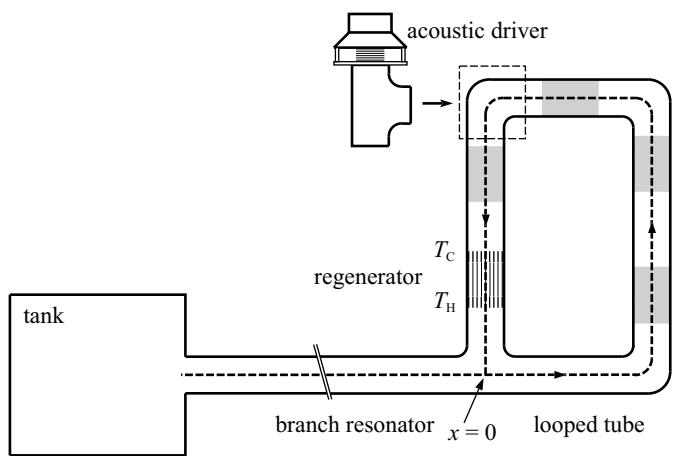
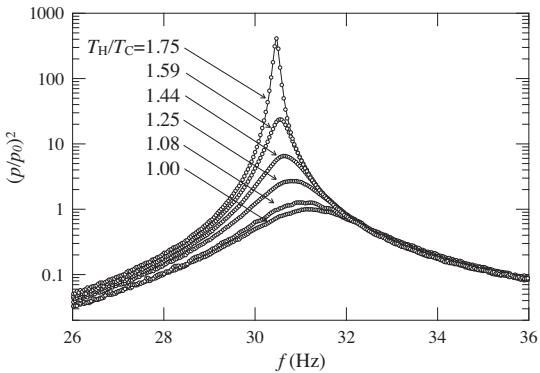
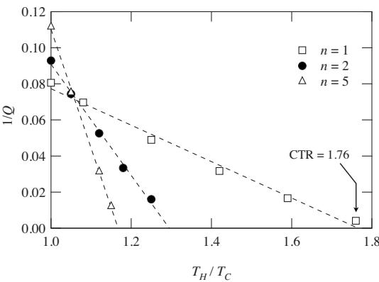

# Low temperature differential thermoacoustic Stirling engine

Tetsushi Biwa,1,a- Daichi Hasegawa,1 and Taichi Yazaki2

1Department of Mechanical Systems and Design, Tohoku University, Sendai 980-8579, Japan 2Department of Physics, Aichi University of Education, Kariya 448-8542, Japan

-Received 17 January 2010; accepted 24 June 2010; published online 20 July 2010

To what extent can we lower the critical temperature ratio -CTR necessary to start a thermoacoustic engine? We present an experimental method for predicting the CTR before the temperature ratio arrives at it using quality factor measurements. Based on the experimental quality factors, we tried to decrease the CTR of a thermoacoustic Stirling engine consisting of a looped tube and a branch resonator. Installation of the multiple regenerators at suitable positions can markedly enhance acoustic power production while overcoming energy dissipation. Results show that the CTR is decreased from 1.76 to 1.19 using five differentially heated regenerators. © 2010 American Institute of Physics. doi:10.1063/1.3464554

A gas column subjected to external heat source starts to oscillate spontaneously when the temperature ratio exceeds some critical value. By analyzing this phenomenon from the viewpoint of heat engines,1–3 it became possible to build a thermoacoustic engine, which is an acoustic device functioning as a prime mover consisting of a gas-filled tube equipped with a regenerator. When a traveling wave phasing between pressure and velocity is achieved in the regenerator, the involved thermodynamic cycle is equivalent to the Stirling cycle. Therefore, a traveling wave engine is called a pistonplaces the solid pistons in mechanical Stirling engines. The first traveling wave engine was built in 1998.5 It consisted of a looped tube equipped with a differentially heated regenerator. The acoustic waves propagating through the loop across the regenerator in the direction from cold to hot have been observed to be self-sustained by the acoustic power production in the regenerator.

Backhaus and $\operatorname { S w i f f } ^ { 6 }$ improved the thermal efficiency of the looped tube engine by connecting the branch resonator. Their engine achieved 40% of the Carnot efficiency when $T _ { H } { = } 9 9 8 \mathrm { ~ K ~ }$ and ${ { T } _ { C } } \mathrm { = } 2 8 8 \mathrm { ~ K ~ }$ . This efficiency is as high as that of conventional heat engines. The simplicity of this engine has attracted much attention from fields related to applications such as natural gas liquefaction and electric power generation in satellites.8 The fields of application could be expected to expand much further to include waste heat recovery systems in chemical plants if $T _ { H }$ were reduced to about 400 K.

To reduce the working temperature ratio $T _ { H } / T _ { C }$ of thermoacoustic engines, it is at least necessary to decrease the critical temperature ratio -CTR. That ratio has been reported as greater than 1.6 in previous papers5,9–12 but this does not necessarily mean that the lowest CTR attainable in a thermoacoustic engine is fixed at this value. Objective of this work is to provide a method for constructing a low temperature differential thermoacoustic Stirling engine. In this letter, the CTR less than 1.2 is demonstrated using multiple regenerators whose locations are determined based on measurements of quality factor Q of the engine.

The experimental setup is the Backhaus–Swift type thermoacoustic Stirling engine consisting of a looped tube and a branch resonator, as presented in Fig. 1. Both the looped tube and the resonator are made of a 40 mm inner-diameter stainless-steel tube. The average length of the loop is L =1.50 m, whereas the length of the resonator is 1.45 m. One end of the resonator is connected to the tank of 2.0 $\times 1 0 ^ { - 2 } \mathrm { ~ m ~ } ^ { 3 }$ in inner volume. A 35-mm-long regenerator made of a pile of many 60-mesh stainless-steel screens with wire diameter of 0.14 mm was placed close to the connection of the looped tube and the resonator.9 Cold and hot heat exchangers are placed adjacently to the regenerator. The hot heat exchanger temperature $T _ { H }$ was controlled by an electrical heater, and the cold heat exchanger temperature $T _ { C }$ was kept at room temperature -=298 K using cooling water.

Acoustic pressure was measured through a 10-mm-long duct of 2 mm inner diameter using a pressure transducer -DD102; JTEKT Corp.. The present engine is filled with one-bar air as a working gas. When the temperature ratio $T _ { H } / T _ { C }$ exceeds the CTR of 1.76, the gas column begins to oscillate spontaneously at the natural frequency of $f _ { 0 }$ =31 Hz. The thermal boundary layer thickness -Ref. 13 of the gas at this frequency is more than twice the hydraulic diameter $r _ { h } = 0 . 2 2$ mm of the regenerator.2 This assures good thermal contacts of the gas with the solid materials in the regenerator required for the Stirling thermodynamic cycle.

  
FIG. 1. Schematic illustration of the present thermoacoustic Stirling engine. A junction position of the looped tube and the resonator is defined as x=0, where x is the axial coordinate directed anticlockwise in the loop. The shaded regions represent the installation position for the additional regenerators. The loop can include up to five regenerators.

  
FIG. 2. Resonance curve with various $T _ { H } / T _ { C }$ for a single regenerator. The pressure amplitude p is normalized with respect to the peak pressure amplitude $p _ { 0 }$ when $T _ { H } / T _ { C } { = } 1$ . The lines represent the Lorentz curve, from which $f$ and $\Delta f$ are determined.

To find out the parameters governing the CTR, we measure the quality factor Q of the thermoacoustic engine when $T _ { H } / T _ { C }$ is less than the CTR. The Q value is defined as

$$
Q = 2 \pi f _ { \dot { E } } ^ { E _ { S } } ,\tag{-1}
$$

where $E _ { S }$ is the energy stored in the system, $\dot { E }$ is the dissipative energy per unit time, and f is the frequency. We determine the Q value through measurements of a resonance curve that is obtained when the engine is forced to oscillate below the CTR.

To excite acoustic oscillations externally, we connected an acoustic driver -FW108N; Fostex Co. with the present engine by replacing one corner of the loop with a tee. A swept-sine signal generated by a function generator was fed to the driver through a power amplifier. The resonance curve, i.e., the square of pressure amplitude $p$ against the driving frequency $f ,$ was depicted at frequencies of 1 to 200 Hz. Figure 2 shows resonance curves with various $T _ { H } / T _ { C }$ , where $p$ is normalized by the peak pressure amplitude $p _ { 0 }$ when $T _ { H } / T _ { C } { = } 1$ . While the resonance frequency f shifts slightly toward the lower frequency region when $T _ { H } / T _ { C }$ is increased, the curve width $\Delta f$ at half maximum substantially decreased, showing enhancement of the Q value. The Q value was evaluated as $Q { = } f / \Delta f ; ^ { 1 4 }$ both $f$ and $\Delta f$ were determined by fitting the resonance curve to a Lorentz curve.

The measured Q value is depicted in Fig. 3, where its inverse 1/Q is shown as a function of $T _ { H } / T _ { C }$ by open squares. It is found that $1 / Q$ goes to zero when $T _ { H } / T _ { C }$ reaches the CTR. A decrease in $1 / Q$ can be seen as the suppression of $\dot { E }$ when $E _ { S }$ is kept constant, since 1 / Q is proportional to $\dot { E } .$ As indicated by theoretical studies2,3 and also by our recent experiments on acoustic power flow, $\dot { E }$ is given by sum of acoustic power dissipation due to viscosity and thermal conductivity of the gas, and acoustic power production in the differentially heated regenerator, the latter of which increases with increasing $T _ { H } / T _ { C } .$ . Therefore, the fact that $1 / Q$ decreases to 0 at the CTR means that the CTR is the temperature ratio at which the acoustic power production in the regenerator becomes great enough to compensate for the energy dissipation.

  
FIG. 3. 1/Q as a function of $T _ { H } / T _ { C }$ of the present engine; n denotes the number of regenerators. The lines are guides to the eye. Pore size and location of additional regenerators are $2 r _ { 0 } { = } 1 . 5$ mm with $\stackrel { - } { x } / L = 0 . 3$ and 0.42, $2 r _ { 0 } { = } 1 . 1$ mm with $x / L { = } 0 . 6 3 .$ , and $2 r _ { 0 } { = } 0 . 9$ mm with $x / L { = } 0 . 8 3$ when n is increased to 5 from 2. In experiments with $n = 2$ and $^ { 5 , }$ all the regenerators were heated to have an equal temperature ratio $T _ { H } / T _ { C }$ each other.

A linear decrease in $1 / Q$ shown in Fig. 3 permits us to write

$$
\frac { 1 } { Q } = - C \left( \frac { T _ { H } } { T _ { C } } - 1 \right) + \frac { 1 } { Q _ { 0 } } ,\tag{-2}
$$

where $- C$ denotes the slope of a $1 / Q$ versus $T _ { H } / T _ { C }$ plot and $Q _ { 0 }$ is the quality factor at $T _ { H } / T _ { C } { = } 1$ , namely, when the temperature gradient is absent in the regenerator. The slope C gives a measure of how the acoustic power production is increased with increasing $T _ { H } / T _ { C }$ . By setting $1 / Q { = } 0$ in Eq. -2, the CTR is expressed as

$$
\mathrm { C T R } = 1 + { \frac { 1 } { C Q _ { 0 } } } .\tag{-3}
$$

The CTR is governed by C and $Q _ { 0 } .$ . Hence, from measurements of these constants, one can predict the CTR before the engine reaches the onset of spontaneous oscillation. If C is zero, the CTR becomes so high that the engine never starts at realistic temperature range. When C is negative, the CTR becomes less than unity. In this case, one should impose a negative temperature gradient along the regenerator to start up the engine. On the other hand, when C is positive as shown in Fig. 3, the relation CTR1 assures the engine’s operation in the region with $T _ { H } / T _ { C } { \geq } \mathbf { C } \mathbf { T } \mathbf { R } > 1$ . In order to reduce the CTR, one should increase the positive C while keeping $1 / Q _ { 0 }$ as low as possible. As we have stated above, positive C originates from the acoustic power sourced from the regenerator having $T _ { H } / T _ { C } { > } 1$ . Therefore, we installed a secondary regenerator in the present thermoacoustic engine, in order to increase the acoustic power production at a given temperature ratio $T _ { H } / T _ { C } .$

The secondary regenerator was made of a ceramic honeycomb catalyst support having many square pores with axial length of 35 mm. Four different catalysts were tested, with respective pore sizes of $2 r _ { 0 } { = } 0 . 9 , 1 . 1 , 1 . 5 .$ , and 2.2 mm. The secondary regenerator was heated to have a positive temperature gradient and an equal temperature ratio to that of the primary one. The $Q$ value was measured by varying the position of the secondary regenerator from $x / L { = } 0 . 3$ to 0.83 in the looped tube -see Fig. 1. Solid squares shown in $\operatorname { F i g } . 3$ present the Q when the lowest CTR was obtained with $2 r _ { 0 }$ $= 1 . 5$ mm and $x / L { = } 0 . 4 2$ . In spite of the increase in $1 / Q _ { 0 } ,$ the CTR drastically decreased because of a substantial increase in C. In other words, the cumulative acoustic power production in two regenerators enables the onset at the lower $T _ { H } / T _ { C }$ than that for a single regenerator.

To decrease the CTR further, the number n of regenerators was increased to five. At each regenerator position, the $r _ { 0 }$ value was chosen to make the CTR as low as possible based on experiments with $n = 2$ . The $T _ { H } / T _ { C }$ -dependence of $1 / Q$ depicted in Fig. 3 demonstrates the further reduction in CTR. We confirmed after removing the acoustic driver -see Fig. 1 that CTR decreased down to 1.19 with $T _ { C } { = } 2 9 8$ K and ${ \cal T } _ { H } = 3 5 5 \mathrm { ~ K ~ }$ . In other words, a temperature difference of only 57 K is sufficient to start up the thermoacoustic engine with five regenerators. Further installation of regenerators would engender further reduction in the CTR.

We conclude that use of multiple regenerators offers an easy and effective method to decrease the CTR. Additionally, it is noteworthy that measurements of Q enable us to predict the CTR before the temperature ratio arrives at it. This technique, based on $Q ,$ would be useful in judging whether thermoacoustic engines really start up or not within a realistic temperature ratio.

1J. C. Wheatley, T. Hofler, G. W. Swift, and A. Migliori, Am. J. Phys. 53, 147 -1985.

2G. W. Swift, J. Acoust. Soc. Am. 84, 1145 -1988; G. W. Swift, Thermoacoustics: A Unifying Perspective for Some Engines and Refrigerators -Acoustical Society of America, Sewickley, PA, 2002.

3A. Tominaga, Cryogenics 35, 427 -1995; Fundamental Thermoacoustics -Uchida Roukakuho, Tokyo, Japan, 1998.

4P. H. Ceperley, J. Acoust. Soc. Am. 66, 1508 -1979.

5T. Yazaki, A. Iwata, T. Maekawa, and A. Tominaga, Phys. Rev. Lett. 81, 3128 -1998.

6S. Backhaus and G. W. Swift, Nature -London 399, 335 -1999.

7G. W. Swift and J. J. Wollan, GasTIPS 8, 21 -2002.

8S. Backhaus, E. Tward, and M. Petach, Appl. Phys. Lett. 85, 1085 -2004.

9Y. Ueda, T. Biwa, U. Mizutani, and T. Yazaki, Appl. Phys. Lett. 81, 5252 -2002; J. Acoust. Soc. Am. 115, 1134 -2004.

10Y. Ueda and C. Kato, J. Acoust. Soc. Am. 124, 851 -2008.

11A. Atchley and F. Kuo, J. Acoust. Soc. Am. 95, 1401 -1994.

12T. Biwa, Y. Tashiro, M. Ishigaki, Y. Ueda, and T. Yazaki, J. Appl. Phys. 101, 064914 -2007.

13The thermal boundary layer thickness  is given as $\delta \mathrm { = } \sqrt { \left( 2 \alpha / \omega \right) }$ , where  is the thermal diffusivity of the gas and 	 is the angular frequency. For air at atmospheric pressure, $\alpha { = } 2 1 \times 1 0 ^ { - 6 } \ \mathrm { m } ^ { 2 } / \mathrm { s } .$

14A. D. Pierce, Acoustics: An Introduction to Its Physical Principles and Applications -Acoustical Society of America, Woodbury, NY, 1991.
