# A thermoacoustically-driven liquid metal magnetohydrodynamic generation system with a thermal efficiency of 11%

Hao Chen,1,2 Yupeng Yang,1,2 Tianqi Wu,1,2 Shunmin Zhu,1,3 Guoyao Yu,1 Rui Yang,1,\* and Ercang Luo1,2,\*

\*Correspondence: yangrui@mail.ipc.ac.cn (R.Y.); ecluo@mail.ipc.ac.cn (E.L.)

Received: July 30, 2025; Accepted: December 16, 2025; Published Online: January 16, 2026; https://doi.org/10.59717/j.xinn-energy.2026.100139 © 2026 The Author(s). This is an open access article under the CC BY license (https://creativecommons.org/licenses/by/4.0/).

## GRAPHICAL ABSTRACT

## Thermoacoustically-driven liquid metal magnetohydrodynamic generator

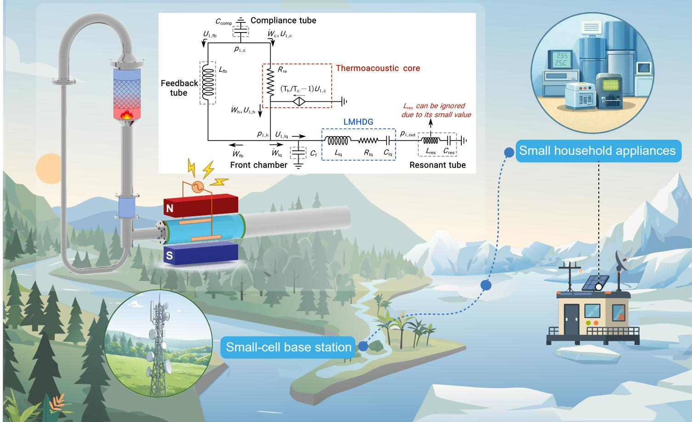

## PUBLIC SUMMARY

■   Developed an efficient thermoacoustic generator with high reliability due to the absence of mechanical moving components.

■   Achieved a record thermal efficiency of 11.0%.

■   This efficiency improves almost one order of magnitude compared to previously reported values, exceeding that of typical thermoelectric generators.

# A thermoacoustically-driven liquid metal magnetohydrodynamic generation system with a thermal efficiency of 11%

Hao Chen,1,2 Yupeng Yang,1,2 Tianqi Wu,1,2 Shunmin Zhu,1,3 Guoyao Yu,1 Rui Yang,1,\* and Ercang Luo1,2,\*

1State Key Laboratory of Cryogenic Science and Technology, Technical Institute of Physics and Chemistry, Chinese Academy of Sciences, Beijing 100190, China

2University of Chinese Academy of Sciences, Beijing 100049, China

3Department of Engineering, Durham University, Durham DH1 3LE, UK

\*Correspondence: yangrui@mail.ipc.ac.cn (R.Y.); ecluo@mail.ipc.ac.cn (E.L.)

Received: July 30, 2025; Accepted: December 16, 2025; Published Online: January 16, 2026; https://doi.org/10.59717/j.xinn-energy.2026.100139

© 2026 The Author(s). This is an open access article under the CC BY license (https://creativecommons.org/licenses/by/4.0/).

Citation: Chen H., Yang Y., Wu T., et al. (2026). A thermoacoustically-driven liquid metal magnetohydrodynamic generation system with a thermal efficiency of 11%. The Innovation 3:100139.

Thermoacoustically-driven liquid metal magnetohydrodynamic generator (TLMHDG) is promising for reliable power generation, but its potential is limited by poor thermal efficiency due to improper acoustic matching. Here we developed an efficient TLMHDG by integrating a liquid metal magnetohydrodynamic generator into the linear gaseous resonator of a Backhaus-Swift engine, where the acoustic field is relatively robust. In experiments, a thermal efficiency of 11.0% and an average electrical power output of 13.5 W are achieved, at a heating temperature of 885 K. These results show an improvement of almost one order of magnitude in thermal efficiency and a onefold increase in power output compared to previously reported. This work underscores the potential of TLMHDG for efficient and reliable power generation.

## INTRODUCTION

Traditional power generation technologies, such as diesel and gas turbine engines, rely on complex mechanical moving parts, which reduces their reliability,1,2 hindering the application where long-term maintenance-free operation is needed. Therefore, it is urgent to develop efficient no-moving-parts power generation technologies.

Existing no-moving-parts power generation technologies face disadvantages including low thermal efficiency, low electrical power output and unstable operation.3,4 Thermoelectric generators, for instance, have typical thermal efficiencies below 10% (see Table S3 in the Supplementary Information for details) due to the low figure of merit of the material.5,6 Constrained by the limited magnitude of the thermomagnetic effect, thermomagnetic generators’ electrical power output is commonly of the order of 10 mW,7,8 far from the requirement of practical applications. Thermionic energy converters can reach a thermal efficiency typically below 10%, but the required emitter temperature is very high (commonly above 1300 K).9 Thermophotovoltaic generators can obtain a much higher electrical power output (beyond 100 W) and thermal efficiency (20% to 40%), but they generally need an emitter temperature exceeding 1500 °C and their stability of operation depends on local solar density.10 These limitations highlight the need for reliable and efficient no-moving-parts power generation technology.

Magnetohydrodynamic (MHD) generators, which harness the kinetic energy of conductive fluids via electromagnetic induction to produce electricity, offer a promising way for no-moving-parts power generation technology with high efficiency and reliability.11 The kinetic energy driving the fluid can be supplied either by mechanical devices, such as pumps, or by natural energy sources, including wave energy.12,13 Plasma MHD generators, which use pumps to accelerate the conductive fluids (ionized gases), had been once considered a leading candidate for power generation in the 1960s to 1990s.14,15 However, the electrical conductivity of ionized gases is of the order of only 10 S/m, which suggests the requirement of extremely high velocity (typically of the order of 1000 m/s) for the magnetic field to capture the kinetic energy. Although many methods exist to optimize the pump performance,16,17 getting such a high velocity is still a challenge in a closed plasma MHD system.18,19 In contrast, the liquid metal MHD generator (LMHDG), which exploits liquid metals with electrical conductivity of the order of 106 S/m, requires a much lower velocity of the fluid (around 1 m/s).20,21 The low velocity indicates the possibility of oscillatory-mode operation, which allows the utilization of kinetic energy from oscillatory motion such as ocean waves, without the need of the complex recycling system.22 Following this, Liu et al. developed a LMHDG with a simple structure, which is powered by ocean waves at a velocity of around 0.5 m/s and attains an electrical power output of 1.1 kW.23 However, the stable operation of the system remains a problem due to the intermittent and stochastic motion of ocean waves.24

To address the limitations of the system stability, acoustic waves are proposed to drive LMHDG. This has been relatively well studied by using an electric-driven acoustic source to drive LMHDG, with the conversion rate from acoustic power to electricity in the range of 24% to 45%.25,26 Since highdensity acoustic waves can be efficiently obtained through thermoacoustic engines by consuming thermal energy,27,28 a thermoacoustically-driven liquid metal MHD generator (TLMHDG) can be conceived by coupling a thermoacoustic engine and a LMHDG.29-31 Due to the extremely simple structure of both the thermoacoustic engine and LMHDG, TLMHDG can operate without any mechanical moving part, thus possessing the advantage of high reliability.32 Such a heat-driven power generation system features a wide operating temperature range and can be adapted to various heat sources, including geothermal, solar and nuclear energy.33,34 Given these, TLMHDG has been listed as a main alternative for long-term power generation by the European Commission.35 So far, the only existing prototype of TLMHDG was developed by Brekis et al., whose electrical power output and thermal efficiency are 6.5 W and 1.3%, respectively.36 This efficiency is far from their theoretical predictions,37 which is primarily due to the improper acoustic matching between the thermoacoustic engine and LMHDG. Moreover, the efficiency can be further improved by optimizing structural parameters of the components, such as the fin geometry of the heat exchanger.38,39

Up until now, TLMHDG faces the challenge of poor thermal efficiency. Herein, we develop a TLMHDG that integrates a traveling wave thermoacoustic engine with a LMHDG. To address the acoustic matching problem, we have integrated a LMHDG into the linear gaseous resonator of a Backhaus-Swift thermoacoustic engine where the acoustic field is relatively robust. Specifically, owing to the closed end of the standing-wave resonator, the acoustic field in the resonant tube is relatively insensitive to variations in the geometric parameters of the resonant tube, allowing considerable design flexibility. Based on this configuration, we first roughly determined the structural parameters according to the target resonant frequency of the system. Then, the geometric dimensions of LMHDG and the thermoacoustic engine were optimized in sequence to achieve acoustic impedance matching and improve the thermal efficiency of the system. In experiments, we significantly improved the thermal efficiency of this technology by almost one order of magnitude compared to previous studies, thereby further underscoring the potential of TLMHDG for clean, efficient and reliable power generation.

## MATERIALS AND METHODS

## Details of experimental prototype

Figure S1 depicts the experimental setup, whose main geometric dimensions are given in Table S1 and S2. The geometric parameters of the components are optimized via a simulation model to achieve acoustic matching.

## Details of measurement

In this study, the parameters involved in the measurements are the resonant frequency, pressure, temperature, and power. The pressure contains mean pressure $p _ { { \mathfrak { m } } }$ and pressure amplitude $\mid p _ { 1 } \mid$ , which were measured by a piezoresistive pressure sensor (GE Druck UNIK 5000) and a piezoelectric pressure sensor (PCB Piezotronics 113B26), respectively. The temperature at HHX was measured by a K-type thermocouple (Kepson KPS-IN600). The temperature at the ambient heat exchanger (AHX) and the secondary ambient heat exchanger (AHX2) was recorded using a water chiller. The net heating power ${ { Q } _ { \hphantom { { Q } } } }$ is defined as the difference between the total heating power and the heat leakage, where the latter is the power required to maintain HHX at the target temperature when the system is not oscillating. Both the total heating power and the heat leakage (see Experimental Section in the Supplementary Information for detailed derivation) were determined by measuring the power consumption of cartridge heaters via a power supply (KIKUSUI PCR500M) when the thermal equilibrium is reached. The output current flowing through $R _ { \mathrm { e } }$ was recorded using an inductive current sensor (Chauvin Arnoux MA 200), while the value of $R _ { \mathrm { e } }$ was measured via a micro-ohm meter (Testkey tk2512). Electrical power output was calculated according to Ohm's law.

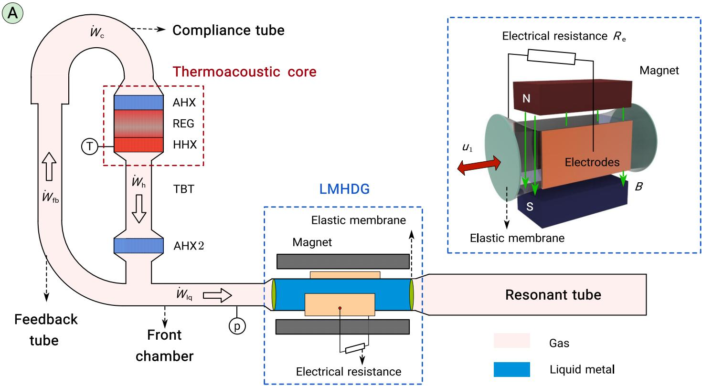

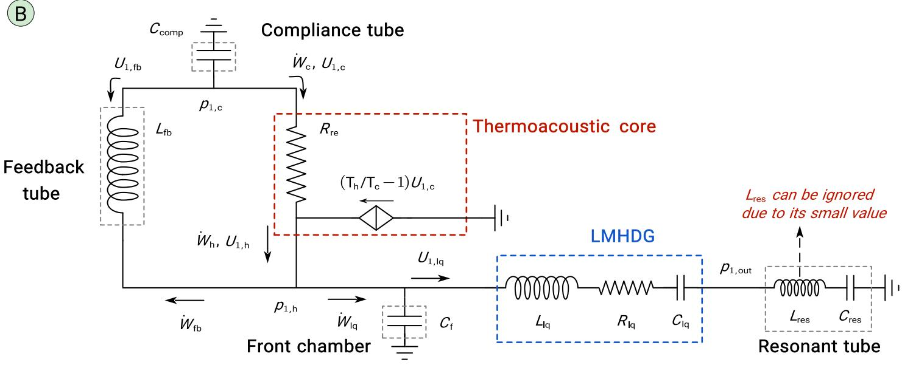  
Figure 1.  (A) System structure of the TLMHDG. T-type K thermocouple, p-pressure sensor, AHX-ambient heat exchanger, REG-regenerator, HHX-hot heat exchanger, TBT-W˙thermal buffer tube, AHX2-secondary ambient heat exchanger. (B) Diagram of the lumped-element model of the TLMHDG. -time-averaged acoustic power, p -acoustic pressure, U -volumetric velocity, C-acoustic compliance, R-acoustic resistance, L-acoustic inertance, the subscripts lq, fb, comp, res, c and h represent liquid metal, feedback tube, compliance, resonant tube, cold end and hot end of REG, respectively. Specific expressions for these acoustic parameters can be found in the Supplementary Information.

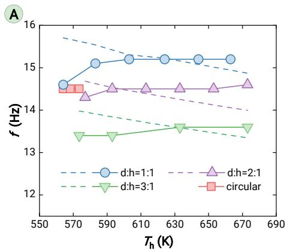

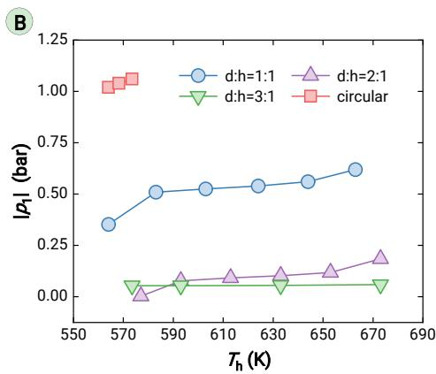

## RESULTS AND DISCUSSION

## Concept and mechanism of TLMHDG

The proposed TLMHDG, shown in Figure 1A, consists of a traveling wave thermoacoustic engine and a LMHDG. The former converts thermal energy into acoustic power via the thermoacoustic effect, while the latter transduces acoustic power into electricity through the electromagnetic induction. The configuration of the engine follows Backhaus and Swift’s classical one,40 but with a liquid metal piston. The configuration of LMHDG is based on the design of an efficient LMHDG developed in our previous work.26 The system operates as follows: when an axial temperature gradient is established along REG by heating HHX (under a heating temperature T ) and cooling AHX (under a cooling temperature T ) of the engine, a self-excited oscillation can be triggered via the thermoacoustic effect. The acoustic power from the oscillation is transmitted through TBT and AHX2. Then part of the acoustic power enters the front chamber and drives the liquid metal to oscillate across the magnetic field. Due to the electromagnetic induction, positive and negative charge carriers are separated toward opposite electrodes respectively, thereby establishing an electrical potential difference. The remaining acoustic power travels through the feedback tube and the compliance tube, and finally goes back to REG.

The integration of the two subsystems, i.e., the thermoacoustic engine and LMHDG, forms a strongly interacting acoustic network. To illustrate this, we employ a lumped-element model in which acoustic pressure (p ) and volumetric velocity (U ) are treated as analogs to voltage and current respectively in an alternating electrical circuit. The main components of the system are modeled as acoustic compliances, acoustic resistances and acoustic inertances, similar to electrical components,41,42 as shown in Figure 1B. The entire system forms a circuit in which each component is dynamically coupled through shared interface variables $( \mathfrak { i . e . , } p _ { 1 }$ and U ) as well as boundary conditions (e.g., the grounding), resulting in the strong mutual dependence among the components. It should be noted that the liquid metal piston and the resonant tube constitute a resonator, with the resonant tube functioning as a gas spring. This gas spring considers only the acoustic compliance of the resonant tube $( C _ { \mathrm { r e s } } ) ,$ , since the acoustic inertance of the resonant tube $\left( L _ { \mathrm { r e s } } \right)$ is only 0.14% of that of LMHDG $\left( L _ { \mathrm { l q } } \right)$ and can thus be ignored.

$$
f = \frac { 1 } { 2 \pi } \sqrt { \frac { 1 } { C _ { \mathrm { q } } L _ { \mathrm { q } } } + \frac { 1 } { C _ { \mathrm { r e s } } L _ { \mathrm { q } } } + \frac { 1 } { L _ { \mathrm { q } } ( C _ { \mathrm { c o m p } } T _ { \mathrm { h } } / T _ { \mathrm { c } } + C _ { \mathrm { f } } ) } } 
$$

Figure 2.  The effects of the cross section of the liquid metal channel on (A) Resonant frequency f and (B) Pressure amplitude $\mid p _ { 1 } \mid _ { . }$ , where the dashed lines indicate calculated results, while the dots correspond to experimental data. $p _ { \mathrm { m } } { = } 2 . 0$ MPa.

(1)

Therefore, selecting parameters for LMHDG is also a key consideration during the design, besides the issue of electromagnetic induction which is obviously important. One example is its influence on the resonant frequency (f) which is expressed as (see Numerical Analysis Section and Figure S2 in the Supplementary Information for detailed derivation):

liquid metal channel (corresponding to the variation of 0.26 kg of the liquid metal in the presented system) approximately leads to a 10% change in $L _ { \mathrm { l q } } ,$ which results in 6% variation in f. Since f is a fundamental parameter, such variation will lead to significant and complicated changes in the acoustic field

where $L _ { \mathrm { l q } }$ and $C _ { \mathrm { l q } }$ denote the acoustic inertance and the acoustic compliance of the liquid metal channel, respectively. The acoustic compliances of the compliance tube, the front chamber and the resonant tube are represented by $C _ { \mathsf { c o m p } } ,$ and $C _ { \mathrm { r e s } } ,$ respectively. As a result, the structural parameters of the system were roughly determined according to the target resonant frequency.

According to Equation 1, f is highly sensitive to the geometry of the liquid metal channel of LMHDG. For example, a 10% change in the length of the characterized by $p _ { 1 }$ and U . This may damage the thermoacoustic conversion of the engine that is highly sensitive to the acoustic field43 and lead to the acoustic mismatching between LMHDG and the engine. In the worst case, this mismatching is even likely to result in a complete failure. Such delicate dependence is the most challenging, and arguably the most intriguing aspect of this system.

To overcome this challenge and improve the performance, we carefully designed the configuration of the engine and LMHDG, and experimentally adjusted geometries of components including the lengths of the liquid meta channel and the resonant tube, the electrical load (reflected by ${ \cal { K } } ,$ as well as $T _ { \mathfrak { h } }$ and the mean pressure (p ). These will be shown in the following discussion.

## Characteristics of the thermoacoustic engine (B=0)

When the magnetic field is removed (i.e., the magnetic flux density B is 0), TLMHDG degrades into a thermoacoustic engine which is the source of acoustic power. Moreover, in the engine, fand the pressure amplitude ${ | \ p _ { \neg } }$ are key parameters that characterize the acoustic field and the acoustio power, respectively. As described in the “Concept and mechanism of TLMHDG” section, f and ∣ $p _ { 1 } \mid$ are highly sensitive to the geometry of the liquid metal channel. To address this, channels with different geometries, including a circular cross section and rectangular cross sections with aspect ratios of 1:1, 2:1 and 3:1, were tested. All geometries share the same crosssectional area.

For these geometries, the corresponding variations of fwith $T _ { \mathfrak { h } }$ are shown in Figure 2A. fincreases with the growth of $T _ { \mathrm { h } } ,$ whose trend slightly deviates from the theoretical predictions from Equation 1. The reason behind this is the overestimated influence of $T _ { \mathfrak { h } }$ on the volumetric-velocity source $( T _ { \mathfrak { h } } / T _ { \mathfrak { c } } - 7 ) \cup _ { \mathfrak { l } , \mathfrak { c } }$ (see Figure 1B), which neglects the viscous and thermal relaxation effects of a practical $\mathsf { R E G } ^ { 4 2 }$ Additionally, f decreases with the rising aspect ratio of the rectangular cross-sectional channel. This trend is attributed to the rise of $L _ { \mathrm { l q } }$ caused by the increased boundary layer effect from the decreased hydraulic radius (see Equation 1 and Equation S14 in the Supplementary Information). Consequently, the highest f of 15.2 Hz is obtained with an aspect ratio of 1:1. The value of f in this work is between 12.0 Hz and 17.0 Hz, which is significantly lower than that of classical thermoacoustic engines.44 However, this range falls in the proper frequencies for efficient electromagnetic transition of LMHDG, which has been demonstrated in our previous work.45 This resonant frequency range is a prerequisite for efficient and stable operation of the system.

The value of $\mid p _ { 1 } \mid$ at the front chamber increases with the rise of $T _ { \mathrm { h } } ,$ as shown in Figure 2B, reflecting the amplified acoustic power delivered to LMHDG. When a circular cross-sectional channel is utilized, the system yields the highest $\mid p _ { 1 } \mid$ , reaching 1.04 bar at $T _ { \mathrm { h } } { = } 5 7 3 \mathrm { K } .$ In contrast, when the rectangular cross-sectional channels are used, the value of ${ | p _ { \uparrow } }$ ∣ decreases as the aspect ratio increases due to greater viscous losses, with the peak value of 0.62 bar obtained with an aspect ratio of 1:1. This is because a larger aspect ratio results in a smaller hydraulic radius, which leads to an increased flow resistance in the channel. Despite its superior acoustic performance, the circular cross-sectional channel is not a good choice for LMHDG due to the difficulties in electrode placement, electromagnetic coupling and nonlinear

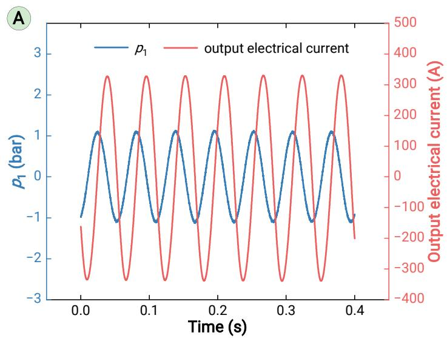

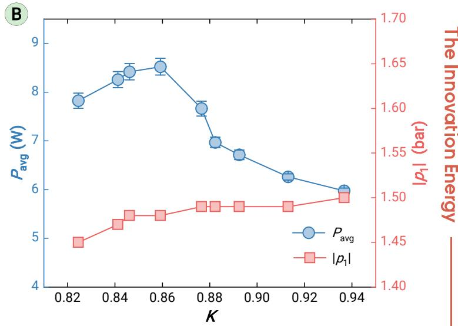

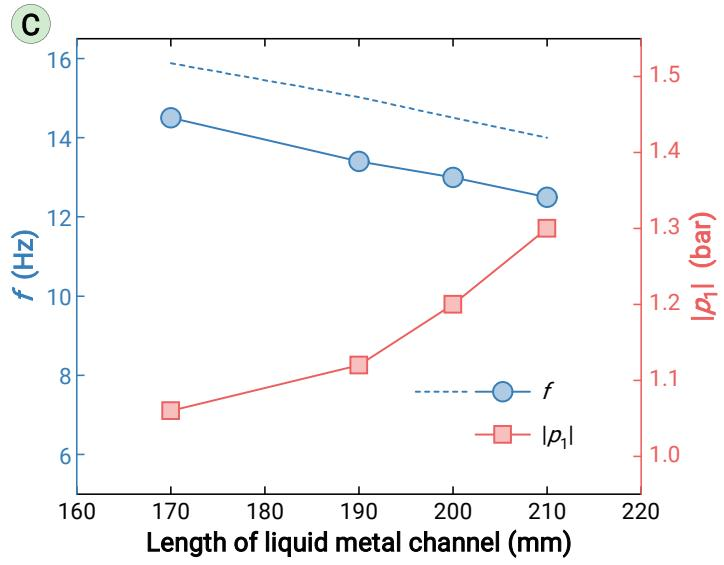

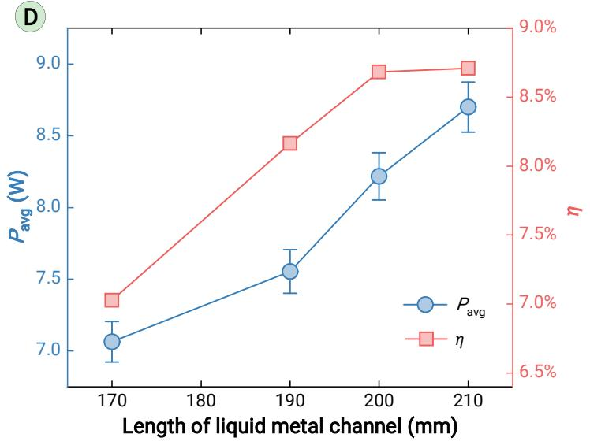  
F

E  
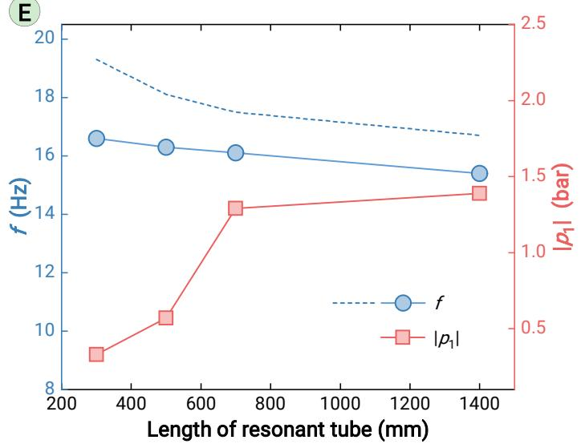

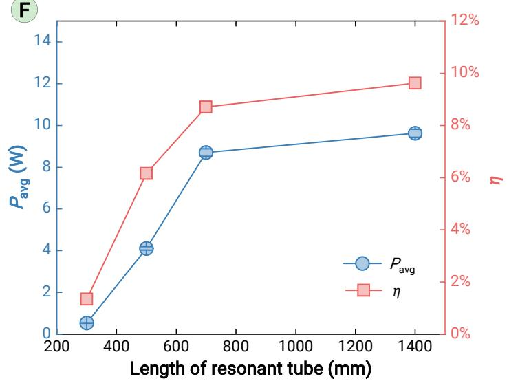  
Figure 3.  Output characteristics of TLMHDG (A) Waveforms of acoustic pressure p and output electrical current where p =3.0 MPa, T =873 K and K=0.91; (B) Variations of pressure amplitude $\mid p _ { 1 } \mid$ and average electrical power output $P _ { \mathrm { a v g } }$ with different load ratios K, $p _ { \mathrm { m } } \mathrm { = } 3 . 0$ MPa, T =873 K; (C) Effects of the length of the liquid metal channel on resonant frequency fand ∣p ∣, where $p _ { \mathsf { m } } { = } 2 . 0 ~ \mathsf { M P a } , ~ T _ { \mathsf { h } } { = } 5 9 3 ~ \mathsf { K } ,$ the dashed and the solid lines represent calculated and experimental results, respectively; (D) Effects of the length of the liquid metal channel on $P _ { \mathrm { a v g } }$ and the thermal efficiencyη, where $p _ { \mathsf { m } } { = } 3 . 0 ~ \mathsf { M P a } , ~ T _ { \mathsf { h } } { = } 8 7 3 ~ \mathsf { K } ,$ with Kbeing optimized for highest $P _ { \mathrm { a v q } } ;$ (E) Effects of the length of the resonant tube on fand $\mid p _ { 1 } \mid$ , where the dashed lines and the solid lines represent calculated and experimental results, respectively; (F) Effects of the length of the resonant tube on $P _ { \mathsf { a v g } }$ and η, where $p _ { \mathrm { m } } \mathrm { = } 3 . 0$ MPa, $T _ { \mathrm { h } } { = } 8 7 3 \mathrm { k } ,$ with Kbeing optimized for highest $P _ { \mathrm { a v g } } .$

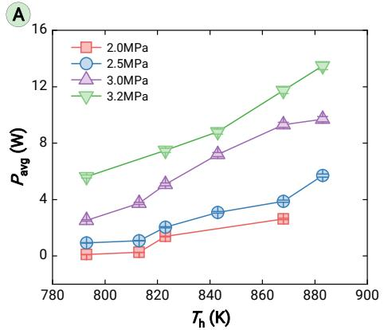  
boundary-layer problems. $\cdot ^ { 4 5 }$ Therefore, a rectangular channel with a crosssectional aspect ratio of 1:1 is utilized in the following experiments. This design enables LMHDG to provide an acoustic impedance adapted to that of the engine.

## Characteristics of TLMHDG (B=0.65 T)

In this section, the operational characteristics of TLMHDG, including output electrical current, ${ | \ p _ {  } }$ ∣, f, average electrical power output $( P _ { \mathrm { a v g } } )$ and thermal efficiency $( \eta ,$ defined as the ratio of $P _ { \mathrm { a v g } }$ over the net heating power Q ) in a magnetic field (B=0.65 T) will be presented. The detailed error analysis for the experimental measurements has been included in the Error analysis of the Supplementary Information.

The waveforms of $p _ { 1 }$ and the output electrical current of a typical case are shown in Figure 3A. These sinusoidal waveforms reflect the oscillatory nature of the whole system. ∣p ∣ of the waveform is 1.10 bar, bringing about an output current with an amplitude of 330 A. A phase difference of 88.7° exists between the waveforms of $p _ { \rceil }$ and the output electrical current. This is because $p _ { 1 }$ and $U _ { 1 }$ have a phase difference of approximately $9 0 ^ { \circ }$ due to the standing-wave resonator of the engine,43 while $U _ { 1 }$ and the output electrical current are almost in phase because of the resistive-dominated electrical load.26

The values of $P _ { \mathrm { a v g } }$ (defined as the time-averaged Joule heating in the electrical resistance $R _ { \mathrm { e } } )$ and $\mid p _ { 1 } \mid$ under different load ratios $K ( K { = } \mathsf { R _ { e } } / ( \mathsf { R _ { e } } { + } \mathsf { R _ { i } } )$ Rwhere is the internal resistance of LMHDG) are shown in Figure 3B. Ideally, the relationship between $P _ { \mathrm { a v g } }$ d Kf ll 46

$$
P _ { a v g } = \frac { 1 } { 2 } K ( 1 - K ) V _ { { t q } } \sigma _ { { t q } } B ^ { 2 } { \langle | U _ { 1 } | \rangle } ^ { 2 }\tag{2}
$$

where $\sigma _ { \mathrm { { \scriptscriptstyle i q } } } , \ V _ { \mathrm { { \scriptscriptstyle i q } } }$ and $\left| \mathsf { U } _ { 1 } \right|$ denote the electrical conductivity, the volume and the velocity amplitude of the liquid metal, respectively. According to Equation $^ { 2 , }$ the system should obtain its peak $P _ { \mathrm { a v g } }$ uat K=0.50 if is fixed. However, due uto the complex acoustic coupling in TLMHDG, varies with the change of $K ,$ resulting in the peak value of $P _ { \mathrm { a v g } }$ (8.5 W) occurring at =0.86 in experiments. The decrease of $P _ { \mathrm { a v g } }$ when K goes above 0.86 reflects the mismatching between the engine and LMHDG, indicating that a large electrical load may exceed the output ability of the engine.

The influences of the length of the liquid metal channel on the output performance of the system, including $f , \ | \ p _ { 1 } \ | \ , \ P _ { \mathsf { a v g } }$ and $\eta ,$ are shown in Figures 3C and 3D. fdecreases with the increased length of the liquid metal channel, which is primarily due to a larger $L _ { \mathrm { l q } }$ (see Equation 1 and Equation S11). Moreover, the value of $\mid p _ { 1 } \mid$ ∣ shows an increasing trend, indicating a rise of acoustic power output into LMHDG. Consequently, when the length increases from 170 mm to 210 mm, the value of $P _ { \mathrm { a v g } }$ rises from 7.1 W to 8.7 W. After the initial increase, the value of η reaches a plateau when the length of the liquid metal channel exceeds 200 mm. In the following experiments, a length of 210 mm is considered the optimal and will be used in the subsequent discussions. Moreover, to verify this, the axial distribution of the acoustic field in the system has been analyzed using Sage software (see Figure S3 in the Supplementary Information). A traveling-wave dominated field is established in REG, with the phase difference $\theta _ { p _ { 1 } - U _ { 1 } }$ between $p _ { 1 }$ and $U _ { 1 }$ ranging from $- 7 7 ^ { \circ } \mathrm { t o } 5 5 ^ { \circ }$ in REG. This indicates that a proper acoustic matching has been achieved in the system.47

Figure 4.  The effects of the mean pressure on (A) Average electrical power output $P _ { \mathsf { a v g } } \flat _ { \prime }$ (B) Thermal efficiency η , where the length of liquid metal channel is 210 mm and the length of resonant tube is 1400 mm, with Kbeing optimized for highest $P _ { \mathsf { a v g } } .$  
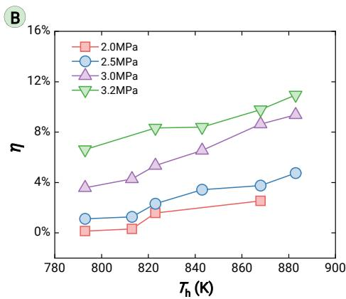

Furthermore, the influences of the length of the resonant tube on the output performance of TLMHDG, including $f , \mid p _ { 1 } \mid , P _ { \mathrm { a v g } }$ and $\eta ,$ are presented in Figures 3E and 3F. f decreases with the rising length of the resonant tube, which is due to the increased $C _ { \mathrm { r e s } }$ from the longer resonant tube (see Equation $7 ) . \ \mid \ p _ { 1 } \mid$ $P _ { \mathsf { a v g } }$ and share similar trends: they increase

rapidly with the initial increase of the length, then grow slowly when the length exceeds 700 mm. This nonlinear trend is attributed to the complex impact of $f$ on the acoustic field (see the “Concept and mechanism of TLMHDG” section), which is determined by the specific design of the system. In summary, the value of $\mid p _ { 1 } \mid$ increases to 1.45 bar with the increased lengths of the liquid metal channel (up to 210 mm) and the resonant tube (up to 1400 mm). This indicates a rise in the acoustic power output into LMHDG, which in turn leads to an increase in thermal efficiency. Consequently, with these lengths, the peak $P _ { \mathrm { a v g } }$ of 9.6 W is obtained at a frequency of 15.4 Hz with of 9.6% under $T _ { \mathrm { h } } { = } 8 7 3 $ K and $p _ { \mathrm { m } } { = } 3 . 0 \mathsf { M P a }$

Subsequently, the values of $P _ { \mathsf { a v g } }$ and were tested under different $T _ { \mathfrak { h } }$ and $p _ { \mathsf { m } } ,$ as shown in Figures 4A and 4B. It is found that the system maintains steady operation over a wide range of mean pressures from 2.0 MPa to 3.2 MPa, owing to the relatively robust acoustic field established by the Backhaus-Swift thermoacoustic engine.48 Moreover, at a fixed $p _ { \mathfrak { m } } , P _ { \mathtt { a v g } }$ increases with the rising $T _ { \mathrm { h } } .$ The reason behind this is the increased volumetric-velocity source (see Figure 1B), which amplifies the acoustic power generated by REG through the thermoacoustic effect, as well as the acoustic power output to LMHDG. At a fixed $T _ { \mathrm { h } } ,$ the higher $p _ { \mathsf { m } }$ leads to a larger $P _ { \mathrm { a v g } } ,$ because the exchanged thermal energy through heat exchangers is enhanced from the higher heat capacity of the working gas. Similarly, values of show increased trends with the growth of $T _ { \mathfrak { h } }$ and $p _ { \mathsf { m } } .$ Given the pressure-resistant design of the system that is primarily determined by the allowable stress of the materials, the highest $p _ { { \mathfrak { m } } }$ and $T _ { \mathfrak { h } }$ in the experiments are 3.2 MPa and 885 $\mathsf { K } ,$ respectively. Under these conditions, the system reaches the highest of 11.0% and $P _ { \mathsf { a v g } }$ of 13.5 W, corresponding to an amplitude of the output electrical current of 700 $\mathsf { A } ,$ with Kof 0.82. This efficiency corresponds to 16.4% of the theoretical limit with a cooling temperature of 293 K. Importantly, the gas composition is a very fundamental parameter which governs sound speed, even small variations in gas composition can cause a significant effect on the performance of the system.49

Furthermore, a 5-hour long-term operation test has been performed (see Figure S4 in the Supplementary Information). The system maintained stable electrical power generation during the test, with a maximum relative deviation of 2.7%. After operation, the liquid metal showed no noticeable surface oxidation, indicating that its electrical conductivity was preserved. This stability is attributed to the pre-filling of the liquid metal channel with the protection of nitrogen, which minimized the oxygen content and ensured sufficient stability of the liquid metal for long-term operation.

In Figure $5 ,$ η of TLMHDG is compared with that of the existing TLMHDG,50 as well as that of thermoelectric generators, thermionic energy converters and thermophotovoltaic generators (see Table S6 in the Supplementary Information for details).9,51 Obviously, η of the proposed TLMHDG shows an improvement of almost one order of magnitude higher over the system in the 'SpaceTRIPS' project.36 Further, this value of η surpasses those of typical thermoelectric generators (a few state-of-the-art thermoelectric generators have a higher thermal efficiency,52 but not representative). Compared to thermophotovoltaic generators and thermionic energy converters, the proposed TLMHDG requires a much lower $T _ { \mathrm { h } } ,$ thus enabling the use of a broader range of heat sources. These advantages indicate that TLMHDG is a promising alternative for reliable and efficient power generation operating below a heating temperature of 1000 K.

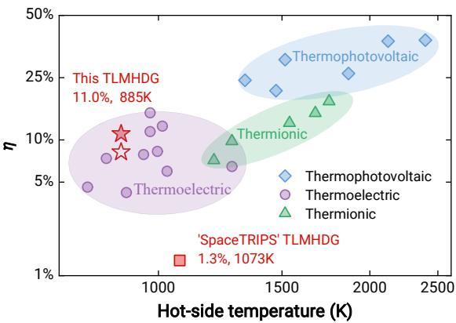  
Figure 5.  Comparison of thermal efficiency of TLMHDG in this study with the typical efficiencies of other no-moving-parts technologies, where the solid pentagram is the thermal efficiency when both the heat leakage of the thermal insulation material and internal heat conduction are ignored, while the hollow pentagram is the thermal efficiency when only the heat leakage of the thermal insulation material is ignored. See Heat leakage analysis and Table S5 in the Supplementary Information for detailed derivation.

## CONCLUSION

TLMHDG is promising for reliable power generation, but this potential is limited by its poor thermal efficiency due to improper acoustic matching. In this work, we have integrated a LMHDG into the linear gaseous resonator of a Backhaus-Swift thermoacoustic engine where the acoustic field is relatively robust, and have carefully designed and optimized main components, thus developed an efficient TLMHDG. Experimental results show that a thermal efficiency of 11.0% and an average electrical power output of 13.5 W under a heating temperature of 885 K can be obtained, which is an improvement of almost one order of magnitude in thermal efficiency and a onefold increase in output power compared to previously reported. This efficiency is comparable to or even superior to that of typical thermoelectric generators. In experiments, we found that tuning the load ratio into the range of 0.80 to 0.88 is effective in improving the performance of the system. Additional techniques to improve the performance include adjusting the length of both the liquid metal channel and the resonant tube, as well as increasing the heating temperature and the mean pressure.

Future strategies to improve electrical power output mainly focus on increasing the velocity amplitude of the liquid metal, which may be achieved by raising the resonant frequency. Thermal efficiency could be improved by reducing losses from eddy currents and end currents in the liquid metal during electromagnetic transitions, through the use of a multi-layered liquid metal channel and the enhanced magnetic field near the channel ends, respectively.

## REFERENCES

Muser T., Krymova E., Morabito A., et al. (2025). Fatigue damage reduction in1. hydropower startups with machine learning. Nat Commun. 16. DOI:10.1038/s41467- 025-58229-z

Omidi M., Liu S.-J., Mohtaram S., et al. (2019). Improving Centrifugal Compressor2. Performance by Optimizing the Design of Impellers Using Genetic Algorithm and Computational Fluid Dynamics Methods. Sustainabilit . 11. DOI: 10.3390/ su11195409

Zhu J., Shen X., Ding J., et al. (2024). Revealing the phonon properties for3. thermoelectric materials by neutron scattering. Innov Energy 1:100049. DOI:10.59717 /j.xinn-energy.2024.100049

Che L., Li N., Wei W., et al. (2025). Day-Night energy harvesting: Photovoltaics-driven4. moisture evaporation and absorption for simultaneous 24-hour power and dehumidification. Innov Energy2:100078. DOI:10.59717/j.xinn-energy.2025.100078

Tang H., Liang Y., Liu C., et al. (2022). A solution-processed n-type conducting5. polymer with ultrahigh conductivity. Nature 611:271−277. DOI:10.1038/s41586-022- 05295-8

Shi X., Song S., Gao G., et al. (2024). Global band convergence design for high-6. performance thermoelectric power generation in Zintls. Science 384:757−762. DOI. DOI:10.1126/science.adn7265

Liu X., Chen H., Huang J., et al. (2023). High-performance thermomagnetic generator7. controlled by a magnetocaloric switch. Nat Commun. 14. DOI:10.1038/s41467-023- 40634-x

Shen J., Huang X., Dai Y., et al. (2024). N-type and P-type series integrated hydrogel h l i ll f l d h h i Nat Commun s41467-024-53660-0

b ll l h i l ( ) d i h

LaPotin A., Schulte K. L., Steiner M. A., et al. (2022). Thermophotovoltaic efficiency of10. 40%. Nature 604:287−291. DOI:10.1038/s41586-022-04473-y

Thring M. W. (1965). Magnetohydrodynamic Power Generation. Nature 208:966−967.11. DOI:10.1038/208966a0

Li K., Li C., Mohtaram S., et al. (2025). Experimental and numerical study on scroll12. 169:241−253. DOI:10.1016/j.ijrefrig.2024.10.007

idi h d idi ( ) i l i b d i i i i f if l i i l l id i h d Academia Lett.767. D0I:10.20935/AL767

Harada N., Kizuka N., Okamura T., et al. (1995). Improvement of enthalpy extraction14. over 30% using a disk MHD generator with inlet swirl. Ener Convers Mana e 36:355-364.D0I:10.1016/0196-8904(95)98900-8

15. Harada N. and Tsunoda K. (1998), Study of a disk MHD generator for noneguilibrium plasma generator (NPG) system. Ener Convers Mana e 39:493−503. DOI:10.1016 /s0196-8904(96)00232-4

Omidi M., Liu Y., Mohtaram S., et al. (2022). Investigating on performance parameters16. and flow field of centrifugal compressor based on the splitter blade leading edge’s location effect, J. Mech, Sci. Technol, 36:4015-4020. D0I:10.1007/s12206-022-0722- 5

Li K., Hu J., Li C., et al. (2024). Refined one-dimensional modeling and experimenta17. validation of scroll compressor with vapor injection for electric vehicles. Int J Refri 168:469−483. DOI:10.1016/j.ijrefrig.2024.09.007

Sawhney B. K. and Verma S. S. (1989). Suitability of Indian coal for coal-fired MHD18. generators. IEEETrans Plasma Sci 17:839−840. DOI:10.1109/27.41214

Mohtaram S., Chen W., Zargar T., et al. (2017). Energy-exergy analysis of compressor19. pressure ratio effects on thermodynamic performance of ammonia water combined cycle. Ener Convers Mana e 134:77−87. DOI:10.1016/j.enconman.2016.12.024

Wang T. C. and Dudzinsky S. J. (1967). Theoretical and experimental study of a liquid20. metal MHD induction generator. AIAAJournal5:107−112. DOI:10.2514/3.3915

Sense K. A. and Gelb G. H. (1967). Cycle analyses for liquid-metal power conversion21. systems using a bifluid MHD GENERATOR. AIAA Journal 5:1818−1822. DOI:10.2514/ 3.4310

Peng Y., Lin Z., Zhao L., et al. (2008). Analysis of Liquid Metal MHD Wave Energy22. Direct Conversion System. The Eighteenth International Offshore and Polar Engineering Conference.

Liu B., Li J., Peng Y., et al. (2015). Experimental and numerical investigation of23. Magnetohydrodynamic generator for wave energy. JOWE2:21−27.

Domínguez-Lozoya J. C., Cuevas S., Domínguez D. R., et al. (2021). Laboratory24. Characterization of a Liquid Metal MHD Generator for Ocean Wave Energy Conversion, Sustainability13. D0I:10.3390/su1309464

Swift G. W. (1988). A liquid-metal magnetohydrodynamic acoustic transducer. J25. Acoust Soc. Am.83:350-361.D0l:10.1121/1.396445

Zhu S., Wang T., Jiang C., et al. (2023). Experimental and numerical study of a liquid26. metal magnetohydrodynamic generator for thermoacoustic power generation. Appl 348:121453. DOI:10.1016/j.apenergy.2023.121453

Huang J., Yang R., Yang Y., et al. (2023). Generalized thermoacoustic heat engines27. with unconventional working substances: A review. A l Ener 347:121447. DOI:10. 1016/j.apenergy.2023.121447

Xiao L., Luo K., Wu Z., et al. (2024). Sustainable heat-driven sound cooler with super-28. high efficiency. Innov Energy1:100027. DOI:10.59717/j.xinn-energy.2024.100027

Swift G. W., Migliori A., Hofler T., et al. (1985). Theory and calculations for an29. intrinsically irreversible acoustic prime mover using liquid sodium as primary working fluid. J Acoust Soc Am 78:767−781. DOI:10.1121/1.39244

Migliori A. and Swift G. W. (1988). Liquid-sodium thermoacoustic engine. Appl Phys30. 53:355−357. DOI:10.1063/1.99913

Garrett S. L. and Gabrielson T. B. (1991). Magnetohydrodynamic and Thermoacoustic31. Mechanisms for Generation of Sound in Seawater. In B.F. Hamonic, J.-N. Decarpigny, and O.B. Wilson, eds. Power Transducers for Sonics and Ultrasonics. (Springer Berlin Heidelberg), pp: 162–177.

Zhu S., Yu G., Jiang C., et al. (2022). A novel thermoacoustically-driven liquid metal32. magnetohydrodynamic generator for future space power applications. Energy 258:115503. DOI:10.1016/j.enconman.2022.115503

Mohtaram S., Wu W., Aryanfar Y., et al. (2022). Introducing and assessment of a new33. wind and solar-based diversified energy production system intergrading single-effect absorption refrigeration, ORC, and SRC cycles. Renew Energy 199:179−191. DOI:10. 1016/j.renene.2022.08.069

Li X., Mohtaram S., Keçebaş A., et al. (2025). Thermodynamic analysis and34. optimization of an optimized geothermal-driven quadruple-production system for sustainable power, heat, freshwater, and hydrogen production. Renew Energy 245:122847. DOI:10.1016/j.renene.2025.122847

European Commission. (2014). Final report summary - MEGAHIT (megawatt highly35. efficient technologies for space power and propulsion systems for long-duration

exploration missions). https://cordis.europa.eu/project/id/313096/reporting/es

Brekis A., Freibergs J., Gailītis A., et al. (2017). New Experimental Results from Testing36. for Materials Processing".

Brekis A., Alemany A., Alemany O., et al. (2021). Space Thermoacoustic Radioisotopic37. Power System, SpaceTRIPS: The Magnetohydrodynamic Generator. Sustainabilit 13. DOI:10.3390/su132313498

Elakrout O., Ghriss O., Bouabidi A., et al. (2024). Investigative analysis of the influence38. of diverse fin configurations on the performance of a dual pass solar air collector. 50:102545. DOI:10.1016/j.tsep.2024.102545

d l h d l f d h b il i d fi d extensive surface in a bulky CCPP. Case Stud Therm En 23:100808. DOI:10.1016/j. csite,2020.100808

Backhaus S. and Swift G. W. (1999). A thermoacoustic Stirling heat engine. Nature40. 399:335-338,D0I:10.1038/20624

Backhaus S. and Swift G. W. (2000). A thermoacoustic-Stirling heat engine: Detailed41. study. J Acoust Soc Am 107:3148−3166. DOI:10.1121/1.429343

Tang K., Lei T., Jin T., et al. (2009). A standing-wave thermoacoustic engine with gas-42. liquid coupling oscillation. Appl Phys Lett 94:254101. DOI:10.1063/1.3157920

Swift, G.W. (2017). Thermoacoustics: A Unifying Perspective for Some Engines and43. Refrigerators. Springer. DOI:10.1007/978-3-319-66933-5

Wang H., Zhang L., Yu G., et al. (2019). A looped heat-driven thermoacoustic44. refrigeration system with direct-coupling configuration for room temperature cooling 64:8−10. DOI:10.1016/j.scib.2018.12.007

Jiang C., Wang T., Zhu S., et al. (2023). A method to optimize the external magnetic45. 282:128251. DOI:10.1016/j.energy.2023.128251

Yang R., Wang J., Wu Z., et al. (2023). Performance analysis of thermoacoustic46. plasma MHD generation. Energy263:125647. DOI:10.1016/j.energy.2022.125647

Tijani M. E. H. and Spoelstra S. (2011). A high performance thermoacoustic engine. J47. 110:093519. DOI:10.1063/1.3658872

Wang K., Sun D., Zhang J., et al. (2016). An acoustically matched traveling-wave48. thermoacoustic generator achieving 750 W electric power. Ener 103:313−321. DOI:10.1016/j.energy.2016.03.001

Blanc N., Yang R., Ramon G. Z., et al. (2023). Thermoacoustic engines with near-49. critical working fluids. Appl Therm Eng 231:120845. DOI:10.1016/j.applthermaleng. 2023.120845

Brekis A. (2019). Space Thermo Acoustic Radio-Isotopic Power System: Space50. TRIPS. MHD55:5−14. DOI:10.22364/mhd.55.1-2.1

Datas A. and Martí A. (2017). Thermophotovoltaic energy in space applications:51. Review and future potential. Sol Ener Mater Sol Cells 161:285−296. DOI:10.1016/j. solmat.2016.12.007

Jia B., Wu D., Xie L., et al. (2024). Pseudo-nanostructure and trapped-hole release52. induce high thermoelectric performance in PbTe. Science 384:81−86. DOI:10.1126/ science.adj8175

## FUNDING AND ACKNOWLEDGMENTS

This work was financially supported by the National Natural Science Foundation of China (Grant No. 52306031). Besides, the authors thank Mr. Bin Liu and Mr. Jianmin Fang for technical supports.

## AUTHOR CONTRIBUTIONS

Hao Chen investigated the methodology and background, designed and constructed TLMHDG, performed the experiments, analyzed the data and wrote the manuscript. Yupeng Yang and Tianqi Wu performed the experiments. Shunmin Zhu and Guoyao Yu analyzed the data. Rui Yang conceived the idea, investigated the methodology and background, designed and constructed TLMHDG, analyzed the data, and supervised the research. Ercang Luo investigated the methodology and background, supervised the research.

## DECLARATION OF INTERESTS

The authors declare no competing interests.

## DATA AND CODE AVAILABILITY

Data are available from the corresponding author upon reasonable request.

## SUPPLEMENTAL INFORMATION

It can be found online at https://doi.org/10.59717/j.xinn-energy.2026.100139

## LEAD CONTACT WEBSITE

The website of lead contact (Professor Ercang Luo) can be found online at http://www.ipc.ac.cn/sourcedb/cn/yjzx/jcqn/200904/t20090415\_49504.htm