# 自動車用ガソリンエンジンの廃熱を利用して駆動する熱音響音波発生機の性能\*

畠小 沢川 政孝 保废 杉瀬 田尾 宜

# Performance of a Thermoacoustic Sound Wave Generator driven with Waste Heat of Automobile Gasoline Engine

Masayasu HATAZAWA\*⁵, Hiroshi SUGITA, Takahiro OGAWA and Yoshitoki SEO

\*⁵ Department of Engineering Science, Junior College of Nihon University, 7-24-1 Narashinodai, Funabashi shi, Chiba, 274 8501 Japan

A new type of thermoacoustic sound wave generator driven with the waste heat of a 4 cycle automobile gasoline engine is described. The exhaust-pipe-connected sound wave generator, in which the hot heat exchanger is set in the exhaust pipe in order to recover the waste heat of exhaust gas, is proposed. A temperature of 780°C of exhaust gas in the exhaust is observed. In a conventional thermoacoustic sound wave generator, sound waves originate at a temperature of the hot heat exchanger, T, of 200\~300°C and become sufficient at 700°C. It is confirmed that the new generator generates sufficient sound waves and its performance is almost equal to that of the electric heater driven generator at a thermal input of 300 W, which corresponds to slightly more than 1% of the heat quantity of exhaust gas provided under the condition that the number of engine revolutions is 2 600 r.p.m. and that the throttle opening is 35%.

Key Words : Thermoacoustic Phenomena, Sound Wave Generator, Exhaust Gas Utilization, Waste Heat Recovery

## 1. 緒 言

著者らは，熱音響機器の開発と並行して，その動力源として重要な役割を果たす熱音響音波発生機(1)(以降，音波発生機という)の効率向上を目指している.その一環として2機の音波発生機を開口端同士で突合せ(2)，さらに4機の音波発生機をループ状に組合せた(3)ところ，いずれの形式の音波発生機ともに音波発生機単独動作に比べて性能が大幅に向上することが確認できた(2)(3)。また，著者らは共鳴管内におけるスタックの最適位置を模索している(4)．さらに,それら機器の熱源として工場や自動車から有効に使われることなく無駄に捨てられている廃熱の再利用を考えている．そのうち自動車用ガソリンエンジンでは,燃焼ガスの熱エネルギーのうち1/3弱が軸出力となり,それとほぼ同量の熱が有効に使われることなく排気ガスとともに大気中に放出されている(5)，近年の省エネルギ一，大気污染および地球温暖化等の地球規模に及ぶ深刻な環境問題に対処するためにも，廃熱の回収と再利用が急務となっている，本報告では，自動車用ガソリンエンジンの排気系に1機の熱音響音波発生機を実装して排気熱を熱源として十分に安定して動作することを確認した，さらに，構造がほぼ同じで電気ヒータにより加熱する従来形の音波発生機と圧力振幅および高温熱交換器の温度等を比較することで，その性能を評価した。ここでは，それらの報告をする.

## 2. 実験装置および実験方法

2·1自動車用エンジンの廃熱回収案図1に自動車用ガソリンエンジンの熱収支を示す．自動車用がソリンエンジンの場合，燃焼ガスの熱エネルギーのうち約20～30%が軸出力として利用され，機械損失が5\~6%,残り60～70%が有効に使われることなく廃熱(冷却熱損失が35～45%であり，排気熱および放射熱が20\~35％である)として無駄に捨てられている(5).著者らは熱音響音波発生機の熱源として，これらの廃熱を利用することを考え，以下に示す二つの方式の音波発生機を考案した。なお，それらを駆動する熱の供給源として水冷ガソリンエンジンを想定している.

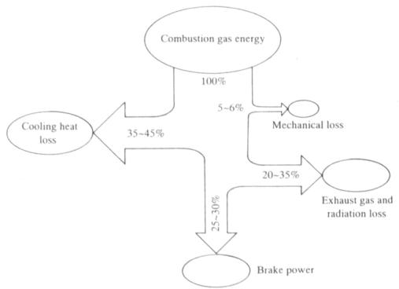  
Fig. 1 Energy balance of automobile gasoline engine

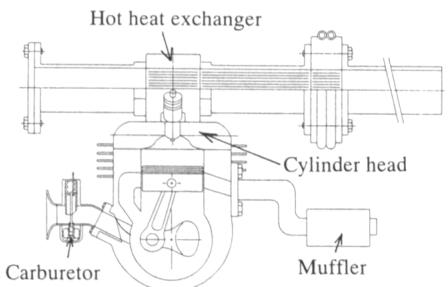  
Water cooled 2 cycle motorcycle engine  
Fig. 2 Cylinder head loading type of sound wave generator

図2に第1案であるシリンダヘッド搭載形音波発生機の概念図を示す．エンジンの冷却性能を高め，かつ音波発生機の熱源を確保できるようにシリンダへッド部分を改造して高温熱交換器を組み込むものである.

図3に第2案である排気熱利用形音波発生機の概念図を示す．音波発生機の高温熱交換器を排気管内に配置し，排気ガスの熱のみを回収するものである.

2·2 予備実験熱音響音波発生機を十分に安定して駆動させるには，その高温熱交換器に相応の熱入カが必要である(2)(3)。なお，シース形電気ヒータを熱源とする従来形音波発生機では高温熱交換器の温度THが200～300Cで音波が発生し始め，TH=700〜800℃で安定して動作することが確認されている(2)(3)。したがって，ここで考案した2種類の音波発生機のうち，どちらの方式が音波発生機を駆動させるに足る熱源として有望であるかを確認するために以下の予備実験を行った.

まず第1案の熱源としてヤマハ発動機製の50cm³水冷ニサイクルモータサイクルエンジンを考え，予備実験として，そのシリンダへッド内の温度測定を行った．なお，エンジン運転中の温度測定時にはシリンダのみを水冷し，シリンダヘッド内には冷却水を流していない．測定部位はシリンダヘッドの燃焼室壁内であり，深さ1mmの孔をあけ，K形熱電対を挿入して運転時のシリンダヘッド壁内の温度を測定した。十分にアイドリングした後，エンジンを無負荷のもとで回転数7000rpmで運転して，燃焼室壁内の温度を測定したところ，測定開始から90s経過した時点で温度が180Cまで上昇したものの飽和しており，その後温度の変化が見られなかった。したがって，熱音響音波発生機を駆動するには温度が低すぎるため，その熱源としては不十分であると判断し，第1案の採用を断念した。

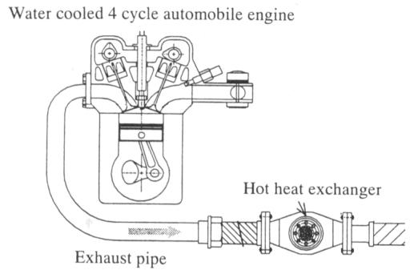  
Fig. 3 Exhaust-pipe-connected type of sound wave generator

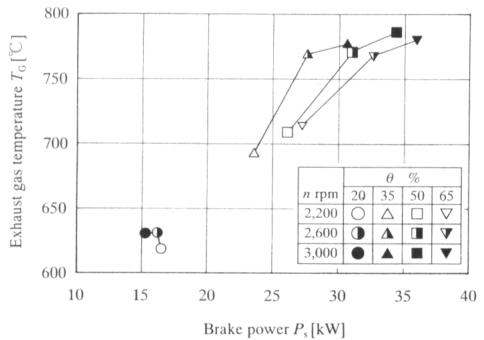  
Fig. 4 Change in exhaust gas temperature of automobile gasoline engine

第2案では第1案よりも多くの熱量が得られると期待できることから，その予備実験として，日産自動車製の自動車用1500cm³水冷四サイクルエンジンを運転させて排気管内の排気ガス温度をK形熱電対(助川電気工業)により直接測定した。なお，測定位置は工ンジン本体の排気口から1300mm離れた排気管内である。

図4にエンジン回転数 nを2 200,2 600, 3 000 rpm一定で,スロットル開度θを20%から65％までの範囲で15%％ごとに変えた場合の軸出力Psと排気ガス温

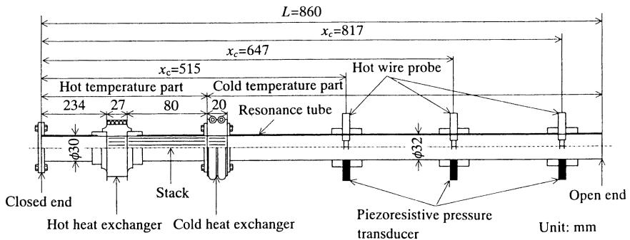  
Fig. 5 Thermoacoustic sound wave generator

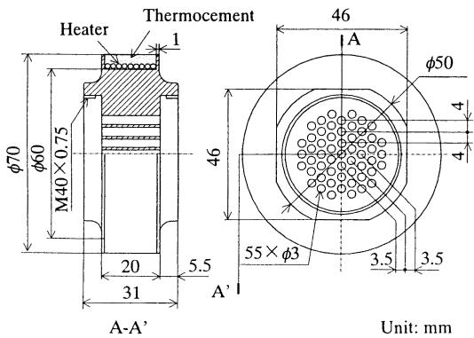  
Fig. 6 Conventional hot heat exchanger

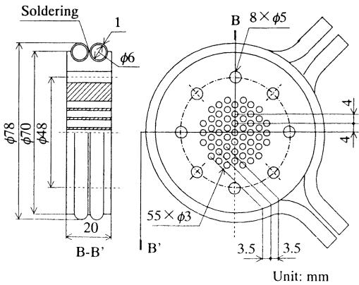  
Fig. 7 Cold heat exchanger

度 $T _ { G }$ の関係を示す.

軸出力の増加に伴って排気ガス温度が上昇しており，回転数n=3000rpmにおいて，スロットル開度θ=20%，軸出力Ps=15.3kWのとき630°Cであった排気ガス温度 TGが，θ=35%，Ps=30.6kWでTc=770°C,θ=50%,Ps=34.4kW で785°C,θ=65%，Ps=35.8kWでTc=780Cに及ぶ高温に達している.このことは，スロットル開度およびエンジン回転数の増加に伴って，軸出力が増加し，排気熱量が増えたことに起因する.

以上の実験結果から，自動車用ガソリンエンジンの排気ガスの温度および熱量が音波発生機高温熱交換器への熱の供給源として十分であることから，その排気熱を熱源として利用する熱音響音波発生機が安定して駆動することが大いに期待できる.

2・3 自動車用ガソリンエンジンの排気熱を利用して駆動する熱音響音波発生機以上の予備実験の結果をふまえて，排気熱利用形熱音響音波発生機を開発した(6).

音波発生機は排気管内に装着するために新たに製作したものであるが,排気熱を回収できるように工夫した高温熱交換器の外側形状を除き，その機構は著者らが従来採用している図5に示すシース形電気ヒータを熱源とする形式(2)(3)とほぼ同じ仕様である.

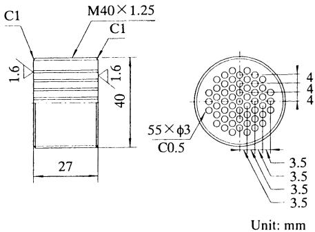  
Fig.8 Hot heat exchanger for waste heat of exhaust gas

図6に従来形の高温熱交換器を，図7に低温熱交換器および図8に排気熱を回収できるように新たに開発した高温熱交換器を示す。

一端を閉じ，もう一端が開放した共鳴管内に発生する音波の周波数は式(1)で表される.

$f = \frac { c } { 4 L }$ …(1)$= \pm \tau$ Cは作動流体中の音速，Lは共鳴管長さである.

本研究では気温20C，大気圧760mmHgの条件の下で発生音波の理論周波数がfrH=100Hzになるように共鳴管全長Lを860mmとした。また，共鳴管の高温部には内径30mmのSUS 304管を，低温部には内径32mmのアクリル管を使用している.

図8に示す排気熱回収用に新しく開発した高温熱交換器は700C以上に及ぶ高温の排気ガスにさらされるため，酸化を防ぐうえからニッケル製とした．また音波発生機内の作動流体と接触する部分は図6に示す従来形の高温熱交換器(2)\~(4)(8)と同じ形状をしており，径3mmの穴が55個あけてある.また，供試 $I : \mathcal { V } \mathcal { V }$ の排気熱で加熱できるように排気管内に設置した。さらに，装置組立を容易にするために，高温熱交換器の外周に全ねじが切ってあり，排気ガスとの接触面積を増大するフィンとしても機能する．なお，図7に示す径3mmの穴が55個あけてある銅製の低温熱交換器および外径2mm，内径1.6mm，長さ80mmのSUS304ステンレス管を180本束ねた形式のスタックは従来より著者らが用いているも $\mathcal { O } ) ^ { ( 2 ) \sim ( 4 ) ( 8 ) }$ と同じ仕様のものである.

さらに，低温熱交換器の外周にろう付けした銅製水路に供給する精製水の温度は15Cに調整してある.

図9に排気熱利用形熱音響音波発生機の実験装置概略を示す．熱源としての自動車用エンジン，エンジン性能を測定するための四サイクルガソリンエンジン渦電流電気動力計(天野工業技術研究所製ED-C1-SK)および熱音響音波発生機から構成される。本研究では，熱源として水冷四サイクル1487cm³ガソリンエ$\Rightarrow \dot { \boldsymbol { \mathscr { V } } } \boldsymbol { \underline { V } }$ (日産自動車製E15E)を使用した。また，音波発生機の高温熱交換器は，予備実験において，排気ガス温度を測定した位置(エンジン本体の排気口より1300mm)である排気管途中に設置した.

図10に排気管と共鳴管の交差する部分(高温熱交換器)の概略を示す. $I = 1 0 ^ { \circ } = 1 0 \cdot 5$ 排出される排気ガスは高温熱交換器の外周に沿って流れ，一方，共鳴管内の作動気体は熱交換器内でのみ往復運動をする。したがって排気ガスと作動気体が直接接触することがないように工夫されている．すなわち，高温熱交換器では排気ガスからの熱の授受のみが行われ，共鳴管内の作動流体が排気ガスに汚染されることがない。そのほか高温熱交換器および共鳴管内の作動気体の温度をK形熱電対(助川電気工業)で測定した。なお，実験は大気圧の下で，作動気体に空気を用いて行った。

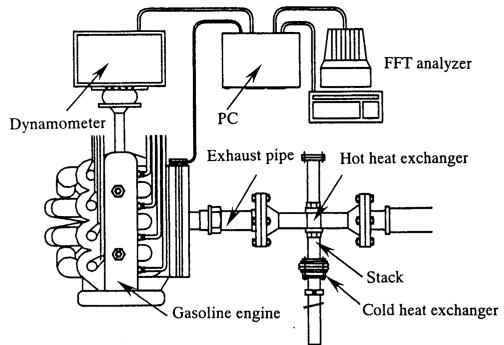

Fig. 9 Schematic diagram of the experimental apparatus  
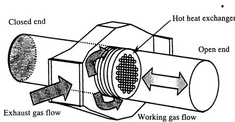  
Fig. 10 Conceptual diagram of a proposed hot heat exchanger

2·3·1 音波発生機の性能評価熱音響音波発生機において発生する仕事(音波)Wは，高温熱交換器温度 $T _ { H } ,$ 低温熱交換器温度 $T _ { c _ { : } }$ 熱損失 $Q _ { \mathrm { L O S S } } ,$ 冷却水の出入口温度差と流量から求められる低温熱交換器の廃熱量 $Q _ { M L }$ ，スタックおよび共鳴管を伝導する伝熱量$Q _ { C }$ (計算値)とすると,式(2)で求められる(4).

$$
\begin{array} { l } { { { \cal W } { = } \displaystyle \frac { T _ { H } - T _ { c } } { T _ { c } } ( Q _ { M L } { - } Q _ { c } { - } Q _ { \mathrm { L o s s } } ) } } \\ { { { } } } \\ { { { \displaystyle ~ = } \displaystyle \frac { T _ { H } - T _ { c } } { T _ { c } } ( Q _ { M A } { - } Q _ { \mathrm { L o s s } } ) } } \\ { { { } } } \\ { { { \displaystyle ~ = } \displaystyle \frac { T _ { H } - T _ { c } } { T _ { c } } ( 1 { - } a ) Q _ { M A } { ~ } ^ { \displaystyle { - } \sum - } { \cdots } { } { \cdots } { } { \cdots } { } { \cdots } { } { \cdots } { } { } ~ ( 2 ~ ) } } \end{array}
$$

$\sum \subset \mathsf { C }$ aは熱から音波への変換の結果として低温熱交換器に放出されたエネル $\nrightarrow - Q _ { M A } ( = Q _ { M L } - Q _ { C } )$ (以下，音波による熱輸送量という)に対するエネルギ一変換損失 $\mathrm {  { Q _ { \mathrm { L O S S } } } }$ の比である.

すなわち，発生する仕事Wは高温・低温熱交換器温度 $T _ { H }$ $T _ { c }$ および音波による熱輸送量 $Q _ { M A }$ に強く依存する．ただし，aは不明である．した $x ^ { 8 } > 4$ ，畠沢·瀬尾は音波発生機の性能を高温熱交換器温度 $T _ { H }$ および音波による熱輸送量 $Q _ { M A }$ で評価している(4).

2·3·2音波発生機のスタック位置の決定畠沢・瀬尾は別に高温部共鳴管内の閉口端側に挿入したインナスペーサの長さと低温部共鳴管長さを調整することで，理論発生周波数を固定し， $\phi \supset \neg$ 共鳴管長さに対するスタックの相対的位置を変えて，音波発生機内におけるスタックの最適位置を模索している(4)。以下におもな結果を示す。

Table 1 Experimental conditions
<table><tr><td rowspan=1 colspan=1>Number of enginerevolutions n [rpm]</td><td rowspan=1 colspan=1>Throttle opening $\theta [ \% ]$ </td><td rowspan=1 colspan=1>Throttle opening interval $\Delta \theta [ \% ]$ </td></tr><tr><td rowspan=1 colspan=1>2200,2600,3000</td><td rowspan=1 colspan=1> $\mathrm { F r o m } \ 2 0 \ \mathrm { t o } \ 6 5$ </td><td rowspan=1 colspan=1>15</td></tr></table>

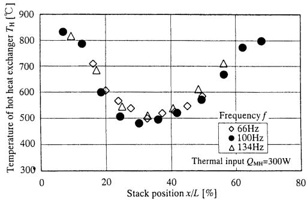  
Fig. 11 Change in temperature of hot heat exchanger with stack position

図11に熱入力 $Q _ { M H } = 3 0 0 \mathrm { \ W } ,$ 理論発生周波数 $f _ { T H } =$ 66，100，134Hzにおける共鳴管閉口端部 $\phi ^ { \Sigma }$ らス $\boldsymbol { \mathcal { I } } _ { \mathrm { ~ \scriptsize ~ \cdot ~ } } ^ { \mathrm { ~ \scriptsize ~ \cdot ~ } }$ ク中央部までの距離xを共鳴管全長L(おのおのの$f _ { T H } \downarrow = \Bumpeq \downarrow 3 \downarrow ) < \textit { L }$ は1300，860，640mmである)で割 $\supset$ た値で定義したス $y _ { \ \cdot } y _ { \ \mathcal { I } } \oslash$ 相対的位置 $x / L \ z$ 高温熱交換器温度 $T _ { H }$ の関係を示す．いずれの周波数においても，スタックの相対的位置x/Lが35%のときに，高温熱交換器溫度 $T _ { H }$ が最低にな $> ( ) ( ) > 3 8$

また，図12に図11と同条件におけるスタ $\boldsymbol { \nu } \gg \mathcal { O }$ 相対的位置 $x / L$ と音波による熱輸送量 $Q _ { M A }$ の関係を示す．いずれの周波数においても，スタックの相対的位置x/Lが35%のときに，音波による熱輸送量 $Q _ { M A }$ が最大にな $0 \subset V _ { 2 }$ る(4).した $\phi ^ { \mathrm { s } }  \tau$ ，x/Lに対する $T _ { H }$ および $Q _ { M A }$ の結果より最適なス $y _ { \ \cdot } y _ { \ \mathcal { O } }$ 相対的位置$x / L$ が35％と考えられるため，本研究では閉口端よりスタック中心までの距離を301mm(スタックの相対的位置x/Lが35%)に固定 $L \tau \cup 3 3$

表1に実験条件を示す．供試エンジンは回転数nを2200,2600,3000rpmの3段階に，スロットル開度θを20％から65％までの範囲において15％間隔で4段階に変えて，計12とおりの条件で運転した.

2·3·3 発生音波の評価法図13に畠沢·野中が別に行ったシース形電気ヒータを熱源とする従来形音波発生機の共鳴管内における圧力・速度振幅の分布を示 $\scriptstyle \pm ( 2 )$ なお，理論発生周波数 $f _ { T H }$ は100Hz，熱入力$Q _ { M H }$ は400Wであり，図13中の実線は圧力振幅，破線は速度振幅の理論値を示す．圧力振幅 $P _ { \mathrm { ~ a ~ } }$ と速度振幅 $V _ { \mathfrak { a } }$ の測定値が式(3),(4)に示す理論値とよく一致している(2)。また，同形式の音波発生機内 $\mathbb { C } \mathbb { k }$ ，他$\mathcal { O }$ 理論発生周波数においても同様に理論値と実験値が一致するのが確認されている.

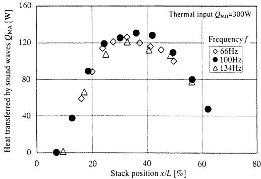  
Fig. 12 Change in heat transferred by sound waves with stack position

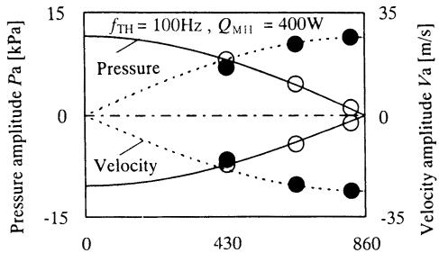  
Distance from the closed end xc [mm]  
Fig. 13 Pressure and velocity amplitude distribution in the resonance tube

$$
P _ { \mathrm { a } } = P _ { \mathrm { a } \operatorname* { m a x } } \cos \left( \begin{array} { c } { 2 \pi x _ { c } } \\ { 4 L } \end{array} \right) = \rho c V _ { \mathrm { a } \operatorname* { m a x } } \cos \left( \frac { 2 \pi x _ { c } } { 4 L } \right)\tag{3}
$$

$$
V _ { \mathrm { a } } = V _ { \mathrm { a } \ m a x } \ \mathrm { s i n } { \left( \frac { 2 \pi x _ { c } } { 4 L } \right) } { = } \frac { P _ { \mathrm { a } \ m a x } } { \rho c } { \cdot } \mathrm { s i n } { \left( \frac { 2 \pi x _ { c } } { 4 L } \right) }\tag{4}
$$

$z \subset \overline { { C } }$ $P _ { \textrm { a m a x } }$ は最大压力振幅， $V _ { \textrm { a m a x } }$ は最大速度振幅， $x _ { c }$ は共鳴管閉端部からの距離， $\rho$ は作動気体の密度である.

よって，共鳴管閉端部からの距離 $x _ { c }$ とその位置における圧力振幅 Paもしくは速度振幅Va のいずれかが明らかになれば，もう一方の残りの振幅が容易に推定できることから，ここでは音波発生機の性能を評価す $3  \supset \mathcal { O } ) .$ 手段として，圧力振幅のみに着目して音波発生機の閉[1端からxc=515mmの位置における圧カを半導体圧力センサ(エンデブコ8507C-15)により測定した．あわせて，FFTアナライザ(小野測器CF-5210)によって圧力波形の周波数解析を行った.

## 3. 実験結果と考察

## 3·1 排気熱利用形熱音響音波発生機の動作確認

エンジンがアイドリング状態で運転されており，排気ガスの温度がそれほど高くないにもかかわらず，その排気管内に高温熱交換器を実装した排気熱利用形熱音響音波発生機から音波が容易に発生しており，十分安定して動作していることが確認できた。

図14は供試 $I \cup { \big / } { \big \circ } $ 回転数 n=3 000 rpm，ス口ットル開度θが35%のとき，かつ音波発生時の共鳴管閉口端からの距離xcが515mmにおける圧力波形を示す。発生する音響流れの圧力波形がほぼ正弦波状を呈していることがわかる.

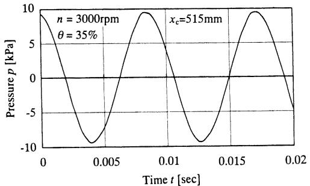  
Fig. 14 Pressure signal of generated sound wave

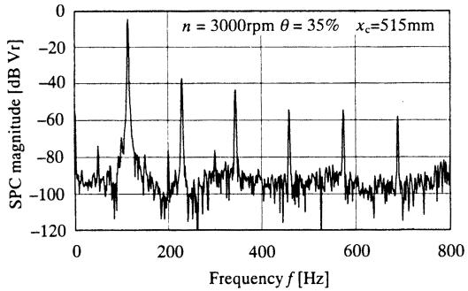  
Fig. 15 Frequency analysis result of generated sound wave

さらに図15 $\sqrt { 4 } \sum \zeta \mathcal { O }$ 圧力波形をFFTアナライザで周波数分析した結果を示す。設定周波数は100Hzであるが，共鳴管内の気体温度の上昇に伴って音速が増加するため実際に発生する音波の周波数はそれより15％ほど高い約115Hzである．さらに，図15中には基本周波数の成分が際だって卓越しており，その高次の成分のみが見られる. $x ^ { 2 } > I > 3 p > I >$ 伝わる振動や外部からの雑音の周波数成分がほとんど見られないことから，自動車用 $x ^ { * } y ^ { * } y ^ { * } \ y \ y ^ { * } \ y \ y \ y$ 排気熱を利用して駆動する音波発生機が十分に安定して稼動していることが確認できる.

3·2 排気熱利用形熱音響音波発生機の性能図16にエンジンを各回転数に設定のうえで，スロットル開度を変えて運転した際の，排気ガス温度 $T _ { G }$ に対する音波発生機の高温熱交換器温度 $T _ { H }$ の関係を示す。測定した範囲内では，スロットル開度およびエンジン回転数の増加に伴って，軸出力が増している，自動車用ガソリンエンジンでは軸出カと排気熱量が同等といわれている(5)ことから，軸出力の増加とともに排気ガス温度が上昇し，かつ高温熱交換器の温度が直線的に増加している，さらに，熱から音波生成への変換工ネルギーが増えた分， $T _ { H }$ は $T _ { G }$ よりも約180°℃低くなり，両者の関係は $x = \Rightarrow \Rightarrow \textcircled { 1 }$ 運転条件の相違によらず式(5)でよく近似できる.

## T= Tc-180 …………………(5)

また，別に軸出力と高温熱交換器温度の関係を確認した結果，軸出力の増加とともに高温熱交換器温度が直線的に増加することがわかっている.

さらに，高温熱交換器への熱の供給をシース形電気$\boldsymbol { \mathrm { \varepsilon } } - \boldsymbol { \mathrm { \varepsilon } } \boldsymbol { \mathrm { \varepsilon } }$ で行っている違いはあるものの，全体の構造がほぼ同じである従来形の音波発生機(2)\~(4)(8)と性能を比較・検討する指標として最大圧力振幅 $\ P _ { \mathrm { a } \ m a x }$ (压力振幅 $P _ { \mathrm { ~ a ~ } }$ は共鳴管閉端部で最も高くなる）を採用した.

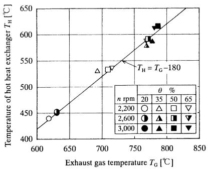  
Fig. 16 Change in temperature of hot heat exchanger with exhaust gas temperature

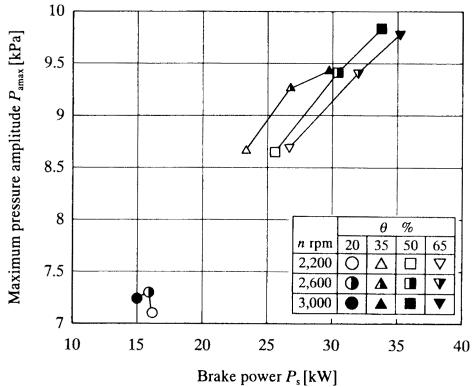  
Fig. 17 Change in maximum pressure amplitude with brake power

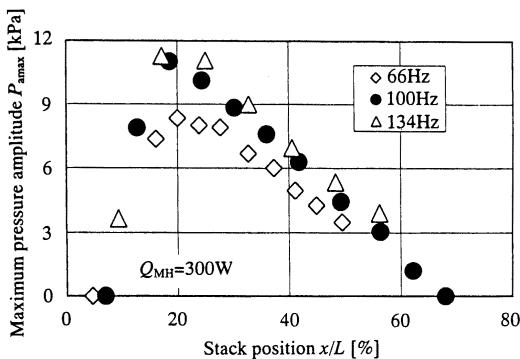  
Fig. 18 Change in maximum pressure amplitude with stack position for electric-heater-driven sound wave generator

なお， $P _ { \textrm { a m a x } }$ は共鳴管閉口端からの距離 $x _ { c }$ が515 mmの位置における圧力振幅 $P _ { \mathrm { { a } } }$ を式(6)に代入して算出した.

$$
\ P _ { \mathrm { a \ m a x } } = { \frac { P _ { \mathrm { a } } } { \cos \left( { \frac { 2 \pi x _ { c } } { 4 L } } \right) } }\tag{6}
$$

図17 $V = I = 1 3 V$ を各回転数に設定し，かつスロットル開度を変えて運転した際の，軸出力 $P _ { s }$ と音波発生機の最大圧力振幅 $P _ { \mathrm { a ~ m a x } } \ O )$ 関係を示す.

本研究に採用した音波発生機では，共鳴管長さに対するス $y _ { \ \cdot } y _ { \ \mathcal { O } }$ 相対的位置が $x / L { = } 3 5 \%$ に固定されているため，最大圧力振幅は高温熱交換器への熱入力のみに依存する．自動車用力 $( y 1 ) - x > 3 y > 7$ は排気熱量が軸出力に相当する(5)ことから，軸出力の増加とともに最大圧力振幅が直線的に増加している。最大圧力振幅 $P _ { \textrm { a m a x } } \mathcal { V } \mathcal { \pm }$ ，スロットル開度 $\theta = 5 0 \%$ 回転数 n=3 000 rpm, $P _ { s } = 3 4 ~ \mathrm { k W } ~ \mathcal { O } ) ~ \xi ~ \stackrel { \ast } { \leq }$ に最も高い9.8kPaであり，θ=35%，n=2 600 rpm,Ps=27 kW のときに

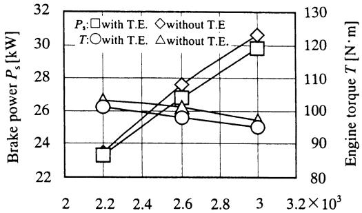  
Number of revolutions n [rpm]  
Fig. 19 Change in brake power and torque with number of engine revolutions

## 9.3kPaであった.

図18は先に行ったシース形ヒータを熱源とする従来形の音波発生機に300Wの熱入力を行った際に得られる各設定音波周波数におけ $3 \times 5 \cdot y \geq 0 )$ 相対位置に対する最大圧力振幅 $P _ { \mathrm { ~ u ~ m u x } } { } ^ { ( 4 ) }$ の関係を示す。

最大圧力振幅は各設定周波数ともに，スタックの相対位置が20％付近で最大となっている．さらに，f=$1 0 0 \ \mathrm { H z } \ O )$ 場合，スタック相対位置 $x / L = 3 5 \% \nwarrow$ おい$\textsf { Z } P _ { \mathtt { a } \operatorname* { m a x } }$ は約8.5kPaが得 $5 \times 2 = 6 2 3$

廃熱利用形あるいは電気ヒータ加熱形による高温熱交換器への加熱方法の違いはあるものの，双方の音波発生機の構造がほとんど同じ仕様であることから，排気熱利用形熱音響音波発生機においてもエンジン回転数 $n { = } 2 \ 6 0 0 \ \mathrm { r p m }$ スロットル開度 $\theta = 3 5 \% O )$ 場合に，高温熱交換器に $Q _ { M H } = 3 0 0 ~ \mathrm { W }$ あるいはそれ以上の熱入力があるものと推測できる．また，同条件において音波発生機の圧力測定時にエンジン性能を動力計で同時に計測した結果によれば， $I \cup \mathcal { \ Y } \cup \mathcal { O }$ 軸出力が26.8kWであった.一般的に，ガソリンエンジンでは軸出力と排気熱量がほぼ同量の熱量といわれていることから(5),26.8kW程度の熱が排気熱として捨てられていると推察できる。すなわち，音波発生機の高温熱交換器への熱入力は排気熱量の1％程度であると思われる.

3·3 排気熱利用形熱音響音波発生機の装着によつて生じるエンジン性能の変化図19にスロットル開度θ=35％において供試エンジンを単独で運転した場合と音波発生機を装着して運転した場合の性能曲線を示す.なお，図19中の)T.Eは熱音響機器(Ther-moacoustic Equipment)の略号であり，ここでは熱音響音波発生機を意味する。音波発生機を装着している場合は単独動作に比べて $x \ y = 0$ トルクTが約2〜3％低下している。これは音波発生機の装着により，排気系の流動抵抗が増したことに起因しているものと考えられる，さらに、この影響は軸出力にも現れており，エンジン回転数の増加に伴って軸出力もわずかに減少しており，エンジン回転数が等しいとき単独運転時に比べて軸出力が約2％減少した.

よって，今後排気ガスに直接さらされる音波発生機の高温熱交換器の外側形状をより流動抵抗が少なく，さらにより多くの熱を回収できる構造にすることで，エンジンの性能低下を軽減し，かつ音波発生機性能のさらなる向上が期待できる.

## 4. 発生する音響流れの利用法

自動車用ガソリンエンジンの廃熱を利用して駆動する熱音響音波発生機が十分安定して動作することが確認できたことから，今後，それより発生する音響流れ(振動流)の熱音響冷凍機(7)，熱音響発電(8)，燃料と空気の予混合，伝熱促進(9)等の広範な方面への利用が期待できる.

## 5. 結 言

自動車用ガソリンエンジンの廃熱を利用して駆動する熱音響音波発生機を開発し動作を確認した結果，明らかになったことは以下のとおりである.

(1）自動車用エンジンの排気熱を熱源とする熱音響音波発生機が十分に安定して駆動する.

(2)音波発生機の高温熱交換器において，エンジン回転数 n=2600rpm，スロットル開度 θ=35%において300 Wあるいはそれ以上の熱が得られたものと推定できる.

(3)エンジン回転数 n=2 600 rpm,スロットル開度θ=35%において排気熱のわずか1%程度の熱を回収するだけで最大圧力振幅 $P _ { a \ m a x } { = } 9 . 3$ kPaの音波が発生した。今後，廃熱の回収率を向上させることで大幅な出力の増大が期待できる.

(4） 音波発生機の装着により排気管内の流動抵抗がわずかに増加することから，エンジンの軸出力およびトルクに約2％の低下が見られる.

(5）エンジンのアイドリング状態でも，音波発生機が十分に安定して駆動することから，発生する音響流れ(振動流)を熱音響冷凍機や燃焼促進のための混合気かくはん等広範な方面へ利用することが期待できる.

## 文 献

(1) Swift. G. W., Thermoacoustic Engines, J. Acoust. Soc. Am., 84-4 (1988), 1145-1180.

(2) 畠沢政保·野中健太郎，突合せ形熱音響音波発生機の特性，機論，67-655,B(2001)，623-630.

(3)畠沢政保·野中健太郎，ル一プ形熱音響音波発生機の特性，低温工学，36-4(2001)，204-211.

(4) 畠沢政保·瀬尾宜時，熱音響音波発生機の性能に及ぼすスタック位置の影響，機論，68-675,B(2002)，3161-3169.

(5)自動車技術ハンドプック基礎·理論編，自動車技術会，(1990), 46.

(6)畠沢政保·杉田洋·小川孝廣·瀬尾宜時，自動車用工ンジンの廃熱を利用する熱音響音波発生機の性能，日本機械学会第5回スターリングサイクルシンポジウム講演論文集,01-30(2001-10),147-150.

(7) Swift. G. W., Thermoacoustic Engines and Refrigerators, Phys. Today, (1995), 22-28.

(8)是永定美·畠沢政保·畑中大·中川麻希子，熱音響音波発生機の流れとその応用(熱音響発電)，機論，66-646，B(2000), 1364-1371.

(9)森田光宣·安沢典男，音響流による冷却伝熱促進，Ther-mal Sci. Technol., 9-2 (2001), 31-43.