# Dynamic Power Convertor Development for Radioisotope Power Systems at NASA Glenn Research Center

Salvatore M. Oriti, Scott Wilson

NASA Glenn Research Center, Cleveland, OH, 44135

The Thermal Energy Conversion Branch at NASA Glenn Research Center (GRC) is supporting the development of high-efficiency power convertors for use in Radioisotope Power Systems (RPS). Significant progress was made towards such a system that utilized Stirling conversion during the 2001 to 2015 timeframe. Flight development of the Advanced Stirling Radioisotope Generator (ASRG) was cancelled in 2013 by the Department of Energy (DOE) and NASA Headquarters primarily due to budget constraints, and the Advanced Stirling Convertor (ASC) technology contract was subsequently concluded in 2015. A new chapter of technology development has recently been initiated by the NASA RPS Program. This effort is considering all dynamic power convertor options, such as Stirling and Brayton cycles. Four convertor development contracts supporting this effort were awarded in 2017. The awarded contracts include two free-piston Stirling, one thermoacoustic Stirling, and one turbo-Brayton designs. The technology development contracts each consist of up to three phases: Design, Fabricate, and Test. As of May 2018, all contracts have completed the Design Phase, and each underwent a design review with an independent review board. Three of the contracts are planned to execute the Phase 2 option for fabrication. Convertors manifesting from these development efforts will then undergo independent validation and verification at NASA facilities, which will consist of convertor performance and RPS viability demonstrations. Example tests include launch vibration simulation, performance mapping over the environmental temperature range, and static acceleration exposure. In parallel with this renewed development effort, NASA GRC is still demonstrating free-piston Stirling convertor technology using assets from previous projects. The Stirling Research Laboratory (SRL) is still operating several convertors from previous development projects which have similarities and relevance to current contract designs. Four of which are flexure-bearing based, and another six are gas-bearing based. One of the flexure-bearing convertors has accumulated over 110,000 hours of operation, and holds the current record for maintenance-free heat-engine run-time. Another flexure-bearing convertor was recently manually shutdown after 105,620 hours of operation, then disassembled and inspected. This inspection produced a wealth of information about the effects of this amount of runtime on the technology’s components. One of the engineering unit flexure-bearing convertors recently underwent launch simulation vibration test, a static acceleration exposure up to 20 g, and was then placed on extended operation. Amongst the gas-bearing convertors, the longest running unit has accumulated over 70,000 hours of operation. Four high-fidelity gas-bearing convertors from the ASRG project are still operating continuously, for which the longest runtime has reached 28,000 hours.

## Nomenclature

AMSC American SuperConductor   
APL Applied Physics Laboratory   
ASC = Advanced Stirling Convertor   
ASRG = Advanced Stirling Radioisotope Generator   
DIPS = Dynamic Isotope Power System   
DOE = Department of Energy   
FISC = Flexure Isotope Stirling Convertor   
GPHS General Purpose Heat Source   
GRC = Glenn Research Center   
GSFC Goddard Space Flight Center   
IPT Integrated Product Team   
JPL = Jet Propulsion Laboratory   
MMRTG = Multi-Mission Radioisotope Thermoelectric Generator   
NASA = National Aeronautics and Space Administration   
NGAS = Northrop Grumman Aerospace Systems   
RFP = Request for Proposal   
RPS Radioisotope Power System   
SMT Surrogate Mission Team   
SRG = Stirling Radioisotope Generator   
SRL Stirling Research Laboratory   
SRSC = Sunpower Robust Stirling Convertor   
TAPC = Thermo-Acoustic Power Convertor   
TBC = Turbo-Brayton Convertor   
TRL = Technology Readiness Level

## I. Introduction

adioisotope power systems (RPS) are an enabling technology for unique missions orchestrated by the Science

40 MW-hrs of thermal energy over a 20 year mission, in a launch-capable package with a mass of just 1.5 kg1. Heat is generated from the radioactive decay of the Pu-238, and requires no control system to modulate. RPS eliminates the dependence of spacecraft power on sunlight, and thus enable missions where solar energy is not available, such as deep space or a shadowed planetary surface. Pu-238 is not naturally occurring, and requires sophisticated nuclear engineering infrastructure to produce (via irradiation) from raw materials mined from the crust of the Earth2. The currently available RPS, the Multi-Mission Radioisotope Thermoelectric Generator (MMRTG), operates with a beginning-of-life conversion efficiency of 6.3%3. To best utilize the expensive and limited Pu-238 resource, higher conversion efficiency is desired. Dynamic power conversion technologies offer a significant increase in efficiency, while maintaining capability for long-life continuous operation. The Thermal Energy Conversion Branch at NASA Glenn Research Center (GRC) has been supporting the development of highefficiency, long-life, reliable energy conversion based on heat-engines. Heat engine thermodynamic cycles useful for space application include Stirling, Brayton, Rankine, and Ericsson. Heat engines based on these cycles can be coupled to alternators to provide a ‘convertor’ that converts radioisotope heat source energy to electricity for spacecraft. The perceived disadvantage of dynamic power conversion is the presence of moving parts, which (in typical terrestrial applications) do not have long maintenance-free operating lives. However, analytical and experimental evidence suggests the presence of moving parts does not preclude long design life. These types of gas cycles can be implemented in machines without any wear mechanisms, via design on non-contacting bearings and seals. The elimination of wear mechanisms is a prerequisite for long-life continuous operation necessary for NASA missions. With this, the design of components fall under the umbrella of standard engineering challenges for which methods exist to achieve the required life4.

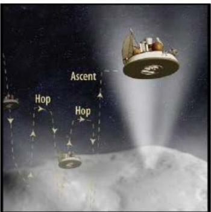

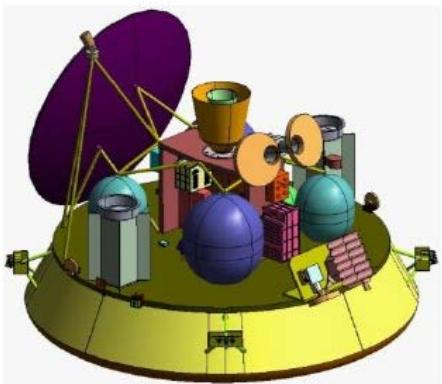

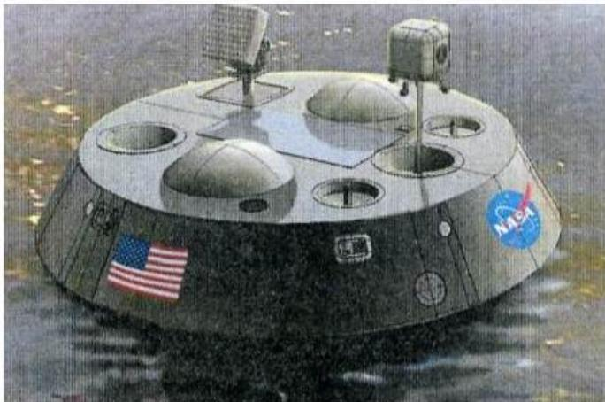  
Figure 1. Example mission proposals that incorporated dynamic RPS. (Top - CHopper, Image Credit Jessica Sunshine, UMD. Bottom - Titan Mare Explorer, Image Credit : Ellen Stofan, Proxemy)

## II. Dynamic Power Convertors

Dynamic energy conversion has been studied for space power systems for many decades, but has never been used in space. Two recent projects focused on developing free-piston Stirling convertors for space flight. The 110- We Stirling Radioisotope Generator (SRG-110) used a flexure-bearing convertor. The project was approaching the engineering unit generator build when it was redirected to change to a gas-bearing convertor to improve overall performance (in terms of efficiency and specific power). This redirection resulted in a name change to the Advanced Stirling Radioisotope Generator (ASRG). Images of the convertors are shown in Fig 2. The distinction between convertor and generator is that a convertor is a subset of the generator. An RPS generator must integrate a conversion device with heat input and heat rejection systems, in addition to any necessary power conditioning electronics. The SRG-110 was under development between 2001 to 2006, and the ASRG was developed between 2006 and 2013. The ASRG project was cancelled in 2013 due to budget constraints, but smaller follow-on efforts focused on convertor and controller advancements followed for a few years after the 2013 flight project cancellation.

Similar thermodynamic devices, cryocoolers based on the same operating principles and mechanical components, have been widely adopted for various space missions. Long-life via elimination of wear mechanisms relies on non-contacting bearings, such as flexures or gas-bearings. The longest-running space cryocooler has surpassed 178,000 hours of operation, and utilizes flexure-bearings in its compressor. A gas-bearing cryocooler ha operated in a space application for over 142,000 hours5.

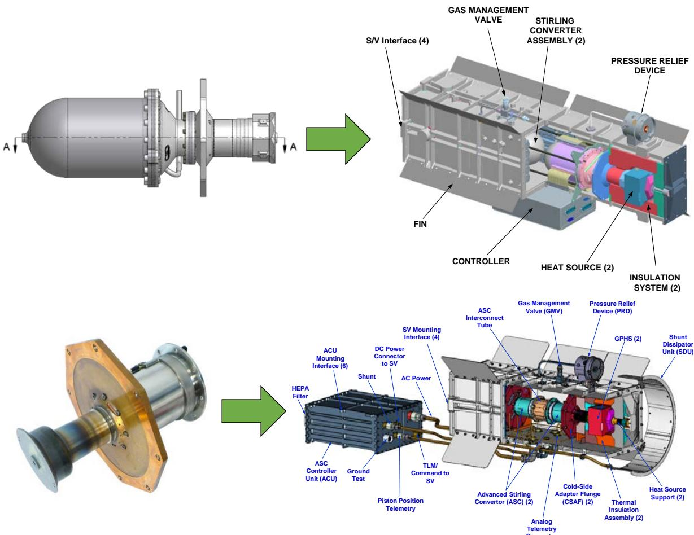  
Figure 2. Recent examples of Stirling convertor development for RPS. (Top – SRG-110, utilizing a flexurebearing convertor from Stirling Technology Company. Bottom – ASRG, utilizing a gas-bearing convertor from Sunpower, Inc.)

There are several advantages that dynamic power conversion offers over existing solid-state thermoelectric technology. First, higher efficiency can be achieved. NASA Glenn researchers have demonstrated 25 to 38% conversion efficiency in flight-like free-piston Stirling convertors based on both flexures and gas-bearings6. The higher conversion efficiency allows RPS to be designed that either produce more power for a given amount of Pu-238 fuel, or require less fuel to produce a desired amount of power. Higher conversion efficiency also reduces the amount of waste heat that must be dissipated from the RPS. In cases where the RPS is in close proximity to the spacecraft, the lesser waste heat permits more spacecraft design options, as there is less waste heat to interfere with spacecraft science functions. Another advantage is the ability for no degradation (other than fuel decay) in a multitude of operating environments. Convertor designs with no wear mechanisms do not degrade, and are compatible with both deep space vacuum and planetary atmospheres. With this, the mission would not have to design for any degradation of power system output beyond the Pu-238 fuel decay. At a fuel decay rate of 0.8% per year, and after a 20 year cruise, the heat source would provide approximately 85% of its original thermal power. Dynamic convertors can be designed to maintain almost the same efficiency as thermal input declines by 15%7. The ability to implement convertor-level redundancy is still available with dynamic power convertors. Convertors can be built to a size suitable for including spare units in the system design. Studies have shown 100% redundancy plausible, which has a significant effect on increasing overall RPS reliability8,9. Another option that has been considered by mission designers is to include a redundant RPS on the spacecraft. However, this method is effectively implementing redundancy at the convertor level and at the fuel level. The Pu-238 module reliability is not of concern, and is expensive to a mission, so it makes sense to implement redundant convertors in the generator if reliability of dynamic conversion is of concern.

Following the cancellation of the ASRG flight development project in 2013, the RPS program office initiated a revised approach to dynamic power convertor technology development, one that mirrored that formulated for their parallel thermoelectric development10. This process consists of two important decision gates. Decision gate 1 evaluates candidate dynamic convertor designs, and identifies those suitable for hardware builds. The second decision gate further examines the technology options after prototype convertor fabrication and relevant environmental testing. The second decision gate will identify convertor options that are suitable for flight development, and ultimate use in an RPS.

After an examination of the technology landscape, a contract framework for dynamic power convertor development was formulated. The contracts consist of up to three phases consisting of design, fabrication, and test activities. RPS decision gate 1 follows Phase 1 (Design), and identifies options that can continue on to Phase 2 (Fabrication), then Phase 3 (Test). RPS decision gate 2 follows Phase 3. A request for proposal (RFP) was released in October $2 0 1 6 ^ { 1 1 }$ . The convertor performance goals put forth in the request for proposal are summarized in the following table:

Table 1. Dynamic Power Convertor Performance Goals for RPS and Planetary Science
<table><tr><td rowspan=1 colspan=1>Item</td><td rowspan=1 colspan=1>Description</td></tr><tr><td rowspan=1 colspan=1>Life</td><td rowspan=1 colspan=1>20 years</td></tr><tr><td rowspan=1 colspan=1>Power</td><td rowspan=1 colspan=1>Suitable for a generator in the range of 200 to 500 We output</td></tr><tr><td rowspan=1 colspan=1>Efficiency</td><td rowspan=1 colspan=1>≥ 24% at $\overline { { \mathrm { T } _ { \mathrm { c o l d } } > 1 0 0 ^ { \circ } \mathrm { C } } }$ </td></tr><tr><td rowspan=1 colspan=1>Specific Power</td><td rowspan=1 colspan=1>20 We/kg (convertor only)</td></tr><tr><td rowspan=1 colspan=1>Partial power</td><td rowspan=1 colspan=1>Maintains 20% conversion efficiency at 50% throttle</td></tr><tr><td rowspan=1 colspan=1>Atmospherecompatibility</td><td rowspan=1 colspan=1>Earth, vacuum, Mars, Titan, Triton</td></tr><tr><td rowspan=1 colspan=1>Hot-End Temp</td><td rowspan=1 colspan=1>&lt; 1000 ℃</td></tr><tr><td rowspan=1 colspan=1>Cold-End Temp</td><td rowspan=1 colspan=1>20 to $1 7 5 ~ ^ { \circ } \mathrm { C }$ </td></tr><tr><td rowspan=1 colspan=1>Random Vibe</td><td rowspan=1 colspan=1>Launch qualification</td></tr><tr><td rowspan=1 colspan=1>Static Accel</td><td rowspan=1 colspan=1>20 g for 1 minute, 5 g for 5 days</td></tr></table>

These goals were formulated via examination of anticipated RPS missions and generator environments. The longest foreseeable mission being considered requires a 20 year life. Based on various mission studies, the majority of science missions require between 200 and 500 ${ \bf W } _ { \mathrm { e } } ^ { 1 2 } .$ The power level of the convertor was not specified in the RFP. Instead the goal is to demonstrate that the chosen convertor power level can be integrated into a generator with the desired total power output. This leaves the design space unconstrained so that system integration concepts can consider a wide array of options, notably redundant arrangements of convertors. A conversion efficiency of 24%, with 90% efficient AC-to-DC electrical power conditioning, would offer a generator with at least a 3-fold improvement over existing RPS that use thermoelectric conversion. Since all thermodynamic cycle efficiencies are dependent on cold-side temperature, the efficiency goal had to be specified along-side a cold-side temperature. Without this, the desired conversion efficiency could be achieved at an unrealistically low cold-side temperature. This would impose an unreasonable burden on a system integrator to implement a large massive radiator to achieve this cold-side temperature. System engineering studies have shown that operating above $1 0 0 ^ { \circ } \mathrm { C }$ results in an optimal system radiator13, so the cold-side minimum for the efficiency metric was set there. Examination of mission thermal environments also suggested a nominal cold-side operating temperature greater than $1 0 0 ^ { \circ } \mathrm { C }$ would be necessary. System engineering studies were also used to set the bar for specific power of the convertor. At a convertor specific power of 20 $\mathrm { W _ { e } / k g , }$ a reasonable generator specific power can be achieved. The RPS program does not have a minimum bar for generator specific power, but the existing technology (MMRTG) achieves 2.4 We/kg. A goal for conversion efficiency at lower thermal input was set to enable redundant convertor arrangements. In the case of a generator design with 100% convertor redundancy, each convertor would be receiving half its designed thermal input. This is referred to as operation at 50% throttle. Since this could be the operating mode for the entirety of a mission, it was important to set a goal here so that overall system efficiency would still be satisfactory. This goal also encompasses throttling that will occur due to fuel decay, which would be only 15% at the end of a 20 year mission, when the convertor would be operating at 85% throttle. In order to maintain capability for a wide array of missions, a goal for compatibility with important destination atmospheric compositions was set. The option for isolating the convertor from the atmosphere still exists, and depends on the generator design. However, designing the convertor to be compatible with these gases is plausible, and offers the widest design space for system integrators. A hot-side temperature limit was imposed by examining the upper temperature limit of the Pu-238 heat source module, and with a realistic estimate of the temperature from the module to the convertor across the thermal input interface. The goal for cold-side temperature operating range was derived from the range of thermal environments. Operation on Titan, with its thick cryogenic atmosphere would result in a cold-end temperature near $2 0 \mathrm { { } ^ { \circ } C }$ (depending on spacecraft design). Certain planetary protection treatments of the spacecraft could drive the cold-side temperature up to $1 7 5 \mathrm { { } ^ { \circ } C }$ Operation on the Moon and in proximity of Venus also result in temperatures near this upper bound. It is important that the convertor technology be capable of this range of temperatures without any permanent effect on performance. The convertor must be capable of withstanding random vibration during launch vehicle ascent. The various launch vehicles were examined and a random vibration profile was formulated. This profile encompasses frequencies between 20 and $2 0 0 0 \mathrm { H z } ,$ and has a maximum value of $0 . 1 \ \mathrm { \textrm { g } } ^ { 2 } / \mathrm { H z } .$ Qualification-level random vibration testing would impose up to $0 . 2 \ { \mathrm { g } } ^ { 2 } / { \mathrm { H z } } .$ Certain methods for launch could impose static acceleration on the RPS. Entry, descent, and landing loads typically have included phases where the deceleration was on the order of 20g for 1 minute. Certain spin stabilization methods may be used on RPS missions during launch or cruise. With the RPS mounted out on a boom away from the center of rotation, the generator would experience centrifugal acceleration. Dynamic convertors, with their moving pistons or rotating turbomachinery, would have to tolerate this with no detriment. In the case of launch-level random vibration or 20g static acceleration, temporary losses of output power could occur, and may be tolerated by the spacecraft electrical bus design. However, it is necessary that the convertor experience no permanent degradation nor loss of reliability. Similar to the convertor power level, the overall convertor size goal was not specified. It is however important that the generator which makes use of this convertor fit within the approved DOE RPS shipping container, which is the mode of transportation to the launch site after fueling.

Robustness was also included in the convertor goals, but resides in a category difficult to express numerically in table form. In the engineering context robustness metrics are usually subjective, and do not lend themselves to quantifiable requirements. The project has adopted a definition of robustness as, “The ability of the device to tolerate events outside expected conditions.” With this, several robustness goals were defined. A design that has more margin is considered more robust. For example, if the designed hot-end temperature is $6 5 0 ~ ^ { \circ } \mathrm { C } ,$ but the convertor could operate at $7 5 0 ~ ^ { \circ } \mathrm { C }$ without any detriment, this is an element of robustness. Designs with few single point failure modes are also considered more robust. Tolerance of some events specific to dynamic power convertors were also defined. Tolerance to loss of electrical load would be a significant element of robustness. In the case of a linear motion machine, losing the electrical load across the alternator would result in a rapidly increasing piston amplitude to the point of contact. User operational error is also a possibility during convertor testing and integration. If the design has mechanisms to prevent damage, or can tolerate these errors, that would also be a significant element of robustness.

This set of goals provided a context for convertor development different from those of past efforts. Previous efforts focused solely on convertor technology and little attention was paid to tailoring interfaces for use in a generator with Pu-238 heat source and radiative heat rejection. For example, the convertor from the SRG-110 project originated in an SBIR, for which the design was frozen and only its external interfaces tailored for integration into a generator. The ASC resulted from an NRA that was intended to push the performance limits of advanced conversion technologies. This convertor design was used as-is (with minimal external interface adjustments) and then instructed for use in the ASRG. These previous convertor designs also didn’t have a comprehensive set of requirements imposed on them that considered all mission environments. The 2016 RFP instead demoted the focus on performance, and emphasized robustness and usefulness in a system. Also, the goals were formulated by amalgamating a wide range of input from all RPS entities, including mission designers, spacecraft designers, Pu-238 fuel producers, and convertor technologists. The intent is to drive technology development with a perspective better than previous efforts, to increase probability of success for dynamic powe conversion.

As a result of the 2016 RFP, four dynamic power convertor contracts were awarded. As of May 2018, all four have completed the Phase 1 6-month design stage. Three of the contracts are executing, or will be awarded, the Phase 2 fabrication portion of effort. A summary of the four convertor design is shown in Table 2, and each is discussed in further detail in the following sections.

Table 2. Dynamic Power Convertor Design Summary
<table><tr><td rowspan=1 colspan=1>Item</td><td rowspan=1 colspan=1>Units</td><td rowspan=1 colspan=1>Flexure IsotopeStirling Convertor(FISC)AmericanSuperconductor, Inc.</td><td rowspan=1 colspan=1>Turbo-BraytonConvertor(TBC)Creare, LLC</td><td rowspan=1 colspan=1>Thermo-AcousticPower Convertor(TAPC)Northrop Grumman</td><td rowspan=1 colspan=1>Sunpower RobustStirling Convertor(ŠRSC)Sunpower, Inc.</td></tr><tr><td rowspan=1 colspan=1>Power</td><td rowspan=1 colspan=1>We</td><td rowspan=1 colspan=1>70</td><td rowspan=1 colspan=1>355</td><td rowspan=1 colspan=1>110</td><td rowspan=1 colspan=1>65</td></tr><tr><td rowspan=1 colspan=1>Efficiency</td><td rowspan=1 colspan=1>%</td><td rowspan=1 colspan=1>31</td><td rowspan=1 colspan=1>26</td><td rowspan=1 colspan=1>26</td><td rowspan=1 colspan=1>29</td></tr><tr><td rowspan=1 colspan=1>Hot-end Temp</td><td rowspan=1 colspan=1>℃</td><td rowspan=1 colspan=1>650</td><td rowspan=1 colspan=1>730</td><td rowspan=1 colspan=1>700</td><td rowspan=1 colspan=1>720</td></tr><tr><td rowspan=1 colspan=1>Mass</td><td rowspan=1 colspan=1>kg</td><td rowspan=1 colspan=1>3.3</td><td rowspan=1 colspan=1>15.5</td><td rowspan=1 colspan=1>6.4</td><td rowspan=1 colspan=1>2.0</td></tr><tr><td rowspan=1 colspan=1>Specific Power</td><td rowspan=1 colspan=1>We/kg</td><td rowspan=1 colspan=1>21</td><td rowspan=1 colspan=1>22</td><td rowspan=1 colspan=1>17</td><td rowspan=1 colspan=1>33</td></tr></table>

## III. Flexure Isotope Stirling Convertor (FISC), by American Superconductor (AMSC)

Infinia Technology Corp. (ITC) of Richland, WA was awarded a contract for a convertor based on their previous involvement with the SRG-110 project, when they were named Stirling Technology Company (STC). Since the contract award, ITC has been acquired by American Superconductor (AMSC). The SRG-110, a 110-We RPS design with dynamic conversion, had reached the engineering unit stage before redirection of the project in 200614. The SRG-110 design integrated two free-piston Stirling convertors with flexure-bearing technology. The convertor design originated during a 1990s SBIR and was deemed Technology Demonstration Convertor (TDC). AMSC’s design is a derivative of the TDC baseline and has been deemed the Flexure Isotope Stirling Convertor (FISC). The FISC is designed for a nominal power output of 70 We while operating at a hot-end temperature of 650°C and a cold-end temperature of 100°C. At this condition, the design analysis reports a conversion efficiency of 31%, which achieves a 0.52 fraction-of-Carnot. The convertor mass, estimated to be 3.3 kg (without the heat collector), achieves a specific power of 21 We/kg. With this convertor building block, one convertor could accept heat from a single GPHS module while operating at nominal power, or two convertors could share the heat from a single module while operating at half of their nominal power output.

The design (Fig. 3) is still based on flexure-bearing technology. Flexure bearings permit large deflections in one axis, necessary for component motion in a heat engine, while providing significant stiffness in the radial direction. This is useful for suspension of a piston within a cylinder with a close-clearance seal. With the use of non-contacting bearings, the engineering challenges for achieving continuous long-life operation are reduced to the areas of high-cycle fatigue, high-temperature materials under constant stress, and long-life organics. The flexure bearings do not experience high temperature, so there are several material options which exhibit an effectively infinite fatigue life if the oscillating stress is designed below the material’s endurance limit. The hot-end of the convertor must contain the high-pressure working gas and operate at the heat input temperature for the duration of the mission, making this a material creep challenge. The performance requirements are such that the necessary hot end operating temperature (650°C) is in a region for which there are several material options. However, long-term material creep data out to 20 years is not available for any of the material choices, but several materials have been identified that have tens of thousands of hours of data. The FISC design will use Special Metals Inconel 740H, for which data are available out to at least 50,000 hours, and Larson-Miller parameter has been extrapolated out to 100,000 hrs15. The samples used to generate these data do not perfectly represent the use case for the FISC. Effects of sample thickness, grain size, and stress state must be considered when using available data. Given the strong dependence of creep behavior on these variables, more data may be required to properly validate the engineering of the high-temperature heater head. Engineered organics options, such as epoxies for magnet bonding, have been identified and processing procedures are being developed to achieve the life requirement. The FISC building block, being a linear-motion free-piston Stirling convertor, would require an opposed convertor, or a balancer, to counteract the motion of the moving mass. This convertor building block offers the potential to design a generator with parallel redundant sets of convertors, which would tolerate complete failure of at least one convertor. The notional generator concept shown in Fig. 3 contains 12 FISCs each operating at half nominal power. This design would tolerate up to 6 convertor failures, and would still produce the same amount of power as the surviving convertors could be throttled up to their full power.

The FISC team at AMSC has completed their 6-month design phase. During the design activity, several trades were studied and choices made that improve upon the TDC baseline. The FISC will implement a moving magnet alternator, rather than the moving-iron style from the TDC. This decision was made because the baseline TDC performance would not meet all the requirements, notably the need for 24% conversion efficiency at a cold-end temperature of $1 0 0 ^ { \circ } \mathrm { C } .$ The mechanical design also improves upon shortcomings of the TDC. The displacer and alternator subassemblies are being designed so that they can be individually validated prior to top level convertor assembly. The thermal interfaces of the FISC were designed in anticipation of future RPS system integration. Even at this early prototype level, the heat input and heat rejection surfaces resemble a device that could be attached to a housing for heat rejection, and accept heat from a flat-surface source such as the GPHS module. The FISC design successfully passed its Phase 1 design review and the AMSC contract is now in the beginning months of Phase 2. This phase includes a few months for design adjustments per the review, after which hardware fabrication will begin. AMSC will fabricate and validate the performance of two FISC prototypes. The prototypes will be non hermetically sealed to permit later disassembly and inspection.

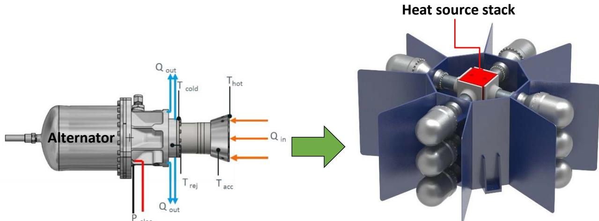  
Figure 3. Left – 70-We Flexure-Isotope Stirling Convertor (FISC) design as of Phase 1 Final Review. Right – A notional generator design with a stack of heat source modules in the center surrounded by FISCs. (Image Credit – AMSC)

## IV. Turbo-Brayton Convertor (TBC), by Creare

Creare LLC of Hanover, NH is pursuing a small Brayton-cycle machine for integration with a radioisotope heat source. This design leverages previous projects, such as their RPS-sized design from a 2002 research announcement, and NASA small-business contracts. The design takes inspiration from the 1990’s Dynamic Isotope Power System (DIPS) concept from Rocketdyne and Allied Signal. Non-contacting operation is achieved by the use of hydrodynamic journal and thrust bearings acting on the rotor assembly, and close clearance seals at the impellers. Creare has previously demonstrated hydrodynamic gas bearings and close clearance seals of this size on previous projects, notably the cryocooler on Hubble’s NICMOS instrument. Creare’s design has been deemed the Turbo-Brayton Convertor (TBC). Creare’s technology consists of a single high-speed rotating shaft assembly with an integral turbine and compressor. The TBC is designed to output 355 We from a 6-GPHS heat source, while operating at a turbine inlet temperature of $7 3 0 \mathrm { { } ^ { \circ } C }$ and a compressor inlet of $1 0 0 ^ { \circ } \mathrm { C }$ Design analysis reports a conversion efficiency of 26% at this operating condition, which achieves a 0.41 fraction of Carnot. The total convertor mass is estimated to be 15.5 kg, which achieves a specific power of 22 $\mathrm { W _ { e } / k g . }$ This convertor also has the ability to operate at half its nominal design output power, which enables redundancy within a generator.

The TBC and a notional generator design are shown in Fig. 4. The only life-limiting engineering design challenge is high-temperature material creep of the turbine impeller. This component must operate at high temperature near that of the turbine inlet $( 7 3 0 ^ { \circ } \mathrm { C } )$ for the duration of the mission while enduring centrifugal stress associated with the high-speed rotation of the shaft. Estimates of this operating stress have been made and several material options identified. A final decision on turbine material is still pending trade study completion. While there is the potential for oscillating stress due to a rotating shaft, the rotating components can be balanced such that cyclic stress becomes negligible, and thus well below any material endurance limits. Options exist for negating the angular momentum of a single, low-mass, high-speed rotor, via the use of two counter-rotating units on a spacecraft.

Inside the turbo-machinery portion, a magnet is installed inside the rotating shaft, and surrounded by the stationary coil and laminations, forming a 3-phase alternator. As can be seen, the turbo-machinery section is only a portion of the working gas volume. The gas must be coupled to input and rejection heat exchangers. A counterflow recuperator must also be used to achieve high thermodynamic efficiency. Two counter-rotating units of this size could be implemented in a power system to achieve convertor redundancy. This would also nullify net angular momentum, which is important when considering spacecraft attitude maneuvers. Analysis suggests that both convertors could be operated at 50% throttle in a default state. If one were to fail, the surviving convertor could ramp up its speed to 100% and maintain thermal energy draw from the GPHS modules. In contrast to Stirling-cycle conversion machines, the TBC implements a closed-loop, continuous-flow, Brayton thermodynamic cycle. Continous-flow cycles make use of large surface area heat exchangers and do not suffer loss of performance due to dead spaces. With this, the heat input and rejection devices can be designed to reduce heat flux at the cost of mass and volume. This offers an advantage in that the temperature gradients through heat input and rejection devices can be reduced, and don’t rely solely on conduction paths. For example, the TBC could make use of a flow-through radiator, where the working gas is sent through parallel tube paths that are directly coupled to the facesheets of the radiator. This would eliminate the need for heat pipe spreading, but does increase the area prone to micrometeoroid damage. In contrast, a Stirling-cycle machine optimizes when its heat exchanger areas are minimized (to minimize dead space) resulting in high heat flux and reduced area to attach a heat rejection device. Previous systems utilizing Stirling machines thus required attention to extract and spread the heat from the rejection zone of the convertor, usually leading designers to implement heat pipes or conduction devices with ultra-high thermal conductivity. The closed-loop Brayton cycle also offers system arrangement flexibility, as the components can be separated in space and only require connection via gas tubing elements. This may widen spacecraft design space as the components could be distributed.

During phase 1, Creare traded various design parameters, such as power output level, recuperator effectiveness, and rotational speed. The TBC design has successfully passed its Phase 1 design review, and Creare is in the beginning months of Phase 2. During this Phase, they will spend the first few months adjusting the design, then initiate prototype fabrication. In Phase 2, Creare will fabricate and demonstrate performance of one convertor. Experimental tests will include performance mapping over the range of required cold-end temperatures, performance at 50% throttled condition, and capability for at least 10 start-stop thermal cycles.

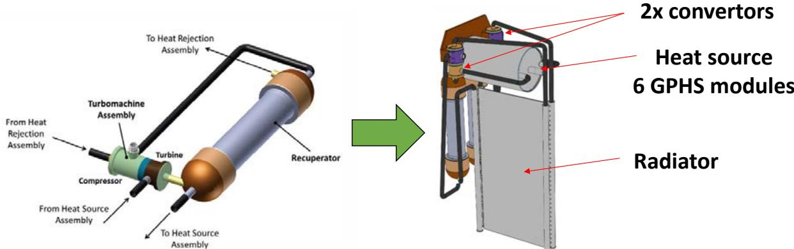  
Figure 4. Left – 355-We Turbo-Brayton Convertor (TBC) design as of Phase 1 Final Review. Right – A notional generator design with a 6-GPHS assembly and two TBCs. (Image Credit – Creare, LLC)

## V. Thermo-Acoustic Power Convertor (TAPC), by Northrop Grumman

Northrop Grumman Aerospace Systems (NGAS) of Redondo Beach, CA is pursuing their thermoacoustic heat engine concept. This design builds on previously flown NGAS pulse-tube cryocoolers, and previous heat engine work for NASA from 200316.

The Thermo-Acoustic Power Convertor (TAPC) (Fig. 5) consists of a centrally located thermoacoustic heat engine driving a dual-opposed pair of alternators that utilize flexure-bearings. The TAPC is designed to output a nominal 110 $\mathrm { W _ { e } }$ at a hot-end temperature of $7 0 0 ^ { \circ } \mathrm { C }$ and a cold-end temperature of 100°C. At this condition the conversion efficiency is estimated by analysis to be 26%, achieving a 0.42 fraction of Carnot. The convertor mass is estimated to be 6.4 kg which achieves a specific power of 17 We/kg. This is lower than the requirement of 20 $\mathbf { W } _ { \mathrm { e } } / \mathbf { k g }$ , but options have been explored to reduce the mass of some of the convertor’s heavy components.

In the thermoacoustic implementation, an acoustic wave can be set up to displace gas between the two temperature zones with the desired phase relative to the piston motion. This has the advantage of eliminating the displacer, a component in the hot end which is used in traditional free-piston Stirling machines. With this, the mechanical design challenge of oscillating the displacer within a close clearance seal goes away, and the only seals left to engineer are those of the pistons residing in the relatively cool alternators. The lack of a displacer does increase the radiation link between the hot and cold temperatures, as a radiation shield cannot be installed here. This introduces an element of efficiency loss, but preliminary estimates performed during Phase 1 show the design still meets the 24% requirement. This design still requires attention to high-cycle fatigue, as the alternator utilizes flexure bearings. The hot-end material creep must also be engineered to achieve the 20-year life requirement. The dual-opposed piston building block offers an advantage of inherent balance. While there could still be residual imbalance, due to moving components with different amplitudes, masses, or non-zero phase, there are options for minimization of this residual via individual control of the piston motions. This convertor building block also lends itself to redundant arrangements with in a generator design.

The TAPC underwent a Phase 1 design review in April 2018. However, a decision was made by the RPS program to not award the Phase 2 fabrication option of the contract.

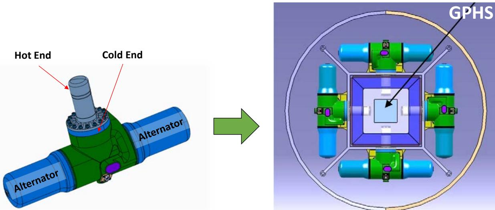  
Figure 5. Left – 110-We Thermo-Acoustic Power Convertor (TAPC) design as of Phase 1 Final Review. Right – A notional generator design with four TAPCs. (Image Credit – Northrop Grumman)

## VI. Sunpower Robust Stirling Convertor (SRSC)

Sunpower Inc. of Athens, OH is pursuing a convertor based on their previous involvement with RPS. The Advanced Stirling Radioisotope Generator (ASRG) project reached the point of flight-unit convertor fabrication before its cancellation in 2013. The design has been deemed the Sunpower Robust Stirling Convertor (SRSC), as it is derived from the ASRG’s Advanced Stirling Convertor (ASC), with a focus on improving several areas.

The SRSC is designed to produce 65 We at a hot-end temperature of 720°C and a cold-end temperature of 100°C. At this operating condition the conversion efficiency is estimated to be 29%, achieving a 0.46 fraction of Carnot. The convertor mass is estimated to be 2.0 kg, achieving a specific power of 33 We/kg. Non-contacting operation is achieved via the use of gas bearings for support of the piston and displacer, along with close clearance seals. The gas bearings are energized by extracting a small portion of the energy from the thermodynamic cycle’s pressure wave. The use of gas bearings enables a comparatively compact design with a concomitant increase in specific power, relative to flexure-bearing designs. The piston requires no mechanical spring, as it is designed to resonate using the gas springs of the working and bounce spaces. The displacer however requires a mechanical planar spring to effect displacer resonance. The design’s pressure boundary must contain high pressure working gas, while operating at high temperature in the area of heat input. Thus, the engineering challenges here are high cycle fatigue, for the planar spring, and high-temperature material creep, for which well-understood engineering methods are available. The gas bearing design offers an engineering design challenge as well. Sunpower has previously demonstrated gas bearing engineering methods on cryocoolers, and the ASC from the ASRG project17. Sunpower has identified Haynes 230 as the hot-end material, which has a substantial creep database, but may need to be supplemented to finalize the heater head design. This convertor building block also enables a wide generator design space, including redundant arrangements.

During Phase 1, Sunpower traded several design changes to address identified areas of improvement relative to the ASC. These areas were identified for potential improvement during the ASRG project, in addition to pursuit of the latest goals levied in the RFP. Included are: magnet encapsulation, displacer gas bearing capacity, static passive centering of the piston, overstroke tolerance, and robust regenerator designs. Magnet encapsulation improves convertor robustness, as the magnets are now protected from inadvertent contact with the surroundings. Magnet contact due to operational error was determined as a proximate cause during previous convertor failure investigations18. Displacer gas bearing capacity has been increased, which gives the SRSC additional margin for static acceleration environments. The SRSC includes provisions for static centering of the piston, which was absent in the ASC and required operational steps to position the piston in a proper starting location. With this, the con-ops steps for manual centering disappear, simplifying the process and making it less prone to error. Phase 1 efforts also focused on regenerator options. Prior convertor long-term operation revealed the convertor to be vulnerable to debris from regenerator shedding. Regenerator options have been identified to reduce the likelihood of debris generation, as well as make the internal components immune to small amounts of debris. Tolerance of overstroke conditions will be implemented in the SRSC hardware. The SRSC will have bumpers that will become engaged if the piston or displacer amplitudes grow too large. Such a situation could result from improper electrical loading at the alternator terminals while a temperature difference is present. Thus, overstroke tolerance adds an element of robustness that addresses operational error. Sunpower has also implemented several mechanical design changes, improving the dimensional stability of internal components relative to the ASC.

The SRSC underwent a Phase 1 design review in April 2018. The decision has been made to award Phase 2 of the contract. During Phase 2, Sunpower will make any final design adjustments, then fabricate and test two convertor prototypes.

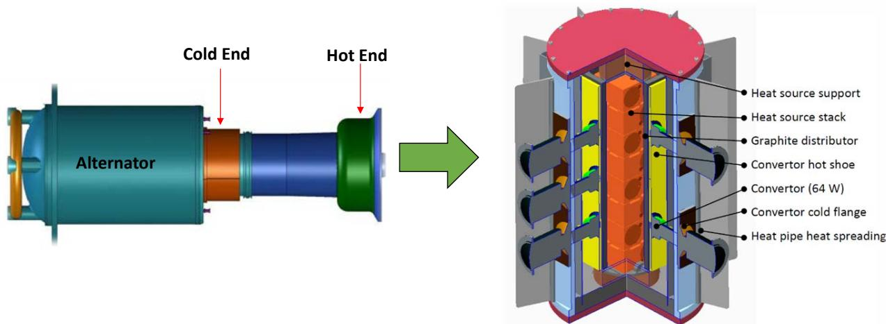  
Figure 6. Left – 65-We Sunpower Robust Stirling Convertor (SRSC) design as of Phase 1 Final Review. Right – A notional generator design with several redundant SRSCs. (Image Credit – Sunpower, Inc.)

## VII. Path to Flight

The task of proving a 20-year design life is unique and atypical in the realm of reliability engineering. Typically, spaceflight product qualification protocols involve demonstrating a multiple of the design life via ground testing. Such a demonstration is not feasible, even for a 1x demonstration of design life. There are also no feasible methods for performing accelerated life testing at the convertor level. Accelerated life testing can be, and has been performed at the component level19. Hot-end materials can be subjected to higher temperature and stress than the convertor operating design point. Flexure bearings and planar springs can undergo cyclic operation at a higher frequency and stress amplitude that the conditions during convertor operation. However, when assembled at the convertor level, the convertor is designed to operate at a specified frequency which can only vary by a few percent. Thus, reliability verification will have to rely on analysis. Reliability analyses typically rely on establishing a statistical database composed of as many hardware data points as possible20. This is the method employed for meantime-between-failure metrics. In the case of the aforementioned dynamic power convertors, the number of hardware data points will always be limited, given its narrow applicability to space missions. Previous reliability methods for Stirling convertors suggested on the order of tens of identical units would need to be placed on extended operation and exposed to the full range of environmental conditions. Fabrication of this number of units is also not feasible on the current timeline. It is unlikely the flight development phase would have the funding or schedule available to build such a statistical database before developing the RPS. Robustness tests could be performed, but these only demonstrate ability of the design to handle temporary off-nominal environments. Such results could bolster confidence in reliability by demonstrating margin, but this would only be one element of any reliability analysis. As a result, the first use of any new power conversion in spaceflight will have to either accept the risk of an imperfect reliability database, or formulate a novel reliability method that uses few data points. One method to significantly improve generator reliability is to incorporate convertor redundancy. For example, if a convertor is at least 85% reliable, and the generator implements 100% convertor redundancy (twice as many convertors as necessary to provide the desired power output), the generator reliability would be in excess of 99%. Redundant convertor arrangements have been studied on several occasions in the past21, and were considered during the latest chapter of convertor development. The disadvantages of convertor redundancy include: additional mass (and reduction in generator specific power), greater control complexity (potentially more control electronics components), and limitations in physical arrangement to accommodate heat flows. A generator with redundant convertors must be designed in such a way that when a convertor fails, heat flow from thermal source can reach the working convertors without violating a fuel temperature limit. The heat rejection device must also be designed to accommodate this scenario in a similar fashion.

To address the issue of flight mission adoption, the RPS Program has chartered a Surrogate Mission Team (SMT)10. The team consists of RPS community parties, including NASA, DOE, and flight centers (JPL, APL, GSFC). The purpose of the team is to provide a stand-in for an actual mission, which is necessary to drive requirements. The SMT provided the insight necessary to drive the performance goals that were written into the 2016 request for proposal. This included examination of several historical and candidate missions. For example, the requirement for static acceleration tolerance was not in place during previous development efforts, but several planetary science missions involve aero-braking procedures, or entry-descent-landing events, which would expose the entire spacecraft to static accelerations on the order of 20 g for 1 minute. Several workshops were held to formulate the surrogate mission requirements. The intent was to encompass all relevant missions, such that a generator built to those requirements would be adoptable by a wide range of missions. As such, the requirements trend towards multi-mission. If this exercise was performed properly, the dynamic RPS flight system will be usable on any foreseeable mission, rather than uniquely tailored for a specific environment.

As stated earlier, the nature of RPS design lives mean that use of any new conversion technology will have to accept some amount of risk. Every technology encounters a similar conundrum when readying for flight. Stated simply, one must answer the question, “what is necessary to convince the mission community that the technology is reliable?” In the absence of a wealth of hardware data points to establish a statistical database, one must resign to establishing readiness of the technology using available hardware resources. For this purpose, the SMT is also tasked with formulating a technology readiness level (TRL) assessment method for dynamic RPS. NASA TRL definitions usually require interpretation, especially for new technologies without established analogs or precedents. Significant effort was put forth during the ASRG project to formalize the protocol and definitions for ranking TRL of the power system and subassemblies22. This ranking considered all components of the ASRG (convertors, controller, balance of plant). This method was used as a launch point for development of the SMT’s TRL assessment method. A common practice for spaceflight technology advancement is to reach TRL 6 before proceeding to flight development. TRL 6 is defined by NASA/SP-2007-6105 as, “System/subsystem model or prototype demonstration in a relevant environment.” With this, the relevant environments were examined to assert which are most important for demonstration. The relevant environments include: thermal extents, deep space, random vibration due to launch, and static acceleration. Known methods exist to duplicate these environments in laboratories within a reasonable cost and schedule. The environment experienced by the convertor can be duplicated even without a generator design. The thermal interfaces are defined sufficiently independent of the specific generator details, such that the critical temperatures and forces can be reproduced on the convertor. The convertor can then be exposed to the range of expected temperatures and thermal input loads. The deep space environment is actually the most benign of the list. The thermal radiation sink temperature produces a low heat rejection temperature. The absence of atmosphere induces a negligibly higher pressure difference across the working gas pressure boundary. The lack of oxygen means operation in space is actually more benign than laboratory operation. Deep space can be simulated in a thermal vacuum chamber, but is not necessary to induce that relevant environment on the convertor. Thermal heat flows paths and temperatures can be arranged to emulate the conduction and radiation heat transfer that would exist in a vacuum environment. Structural interfaces to the convertor do however depend on generator design details. However, these can all be encompassed by exposing the convertor to the launch random vibration spectrum directly. The generator structure could amplify or attenuate portions of the spectrum, so this must be considered when generators are designed. Static acceleration environments can be, and have been, simulated with a centrifuge facility23. Nothing precludes full-power convertor operation during these demonstrations, which is the most likely situation during these phases of a mission. It can also be claimed that continuous operation for many years on a planetary surface is a relevant environment. This too is straightforward to implement. Even cyclic temperature fluctuations for many years, such as those that would be present on a Mars or Moon mission, can be simulated.

The deliverables of the contracts, and the activities to take place during the various phases, were tailored to support TRL advancement. During phase 1, the convertor design and analysis support TRL 4. During phase 2, the contractors will complete physics-based models, and build functioning convertor prototypes. The performance testing and model validation during this stage will support TRL 4 and 6, but alone will not satisfy all elements to achieve TRL 6, as the emulation of all the relevant environments is outside the scope of the contracts. Phase 3 will focus exclusively on independent validation and verification, during which attention to all relevant environments can be paid. Phase 3 will have an emphasis on experimental environmental testing, but will also focus on independent modeling and analysis. Following the completion of Phase 3, the goal is to have formal recommendations to the RPS program regarding which convertor technologies are viable for flight development. In the currently conceived timeline, flight development could begin as early as 2021. Since the contracts are working towards pseudo-flight requirements, the valuable hardware produced here could continue use and provide valuable data to system integrators during the flight development stage.

## VIII. Ongoing in-house Dynamic Power Convertor Validation

The Thermal Energy Conversion Branch at NASA GRC is responsible for the execution of the contracts, having authored the originating RFP. NASA GRC also supports dynamic convertor development via additional activities. NASA GRC continues to contribute dynamic conversion expertise to the SMT, having provided input into generator requirements and TRL assessment methods. GRC has coordinated extensively with the SMT to flow information and products from convertor contracts. This collaboration played an integral role in the genesis of the RFP, as many of the requirements were extrapolated from candidate mission needs, which were conceptualized by the mission center representation on the SMT. The contract meeting schedule and deliverables were tailored to flow information back to the SMT. The SMT participate in-person in all the contract technical interchange meetings. To assist with GRC’s execution and contractor progress review, an integrated product team (IPT) has been assembled. This team is composed of various technical discipline representatives from within the branch, and other branches at GRC. Disciplines covered here include tribology, materials, and systems engineering. The IPT also includes outside organization representatives from DOE and APL, to provide the system integration and mission perspectives. This team is responsible for examining monthly progress and technical direction of the contracts, and providing recommendations and feedback.

NASA GRC also maintains unique capability for convertor technology research. The Stirling Research Laboratory (SRL), established in 2000, is still active and continuing long-term operation of several convertors, in addition to performing specialized experiments. A summary of convertor hardware run-time is shown in Table 3.

Table 3. Summary of free-piston Stirling convertor extended operation at NASA GRC
<table><tr><td rowspan=1 colspan=1>Project &amp;Provider</td><td rowspan=1 colspan=1>TestArticle</td><td rowspan=1 colspan=7>BearingTechnology</td><td rowspan=1 colspan=1>Years ofOperation</td><td rowspan=1 colspan=1>Status</td></tr><tr><td rowspan=5 colspan=1>SRG-110Infinia, Corp.</td><td rowspan=1 colspan=1>TDC #13</td><td rowspan=3 colspan=7>Flexure</td><td rowspan=1 colspan=1>12.6</td><td rowspan=1 colspan=1>On-going</td></tr><tr><td rowspan=1 colspan=1>TDC #14</td><td rowspan=1 colspan=1>12.1</td><td rowspan=1 colspan=1>Shutdown for disassembly and inspection</td></tr><tr><td rowspan=1 colspan=1>TDC #15</td><td rowspan=1 colspan=3></td><td rowspan=1 colspan=2>e</td><td rowspan=1 colspan=1>11.6</td><td rowspan=1 colspan=1>On-going</td></tr><tr><td rowspan=1 colspan=1>TDC #16</td><td rowspan=1 colspan=3></td><td rowspan=2 colspan=5></td><td rowspan=1 colspan=1></td><td rowspan=1 colspan=1>11.6</td></tr><tr><td rowspan=1 colspan=1>SES #2</td><td></td><td></td><td rowspan=1 colspan=1>0.3</td><td rowspan=1 colspan=1>On-going</td></tr><tr><td rowspan=9 colspan=1>ASRGSunpower, Inc.</td><td rowspan=1 colspan=1>ASC-0 #3</td><td rowspan=2 colspan=7></td><td rowspan=1 colspan=1>8.3</td><td rowspan=1 colspan=1>On-going</td></tr><tr><td rowspan=1 colspan=1>ASC-E3 #3</td><td rowspan=1 colspan=3></td><td rowspan=1 colspan=1>2.5</td><td rowspan=1 colspan=1>Shutdown for disassembly and inspection</td></tr><tr><td rowspan=1 colspan=1>ASC-E3 #4</td><td rowspan=1 colspan=3></td><td rowspan=4 colspan=5>Gas</td><td rowspan=1 colspan=1>3.1</td><td rowspan=1 colspan=1>On-going</td></tr><tr><td rowspan=3 colspan=1>ASC-E3 #6</td><td rowspan=1 colspan=3></td><td></td><td></td></tr><tr><td rowspan=2 colspan=3></td><td></td><td></td></tr><tr><td rowspan=1 colspan=1>2.4</td><td rowspan=1 colspan=1>On-going</td></tr><tr><td rowspan=1 colspan=1>ASC-E3 #8</td><td rowspan=1 colspan=3></td><td rowspan=3 colspan=5></td><td rowspan=1 colspan=1></td><td rowspan=1 colspan=1></td></tr><tr><td rowspan=1 colspan=1>ASC-E3 #9</td><td></td><td></td><td rowspan=1 colspan=1>1.6</td><td rowspan=1 colspan=1>On-going</td></tr><tr><td rowspan=1 colspan=1>ASC-L</td><td></td><td></td><td rowspan=1 colspan=1>4.0</td><td rowspan=1 colspan=1>On-going</td></tr></table>

The SRL is currently operating four of the flexure-bearing FISC-design predecessor units. The maximum perunit runtime has reached over 12.6 years at full temperature and power. TDC #13 has operated for over 12.6 years

at full power and temperature, with no degradation. This unit now holds the record for the longest-running freepiston Stirling machine. It also holds the record for longest-running maintenance-free heat engine in the history of civilization. This encompasses all automobile engines, gas turbines for terrestrial power plants, remote backup generators, and aerospace turbine engines. This convertor has accumulated over 32 billion cycles of operation. Throughout its life, no parts required replacement. This includes the flexures, alternator, and high-temperature components. Only periodic small replenishments of the helium working gas were required, which was due to imperfect hermetic welds at the pressure boundary joints. A flight convertor with proper hermetically sealed joints would not experience any measurable working gas loss. This valuable data point supports the engineering methods behind free-piston Stirling convertor designs. The nickel-based super alloy, Inconel 718, was designed to withstand the operating temperature of $6 5 0 ~ ^ { \circ } \mathrm { C }$ and stress due to the internal working gas pressure. Data for Inconel 718 were only available out to 10 years. The hot-end component was engineered via extrapolation of this data to a design-life of over 17 years, with failure defined as the onset of tertiary creep. Given that no convertor degradation has been observed, this validates the method for designing a high-temperature component in the absence of sufficient creep material data. Given that no components have suffered fatigue failure, this suggests the components were properly engineered to withstand the oscillating stress amplitude, notably the flexures. The degradation-free performance from this convertor also proves the engineering behind the alternator, for which the permanent magnets must sustain their magnetic flux in the presence of oscillating reaction force from the coil current generation. Similarly, the engineering of the bonding methods for the magnets and other alternator components has been validated by TDC #13. Performance data from this convertor have been examined closely throughout its operational life. Changes in performance have been explained by either oxygen ingress through its original non-hermetic joints, or variation in the facility support equipment that upset the control of the operating point. A recent 6-year span was examined closely, during which no changes to the facility setup were made. This was useful for isolating effects of convertor degradation from facility disturbances. The performance of the convertor was found to be flat-line across this 6 year span to within 0.1 We of power output, and to within 0.2 percentage points of gross efficiency. Even the small efficiency difference could be due to changes in the hot-end insulation, and not any change in the convertor. Insulation losses, and stability of such losses are difficult to quantify to the resolution necessary to explain small deviations. It was discovered concurrently during this time that the coolant used to control the cold-end temperature of the convertor had corrosion inhibitors that fouled the heat rejection surfaces. The surfaces were inspected with a borescope and significant fouling was discovered that would interfere with the heat transfer in this area. No instrumentation would have indicated this fouling, and the effect would show up as a change in convertor performance, as the fouling would disrupt the cold-end temperature of the cycle. This is a prime example of the need to examine all possible sources of data disturbances when examining long-term performance. TDC #13 will continue extended operation at its full-temperature and power operating point for the foreseeable future. Discussions are currently underway to assess what component will exhibit any life-limiting effect, and when that may occur. From an engineering perspective, the hot-end material will eventually creep enough to disrupt the geometry such that the thermodynamic cycle will be disturbed. With the current instrumentation, this will be detected long before any rupture occurs.

TDC #14 operated alongside #13 until it was recently manually shut down for disassembly and inspection. After accumulating 12 years of operation, TDC #14 was manually shut down and removed from the test station. The convertor was disassembled for inspection to assess the state of the internal components. The heater head was removed to inspect the displacer state. There were signs of mild oxidation on the hot surfaces of the heater head and displacer, which was expected (Fig 7). During initial operation of this convertor, the pressure boundary joints were not hermetically sealed, and oxygen ingress was observed. It is possible that elimination of oxygen from the onset of operation would leave oxidation-free surfaces. Nonetheless the surface oxidation on these components is cosmetic and did not disrupt convertor operation. Scratches were observed on the hot-end of the displacer. It has been hypothesized that these are from fibers shed by the random-fiber regenerator, which broke loose and were pulverized by the oscillation motion of the displacer. If true, the 22 um fiber was reduced to dust form, as no bulk fibers were observed. Only evidence of iron-oxide dust was found on various surfaces, which again didn’t degrade performance. Plans are being made to extract the regenerator from TDC #14’s heater head, which is currently captured between brazed-in components. One of these braze joints must be removed in order to access the regenerator, which will render the heater head permanently disassembled. Ideally, a regenerator would not shed debris. It is further hypothesized that early operation of this convertor, during which there was known oxygen ingress, compromised the hot portion of the stainless steel regenerator. Investigation of this hypothesis is planned. It is possible that proper sealing from the onset, and purification of the working gas, would have eliminated any such damage to the regenerator due to oxidation embrittlement. Since the design of the TDC (which dates to the mid-1990s), advancements in regenerator material options have been made and have been demonstrated during the

ASRG project. Materials with greater oxidation resistance than 316L stainless steel are available, so the regenerator shedding is not an insurmountable problem for Stirling convertor flight development. No signs of rubbing were evident on the displacer seal area, suggesting the accurate close clearance seal in this area remained stable over the operating life.

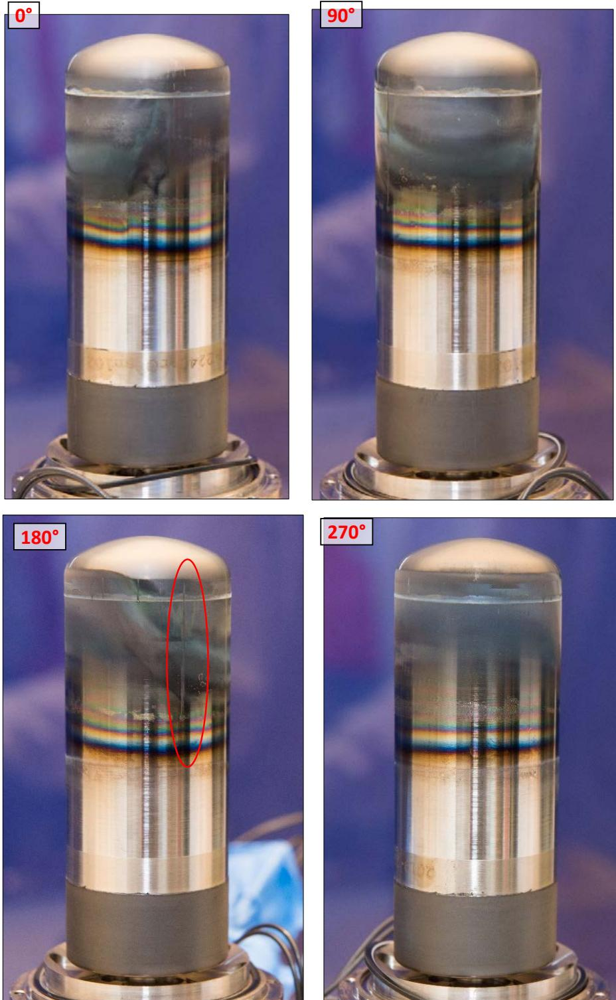  
Figure 7. TDC #14 displacer assembly after 12 years of operation. Some oxidation was observed as expected. Scratch marks on the hot end could be from a compromised regenerator shedding debris.

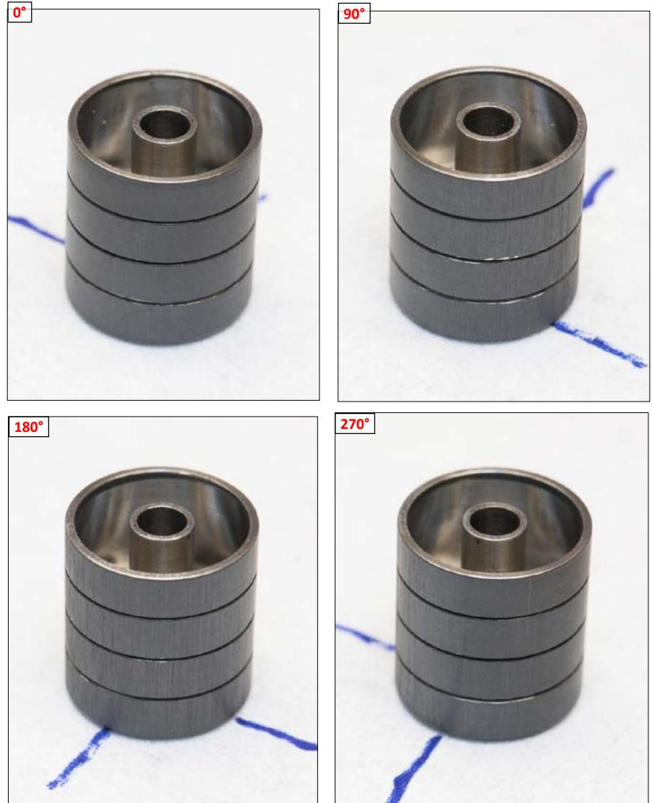  
Figure 8. TDC #14 piston assembly after 12 years of operation. Light scratches of the Xylan surface were observed and thought to be due to regenerator debris.

The piston was removed from the moving portion of the alternator and examined (Fig. 8), along with the cylinder in which it resides. Light axial scratches were evident in the Xylan outer diameter of the piston. Particles were found embedded in the Xylan surface and chemical analysis revealed them to be composed of Iron and Chromium. Again this is thought to be due to shedding of material from the regenerator, but it did not degrade convertor operation. This convertor suffered sustained overstroke (on the order of several seconds) at the 3.8-year mark, due to temporary electrical load disconnection. The convertor operated thereafter until the time of shut down for disassembly. The only effect of this overstroke observed upon internal inspection was mild impact marks on the piston face Tefzel bumper, which was implemented for such an event. This suggests that polymer bumpers are a viable method for increasing convertor robustness, making them immune to operational errors. Portions of the alternator section were also inspected, but is limited until this section is disassembled further. The flexures that could be seen showed no signs of damage or initiation of cracks. Accurate dimensional inspection of components was conducted using a coordinate-measuring-machine. The results showed that, compared to original drawing specifications, the parts maintained dimensional stability and engineering clearances. Further disassembly of TDC #14 is planned to gather more information. The alternator section will be disassembled so the flexures may be inspected more closely. Various examination techniques will reveal what cannot be seen with the unassisted eye. Microscopic imaging and dye testing can reveal flaws or crack initiation points. This will also allow close inspection of the organics and magnets of the alternator.

A static acceleration exposure test was recently performed on an engineering-unit flexure-bearing convertor from the SRG-110 project. The engineering unit convertors from the SRG-110 project were deemed with the acronym SES. This test was pursued because static acceleration is a likely requirement, and such a test was never performed on a flexure-bearing convertor. The test article installed in the centrifuge is shown in Fig. 9. The forward-looking requirement demands tolerance up to 20g in every axis. However, as the SES was not designed with static acceleration in mind, the test matrix had to take this into account. The convertor was exposed to 5g in the axia orientations (those in line with the piston motion), and 20g in the lateral orientation. The duration for each exposure was 1 minute at the full level. The centrifuge facility maximum spin up rate was such that several minutes were required to reach the 20g level, so the cumulative static acceleration was higher than simply 1 minute at 20g. A total of four tests were run : two axial and two lateral. The convertor was operated at full design power and temperature during each exposure. The convertor behaved as expected during 5g and 20g accelerations. There was a temporary reduction in power as slight friction between the piston and its cylinder occurred (Fig. 10), which disrupted thermodynamic cycle operation. There appears to be a point where the displacer motion is also disrupted due to friction, above 18g. Structural analyses performed prior to the test indicated contact could occur at these levels in the lateral direction. The reduction in power output was temporary, and performance returned to nominal after the centrifuge was halted. This convertor will continue extended operation for the forseeable future, as this unit has now undergone launch random vibe as well as static acceleration. The long-term effect, if any, of these environmental exposures will be evaluated over several thousands of hours of operation.

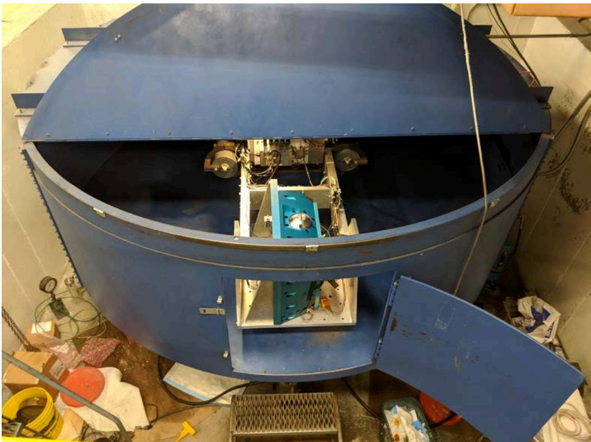  
Figure 9. SES #2 installed in a centrifuge ready for axial static acceleration exposure.

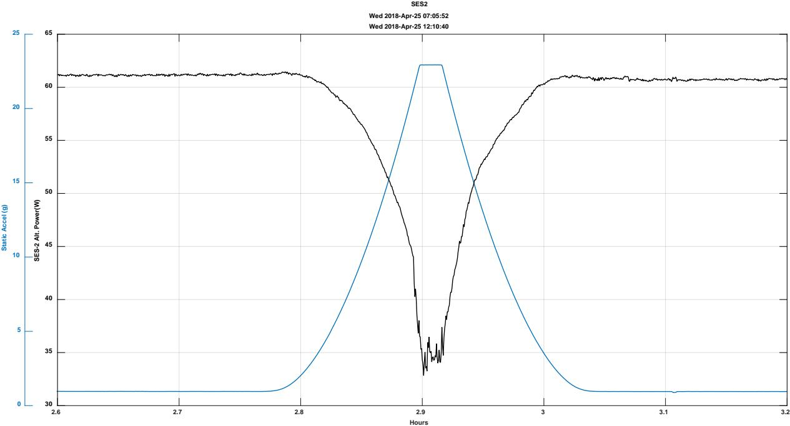  
Figure 10. Example SES #2 power output while undergoing 20g of static acceleration in a lateral orientation.

The SRL is also still operating several units from Sunpower, including the last design iteration from the ASRG project, the ASC-E3, for which the longest running unit has accumulated over 3.1 years of operation at full temperature and power. The ASC-E3 design was equivalent to the flight convertor developed under ASRG. A predecessor design with Inconel 718 for the hot-end material, deemed the ASC-0, has reached 8.3 years of operation. Several of the ASC units have undergone launch random vibration exposure, and then continued extended operation. A static acceleration exposure was also performed on an ASC in the 2012 timeframe23. The lab has cultivated a performance tracking methodology to support this long-term operation analysis, one in which the test article parameters are constantly recorded. Methods have been implemented to organize and parse this large dataset for on-demand analysis. Capability also exists to continuously store high-rate signal data, up to 6 ksamples/sec.

The SRL has initiated preparations for up to three DPC prototype designs, which are scheduled to arrive for government IV&V in 2019. NASA GRC also has analysis capability to interrogate products from the contractors. There exists capability to examine physics-based models, such as FEA and CFD, solid CAD models, and thermodynamic models such as those from Sage®. The Thermal Energy Conversion branch also maintains a unique System Dynamic Model (SDM) that can be tailored for the next generation of DPC design. This tool accurately models the physics-based dynamics of components of dynamic convertor operation24. It is useful for transient as well as steady-state analysis. Thus it can be engaged when examining convertor behavior under launch vibration, static acceleration, or to evaluate controller behavior.

## IX. Conclusions

A recent endeavor to develop high-efficiency power convertors for NASA’s RPS needs has begun. An RFP from 2016 has resulted in the award of four dynamic convertor development contracts. Three of the contracts were for Stirling-cycle devices, while the fourth is pursuing a Brayton-cycle device. The contracts consist of design, fabrication, and test phases. Three of the contract have either begun or are about to being the fabrication phase. These three contracts may each result in operable prototype hardware that will undergo government IV&V. NASA GRC is responsible for the coordination of these contracts, and is currently exercising protocols for ongoing contract evaluation. NASA GRC is also preparing for the eventual IV&V phase during which the prototype hardware will undergo a series of requirements validation tests, for which the goal is to identify which convertor options are suitable for flight development. NASA GRC also support development and demonstration of dynamic power convertor technology for eventual use on RPS. Several flight-like hardware data points have shown capability of free-piston Stirling convertors to meet the requirements of spaceflight.

## X. Acknowledgements

This work is funded through the NASA Science Mission Directorate. Any opinions, findings, and conclusions or recommendations expressed in this article are those of the authors and do not necessarily reflect the views of NASA.

## XI. References

1http://rps.nasa.gov

2Wham, B.M. (2015). Reestablishing the Supply of Plutonium-238. AIAA-2015-4115.

3Woerner, D. (2013). The Mars Science Laboratory (MSL) MMRTG in-flight: a power update. Nuclear and Emerging Technologies for Space 2013.

4Schreiber, J. (2006). Developmental Considerations on the Free-piston Stirling Power Convertor for Use in Space. AIAA-2006-4015.

5Ross, R.G. Jr. (2016). History of Space Cryocoolers as of May 2016.

6Oriti, S. M. (2013). Performance Measurement of Advanced Stirling Convertors (ASC-E3). AIAA-2013-3813.

7Schreiber, J. (2006). Status of the NASA Stirling Radioisotope Project. International Stirling Forum 2006.

8Schmitz, P. C. (2015). Modular Stirling Radioisotope Generator. AIAA-2015-3809

9Bolotin, G. (2014). The Use of Redundancy to Improve Reliability of Deep Space Missions Using Stirling Radioisotope Generator Power Sources. AIAA-2014-3963

10Hibbard, K. (2016). Stirling to Flight Initiative. IEEE Aerospace Conference 2016.

11NASA Research Announcement NNH16ZDA001N-DPC4RPS, under the Research Opportunities for Space and Earth Sciences (ROSES-2016).

12Nuclear Power Assessment Study Final Report (2015). Johns Hopkins University Applied Physics Laboratory NASA Contract NNN06AA01C Task NNN13AA17T.

13Mason, L.S. (2006). Realistic Specific Power Expectations for Advanced Radioisotope Power Systems.

Journal of Propulsion and Power Vol 23 No 5 September-October 2007.

14Schreiber, J. (2007). Final Results for the GRC Supporting Technology Development Project for the 110-Watt Stirling Radioisotope Generator (SRG110). STAIF-2007

15Tortorelli, P.F. (2014). Ni-Based Alloys for Advanced Ultrasupercritical Steam Boilers. Oak Ridge National Laboratory Presentation.

https://www.netl.doe.gov/File%20Library/Events/2014/crosscutting/Crosscutting\_20140522\_1600B\_ORNL.pdf

16Petach, M. (2004). Design and Testing of a Thermal to Electric Power Converter Based on Thermoacoustic Technology. AIAA-2004-5518.

17Wong, W.A. (2015). Advanced Stirling Convertor (ASC) Technology Maturation. AIAA-2015-3806.

18Lewandowski, E. J. (2016). Advanced Stirling Radioisotope Generator EU2 Anomaly Investigation. AIAA-2016-4816.

19Wilson, S. D. (2014). NASA GRC Support of the Flight ASRG Project. AIAA-2014-3859.

20Ha, C. (2010). Reliability Demonstration Approach for Advanced Stirling Radioisotope Generator. AIAA-2010- 7174.

21Schmitz, P. C. (2015). Modular Stirling Radioisotope Generator. AIAA-2015-3809.

22Frerking, M. A. (2016). JPL Technology Readiness Assessment Guideline. IEEE Aerospace Conference 2016.

23Meer, D. (2012). Advanced Stirling Convertor Durability Testing. AIAA-2012-4249.

24Meer, D. (2010). Incorporating Vibration Test Results for the Advanced Stirling convertor into the System Dynamic Model. AIAA-2010-7094.