# General Disclaimer

## One or more of the Following Statements may affect this Document

• This document has been reproduced from the best copy furnished by the organizational source. It is being released in the interest of making available as much information as possible.

• This document may contain data, which exceeds the sheet parameters. It was furnished in this condition by the organizational source and is the best copy available.

• This document may contain tone-on-tone or color graphs, charts and/or pictures, which have been reproduced in black and white.

• This document is paginated as submitted by the original source.

• Portions of this document are not fully legible due to the historical nature of some of the material. However, it is the best reproduction available from the original submission.

DOE/NASA/0333-1   
NASACR-174771   
(NASA-CR-174771)FREE-PISION STIRLING N85-30481   
ENGINE/LINEARAITEENATOE1OOO-HOUEENDURANCE   
TESTFinalReport(Mecba nical Technology.   
InC.) 98P HCAC5/MFAU1 CSCL10B U nc la E   
G3/44 21631

# Free-Piston Stirling Engine/ Linear Alternator 1000-Hour Endurance Test

JeffreyRauch and George Dochat Mechanical Technology Incorporated

March1985

Prepared for   
NATIONALAERONAUTICSANDSPACEADMINISTRATION   
Lewis Research Center   
UnderContract DEN3-333   
for   
U.S. DEPARTMENT OF ENERGY   
Office of Building and Community Systems   
Building Equipment Division

# Free-Piston Stirling Engine/ Linear Alternator 1000-Hour Endurance Test

Jeffrey Rauch and George Dochat Mechanical Technology Incorporated Latham, New York 12110

March 1985

Prepared for   
NATIONAL AERONAUTICS AND SPACE ADMINISTRATION   
Lewis Research Center   
Cleveland, Ohio 44135   
Under Contract DEN 3-333   
for   
U.S. DEPARTMENT OF ENERGY   
Office of Building and Community Systems   
Building Equipment Division   
Washington, D.C. 20545   
Under Interagency Agreement DE-AI05-82OR1005

## TABLE OF CONTENTS

Section Pag   
1.0 SUMMARY....   
1.1 Scope of Work. 1   
1.2 Objectives. 1   
1.3 Results.   
1.4 Conclusions..   
1.5 Recommendations.. 4   
2.0 ENGINE AND INSTRUMENTATION DESCRIPTION.. 47   
2.1 Engineering Model Description.   
2.1.1 Engine Thermodynamics. 7   
2.1.2 Displacer Drive. 7   
2.1.3 Engine Control. 10   
2.1.4 Heat Exchanger System. 10   
2.1.5 Combustion System.. 14   
2.1.6 Regenerator. 14   
2.1.7 Cooler. 14   
2.1.8 Gas Bearings.. 14   
2.1.9 Close-Tolerance Seals.. 18   
2.1.10 Alternators... 18   
2.1.11 Skid and Support. 21   
2.2 Engine Instrumentation. 21   
2.3 Data Acquisicion System.. 27   
2.4 Engine Control.. 28   
3.0 GENERAL DISCUSSION AND HISTORY.. 33   
3.1 Test History.. 33   
3.2 Combustor... 39   
3.3 Engine Support Stand and Facilities. 40   
3.4 Critical Ciearance Inspection. 40   
3.5 Bearing Flow Measurement. 50   
3.6 Internal Bearing Supply Development. 50   
4.0 PHASE I - LOW-POWER TESTING.. 53   
4.1 Objective. 53   
4.2 Conclusions.. 53   
4.3 Discussion.. 53   
4.3.1 Test Description. 54   
4.3.2 Test History and Results 54   
4.3.3 Post-Test Inspection.. 54   
5.0 PHASE II - FULL-STROKE TESTING.. 61   
5.1 Objective. 61   
S.2 Conclusions. 61   
5.3 Discussion. 61   
5.3.1 Test Description. 61   
5.3.2 Test History.. 62   
5.3.3 Test Results. 63   
5.3.4 Post-Test Inspection.. 63   
ection Page   
6.0 PHASE III - DUTY-CYCLE TEST..... 71   
6.1 Objective.... 71   
6.2 Conclusions... 71   
6.3 Discussion.. 71   
6.3.1  Test Description....... 71   
6.3.2 Test History... 74   
6.3.3 Test Results...... 75   
7.0 PHASE IV - START/STOP TEST......... 87   
7.1 Objective...... 87   
7.2 Conclusions... 87   
7.3 Discussion.. 87   
7.3.1 Test Description.. 87   
7.3.2 Test History.. 89   
7.3.3 Test Results.. 89   
APPENDIX A - SYMBOLS 97

## 1.0 SUMMARY

## 1.1 Scope of Work

The Ftee-Piston Stirling Engine (FPSE) has been under development at Mechanical Technology Incorporated (MTI) since l976. As the design has matured and performance improved during the development/testing process, it has become important to demonstrate the potential of the FPSE for long life and high reliability. The first part of this demonstration, a l000-hour endurance test, was defined and testing has been successfully accomplished. This report presents the information concerning this first test.

## 1.2 Objectives

The goal of this endurance test was to accumulate l000 hours of engine operation, which has been successfully completed with several typical loading conditions. Further, the test was structured to accumulate data on the wear and life of engine components. Therefore, this program consisted of four phases:

1. Phase I - Low-Power Test - Accumulate l00 test hours at 0.5 kWe power, 600°C mean heater head temperature to evaluate the stability of gross engine parameters.

2. Phase II - Full-Stroke Test - Accumulate 300 test hours at full piston stroke, 700°C mean heater nead temperature to evaluate endurance at this load.

3. Phase III - Duty-Cycle Test - Accumulate 300 test hours at loads between 0.5 and 2.5 kWe, 700°C mean heater head temperature.

4. Phase IV - Stop/Start Test - Accumulate 300 test hours while performing l000 start/stop tests of the engine system. The engine was to be cycled on and off approximately every 15 minutes, with load between zero power and the power point defined in Phase II.

The goals of Phase III and IV were modified in that the duty-cycle test was extended to nearly 700 hours, thus completing over ll00 hours of engine testing by the end of Phase III. Phase IV was modified to accumulate sl2 start/stop cycles per running hour. The test was terminated after 262 start/stop cycles had been accumulated.

## 1.3 Results

The test was begun on 7 April 1983 with the low-power testing; l000 hours of engine testing were completed on 3 October l983; and the test program was completed on 22 February 1984.

The engine used Eor this test was one of three engineering models (EM) EM No. 2 (Figure l-l), which were built by MTI in l98l and have been undergoing continuous development since that time. The engine was tested in cell No. 6 of MTI's free-piston Stirling lab. This cell has been prepared specifically for endurance testing and is capable of automatic unattended engine operation.

## 1.4 Conclusions

Over ll00 FPSE test hours were successfully completed during the course of the endurance program. The major conclusion is that there was no appreciable wear of the critical bearing and sealing surfaces of the EM as documented by inspection. This test program confirms the potential of FPSE's to provide long life and high reliability. Other conclusions that resulted from the test program are:

• Test conditions and/or load did not affect wear or durability. Differences between the various test/load conditions did not appear to have any effect on the condition of the hardware and/or performance. Start-stop testing did show a number of fine scratches on bearing surfaces that did not seem to affect performance.

• Engine system was very mechanically reliable over the duration of the test. Except for a displacer magnet segment coming loose during operation. the engine hardware remained very reliable, with the last 400 test hours of duty-cycle testing accomplished in 432 available hours. Unintentional shutdowns were primarily a result of facility type

# ORIGINAL PAGES OF POOR QUALITY

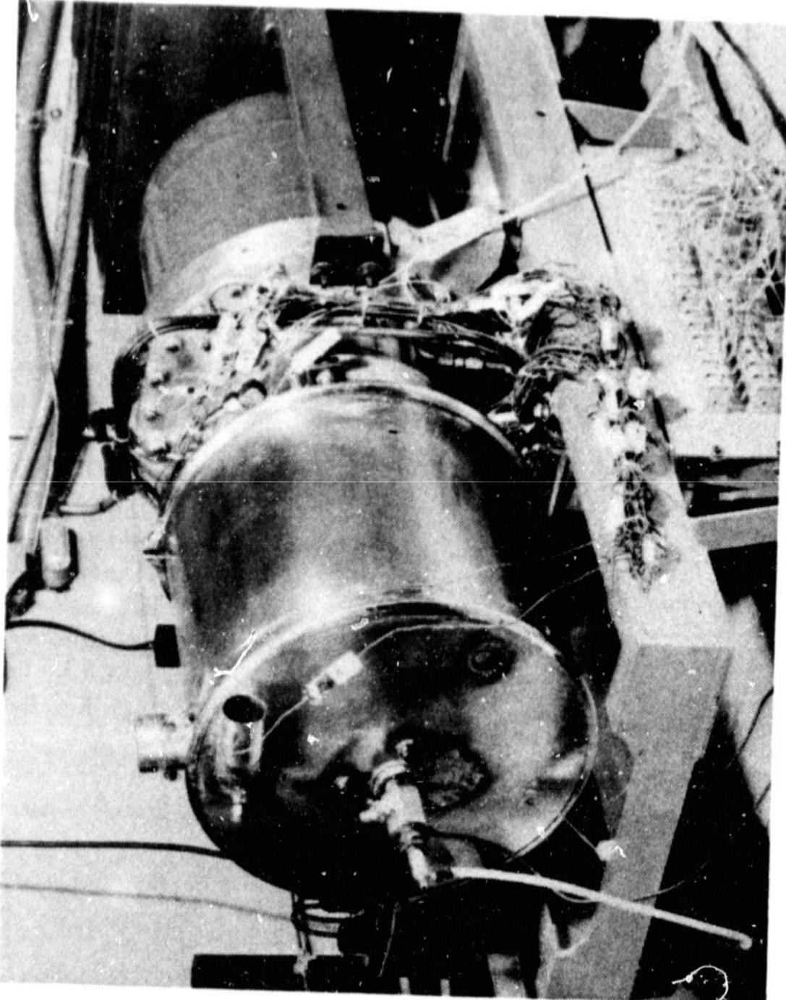  
n n e     n

failures (i.e., pressure out of tolerance, loss of electrical power, loss of shop air).

• A successful build of the EM requires time and care during assembly. With regard to future FPsE designs, it was seen that the design of the EM engine, with its many displacer drive hardware stack-up fits, requires significant attention to detail to achieve a successful build (one with no rubs during bench checkout of the hardware). Improvements in design to permit quicker and more reliable assemblies should be considered.

## 1.5 Recommendations

The most important recommendation resulting from the test results and conclusions to date is the need to continue endurance testing of this engine. The critical l000-hour test confirms the potential for long life and durability, but many additional hours (lO,O00) are needed to fully demorstrate these FPSE features. Continued testing will also identify long-term potential problems that may require a redesign to achieve the goal of long life and high reliability.

At present, the chromium oxide (Cr2O3) material used to provide a durable coating of the critical surfaces has worked extremely well. It has been a tough and forgiving surface. Cr2O3 has not been put on our small inner diameter (I.D.) because of plasma spraying limitation. It is recommenced chat evaluation of other Cr2O3 processes and/or simpler alternatives to Cr2O3 be investigated.

Both the complexity and energy requirements of the displacer drive system are concerns. A lighter displacer would reduce input energy requirements, the material chosen must be compatible with existing materials to assure maintenance of the proper clearances during operation. Information concerning light weight materials and their dimensional stability as a function of time and temperature shouid be sought.

In summary, the recommendations that result from the Endurance Test Program are:

• Continue endurance testing with a goal of demonstrating 10,000 hours

• Eventually improve design for assembly consideration

• Evaluate alternative protective surface coatings

• Investigate material dimensional stability as a function ot tim? ind temperatute.

The engine, instrumentation, and data acquisition system (DAs) are described in Section 2.O. A history and discussion of the overall endurance test is given in Section 3.0. Sections 4.0 through 7.0 present results of each phase of the endurance test.

# 2.0 ENGINE AND INSTRUMENTATION DESCRIPTION

## 2.1 Engineering Model Description

The major components of the EM power module are schematically depicted in Figure 2-l. The following subsections descr e the design of the EM.

## 2.1.1 Engine Thermodynamics

Thermodynamically, the FPSE is similar to more conventional (i.e., kinematic) Stirling engines except that the piston/displacer motions are controlled by a resonant spring/mass system rather than a mechanical linkage.

The thermodynamic elements of the engine consist of an expansion and compression space connected by three heat exchangers, l) heater; 2) regenerator; and, 3) cooler, which convert thermal energy into mechanical energy at high efficiency. The expansion space is the volume enclosed by-the displacer hot end and cylinder head, including the "shuttle gap" in the annular space between the displacer and cylinder walls. The compression space is actually two displaced volumes that are connected: one due to motion of the displacer cold end, and the other due to piston motion. A clearance seal at the cold end of the displacer isolates the compression space from the expansion space. The compression space is also isolated from the "bounce" chamber and gas springs by clearance seals around the power piston and displacer rod. Since pressure in the bounce chamber is essentially constant, the pressure difference across the rod and piston seals is the compression-space cycle pressure amplitude. Ducts through the displacr post and flange assembly connect the two compression spaces. The displacer and piston elements are contained within the same cylinder. The purpose of the displacer is to reciprocate the working gas through the heat exchangers. The engine derives power from the changing pressure amplitude of the cycle acting on the power piston face area (see Figure 2-2).

## 2.1.2 Displacer Drive

The posted design is an MTI design feature that improved dynamics and relaxed tolerances between the displacer and power piston. With the separation of the power piston and displacer via the poated displacer dusign, the dynamics of the FPSE system can be tuned to obtain the desired thermody'namics. The engine incorporates a variable-volume uisplacer gas spring, therefore allowing dynamics/thermodynamics of the engine to be altered by changing the spring rate.

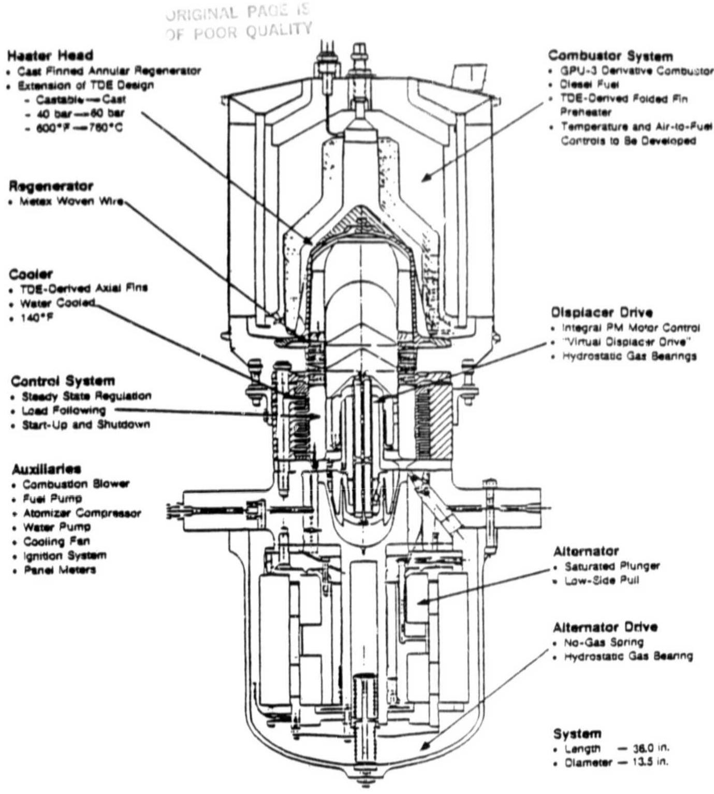  
Figure 2-1 Engineering Model - Major Components

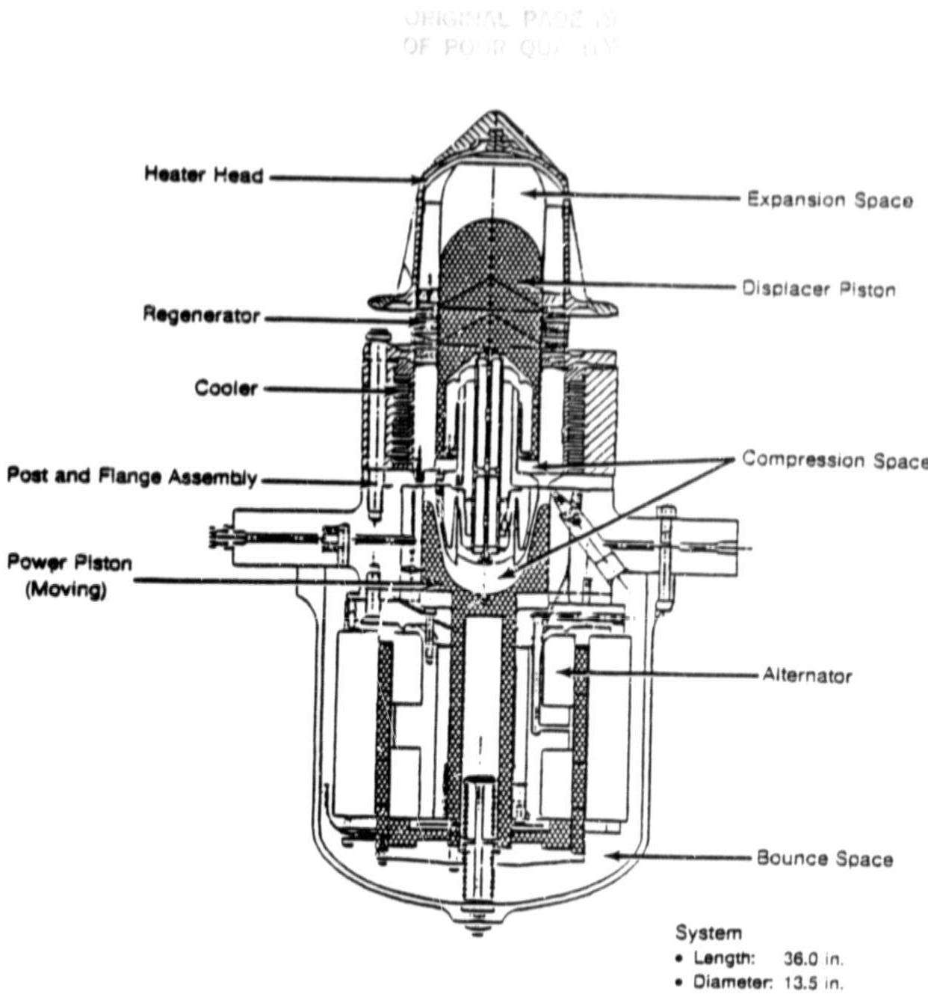  
Figure 2-2 Schematic of Engine Components

## 2.1.3 Engine Control

Typically, a FPSE is a low-stored energy, multidegree-of-freedom engine mads to oscillate freely by designing the system parameters so that the dominant system eigenvalue is neutrally damped, Such a system is simple to operate in a laboratory cnsironment at constant load; however, it is difficult to operate in a transient environment due to its low-stored energy capability and neutrally damped dominant eigenvalue. Any significant change in a working parameter requires a rapid change in another system dynamic parameter to maintain unit stability, which is not practical without providing a hydraulic, pneumatic, or electric buffer between the, load and the engine. By driving the displacer with a linear motor at all times, the controllability of the EM is the single most important and proprietary feature that makes it suitable for various applications and loads.

The combined EM posted displacor concept and linear motor drive consints of the displa.k body and dome, hydrostatic gas bearing displacer rod, linear motor driv, and displacer gas springs. The displacer body contains the displacer cylinder clearance seal, and an integrally fabricated, linear electric motor armature, which is a basic part of the engine pcwer-control system. The displacer rod and body are supported on gas bearings wichin the post and flange assembly (Figure 2-3). The rod area, which is the difference between the effective expansion-space face area of the displacer and the effective compression-space face area, determines the thermodynamic input power to the displacer.

## 2.1.4 Heat Exchanger System

2.l.4.1 Heater Head. The EM heater head (Figure 2-4) was designed as a monolithic pressure vessel that is integral with the annular regenerator pressure wall (see Figure 2-5). This design, which requires no high-temperature structural weld or brazed joints, can be cast with integral internal and external fins.

C--19

aeDatDatDtDeDatate

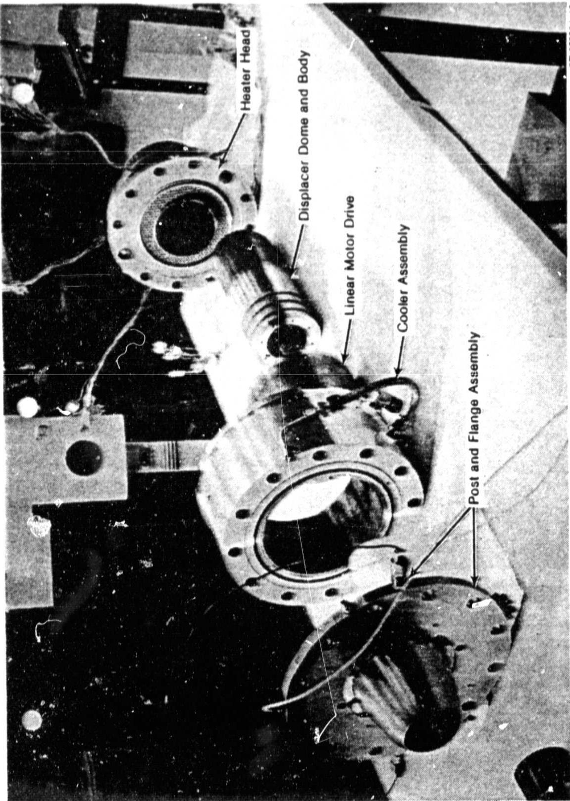

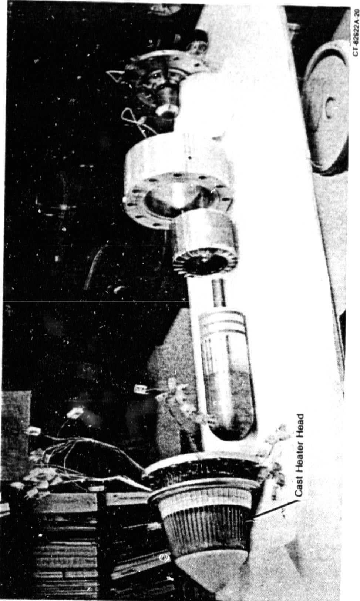  
Fn ntt  d t d  nts

ORIGINAL PACCS OF POOR QUALITY

C122-2

FHttRH R RttRHtgFHHtng

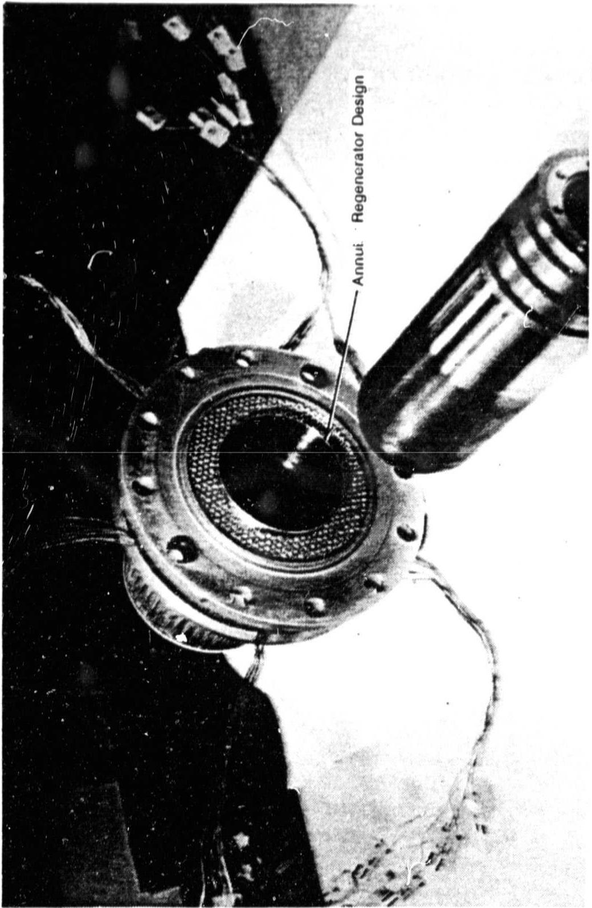

## 2.1.5 Combustion System

The EM combustor is a spin-off developed from the technology demonstrator engine (TDE) with major improvements in the preheater. Fuel and air are supplied to the combustor from an external air/fuel (A/F) control system. Inlet air is preheated by the combustion exhaust in a folded fin preheater. The preheater air enters the combustion chamber through a swirler cup to create a turbulent mixing zone, and fuel is injected through the center of the swirler cup into the combustion zone. The current combustor system (shown in Figure 2-6) is designed to burn natural gas at a peak firing rate of l6 kW. The combustor control senses heater head temperature and adjusts fuel and airflow to maintain the heater head temperature at the fixed operating temperature.

## 2.1.6 Regenerator

The regenerator is an annular, porous ring located between the heater and cooler. The regenerator matrix (Figure 2-7) is metex, a .0035-in. diameter knitted wire, formed and pressed in a disk to the specified porosity.

## 2.1.7 Cooler

The engine cooler (Figure 2-8) is located in an annulus between the regenerator and compression spaces. The helium-side flow paysages are rectangular slots milled axially onto the inside of a thin, aluminum pressure wall, whereas the water-side assages are circumferential grooves machined onto the outside of the pressure wall. The cooler is connected to the compression-space volume through the compression-space connecting duct.

## 2.1.8 Gas Bearings

Both the displacer and power piston are radially supported by hydrostatic gas journal bearings. The displacer bearing feed holes, located in the engine post and flange assembly, consist of a single-plane series of holes at one end and a double-plane series of holes at the other end, while the power piston bearings consist of two sets of double-plane feed holes located at each end of the alternator cylinder.

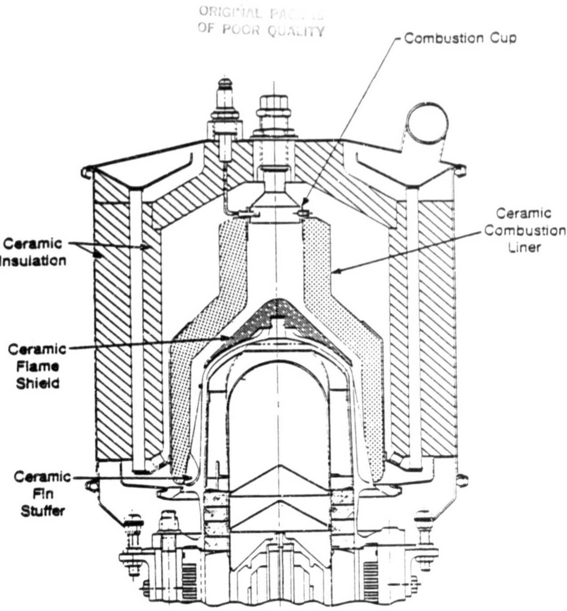  
Figure 2-6EngineeringModel External Heat System

Metc Stx Rcks

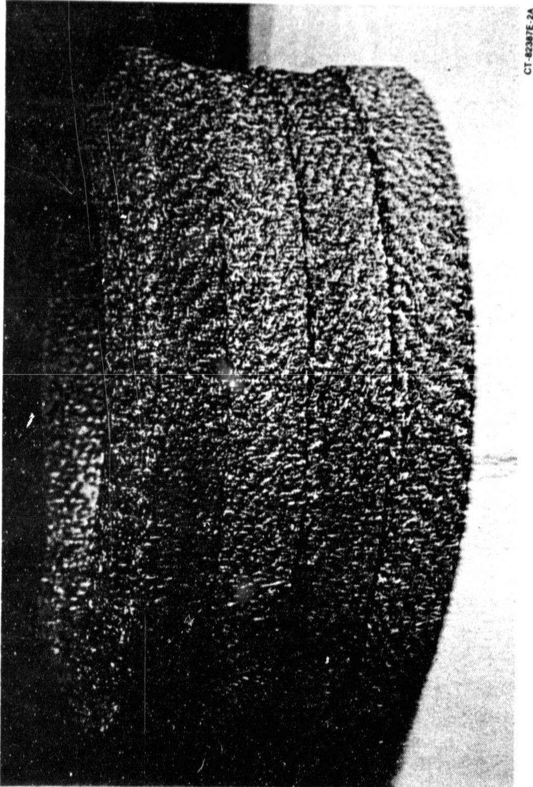

C1-2-23

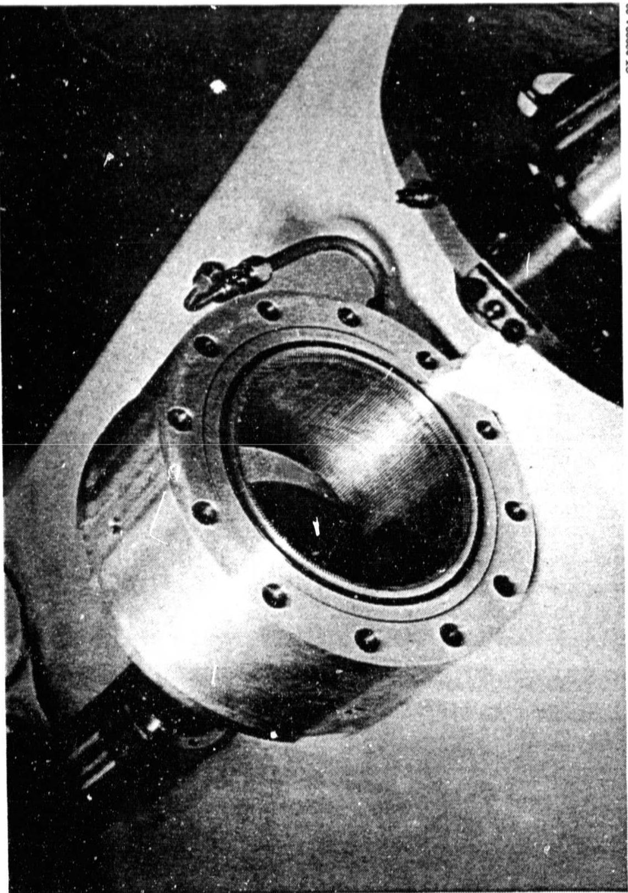  
En1t Cttert P1F-8

## 2.1.9 Close-Tolerance Seals

The EM utilizes close-tolerance, noncontacting seals to isolate the various gas volumes in the power module. The engine seals (Figure 2-9) consist of the:

• Forward Gas Spring Seal - Isolates gas spring volume From compresgion-space volume

• Aft Gas Spring Seal - Isolates gas spring volume from compressionspace volume

• Forward and Aft Bearing Seals - Isolate the bearing drain pressure (bounce pressure) from gas spring pressure

• Shuttle Gap Seai - Isolates expansion-space volume from compressionspace volume

• Power Piston Seal - Isolates compression-space volume from bouncespace volume.

## 2.1.10 Alternators

The "partially-saturated plunger" alternator evolved from earlier flux-switching alternator configurations. This concept (shown in Figure 2-l0) is based on the principle of minimizing the weight of the driven mass (plunger) at the sacrifice of the stationary mass (stator). The resulc is that only the pole pieces (required for "flux-switching") are needed to form the moving member. Furthermore, both inside and outside stator coils have been devised to optimize overall packageability and to enhance the alternator conversion efficiency. The latter can be achieved by virtue of the smaller mean diameter of the coil windings on the inner stator relative to the outer coils, thereby reducing the overall I²R losses for the alternator system.

The linear alternator consists of a 0.5-in. thick cylindrical plunger that reciprocates between the inner and outer cylindrical stators. A DC field coil generates a toroidal flux path linking the inner and outer stators which passes through the two magnetically active rings on the plunger and passes in and out of the two stators. Consequently, reciprocation of the plunger causes the flux toroid to move axially along the stator, sinusoidally linking and unlinking four physically separate AC output coils. These electrically connected coils act as a single output coil, providing alternating AC voltage and power.

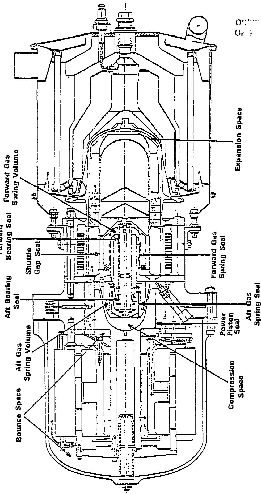  
Cte e sts e -9

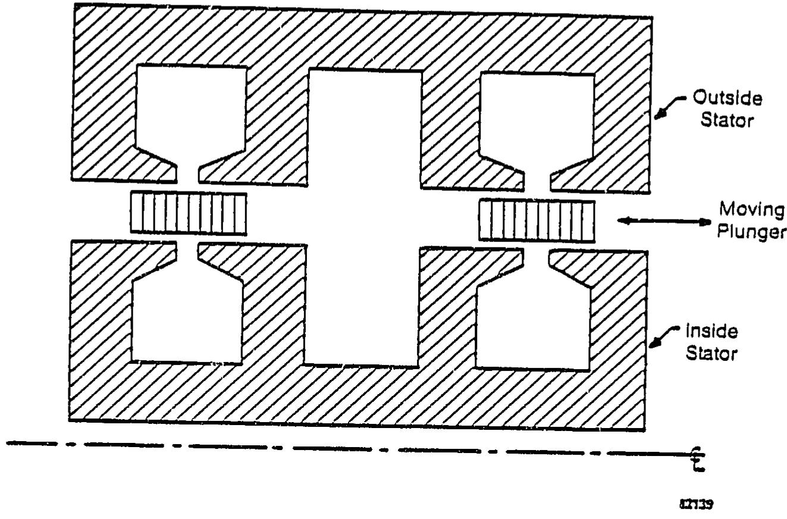  
Figure 2-l0 Partially Saturated Plunger with Inner and Outer Stator

The EM alternator is relatively rugged and has a low plunger weight. The lightweight plunger allows the EM to operate at 60 Hz without the use of an auxiliary piston gas spring. A layout of the alternator and plunger configuration is shown in Figure 2-ll, and a photagraph of this configuration is shown in Figure 2-l2.

## 2.1.11 Skid and Support

The EM. presently mounted in a horizontal orientation on a structural aluminum stand, makes use of five soft rubber mounts, four of which are located on the mounting flange between the engine and alternator, and one on the alternator pressure vessel (see Figure 2-l3). The machine is allowed to vibrate freely in this configuration. A structural integrity problem with the combustor was encountered during initial testing. Work is being performed on a new combustor design to solve the problem. In the interim, the EM is linked to a large mass, reducing the casing vibration, located at the rear of the machine and attached by means of two steel stringers fastened to the mounting flange of the EM (Figure 2-l4).

## 2.2 Engine Instrumentation

The purpose of the test was to accumulate durability hours. In instrumenting the EM No. 2, the primary consideration in selecting the parumeters to be measured was to be able to use the measurements to monitor the operation of the machine and be able to use the measured values to observe changes in operating conditions that would be indicative of component wear. Therefore, the measurements could be used to trouble-shoot problem areas and be aule to adjust, to some degree, for minor wear or to shutdown shocld major problems occur. The entire instrumercation package was streamlined to exclude what was considered nonessential parameters. The instrumentation chosen measures parameters of pressure (P), flow (V), position (Xp and Xp), case acceleration which indicates case position, and temperature (T); along with appropriate voltages (V) and currents (I). Table 2-l is a listing of those measurements along with a description of the measuring equipment used.

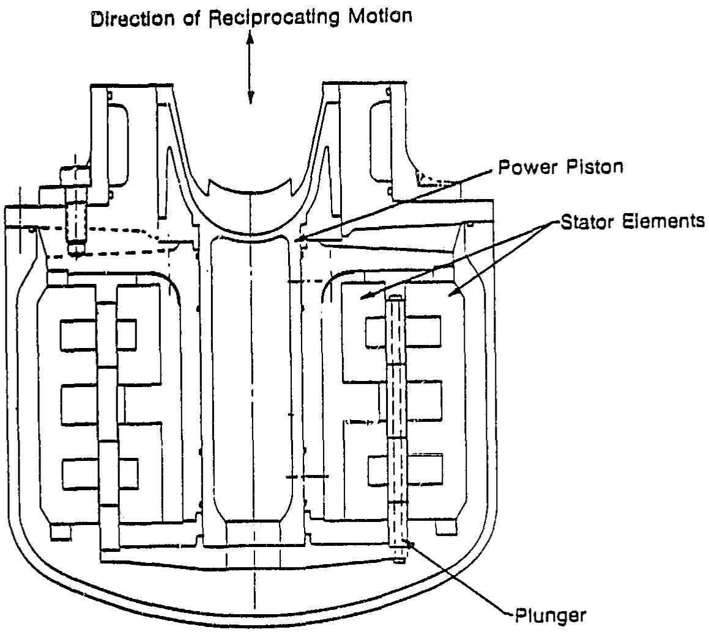  
Figure 2-l1 Partially Saturated Plunger Alternator Subsystem

ORIGINAL PAGE IS OF POOR QUALITY

PintsP PtsPatsPasPnts

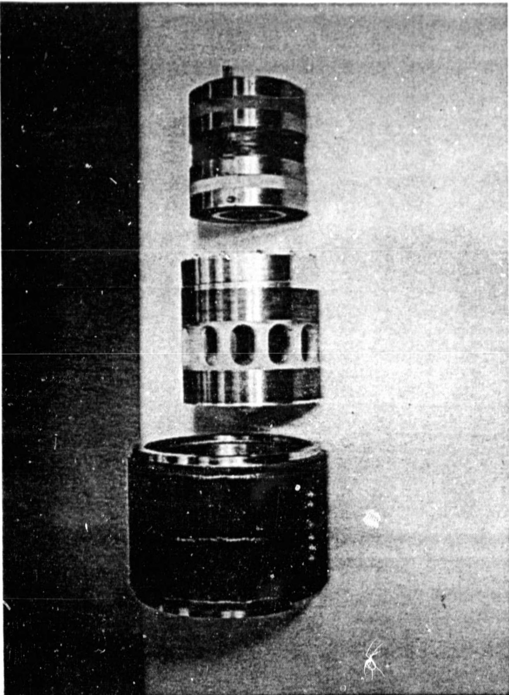

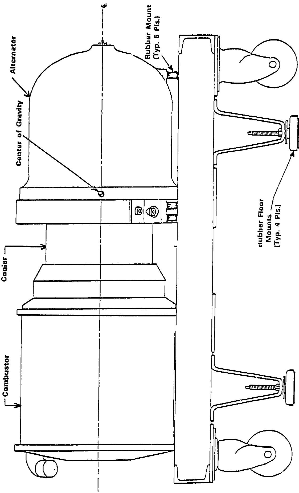  
E   ia 1e 13

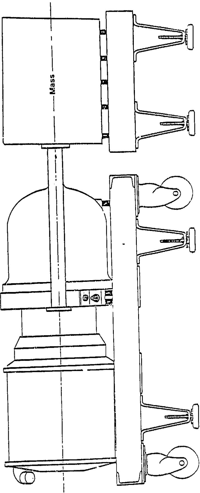

# TABLE 2-1 ENDURANCE ENGINE INSTRUMENTATION

## Pressures

Pmean Kistler 4045Al00 with 4601 amplifier

Pbearing  Kigtler 4045Al00 with 4601 amplifier

PDGS2' Kistler Piezoelectric 60lA with 5002 charge amplifier

PDGS2 Kulite XF-l-190-2000 wich analog device with 2B31J conditioner

PC Druck PDCR/200 wich analog device 2B31J conditioner

PDGSl' Kistler piezoelectzic 60lA with 5002 charge amplifier

PDGS1 Kulite XF-l-190-2000 with analog device 2B31J conditioner

Pair Dyuisco APT-320J-25

Pfuel Dyni,sco APT-320J-25

## Flows

Air Meriam LFE laminar flow element with Validyne DP-45-l6/CD-15 differential pressure transducer and carriar denodclator

Fuel Meriam LFE laminar flow element with Validyne DP-45-l6/CD-15 differential pressure transducer and carrier demodulator

Coolant  Bearingiess flow meter model E-l00 with analog devicas AD 451J frequency-DC converter. Coolant temperatures aro monitored by thermistors (2252 Ω @ 25°C)

## Displacements

XD1, XD2 Kaman KD-2350-2UB Eddy current displacement measurement systems

XP1, XP2 Kaman KD-2350-lU Eddy current displacement measurement systems

Voltage, Vmotor, Imotor, Vload, Ilcad, Valt, Ialt are sensed by resisture Current voltage dweden, step-down potential transformers, current transformers

The measurements taken can be classed in two categories, static and dynamic measurements.

Static Measurements. The static measurements consist of DC readings, along with some mechanical visual readings. Measurements of heater head temperatures, air temperature, fuel temperature, coolant temperature, air pressure, fuel pressure, mean charge pressure, combustor pressures, and air, coolant, and fuel flows are all static measurements.

Dynamic Measurements. The dynamic measurements consist of AC readings and are parameters which change at the engine frequency, which is 60 Hz. Examples of these measurements are piston and displacer position, compression space pressure, and electrical input and outn't measurements (such as motor current and alternator output current). The AC measurements were made with an RMS voltmeter; the result was used to calculate amplitudes. The disadvantage of this approach is that phase angles are lost; therefore, parameters such as engine PV power and spring losses can not be routinely calculated.

## 2.3 Data Acquisition System

The DAS used for FPSE testing has been in use since January l98l. This overall system is configured around two processing units; HPl000XL microcomputer and an HP9825 calculator. The HPl000XL computer and its peripheral instruments is the primary system. This system is used where detailed performance evaluation is required, since it is capable of acquiring and analyzing dynamic signals generated by position and pressure gignals. This system is also used to acquire steady-state data from several "performance" test cells. The real-time operating system of the HPl000 can coordinate and schedule several concurrent tasks, and is thus capable of performing data acquisition tasks for several simultaneously operating cells as well as background program development and data reduction tasks. The use of the HPl000 for this endurance testing was limited to analysis of up to four dynamic signals during the duty-cycle test and post test storage and analysis of data collected by the HP9825 calculator based system.

The 9825 calculator controls a satellite DAS, which was the primary system used for monitoring and controlling the endurance test. This system includes the calculator, a frequency counter, a precision DVM, scanners, and a six-channel relay actuator, which are used to acquire data and provide limited engine control. The primary limitations of this system are that it can not quickly acquire and analyze high-speed dynamic signals, and it must be dedicated to, basically, a single task (limited multi-tasking has been implemented via user software). To support the endurance test, this system has been programmed to perform:

• Basic data acquisition and limited real time data analysis

• Continuous monitoring of critical engine operating parameters and detection of out-of-tolerance conditions

• Automatic shutdown of the engine should one or more out-of-tolerance conditions be detected

In spite of its limitations, this system provides all essential functions for monitoring of the endurance test, including measurement of dynamic signal amplitudes. This is accomplished by measuring these parameters with the true RMS functicn of the DvM and scaling the result, assuming that they are sinusoidal.

The measurement of pV power and internal losses was limited during the test by insufficient high-speed channel capability and the lack of necessary software to easily and efficiently measure these parameters. These limitations were substantially eliminated near the end of the test; therefore, future endurance testing will have DAS support which is very similar to that of the performance test cells.

## 2.4 Engine Control

There are three major control systems associated with the engine test cell:

1. Combustor control system

2. Power control system

3. Unattended operation interlock system

The combustor control is a digital electronic unit which monitors and controls heater head temperature and combustor A/F ratio. The primary inputs to the controller include 10 type K heater thermocouples (T/C), fuel flow and airflow. The required air and fuel Elow rates are set points to PID algorithms which control the position of the actual air and Fuel control valves. This unit also monitors the status of several contactors which are part of the unattended operation function described below.

The power-control system is an analog electronic control which monitors and controls the alternator output voltage. For most of the first, second, and fourth phases of the endurance test, this control was used in a manual mode (i.e., the motor input voltage and frequency were set manually). However, during the duty-cycle test, the operating frequency and required output voltage were set, and the proportional/differential algorithm of the control unit determined the motor voltage required to maintain a constant output voltage for various load resistance values.

The unattended cell control is provided by a variety of hardware, including:

• Combustor control system

• HP9825 DAS

Hardwired relay and switch logic

The faults which this system protects against and the action taken for each is summarized in Table 2-2. The basic control approach was to turn off the combustor and engine motoring when any faults were detected. The more critical faults are handled by hardwired relay logic. Several faults associated with the combustion system are handled by the combustion control system. The least critical faults are detected by the DAS. Due to the time required to complete a scan by the DAS (s30 s), these faults are related to slowly varying or less critical to engine parameters.

eune pe Ccs) c s   d a t  e  te ton

lld ld ed cld cler Son  n tne   ne

co  ( n   ne con     on llt   t t t on

coo on n  s     o nga    g s  ot Scae  o a s  ooue

shopns Na   t l e

l cl n c ce co        o ba a l S. s  s

I1(an ) Cn Cant rel     t  se dt t    t ol t Co     ton ol nn nn  t ccR

t( s a   d  r er o  s s  n oxnt n. t n  ol ll

B.l   ure

Bx ug d a

Dlo s s s  it

Atreere e e  ent

(l)  n

tere y y anyaant

C0t 0Dw 3.  aory

CO0t 0 2.e  r ary

r t e e Cole    e   eu

Jc     -  d ly -r C      c u o unnd () di eee e Suedn

fld el ed n    :  n AVcc l a l   e an

rPe   tl) a       al e   . e  l to Dd et t o  o en ra   a  a   am -    eo   -

## Syse e

doy ycoy

VUbion 1 cl l

s s   a

##

# 3.0 GENERAL DISCUSSION AND HISTORY

The l000-hour endurance test was divided into four phases as described in Section 1.0. A discussion of aspects common to all phases of the test, history of the test, and a chronology of significant events are described in this section.

## 3.1 Test History

A complete chronological history of the endurance test, indicating significant events during the test program is given in Table 3-l. This information is also presented versus engine operating hours in Figure 3-l. In general, testing proceeded smoothly, with few interruptions. However, there were three major unplanned shutdowns during the program:

1. The heater head instrumentation necessary to monitor and control the heater temperature failed. This was caused by a combination of rough handling and vibration whtch broke the sheathed thermocouples (T/C's) that were brazed to the heater head. Since the T/C's were brazed to the head, their repair was involved and caused a substantial delay in the program. A subsequent redesign of the head instrumentation has substantially reduced the possibility of failure and, at the same time, will permit easy replacement of the T/C's if they should fail.

2. After the completion of the full-stroke test, the engine was being run to repeat selected test point performance. Due to an operator error, the engine was run for approximately three minutes (sl0000 cycles) without the hydrostatic gas bearings operating before the error was noticed and the engine shutdown. The subsequent inspection showed a number of local scratches, attributed to the dry-bearing operation, on the power piston (Figure 3-2) and mating bearing. The depth of the local scratches were not measurable by conventional instruments (micrometers); the surface profile (Figure 3-3) was measured in the areas shown in Figure 3-4 with a surface analyzer. Further, the bearing flow rate increased less than l0%

EAGR2ITNTIONALY BLANK

K NOT TILITD

<table><tr><td>Date</td><td>Event</td><td></td><td>品 é Comments PAC:</td></tr><tr><td>4/8</td><td>Initiated 100-nr low-power test</td><td></td><td>QUALIT</td></tr><tr><td>4/15</td><td>Completea 100-nr low-power test</td><td></td><td>lotai 100 n-</td></tr><tr><td>4/15-4/25</td><td>Planned inspectior</td><td></td><td>No measurab&#x27;e haranare changes</td></tr><tr><td>4/25-5/20</td><td>Limiteo full-stroke test</td><td></td><td>Heater nead instrumentation proolems</td></tr><tr><td>5/20-7/11</td><td>Heater neac refurbisnmert</td><td></td><td>Heater head thermocouples completely replacec</td></tr><tr><td>7/13</td><td>In:tiated 300-hr full-stroke tet</td><td></td><td>Minor problems itn unattended operation mode. corrected during testin.</td></tr><tr><td>9/3</td><td>completed 300-hr tuli-strohe test</td><td></td><td>Totai 40u n</td></tr><tr><td>814</td><td>Engine run without Dearings pressurt</td><td></td><td></td></tr><tr><td>8/5-8/15 8/17</td><td>Planned inspectior</td><td></td><td>No measurabie naroware changes</td></tr><tr><td>8/29</td><td>in:tiated 600-hr duty-cycie tes:</td><td></td><td></td></tr><tr><td></td><td>unscneauled shutaown at hour 210 of 60-nr tes:</td><td></td><td>Small section ot magnet separated and jammed displacer: damagej liner</td></tr><tr><td>9/29-9/14</td><td>Teardown</td><td></td><td>Engine rebuilt witn nen motor liner. reparied dispaicer</td></tr><tr><td>9/14 10/2</td><td>Restarteo duty-cycle test</td><td></td><td></td></tr><tr><td>10/2-10/9</td><td>Completed 600-nr duty-cycle test</td><td></td><td>Total 10e0 hr</td></tr><tr><td>10/9-10/15</td><td>Continuted duty-cycle test additional 100-hr</td><td></td><td>Total 1100 h^</td></tr><tr><td>10/15-2/13/84</td><td>Planned inspection</td><td></td><td>No measurable tardware changes</td></tr><tr><td>2/13/84-2/21</td><td>Internal bearing development and demonstration</td><td></td><td></td></tr><tr><td></td><td>Start-stop test</td><td></td><td>No measurable nardware changes; 262 start-stop cycies</td></tr></table>

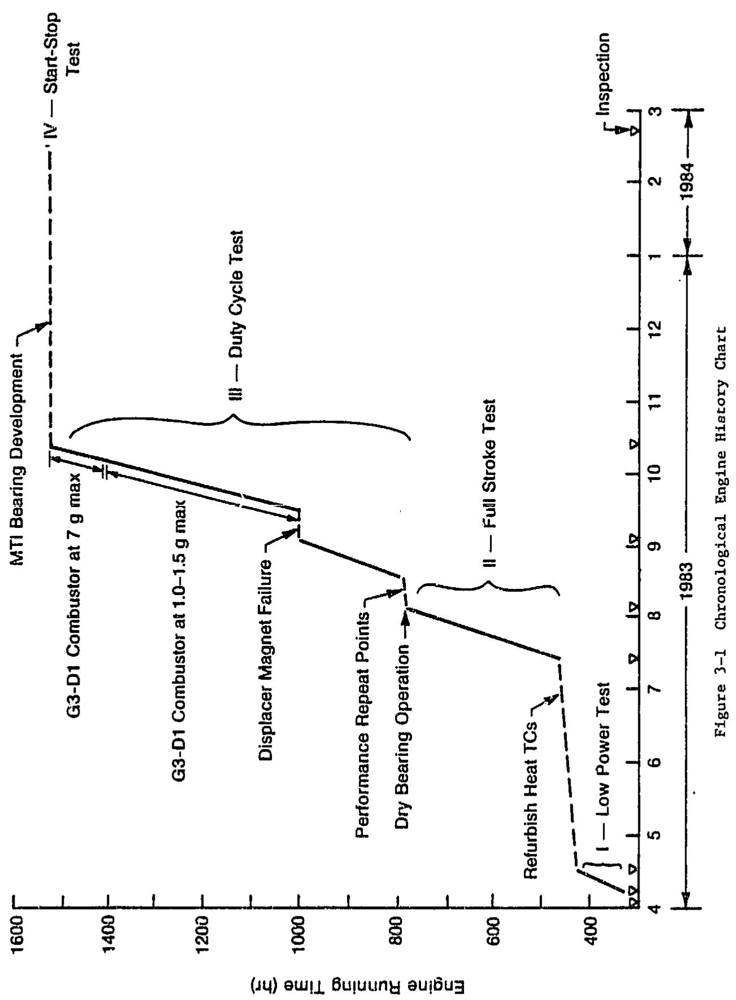

# ORIGINAL PLG OF POOR QUALITY

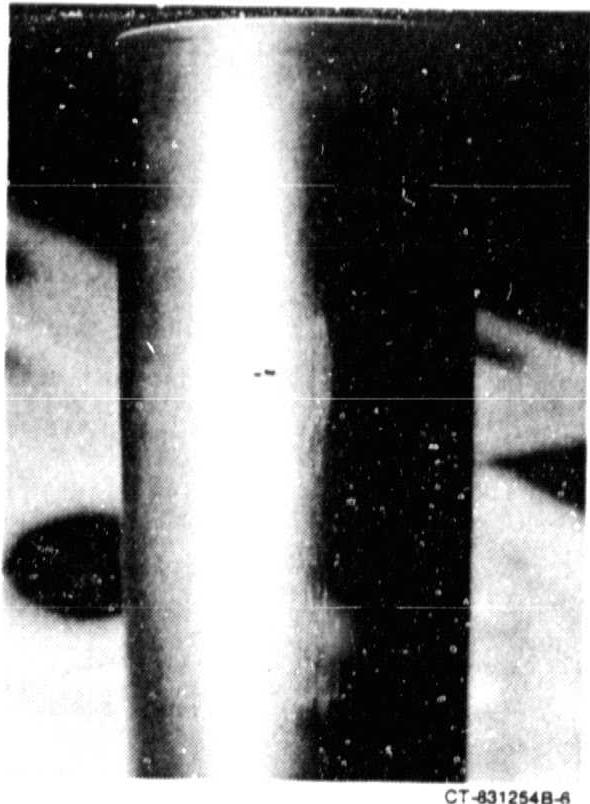  
Figure 3-2 Piston Rub Due to Dry Bearing Operation

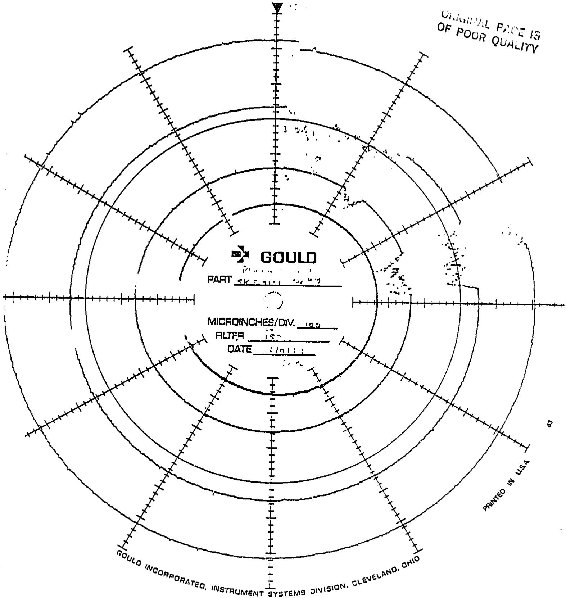  
Figure 3-3 Surface Profile After Dry Bearing Operation

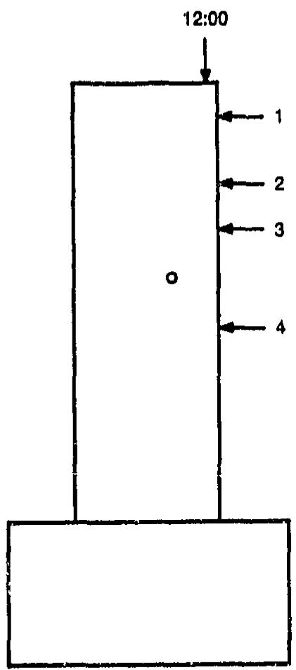  
Figure 3-4 Location of Profile Measurement on Power Piston

CRS

OF POOR QJALITY

from pre-tegt measurements. the icratche; wert polighed and cleaned to remove high spot4 nud lebr hotn rnr:tnuting the !pgt.

3. A small $( 1 / 4 " \times 1 / 4 " )$ segment of the displacer dtive magnet became dislodged and jammed the displacer. tho magnet matertal i3 very brittle, although it is secureiy bondud t) rhe displacer and protected from chipping, it ig subjee' to damage during nanutacture and assembly. The failed gegment had broben lurirg assembly prior to the start of the endurance prngram and had been cemented back in place with an anaerobic adhesive. Ihig repair, however, proved to be temporary and the gegment dislodged 220 huri int the duty-cycle testing. The magnet became lodged hetween rhe displacer nagnet and motor stator causing significant damage ro he phenolic motor liner. The dislodged magnet was pulverized before the failure became evident and the engine sropped. The engine was repaired by filling the void in the magner with che same epoxy used to boud the magnets to the displacer. The phenolic liner was also replared. No noticeable loss of motor performance has resulred from the resulr" ing reduction of magnet volume.

Other cauges of engine shutdown were rel-ted to the exrernal combustor, engine support stand, and support facilities.

## 3.2 Combustor

The combustor used to supply heat to the engine proved to he less reliable than desired early in rhe tesr program and was modified yeveral times to correct various problems. As the engine power module endurance (excluding the combustor) was the objective of this test, its durabilitv and lite potential will be only briefly discussed.

The poor durability of the r!y altribured to the relatively high vibration levels (s7 g's tirh the rombustut was subjected.Substantial imptvement.t näl he combustor design during the endurance test. The latest combustor Jesign (G3-[]) was run for s380 hours with the engine tied to an inertial mass (sl-l.) ) tol:owed hy 90 hours of operation at 7 g operation where the ungine casu was tree to vibrat (yee bigure 3-l). lhe durability of the combustor in the high g environment was found to be limited by the relatively soft rigid insulation materialy used in its construction. While substantial improvements in the combustor proper were made, the most successful solution was to substantially reduce or eliminate the engine vibration.

## 3.3 Engine Support Stand and Facilities

There were several failures of the struts which connected the engine to the inertial mass. This had no effect on power module; however, if not caught quickly, operation after strut failure could cause rapid degradation of the combustor. The facility and interlock system designed to protect t.he engine from facilily related failures caused numerous engine stoppages early in the test program. These problems were corrected and the test continued. By the duty-cycle test phase, the number of facility related stoppages were substantially reduced. The last 400 hours of duty-cycle testing were completed in 432 clock hours (18 days) or only 8% down time.

## 3.4 Critical Clearance Inspection

Prior to each test phase, the critical wear surfaces were thoroughly inspected and photographed. The engine was also inspected when a failure involving the power module occurred and following each test phase. Critical measurements and inspection locations are shown in Figure 3-5. These areas and the clearances are outlined as follows:

• Displacer Bearings/Seals - Clearance between displacer rod (rod that attaches to the displacer body) and post manifold. This clearance is important for proper operation of displacer gas bearings and to seal the forward and aft displacer gas springs from the bearing drains.

• Displacer Motor Seal - Clearance between outer diameter (O.D.) of the displacer body in the area of the permanent magnets and displacer motor liner which seals between the hot-expansion and cold-compression spaces.

• Displecer Gas Spring Seals - Clearance between the forward gas spring and outside diameter of the post, or between aft gas spring and gas spring cylinder. The purpose ut this clearance is t) prevent lenkage between the gas springs and eny: pr:;ure wave,

Crs s as ass  s s on Inb ntyy Sy Sn2) uu-5  
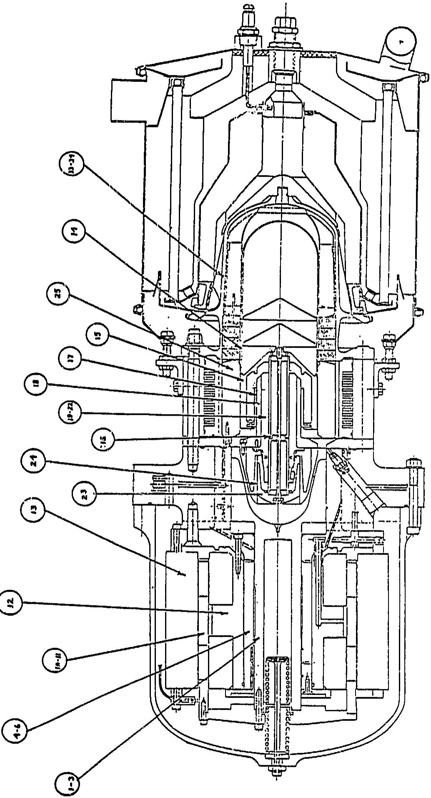

• Power Piston Seal - Clearance lutween forward power piston and power piston cylinder which pr:id. sr,le hatween the engine pressure wave acting on the tace o!  twer pistor and engine mean or bounce presgure.

The inspection data for the initial test :as tabutated on the torm shown in Table 3-2. As shown in Table 3-2, all ritial qurfaces have been given an item number (Column 1), Figures 3-5 to 3-7 lrt'es each :rem on an overall assembly. The detail drawing number for the part is gi.en in Crlumn ? and the gerial number in Column 3. The item is described in 'imn 4. The nominal print dimension for each item is given in Column 5, and Column 6 gives the average as measured dimension. Column 7 lists the results of a flow cherk for several bearings or seals; these flow paths are shown in Figures 3-6 ind 3-7. The flow measurement rig used for rhese checks is shown in Figure 3-9. Climns 8 and 9 lisr the design and as measured surface finish. These ar done with a surface comparitor; the initial surfaces are in new condition. A detailed surface profile (Column l0) will be completed where appropriate, for subsequent inspections. The part weights are listed in Column ll; these are measured wirh a balance which has a resolution of l gmn. Column 12 lists the picture numbers of the critical surfaces. For each surface a picture is taken with the part in each of four orientations (l2, 3, 6 and 9 o'clock). The final column is orovided for miscellaneous remarks.

The clearance was determined by measuring the bore (I.D.) of the cylinder and subtracting the measurement of the utside diameter of the mating part. This procedure resulted in a measuremen: of twn relatively large diameters; the subtraction of one from the other resu!ting in extremely small clearance dimensions. Since the inspection itselt was a difficult task, care was taken to have the sarie inspector conduct each insperrion in an attempt to maintain consistency. Because of the instruments used and the number of measurements taken, the uncertainty of the resulting measurement wa: 70-millionths of an inch (.00l78 mm).

The results for the critical clearances as d function of test hours are graphically presented in Figures 3-9 through :-l4 and include measured clearances relative to the design value oi the disp!acer pearings, displacer seals, displacer motor seal, gas spring seal, power pist n bearingy, and power piston yeel, respectively.

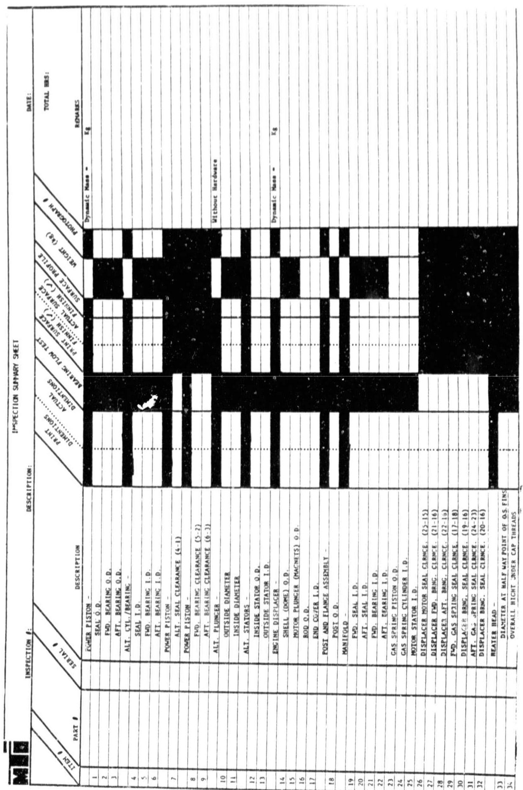

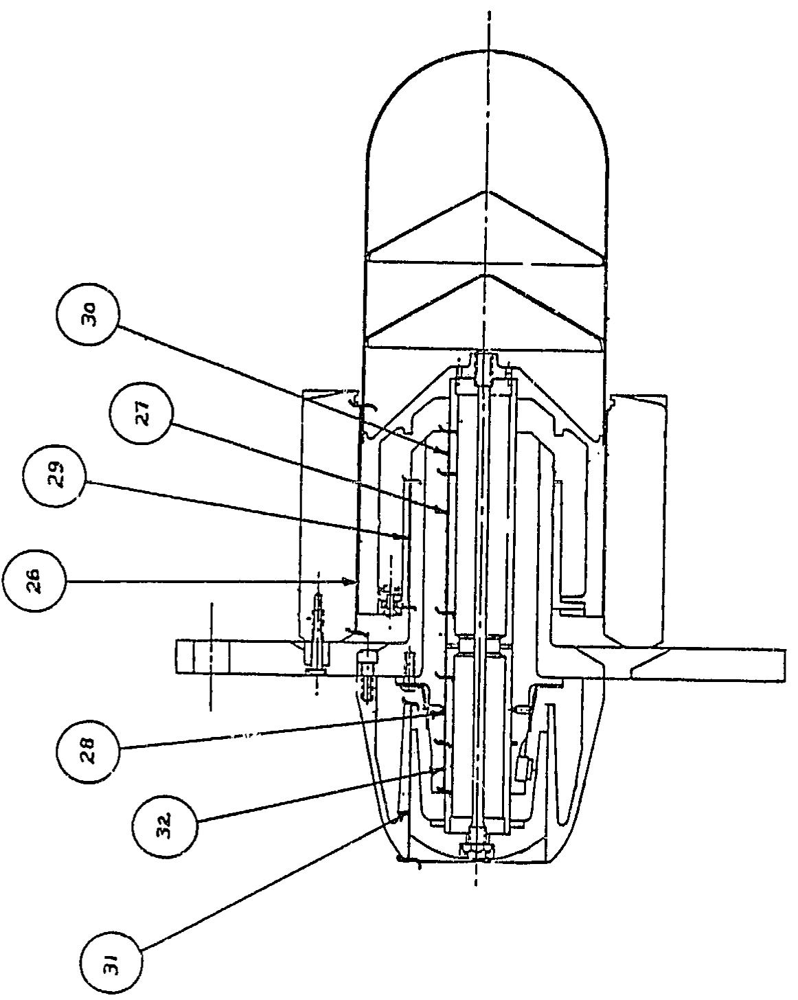  
Ccrt s  s s ms nn  n dn ) e rb

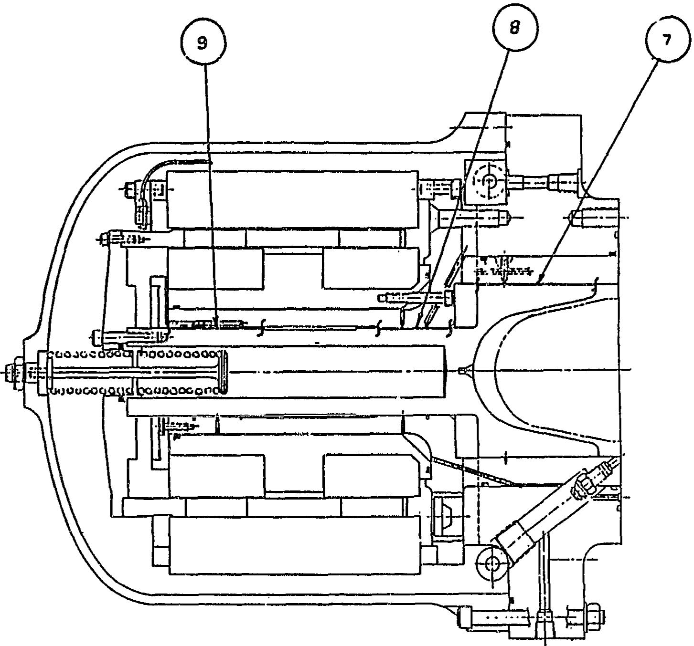  
Figure 3\~7 Critical Alterantor Clearances (numbers reference items on Inspection Summary Sheet, Table 3-2)

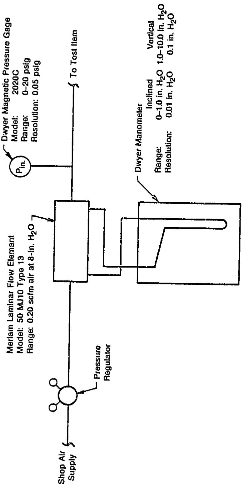

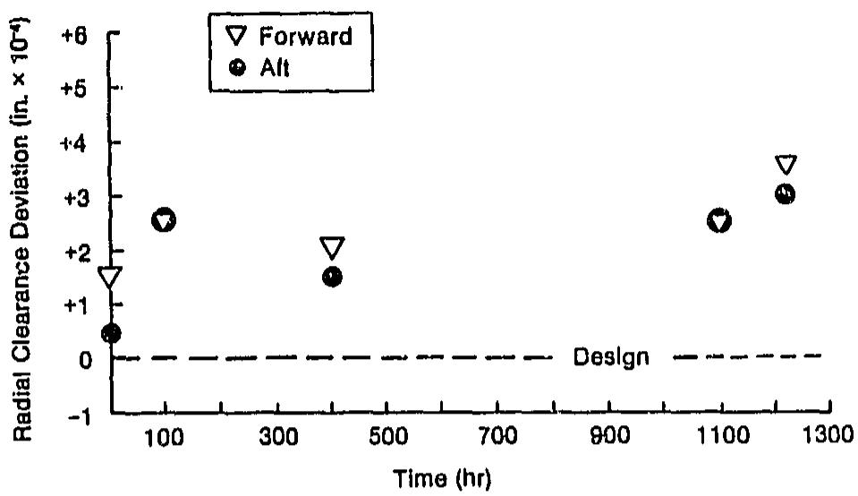  
Figure 3-9 Measured Clearances - Displacer Bearings

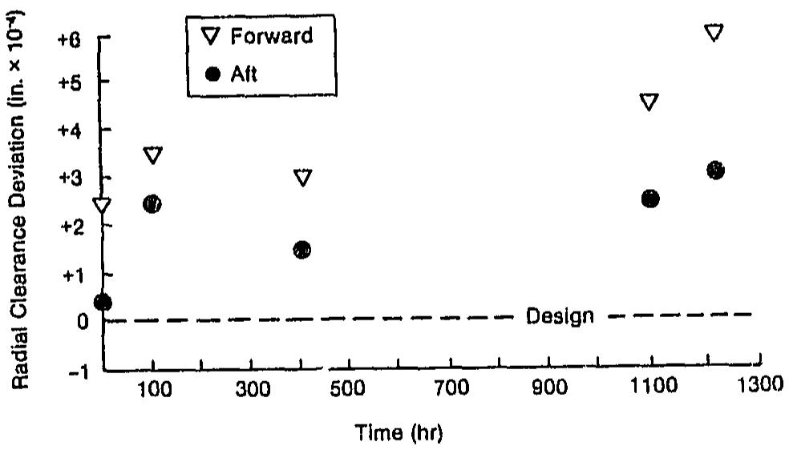  
Figure 3-10 Measured Clearances - Displacer Rod Seals

Measurements Taken after 1220 hr  
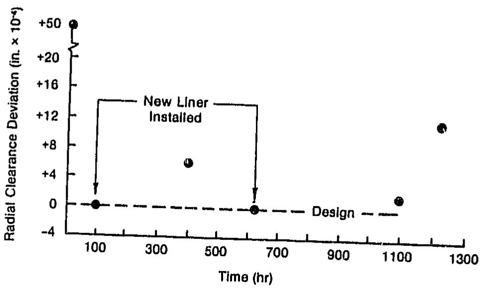  
Figure 3-ll Measured Clearances - Displacer Motor Seal

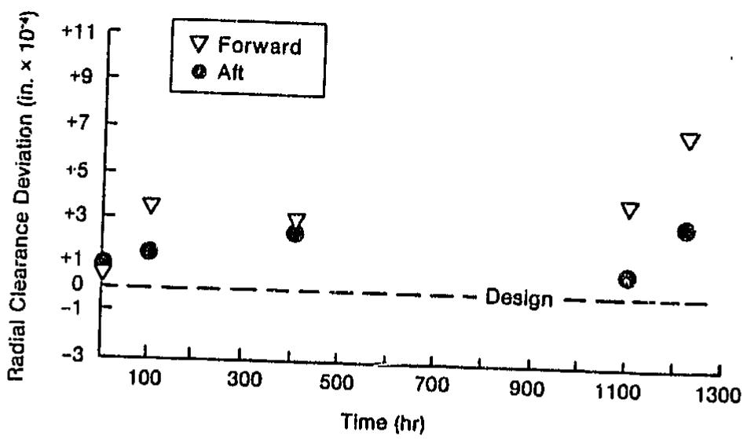  
Figure 3-12 Measured Clearances - Gas Spring Seals

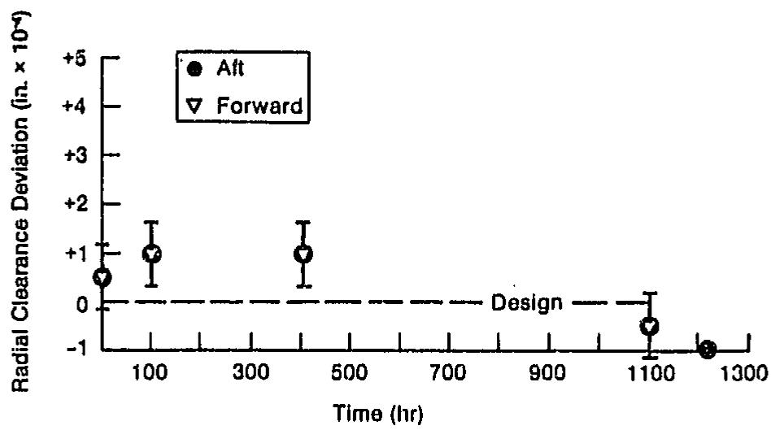  
Figure 3-l3 Measured Clearances - Power Piston Bearings

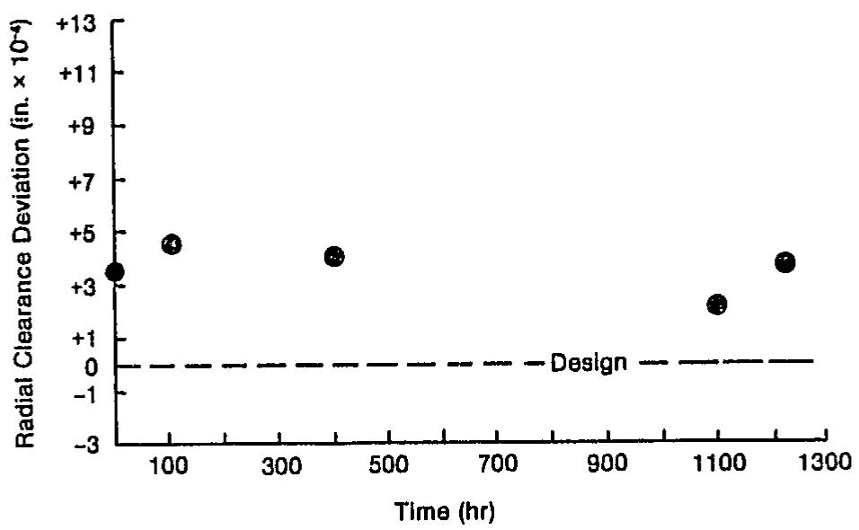  
Figure 3-l4 Measured Clearances - Power Piston Seal

As can be seen, no trend is exhibited in the critical clearance measurements, even though variations between clearance; exist at the various inspection points. Since the variations over time are within the measurement uncertainty band, they are not statistically significant and do not repreyent a change in clearance.

## 3.5 Bearing Flow Measurement

As another check on bearing clearances within the displacer and power piston, bearing flow measurements were made on the assembled engine at the beginning of the test and prior to teardown Eor each inspection. Flow versus back pressure is a very sensitive indicator of changes in the bearing gurface clearances.

The change in bearing flow as a function of time, which is an indicntion of the change in bearing clearance, shown in Figure 3-l5. The flow is seen to slightly increase during the first 400 hours of thē test, but is nearly constant throughout the remaining 700+ hours. These t!ow measurements confirm these inspections of the critical clearances that showed no significant increase in bearing clearances during the test.

## 3.6 Internal Bearing Supply Development

Phases I, II, and III were all conducted with externally supplied gas bearing pressure.

The demonstration of internal bearing operation was carried out on MTI funds between the end of the duty-cycle test and prior to beginning the start/stop task of the 1000-hour endurance program.

The engine hardware was modified to add a check valve that would pump working fluid from the engine compression space to the bearing supply plenum. The check valves are based on a commercially available o-ring check valve in which an o-ring expands radially when the valve opens, then springs back into a groove to ciose. The power piston and cylinder were also modified to increase the mid-stroke port area and to enlarge the passages between the ports and bounce space, The initial tests of this hardwure showed the relatively small ports originally in the piston would have been adequate to maintain the piston mid-stroke position. During the tusting, several improvements were made to the' check valve assemblies to reduce the pressure drop in the valve and connecting tubing. Two chack valves were found to be too restrictive for the desired bearing Elow. Furthermore, the check valve plenum was found to be too small, causing high prcssure pulsation in the discharge when the valve oper.ed. Therefore, a plenum assembly was fabricated which provided for four chock valves and substantially increased the plenem size.

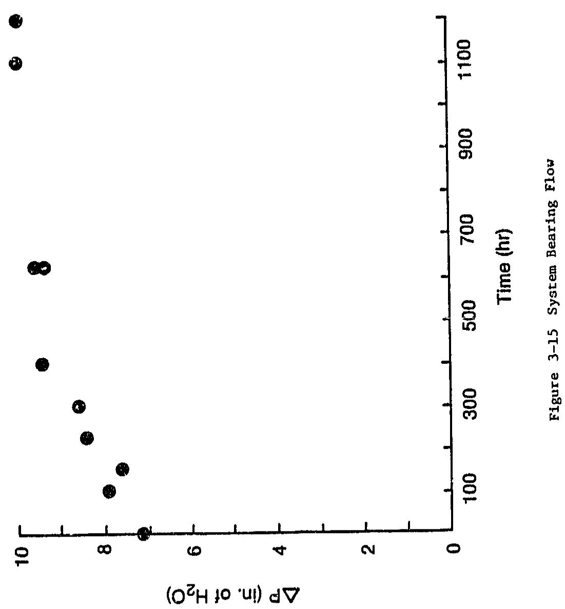

When this aasembly was tested, the discharge plenum was found to have a relatively large pregsure amplitude at a frequency corresponding to the resonant frequency of the plenum and discharge tube system. Several tests were carried out to characterize the internal compressor flow and pressure for various discharge tube lengths and frequencies. From these results, the bearing compressor was tuned to give the maximum bearing pressure. Approximately l0-20 hours of exclusive internal bearing testing was accomplished.

# 4.0 PHASE I - LOW-POWER TESTING

## 4.1 Objective

The objective of the low-power test was to accumulate l00 operational test hours at s5 kW power and $60 0 ^ { \circ } C$ mean heater head temperature. The purpose of the test was to provide check-out of the operating power module and test cell interaction, and to evaluate engine performance to determinc if changes occurred to engine performance parameters. It was expected that engine performance parametrics would be more sensitive to small changes at low power, since parasitic losses represent a higher percentage of power output.

## 4.2 Conclusions

The low-power test was successfully completed. Although there were indications that some critical clearances did increase, they could not be confirmed by other messurements. Most all clearance changes were in the level of inspection resolution. Gross engine parameters remained constant throughout the test. Therefore, the engine was readied for 300 hours of full-stroke testing.

## 4.3 Discussion

## 4.3.1 Test Description

The engine seal and bearing clearances were inspected prior to starting this phase of engine testing.

This test was conducted with the engine load and motor input set to constant values such that the piston stroke was s50% of design. The heater temperature was set to a constant 600°C and the engine pressure was 60 Bar.

Supplementing the inspection of critical clearances, photographs of all critical parts and surfaces were taken prior to the glart of the test. In addition, a flow check was also made on the power piston bearings and displacer bearings. All measurements and inspections are performed at the beginning and end of each test phase. The pre-test inspection performed prior to the l00-hour test is the nominal inspection from which magnitude of changes are evaluated.

## 4.3.2 Test History and Results

The l00 hours of low-power testing was uneventful. Testing lias initiated on 8 April 1983 and concluded on 15 April l983. The engine performance did not change from the start to finish of the test. The displacer motor power increased slightly (20-30 watts), which may be due to even smaller changes in other operating parameters. Power variation, which would indicate gtos, changes in the engine, remained steady throughout the test (Figure 4-1). Table 4-l presenrs , summary of engine parameters XD, Xp, Pmean, and THD as a function of test hotrn.

## 4.3.3 Post-Test Inspection

Post-test inspection of the hardware, which is also the pre-cest inspection for the 300 full-stroke test, was completed on 20 April 1983. Visual inspection of the hardware indicated a small scratch 50.2 in. (5.08 mm) wide in the area of a feed hole of the forward power piston bearing. This may be due to debris from the feed hole, since the damage was very localized. This damage also appeared in piston bearing flow check which increased 26.9%.

The pre- and post-test inspections showed some clearance changes. Figures 3-l0 through 3-15 indicate the clearance change between the initial inspection (No. l) and the inspection at the end of l00 hours (No. 3), Table 4-2 summarizes these particular measurements. Most of the clearance changes were on the order of the measurement resolution. The displacer forward and aft bearing clearance, forward displacer gas spring clearance, and displacer bearing seal, however, appear to be significant. The motor clearance seal actually decreased during the test, which may be due to shrinkage of the phenolic liner. There was some heat discoloration of the liner. The increase in the displacer bearing clearance is not substantiated by the bearing flow check, which indicated a slight decrease in clearance. The other clearances, while siguificant, could not be checked against independent measuremencs. These would tend to increase the respective gas spring losses and, consequently, displacer motor power. However, displ,-er motor power and respective gas spring neasured losses only increased slighily during the l00-hour test.

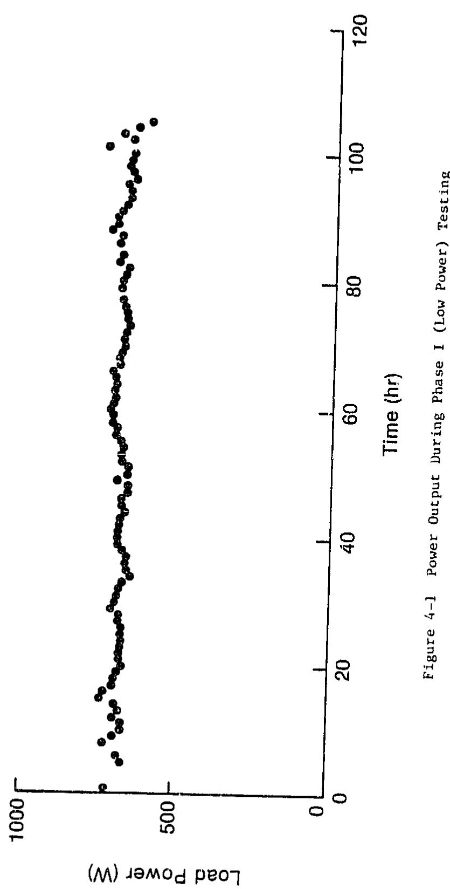

HOE   D  TA
<table><tr><td></td></tr><tr><td></td></tr><tr><td></td></tr><tr><td></td></tr><tr><td></td></tr><tr><td></td></tr><tr><td></td></tr><tr><td></td></tr><tr><td></td></tr><tr><td></td></tr><tr><td></td></tr><tr><td></td></tr><tr><td></td></tr><tr><td></td></tr><tr><td></td></tr></table>

(A) - e)
<table><tr><td></td></tr><tr><td></td></tr><tr><td></td></tr><tr><td></td></tr><tr><td></td></tr><tr><td></td></tr><tr><td></td></tr><tr><td></td></tr><tr><td></td></tr><tr><td></td></tr><tr><td></td></tr><tr><td></td></tr><tr><td></td></tr><tr><td></td></tr><tr><td></td></tr></table>

TABLE 4-2

## CLEARANCE CHANGES BETWEEN INSPECTIONS NO. 1 AND 3

<table><tr><td>Item</td><td>Description</td><td>Diameter Clearance Change (in.)</td></tr><tr><td>7</td><td>Power Piston Seal</td><td>0.0002</td></tr><tr><td>8</td><td>Power Piston FWD Bearing</td><td>0.0001</td></tr><tr><td>9</td><td>Power Piston AFT Bearing</td><td>0.0001</td></tr><tr><td>26</td><td>Displacer Motor Seal</td><td>-0.0007</td></tr><tr><td>27</td><td>Displacer FWD Bearing</td><td>0.0002</td></tr><tr><td>28</td><td>Displacer AFT Bearing</td><td>0.0004</td></tr><tr><td>29</td><td>FWD Gas Spring Seal</td><td>0.0006</td></tr><tr><td>30</td><td>Displacer Bearing Seal</td><td>0.0002</td></tr><tr><td>31</td><td>AFT Gas Spring Seal</td><td>0.0001</td></tr><tr><td>32</td><td>Displacer Bearing Seal</td><td>0.0004</td></tr></table>

System bearing flow checks, pre- and post-test, indicated that the ∆p increased by 1l% which is indicative of the flow and, hence, a slight increase in clearance. Thio increase in Δp for a given inlet pressure increase is attributed to the power piston bearings, but has not been confirmed by inspection of hardware.

# 5.0 PHASE II - FULL-STROKE TESTING

## 5.1 Objective

The objective of the full-stroke test was to accumulate 300 operational test hours at 700"C mean heater head temperature and at 20mm (full stroke) power piston stroke. Full-stroke testing is representative of the most severe operating condition except for dry start/stop testing.

## 5.2 Conclusions

The EM endurance engine successfully completed the Phase II full-stroke test phase. The averagc power was Sl.5 kW. There were no appreciable changes in the hardware as determined by visual observation, flow test, and inspection of the rardware. Engine parameters remained constant throughout this phage with no indications of degradation. The chrome oxide surfaces are particularly durable and held up well, even without the gas bearings operating for a short time. Check out and initial unattended operation went very well, with only minor corrections needed to software and facility hardware. The engine hardware was judged acceptable for Phase III duty-cycle testing.

## 5.3 Discussion

## 5.3.1 Test Description

The critical seal and bearing clearances were inspected as described in Section 3.0.

The engine load for this phase of endurance testing was set to a constant resistance with the load variac (Figure 6-l). The load resistance was adjusted to give design piston stroke (20 mm) at maximum motor current level (6 amps). The heater head temperature was also set to a constant level (between 650 and 700°C). The resulting electrical power output was between 1300 and l600 watts.

The only hardware change was the displacer motor liner, which was replaced with a new phenolic liner with nominal design displacer seal clearance. The liner seal clearance (item 26 of Figure 3-7) during the low-power test was S0% larger than design. It was expected that the reduced displacer seal clearance (to design values) would reduce the displacer motor current necessary to drive the displacer.

## 5.3.2 Test History

Limited full-stroke testing was initiated on 25 April l983 but was suspended because of poor combustor durability and a lack of operating thermocouples on the heater head. Corrective action was taken to resolve these problems prior to restarting the full-stroke test. Combustor durability was improved by limiting the amount of comnbustor vibration by adding mass co the engine test stand. The heater head instrumentation was completely redone with 27 new thermocouples tackwelded to the heater head. With improved combustor durability and re-instrumented heater head, the engine was checked out during the first two weeks of July for full-stroke operation. An identified displacer rub was corrected by replacing the liner and stuffer assembly. This substantially reduced the required motor power for a given alternator load and stroke. On July 13, the 300 hours of full-stroke testing was started. For this test, the inertial mass was attached to the case to reduce combustor vibraticn.

The safety interlock system was fine-tuned early in this test and substantial time was accumulated without operator attention. The interlock system shutdown the engine a few times per day for various reasons. These were mostly "glitches" in the cell exhaust airflow switch or in the primary coolant flow switch. The air and water flow switch installation was modified to reduce errant shutdowns. During the course of the test, the bearing pressure transducer, the case accelerometer, and the engine pressure trausducers failed. In each case, the transducer was replaced or repaired and the test continued. Several shutdowns were th: result of very slow engine pressure leaks; the pressure would drop from 63 to 60.5 Bar in aproximately six hours. Pressures outside this band de-tune the engine system, resulting in excessive displacer motor current. A makeup system was installed for later tests.

The engine was run at an electrical output of sl500 watts and s20 mm piston stroke during this test.

The 300-hour full-stroke test phase was completed on 3 August l983. At completion of the test, the engine was run accidentally without operating gas bearings for approximately thrce minutes. The engine was completely inapected between 5-l5 August 1983.

## 5.3.3 Test Results

Engine parametric trends as a function of time during the 300-hour test phase are shown in Figures 5-1 through 5-10. Load power varied between 1.3 and 1.6 kW as shown in Figure 5-4. Displacer amplitude (Figure S-2) was automatically adjusted to maintain the power output (Figure S-4) in response to changes in pressure (Figure S-l), changes in heater head temperature (Figure 5-7), and load resiscance (Figure 5-9).

## 5.3.4 Post-Test Inspection

The engine was disassembled and inspected following the full-stroke test, and the inspection was completed by 15 Auguat l983. The engine was in excellent condition, there was no damage to any ongine hardware. The bearings and seal gurfaces showed normal polishing and evidence of minor rubbing, however, no damage to bearing surfaces was found. The dimensional inspection of the hardware showed clearance changes, which may be due to measurement technique rather than the actual changes since there is no consistent trend over the pre- and post-test inspections associated with the l00 hour test phase.

The results of flow tests completed before and after this test are shown in Table 5-i. The piston bearings (i.e., alternator and aft gas spring bearings) show no change in flow as indicated by the flow meter ∆P. The test does indicate a change in the displacer bearing flow of 3l%. The equivalent clearance change required for this flow change is within the measurement uncertainty of normal instrumentation ±0.0007 in.

Surface sc-atches were visually observed in the area of the forward piston bearing. The scratches were very local and did not affect inspection dimensions, nor did they affect. power piston flow checks. It is very likely that these scratches occurred during the short period of operation without the hydrostatic gas bearings at the end of the 300-hour full-stroke test. It does demonstrate that the chrome oxide surfaces incorporated on the moving surfaces do provide a tough, durable surface coating tac can protect against surface contact due to shock or momentary wear or, as demonstrated later in this test program, dry (no bearing) start-up.

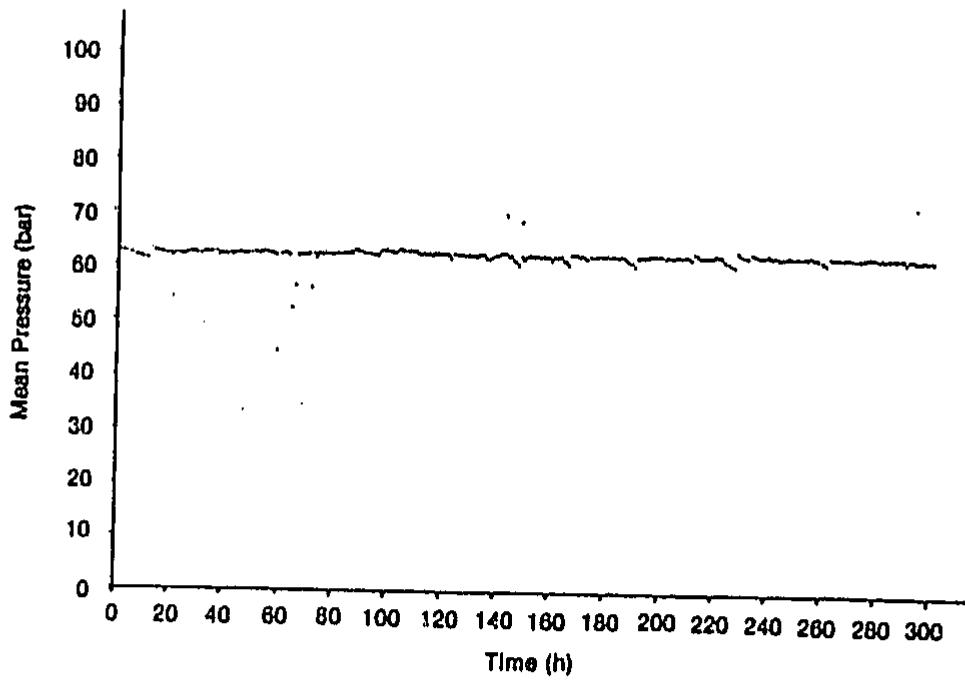

Figure 5-l 300-Hour Full-Stroke Test Mean Fressure versus Time  
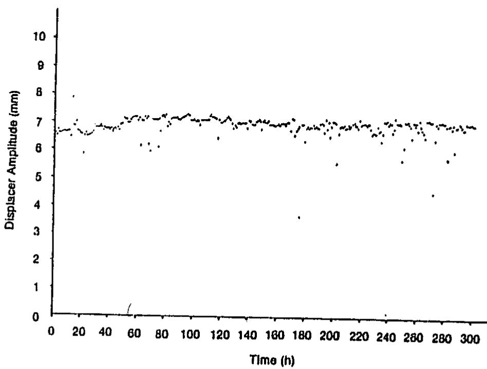  
Figure 5-2 300-Hour Full-Stroke Test Displacer Amplitude versus Time

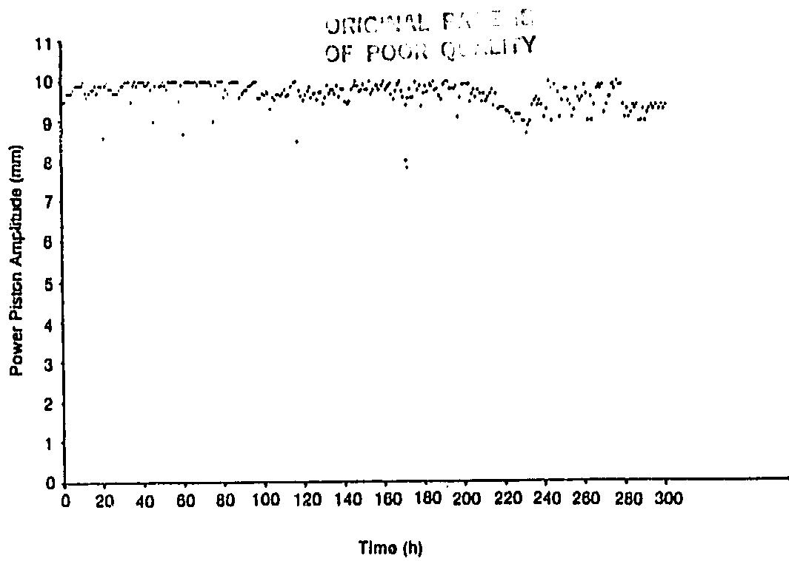  
Figure 5-3 300-Hour Full-Stroke Test Power Piston Amplitude versus Time

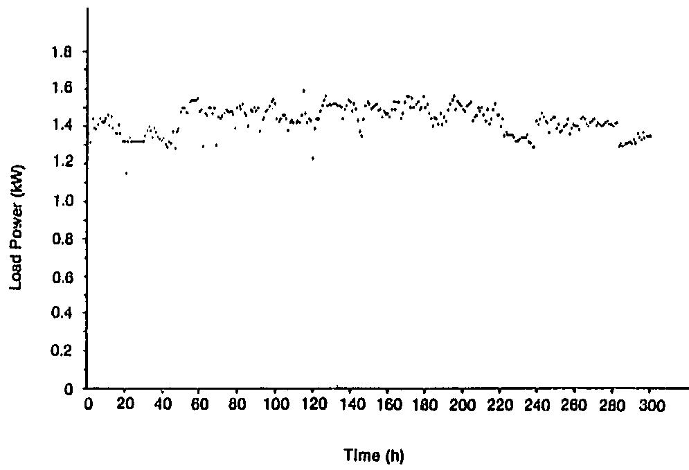  
Figure 5-4 300-Hour Full-Stroke Test Load Power versus Time

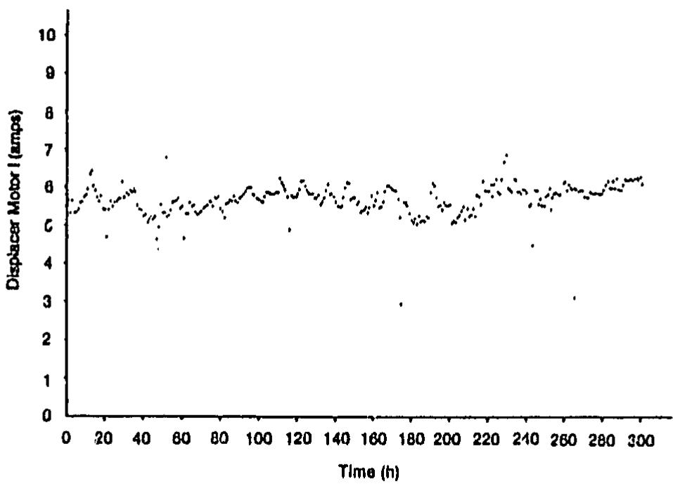  
Figure 5-5 300-Hour Full-Stroke Test Displacer Motor·Current versus Time

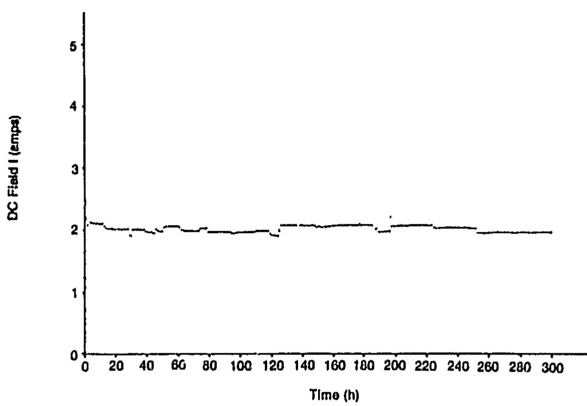  
Figure 5-6 300-Hour Full Stroke Test DC Field Current versus Time

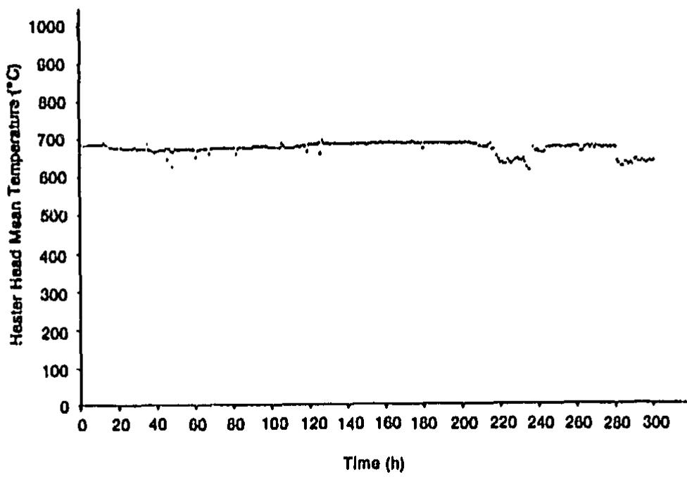

Figure S-7 300-Hour Full-Stroke Test Heater Head Mean Temperature versus Time  
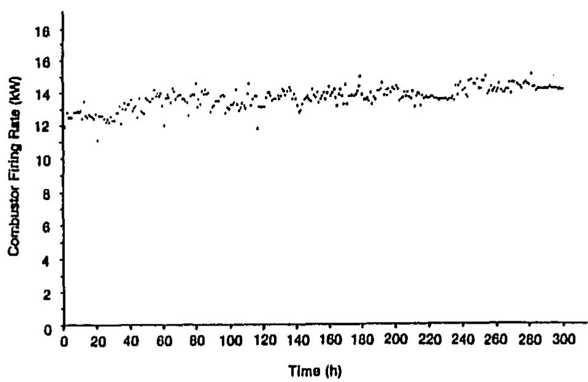  
Figure 5-8 300-Hour Ful1 Stroke Test Combustor Firing Rate versus Time

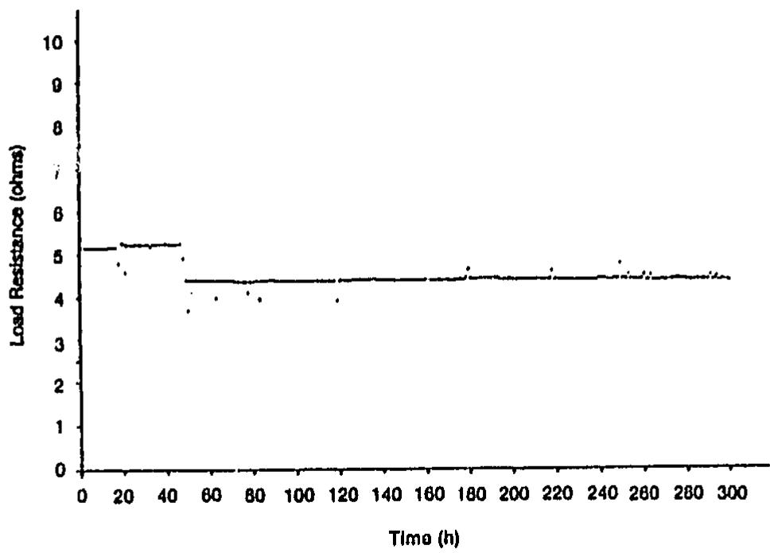  
Figure 5-9 300-Hour Full-Stroke Test Load Resistance versus Time

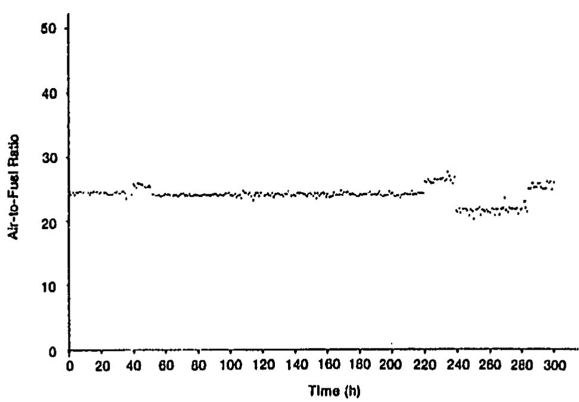  
Figure 5-10 300-Hour Full-Stroke Test Combustor Air to Fuel Ratio versus Time

TABLE 97  
PHASE II - FULL STROKE TESTING BEANING FLOW CHANGES
<table><tr><td colspan="3">∆P in H20 at 20 psig Inlet Pressure</td></tr><tr><td></td><td>Pre-Test</td><td>Post-Tes!</td></tr><tr><td>Displacer Bearing</td><td>6.5</td><td>8.5</td></tr><tr><td>Alternator Bearing</td><td>5.0</td><td>5.0</td></tr><tr><td>AFT Gas Spring</td><td>5.1</td><td>4.9</td></tr></table>

# 6.0 PHASE III - DUTY-CYCLE TEST

## G.1 Objactive

The original objective of the duty-cycle test was to accumulate 300 operational hours at loads between 0.5 and 2.5 kWe, and 700°C mean heater head temperature. This objective was modified with NASA approval to extend the accumulated hours to 600.

## 6.2 Conclusions

The EM successfully completed 691 hours of duty-cycle operation. The one major engine failure displacer magnet dislodgement) was not related to the duty-cycle operacing mode.

## 6.3 Discussion

## 6.3.1 Test Description

The critical seal and bearing clearances were inspected as described in Section 3.0.

The electrical engine load was modified by the addition of a parallel clock-driven resistive load, shown in Figure 6-l. Manual relays were also installed to allow for use of the original "fixed" resistance load. The variac used to adjust the "fixed" resistance load provided the flexibility of proportionally adjusting the duty-cycle load.

The duty-cycle load was designed to change the engine load to one of three levels for a given alrrnator voltage every l/2-hour according to the schedule shown in Figure 6-2. The resistances are switched such that the load'is at one of three levels, 100%, 60%, and 20%, for a period of sl/2-hour, and the cycle repeats every two hours. The power dissipated in the load will also depend on the engine output voltage, which for this test was set by a power control that senses the load voltage and adjusts the displacer motor voltage to produce the required output voltage.

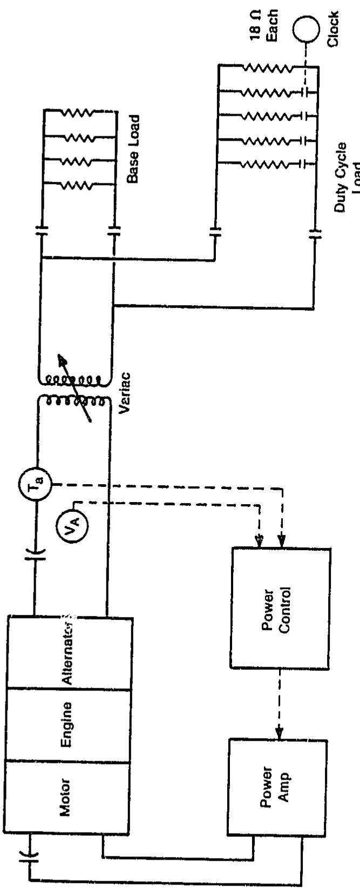  
Du   ic l

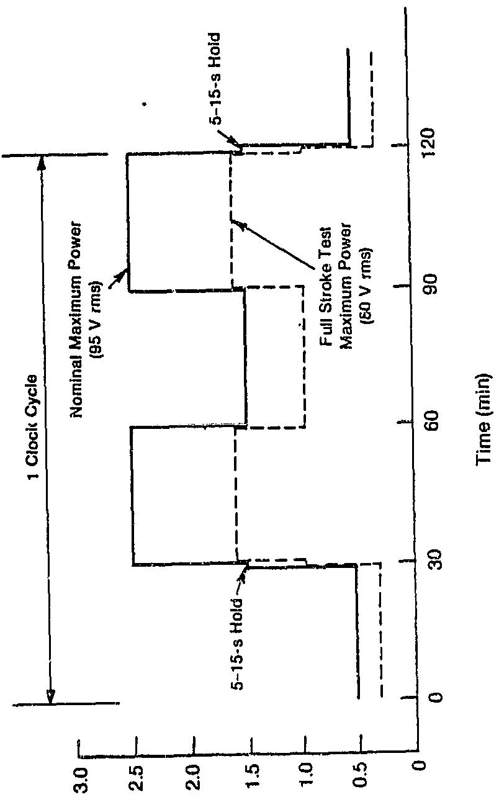  
F   e D ute

The large load changes (20 to l00% and 100 to 20% steps) are provided with a 5-15 second delay at the 60% load level. This reduced the impact of these large load changes. The engine and control responded very well to the duty-cycle load changes. The output voltage was maintained very consistently, with little or no overshoot during load change .

The power levels at which the duty-cycle test was run were lower than the design values to limit the motor inpur. current. The available motor power supply was limited to 6-7 amps RMS; therefore, the load was adjusted to limit the motor current to about 6 amps. The previous full-stroke testing was run at sl600 watts and was not increased prior to the duty-cycle test; therefore, the load was set to the dashed curve in Figure 6-2.

The engine DAS was improved for this test. This involved implementing a program which could take wave form data from the endurance cell No. 6 with the HPl000 AS. Though the number of channels was limited to four, the basic engine dynamic (Xp and Xp) and thermodynamic pressure wave $( P _ { C } )$ could be measured on a routine basis. With these measurements, the piston PV power was calculated and direct comparisons with the first-order thermodynamic analysis could he made.

## 6.3.2 Test History

The 691 hours of duty-cycle testing was begun on 17 August l983. The displacer magnet failure described in Section 3.0 was the only major engine related failure which occurred during this phase of endurance testing. Shortly after the engine was re-started, one stringer, which attaches the engine to the inertia mass, failed. This caused a combustor failure. Both were repaired and the testing continued smoothly until 600 hours of duty-cycle testing were completed on l0 September 1983. The goal of 1000 hours of endurance testing was accomplished.

The engine was then separated from its inertia mass in order to accumulate hours on the combustor at high (s7 g's) vibration levels. The engine was run in this configuration for 91 hours.

The analysis was compared to test results to establish the empirical factors needed to obtain an agreement in terms of the dynamic engine performance. In general, empirical factors applied to total volume and seal leakage are necessary to obtain an agreement in terms of dynamic engine performance. In general, empirical factors applied to total volume and seal leakage are necessary to obtain an agreement with test results (Table 6-l). Volume adjustments of 8 and l4% are typical for FPSE's, and are perhaps indicative of needed improvements in the analysis. Seal leakage adjustments, on the other hand, may be more attributable to the difficulty of accurately measuring small clearances of relatively large diameters. In this respect, EM No. 1 hardware was in very good condition, and a 3% increase in the seal clearances could account for the observed differences. EM No. 2 hardware was in somewhat worse condition, so a 28% increase in seal clearance would be required to account for the observed differences.

Performance of the two EM engines is compared in Figures 6-3 through 6-17 at various power levels. EM No. 2 was operated at constant load voltage and various load impedances (Figure 6-3), while EM No. 1 was operated at a constant load impedance and various voltage levels. The power piston amplitudes necessary to produce the desired output voltages (Figure 6-4) indicate a resonable agreement between the physical hardware and the model. The piston stroke versus power curves are different for two reasons: l) different loading conditions; and, 2) the hardware differences in the two alternators (i.e., EM No. 2 has fewer AC turns than EM No. 1).

The pressure amplitude and phase (Figures 6-5 and 6-6) provide the force to drive the alternators and determine the basic PV power dciivered to the load by the cycle (abscissa of Figures 6-3 through 6-9). The PV power, rather than total cycle power, was selected for comparison since it could be easily measured on the test engine. The cycle power delivered to the displacer is relatively constant over the test range. The pressure force must balance all other forces acting on the power piston and is, therefore, indicative of any deviations between the modeled load on the thermodynamic system and physical reality. Deviations of less than 3% are observed in the pressure amplitude where the worst case is at the low power point for EM No. 2. Also, deviations on the order of 0.5 degrees are

TABLE 6-1

## COMPARISON OF DATA TO CODE PREDICTIONS EM's #1 and 2

<table><tr><td rowspan=2 colspan=1></td><td rowspan=1 colspan=2>EM 41</td><td rowspan=1 colspan=2>EM 02</td></tr><tr><td rowspan=1 colspan=1>Data</td><td rowspan=1 colspan=1>Calc.</td><td rowspan=1 colspan=1>Daca</td><td rowspan=1 colspan=1>Calc.</td></tr><tr><td rowspan=1 colspan=1>Frequency (Hz)Pressure (Bar)Heater Temp (c)Coolar Tamp (&quot;c)Disp, .()Disp, Phase (&quot;)Piston. np. (m)Pressure Aap. (Bar)Pressure Phase (&quot;)PV Pover (watts)Heat Raj. (uacts)PV EfficiencyDead Volume FactorSeal Leakage Factor</td><td rowspan=1 colspan=1>58.159.9710326.8267.79.959.57-11.0341076100.3091.0.0.82b</td><td rowspan=1 colspan=1>58.159.971043246.8767.89.949.55-11.1342063100.3511.080.90</td><td rowspan=1 colspan=1>6062680376.4859.08.757.63-7.9618005650.2421.01.52b</td><td rowspan=1 colspan=1>6062680376.4758.68.767.64-7.9818005840.2361.143.15</td></tr></table>

mesured operating condition

"calculaced from measured geometry

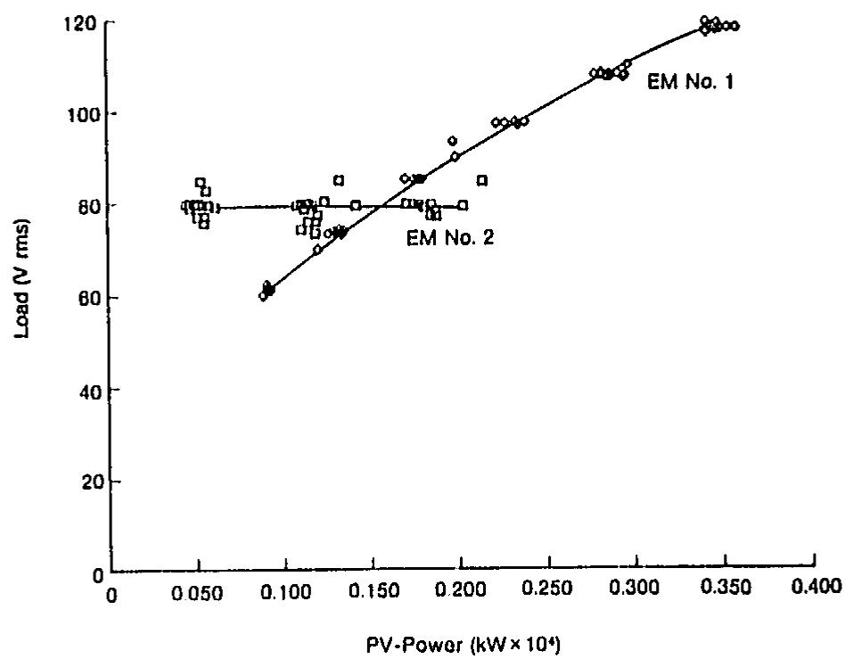  
Figure 6-3 EM #2 Operation - $v _ { L o a d }$ versus PV Power

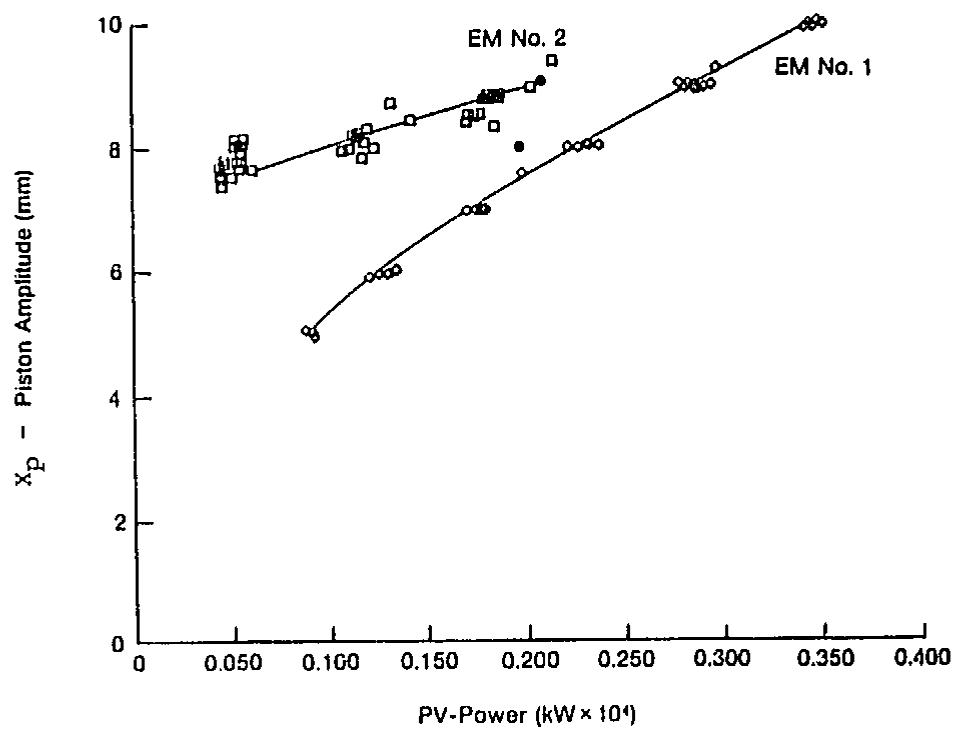  
Figure 6-4 EM #2 Operation - $X _ { p }$ versus PV Power

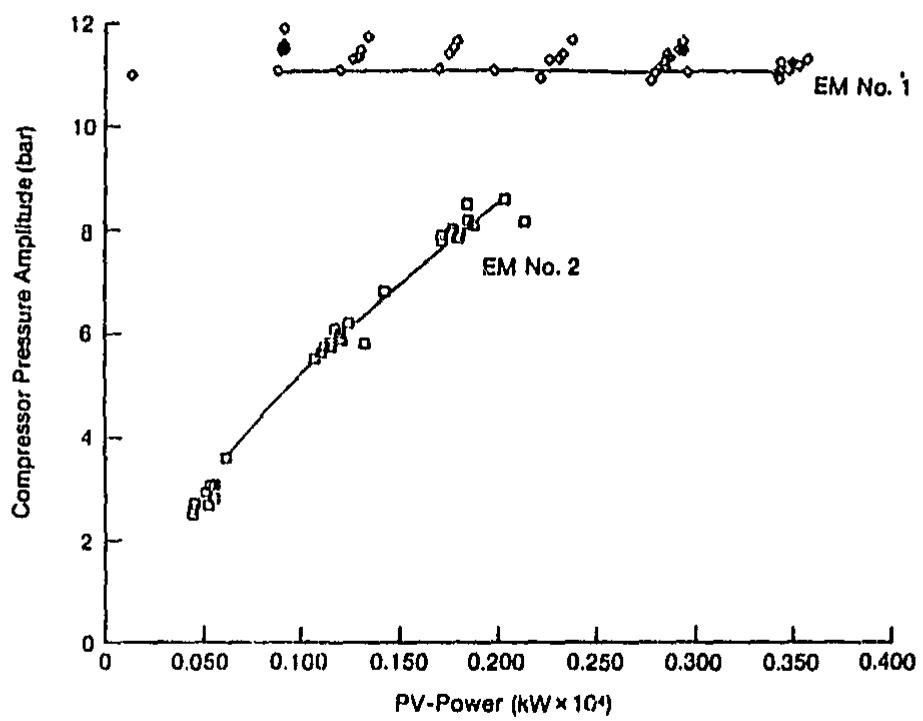  
Figure 6-5 EM #2 Operation - Pressure Amplitude versus PV Power

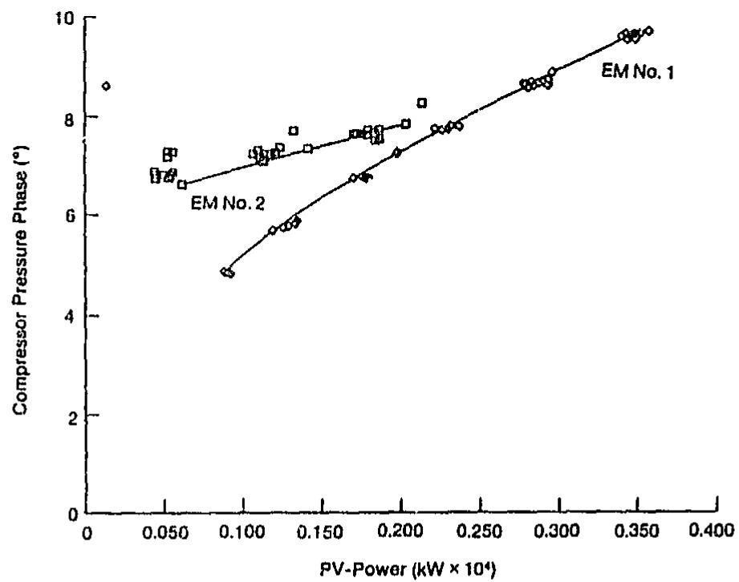  
Figure 6-6 EM #2 Operation - Pressure Phase Angle versus PV Power

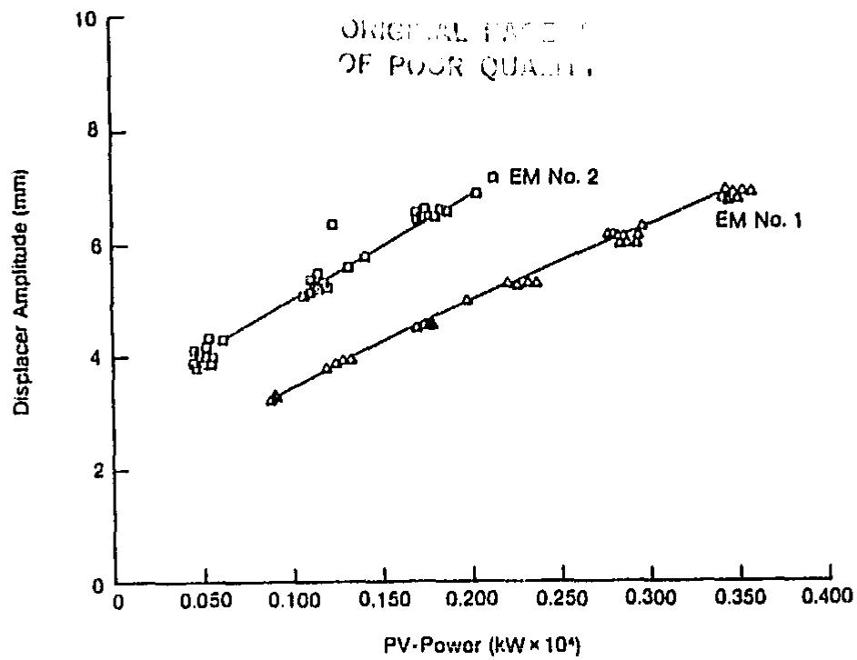  
Figure 6-7 EM /2 Operation - Displacer Amplitude versus pV Powar

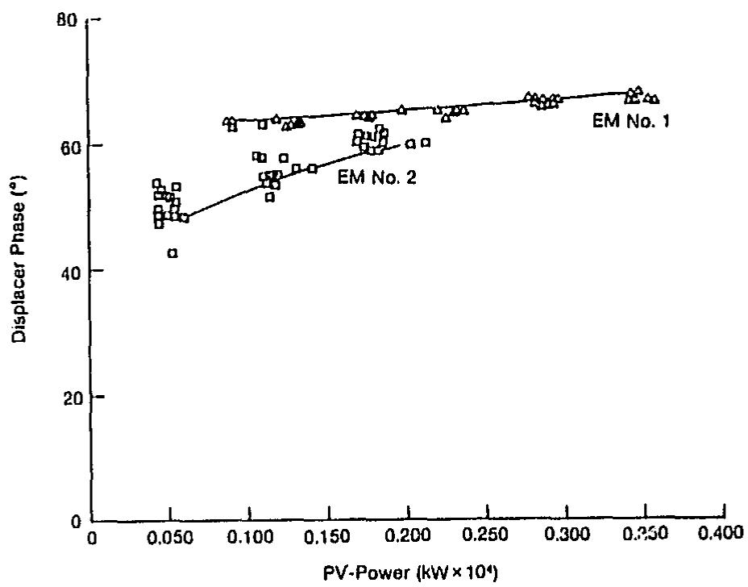  
Figure 6-8 EM #2 Operation - Displacer Phase K versus PV Power

  
Figure 6-9 EM #2 Operation - PV Efficiency versus PV Power

obaerved in the EM No. 1 pressure phage, indicat ing varli! ; 1'h l'tlitor load or bounce-space loss.

The displacer amplitude and phase for the EM erginei i; diroctiy 'ntluenced by the effective impedance of the engine working space in arldit ion !o th pigton dynamics and load. The effective working-space impedance i: 1 direct r"ult l the thermodynanic engine behavior and, therefore, of all parameters that intluence thermodynamic performance. The displacer dynamics (Figures 6-7 and 6-8) show an agreement between test and analysis, indicating that the harmonic thermodvnamics analysis is a good model of the physical processes. The thermolynamic .tiiirnv :,, atter engine power, the most important engine performanc parameter. Th i'y ttiiency used for comparison is defined as:

## PV Efficiency = PV Power/PV Power + Heat Rejected

This was selected since the measured efficiency on this basis is well detined, and would, therefore, provide a well defined comparigon with the calculated etticiency. This definition was selected over those defined by Crowley, since, in this case, his definition would involve the addition of terms which cuuld not be directly measured. The PV efficiency of the EM engines is compated to corresponding calculated values in Figure 6-9. The data from EM No. 2 was in agreement with predictions across the power range tested. Considerable gcatter is seen in this test data, may be due to the transient nature of the duty-cycle test from which the data was obtained. The data from EM No. 1 follows the trend predicted by the harmonic analysis; however, it is two to four points lower than the prediction, particularly at higher power. The running st results are also shown in Figure 6-l0 through 6-l7. This data indicates that the engine perlormanc was not affected by the duty-cycle load changes.

  
Figure 6-10 Heater Head Temperature versus Time

  
Figure 6-l1 Charge Pressure versus Time

TIME ( DAY.FRACTION OF DAY )  

Figure 6-12 Piston and Displacer Stroke versus Time  
  
Figure 6-l3 Piston and Displacer Stroke versus Time

  
Figure 6-l4 Load Power ersus Time

  
Figure 6-15 Motor Current versus Time

  
Figure 6-l6 A/F Ratio versus Time

  
Figure 6-l7 Firing Rate versus Time 85

# 7.0 PHASE IV - START/STOP TEST

## 7.1 Objective

The original objective of the start/stop test was to accumulate 300 test hours while performing 1000 start/stop tests of the engine system. The engine was to be cycled on and off approximately every 15 minutes, with load betweer zero power power and the power point defined in Phase II. This task objective was modified with approval from NASA to accumulate a minimum of l00 start/stop tests. The engine was to be cycled on and off approximately every 5 minutes.

## 7.2 Conclusions

The EM engine successfully completed 262 start/stop cycles. While there was no significant degradation of engine operating performance, there were subtle indications of engine degradation. On inspection of the bearings and seals, no damage was observed in the seals or piston bearings, however, minor damage of the displacer rod was noted.

## 7.3 Discussion

## 7.3.1 Test Description

The critical seal and bearing clearances were inspected as described in Section 3.0.

The test procedure was designed to demonstrate the most critical phase of engine start-up relative to wear and durability of the engine proper. The start procedure was abbreviated to obtain as many start/scop cycles as possible and to demonstrate the basic durability of the engine bearings and seals. To this end, the engine heater/combustor was operated continuously as was the engine cooling system. The combustor control maintained the heater temperature at the set point of 650-700°C by automatically controlling firing rate and airflow (Figure 7-l). The cooling flow in the primary and secondary loops were maintained at constant flow rates. The coolant inlet temperature is controlled by the temperature of a large storage tank, which is cooled by a cooling tower. The inlet temperature cycled between 28 and 33°C (Figure 7-2) once the cooling system came up to temperature at the beginning of each day's testing. The engine outlet temperature followed the inlet temperature with a constant ∆T (sl3°C), Figure 7-2.

Figuie 7-] Tread Operating Range  
  
Figure 7-1 Continued

## 7.3.2 Test History

The start/stop test was begun following the demonstration of internal bearing operations described in Section 4.0. The test was started on 13 February 1984 and was completed on 21 February 1984, with a total accumulation of 262 "dry" (no external pressure) bearing starts.

## 7.3.3 Test Results

The engine started easily during this test, achieving steady-state piston stroke, displacer stroke, and bearing supply pressure in less than one second. A typical start-up cycle (Figure 7-3) shows the displacer stroke comes up to 75% of the steady level in three engine cycles, then stabilizes. The piston stroke and compression space pressure amplitude oscillates at a low amplitude for 20 cycles, at which point the piston and pressure amplitude increases rapidly for several cycles (five), then increases slowly for another 25 cycles when full piston stroke is achieved, The bearing supply pressure (∆p bearing) came up to its steady level as the piston stroke achieved its steady state level. Also, once the piston stroke begins coming up to full stroke, the load on the displacer drops and the dispiacer stroke increases to steady-state levels.

The delay in the piston stroke, and thus pressure amplitude, in coming up to stroke is due to the additional leakage loss of the mid-stroke ports. When the stroke increases to the point where the ports begin to close, the leakage loss drops relative to the stroke and reduces the load on the thermodynamic cycle, thus making more energy available for driving the power piston.

The steady state bearing ∆P (Figure 7-4) was relatively constant during the first three days. On 21 February l984, the bearing check vaive system was modified to improve the tuning, and thus the bearing supply pressure. The bearing pressure was increased from 5.7 to 6.1 Bar.

  
Figure 7-2 Cooling Water Temperature and Difference Operating Range

  
Figure 7-2 Continued

  
Figure 7-3 Start-Up Sequence

  
Figure 7-4 ∆Pbearing Operating Range

  
Figure 7-4 Continued

The bearing pressure dropped 0.l to O.2 Bar in the first hour of running each day, then stabilized. This is may be due to cold-start thermal transients, which are affecting either the bearing clearance or the internal check-valve compressor operacion.

The piston and displacer amplitudes were maintained at a constant level during the entire test (Figure 7-5). The consistency of the piston and displacer amplitudes indicates that thermodynamic performance and losses are not changing over time.

The motor current (Figure 7-6) is proportional to the force that the motor imposes on the displacer and is the most sensitive to changes in dynamic or thermodynamic losses. This is evident by the scatter in the current during the first three days of testing compared to other parameters, such as piston and displacer amplitude. The data from 15 February l984 indicates a potential increase in losses during the first hour of operation, after which the current dropped to the same as the previous two days of testing. The data from 21 February l984 exhibirs more scatter than was observed on 13-15 February l984. This may be an indication of intermittent increases in losses which may be an early inlication of engine degradation. Subsequent engine inspection indicated rubbing between the displacer rod and the bearing it runs in, and could explain the intermittent high current observed in the test data.

Figure 7-5 Continued 94 OF FOO.  
  
Figure 7-5 Displacer (Xd) and Power Pistou $( \ Y _ { \mathfrak { A } _ { \mathfrak { p } } } )$ -9 Amplicude Operating Range X10

$$
\sin _ { 2 \pi } \angle \sqrt { 2 }
$$

  
Figure 7-6 Displacer Motor Curtent Operating Rnage

  
Figure 7-6 Continued

## APPENDIX A

## SYMBOLS STANDARD MEASURED DATA AND CALCULATED RESULTS

## Stanlard Measured Data

Pmean - mean engine pressure   
Pbrng - bearing supply pressure   
$\tan \theta$ - engine frequancy   
$\tt X _ { d }$ mean - mean displacer position   
$\pmb { \chi } _ { \pmb { \mathrm { d } } }$ amp - displacer ampiitude   
$X _ { p }$ mean - mean piston position   
$X _ { p }$ amp - piston amplitude   
Pdgs 1 M - mean pressure of displacer gas spring 1   
Pdgs 2 M - mean pressure of displacer gas spring 2   
$p _ { c }$ M - mean pressure of compression space   
Pdgs 1 A - pressure amplitude of displacer gas spring l   
Pdgs 2 A - pressure amplitude of displacer gas spring 2   
$p _ { c }$ A - pressure amplitude of compression space   
Vmtr - input motor voltage (RMS)   
Imtr - input motor current (RMS)   
MTR Pwr - input motor power (watts)   
Vfield - alternator field voltage (PC)   
Ifield - alternator field current (PC)   
V1oad - alcernator load voltage (RMS)   
I1oad - alternator load power (watts)   
Load Pwr - alternator load power (watts)   
dPfuel - differential pressure of fuel laminar-flow element   
Pfuel - fuel supply pressure   
Tfuel - fuel supply temperature   
dPambair - differential pressure of air laminar-flow element   
Pambair - combustion air supply pressure   
Tamb-ir - combustion air supply temperature   
Tcwin - engine cooling water inlet temperature   
Tcwout - engine cooling water outlet   
Flowcw - engine cooling water flow rate   
$\tau _ { h d }$ - head temperatures up to 27 locations   
$\tt T _ { a m b }$ - combustion temperatures up to 10 locations

## Standard Calculated Results

Tetrlmn - mean control temperature, average of heater thermocouples used for temperature control (°C)   
Thd Mean - mean head temperature (°C)   
Fire Rate - gross heat input to combustor (watts)   
A/F Rtio  - combustor air/fuel ratio   
Load Res- calculated load resistance (Ω)   
Field Pwr - power input to alternator field (watts)   
Field Res - resistive independence of alternator field coil (Ω)   
Field Temp - estimate of mean field coil temperature based on coil resistance (Ω) Ht Rej- heat rejected to engine cooling water (watts)   
Brng dP- pressure difference across gas bedrings   
Gross Eff - grogs engine efficiency defined as electrical power at the load/ gross heat input to conbusror.

<table><tr><td rowspan=1 colspan=2>1. Report No.NASA CR-174771</td><td rowspan=1 colspan=2>2. Governmant Accesslon No.</td><td rowspan=1 colspan=3>3. Roclplent&#x27;s Catalog No.</td></tr><tr><td rowspan=2 colspan=4>4. Titte and BubtitioFree-Piston Stirling Engine/Linear Alternator1000-Hour Endurance Test</td><td rowspan=1 colspan=3>5. Report DateMarch 1985</td></tr><tr><td rowspan=1 colspan=3>6. Parformino Organlzatlon Codo</td></tr><tr><td rowspan=2 colspan=4>7. Author(s)Jeffrey Rauch and George Dochat</td><td rowspan=1 colspan=3>8. PorlormIng Orgenlzallon Report No</td></tr><tr><td rowspan=2 colspan=3>10. Wort Unlt No.</td></tr><tr><td rowspan=3 colspan=4>9. Portorming Organizatlon Namo and AddreasMechanical Technology Incorporated968 Albany-Shaker RoadLatham, New York 12110</td></tr><tr><td rowspan=1 colspan=3>11. Contraçt or Grant No.DEN 3-333</td></tr><tr><td rowspan=2 colspan=3>13. Type of Raport and Porlod CovaredContractor Report</td></tr><tr><td rowspan=2 colspan=4>12. Sponsoring Agency Name and AddressU.S. Department of EnergyOffice of Building and Community SystemBuilding and Equipment DivisionWashington, D.C. 20545</td></tr><tr><td rowspan=1 colspan=3>14. Sponsorlng Agancy CodeDOE/NASA/0333-1</td></tr><tr><td rowspan=1 colspan=7>15. Supplomontary NotosFinal Report. Prepared under Interagency Agreement DE-AI05-82OR1005. ProjectManager, Donald Alger, Power Technology Division, NASA Lewis Research CenterCleveland, Ohio 44i35.</td></tr><tr><td rowspan=1 colspan=7>16. AbstractThe Free-Piston Stirling Engine (FPSE) has the potential to be a long-livea,highly reliable, power conversion device attractive for many product applicationssuch as space, residential or remote-site power. The purpose of endurance test-ing the FPSE was to demonstrate its potential for long life. The enduranceprogram was directed at obtaining 1000 operational hours unur various lest con-ditions: low power, full strcke, duty cycle and stop/start. Critical perform-ance parameters were measured to note any rhange and/or trend. Inspections wereconducted to measure and compare critical seal/bearing clearances.The engineperformed well throughout the program, completing more than 1100 hours. Hardwareinspection, including the critical clearances, showed no significant change inhardware or clearance dimensions. The performance parameters did not exhibitany increasing or decreasing trends. The test program confirms the potentialfor long-life FPSF applications.</td></tr><tr><td rowspan=1 colspan=3>17. Koy Words (Suggestad by Author(a))Stirling engines; Free-piston Stirlingengines; Endurance test; Linearalternator</td><td rowspan=1 colspan=4>16. Distributlon StatemantUnclassified - unlimitedSTAR Category 44DOE Category UC-95</td></tr><tr><td rowspan=1 colspan=1>19. Socurlty Claaalf. (of thla report)Unclassified</td><td rowspan=1 colspan=4>20. Socurlty Ctasslf. (of thla pago)Unclassified</td><td rowspan=1 colspan=1>21, No. of pages100</td><td rowspan=1 colspan=1>22. Prico*A05</td></tr></table>

\*For cale by the Natlonal Technlcal Informatlon Servlce, Springfleld, VirgInla 22161

END DATE SEp. 13,1985 • U.6. GOVERNMENT PAINTING OF.TCE: 1905--559100/10439