# Modeling and Analysis of Stirling Power Convertors

Luis A. Rodriguez1 Steven M. Geng, Terry V. Reid, Roy C. Tew Jr., Scott D. Wilson NASA Glenn Research Center, Cleveland, OH, 44135, USA

NASA Glenn’s Thermal Energy Conversion Branch is supporting the development of the next generation free-piston Stirling power convertors for Dynamic Radioisotope Power Systems (DRPS). American Superconductor (AMSC) and Sunpower Inc. are the two firms under contract to develop the Flexure Isotope Stirling Convertor (FISC) and the Sunpower Robust Stirling Convertor (SRSC), respectively, to meet DRPS requirements. To comprehend and forecast convertor performance, Sage, ANSYS® Maxwell, and ANSYS® Fluent were used to model the Stirling thermodynamic cycle, alternator electromagnetics, and piston and displacer dynamics.

## I. Nomenclature

$X _ { p }$ = piston amplitude   
$X _ { d }$ = displacer amplitude   
$f$ operating frequency   
$\phi _ { d i f f }$ = piston-displacer phase difference   
$P _ { c h a r g e }$ = charge pressure   
$T _ { h }$ hot end temperature   
$T _ { k }$ cold end temperature   
$Q _ { i n }$ net heat input into the heater head $( Q _ { i n } = \ Q _ { c e } + Q _ { e s d } )$   
$Q _ { e s d }$ expansion space & acceptor tube extracted heat   
$Q _ { r e j }$ net heat rejected   
$Q _ { h t r }$ heater gross heat input   
$Q _ { c e }$ non-contributing heat-flux CSAF losses (e.g., solid conduction, from hot to cold end)   
$Q _ { e n v }$ environmental losses (e.g., heat source loss through insulation)   
���������� = parasitic losses $( Q _ { p a r a s i t i c } = Q _ { c e } + Q _ { e n v } )$   
$W _ { p v }$ piston PV power   
$W _ { a l t }$ electrical power output   
����� = convertor efficiency   
���� = cold-side adapter flange

## II. Introduction

Free-piston Stirling convertors are being developed by NASA that can be used for long-lived Dynamic Radioisotope Power Systems (DRPS) for NASA’s future space science missions. Currently, NASA Glenn Research Center (NASA GRC) has contracts with American Superconductor (AMSC) and Sunpower Inc., for the development of the next generation of free-piston Stirling convertors for Dynamic Radioisotope Power Systems. AMSC is developing the Flexure Isotope Stirling Convertor (FISC), which uses flexures to provide axial springing and radial stiffness which prevents contact of the moving components. Similarly, Sunpower Inc, is developing the Sunpower Robust Stirling Convertor (SRSC). The SRSC uses gas bearings to provide radial stiffness which also prevents contact of the moving components. These two means of preventing contact in free-piston Stirling convertor operation were well proven with earlier representative multiple convertors of each type exceeding 10-14 years of operation at GRC. The FISC and SRSC represent the newest designs to address anticipated DRPS flight requirements. As convertor development continues, it is increasingly important to understand and predict the interactions of components in the system, how they respond to one another, and how they perform in response to changes in operating conditions. A suitable and enlightening way to demonstrate and foresee these interactions is with the use of accurate modeling software. Sage, ANSYS® Maxwell, and ANSYS® Fluent are the current modeling tools used by NASA to analytically predict convertor performance.

Sage is a one-dimensional object-oriented commercial software package used for modeling and optimizing Stirling convertors and is one of the most accurate Stirling convertor codes in use by NASA. This code is the successor to GLIMPS (Globally-Implicit Stirling Cycle Simulation) and GLOP (GLIMPS Optimization) software created by Gedeon Associates [1]. Model input parameters are typically material/gas type, component physical dimensions, temperatures, frequency, charge pressure, and number of time/space nodes. Sage is used to model both the FISC’s and SRSC’s Stirling cycle thermodynamics and piston/displacer dynamics. The software has also been used by NASA and NASA contractors to aid in design optimization. In addition, Sage is also capable of modeling electromagnetic components such as linear alternators. In that respect, Sunpower and AMSC have developed their own ideas about how to model the electrical power output of their respective alternator design. In this paper, Sage models are compared against each convertors measured performance data and Sankey diagrams are used to illustrate the energy paths through the convertors. A thorough comparison of the model prediction with the in-lab captured data will enhance the capability and understanding of future convertor modeling.

ANSYS® Fluent was used to build a 3-D computational fluid dynamic (CFD) model to examine the Stirling cycle thermodynamic losses and net heat input for the SRSC systems. Unfortunately, due to the current pandemic, the FISC system was not analyzed. Three-dimensional Computer Aided Design (CAD) models are typically used to create the physical components of each convertor. Steady-state CFD simulations were conducted for hardware testing, predictions of environmental losses, and predictions of parasitic losses during testing. The model inputs to the aforementioned analysis are the material properties and boundary thermal conditions. The steady-state model calculates temperature and heat flow distributions as well.

For the SRSC, CFD simulations were used to fill knowledge gaps and to better understand operational performance parameters. For proprietary reasons, very little of the actual SRSC will be shown. However, Figure 1 shows a general schematic of a typical Stirling convertor.

ANSYS® Maxwell was used to create a three-dimensional (3-D) axisymmetric model for both FISC and SRSC alternators. The significant physical components included in each model are the magnets, magnet carrier, outer/inner laminations, and the coil. Inputs to the model are piston amplitude, piston frequency, coil resistance, tuning capacitance, and specific material properties. The alternator models calculate terminal voltage, current, terminal power and efficiency. The total alternator losses are also a part of the final results.

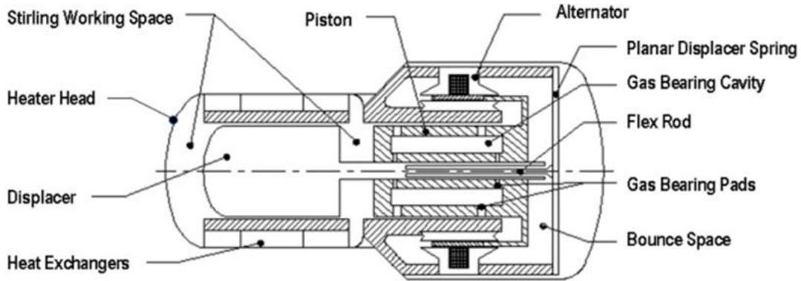  
Figure 1 : Internal Schematic of a Stirling Convertor

## III. Sage Model Interrogation and Analysis

Contractor developed FISC and SRSC piston driven Sage models were received from AMSC and Sunpower respectively. To validate Sage simulations, each model’s predictions were compared against experimental data. Interrogation was initiated by performing an in depth characterization of the possible thermal energy pathways within the convertor models. These pathways were conduits for the enthalpic, conduction, and radiative energies that coalesce into the final electrical power output. A high level illustration of each convertor’s thermal energy paths will be shown in the form of a Sankey diagram.

## A. SRSC : Sage Model vs Convertor Performance Test

Two SRSC convertors, SRSC #1 and SRSC #2, were delivered to NASA GRC in October 2020 along with performance data taken, by Sunpower. Table 1 describes the input and output values of the as received SRSC Sage model compared to the Sunpower measured performance data. As can be seen in the aforementioned table, there is a noticeable difference between Sage and measured input parameters that lead to significant difference in output parameters. For example, the difference in $\mathrm { T _ { h } }$ and $\mathrm { \Delta P _ { c h a r g e } }$ is \~20⁰ and 0.438e6 Pa respectively.

Table 1 : SRSC Sage Model vs SRSC #1 and SRSC #2 Convertor Performance
<table><tr><td>Parameter</td><td>Sage Input Value</td><td>SRSC #1 Measured Values (08.31.20)</td><td>SRSC #2 Measured Values (05.21.20)</td><td>Unit</td></tr><tr><td> $X _ { p }$ </td><td>4.20</td><td>3.77</td><td>3.36</td><td>mm</td></tr><tr><td> $f$ </td><td>96</td><td>99.6</td><td>99.6</td><td>Hz</td></tr><tr><td> $P _ { c h a r g e }$ </td><td>3.8e6 (551.14)</td><td>4.238e6(614.7)</td><td>4.238e6(614.7)</td><td>Pa (psi)</td></tr><tr><td> $T _ { h }$ </td><td>720</td><td>700.3</td><td>699.3</td><td>℃</td></tr><tr><td> $T _ { k }$ </td><td>100</td><td>100.3</td><td>99.6</td><td>℃</td></tr><tr><td>Parameter</td><td>Sage Output Value</td><td>SRSC #1 Measured Values (08.31.20)</td><td>SRSC #2 Measured Values (05.21.20)</td><td>Unit</td></tr><tr><td> $X _ { d }$ </td><td>3.15</td><td>3.01</td><td>2.97</td><td>mm</td></tr><tr><td> $\phi _ { d i f f }$ </td><td>53.92</td><td>55.7</td><td>58.4</td><td>deg</td></tr><tr><td> $Q _ { i n }$ </td><td>228.56</td><td>223</td><td>223</td><td>Watt</td></tr><tr><td> $Q _ { r e j }$ </td><td>147.68</td><td>1</td><td>-</td><td>Watt</td></tr><tr><td> $W _ { p v }$ </td><td>80.88</td><td>1</td><td>1</td><td>Watt</td></tr><tr><td> $W _ { a l t }$ </td><td>62.11</td><td>47.7</td><td>50.3</td><td>Watt</td></tr><tr><td> $\eta _ { c o n v }$ </td><td>27.17</td><td>21.4</td><td>22.6</td><td>%</td></tr></table>

As a result of the difference between Sage and measured input parameters in the top of Table 1, copies of the as received SRSC Sage model were created and calibrated for both the SRSC #1 and the SRSC #2 convertors. Table 2 shows the SRSC #1 calibrated Sage model. The following variables, Xp, f, Pcharge, Th, and Tk, were gathered from the SRSC #1 tested convertor and used inputs in the SRSC Sage model. This was done to match the test article operating conditions. Typically, un-calibrated models have an accuracy of 10-20%, while models calibrated over a range of test data have an accuracy of 5% [2]. Sage can have higher errors than 20% depending on how much 3D flow effects are missing from the 1D model. It is important to note that tuned SRSC and FISC models were not fully calibrated and other parameters with in Sage could have been adjusted to minimize error. Most output values in Table 2, were below a 15% error, except for the piston-displacer phase difference and net efficiency.

Similar to Table 2, a calibrated Sage model was created using the measured values from SRSC #2 as shown in Table 3. This convertor had the lowest piston amplitude of 3.36 mm with respect to the original model and SRSC #1 test value. The decrease in amplitude resulted in an overall higher percent error, when compared to SRSC #1, in all output parameters, except for net convertor efficiency. Further model interrogation and convertor testing is currently in the works to narrow down the root cause of possible model flaws and the high errors.

Table 2 : SRSC Sage Model Calibrated to SRSC #1 Measured Values  
Table 3 : SRSC Sage Model Calibrated to SRSC #2 Measured Values
<table><tr><td>Parameter</td><td>Sage Input</td><td colspan="2">SRSC #1 Measured Values (08.31.20)</td><td>Unit</td></tr><tr><td> $X _ { p }$ </td><td>3.77</td><td colspan="2">3.77</td><td>mm</td></tr><tr><td> $f$ </td><td>99.6</td><td colspan="2">99.6</td><td>Hz</td></tr><tr><td> $P _ { c h a r g e }$ </td><td>4.238e6(614.7)</td><td colspan="2">4.238e6(614.7)</td><td>Pa (psi)</td></tr><tr><td> $T _ { h }$ </td><td>700</td><td colspan="2">700.3</td><td> $^ \circ \mathbb { C }$ </td></tr><tr><td> $T _ { k }$ </td><td>100</td><td colspan="2">100.3</td><td>℃</td></tr><tr><td>Parameter</td><td>Sage Output</td><td>SRSC #1 Measured Values (08.31.20)</td><td>Unit</td><td>Error (%)</td></tr><tr><td> $X _ { d }$ </td><td>2.97</td><td>3.01</td><td>mm</td><td>1.4</td></tr><tr><td> $\phi _ { d i f f }$ </td><td>43.6</td><td>55.7</td><td>deg</td><td>21.7</td></tr><tr><td> $Q _ { i n }$ </td><td>193.0</td><td>223</td><td>Watt</td><td>13.5</td></tr><tr><td> $Q _ { r e j }$ </td><td>124.5</td><td>1</td><td>Watt</td><td>I</td></tr><tr><td> $W _ { p v }$ </td><td>68.4</td><td>1</td><td>Watt</td><td>1</td></tr><tr><td> $W _ { a l t }$ </td><td>52.5</td><td>47.7</td><td>Watt</td><td>10.1</td></tr><tr><td> $\eta _ { c o n v }$ </td><td>27.2</td><td>21.4</td><td>%</td><td>27.2</td></tr></table>

<table><tr><td>Parameter</td><td>Sage Input</td><td colspan="2">SRSC #2 Measured Values (05.21.20)</td><td>Unit</td></tr><tr><td> $X _ { p }$ </td><td>3.36</td><td colspan="2">3.36</td><td>mm</td></tr><tr><td> $f$ </td><td>99.6</td><td colspan="2">99.6</td><td>Hz</td></tr><tr><td> $P _ { c h a r g e }$ </td><td>4.238e6(614.7)</td><td colspan="2">4.238e6(614.7)</td><td>Pa (psi)</td></tr><tr><td> $T _ { h }$ </td><td>700</td><td colspan="2">699.3</td><td> $^ { \circ } \mathrm { C }$ </td></tr><tr><td> $T _ { k }$ </td><td>100</td><td colspan="2">99.6</td><td>℃</td></tr><tr><td>Parameter</td><td>Sage Output</td><td>SRSC #2 Measured Values (05.21.20)</td><td>Unit</td><td>Error (%)</td></tr><tr><td> $X _ { d }$ </td><td>2.68</td><td>2.97</td><td>mm</td><td>9.8</td></tr><tr><td> $\phi _ { d i f f }$ </td><td>43.8</td><td>58.4</td><td>deg</td><td>24.9</td></tr><tr><td> $Q _ { i n }$ </td><td>162.0</td><td>223</td><td>Watt</td><td>27.4</td></tr><tr><td> $Q _ { r e j }$ </td><td>105.3</td><td>1</td><td>Watt</td><td>1</td></tr><tr><td> $W _ { p v }$ </td><td>56.7</td><td>1</td><td>Watt</td><td>-</td></tr><tr><td> $W _ { a l t }$ </td><td>43.6</td><td>50.3</td><td>Watt</td><td>13.4</td></tr><tr><td> $\eta _ { c o n v }$ </td><td>26.9</td><td>22.6</td><td>%</td><td>19.0</td></tr></table>

Sankey diagrams were created to demonstrate a high level over view of the SRSC’s thermal to electrical energy path and losses that are incurred along the way. These diagrams illustrate the combination of Sage, estimated, and in lab measured test values of energy in watts. Diagrams were created for both SRSC #1 and SRSC #2 in-lab measured data, along with the original Sunpower Sage model data in Figure 2 and Figure 3. In addition, diagrams with calibrated Sage models and their respective SRSC #1 and SRSC #2 test data, were also created as shown in Figure 4 and Figure 5. The gross heat input on the left side of each diagram is produced from an electrical heat source, commonly used in lab test settings. During in-air ground tests, convertors are insulated in microporous bulk insulation to minimize thermal energy loss in order to maximize electrical power. A typical amount of environmental loss through the insulation is about 20-30% of the gross heat input [3]. All estimated insulation loss values for each of the two convertors are within the conventional bounds. The estimated environmental insulation loss was calculated as the difference between the gross heat input and the net heat input $\left( \mathrm { Q } _ { \mathrm { i n } } \right)$ of the in-lab measured test values. Lab environmental and parasitic loss are shown as not available (NA) for each convertor and will be measured in future work. The measured net heat input for both SRSC #1 and SRSC #2 convertors and as received Sage models were comparable, except for the SRSC #1 and SRSC #2 calibrated Sage models, which resulted in $\mathrm { Q _ { i n } } = 1 9 3 \mathrm { W _ { t h } }$ and $\mathrm { { Q } _ { i n } = }$ 162 $\mathbf { W _ { \mathrm { f h } } }$ , respectively, as shown in Figure 4 and Figure 5. The change of input values from the SRSC #1 and #2 convertors, seems to have caused the thermal energy to diminish throughout both the calibrated Sage models. This effect is shown in the Sage output of the heat rejected, PV power, and electrical power output. The heat rejected is the heat removed through the CSAF [4]. The alternator losses for all Sage models result in a 23% drop from the PV power, which is generated from the pressure wave on the piston. An alternator model was not provided in the original SRSC Sage model, therefore the alternator efficiency was used to calculate final electrical power outputs.

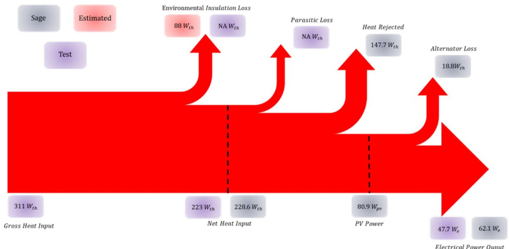  
Figure 2 : Sankey Diagram of SRSC #1 Convertor and Original Sage Model

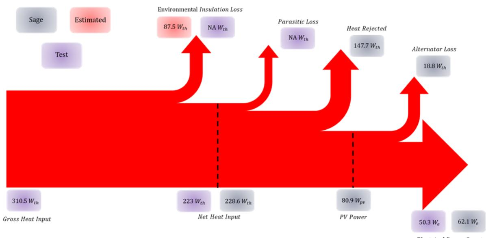

Figure 3 : Sankey Diagram of SRSC #2 Convertor and Original SRSC Sage Mode  
  
Figure 4 : Sankey Diagram of SRSC #1 Convertor and Calibrated SRSC #1 Sage Model

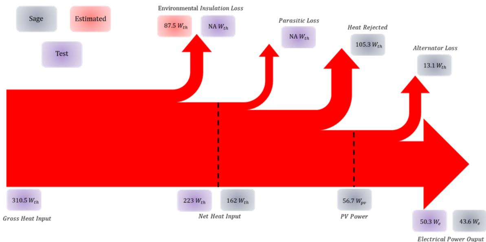  
Figure 5 : Sankey Diagram of SRSC #2 Convertor and Calibrated SRSC #2 Sage Model

## B. FISC : Sage Model vs Convertor Performance Test

A similar interrogation was performed on AMSC’s FISC convertor. FISC convertors have not been delivered by the contractor to NASA, therefore preliminary test data provided by AMSC is assessed. As a result of the notable difference in piston amplitude and hot-end temperature between the Sage input and measured values, as can be seen in Table 4, the FISC Sage model was calibrated to the FISC in-lab measured values and results are shown in Table 5. The percent error for the calibrated model is also well within the un-calibrated ±20% error bounds. It is important to note that the FISC Sage model and its alternator are only connected via a piston amplitude shared value and do not share pressure or force boundaries.

Table 4 : FISC Sage Model vs FISC Convertor Performance  
Table 5 : FISC Sage Model Calibrated to FISC Measured Values
<table><tr><td>Parameters</td><td>Sage Input</td><td>Measured Values (02.08.21 Results)</td><td>Unit</td></tr><tr><td> $X _ { p }$ </td><td>5.55</td><td>5.86</td><td>mm</td></tr><tr><td> $f$ </td><td>81</td><td>82.9</td><td>Hz</td></tr><tr><td> $P _ { c h a r g e }$ </td><td>2.5e6 (362.59)</td><td>2.48e6 (359.74)</td><td>Pa (psi)</td></tr><tr><td> $T _ { h }$ </td><td>613.8</td><td>652.4</td><td> $^ \circ \mathbb { C }$ </td></tr><tr><td> $T _ { k }$ </td><td>100.1</td><td>104.6</td><td> $^ \circ \mathbb { C }$ </td></tr><tr><td>Parameter</td><td>Sage Output</td><td>Measured Values (02.08.21)</td><td>Unit</td></tr><tr><td> $X _ { d }$ </td><td>2.64</td><td>2.87</td><td>mm</td></tr><tr><td> $\phi _ { d i f f }$ </td><td>74.7</td><td>72.4</td><td>deg</td></tr><tr><td> $Q _ { i n }$ </td><td>229.8</td><td>1</td><td>Watt</td></tr><tr><td> $Q _ { r e j }$ </td><td>150.9</td><td>1</td><td>Watt</td></tr><tr><td> $W _ { p v }$ </td><td>78.8</td><td>1</td><td>Watt</td></tr><tr><td> $W _ { a l t }$ </td><td>62.0</td><td>73.1</td><td>Watt</td></tr><tr><td> $\eta _ { c o n v }$ </td><td>27.0</td><td>25.4</td><td>%</td></tr></table>

<table><tr><td colspan="3">Parameters Sage Input</td><td colspan="2">Measured Values (02.08.21 Results)</td><td rowspan="2">Unit</td></tr><tr><td> $X _ { p }$ </td><td colspan="2">5.86</td><td colspan="2">5.86</td></tr><tr><td> $f$ </td><td colspan="2">82.9</td><td colspan="2">82.9</td><td>mm Hz</td></tr><tr><td> $P _ { c h a r g e }$ </td><td colspan="2">2.48e6(359.74)</td><td colspan="2">2.48e6(359.74)</td><td>Pa (psi)</td></tr><tr><td> $T _ { h }$ </td><td colspan="2">652.4</td><td colspan="2">652.4</td><td> $^ \circ \mathbb { C }$ </td></tr><tr><td> $T _ { k }$ </td><td colspan="2">104.6</td><td colspan="2">104.6</td><td> $^ \circ \mathbb { C }$ </td></tr><tr><td>Parameter</td><td>Sage Output</td><td>Measured Values (02.08.21 Results)</td><td></td><td>Unit</td><td>Error (%)</td></tr><tr><td> $X _ { d }$ </td><td>2.84</td><td>2.87</td><td></td><td>mm</td><td>1.1</td></tr><tr><td> $\phi _ { d i f f }$ </td><td>64.0</td><td>72.4</td><td></td><td>deg</td><td>11.6</td></tr><tr><td> $Q _ { i n }$ </td><td>250.7</td><td>1</td><td></td><td>Watt</td><td>1</td></tr><tr><td> $Q _ { r e j }$ </td><td>160.9</td><td>1</td><td></td><td>Watt</td><td>-</td></tr><tr><td> $W _ { p v }$ </td><td>89.8</td><td>-</td><td></td><td>Watt</td><td>-</td></tr><tr><td> $W _ { a l t }$ </td><td>72.4</td><td></td><td>73.1</td><td>Watt</td><td>1.0</td></tr><tr><td> $\eta _ { c o n v }$ </td><td>28.9</td><td></td><td>25.4</td><td>%</td><td>13.7</td></tr></table>

Sankey diagrams were also created for the FISC convertor as shown in Figure 6 and Figure 7. These diagrams contain both convertors’ simulated and tested thermal to electric energy outputs. Analogous to the SRSC Sankey diagram description, the gross heat input enters the convertor and thermal energy is lost to the environment through the insulation. The rest of the energy is conducted to the heater head and dispersed within the convertor. Heat is now lost parasitically or rejected out through the CSAF. Within the convertor the pressure wave applies itself on the piston and PV power is generated. The piston motion then aids the creation of electrical energy along with alternator losses.

Figure 7 shows the highest of the net heat inputs of the two FISC Sage simulations. The higher input leads to the increase of PV-power, heat rejected, alternator loss, and electrical power. This is an expected result due to the increase in piston amplitude, frequency, and hot-end temperature input parameters. Alternator losses are similar when compared between both models but the final power output was much more accurate for the calibrated model.

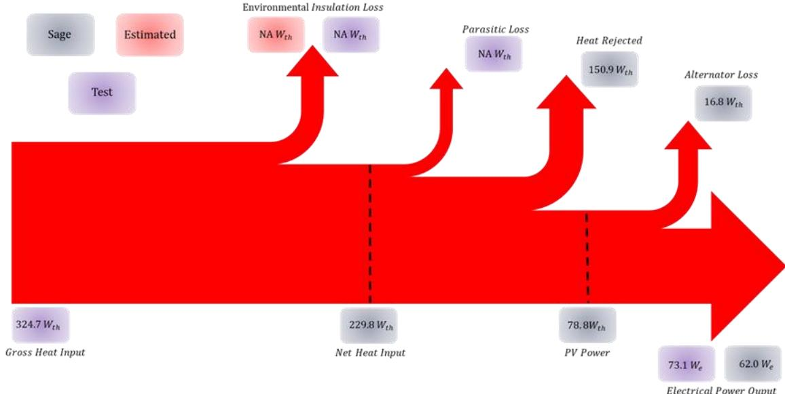

Figure 6 : Sankey Diagram of the FISC Convertor and Original FISC Sage Model  
  
Figure 7 : Sankey Diagram of FISC Convertor and Calibrated FISC Sage Model

## IV. SRSC 3D CFD Model Analysis

To set up the SRSC Computational Fluid Dynamics (CFD) model, editing was performed to the SRSC solid model geometry, which was provided by Sunpower. The intention is to book-keep the transfer of heat that occurs inside the heater head and all of its internal components as shown in Figure 1, which is where the Stirling cycle occurs.

As mentioned before, the goal is to use the computational tools available to better understand what takes place inside the convertor, as it is difficult to measure some parameters, such as $Q _ { e s d }$ and parasitic losses, during laboratory testing. The software ANSYS Fluent is being used to estimate useful information that can’t be measured in the aforesaid difficult scenarios. Comparisons are also performed with similar parameters between SRSC #1, SRSC # 2, and Fluent. An example of a comparison of similar parameters is shown in Table 6.

Table 6 : Top Level Parameters of the SRSC Experimental Values and SRSC ANSYS Fluent Model in Watts
<table><tr><td>Parameters</td><td>SRSC #1</td><td>SRSC #2</td><td>ANSYS Fluent</td></tr><tr><td> $Q _ { h t r }$ </td><td>311.0</td><td>310.5</td><td>310.1</td></tr><tr><td> $Q _ { c e }$ </td><td>1</td><td>1</td><td>24.2</td></tr><tr><td> $Q _ { e n v }$ </td><td>88</td><td>87.5</td><td>89.4</td></tr><tr><td> $Q _ { p a r a s i t i c }$ </td><td>1</td><td>1</td><td>113.6</td></tr><tr><td> $Q _ { i n }$ </td><td>223</td><td>223</td><td>220.7</td></tr></table>

The parameters in Table 6 are important as they can be used to determine the net heat input, parasitic losses, and the efficiency of the convertor. In the lab, the convertor is encapsulated in an insulation package and a heater package. This configuration is shown in Figure 8. Gross heat input is provided by the firerod electric heater element. The CSAF is used to fix the temperature at the cold end. Temperature measurements around the perimeter of the can, as well as at the hot-end, and heater block surfaces are collected for modeling.

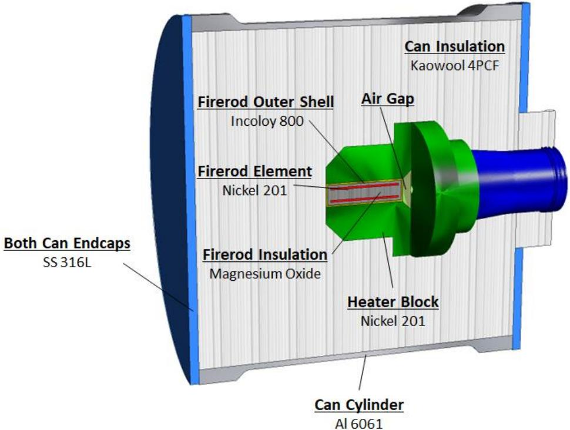  
Figure 8 : SRSC Hardware Fitted with Insulation and Heater Packages

A variety of thermal loss (non-operating) and operating experiments were performed. After heat input and temperature data are collected, these are used as boundary conditions for the CFD model. The test setup is shown in Figure 9. The temperature boundary conditions around the perimeter of the can are collected and used to create a curve-fit equation. This allows the measured temperatures to be mapped onto the CFD model as shown in green boxes around the perimeter in Figure 10. Measured gross heat input is also used as a heat source for the CFD model of the insulation can and heater head of Figures 9 & 10.

Fluent is run using a pressure-based solver with the ideal gas law applied to the working fluid. Also, the Discrete-Ordinances (DO) radiation model is activated. The CFD simulation is run in steady-state mode, which does not capture shuttle heat transfer effects and could influence final results. The steady-state mode, in combination with just using heater head and its encapsulated components helps to keep the CFD mesh count down to a minimum, while allowing a quick turnover between various calculations. When running a simulated case, the heat source and hot-end temperatures are monitored, and are initially high. This is because the lack of motion in the model does not account for the conversion of thermal energy to mechanical energy. From a bookkeeping perspective, this is accounted for by extracting a finite quantity of heat via the expansion space and the acceptor tubes. As this is done, the Heat Source and Hot-End temperatures start to drop. The magnitude of the extracted heat is increased until the predicted temperatures match those measured in the lab. In the case shown in Figure 10, the magnitude of the extracted heat was 196.5 W, which produced a predicted heat source temperature that was within 2 degrees C of that measured in the lab. The predicted hot-end temperature was within 0.6 degrees C of that measured in the lab. This represents a stop point for this particular condition. When extracting variables from the converged solution, results indicated that the extracted heat, cold-end losses out of the CSAF, and environmental losses are

$$
\begin{array} { c } { Q _ { e s d } = 1 9 6 . 5 \mathrm { ~ W ~ } } \\ { \ } \\ { Q _ { c e } = 2 4 . 2 \mathrm { ~ W ~ } } \\ { \ } \\ { Q _ { e n v } = 8 9 . 4 \mathrm { ~ W ~ } } \end{array}
$$

The non-contributing cold-end losses out of the $\mathrm { C S A F } , Q _ { c e }$ are losses that do not contribute to any work in the Stirling cycle. They are simply losses that conduct straight through the convertor’s heater head and out the CSAF. Similarly, environmental losses are conductive thermal energy that is lost between the gross heat input and the net heat in of the convertor’s heater head. These losses go straight out of the insulation and to the environment. The aforementioned losses can be used to predict parasitic losses and net heat input as

$$
\mathrm { P a r a s i t i c \ L o s s e s } = Q _ { c e } + Q _ { e n v } = 1 1 3 . 6 \ \mathrm { W }
$$

$$
\mathrm { N e t } \mathrm { H e a t } \mathrm { I n p u t } = Q _ { c e } + Q _ { e s d } = 2 2 0 . 7 \mathrm { W }
$$

Other parameters can be extracted from the model as needed.

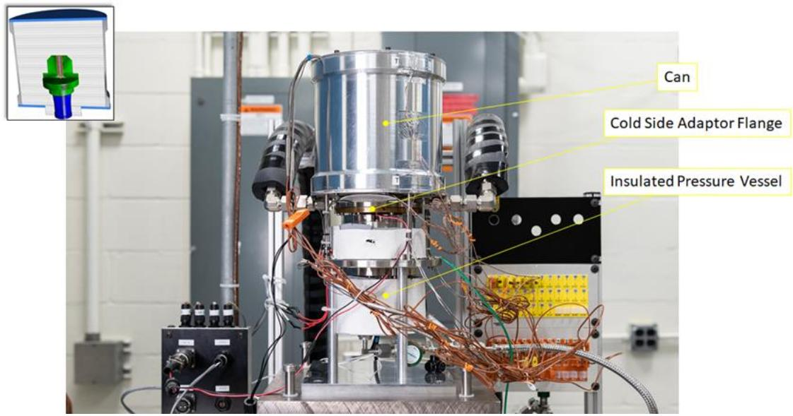  
Figure 9 : Vertically-oriented SRSC #1 in the Glenn Research Center Stirling Lab (GRC-SRL).

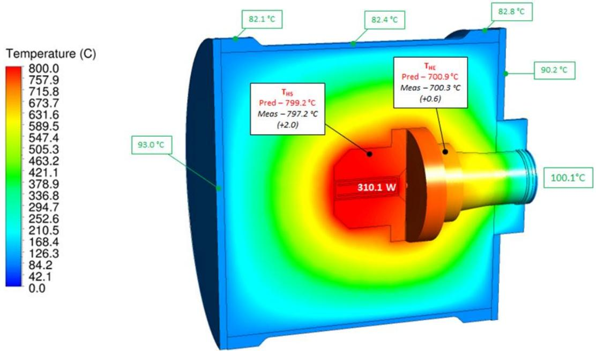  
Figure 10 : Temperature Contours and Boundary Conditions of the ANSYS-Fluent Steady-State Simulation of the SRSC Convertor Insulation Can and Heater Head

## V. Linear Alternator Modeling

Transient three-dimensional (3D) axisymmetric Maxwell models were prepared for each of the SRSC and FISC linear alternators. These alternator models are more detailed than the Sage alternator assumptions/models previously mentioned. Similar models were used to simulate the SRSC and FISC linear alternators as shown in Figure 11.

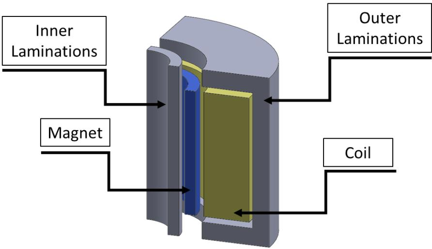  
Figure 11 : Similar Geometric Representation of the SRSC and FISC Linear Alternator Models

The key alternator components included for each model are: 1) magnet(s), 2) magnet can (not shown in Figure 11), 3) inner laminations, 4) outer laminations, and 5) coil. The models were created to take advantage of the sector symmetry, so only a sector section was used in each simulation as shown in Figure 11. In addition, both alternators are of the moving magnet type, and are made of similar materials.

## A. SRSC : LA Performance Verification

An external load circuit, as shown in Figure 12, was added to the SRSC LA model and performance predictions were generated. The values for the load resistance and tuning capacitor were obtained from Sunpower, and reflect the actual load that was used during checkout testing. In the transient model, the mover was gradually ramped-up to full stroke operation of 8.5 mm to maintain computational stability. The model obtained steady-state operation at about 10 cycles as shown in Figure 13. The voltage and current values shown in Figure 13 were calculated at the locations indicated as V and A respectively, in Figure 12.

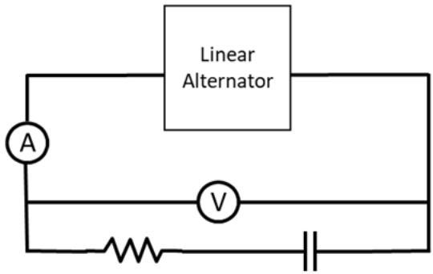  
Figure 12 : SRSC Load

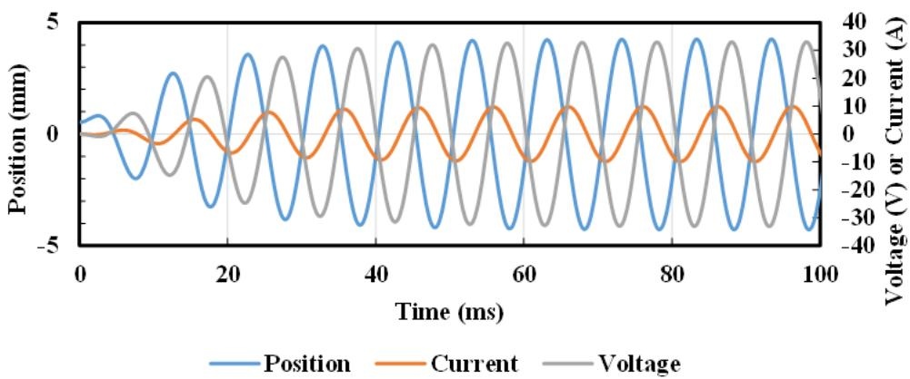  
Figure 13 : SRSC Mover Position, Terminal Voltage & Current vs Time

The SRSC LA performance predictions are summarized and compared with Sunpower alternator test data in Table 7. The test data was acquired during the October 11, 2019 convertor checkout testing at Sunpower. The test data indicated that the engine was operated at 3 Hz above the design frequency of 96 Hz. So the model frequency was adjusted to match the test operating conditions. The model agreed well with the test data in terms of alternator output power and current. The agreement between the predicted and measured terminal voltage was not as good. It should be noted that the model did not account for any voltage drops between the coil and convertor output terminals.

Table 7 : SRSC LA Performance Predictions Compared with Sunpower Test Data
<table><tr><td rowspan=1 colspan=1>Parameter</td><td rowspan=1 colspan=1>GRC Prediction</td><td rowspan=1 colspan=1>Test Data</td><td rowspan=1 colspan=1>% Error</td></tr><tr><td rowspan=1 colspan=1>Piston Amplitude, mmFrequency, Hz</td><td rowspan=1 colspan=1>4.2599</td><td rowspan=1 colspan=1>4.2599</td><td rowspan=1 colspan=1>-</td></tr><tr><td rowspan=1 colspan=1>Terminal Voltage, VrmsCurrent, ArmsPower, WEfficiency, %Total Losses</td><td rowspan=1 colspan=1>23.36.9864.380.016.1</td><td rowspan=1 colspan=1>16.86.563.4-=</td><td rowspan=1 colspan=1>38.7 %7.4 %1.4 %1</td></tr></table>

## B. FISC : LA Performance Verification

A similar load circuit to that of the SRSC as shown in Figure 12, was added to the FISC LA model, and performance predictions were generated. The mover was gradually ramped-up to full stroke operation of 12 mm to maintain computational stability. The model obtained steady-state operation at about 10 cycles as shown in Figure 14. The voltage and current values shown in Figure 14 were calculated at the locations indicated in Figure 12.

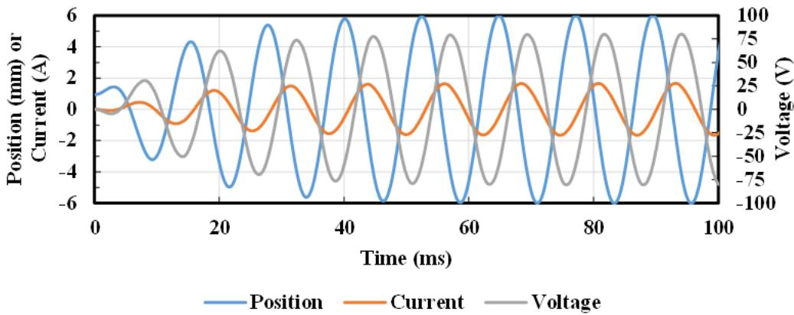  
Figure 14 : FISC Mover Position, Terminal Voltage & Current vs Time

A single data point acquired during testing at AMSC (October 3, 2019) was selected for model verification. Since the selected data point was acquired at 4 Hz below the design frequency of 81 Hz, the model frequency was adjusted to match the data. Model predictions are compared with the AMSC experimental data in Table 8. The generated predictions for the FISC alternator resulted to be in good agreement with the experimental data.

Table 8 : FISC LA Performance Predictions Compared with AMSC Test Data
<table><tr><td>Parameter</td><td>GRC Prediction</td><td>AMSC Test Data (10/3/2019)</td><td>% Error</td></tr><tr><td>Piston Amplitude, mm</td><td>6.0</td><td>6.0</td><td></td></tr><tr><td>Frequency, Hz</td><td>77</td><td>77</td><td>一</td></tr><tr><td>Terminal Voltage, Vrms</td><td>54.3</td><td>-</td><td></td></tr><tr><td>Current, Arms</td><td>1.56</td><td>1.54</td><td>1.3%</td></tr><tr><td>Power, W</td><td>67.1</td><td>68.6</td><td>2.2%</td></tr><tr><td>Efficiency, %</td><td>92.6</td><td>88</td><td>5.2%</td></tr><tr><td>Total Losses</td><td>5.4</td><td></td><td></td></tr></table>

## VI. Conclusions

Sage models were received from both Sunpower and AMSC to interrogate and validate against nominal convertor performance data. Sankey diagrams were also created to visualize the thermal to electric energy conversion process. A difference was noticed between the as received test data and the predictive models. Due to this difference, models were calibrated respectively. As a result of errors between test data and the calibrated models further testing and model optimization will be performed.

An SRSC CFD model was created based on the SRSC convertor geometry. ANSYS Fluent was used to collect useful data that can’t be measured inside the convertor during operating conditions. Lab temperatures measurements were collected from the cylinder can, CSAF, hot end of the convertor, and heater block surfaces and used in the CFD model. Results matched well with lab test. In addition parasitic losses and cold-end losses were also calculated. The FISC convertors have not been delivered, hence, a similar analysis was not performed.

For both the SRSC and FISC alternators, the model predictions were in good agreement with the test data for some parameters, but not so good for others. For the SRSC, the problem area of concern is the terminal voltage. The reason for the discrepancy might be due to the model not accounting for any voltage drops between the coil and convertor output terminals. For the FISC alternator, modeled predictions agree with experimental data. More parameters can be compared in the future as more test data becomes available.

## References

[1] Gedeon, David. “Sage: Object Oriented Software for Stirling Machine Design,” AIAA Paper 94-4106-CP. 1994. https://doi.org/10.2514/6.1994-4106

[2] Metscher, J. F., “ Free-Piston Stirling Convertor Model Development, Validation, and Analysis for Space Power Systems,” Master’s Thesis, Mechanical Engineering Dept., Embry-Riddle Aeronautical Uni., Daytona Beach, FL, 2014.

[3] Wilson, S. D., “Performance of an Advanced Stirling Convertor Based on Heat Flux Sensor Measurements,” NASA TM-217731, 2012.

[4] Wong, W. A., “Advanced Stirling Convertor Development for NASA Radioisotope Power Systems,” NASA TM-218461, 2015.