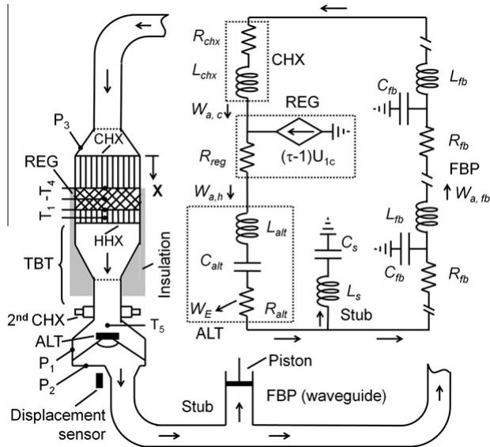
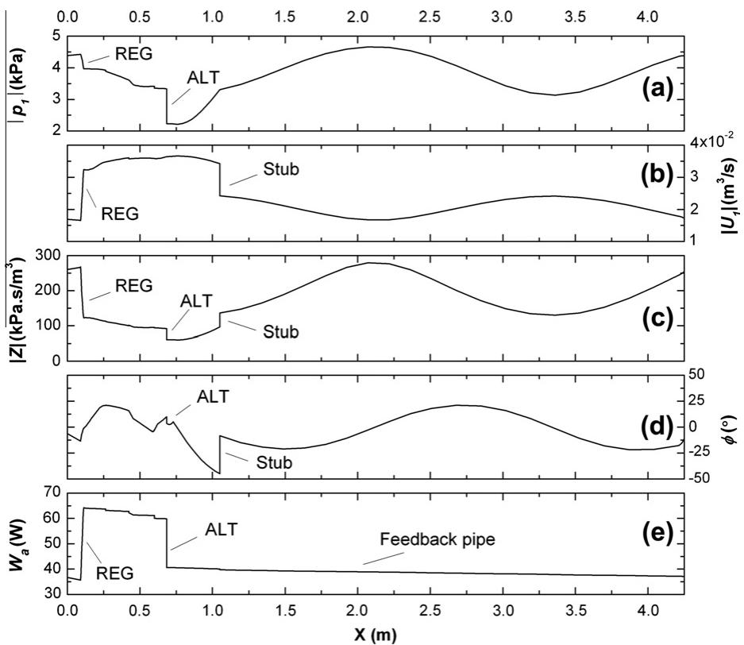
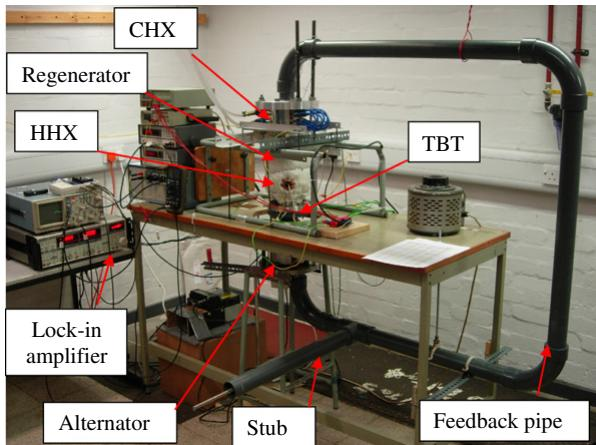
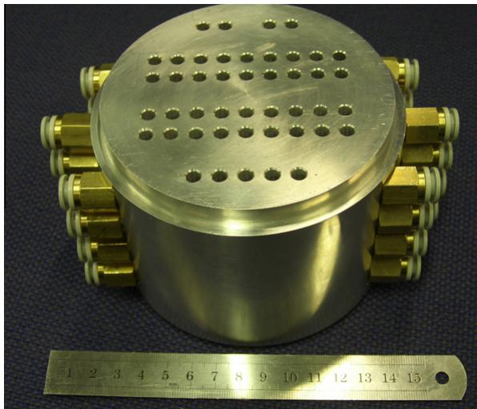
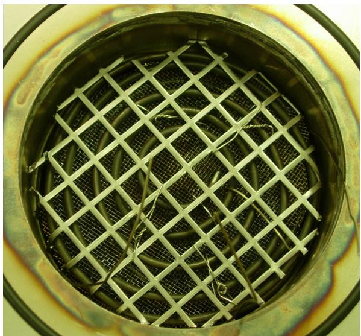
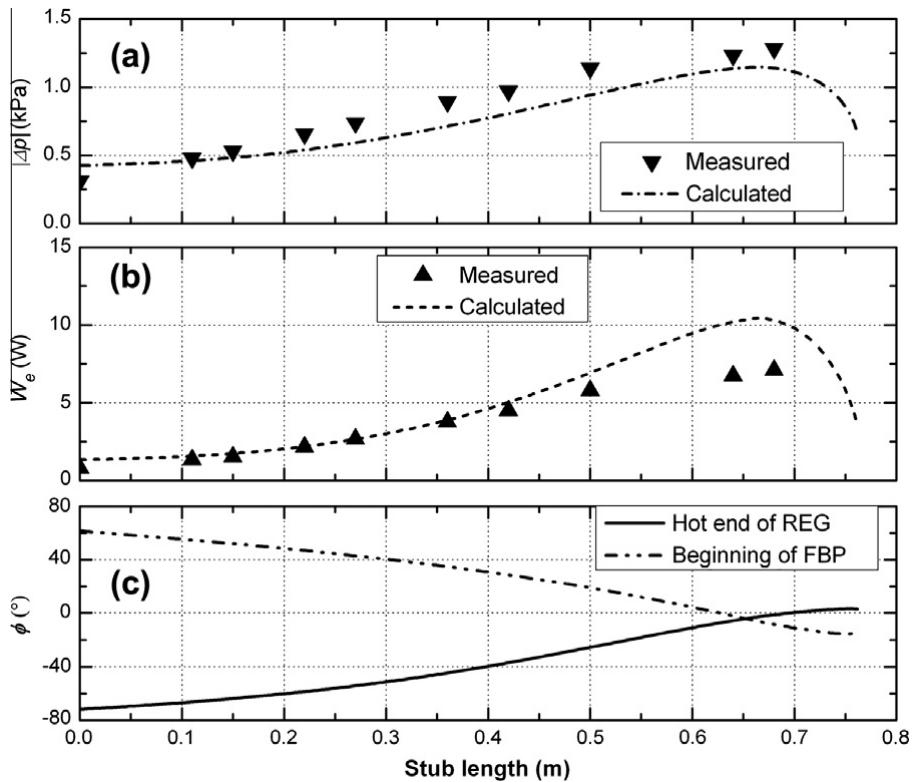
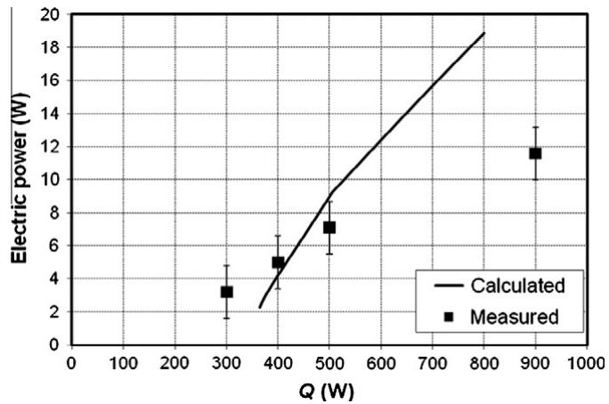
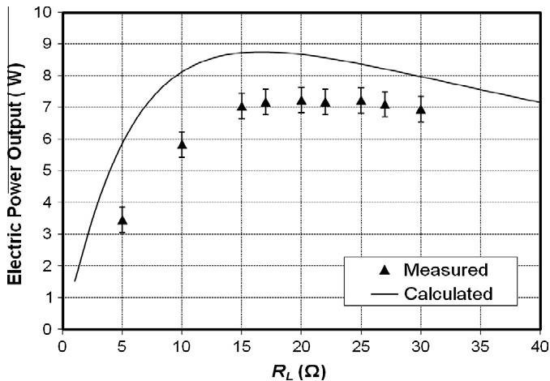

Yu, Z., Jaworski, A.J., and Backhaus, S. (2012) Travelling-wave thermoacoustic electricity generator using an ultra-compliant alternator for utilization of low-grade thermal energy. Applied Energy, 99 . pp. 135-145. ISSN 0306-2619

Copyright © 2012 Elsevier

A copy can be downloaded for personal non-commercial research or study, without prior permission or charge

Content must not be changed in any way or reproduced in any format or medium without the formal permission of the copyright holder(s)

When referring to this work, full bibliographic details must be given

http://eprints.gla.ac.uk/69764/

Deposited on: 09 September 2013

# Travelling-wave thermoacoustic electricity generator using an ultra-compliant alternator for utilization of low-grade thermal energy

Zhibin Yua, Artur J. Jaworski a,\*, Scott Backhausb

a Department of Engineering, University of Leicester, University Road, Leicester LE1 7RH, UK

b Los Alamos National Laboratory, Condensed Matter and Thermal Physics Group, Los Alamos, NM 87545, USA

## HIGHLIGHTS

▶Presented a novel concept of a travelling-wave thermoacoustic electricity generator.

Use of ultra-compliant alternator to convert acoustic power to electricity.

▶New acoustic stub matching and phase adjustment techniques modelled and demonstrated.

Principles and functionality demonstrated through modelling and experimentation.

Guidelines for designing cheap and practical ultra-compliant alternators developed.

## ARTICLE INFO

Article history:   
Received 24 January 2011   
Received in revised form 13 March 2012   
Accepted 30 April 2012   
Available online 4 June 2012

Keywords:   
Thermoacoustics   
Electricity generator   
Ultra-complaint alternator   
Phase tuning

## ABSTRACT

This paper proposes a novel concept of a travelling-wave thermoacoustic electricity generator, which employs a looped-tube travelling-wave thermoacoustic engine to convert thermal energy into acoustic power, an ultra-compliant alternator within the engine loop to extract and convert the engine acoustic power to electricity and an acoustic stub matching technique to match the alternator to the engine. In addition, a carefully designed cold heat exchanger acts as a phase shifting inertance to improve the performance. A simple model has been developed to capture and demonstrate the physics of this new concept, while the whole system has been investigated in detail numerically by using a specialized design tool DeltaEC. Based on the current concept, a prototype has been designed, constructed and tested. It uses atmospheric air as the working fluid, a commercially available audio loudspeaker as the electro-dynamic transducer, and inexpensive standard parts as the acoustic resonator. The experimental results have verified the simplified model and the numerical simulations of the practical build. The small-scale inexpensive prototype generator produced 11.6 W of electrical power, which shows the potential for developing cheap thermoacoustic electricity generators for energy recovery from waste heat sources. It is concluded that such concept could be very attractive provided that inexpensive ultra-compliant alternators based on the standard technology used in audio loudspeakers could be developed. Finally, some guidelines have been discussed and proposed for developing such alternators.

© 2012 Elsevier Ltd. All rights reserved.

## 1. Introduction

Thermoacoustic technologies deal with the thermodynamic conversion between thermal energy and acoustic power by relying on the so-called thermoacoustic effect. Here, the heat transfer between a gas parcel and solid material, occurring due to their local temperature difference, can take place at separate locations along the solid temperature gradient due to the fluid displacement caused by the acoustic oscillations. Therefore, the appropriately phased pressure and displacement (or velocity) oscillations enable the compressible gas parcel to undergo a useful thermodynamic cycle in the vicinity of a solid material and thus to convert thermal energy to acoustic power. A variety of thermoacoustic engines (TAEs) have been devised to convert thermal energy to high intensity acoustic power using the above thermoacoustic effect [1–5]. According to the characteristics of the sound wave present in these engines, they can be categorized into two types: travelling-wave and standing-wave engines. For the travelling-wave engines, the phase difference between the pressure and velocity oscillations is close to zero within the thermoacoustic core, while for the standing wave devices, the phase difference is close to 90°; and these characteristics have a major impact on the reversibility and thus efficiency of the associated thermodynamic cycles. The term “core"

<table><tr><td>Nomenclature</td><td></td><td></td></tr><tr><td>A area</td><td></td><td>ratio of specific heat capacities</td></tr><tr><td>a sound speed</td><td></td><td>penetration depth</td></tr><tr><td>Bl force factor</td><td></td><td>efficiency</td></tr><tr><td>C acoustic compliance</td><td></td><td>coil displacement</td></tr><tr><td> $c _ { p }$ </td><td>specific heat at constant pressure</td><td>density</td></tr><tr><td>F frequency f</td><td></td><td>Prandtl number</td></tr><tr><td>thermoacoustic function</td><td></td><td>temperature ratio</td></tr><tr><td>square root of –1</td><td>φ ω</td><td>porosity; phase angle</td></tr><tr><td>K stiffness k</td><td></td><td>angular frequency</td></tr><tr><td>acoustic propagation coefficient</td><td></td><td></td></tr><tr><td>inductance length</td><td>Subscript a</td><td></td></tr><tr><td>1</td><td></td><td>acoustic</td></tr><tr><td>M</td><td>moving mass</td><td>alternator</td></tr><tr><td>Q</td><td>heat power</td><td>cold heat exchanger</td></tr><tr><td>P Pressure</td><td></td><td>electrical</td></tr><tr><td>p</td><td>acoustic pressure amplitude</td><td>feedback</td></tr><tr><td>R r radius</td><td>electric/mechanical/acoustic resistance</td><td>gas</td></tr><tr><td>T</td><td></td><td>related to thermal penetration</td></tr><tr><td>U</td><td>temperature</td><td>mean</td></tr><tr><td></td><td>volumetric velocity</td><td>mechanical stub</td></tr><tr><td>u velocity V</td><td></td><td>related to stub</td></tr><tr><td>voltage; volume power</td><td></td><td>thermal</td></tr><tr><td>W X</td><td></td><td>viscous</td></tr><tr><td>Z</td><td></td><td>first order variable</td></tr><tr><td>acoustic impedance</td><td>1</td><td></td></tr></table>

denotes an arrangement of the thermoacoustic regenerator/stack and adjacent heat exchangers.

Swift [1] designed and tested a large scale standing-wave thermoacoustic engine, which uses 13.8 bar helium as the working gas and can deliver 630 W of acoustic power to the external acoustic load, converting the heat (thermal) energy into acoustic power at a thermal efficiency of 9%. There are also several other prototypes of standing-wave engines of different sizes or configurations which have been studied by various researchers. However, the standingwave thermoacoustic engines work on an intrinsically irreversible thermodynamic cycle. Their thermal efficiency ratio of acoustic power produced to heat input has thus far been limited to less than 20%.

Ceperley [6] was first to point out that when a travelling sound wave passes though the regenerator with axial temperature gradient, the interaction between the gas and the solid material leads to a Stirling-like thermodynamic cycle. Yazaki et al. [2] were the first to demonstrate such an engine, but at low efficiency due to the low acoustic impedance within the thermoacoustic core, which caused large viscous losses resulting from high acoustic velocities. Much later, based on a compact acoustic network, Backhaus and Swift [3] proposed a new type of thermoacoustic engine which employs an inherently reversible Stirling cycle in the regenerator and utilised a high acoustic impedance to suppress the high acoustic loss. Based on a more complex acoustic network, compared to previous attempts [2], their thermoacoustic Stirling heat engine (TASHE) demonstrated a higher thermal efficiency of 30%, corresponding to 41% of the Carnot efficiency. Recently, for the same type of engine, a new record of 49% of Carnot efficiency has been set by Tijani and Spoelstra [7].

The devices mentioned above were designed to utilise a high temperature source at the engine's hot heat exchanger (or in other words a high temperature difference along the regenerator). A separate challenge, however, is the engine excitation by as small temperature gradients as possible, because this could open the new opportunities for utilisation of low grade waste heat. For example, de Blok's travelling-wave thermoacoustic engine [5] with a travelling wave feedback pipe starts to operate at a temperature difference of only 65 K. Recently, his multistage version of this type of engine was able to operate at the temperature difference of only 40 K at each stage [8]. Due to their simple configuration, with no moving mechanical components, TAEs show the potential for developing reliable, low-cost and environmentally-friendly energy conversion devices for utilizing solar energy or industrial waste heat.

The acoustic power generated by the TAEs can be converted to electricity through an electro-dynamic transduction mechanism. Depending on the range of the acoustic impedance of these electro-dynamic transducers, the method of coupling them to TAEs differs. So far, several thermoacoustic generator prototypes have been built and tested. A compact travelling-wave thermoacoustic generator prototype has been developed for electricity generation aboard spacecraft by integrating the TASHE concept with a linear alternator [9]. Instead of using a lossy standing-wave acoustic resonator, the reactive impedance (i.e. the moving mass) of the linear alternator created a resonance with the compliant gas spring of the thermoacoustic Stirling engine's volume, while the real impedance of the linear alternator extracted the useful acoustic power. At its most efficient operating point, the device achieved a thermal to electric conversion efficiency of 18%. A linear alternator can also be coupled to a conventional thermoacoustic Stirling engine as an acoustic load where the acoustic resonance is provided by the standing-wave acoustic resonator. Recent work indicated that this type of combination can achieve a thermal to electric conversion efficiency of 15% [10]. Other alternatives include integrating a piezoelectric generator with a TAE [11].

In the TAE/alternator combinations mentioned above, the linear alternators had very high acoustic impedance (i.e. large force and small displacement) at the operating frequency of the system and needed to be installed at a high impedance region of the acoustic field. In acoustics, they are also referred to as “noncompliant" transducers. The high impedance generally leads to a high pressure drop. Most linear alternators usually adopt a clearance seal which is essentially a radial gap between the cylinder and piston as small as 10 μm to avoid friction losses [9]. However this leads also to high seal losses. Although the clearance is small, the gas can still pass through this gap (a form of acoustic streaming) when the pressure difference between two sides of the piston is high. In some arrangements, for example, the piston faces the thermoacoustic engine, while its back is enclosed. Such streaming will accumulate the gas on one side of the piston and, as a result, the mean pressure at two sides of the piston will not be equal, which can cause an excessive piston drift. Furthermore, such linear alternators tend to be very expensive because the clearance seal requires a costly manufacture processes. This counteracts the frequently mentioned advantages of thermoacoustic technology such as simplicity and low cost. From the viewpoint of potential commercialization, such an expensive combination is unlikely to be viable when competing with the generators based on conventional Stirling engines which can also utilize low temperature heat sources but have higher conversion efficiencies.

However, from the theoretical viewpoint, it is also possible to combine TAEs with low impedance (i.e. small force and large displacement) transducers. Such low impedance transducers are also referred to as “ultra-compliant" transducers. This combination has several advantages compared to its high impedance counterparts mentioned above. Installing such alternators in a low impedance region avoids the technical problems associated with the high impedance transducers because the required pressure drop is much lower. This allows replacing the clearance seal with a “hermetic" seal which eliminates the seal loss and the possible piston drift due to the streaming though the clearance seal present in conventional linear alternators. In addition, in the engine concept proposed in this paper, such a “hermetic" seal allows suppressing the Gedeon streaming that usually exists within the loop type thermoacoustic systems†. The manufacturing costs of such ultra-compliant alternators could be much lower because they could potentially use the technologies which have been widely used by audio loudspeaker manufacturers. However, very little research attention has been devoted to such combinations, partly because there are no such ultra-compliant linear alternators available in the market yet, except the audio loudspeakers which might be treated as low impedance alternators because they usually have relatively small moving mass and stiffness. However, it should be noted that, the loudspeakers are designed for high audio quality rather than to convert acoustic power to electricity in an efficient manner, and they do not match exactly the requirements of a thermoacoustic generator. For example, they have a relatively low power transduction efficiency, a fragile paper cone, and a limited stroke.

Integrating ultra-compliant alternators with TAEs leads to new challenges and design considerations, which the current research aims to address. A new concept for coupling such an alternator to a TAE is proposed, and this has been investigated in detail, both theoretically and numerically. Based on this novel concept, a smallscale prototype of an inexpensive thermoacoustic generator has been built and tested. It has produced useful amounts of electricity with reasonable conversion efficiency. The experimental results have verified the modelling. Furthermore, the ultimate goal of this work is to raise the awareness of both the research community and industry regarding the potential opportunities to develop inexpensive thermoacoustic generators for energy recovery from waste heat sources, and that there is a demand for low cost and low impedance alternators which could be manufactured using the mature technologies being widely used by loudspeaker manufacturers. Furthermore, from the viewpoint of a better coupling with TAEs, some guidelines for developing such ultra-compliant alternators have been discussed and summarized based on the research results obtained.

## 2. Concept and simplified model

As described in the introduction, there are different types of thermoacoustic engines. Standing-wave engines have a very simple linear configuration but relatively low efficiencies [1]. The pressure difference across the alternator's diaphragm has a high amplitude when the alternator is coupled to the standing-wave thermoacoustic engine. Such working conditions typically demand the application of high impedance linear alternators because their high mass/high stiffness construction allows handling high pressures across the diaphragm which is typically a sturdy metal piston. Ultra-compliant alternators would be a bad choice in this situation due to the fact that a relatively flexible diaphragm would be unable to handle the very high pressure differentials across. Torus type travelling wave engines have high thermal efficiencies [3,9], and the generator based on this type of engine has shown a high generator efficiency [9]. However, the ultra-compliant alternator could not provide the large reactive impedance to maintain the acoustic resonance for the torus as shown in Ref. [9]. It is possible to install such an ultra-compliant alternator in the thermoacoustic engine through a side branch pipe as shown in Ref. [10]. This however requires the alternator to handle a high pressure drop and this configuration is not suitable for such a low impedance ultra-compliant alternator.

A looped tube thermoacoustic engine is another type of a travelling-wave engine [2]. Its performance is better than the standingwave engine [1], while the configuration is still relatively simple. Using this configuration, it is possible to install the ultra-compliant alternator in the near-travelling wave region within the loopedtube resonator. In this way, the pressure difference across the alternator diaphragm can be significantly reduced. This arrangement also helps to suppress the acoustic streaming which is induced by the secondary mass flow and could cause heat losses from a hot heat exchanger.

As mentioned in the introduction, currently there are no ultracompliant alternators available on the market. Therefore in this research it has been decided to use an audio loudspeaker as an approximation of an ultra-compliant alternator, although it is recognised that audio loudspeakers would not match exactly the requirements of a thermoacoustic electricity generator. According to the loudspeaker (or in this case alternator) linear theory [12], to achieve a high transduction efficiency, the alternator should have a high force factor Bl, low mechanical resistance $R _ { m } ,$ and low electrical resistance $R _ { e } .$ Furthermore, for a given frequency, the electrical power production capacity also depends on the excursion of the alternator; therefore, a high excursion is preferred. According to these criteria, a B&C 6PS38 woofer (manufactured by B&C speakers) was selected. Its specifications and the measured Thiele/Small parameters are summarized in Table 1 [13].

Specifications of the loudspeaker (alternator).
<table><tr><td></td><td>Nominal</td><td>Measured</td><td>Deviation</td></tr><tr><td>F (Hz)</td><td>75</td><td>62.0</td><td>±0.1 (±0.2%)</td></tr><tr><td>Bl (N/A)</td><td>10.8</td><td>9.6</td><td>±0.3 (±3%)</td></tr><tr><td>Le (mH)</td><td>0.6</td><td>0.479</td><td>±0.002 (±4.1%)</td></tr><tr><td>Re (Ω)</td><td>5.4</td><td>5.41</td><td>±0.1 (±1.8%)</td></tr><tr><td>Mm (g)</td><td>14</td><td>17.0</td><td>±0.3 (±2%)</td></tr><tr><td>Km (N/m)</td><td>2778</td><td>2621</td><td>±10 (±4%)</td></tr><tr><td>Rm (kg/s)</td><td>0.64</td><td>0.96</td><td>±0.02 (±2%)</td></tr><tr><td>X (mm)</td><td>±6</td><td></td><td></td></tr><tr><td>Aat (cm2)</td><td>132</td><td></td><td></td></tr></table>

  
Fig. 1. Schematic of the demonstrator unit and the lumped acoustic circuit.

The present concept of the thermoacoustic electricity generator is shown schematically in Fig. 1. The thermoacoustic core consists of a cold heat exchanger (CHX), regenerator (REG) and hot heat exchanger (HHX). The core is in essence an acoustic power amplifier [14]. The overall power flow is such that part of the acoustic power generated in the core is extracted by the alternator, while the remaining part is fed into the cold end of the regenerator through the feedback pipe (FBP) and is then amplified by the regenerator with a steep temperature gradient in the direction of sound propagation which causes a sharp increase in the volumetric velocity (the above mentioned amplification effect). The regenerator has a cross sectional area A much larger than that of feedback pipe, in order to improve the generator performance by having $| Z | \gg \rho _ { M } a / A$ [3]. The change in A requires two tapered sections, likely to cause flow separations and thus significant streaming and heat leaks [15]. To suppress the streaming, two flow straighteners (several coarse mesh discs) are installed – c.f. the dotted lines as shown in Fig. 1.

Below the thermoacoustic core, there is a thermal buffer tube (TBT), of which one end connects to the hot heat exchanger; while the other connects to the secondary cold heat exchanger that prevents a heat leak to the alternator housing. The alternator is installed just after the secondary cold heat exchanger, and is enclosed in a housing. The acoustic power is extracted by the alternator immediately after it is produced in the thermoacoustic core. The alternator introduces an acoustic load to the thermoacoustic engine, which alters the acoustic field within it. An acoustically unmatched load generates an acoustic reflection and a high standing wave ratio in the acoustic feedback pipe and thus causes large acoustic losses. To extract the acoustic power in an efficient manner through the alternator and reduce the acoustic losses within the feedback pipe, the load (alternator) has to be matched with the engine's acoustic network. This is achieved by applying a technique of “stub-matching", very similar to that routinely used in microwave electronic circuits. Here an acoustic stub has been introduced to the engine as shown in Fig. 1. It is a side branch pipe with the same diameter as the feedback pipe, and its length can be varied by moving a piston so that the fine tuning effect can be obtained within the experiments. In principle, acoustic reflections introduced by the alternator can be cancelled out by adding an equal and opposite reflection from the side stub.

The matching stub should be attached to the wave guide at the location close to the load as schematically shown in Fig. 1. The optimal location for the stub will be discussed later. After the side stub, the long feedback pipe (FBP) connects back to the thermoacoustic core to the top end of the cold heat exchanger, through which part of the acoustic power is fed back to the thermoacoustic core for amplification.

In addition to the diagram of the physical layout, an equivalent lumped electrical circuit is presented in the inset of Fig. 1 to provide a further physical understanding of the generator's operation. According to the linear thermoacoustic theory [16], Eq. (1) quantitatively describes the interaction between the acoustic and temperature fields (i.e. the thermoacoustic effect).

$$
[ 1 + ( \gamma - 1 ) f _ { k } ] p _ { 1 } + \frac { \gamma p _ { 1 } } { \omega ^ { 2 } } \frac { d } { d x } \bigg ( \frac { 1 - f _ { \nu } } { \rho _ { M } } \bigg ) - \frac { a ^ { 2 } } { \omega ^ { 2 } } \frac { f _ { k } - f _ { \nu } } { 1 - \sigma } \frac { 1 } { T _ { M } } \frac { d T _ { M } } { d x } \frac { d p _ { 1 } } { d x } = 0 .\tag{1}
$$

Here, $p ,$ U, $T , \rho ,$ and γ are the pressure, volumetric velocity, temperature, density and the ratio of specific heat capacities of the gas, respectively; ω and a are the angular frequency and sound speed of the acoustic wave; $f _ { k }$ and $f _ { \nu }$ are the spatially averaged thermal and viscous functions, respectively. $f _ { k }$ and $f _ { \nu }$ and are given in [16] in detail. Subscript “1" indicates the first order of a variable, which usually has a complex amplitude. For the convenience of numerical calculations, Eq. (1) can be written as:

$$
{ \frac { d p _ { 1 } } { d x } } = - { \frac { j \omega \rho _ { M } / A } { 1 - f _ { \nu } } } U _ { 1 } ,\tag{2}
$$

$$
\frac { d U _ { 1 } } { d x } = - \frac { j \omega A } { \gamma p _ { M } } [ 1 + ( \gamma - 1 ) f _ { k } ] p _ { 1 } + \frac { ( f _ { k } - f _ { \nu } ) } { ( 1 - f _ { \nu } ) ( 1 - \sigma ) } \frac { d T _ { M } } { T _ { M } d x } U _ { 1 } .\tag{3}
$$

In essence, Eqs. (2) and (3) are the thermoacoustic version of momentum and continuity equations. The time-averaged acoustic power $d W _ { a }$ produced in a length dx of the channel can be written in the complex notation in the general form as

$$
\frac { d W _ { a } } { d x } = \frac { 1 } { 2 } \mathrm { R e } \left[ \tilde { U } _ { 1 } \frac { d p _ { 1 } } { d x } + \tilde { p } _ { 1 } \frac { d U _ { 1 } } { d x } \right]\tag{4}
$$

where $\ " _ { \sim } \ "$ indicates a complex conjugate. Re[ ] denotes the real part of a complex number. Eq. (4) can be written as

$$
\frac { d W _ { a } } { d x } = - \frac { R _ { \nu } } { 2 } \left| U _ { 1 } \right| ^ { 2 } - \frac { 1 } { 2 R _ { k } } \left| p _ { 1 } \right| ^ { 2 } + \frac { 1 } { 2 } \mathrm { R e } [ g \tilde { p } _ { 1 } U _ { 1 } ] .\tag{5}
$$

Viscous resistance per unit length of the channel, $R _ { \nu } ,$ thermalrelaxation conductance per unit length of the channel, $1 / R _ { k } ,$ and the complex gain constant for the volume flow rate, g, are defined as follows:

$$
R _ { \nu } = \frac { \omega \rho _ { m } } { A _ { g } } \frac { \mathrm { I m [ - } f _ { \nu } ] } { \left| 1 - f _ { \nu } \right| ^ { 2 } } ,\tag{6}
$$

$$
\frac { 1 } { R _ { k } } = \frac { \gamma - 1 } { \gamma } \frac { \omega A _ { g } } { p _ { M } } \mathrm { I m } [ - f _ { k } ] ,\tag{7}
$$

and

$$
g = \frac { ( f _ { k } - f _ { \nu } ) } { ( 1 - f _ { \nu } ) ( 1 - \sigma ) } \frac { 1 } { T _ { M } } \frac { d T _ { M } } { d x } .\tag{8}
$$

$A _ { \mathrm { g } }$ is the cross sectional area of gas channels in the regenerator. Furthermore, $A _ { \mathrm { g } } = \phi A$ , where φ and A are porosity and cross sectional area of the regenerator, respectively. In the regenerator, the viscous loss is much more important than the thermal-relaxation loss. Therefore, the regenerator is simplified and modelled as a combination of resistance $R _ { r e g }$ and a current source $( \tau - 1 ) U _ { 1 , c }$ as shown in

Fig. 1. Here, $\scriptstyle \tau = T _ { h } / T _ { c , }$ while $T _ { h }$ and $T _ { c }$ are the temperatures at two ends of the regenerators, respectively.

In the acoustic domain, the impedance of the alternator can be written as [13]

$$
Z _ { a l t } = \frac { \Delta p } { U _ { 1 } } = \frac { 1 } { A _ { a l t } ^ { 2 } } \left[ \frac { \left( B l \right) ^ { 2 } } { \left( R _ { e } + R _ { L } + j \omega L _ { e } \right) } + R _ { m } + j \left( \omega M _ { m } - \frac { K _ { m } } { \omega } \right) \right]\tag{9}
$$

Here $\Delta p$ is the pressure drop across the diaphragm, and $R _ { L }$ is the load resistance. According to the parameters shown in Table 1, $\omega L _ { e }$ is much less than $R _ { e }$ or $R _ { L } ,$ therefore, neglecting the inductance of the coil leads to

$$
Z _ { a l t } = \frac { 1 } { A _ { a l t } ^ { 2 } } \left[ \left( \frac { ( B l ) ^ { 2 } } { R _ { e } + R _ { L } } + R _ { m } \right) + j \left( \omega M _ { m } - \frac { K _ { m } } { \omega } \right) \right] .\tag{10}
$$

The right hand side of Eq. (9) shows that the alternator introduces an acoustic resistance $R _ { a l t }$ (i.e., the total effect of coil resistance $R _ { e } ,$ load resistance $R _ { L } ,$ and the mechanical resistance $R _ { m } ) ,$ an inertance $L _ { a l t }$ (i.e., the inertial effect of the mass of the coil and cone), and a compliance $C _ { a l t } ,$ (i.e., the spring effect) to the loop. These three components are connected in the equivalent circuit in series as shown in Fig. 1. The acoustic power extracted by $R _ { a l t }$ is mostly converted into electric power, part of which is delivered to $R _ { L } ,$ while the rest is dissipated by the coil resistance. $U _ { 1 }$ is constant at the two sides of the alternator diaphragm, while $| p _ { 1 } |$ drops due to the power extraction. This pressure drop is much smaller than that in conventional designs because the reactive part of the impedance is very small even when the alternator is off resonance by a few Hz:

$$
\left( \omega M _ { m } - \frac { K _ { m } } { \omega } \right) \ll \left( \frac { \left( B l \right) ^ { 2 } } { R _ { e } + R _ { L } } + R _ { m } \right) .\tag{11}
$$

Although the pressure drop is small, the installation of the alternator will still modify the preferred acoustic field along the looped engine [2]. This will cause a drop of [Z| at two sides of the alternator. To tune $Z$ for minimum dissipation in the feedback pipe, the side-branch matching stub needs to compensate for the alternator's effect on the acoustic field.

For a section of acoustic duct, the relationship between the input $Z _ { 1 }$ and output acoustic impedance $Z _ { 2 }$ can be rewritten as [17]:

$$
Z _ { 1 } = Z _ { 0 } \frac { Z _ { 2 } + j Z _ { 0 } \tan { k l } } { Z _ { 0 } + j Z _ { 2 } \tan { k l } } .\tag{12}
$$

Here, l is the length of the duct, $k = 2 \pi / \lambda$ is the acoustic propagation coefficient, and $Z _ { 0 }$ is the characteristic impedance of the duct and is defined as

$$
Z _ { 0 } = \frac { \rho _ { M } a } { A } .\tag{13}
$$

The stub is essentially a section of an acoustic duct with a closed end, i.e. $Z _ { 2 } = \infty$ . Therefore, the input acoustic impedance of the stub can be approximately written as

$$
Z _ { s t u b } \approx - j \frac { \rho _ { M } a } { A } \cot k l .\tag{14}
$$

Usually, the stub length is much less than $\lambda / 4$ so that $k l < \pi / 2$ For $0 . 5 < k l < 1$ , applying the second order approximation on cotangent function on the right hand side of Eq. (14) leads to

$$
Z _ { s t u b } \approx - j \frac { 1 } { \omega C _ { s } } + j \frac { \omega L _ { s } } { 3 } .\tag{15}
$$

Here,

$$
C _ { s } = \frac { V } { \rho _ { M } a ^ { 2 } } = \frac { V } { \gamma P _ { M } } ,\tag{16}
$$

and

$$
L _ { s } = \frac { l \rho _ { M } } { A } .\tag{17}
$$

Therefore, the stub can be modelled as a combination of acoustic compliance $C _ { s }$ and inertance $L _ { s }$ in series, as shown in Fig. 1. Considering $1 / \omega C _ { s } \gg \omega L _ { s }$ so that the stub injects a reactive $\Delta U _ { 1 }$ into the loop that lags $p _ { 1 }$ by almost $9 0 ^ { \circ }$ without changing lp₁| at the junction. Consequently, it introduces a sharp increase of $| Z |$ and the phase angle, which compensates for the effect of the alternator.

The rest of the feedback pipe is just a lossy acoustic waveguide. Each unit section can be modelled as a combination of resistance $R _ { f b } ,$ inertance $L _ { f b }$ and compliance $C _ { f b } ,$ which can also be calculated according to Eqs. (16) and (17). It should be noted that, as will be described later in Section 4, the cold heat exchanger has a very low porosity of $1 0 \% ,$ while it has a relatively long length of 90 mm. Compared with the large cross-sectional area of the thermoacoustic core, the CHX effectively introduces a long but small cross-section channel locally into the loop. Therefore from the acoustics point of view, the CHX introduces a noticeable inertance effect in addition to the usual acoustic resistance $R _ { c h x } .$ This additional inertance effect is modelled as $L _ { c h x }$ as shown in Fig. 1 and is also demonstrated by the numerical results as shown in Fig. 2d later in this paper. Essentially, such an inertance effect introduces a pressure drop $\Delta p$ that lags $U _ { 1 }$ by almost 90° [18]. This also provides a phase change helping to create the preferred condition for an efficient regenerator (i.e. $U _ { 1 }$ leads $p _ { 1 }$ at the cold end and $U _ { 1 }$ lags $p _ { 1 }$ at the hot end [3]). Although its inertance effect is much smaller than the classic “inertance tubes" which are commonly used in pulsetube cooler systems, the interesting attempt here is to demonstrate that it is feasible to combine the inertance phase shifter with heat exchangers, which is potentially an advantage for designing more compact thermoacoustic systems.

## 3. Design simulations

The simplified model described above provides a very useful qualitative understanding of the behavior of the thermoacoustic electricity generator considered in this paper. However it is admittedly a complex system involving acoustic, mechanical and electrical components. Therefore for a quantitative analysis a more specialised design tool referred to as Design Environment for Low-amplitude ThermoAcoustic Energy Conversion (DeltaEC) is employed. It is a computer programme, widely used for analysing thermoacoustic applications [19]. It can be used in the design process in order to optimise a thermoacoustic system from the point of view of the required performance, or to predict the performance of an existing build of a thermoacoustic device with the view of further debugging. DeltaEC integrates numerically the acoustic wave equation and energy equation segment by segment throughout the whole device based on the low amplitude acoustic approximation and the sinusoidal time dependence of the variables [16].

The design and optimisation processes are quite involved and would require a separate paper to describe all the detailed steps. However these are outside the scope of this paper. Therefore, for convenience, the simulation results discussed in this section are based on the final design of the prototype, with dimensions given in the next section. This will allow comparisons between the experiments and simulations to verify the model. However, it should be noted that, some compromises had to be made to utilise the available standard parts in order to reduce the cost of the prototype. This means that the final prototype design is not fully optimized from the theoretical point of view, and there are still some opportunities for further improvement of performance if for example bespoke parts were to be made (e.g. pipes of non-standard diameters). Furthermore, atmospheric air is used as working gas in order to simplify the construction and operation of the present prototype.

  
Fig. 2. Pressure amplitude (a), volumetric velocity (b), acoustic impedance (c), phase angle (d) and acoustic power flow (e) along the generator.

For the purpose of comparison with the experiments, the displacement of the coil within the alternator is set to 6.25 mm as a boundary condition, which is also easy to be accurately controlled in the experiments. To achieve this displacement, the input heat power is about 434 W in the simulation. Although the displacement is slightly bigger than the nominal maximum excursion of the alternator, the measurement shows that the distortion of the output voltage is negligible. The load resistance is set to 15.6 Ω. The working gas is air at atmospheric pressure. The working frequency is 70 Hz, which is a compromise between the requirements from the alternator (i.e. at resonance) and dimensions of the regenerator (i.e. matching the hydraulic radius). The principles for optimization were as follows: Firstly, the regenerator should work in a travelling-wave condition. Secondly, a near travelling wave has to be achieved in the feedback pipe to reduce the dissipation. One typical case of the simulation is shown in Fig. 2.

Fig. 2a shows the pressure amplitude distribution along the loop (which is around 4.25 m long). There are two maxima and two minima of pressure amplitude along the loop and two sharp pressure drops. One drop is along the regenerator (about 450 Pa). The other is at the alternator which indicates that the alternator extracts a considerable acoustic power. Looking back to the simplified model as shown in Fig. 1, the first pressure drop is caused by the flow resistance of the regenerator $R _ { r e g } ,$ while the second is obviously caused by the acoustic resistance $R _ { a l t }$ introduced by the alternator. The standing wave ratio within the loop can be estimated by the ratio of the maximum over minimum pressure amplitude which, as expected, is relatively small (about 2.1). Furthermore, the acoustic stub does not cause a change of pressure amplitude, while it changes the slope at which pressure amplitude increases. The pressure amplitude changes smoothly along all other parts.

Fig. 2b shows the distribution of volumetric velocity along the loop. There are also two maxima and two minima along the loop. One maximum is in between the alternator and the stub, and the other is near the end of the feedback pipe where the minimum of the pressure amplitude is located. One minimum of the volumetric velocity is at the cold end of the regenerator, while the other is close to the middle of the feedback pipe. The small volumetric velocity within the regenerator is preferred to avoid high viscous dissipation, which is one of the design strategies behind the current concept. It can also be seen that the volumetric velocity increases significantly along the regenerator. This is due to the sharp temperature gradient along the regenerator. This is the reason why the regenerator is modelled as a current source. Furthermore, at the location of the stub, there is a sudden decrease of the volumetric velocity. This indicates that the stub shunts part of the volumetric velocity away from the looped resonator. Along all other parts, the volumetric velocity changes smoothly.

Fig. 2c shows the acoustic impedance along the loop. It can be seen that the acoustic impedance is highest at the cold end of the regenerator $( | Z | \sim 5 \rho _ { M } a / A )$ . The impedance drops quickly because the pressure amplitude decreases (see Fig. 2a) while the volumetric velocity increases sharply from the cold to the hot end of the regenerator (see Fig. 2b). The alternator causes a sudden drop of acoustic impedance due to the fact that the volumetric velocities at two sides of the alternator are the same, while the pressure amplitude drops significantly due to the acoustic power extraction. The stub introduces a sudden increase of the acoustic impedance along the loop. This is because the pressure amplitude at the stub junction is constant, while the volumetric velocity has been shunted partly to the stub due to the stub's reactive impedance as shown in Fig. 1. It is very clear that the stub cancels out (almost perfectly) the acoustic impedance drop caused by the alternator. This is the essence of the stub matching idea behind the current concept.

From Fig. 2c, one can also find that the alternator is very close to the minimum of acoustic impedance. This is also a carefully designed feature of the rig, introduced to obtain a sufficient volumetric velocity to drive the alternator to the maximum excursion which subsequently maximizes the electrical power output. The location of the stub has also been optimised in the model. As discussed above, it should be close to the acoustic loads, which in this system are the alternator and the feedback pipe's (FBP) acoustic resistance. After a careful simulation process, it has been located about 33 cm away from the alternator. From Fig. 2c, it can also be found that $0 . 6 < | Z | < 1 . 6 \rho M a / A$ along FBP. Therefore, the dissipation in the FBP has also been minimized.

Fig. 2d shows the phase difference between pressure and velocity oscillation along the pipe. It can be found that the regenerator is at a near travelling-wave location. The phase angle decreases rapidly after alternator till the junction with stub. The stub introduces a sharp increase of phase angle $\left( \Delta \phi = 3 7 ^ { \circ } \right)$ to counteract this sharp phase angle decrease. Furthermore, it can also be seen that CHX's phase-shifting inertance $L _ { c h x }$ (which has a very low porosity of only10%, as will be described in the next section) introduces a phase change $\Delta \phi = - 7 ^ { \circ }$ helping to create the preferred condition for an efficient regenerator (i.e. $U _ { 1 }$ leads $p _ { 1 }$ at the cold end and $U _ { 1 }$ lags $p _ { 1 }$ at the hot end [2]). The rest of FBP is just an acoustic waveguide. After optimization, FBP also achieves a near travelling wave condition $( { \mathrm { i . e . ~ } } - 2 1 ^ { \circ } < \phi < 2 1 ^ { \circ } )$

Fig. 2e shows the acoustic power flow along the loop. It can be found that around 37 W of acoustic power is fed into the cold heat exchanger which dissipates around 1.4 W. The remaining 35.6 W is fed into the cold end of the regenerator. Within the regenerator, the acoustic power is amplified to around 64.3 W which is the level of acoustic power flowing out from the hot end of the regenerator. The hot heat exchanger and thermal buffer tube dissipate around 4.3 W. The alternator extracts about 19.3 W of acoustic power. The feedback pipe dissipates about 3.6 W. In this simulation, the alternator produces 10.3 W of electricity. As mentioned above, the required input heat is 434 W for this case. Therefore, the calculated thermal-to-acoustic efficiency $\eta _ { t - a } = 4 . 4 \%$ acoustic-to-electric efficiency $\eta _ { a - e } = 5 3 . 4 \% ,$ and thermal-to-electric efficiency $\eta _ { t - }$ $_ e = 2 . 4 \%$

## 4. Experimental apparatus

A prototype thermoacoustic generator has been constructed according to the present concept and the detailed modelling results. Fig. 3 is a photograph of the prototype and the instrumentation used in the experiments. As shown in Fig. 4, the cold heat exchanger is made out of a round aluminium block, which is

  
Fig. 3. Photograph of the thermoacoustic generator prototype.

  
Fig. 4. Photograph of the cold heat exchanger.

  
Fig. 5. Photograph of the hot heat exchanger.

90 mm long and has 110 mm diameter. Gas passages are made in the form of 45 holes with the diameter of 5 mm, drilled parallel to the heat exchanger's centre-line. Twelve holes with the diameter of 6 mm are drilled perpendicular to the heat exchanger axis to pass cooling water. A PCB pressure transducer (model 112A22) is installed just above the cold heat exchanger, which is indicated as P3 in Fig. 1.

The regenerator is made out of stainless screen disks (110 mm in diameter), with the mesh number 34 and the wire diameter 0.254 mm. Fourty two discs have been piled up in a stainless steel can which has a wall thickness of 2 mm. The disks form a 21 mm long regenerator. Consequently, the obtained porosity and hydraulic radius are 73.3% and 175 μm, respectively. Three Type-K thermocouples (TC-Direct model 408-119) are installed along the regenerator. The distance between each of the two adjacent thermocouples is 10.5 mm. They monitor the temperature profile along the axis of the regenerator, as well as the temperature difference between the two ends of the regenerator. They are denoted by T2–T4 in Fig. 1.

The hot heat exchanger is made using a standard cable heater manufactured by WATLOW. It has 3.17 mm diameter and a length

Table 2

of 2.4 m. Its rated power is 1000 W and the rated voltage is 240 V. Fig. 5 is the photograph of the hot heat exchanger when it is installed in the engine. It was wound into a spiral configuration with two layers. Several coarse mesh discs were inserted in between these two layers to enhance the heat transfer between the air and heater. It is powered by a transformer which can adjust the voltage in the range of 0–240 V. One Type-K thermocouple is installed in the heater to measure the surface temperature of the heater, and it is denoted by T1 in Fig. 1.

Below the hot heat exchanger, there is a short thermal buffer tube, which is a section of stainless steel pipe (ID = 110 mm) with a length of 80 mm, and a wall thickness of 2 mm. The 110 mm diameter buffer tube connects to a smaller buffer tube via a short transition cone, which reduces the diameter from 110 mm to 54 mm over a distance of 54 mm. The small diameter section is around 160 mm long and has the internal diameter of 55 mm (a section of standard stainless steel 2-in. tube, with 2.77 mm wall thickness). To reduce heat losses, the regenerator, hot heat exchanger and the thermal buffer tube are enclosed within an insulation blanket. The other end of the thermal buffer tube connects to the secondary cold heat exchanger. A car radiator matrix is tightly fitted within the 2-in. pipe to take heat from the hot gas, and there is a water jacket outside the pipe to take the heat away by the running cold water. A short section of 2-in. stainless tube with a length of 90 mm connects the secondary cold heat exchanger and the alternator housing.

The alternator is mounted on the bottom flange of the housing; the cone facing downwards. The bottom flange has a small glass window (50 mm diameter), which is an optical access for the laser displacement sensor (Keyence LK-G152) to measure the displacement of the alternator diaphragm. It has a standoff distance of 150 mm, and a measuring range of ±40 mm. The sampling frequency is 50 kHz and the resolution is 0.5 μm. Two PCB pressure transducers (model 112A22) have been used to measure the pressures behind and in front of the alternator diaphragm (marked as P1 and P2 in Fig. 1). Another Type-K thermocouple is installed just above the alternator to monitor the local gas temperature to ensure the alternator works within the rated temperature range.

The remaining part of the rig is the 3.65 m long feedback tube which connects back to the cold heat exchanger through a transition cone (54 mm in length). Because the engine is designed to operate with air at atmospheric pressure, the maximum pressure difference between the inside and the outside of the resonator corresponds to the acoustic pressure, which is usually less than 0.1 bar. Therefore, the feedback pipe is made of standard 2-in. PVC pipe and $9 0 ^ { \circ }$ bends (Class E, OD: 60.3 mm, thickness 4.5 mm) instead of a metal pipe to reduce cost. The total length of the loop is about 4.25 m. About 33 cm away from the alternator housing, an acoustic stub tube (680 mm in length) is connected to the resonator to improve the impedance matching between the alternator and engine as already discussed in the section describing the modelling aspects.

A high power variable resistor is utilized as an electrical load for the alternator to extract electrical power. The voltage difference and the current flowing through the load resistor are measured using a standard voltmeter (with the resolution of 0.001 V) and ammeter (with the resolution of 0.01 A). As a result, the electrical power extracted by the load resistor is deduced. The output from the pressure and displacement sensors together with the voltage drop $V _ { L }$ on the load resistor are recorded directly using a computer acquisition card (OMB-DAQTEM 14). The phase angles between these signals are measured by SR830 DSP lock-in amplifier with an accuracy of 0.01°. All of the pressure sensors have a resolution of 7 Pa, and have been carefully calibrated prior to measurements. The pressure sensors have been interchanged to double check their reliability.

## 5. Experimental results and discussion

With the terminals of the alternator open $( \mathrm { i } . { \bf e } . R _ { L } = \infty ) ,$ the generator begins to oscillate when the temperature difference at two ends of the regenerator reaches about 120 K. To achieve $| \xi | = 6 . 2 5$ mm at the alternator (when $R _ { L } = 1 5 . 6 \Omega$ and stub length = 0.68 m), the calculated $Q = 4 3 4 \mathsf { W }$ , while the measured $Q = 5 0 0 { \mathrm { W } }$ The difference of 66 W is estimated from experiments as the heat losses to the ambient. The measured pressure amplitude is $\left| P _ { 3 } \right| = 4 8 4 1 { \mathrm { ~ P a } }$ . For the most efficient case, the measured $W _ { e } = 7 . 1$ W with a thermal-to-electric efficiency of 1.4%, an acoustic-to-electrical efficiency of 46.5% and a thermal-to-acoustic efficiency of 3.0%. The comparisons with the simulation results are summarized in Table 2. Considering that the rig is a very complicated system, Table 2 shows a reasonable agreement between experiments and simulations.

From Table 2, it can be seen that, the measured pressure amplitude of [P3| is very close to the calculated one, while the measured $\left| P _ { 1 } \right|$ and |P2| are about 10% higher than the calculated ones. It can be found that the actual standing wave ratio within the loop should be higher than the calculated one. Therefore, the actual acoustic losses are higher than those in the simulation. The measured thermal-to-acoustic and acoustic-to-electric efficiencies are about 30% and 12% lower than the calculated ones, respectively. The overall thermal-to-electric efficiency is about 40% lower than the theoretical one. All of these discrepancies are most likely the effect of underestimating the actual acoustic losses due to sudden change of area around the alternator housing and the mechanical resistance of the alternator in the simulation.

Fig. 6 shows the comparison between the simulation and experiments $\left( R _ { L } = 1 5 . 6 \Omega \right)$ when $l _ { \mathrm { s t u b } }$ varies. To account for heat losses, Q is fixed at 434 and 500 W for simulations and experiments, respectively. Fig. 6a shows that the measured |∆p| across the alternator agrees well with the simulations. As $l _ { \mathrm { s t u b } }$ increases, |∆p| increases significantly. The calculated optimal lstub is around 0.6–0.7 m. In the experiments, $l _ { \mathrm { s t u b } }$ varies in the range of 0–0.68 m because the rig enters the second acoustic mode when $l _ { \mathrm { s t u b } } > 0 . 6 8 \mathrm { m }$ This ensures that $l _ { \mathrm { s t u b } }$ is much less that λ/4 so that the simplification in Eq. (5) stands. Essentially, the matching stub works as a sidebranched Helmholtz resonator. Fig. 6b shows that as the stub length increases from 0 to 0.68 m, the extracted electric power $W _ { e }$ increases about ten-fold, which agrees with the simulation qualitatively. The apparent discrepancy occurring when $l _ { \mathrm { s t u b } }$ is high is due to the fact that the alternator coil slightly runs out from the magnet gap, and therefore the transduction efficiency drops significantly. The comparison between the simulation and measurements shown in $\mathrm { F i g . }$ 6a and b shows a good agreement between the simulation and measurements. Furthermore, it is indicated that the matching stub works as expected.

An interesting question that might be asked here is how the stub tunes the phase φ between the pressure and velocity within the thermoacoustic engine, especially around the regenerator. Unfortunately, it is not always possible to measure the phase angles within or around the regenerator (the main limitation being the temperatures to which pressure transducers can be exposed around the hot end of the regenerator). However, a good agreement between simulations and experiments shown in Fig. 6a and b suggests that one could rely on the modelling results in order to obtain some insight into tuning function of the stub. Results presented in Fig. 6c show how the stub length affects the phase angles within the loop. It can be found that, without the stub $( l _ { \mathrm { s t u b } } = 0 \ : \mathrm { m } )$ φ is around – $. 7 1 ^ { \circ }$ and $6 1 ^ { \circ }$ at the hot end of the regenerator and the beginning of feedback pipe, respectively, while it approaches $0 ^ { \circ }$ when $l _ { \mathrm { s t u b } } \approx 0 . 6 5$ m. As discussed above, the design strategy is to achieve the near travelling-wave condition around the regenerator and within the feedback pipe, so that the acoustic power production within the regenerator can be maximized, while the acoustic dissipation within the feedback loop can be minimized. As can be seen from Fig. 6c, the acoustic stub effectively tunes the phase to the preferred condition as expected. This explains the strong dependence of $W _ { e }$ on $l _ { \mathrm { s t u b } } .$

Comparison between the simulation and measurements.
<table><tr><td></td><td>Simulation</td><td>Experiments</td></tr><tr><td>|ξ(mm)</td><td>6.25</td><td>6.25</td></tr><tr><td>RL (Ω)</td><td>15.6</td><td>15.6</td></tr><tr><td>Q (W)</td><td>434</td><td>500</td></tr><tr><td>|p1| (Pa)</td><td>3780</td><td>4222</td></tr><tr><td>|p2| (Pa)</td><td>2644</td><td>2947</td></tr><tr><td>|p3| (Pa)</td><td>4771</td><td>4638</td></tr><tr><td>|ViI (V)</td><td>18.1</td><td>14.6</td></tr><tr><td>Wa(W)</td><td>19.3</td><td>15.24</td></tr><tr><td>We (W)</td><td>10.3</td><td>7.1</td></tr><tr><td> $\eta _ { t - a }$  (%)</td><td>4.4</td><td>3.0</td></tr><tr><td>ηa-e (%)</td><td>53.4</td><td>46.5</td></tr><tr><td> $\eta _ { t - e } \left( \% \right)$ </td><td>2.4</td><td>1.4</td></tr></table>

  
Fig. 6. Comparison between the experiments and the simulation when $l _ { \mathrm { s t u b } }$ varies: (a) pressure drop [∆p| across the alternator, (b) electric power extracted by the load resistor $\left( R _ { L } = 1 5 . 6 \Omega \right)$ and (c) the impact of the stub pipe length on the phase angle in the regenerator and feedback pipe.

Fig. 7 shows the relationship between the input heat power and the output electrical power. The solid line shows the simulation results, while the squares show the measurement results. Both indicate that the electric power increases almost linearly with the increase of the input heat power. The predicted electrical power is close to the measured values at low power level but it is much higher than the measured values at high power level. This indicates that the heat losses to the ambient are considerable when the heat input is high. This is because the heat loss depends on the temperature of the heater: the higher the heater temperature, the higher the loss to the ambient. For the highest input power tested $( Q = 9 0 0 \mathsf { W } )$ , the alternator output is 11.6 W of electricity with a thermal-to-electric efficiency of 1.3%. In this case, coil displacement $\lvert \xi \rvert = 8 . 5$ mm exceeds the maximum excursion (around 6 mm) of the alternator, and therefore, a strong distorted waveform appears in the voltage across $R _ { L } .$ However, it should also be noted that the predicted output is even lower than the measured one when the heating power is less than 500 W, which is somewhat unusual. The possible reason is that as the pressure amplitude increases, the nonlinear effects within the engine become strong. The acoustic losses seem to be overestimated at the low amplitude and underestimated at the high amplitude working conditions.

  
Fig. 7. The relationship between electric power output and the input heat power. Solid line shows the simulation, while the squares show the measured results $R _ { L } = 1 5 . 6 \Omega .$

Fig. 8 shows the relationship between the electrical power output and the load resistance in both simulation and experiments. The trend of the measured results agrees well with the calculated results. For both the simulation and experiments, there is an optimum region of load resistance that corresponds to the maximum electrical power that can be extracted. The measured optimum region of $R _ { L }$ agrees with the calculated one. The extracted electrical power depends on both the coil velocity amplitude [u| and $R _ { L }$ for the given alternator. For a given $\left| u _ { 1 } \right|$ , in order to extract more electrical power R should approach $R _ { e } .$ So reducing $R _ { L }$ from a very high value (for example 45 Ω in Fig. 8) can increase the extracted electrical power. However, according to Eq. (10), as the load resistance $R _ { L }$ decreases further, the equivalent acoustic impedance of the alternator increases quickly, and therefore, the interaction between the alternator and the engine becomes stronger. As a result, the alternator causes a higher pressure drop. However, as the heat input is fixed, the possible pressure amplitude is also limited. Consequently, this high impedance dramatically decreases $\begin{array} { r } { | u _ { 1 } | . } \end{array}$ Therefore, the acoustic power flow through the alternator diaphragm, which is feeding back to the cold end of the regenerator, also decreases. Therefore, less net acoustic power can be produced in the regenerator. The results in Fig. 8 show how to balance the acoustic power extraction and feedback in the proposed thermoacoustic generator.

  
Fig. 8. Effect of load resistance on the output electric power. The comparison between simulation (solid line) and measured results (triangles).

Finally, based on this research, some general guidelines for developing ultra-complaint alternators and the related inexpensive thermoacoustic electricity generators can be drawn. In the most general sense, an ideal alternator of the kind described in this paper should cause minimum changes to the engine acoustic field, while also having a high transduction efficiency. Firstly, the alternator acoustic impedance should be designed as small as possible to reduce the “disruption" to the acoustic field in the thermoacoustic engine compared to the case with no alternator. Therefore, the generator should operate at the alternator's resonance frequency to eliminate the reactive part of the alternator impedance. However, it is not always possible to match the frequency exactly because the frequency will rise slightly as the gas in the engine is heated up during its operation. In this case, according to Eq. (11), the moving mass and stiffness should be as small as possible to avoid a large reactive impedance when the operating frequency is a few Hz off the alternator resonance. The mechanical resistance (or mechanical quality factor) should be kept low (or high) to minimize the acoustic loss. Secondly, the electrical resistance of the alternator should be designed small to reduce the electric power loss due to Joule heating within the coil, while the Bl factor should be high to achieve high conversion efficiency. There is a trade-off between these two requirements for deciding the coil length. Thirdly, the area of the diaphragm should be similar to that of the acoustic duct where it is installed to avoid sudden changes of the cross-sectional area which cause undesirable acoustic losses. Fourthly, the excursion of the coil should be large to ensure a high electric power production.

Furthermore, the cone-shaped diaphragm of the alternator used in the current research introduces an unwanted volume (acoustic compliance) to the thermoacoustic engine, which complicates the impedance matching for the whole system. Such cone should ideally be replaced by a flat plate in the practical design of future ultra-compliant alternators. In addition, as the alternator is installed within the loop, the front of the diaphragm receives the acoustic power, while its back needs to radiate the remaining acoustic power to the feedback pipe. From this point of view, the tested alternator is clearly asymmetrical. The cage and magnet at the back of this alternator alters the acoustic field and causes considerable acoustic losses. In a practical design, it would be better to have flat diaphragms of the same size at the two sides of the alternator, so that the conventional cage and magnet can be hidden in between two diaphragms, and therefore, nearly symmetric acoustic interfaces can be obtained at the two sides of the alternator (e.g. the Halbach array linear alternator [20]). Finally, the glass fibre diaphragm of the tested alternator handled successfully a pressure difference more than 1000 Pa. However, the maximum pressure drop that this kind of diaphragm can handle is still unknown. For high pressure and high power applications, the required pressure amplitude is much higher, and this would be a challenge for conventional diaphragms used in loudspeakers. For example in a 30 bar helium system, with a relative acoustic pressure amplitude of 10%, the required pressure drop across the diaphragm would be around 30–40 kPa according to the estimates based on results of this work. Clearly, this is too large for the conventional paper or polymer diaphragm. Therefore, one should use other stronger, but light materials such as carbon fibre or aluminium to make the diaphragm. For example, Tijani et al. replaced the paper cone of a commercial moving-coil loudspeaker with 0.6 mm thick aluminium plate, and applied it as an acoustic driver for their thermoacoustic cooler. The modified loudspeaker could produce 2.1% acoustic pressure amplitude in a 10 bar helium system. [18] Therefore, it seems that it would be feasible to develop ultra-compliant alternators based on the audio loudspeaker technology for high power application, although some practical challenges would still need to be addressed.

## 6. Conclusion

This paper proposes a novel concept of a travelling wave thermoacoustic generator. The novelty lies in three aspects: the utilization of the ultra-complaint alternator, the stub used for phase and impedance tuning, and the CHX designed to have a phase shifting inertance. The tuning stub effectively corrects the acoustic field within the looped-tube engine altered by the installation of the alternator. It is particularly useful for the practical design of such generators because of the unavoidable manufacturing uncertainties and fluctuating electrical loads. Based on the proposed concept, a simple prototype produced useable amount of electricity. The measurement results have verified both the simplified and detailed design models. Theoretically, this type of generator can achieve much higher efficiencies when using a high pressure helium as the working gas and an improved alternator. Because the ultra-complaint alternators could in principle be developed utilizing a typical technology used in the loudspeaker manufacture, the results shown in this paper illustrate the potential of developing inexpensive electricity generators based on thermoacoustic technology. Some design guidelines and strategies have also been proposed for developing future ultra-compliant alternators.

## Acknowledgments

The authors would like to acknowledge the support from EPSRC (UK) under Grant EP/E044379/2.

## References

[1] Swift GW. Analysis and performance of a large thermoacoustic engine. J Acoust Soc Am 1992;92:1551–63.

[2] Yazaki T, Iwata A, Maekawa T, Tominaga A. Traveling wave thermoacoustic engin in a looped tube. Phys Rev Lett 1998;81:3128–31.

[3] Backhaus S, Swift GW. A thermoacoustic-Stirling heat engine: detailed study. J Acoust Soc Am 2000;107:3148-66.

[4] Gardner DL, Swift GW. A cascade thermoacoustic engine. J Acoust Soc Am 2003;114(4):1906-19.

[5] de Blok CM. Low operating temperature integral thermoacoustic devices for solar cooling and waste heat recovery. Acoustics'08, Paris; June 29-July 4, 2008.

[6] Ceperley PH. A pistonless Stirling engine – the traveling wave heat engine. J Acoust Soc Am 1979;66:1508–13.

[7] Tijani MEH, Spoelstra S. A high performance thermoacoustic engine. J Appl Phys 2011;110:093519.

[8] De Blok K. Novel 4-stage traveling wave thermoacoustic power generator. In: Proceedings of ASME 2010 3rd joint US-European fluids engineering summer meeting and 8th international conference on nanochannels, microchannels and minichannels, FEDSM2010-ICNMM2010, Montreal, Canada; August 2-4, 2010.

[9] Backhaus S, Tward E, Petach M. Travelling-wave thermoacoustic electric generator. Appl Phys Lett 2004;85(6):1085–7.

[10] Wu ZH, Man M, Luo EC, et al. Experimental investigation of a 500 W travelingwave thermoacoustic electricity generator. Chinese Sci Bull 2011;56:1975–7.

[11] Jensen C, Raspet R. Thermoacoustic power conversion using a piezoelectric transducer. J Acoust Soc Am 2010;128:98–103.

[12] Jordan EJ. Loudspeakers. London: Focal Press; 1963.

[13] Yu Z, Saechan P, Jaworski AJ. A method of characterising performance of audio loudspeakers for linear alternator applications in low-cost thermoacoustic electricity generators. Appl Acoust 2011;72(5):260–7.

[14] Yu Z, Jaworski AJ. Impact of acoustic impedance and flow resistance on the power output capacity of the regenerators in travelling-wave thermoacoustic engines. Energy Convers Manage 2010;51:350–9.

[15] Gedeon D. DC gas flows in Stirling and pulse tube refrigerators. In: Ross RG, editor. New York: Cryocoolers 9, Plenum; 1997. p. 385–92.

[16] Swift GW. Thermoacoustics: a unifying perspective for some engines and refrigerators. Sewickley, PA: Acoustical Society of America, Publications; 2002.

[17] Kinsler LE. Fundamentals of acoustics. 4th ed. John Wiley & Sons; 2000.

[18] Tijani MEH, Zeegers JCH, de Waele ATAM. Construction and performance of a thermoacoustic refrigerator. Cryogenics 2002;42(1):59–66.

[19] Ward WC, Swift GW. Design environment for low-amplitude thermoacoustic engines. J Acoust Soc Am 1994;95:3671–2.

[20] Saha CR, Riley PH, Paul J, Yu Z, Jaworski AJ, Johnson CM. Halbach array linear alternator for thermo-acoustic engine. Sensor Actuator A: Phys 2012;178:179-87. http://dx.doi.org/10.1016/i.sna.2012.01.042.