Y3785455

University of Chinese Academy of Sciences

# 硕士学位论文

# 变温热源串联环路热声发动机系统研究

作者姓名：\_\_\_\_ 喻绍飞

指导教师：罗二仓 研究员 博士 中国科学院理化技术研究所

学位类别: 工学硕士

学科专业：工程热物理

培养单位：中国科学院理化技术研究所

2020年6月

Y3785455

University of Chinese Academy of Sciences

## 硕士学位论文

## 变温热源串联环路热声发动机系统研究

作者姓名：\_\_\_\_ 喻绍飞

指导教师：罗二仓 研究员 博士 中国科学院理化技术研究所

学位类别： 工学硕士

学科专业： 工程热物理

培养单位：中国科学院理化技术研究所

2020年6月

Study on looped traveling-wave thermoacoustic heat engines with distributed-temperature heat sources

A thesis submitted to

University of Chinese Academy of Sciences

in partial fulfillment of the requirement

for the degree of

Master of Philosophy

in Engineering Thermal Physics

By

Shaofei Yu

Supervisor: Professor Ercang Luo

Technical Institute of Physics and Chemistry

Chinese Academy of Sciences

June 2020

## 中国科学院大学研究生学位论文原创性声明

本人郑重声明: 所呈交的学位论文是本人在导师的指导下独立进行研究工作所取得的成果。尽我所知，除文中已经注明引用的内容外，本论文不包含任何其他个人或集体已经发表或撰写过的研究成果。对论文所涉及的研究工作做出贡献的其他个人和集体，均已在文中以明确方式标明或致谢。

作者签名: 喻绍飞

日期：2020年6月15号

## 中国科学院大学 学位论文授权使用声明

本人完全了解并同意遵守中国科学院有关保存和使用学位论文的规定，即中国科学院有权保留送交学位论文的副本，允许该论文被查阅，可以按照学术研究公开原则和保护知识产权的原则公布该论文的全部或部分内容，可以采用影印、缩印或其他复制手段保存、汇编本学位论文。

涉密及延迟公开的学位论文在解密或延迟期后适用本声明。

作者签名：喻绍飞

导师签名：罗二仓

日期：2020年6月15号

日期：2020.6.15

## 摘要

串联环路型双作用双行波热声发动机系统不仅结构紧凑，而且在回热器和谐振管中均构建行波声场，因此具备高效的热声转换效率和声功传输能力。先前对该环路结构热声发动机系统的研究集中于各热声核心单元均耦合完全相同的高低温热源，整机结构高度对称。然而现实环境中存在大量的变温热源，因此直接应用该环路系统中各热声核心单元可耦合不同高低温热源的结构优势，设定变温方案，即高温热源之间温差 $\Delta T$ 按照等差数列排布，分别为0，50K和100K，本文开展各变温方案下系统的相关热力学性能探索，必将推动环路热声发动机系统对低品位热能的运用潜力发挥及其实用化进程。基于热声学理论，本文主要开展了如下工作：

1. 三单元环路三负载系统耦合变温热源时的能量转换与输出特性研究

由于三单元环路三负载系统结构高度对称，因此将整机系统划分为三个结构完全相同的热声核心单元，研究分析工作可对各热声核心单元分别展开。据此首先考察了核心单元中基本参数声功 Wa、压力波动 p、体积流率 U 和 pU 相位差 $\theta_{z}$ 的沿程分布，可以确定系统回热器和谐振管内都是偏行波的声场环境，具备较高效的热声转换和声功传输能力。然后改变外接负载阻抗值，分别分析阻抗幅值和阻抗相角对各核心单元输出声功和热声转换效率的影响，据此可获得各加热温度下各热声核心单元可匹配的最佳外接负载阻抗均为 $3.0E7Pa\cdot s/m^{3}@60^{\circ}$ ，无量纲化处理后该最佳值为 $2.641@60^{\circ}$ 。

将最佳外接负载阻抗代入并转化为以整机系统为研究对象。研究表明，变温条件主要对最高加热温度热声核心单元性能起到一定的削弱作用，对最低加热温度热声核心单元性能起到一定的加强作用，这种加强和削弱实质上拓宽了环路结构热声发动机系统的有效工作温区，并且变温系统在这种加强和削弱的综合作用下实现了不亚于恒温系统的整机性能。

## 2. 三单元环路三负载系统中结构参数的优化研究

在外接负载的阻抗值均取 $3.0E7Pa \cdot s/m^{3}@60^{\circ}$ 的前提下，首先考察了回热器内不锈钢丝网丝径、外部直径对各热声核心单元性能的影响，取二者最优值分别为 5E-5m 和 0.080m。然后定义了关联参数，即回热器与谐振管截面积比 a 以获取最佳谐振管直径取值范围。在不同的谐振管直径下，改变各热声核心单元谐振管长度取值，综合分析取所有谐振管长度均为 3.5m，加热温度为 723K 的热声核心单元谐振管直径取 24mm，对应 a 为 11.1，其余热声核心单元谐振管直径均为 22mm，对应 a 均为 13.2。

将各部件优化参数代入整机系统，最终结果表明：3种变温方案下均可实现更高的声功输出，但与此同时系统的热声转换效率和相对卡诺效率在3种变温方案中均出现了小幅度的下滑，此外发生在谐振管中的声功损耗和系统从高温热源的总吸热量增加，谐振管内表面积增加成为引起声功损耗的一个重要因素。总体上，整机系统的对外输出特性获得提升，进一步发挥了系统对低品位热能的利用潜力。

3. 对一种三单元环路单负载结构的热声发动机系统性能进行了变温探索

引入了一种新型三单元环路单负载结构的热声发动机系统，该系统中声功从最低加热温度热声核心单元开始向更高较热温度热声核心单元不断累积，最后在最高加热温度的热声核心单元集中输出。

以整机系统为研究对象，计算分析结果首先表明，3种变温方案下整机系统内部声场阻抗变化较小、最佳外接负载阻抗值均为 $2.0E7Pa\cdot s/m^{3}@15^{\circ}$ 。此后开展了结构优化工作，考察了谐振管直径比b、回热器长度比c和回热器直径比d对整机系统性能的影响，并在3种变温方案下分别获得其最优值。最后各变温方案下整机系统均能实现高效驱动声功消耗超过5kW的大功率负载，并成功降低了回热器与谐振管中的烟损失率，提升了系统内的热声转换和声功传输效率。

关键词：串联环路热声发动机系统，数值模拟，变温热源，负载阻抗，结构参数优化

## Abstract

Double-acting and double-traveling wave thermoacoustic engine system with series loop structure not only has a compact structure, but also builds traveling-wave acoustic field in the regenerators and resonance tubes and so that has a high level of thermoacoustic conversion and acoustic power transmission. The past research on the looped thermoacoustic system mainly focused on the coupling of each thermoacoustic core unit with the same high and low temperature heat sources, and the whole structure is highly symmetrical. However, there are a large number of distributed-temperature heat sources in the real environment, so if directly apply the structural advantages of coupling different high and low temperature heat sources with each thermoacoustic core unit in the looped system, we can explore the thermodynamic properties of the system under distributed-temperature heat sources condition, in which the temperature difference $\Delta T$ between the hot reservoir is 0, 50K and 100K, respectively. And such work will promote the utilization potential of low-grade thermal energy and its practical process. Based on the thermoacoustic theory, this paper mainly carried out the following numerical simulation work:

1. Investigation on the energy conversion and output characteristics of looped three-unit thermoacoustic engine system with three loads coupled with distributed-temperature heat sources condition

Because the structure of the looped three-unit thermoacoustic engine system with three loads is highly symmetrical, as a result, the whole structure is divided into three identical thermoacoustic core units and the research and analysis work can be carried out on each unit separately. Based on this, the distribution of the basic parameters of acoustic power Wa, pressure wave amplitude p, volume flow rate U and pU phase difference $\theta_{Z}$ in the core unit are first investigated, it can be determined that the regenerators and the resonance tubes are both partial traveling wave acoustic field environment, which means the system has a high efficient thermoacoustic conversion and acoustic power transmission capacity. Then the influence of impedance amplitude and impedance arguments on the output acoustic power and thermoacoustic conversion efficiency of each core unit is analyzed by changing the external load impedance. According to this, the optimal external load impedance of each thermoacoustic core unit that can be matched at each heating temperature is $3.0E7Pa\cdot s/m^{3}@60^{\circ}$ and equals to $2.641@60^{\circ}$ when transformed to the dimensionless form.

After the optimal external load impedance is substituted, the whole machine system is taken as the research object. Research shows that the distributed-temperature condition weakens the performance of the thermoacoustic core unit at the highest heating temperature and strengthens the performance of the thermoacoustic core unit at the lowest heating temperature, and this kind of strengthening and weakening broadens the effective working temperature region of looped thermoacoustic system, and the distributed-temperature system has as well as performance with the constant temperature system under the comprehensive action of strengthening and weakening.

## 2. The optimization on structural parameters of looped three-unit system with three loads

On the premise that all the impedance values of external load is $3.0E7Pa\cdot s/m^{3}@60^{\circ}$ , the effect of diameter of regenerators and diameter of stainless steel wire mesh on the performance of each thermoacoustic core unit was firstly investigated, and the optimal values of the two are 5E-5m and 0.080m, respectively. Then the correlation parameter, namely the cross-sectional area ratio a between the regenerator and the resonance tube, is defined to obtain the optimal value range of the diameter of the resonance tubes. Under different resonance tube diameters, the values of the resonance tube length of each thermoacoustic core unit are changed. In a comprehensive analysis, the length of all resonance tubes are 3.5m, the diameter of the resonance tube of the thermal acoustic core unit at the heating temperature of 723K is 24mm, corresponding to a of 11.1, and the diameter of the resonance tube of the residual thermal acoustic core units are 22mm, corresponding to a of 13.2.

After the optimization parameters of each component are substituted into the overall system, the final results show that higher acoustic power output can be achieved under all the 3 distributed-temperature schemes. However, at the same time, the thermoacoustic conversion efficiency and relative Carnot efficiency of the system both decreased slightly in the three schemes. In addition, the acoustic power loss in the resonance tubes and the total heat absorption of the system from the hot reservoirs increased, and the increase of the surface area in the resonant tube is an important factor for the loss. On the whole, the external output characteristics of the whole system are improved, and the utilization potential of low-grade thermal energy is further developed.

3. Study on the characteristic of a looped three-unit thermoacoustic engine system with single load with distributed-temperature heat sources

A novel looped three-unit thermoacoustic engine system with single load is presented, in this system, acoustic power starts from the thermoacoustic core unit at the lowest heating temperature to the thermoacoustic core unit at a higher temperature and accumulates continuously. Finally, the output is concentrated in the thermoacoustic core unit at the highest heating temperature.

Taking the whole machine system as the research object, the results of calculation and analysis firstly show that all the optimal external load impedance under 3 distributed-temperature schemes is $2.0E7Pa\cdot s/m^{3}@15^{\circ}$ . After that, structural optimization work was carried out to investigate the influences of resonance tube diameters ratio b, regenerator lengths ratio c and regenerator diameters ratio d on the system performance of the overall system, and the optimal values are obtained under 3 distributed-temperature schemes. Finally, under each distributed-temperature scheme, the overall system can achieve efficiently drive a high-power load of acoustic power consumption of more than 5kW, and successfully reduce the exergy loss rate in the regenerators and resonance tubes, so that improve the thermoacoustic conversion and acoustic power transmission efficiency in the system.

Key Words: Thermoacoustic engine system with series loop structure, Numerical simulation, Distributed-temperature heat sources, Load impedance, Structural optimization

## 目录

第1章 引言....1
1.1 研究背景....1
1.2 热声发动机的研究进展....2
1.2.1 热声现象的发现....2
1.2.2 热声发动机的发展....3
1.2.3 热声技术与其他低温热源利用技术的对比....14
1.3 本文的主要工作....15
第2章 经典热声学理论基础....17
2.1 本章引论....17
2.2 经典热声学理论....17
2.2.1 经典热声控制方程组....17
2.2.2 经典热声学方程组的典型解....19
2.2.3 时均声功流....22
2.3 模拟软件....24
2.4 本章总结....24
第3章 三单元环路三负载系统热声转换特性研究....27
3.1 本章引论....27
3.2 理论计算及机理研究....27
3.2.1 系统结构....27
3.2.2 热力学条件....29
3.2.3 计算结果....32
3.3 实验探究....40
3.3.1 三单元系统实验和理论分析....41
3.3.2 四单元系统实验和理论分析....41
3.3.3 最佳阻抗无量纲化处理....45
3.4 本章总结....46
第4章 三单元环路三负载系统结构优化研究....49
4.1 本章引论....49
4.2 理论计算及机理研究....49
4.2.1 回热器结构....49

4.2.2 谐振管结构....51
4.3 本章总结....60
第5章 三单元环路单负载系统研究....63
5.1 本章引论....63
5.2 理论计算及机理研究....63
5.2.1 系统结构....63
5.2.2 系统性能判定指标....64
5.2.3 温差100K时整机系统性能优化....65
5.2.4 温差50K时整机系统性能优化....86
5.2.5 温差0时整机系统性能优化....88
5.3 本章总结....92
第6章 全文总结与工作展望....93
6.1 全文总结....93
6.2 主要创新点....94
6.3 今后工作展望....95
参考文献....97
致谢....103
作者简历及攻读学位期间发表的学术论文与研究成果....105

## 图目录

图1.1 Higgins 管....3
图1.2 Rijke 管....3
图1.3 Sondhauss 管....3
图1.4 Taconis 管....3
图1.5 Wheatley 研制的双驻波型热声发动机....4
图1.6 Swift 研制的双驻波型热声发动机....4
图1.7 Olson 设计的对称型驻波热声发动机....4
图1.8 陈国邦研制的驻波型热声发动机....5
图1.9 带U型液柱谐振管的驻波型热声发动机....5
图1.10 Chen 设计的以太阳能为高温热源的驻波型热声发动机....5
图1.11 戴巍等人研制的高频双驻波热声发动机....6
图1.12 Ceperley 设计的行波热声发动机....7
图1.13 Yazaki 研制的环路型行波热声发动机....7
图1.14 Backhaus 和Swift 提出的行驻波混合型热声发动机....8
图1.15 罗二仓研制第一台国产行波热声发动机....8
图1.16 同轴型行波热声发动机....9
图1.17 聚能型行波热声发动机....9
图1.18 Gardner 等人提出的行驻波混合级联型热声发动机....10
图1.19 多级双行波型热声发动机....11
图1.20 De Blok 提出的四级双行波型热声发动机....11
图1.21 罗二仓等人改进的多级双行波型热声发动机：(a)液体活塞型(b)机械活塞型....12
图1.22 罗二仓改进的声学双作用型行波热声发动机....13
图1.23 徐静远等设计的变截面声学双作用型行波热声发动机....13
图1.24 赵瑞东等设计的双作用型行波热声发动机单元台实验系统....13
图1.25 浙江大学金滔等人研制的非对称多级双行波型行波热声发动机：(a)单级发动机 (b)两级发动机 (c)三级发动机 (d)四级发动机....14
图3.1 三单元环路三负载系统结构：(a)整机系统 (b)热声核心单元....28
图3.2 热声核心单元基本参数沿程分布：(a)声功与相位差(b)压力波动与体积流率....31
图3.3 TH=923K时负载阻抗对热声核心单元热力学性能的影响：(a)全局范围(b)局部放大....33

图3.4 不同 $\mathrm{T_H}$ 时负载阻抗对热声核心单元热力学性能的影响 (a) $\mathrm{T_H} = 723\mathrm{K}$ (b) $\mathrm{T_H} = 773\mathrm{K}$ (c) $\mathrm{T_H} = 823\mathrm{K}$ (d) $\mathrm{T_H} = 873\mathrm{K}$ ……34  
图3.5 整机系统内部声场阻抗：(a)阻抗幅值(b)阻抗相角 ……35  
图3.6 最佳阻抗时核心单元热声转换性能与高温热源温度关系 ……36  
图3.7 最佳阻抗时整机系统和热声核心单元声功沿程分布 ……37  
图3.8 最佳阻抗时整机系统和热声核心单元压力波动沿程分布 ……38  
图3.9 最佳阻抗时整机系统和热声核心单元体积流率沿程分布 ……39  
图3.10 四单元环路四负载系统结构：(a)示意图 (b)实物图 ……42  
图3.11 核心单元热声转换效率 ……43  
图3.12 核心单元外接负载阻抗：(a)阻抗幅值 (b)阻抗相角 ……43  
图3.13 四单元系统综合性能 ……44  
图4.1 回热器丝径对热声核心单元性能的影响 ……50  
图4.2 回热器直径对热声核心单元性能的影响 ……51  
图4.3 不同加热温度时面积比对热声核心单元性能的影响 ……52  
图4.4 不同加热温度时谐振管长度对热声核心单元性能的影响 ……53  
图4.5 $\Delta T = 0$ 时优化谐振管尺寸前后对整机系统性能的影响 ……55  
图4.6 $\Delta T = 50\mathrm{K}$ 时优化谐振管尺寸前后对整机系统性能的影响 ……55  
图4.7 $\Delta T = 100\mathrm{K}$ 时优化谐振管尺寸前后对整机系统性能的影响 ……56  
图4.8 谐振管尺寸优化前后对整机系统内部声场阻抗幅值的影响 ……57  
图4.9 谐振管尺寸优化前后对整机系统内部声场阻抗相角的影响 ……58  
图4.10 优化谐振管尺寸前后对关键部件和整机系统性能的影响：(a) $\Delta T = 0$ (b) $\Delta$ T=50K (c) $\Delta T = 100\mathrm{K}$ (d) 整机系统 ……59  
图5.1 三单元环路单负载结构示意图 ……64  
图5.2 $\Delta T = 100\mathrm{K}$ 时负载阻抗对整机系统热力学性能的影响 ……66  
图5.3 $\Delta T = 100\mathrm{K}$ ， $|Z| = 2.0\mathrm{E}7\mathrm{Pa}\cdot \mathrm{s} / \mathrm{m}^3$ 时，负载阻抗相角对整机系统热力学性能的影响 ……66  
图5.4 $\Delta T = 100\mathrm{K}$ ， $Z = 2.0\mathrm{E}7\mathrm{Pa}\cdot \mathrm{s} / \mathrm{m}^3@15^\circ$ 时，谐振管直径比对 $pU$ 相位差的影响：(a)回热器 (b)谐振管 ……67  
图5.5 $\Delta T = 100\mathrm{K}$ ， $Z = 2.0\mathrm{E}7\mathrm{Pa}\cdot \mathrm{s} / \mathrm{m}^3@15^\circ$ 时，谐振管直径比对阻抗幅值的影响：(a)回热器 (b)谐振管 ……69  
图5.6 $\Delta T = 100\mathrm{K}$ ， $Z = 2.0\mathrm{E}7\mathrm{Pa}\cdot \mathrm{s} / \mathrm{m}^3@15^\circ$ 时，谐振管直径比对声功的影响：(a)回热器(b)谐振管 ……70  
图5.7 $\Delta T = 100\mathrm{K}$ ， $Z = 2.0\mathrm{E}7\mathrm{Pa}\cdot \mathrm{s} / \mathrm{m}^3@15^\circ$ 时，谐振管直径比对烟损失率的影响。72  
图5.8 $\Delta T = 100\mathrm{K}$ ， $Z = 2.0\mathrm{E}7\mathrm{Pa}\cdot \mathrm{s} / \mathrm{m}^3@15^\circ$ 时，谐振管直径比对整机系统性能的影响

73
图 5.9 回热器长度比对 pU 相位差的影响：(a)回热器 (b)谐振管……75
图 5.10 回热器长度比对声阻抗幅值的影响：(a)回热器 (b)谐振管……75
图 5.11 回热器长度比对声功的影响：(a)回热器 (b)谐振管……77
图 5.12 回热器长度比对烟损失率的影响……78
图 5.13 回热器长度比对整机性能的影响……79
图 5.14 回热器直径比对 pU 相位差的影响：(a)回热器 (b)谐振管……80
图 5.15 回热器直径比对声阻抗幅值的影响：(a)回热器 (b)谐振管……81
图 5.16 回热器直径比对声功的影响：(a)回热器 (b)谐振管……83
图 5.17 回热器直径比对烟损失率的影响……84
图 5.18 回热器直径比对整机性能的影响……85
图 5.19 ΔT=50K 时负载阻抗对整机系统热力学性能的影响……86
图 5.20 ΔT=50K, |Z|=2.0E7Pa·s/m³ 时,负载阻抗相角对整机系统热力学性能的影响……87
图 5.21 ΔT=0 时负载阻抗对整机系统热力学性能的影响……88
图 5.22 ΔT=0, |Z|=2.0E7Pa·s/m³ 时,负载阻抗相角对整机系统热力学性能的影响……89
图 5.23 整机系统基本参数沿程分布……91

## List of Figures

Figure 1.1 Higgins tube....3
Figure 1.2 Rijike tube....3
Figure 1.3 Sondhauss tube....3
Figure 1.4 Taconis tube....4
Figure 1.5 Standing-wave thermoacoustic engine investigated by Wheatley....4
Figure 1.6 Standing-wave thermoacoustic engine proposed by Swift....4
Figure 1.7 Symmetrical standing-wave thermoacoustic engine designed by Olson....4
Figure 1.8 Standing-wave thermoacoustic engine developed by Chen....5
Figure 1.9 Standing-wave thermoacoustic engine with U-shaped liquid column resonance tube....5
Figure 1.10 Solar-powered standing-wave thermoacoustic engine proposed by Chen....5
Figure 1.11 High frequency standing-wave thermoacoustic engine developed by Dai et al....6
Figure 1.12 Traveling-wave thermoacoustic engine designed by Ceperley....7
Figure 1.13 The looped traveling-wave thermoacoustic engine proposed by Yazaki....7
Figure 1.14 Hybrid thermoacoustic engine proposed by Backhaus and Swift et al....8
Figure 1.15 The first domestic traveling-wave thermoacoustic engine proposed by Luo....8
Figure 1.16 Coaxial traveling-wave thermoacoustic engine....9
Figure 1.17 Energy-focused traveling-wave thermoacoustic engine....9
Figure 1.18 Hybrid cascade thermoacoustic engine proposed by Gardner et al....10
Figure 1.19 Multi-stage double-acting traveling-wave thermoacoustic engine....11
Figure 1.20 Four-stage double-acting traveling-wave thermoacoustic engine proposed by De Blok....11
Figure 1.21 Multi-stage double-acting traveling-wave thermoacoustic engine optimized by Lu o et al: (a)Liquid-piston type (b)Mechanical-piston type....12
Figure 1.22 The acoustic double-acting traveling-wave thermoacoustic engine optimized by L uo....13
Figure 1.23 The acoustic double-acting traveling-wave thermoacoustic engine with....13
variable cross-section designed by Xu....13
Figure 1.24 Experimental system for the unit characteristic of double-acting traveling-wave t hermoacoustic heat engine proposed by Zhao....13
Figure 1.25 Unsymmetrical multi-stage double-acting traveling-wave thermoacoustic engine d eveloped by Jin et al: (a)One-stage engine (b)Second-stage engine (c)Three-stage engine (d)F our-stage engine....14
Figure 3.1 Structure of looped three-units system with three loads: (a) overall system (b) th ermoacoustic core unit....28
Figure 3.2 The distribution of basic parameters of thermoacoustic core unit:(a)acoustic powe r and pU phase difference (b)pressure wave amplitude and volume flow rate....31
Figure 3.3 Dependence of thermodynamic performance of thermoacoustic core unit on load impedance when TH=923K: (a)the global scope (b)partial enlargement....33
Figure 3.4 Dependence of thermodynamic performance of thermoacoustic core unit on load impedance at different heating temperatures $(\mathrm{T_H})$ : (a) $\mathrm{T_H} = 723\mathrm{K}$ (b) $\mathrm{T_H} = 773\mathrm{K}$ (c) $\mathrm{T_H} = 823\mathrm{K}$ (d) $\mathrm{T_H} = 873\mathrm{K}$ ....34   
Figure 3.5 Internal acoustic impedance of the overall system: (a)impedance amplitude (b)impedance argument....35   
Figure 3.6 Dependence of thermoacoustic conversion performance of core unit on the temperature of hot reservoir at optimum impedance....36   
Figure 3.7 Distribution of acoustic power of overall system and thermoacoustic core unit at optimum impedance....37   
Figure 3.8 Distribution of pressure wave amplitude of overall system and thermoacoustic core unit at optimum impedance....39   
Figure 3.9 Distribution of volume flow rate of overall system and thermoacoustic core unit at optimum impedance....39   
Figure 3.10 Structure of looped four-unit system with four loads: (a)schematic diagram (b)real system....42   
Figure 3.11 Thermoacoustic conversion efficiency of thermoacoustic core unit....43   
Figure 3.12 Load impedance of thermoacoustic core unit:(a)amplitude (b)argument....44   
Figure 3.13 Comprehensive performance of four-unit system....44   
Figure 4.1 Dependence of thermoacoustic core unit performance on the wire diameter of regenerators....50   
Figure 4.2 Dependence of thermoacoustic core unit performance on the diameter of regenerators....51   
Figure 4.3 Dependence of thermoacoustic core unit performance on the flow-area ratio at different heating temperatures....52   
Figure 4.4 Dependence of thermoacoustic core unit performance on the length of resonance tube: (a) $\mathrm{T_H} = 723\mathrm{K}$ (b) $\mathrm{T_H} = 773\mathrm{K}$ (c) $\mathrm{T_H} = 823\mathrm{K}$ (d) $\mathrm{T_H} = 873\mathrm{K}$ (e) $\mathrm{T_H} = 923\mathrm{K}$ (f) comparison..53   
Figure 4.5 The influence of resonance tube dimensions optimization on the overall system performance when $\Delta T = 0$ ....55   
Figure 4.6 The influence of resonance tube dimensions optimization on the overall system performance when $\Delta T = 50\mathrm{K}$ ....56   
Figure 4.7 The influence of resonance tube dimensions optimization on the overall system performance when $\Delta T = 100\mathrm{K}$ ....56   
Figure 4.8 The influence of resonance tube dimensions optimization on the overall system internal acoustic field impedance amplitude....57   
Figure 4.9 The influence of resonance tube dimensions optimization on the overall system internal acoustic field impedance argument....58   
Figure 4.10 The influence of resonance tube dimensions optimization on the key components and overall system performance:(a) $\Delta T = 0$ (b) $\Delta T = 50\mathrm{K}$ (c) $\Delta T = 100\mathrm{K}$ (d) overall system....59   
Figure 5.1 Structure schematic of looped three-units system with single load....64   
Figure 5.2 Dependence of thermodynamic performance of overall system on load impedance when $\Delta T = 100\mathrm{K}$ ....66   
Figure 5.3 Dependence of thermodynamic performance of overall system on load impedance arguments when $\Delta T = 100\mathrm{K}$ and $|Z| = 2.0E7Pa\cdot s / m^3$ ....66   
Figure 5.4 Dependence of $pU$ phase difference on resonance tube diameter when $\Delta T = 100\mathrm{K}$ and $Z = 2.0E7Pa\cdot s / m^3@15^\circ$ : (a)regenerator (b)resonance tube....67   
Figure 5.5 Dependence of impedance amplitude on resonance tube diameter when $\Delta T = 100$

K and Z=2.0E7Pa·s/m³@15°: (a)regenerator (b)resonance tube....69
Figure 5.6 Dependence of acoustic power on resonance tube diameter when ΔT=100K and Z=2.0E7Pa·s/m³@15°: (a)regenerator (b)resonance tube....70
Figure 5.7 Dependence of the exergy-loss ratio on resonance tube diameter when ΔT=100K and Z=2.0E7Pa·s/m³@15°....72
Figure 5.8 Dependence of the overall system performance on resonance tube diameter when ΔT=100K and Z=2.0E7Pa·s/m³@15°....73
Figure 5.9 Dependence of the pU phase difference on length ratio of regenerators in: (a)regenerators (b)resonance tubes....75
Figure 5.10 Dependence of the acoustic impedance amplitude on length ratio of regenerators in: (a) regenerators (b) resonance tubes....75
Figure 5.11 Dependence of the acoustic power on length ratio of regenerators in:(a)regenerators (b)resonance tubes....77
Figure 5.12 Dependence of the exergy-loss ratio on length ratio of regenerators....78
Figure 5.13 Dependence of overall system performance on length ratio of regenerators....79
Figure 5.14 Dependence of the pU phase difference on diameters ratio of regenerators in:(a)regenerators (b)resonance tubes....81
Figure 5.15 Dependence of the acoustic impedance amplitude on diameters ratio of regenerators in: (a)regenerators (b)resonance tubes....81
Figure 5.16 Dependence of the acoustic power on diameter ratio of regenerators in:(a)regenerators (b)resonance tubes....83
Figure 5.17 Dependence of the exergy-loss ratio on diameters ratio of regenerators....84
Figure 5.18 Dependence of overall system performance on diameter ratio of regenerators...85
Figure 5.19 Dependence of thermodynamic performance of overall system on load impedance when ΔT=0K....86
Figure 5.20 Dependence of thermodynamic performance of overall system on load impedance arguments when ΔT=50K and |Z|=2.0E7Pa·s/m³....87
Figure 5.21 Dependence of thermodynamic performance of overall system on load impedance when ΔT=0....88
Figure 5.22 Dependence of thermodynamic performance of overall system on load impedance arguments when ΔT=0 and |Z|=2.0E7Pa·s/m³....89
Figure 5.23 Distribution of basic system parameters along the whole machine....91

## 表目录

表3.1 热声核心单元结构参数....29  
表3.2 变温热源条件下三热声核心单元加热温度....29  
表3.3 热声核心单元综合热力学性能....32  
表3.4 三类系统综合热力学性能对比....40  
表3.5 四单元系统热声核心单元结构参数....42  
表3.6 变温热源条件下四热声核心单元加热温度....42  
表3.7 整机系统无量纲阻抗....45  
表3.8 热声核心单元无量纲阻抗....46  
表4.1 谐振管最优结构参数时热声核心单元热力学性能....54  
表5.1 不同b对应谐振管直径....67  
表5.2 当 $b = 0.9$ 时整机系统综合热力学性能....74  
表5.3 不同c对应谐振管直径....74  
表5.4 当 $c = 0.9$ 时整机系统综合热力学性能....79  
表5.5 不同d对应回热器直径....80  
表5.6 当 $d = 0.9$ 时整机系统综合热力学性能....85  
表5.7 当 $\Delta T = 50K$ 时整机系统综合热力学性能....88  
表5.8 当 $\Delta T = 0$ 时整机系统综合热力学性能....90

## List of Tables

Table 3.1 Structural parameters of thermoacoustic core unit....29
Table 3.2 The heating temperature of three thermoacoustic core units under the distributed-temperature heat sources condition....29
Table 3.2 Comprehensive thermodynamic properties of thermoacoustic core unit....32
Table 3.4 Comparison of comprehensive thermodynamic properties of three systems....40
Table 3.5 Structural parameters of thermoacoustic core unit of four-unit system....42
Table 3.6 The heating temperature of four thermoacoustic core units under the distributed-temperature heat sources condition....43
Table 3.7 Dimensionless impedance of overall system....45
Table 3.8 Dimensionless impedance of thermoacoustic core unit....46
Table 4.1 Thermodynamic properties of thermoacoustic core unit with optimal structural parameters of resonance tubes....54
Table 5.1 Resonance tube diameters with different b....67
Table 5.2 Comprehensive thermodynamic properties of overall system when b=0.9....74
Table 5.3 Regenerator lengths with different c....74
Table 5.4 Comprehensive thermodynamic properties of overall system when c=0.9....79
Table 5.5 Regenerator diameters with different d....80
Table 5.6 Comprehensive thermodynamic properties of overall system when d=0.9....85
Table 5.7 Comprehensive thermodynamic properties of overall system when ΔT=50K....88
Table 5.8 Comprehensive thermodynamic properties of overall system when ΔT=0....90

## 符号说明表

## 英文字母：

<table><tr><td>A</td><td>面积  $m^{2}$ </td></tr><tr><td> $a_{0}$ </td><td>声速  $m/s$ </td></tr><tr><td>a</td><td>回热器与谐振管横截面积比</td></tr><tr><td>b</td><td>平板间距的一半  $m$ ;环路中谐振管直径比</td></tr><tr><td> $c_{p}$ </td><td>定压比热容  $J/kg·K$ </td></tr><tr><td>c</td><td>环路中回热器长度比</td></tr><tr><td>Dwire</td><td>丝网丝径  $m$ </td></tr><tr><td>d</td><td>环路中回热器直径比</td></tr><tr><td> $E_{2}$ </td><td>声功  $W$ </td></tr><tr><td>f</td><td>频率  $Hz$ </td></tr><tr><td> $f_{\kappa}$ </td><td>热分布函数的空间平均</td></tr><tr><td> $f_{\mu}$ </td><td>粘性分布函数的空间平均</td></tr><tr><td> $fqx$ </td><td>纵向热流因子</td></tr><tr><td> $fwT$ </td><td>单位流道长度的功产生因子</td></tr><tr><td> $gqx$ </td><td>温度梯度因子</td></tr><tr><td> $g_{wk}$ </td><td>有限传热功耗散因子</td></tr><tr><td> $g_{w\mu}$ </td><td>粘性功耗散因子</td></tr><tr><td> $H_{2}$ </td><td>总能流  $W$ </td></tr><tr><td>h</td><td>单位质量的焓流  $J/kg$ </td></tr><tr><td>i</td><td>虚数单位;环路中的第一个单元</td></tr><tr><td>j</td><td>贝塞尔函数;环路中的第二个单元</td></tr><tr><td>m</td><td>质量  $kg/s$ </td></tr><tr><td>Keff</td><td>总等效导热系数</td></tr><tr><td>k</td><td>热导率 W/m·K;环路中的第三个单元</td></tr><tr><td>PXlossreg</td><td>谐振管中的总烟损失</td></tr><tr><td>PXlossres</td><td>回热器中的总烟损失</td></tr><tr><td>p</td><td>压力波动 Pa</td></tr><tr><td>Q</td><td>吸热量 J</td></tr><tr><td>q</td><td>单位长度换热量 W/m</td></tr><tr><td>R</td><td>气体常数 J/kg·K</td></tr><tr><td>rh</td><td>丝网填料水力半径 m</td></tr><tr><td>T</td><td>温度 K</td></tr><tr><td>t</td><td>时间 s</td></tr><tr><td>U</td><td>体积流率  $m^{3}/s$ </td></tr><tr><td>u</td><td>轴向速度 m/s</td></tr><tr><td>v</td><td>速度 m/s</td></tr><tr><td>Wa</td><td>声功 W</td></tr><tr><td>Xadd</td><td>回热器和谐振管中的总烟损失</td></tr><tr><td>Xlossreg</td><td>回热器中发生的烟损失</td></tr><tr><td>Xlossres</td><td>谐振管中发生的烟损失</td></tr><tr><td>x</td><td>x方向坐标</td></tr><tr><td>Ya</td><td>声导率</td></tr><tr><td>Yc</td><td>单位流道长度的声导纳</td></tr><tr><td>y</td><td>y方向坐标</td></tr><tr><td>z</td><td>z方向坐标</td></tr><tr><td>ZF</td><td>声阻抗Pa·s/ $m^{3}$ </td></tr></table>

<table><tr><td> $\alpha$ </td><td>多孔介质粘性阻力因子</td></tr><tr><td> $\beta t$ </td><td>多孔介质附加质量系数</td></tr><tr><td> $\gamma$ </td><td>绝热指数</td></tr><tr><td> $\delta_{\mu}$ </td><td>粘性穿透深度 m</td></tr><tr><td> $\delta_{k}$ </td><td>热穿透深度 m</td></tr><tr><td> $\eta_{1}$ </td><td>热声转换效率</td></tr><tr><td> $\eta_{2}$ </td><td>相对卡诺效率</td></tr><tr><td> $\theta$ </td><td>相位角 deg</td></tr><tr><td> $\lambda$ </td><td>波长 m</td></tr><tr><td> $\mu$ </td><td>动力粘度系数 kg/m·s</td></tr><tr><td> $\rho$ </td><td>密度  $kg/m^{3}$ </td></tr><tr><td> $\sigma$ </td><td>普朗特数</td></tr><tr><td> $\tau$ </td><td>周期 s</td></tr><tr><td> $\varphi$ </td><td>相位差 deg</td></tr><tr><td> $\Phi$ </td><td>比热比</td></tr><tr><td> $\phi$ </td><td>孔隙率</td></tr><tr><td> $\Omega_{H}$ </td><td>特征换热角频率</td></tr><tr><td> $\omega$ </td><td>角频率 rad/s</td></tr></table>

## 希腊字母：

上标：

\~ 时域波动量

## 下标：

0 平均量

1 一阶量

2 二阶量

aft-opt 结构优化后

bef-opt 结构优化前

in 系统内部的

m 平均量

reg 回热器

res 谐振管

## 特殊符号：

Re[] 复数取实部

Im[] 复数取虚部

<> 与 x 方向垂直的空间平均

|| 复数的幅值

哈密顿算子

## 第1章 引言

## 1.1 研究背景

人类生存和社会发展离不开能源的支撑，自第一次工业革命以来，机器的广泛使用在全方位解放生产力和推动人类社会大发展的同时，一直是以开采和消耗大量的不可再生能源为代价，其中尤以对化石能源的大规模开采和使用为重。进入二十世纪，人类对化石能源的开采和使用的方法都得到了提升，对化石能源的消耗进程加速，随之而来的是大规模的环境污染和越来越严峻的能源短缺问题。中国作为世界上生产规模最大的发展中国家，改革开放四十余年来，以较低的能源利用效率消耗了大量不可再生能源，这不仅破坏了环境，也使得我们国家在当前和未来的发展可能因能源短缺而在能源战略、国家发展上上受制于人，面临经济产业结构需要持续优化升级和改革，以及在全球环境治理方面需要承担更大责任等问题。

当前，“可持续发展”、“中国制造2025”、“绿水青山就是金山银山”等概念已经深入人心，走科技先行、节能减排、生态环保、多元化发展的、符合中国特色的能源道路已经成为共识。热声热机是一种可以直接使用外部热源的外燃式热机，同时具备使用氮气、氦气等环保工质而非化石能源、内部无运动部件、可利用传统内燃机无法利用的低品位热能等优势，正是一种符合时代需求、拥有较好应用前景的热机。热声热机至今已发展了几十年，作为一种外燃机，它的能源转换效率已经和传统的内燃机相当[1]-[2]。从原理上看，热声热机由于回热器两端温度不同而形成温度梯度，引起工作气体自激振荡，从而实现热能与声功的相互转换，声功本身是一种可对外做功的机械能，因此热声热机可实现能量品味的提升。从应用方向看，热声热机又可分为热声发动机和热声制冷机，热声发动机利用热能激发环保气体氮气、氦气往复振荡而产生具备对外做功能力的声波，声波推动直线电机运转将声功转化为电能（太阳能发电[3]-[4]、烟气余热发电[5]-[6]、燃气发电[7]-[8]等）；热声制冷机则是通过消耗外部提供的压力波动（实际上就是热声发动机产生的声功）的能量实现热量从低温端向高温端的输运。

热声发动机作为一种具备良好应用前景的新型发动机，按照其内部声场中压力波和速度波的相位情况，又可细分为驻波型和行波型。两类热声发动机回热器结构互不相同，驻波型为板叠结构，内部换热过程具有不可逆程度高、效率低的特点；行波型为丝网结构，内部换热过程较为理想，可逆性程度高，其中的热力过程接近斯特林循环，理论效率为卡诺效率。目前，行波型热声发动机已经成为相关科研工作中的主流研究对象。

行波型热声发动机的发展经历了从传统型向双作用型的升级历程[9]。传统型行波热声发动机占地面积较大、各器件中的功率密度较低，此外还存在声功沿程损耗量大、回热器中声功放大能力有限等问题，并且发电量一般只在 $1\mathrm{kW}$ 左右，因此难以大规模应用到现实生活中。中科院理化技术研究所热声课题组2012年率先提出了双作用热声系统的概念，随后在热声发动机[10]-[14]、热声制冷机[15]-[18]等方面展开了深入探索。与传统结构的热声发动机相比，双作用型行波热声发动机引入了细长的谐振管，整机系统的体积明显减小。此外，双作用型行波热声发动机系统将多个热声发动机单元通过谐振管连成一个整体，系统可向负载输出的声功总量明显提升。

当前，热声发动机的实际运行效率还不能达到理论效率，并且对热声发动机的研究集中于耦合定温热源的工况，发动机的结构设计使得温度低于设定值的热能不能被有效利用，这种高低温热源温度固定的设计方案实际上限制了热声发动机的工作温区和运行效率，不能有效发挥其充分利用低品位能源的潜力。基于此，本课题开展了变温热源条件下热声发动机系统的研究，旨在发挥热声发动机运用低品味能源的潜力、拓宽热声发动机的工作温区、提升热声发动机的运行效率。

本章接下来将首先介绍热声发动机的在国内外的研究进展，然后结合当前热声发动机系统未能充分耦合变温热源的实际问题，引出了课题的主要内容。

## 1.2 热声发动机的研究进展

## 1.2.1 热声现象的发现

热声效应的本质是因为有温度梯度而在回热器板叠或者丝网结构中发生的热能与声功的相互转化。根据能量转化方向分：一类由热能产生声波，是热致声效应，实质为回热器中不同气体微团之间温度不同，由此构建起微型热机，高温微团放热，低温微团吸热，同时将剩余的热量转化为声功；一类用声功实现制冷，是声致冷效应，实质为回热器中不同气体微团之间温度不同，由此构建起微型热机，低温微团放热，高温微团吸热，同时消耗声功转化为热量。热声效应其实一直伴随人类的生产生活，只是常规环境很难提供促成强烈热声效应。研究表明，人类讲话时的热声效应可能引起局部温度变化 $10^{-4}\mathrm{C}^{[19]}$ 。

1777 年，Byron Higgins 发现往两端开口的空管中放入氢气火焰（这一组合被称为 Higgins 管），管中一些特殊的位置会发出声音 $^{[20]}$ ，这被称为“歌焰现象”，如图 1.1 所示。1859 年，Rijke 使用红热的丝网代替 Higgins 管中的氢气火焰，并将其置于两端开口空管的下半部分（这一组合被称为 Rijke 管），如图 1.2 所示，结果产生了比 Higgins 管更加剧烈的声振荡 $^{[21]-[22]}$ 。与 Rijke 相反，Riess 将冷的丝网置于两端开口空管的上半部分，但同样获得了剧烈的声振荡效应 $^{[23]}$ 。十九世纪中期，欧洲吹玻璃工人发现给仅在一端开口的玻璃空管封闭端加热时，空管中也会激发出声音。1850 年，Sondhauss 发现玻璃管所发声音的特质与其尺寸有关，同时玻璃自身的振动对产生的声音没有影响。后人将这种管命名为 “Sondhauss 管 $^{[24]}$ ”，如图 1.3 所示，这就是驻波型热声发动机的原型。1949 年，Taconis 在对液氮开展研究时，发现将一根空管的开口端接触到液氮液面，如图

1.4 所示，管中会发生热声振荡 $^{[25]}$ ，这就是低温科学史上著名的“氦振荡”现象。

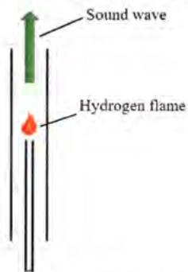  
图1.1 Higgins管

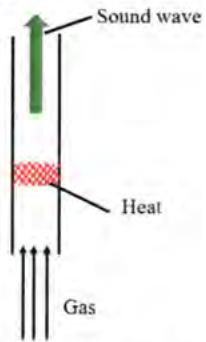  
图1.2 Rijke管

Figure 1.1 Higgins tube  
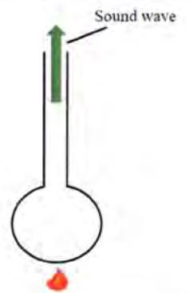  
图 1.3 Sondhauss 管

Figure 1.2 Rijke tube  
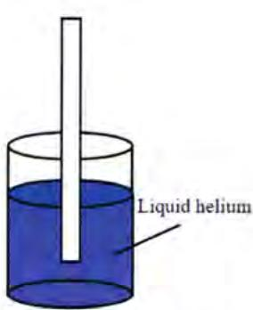  
图1.4 Taconis振荡  
Figure 1.3 Sondhauss tube  
Figure 1.4 Taconis oscillation

## 1.2.2 热声发动机的发展

热声现象的发现往往是在大直径管内，管内传热过程容易局限于热边界层以内，这种条件下难以激发起显著的声振荡，热声效应还不能被引向实用。公元1962年，Cater和Feldman等人在Sondhauss管内加入了板叠结构，实际结果表明管内发生声振荡效应的区域大比例上升[26]。Feldman在他的博士阶段研制出全球首台声功输出明显的热声发动机，当发动机的吸热量为 $600\mathrm{W}$ 时可产出27W声功[27]-[28]。这成为热声学发展史上的一座里程碑。

## 1.2.2.1 驻波型热声发动机

驻波型热声发动机由于发现较早、结构简单，最早受到关注。美国的 Los Alamos 实验室对此做了一系列具有历史意义的工作。二十世纪八十年代中期，Wheatley 研制出双驻波型热声发动机，如图 1.5 所示，并对其中的热声转换和声功传输机理 $^{[29]}$ 进行了精致入微的探索。双驻波型热声发动机可根据实际温度分布自发调节声场中的行驻波比例，被称作“天然的发动机”（natural engine）。Swift等人则使用液态工质对该发动机的性能开展了一系列探索 $^{[30]-[32]}$ 。

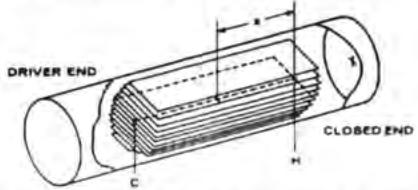  
图 1.5 Wheatley 研制的双驻波型热声发动机

Figure 1.5 Standing-wave thermoacoustic engine investigated by Wheatley  
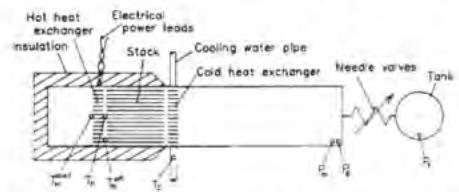  
图 1.6 Swift 研制的双驻波型热声发动机  
Figure 1.6 Standing-wave thermoacoustic engine proposed by Swift

1992 年，Swift 研制了一台双驻波型热声发动机，如图 1.6 所示。该发动机回热器板叠为直径 128mm 的蜂窝状，总长 4320mm，体积非常庞大。往该发动机内充入氦气为工质，工作压力设定为 1.38MPa，可以 9% 的相对卡诺效率获得 630W 声功。继续研究发现，当发动机内一阶压力波动幅值较小时，实验结果可以较好地验证理论计算结果；当振幅增大后，二者之间出现明显偏差，此时的计算已经进入非线性热声学理论适用范畴。

1995 年，Olson 提出一种两端对称的驻波型热声发动机 $^{[33]}$ ，如图 1.7 所示，整机系统的长度为 1.2m，等效声阻抗旁接在某一端的水冷器旁。Olson 采用模拟和实验两种方法研究了声阻抗对整机性能的影响，但实际上模拟和实验所用声阻抗与发动机都并非最佳匹配，高达 95% 的热能并未参与到热声转换中来。在与 Tektronix 公司的合作中，他们设计出使用脉管制冷机做负载的新系统 $^{[34]}$ ，新系统中可实现热声转换的热量增加到 77%。

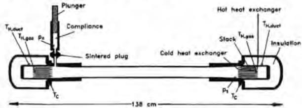  
图 1.7 Olson 设计的对称型驻波热声发动机  
Figure 1.7 Symmetrical standing-wave thermoacoustic engine designed by Olson

浙江大学在驻波型热声发动机的探索上上也做出了许多重要工作。1996年，陈国邦等人在国内第一次研制出双驻波型热声发动机，如图1.8所示。回热器内板叠结构使用铜丝作为制作材料，以氮气和氦气为工作气体时，共振频率分别为25Hz和70Hz，可获得的最高压比分别为1.12和1.06。此外，他们进一步研究了工况参数和结构参数对该发动机性能的影响 $^{[35]-[38]}$ 。基于此，汤珂等人随后将水注入谐振管，设计出装满液体的U型管谐振机构，如图1.9所示，整机性能获得进一步提升 $^{[39]}$ 。

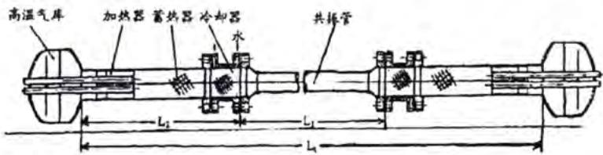  
图 1.8 陈国邦研制的驻波型热声发动机

Figure 1.8 Standing-wave thermoacoustic engine developed by Chen  
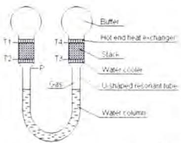  
图 1.9 带 U 型液柱谐振管的驻波型热声发动机  
Figure 1.9 Standing-wave thermoacoustic engine with U-shaped liquid column resonance tube

1998 年，以太阳能做高温热源的双驻波型热声发动机 $^{[40]}$ 由宾夕法尼亚大学的 Chen 和 Barrett 研制成功，如图 1.10 所示。该系统中的工作气体为空气，回热器板叠结构材料为多孔陶瓷。如果用一台直径 35 英寸的太阳能集热器作为加热器，在 1m 的距离之外可测得超过 120dB 的声音，这项工作开启了太阳能驱动热声发动机的研究之路。

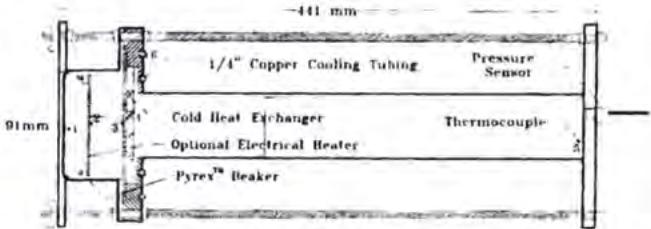  
图 1.10 Chen 设计的以太阳能为高温热源的驻波型热声发动机  
Figure 1.10 Solar-powered standing-wave thermoacoustic engine proposed by Chen

二十一世纪以来，中科院理化术热声课题组在双驻波型热声发动机的研究上取得一定进展。2005年，戴巍、罗二仓等人对换热器开展了结构参数优化工作，当系统中的工作介质为氮气时，实际可获得的压比为 $1.22^{[41]}$ 。2006年，罗二仓等为进一步降低系统中的谐波成分，引入了入圆锥形结构的谐振管，实验结果表明声功产出增加 $20\%^{[42]}$ 。2007年，戴巍等人将双驻波型热声发动机的共振频率提升到 $300\mathrm{Hz}$ ，使用该发动机耦合脉管制冷机可实现的最低温度为 $95\mathrm{K}^{[43]}$ ，优化后，最低温度可降至 $69.5\mathrm{K}$ 。该系统在 $80\mathrm{K}$ 时可以实现 $1.2\mathrm{W}$ 的制冷量[44]，结构如图1.11所示。2011年，王晓涛等人采用相同思路，成功实现了 $60\mathrm{K}$ 的制冷温度，在 $80\mathrm{K}$ 的温度下，系统制冷量提升到 $1.5\mathrm{W}^{[45]}$ 。

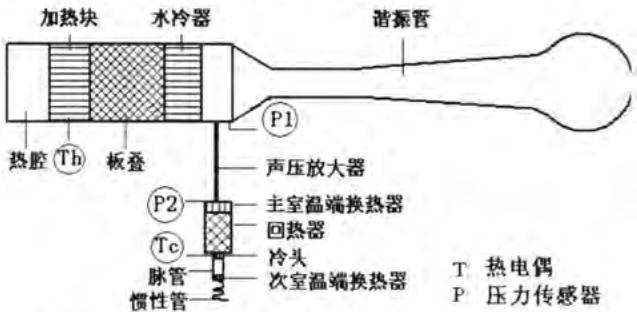  
图 1.11 戴巍等人研制的高频双驻波热声发动机  
Figure 1.11 High frequency standing-wave thermoacoustic engine developed by Dai et al

还有很多研究者，如华中科技大学张晓青[46]，上海交通大学郝熙欢[47]，西安交通大学何雅玲[48]-[50]，中南大学张明研[51]，都对驻波型热声发动机的性能探索做出了贡献。

驻波型热声发动机的热声效应主要在回热器内部发生，板叠结构中的压力波动和体积流率的相位差值趋近 $90^{\circ}$ ，有限换热过程不可逆程度较高，热力学效率一般低于 $20\%$ 。

## 1.2.2.2 行驻波混合型热声发动机

行波型热声发动机与驻波型热声发动机的不同主要在于行波回热器内部是丝网而非板叠形成的致密结构，且回热器内部声场中压力波动与体积流率相位差值接近0°而非90°。行波型热声发动机内经历的理想热力学过程，十分接近斯特林循环，热声效应的发生具有较高的可逆性，理论效率为卡诺效率。

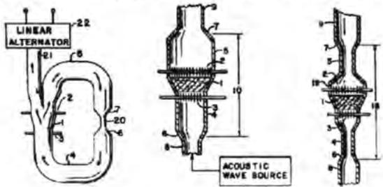

图 1.12 Ceperley 设计的行波热声发动机

Figure 1.12 Traveling-wave thermoacoustic engine designed by Ceperley

对于斯特林发动机，早在十九世纪十年代中期就被认识到其内的热力学循环本征可逆，理想情况下热效率等于卡诺效率。然而在长达一百年的岁月里，人们都未能将其中的机械运动部件完全消除。1979年，曙光初现，美国George Mason大学的Ceperley发现斯特林循环与行波在压力与速度的相位上一致[52]，也即所有的机械运动部件实际上可以用声学气体弹簧代替，这就是行波热声发动机的原型。图1.12是Ceperley设计的三种行波热声发动机。经过深入研究，Ceperley发现，增大行波热声发动机回热器内部声场声阻抗可以降低气体的体积流率，进而降低回热器内的声功损失，并因此获得更好的热声转换和声功输出特性[53]-[54]。

1998年，日本学者Yazaki等基于Ceperley的研究研制出一台环路型行波热声发动机[55]，如图1.13所示。环路为内径 $20.1\mathrm{mm}$ ，长度 $2.58\mathrm{m}$ 的不锈钢管道结构。通过在在特定区域插入隔板，系统可从行波型向驻波型转变。Yazaki等人实测发现，回热器内气固耦合程度高有助于增强行波型系统内的声振荡，抑制驻波型系统内的声振荡，这印证了Ceperley的观点。重点关注压力波动和体积流率相位差变化后，得出结论：回热器内部不可能出现纯行波声场，适当下调行波比例可能增强回热器对声功放大的能力。通过继续研究，发现：如果回热器内部声场的声阻抗减小，可能造成较大的流动损失，从而影响到整机系统的性能，这也印证了Ceperley的观点，因此，如何开展回热器内部声场阻抗特性的优化是提升系统性能的重要一步。

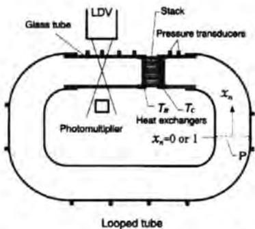  
图 1.13 Yazaki 研制的环路型行波热声发动机  
Figure 1.13 The looped traveling-wave thermoacoustic engine proposed by Yazaki

实际上，无论是驻波型热声发动机还是行波型发动机，内部声场都不会出现纯粹的驻波和行波，实质上总是以某一种波型为主体。前述已知，往行波中加入少量驻波可以提升热声发动机中的热声效应。此外，驻波谐振管封闭端的气体体积流率往往较小、阻抗幅值往往过高，因此可以在驻波速度节点的位置引入行波，这可以避免回热器中声阻抗幅值较大的问题，进而降低其内产生的声功损失。基于此，Backhaus 和 Swift 等人于 1999 年研制出行驻波混合型热声发动机 $^{[1]-[2]}$ ，如图 1.14 所示。该系统在保证回热器内部声场行波占主的条件下，往行波环路中引入了驻波，驻波降低了气体流速，增大了声阻抗，促进了热声效应的发生，提升了系统效率。因为该发动机回热器中的热力循环与斯特林循环相似，因此也将其称作“热声斯特林发动机”。此外，为了降低 Gedeon 直流 $^{[56]}$ 和 Rayleigh 直流 $^{[57]}$ 的对系统性能的影响，他们往系统中引入了喷射泵装置，并将热缓冲管优化为锥形结构。实验结果表明，当高温热源热端温度为 998K 时，系统向谐振管输出的声功为 710W $^{[58]-[59]}$ ，对应效率 30%。常规内燃机比如汽油机和柴油机的热效率大约在 25% 到 40% 之间，所以该热声发动机已经达到与之相匹敌的效率。行驻波混合型热声发动机将热声技术引领上更高的台阶，研究论文被《Nature》收录，成为热声学发展史上的另一座里程碑。

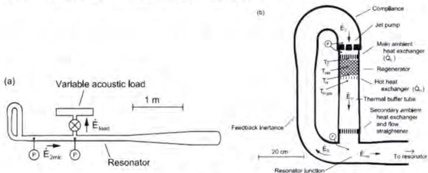  
图 1.14 Backhaus 和 Swift 提出的行驻波混合型热声发动机  
Figure 1.14 Hybrid thermoacoustic engine proposed by Backhaus and Swift et al

对行驻波混合型热声发动机特性进一步的探究工作由日本名古屋大学的Biwa和Ueda等开展[60]-[61]。他们从研究热声发动机内部能流的角度揭示了系统不同振荡模式的发生机理，还进一步指出回热器内部声场中的当地声阻抗相角的分布不完全等同于纯行波恒为 $0^{\circ}$ ，实际上的声阻抗相角接近 $20^{\circ}$ [62]。此后，他们继续对环路与谐振管的结构参数、耦合位置做了实验研究[63]。

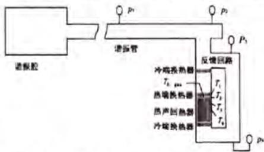  
图 1.15 罗二仓研制第一台国产行波热声发动机  
Figure 1.15 The first domestic traveling-wave thermoacoustic engine proposed by Luo

2000 年,中国科学院理化技术研究所罗二仓等人在中国首次制成行驻波混合型热声发动机 $^{[64]-[66]}$ ，如图 1.15 所示，并对整机系统性能做了全方位考察。2002，他们又设计了将回热器、热缓冲管和冷端换热器等部件进行同轴布置的同轴型行波热声发动机[67]-[68]，如图1.16所示，系统结构紧凑性能较高。2004年，罗等人研制出“聚能型”行波热声发动机，如图1.17所示，该结构使用了锥形结构的谐振管，显著优化了整机系统内部声场特性，降低了声功沿程损耗，大幅提高了系统压比。

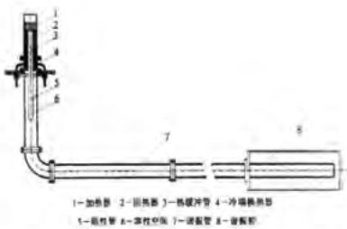  
图 1.16 同轴型行波热声发动机

Figure 1.16 Coaxial traveling-wave thermoacoustic engine  
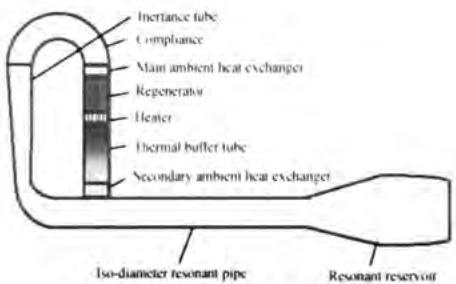  
图 1.17 聚能型行波热声发动机  
Figure 1.17 Energy-focused traveling-wave thermoacoustic engine

该聚能型行波热声发动机使用氦气作为工质，在工作压力为1.52MPa，高温热源温度为670℃时，系统的输出压比可以达到1.3 $^{[69]-[70]}$ ，而同期国际同行最高只能做到1.2。这是一项开创性的研究，此后余国瑶等人对锥形谐振管进一步做了结构优化，如果使用氮气为工作介质，工作压力设定为1.5MPa，当高温热源的加热量为3kW时，系统可获得高达1.4的压比 $^{[71]}$ 。如果继续引入声压放大器，压比可进一步提升至1.47 $^{[72]}$ 。2010年，行驻波混合型热声发动机可以25.4%的效率产出1.13kW的声功 $^{[73]}$ ，达到了千瓦级的设计目标。此外，理化所李青等人从起振特征和系统起振后在两种模式之间如何变化展开了研究 $^{[74]}$ ，探索了不同振荡模式下系统性能的稳定性 $^{[75]}$ ，以及结构参数、充气压力等因素对系统性能的影响 $^{[76]}$ 。

浙江大学也对行驻波混合型热声发动机的研究做了很多工作。2002年，邱利民等人研制了一台长4.5m，高1.25m的行驻波混合型热声发动机，该发动机系统从高温热源的最大吸热量为5kW，采用氦气和氮气为工质时压比分别可达到1.19和 $1.21^{[77]-[78]}$ 。为了消除直流对整机性能的影响，弹性膜片被引入环路结构中，系统压比因此提升至 $1.3^{[79]}$ 。后来，他们借用多级声压放大器[80]和采取多路声功输出的手段[81]增强了发动机的声功产出。2009年，他们对多热源条件下的系统性能开展了研究[82]-[83]。2011年，他们又借助红外成像技术对系统内自激振荡的开始和消除过程进行了可视化研究[84]-[85]。

2012 年, 荷兰能源研究中心 Tijani 等人研制出一种高效行驻波混合型热声发动机, 可以 32% 的最高热声效率获得 280W 的声功, 对应的相对卡诺效率为 49% $^{[86]}$ 。

前述行驻波混合型热声发动机均是将驻波谐振管引入行波反馈管中，虽然可高效实现热声转换，但是环路结构中产生的直流效应会显著干扰系统的运行。目前主流的抑制或消除直流的办法，包括安装喷射泵将流道改变为非对称的结构、或者在环路中安装弹性膜部件隔断直流等，但它们对的引入都对声功造成了更大消耗，影响了系统性能的提升。为此，Los Alamos实验室的Gardner等人研制出三级串联结构的行驻波混合型热声发动机[87]，如图1.18所示。声功依次在三级发动机中放大，其中第一级发动机单元回热器为板叠结构，第二级和第三级为丝网结构。整个系统主要基于行波回热器实现热能向声功的能量转化，结构更紧凑，还消除了热声发动机中的直流。

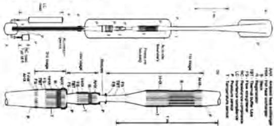  
图 1.18 Gardner 等人提出的行驻波混合级联型热声发动机  
Figure 1.18 Hybrid cascade thermoacoustic engine proposed by Gardner et al

## 1.2.2.3 声学双作用型行波热声发动机

热声发动机的发展一直朝着回热器中的热声效应更加强烈、系统内部声场沿程能量损耗更加微弱的方向前进，由于谐振管中的能量损耗在系统总能量损耗中占据显著比例，因此满足这种要求的热声发动机将在回热器和谐振管中构建偏行波的声场，这种热声发动机也被称为“双行波型热声发动机”。相比前述驻波型和行驻波混合型热声发动机，双行波型热声发动机回热器声功放大能力和谐振管中的声功传输能力都更高，系统结构更加紧凑，潜在效率更高，功率密度更大，是目前研究的主流方向。

前述已经提及，日本学者 Yazaki 等人率先研制出双行波型热声发动机，如图 1.13 所示。对该发动机展开研究主要获得两大成果：一是系统的起振温度比降低，表明系统的工作温区可以进一步拓展，利用热声发动机对较低品位的余热进行回收利用将成为可能；二是发现系统内部声场阻抗特性，尤其是阻抗相角的沿程分布对整机性能有决定性的影响，这对该种结构的热声发动机地性能优化提供了借鉴和参考价值。在此基础上，法国曼恩大学的 Gusev 和 Penelet 等人继续对系统中会出现的声直流展开了探索，一方面从理论上探究了其运动方向 $^{[88]}$ ，另一方面在实验中测出了其数值大小 $^{[89]}$ ，此外，实验中还从察到系统发生了二次起振 $^{[90]}$ 。

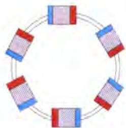  
图 1.19 多级双行波型热声发动机  
Figure 1.19 Multi-stage double-acting traveling-wave thermoacoustic engine

2007年，根据多缸斯特林发动机[91]的原理和结构的研究，中科院理化所罗二仓提出直接将多个行波热声发动机通过细长的谐振管连接组成多级双行波型热声发动机系统，如图1.19所示，该多级结构中的热声发动机单元数量可以根据实际声功需求灵活设定，。当系统起振后，谐振管中的工作气体对上一个热声发动机单元起到膨胀作用的同时，可对下一个热声发动机单元起到压缩作用，因此这种结构的发动机也被称作“声学双作用型行波热声发动机”。与传统结构的行波热声发动机相比，声学双作用型行波热声发动机在结构上更加紧凑、功率密度也获得提高，同时多级系统可输出的声功量也将显著提升。

2010年，荷兰Aster公司的DeBlok提出四级双行波型热声发动机系统，由四个完全相同的热声发动机单元通过细长的谐振管首尾顺次相连[92]-[93]组成环路，如图1.20所示，这种思路同罗在2007年类似。该热声发动机系统可在较低的温区实现热能向声功的转换[94]-[95]。

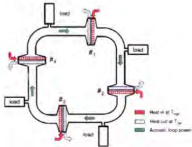  
图 1.20 De Blok 提出的四级双行波型热声发动机  
Figure 1.20 Four-stage double-acting traveling-wave thermoacoustic engine proposed by De Blok

多级双行波型热声发动机系统总体积较为庞大，而热声发动机单元的性能受到结构尺寸的影响较为显著，因此为了减小实验系统的占地面积，罗二仓等人提出把谐振管用固体和液体活塞来替代，相应结构如图1.21所示。这种结构一方面减小了系统的占地面积，另一方面也提升了整机性能。对于固体活塞，当使用5MPa的氦气做工质时，可以 $16.8\%$ 的效率获得最大输出电功 $1.57\mathrm{kW}^{[96]}$ ；对于液体活塞，当时用1.5MPa的氦气做工质时，可获得1.45的压比[97]-[100]。

  
图 1.21 罗二仓等人改进的多级双行波型热声发动机: (a) 液体活塞型 (b) 机械活塞型  
Figure 1.21 Multi-stage double-acting traveling-wave thermoacoustic engine optimized by Luo et al: (a)Liquid-piston type (b)Mechanical-piston type

2014年，罗等人进一步改进了声学双作用型行波热声发动机系统，如图1.22所示，该系统中的热声发动机单元数量大于或等于三个，相邻的热声发动机单元依然使用细长的谐振管连接，但每一个热声发动机单元中都在加热器后部添加了热缓冲管和次水冷器，此外，为了减小声直流的影响，主水冷器入口前还安装了弹性膜片。相比于之前的多级双行波型热声发动机系统，该结构的系统可以获得更高的热声转换效率和声功传输能力。在此基础上，徐静远研究了当热声发动机和谐振管的直径逐级变化系统的综合性能，并将发动机的输出声功引入脉管制冷机中[101]-[102]，如图1.23所示。

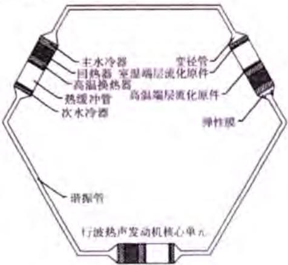

图 1.22 罗二仓改进的声学双作用型行波热声发动机  
Figure 1.22 The acoustic double-acting traveling-wave thermoacoustic engine optimized by Luo  
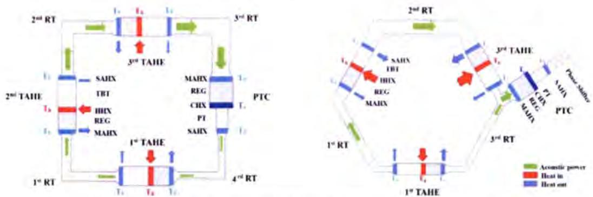  
图 1.23 徐静远等设计的变截面声学双作用型行波热声发动机

Figure 1.23 The acoustic double-acting traveling-wave thermoacoustic engine with variable cross-section designed by Xu  
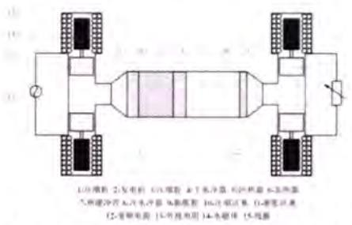  
图 1.24 赵瑞东等设计的双作用型行波热声发动机单元台实验系统  
Figure 1.24 Experimental system for the unit characteristic of double-acting traveling-wave thermoacoustic heat engine proposed by Zhao

由于多单元结构的双作用型行波热声发动机整机系统性能受到多因素的影响，可调因素多的同时各因素的作用可能彼此掩盖。因此，在对整机系统开展研究之前，如果能对单个热声发动机单元的特性有深入的了解和掌握，必将起到事半功倍的效果。基于这一思路，赵瑞东等人设计了一种声学双作用型热声发动机单元热功转换性能实验台[104]，如图1.24所示。压缩机产出的机械能作为发动机入口的声功，声功先在回热器被放大，后又在发电机中被消耗，发电机同时起到对发动机内的声场做阻抗调节的作用。利用这一实验系统，他们对热声发动机单元性能开展了丰富的研究工作[104]-[105]。

浙江大学金滔等人则开展了改变环路中热声发动机级数的研究工作[106]-[107]，如图1.25所示。研究发现，当使用二氧化碳为工作介质，工作压力为 $1\mathrm{MPa}$ 时，三级和四级系统可在 $29^{\circ}\mathrm{C}$ 下工作。如果使用直线电机做负载，且消耗的声功是由第三级热声发动机提供，整机系统的热电转换效率为 $1.51\%$ 。此外，他们提出采用阻性管或容性腔对发动机的声场进行调相，系统可在 $40^{\circ}\mathrm{C}$ 起振[108]。

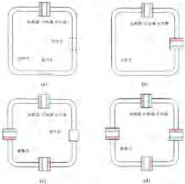  
图 1.25 浙江大学金滔等人研制的非对称多级双行波型行波热声发动机: (a) 单级发动机 (b) 两级发动机 (c) 三级发动机 (d) 四级发动机  
Figure 1.25 Unsymmetrical multi-stage double-acting traveling-wave thermoacoustic engine developed by Jin et al: (a)One-stage engine (b)Second-stage engine (c)Three-stage engine (d)Four-stage engine

除上述外，其他学者也对不是高度对称结构的声学双作用型行波热声发动机系统开展了研究，禹智斌等人搭建了旁接谐振活塞[109]的热声发电系统，日本东海大学Senga等人研究了变谐振管直径的四单元热声发电系统[110]。

## 1.2.3 热声技术与其他低温热源利用技术的对比

热声发动机可利用的变温余热温度温区分布大致在 $300-600^{\circ}C$ 之间，工作温区与之最为相近的是超临界 $CO_{2}$ 布雷顿循环，然而后者对应的实际结构中存在主压气机、再压气机等机械运动部件，并且系统中往往只有一个加热器，并不适用于在同一套系统中多次耦合流动型变温余热热源。此外，也时常使用余热锅炉与蒸汽透平或者膨胀机组成的低温汽轮机发电系统度对这一温区的余热资源进行能量回收，然而该系统面临参数低、功率小的问题。

对于更低温区的余热资源利用，比如 $50-200^{\circ}C$ 的低温余热，常用的技术包括吸附式制冷、吸收式制冷、有机朗肯循环等。然而吸收式制冷使用氨、溴化锂等工质，存在一定的毒副作用，并且还可能出现盐溶液结晶等问题；吸收式制冷工质种类繁多，虽然避免了吸附式制冷的多种问题，但是系统功率较低；有机朗肯循环虽然性能较好，但是技术要求高且设备较为昂贵。此外还有许许多多的低温热源利用技术，比如相变储能、热磁发电等。

实际上，每一种技术都有其优缺点和适宜的工作温区。因此，当余热温区分布过广，应当“取百家之长”，建立分布式能源系统，根据“温度对口、梯级利用”的原则，使得每一温区均应用最适宜的技术，实现对低品位热能的充分回收。

## 1.3 本文的主要工作

热声发动机作为一种结构紧凑、无运动部件、工质环保的新型热机，在当前全球能源枯竭、时刻面临石油危机的大势下当具有可观的发展前景。由前述分析已知，热声发动机的发展经历了驻波型向行波型的过渡，也经历了单级向环路多级的过渡，同时热声发动机对低品位热能的利用潜力也不断得到开发。环路结构的热声发动机系统内含多个热声发动机，整机系统具备耦合不同高低温热源的结构优势。因此，将环路结构热声发动机系统和变温热源相耦合，不仅可以发挥其结构优势和运用低品位热能的潜力，还可以将现实环境中存在的大量变温余热高效回收利用。基于此，本文以串联型三单元环路结构的热声发动机系统为研究对象，固定所有热声发动机耦合的低温热源温度都为303K(即30℃)，同时高温热源温度从923K(即30K)起按照等差递减的方式，分别相差0.50K和100K，设定了3种变温方案，开展了如下研究工作：

（1）详细分析了高度对称的三单元环路三负载系统在3种变温方案下的热声转换特性。先以耦合不同高温热源的热声核心单元为研究对象，从负载阻抗值与热声核心单元互相匹配的角度出发，综合分析得全部负载的阻抗最佳优选值均为 $3.0E7Pa\cdot s/m^{3}@60^{\circ}$ 。将最优阻抗值代入，转化为以整机系统为研究对象，结果表明变温条件不影响串联环路热声系统内部的声场阻抗，同时变温系统获得了优于恒温系统的综合热力学性能。

（2）对三单元环路三负载热声系统开展了结构优化分析工作。首先考察了回热器内部不锈钢丝网丝径、外部直径对各热声核心单元热力学性能的影响。然后考虑到回热器和谐振管是热声发动机系统声功损失最多的两个部件，因此定义回热器与谐振管面积比 $a$ 作为关联参数来揭示两大部件内部的声功损耗。最优结构下回热器内部丝网丝径与外部直径均保持不变，同时谐振管的直径和长度均增加，在采取了折中处理策略后，整机系统的热力学性能进一步提升。

（3）考虑到现实环境中对于大功率负载的使用需求，因此在对三单元环路三负载热声发动机系统的研究基础上，首次提出了三单元环路单负载热声发动机系统。高度对称的环路结构被改变，仅在最高加热温度的热声核心单元旁接负载，声功从最低加热温度单元不断向更高加热温度的热声核心单元集聚，最后集中输出到旁接负载。对于该不对称系统，分析结果表明3种变温方案下整机系统内部声场阻抗的分布几乎无变化，因此负载的最佳阻抗值均为 $2.0E7Pa\cdot s/m^{3}@15^{\circ}$ 。此外，本文依然开展了结构优化工作，定义了谐振管直径比b、回热器长度比c和回热器直径比d作为优化参数。结构优化结果表明，整机系统可实现对声功消耗超过5kW的大功率负载实现直接、高效地驱动。

（4）总结全文，对各章的主要工作内容、研究成果和主要创新点进行了总结和概括，对本文研究内容的不足进行的总结，同时对变温条件下串联环路型热声发动机系统的应用前景做了展望。

## 第 2 章 经典热声学理论基础

## 2.1 本章引论

十九世纪六十年代后期，科学家开始构建经典热声学理论的基础，Kirchhoff研究了气体与恒温壁面换热机理及由此引发的声波振荡之间的关系[111]。公元1896年，Rayleigh准则提出：在气体密度最高的时候向内加热，或者在气体密度最低的时候从中吸热，声振荡现象都会加强；反之，如果在气体密度最高的时候从中吸取热或者最低的时候向内加热，声振荡现象都会被削弱[112]。从1969年开始，瑞士苏黎世联邦技术研究所N.Rott教授用了15年时间基于欧拉法发展出一套较为系统的理论体系，可以对热声现象进行定量描述，奠定了经典热声学理论的基础[113]-[118]。1990年前后，Swift和肖家华等人在Rott的基础上进一步丰富和完善了经典热声学理论[119]-[124]。Swift在2002年正式出版了专著：

Thermoacoustics: A unifying perspective for some engines and refrigerators, 此书是经典热声学理论的集大成者，成为当代进行热声系统定量设计的核心参照。2017年，Swift修正了部分错误后又出了该书的第二版。

本章将重点介绍经典热声学理论和用于开展数值模拟工作的 Sage 软件。

## 2.2 经典热声学理论

## 2.2.1 经典热声控制方程组

经典热声学理论适用于小振幅波动假设，本质上是线性热声学理论。首先根据质量、动量和能量守恒方程获得压力、速度、温度等物理量的解析解，然后在热声振荡周期内对系统开展能流分析，最后获得研究对象的综合性能。经典热声理论对系统所作假设如下：

1）固体介质刚性且位置固定；

2）工质为可压缩的简单流体；

3）系统中声场是稳定的；

4）流道的横向尺寸和流体的热穿透深度远小于流体中声波波长；

5）流体振幅很小，可视为层流流动。

对于密度、温度、压力波动、速度，时域与复域的对应关系如下：

密度： $\tilde{\rho} (x,y,z,t) = \rho_{m} + \mathrm{Re}[\hat{\rho}_{1}(x,y,z)e^{i\omega t}]$

... (2.1)

$$
\text { 温度: } \qquad T (x, y, z, t) = T _ {m} (x) + \mathrm{Re} [ \hat {T} _ {1} (x, y, z) e ^ {i \omega t} ]\tag{... (2.2}
$$

$$
\text { 压力波动: } \quad \tilde {p} (x, y, z, t) = p _ {m} + \mathrm{Re} [ \tilde {p} _ {1} (x) e ^ {i \omega t} ]\tag{... (2.3}
$$

$$
\tilde {\nu} (x, y, z, t) = \operatorname{Re} \left[ \hat {u} _ {1} (x, y, z) e ^ {i \omega t} \right]\tag{... (2.4}
$$

其中， $\rho$ 、 $T$ 、 $p$ 、 $u$ 、 $t$ 代表密度、温度、压力波动、速度和时间，i 为复数单位， $\omega$ 代表角频率，角标 $m$ 、1 分别表示平均量和一阶波动量，Re[] 表示取复数

... (2.8)

实部，“^”表示频域内波动量幅值，“～”表示时域波动量。

基于上述设定，理想热声系统中的气体工质被认为是连续的、可压缩的粘性流体，运动规律满足流体力学基本控制方程：质量守恒方程、动量守恒定律、能量守恒定律和气体状态方程。

质量守恒方程： $\frac{\partial\rho}{\partial t} +\nabla \cdot (\rho \tilde{\nu}) = 0$

... (2.5)

动量守恒方程： $\rho \left[\frac{\partial\tilde{\nu}}{\partial t} + (\tilde{\nu}\cdot \nabla)\tilde{\nu}\right] = -\nabla p + \mu \nabla^2\tilde{\nu}$

... (2.6)

$$
\text {能量守恒方称:} \frac {\partial}{\partial t} \left(\rho \varepsilon + \frac {1}{2} \rho | \tilde {\nu} | ^ {2}\right) = - \nabla \cdot \left[ - k \nabla T - \tilde {\nu} \cdot \sigma^ {\prime} + \left(\rho h + \frac {1}{2} \rho | \tilde {\nu} | ^ {2}\right) \tilde {\nu} \right]\tag{2.7}
$$

气体状态方程： $p = p(\rho, T)$

将公式（2.1）-（2.4）代入基本控制方程，可得到复频域上的经典热声学控制方程组：

$$
i \omega \rho_ {1} + \frac {\partial}{\partial x} \left(\rho_ {m} u _ {1}\right) = 0\tag{... (2.9}
$$

$$
i \omega \rho_ {m} u _ {1} = - \frac {d p _ {1}}{d x} + \mu \left(\frac {\partial^ {2} u _ {1}}{\partial y ^ {2}} + \frac {\partial^ {2} u _ {1}}{\partial z ^ {2}}\right)\tag{... (2.10}
$$

$$
i \omega \rho_ {m} c _ {p} T _ {1} + \rho_ {m} c _ {p} \frac {d T _ {m}}{d x} = i \omega p _ {1} + k \left(\frac {\partial^ {2} T _ {1}}{\partial y ^ {2}} + \frac {\partial^ {2} T _ {1}}{\partial z ^ {2}}\right)\tag{... (2.11}
$$

$$
p _ {1} = \rho_ {m} R T _ {1} + R T _ {m} \rho_ {1}\tag{... (2.12}
$$

由于方程组中式（2.11）包含平均温度和轴向梯度，求解时还需要引入总能流表达式。总能流方程为：

$$
\dot {H} _ {2} = c _ {p} \dot {m} _ {2, 0} T _ {m} + c _ {p} \hat {\dot {m}} _ {1} \hat {T} _ {1}\tag{... (2.13}
$$

总能流守恒方程为：

$$
\frac {d \dot {H} _ {2}}{d x} = \dot {q}\tag{... (2.14}
$$

式中：H 即总能流，上标 “·” 代表时均值，q 为系统单位长度换热量， $m_{2,0}$ 为二阶平均质量流量。

将式（2.13）代入式（2.14）有：

$$
\frac {d \left(c _ {p} \dot {m} _ {2 , 0} T _ {m} + c _ {p} \hat {\dot {m}} _ {1} \hat {T} _ {1}\right)}{d x} = \dot {q}\tag{... (2.15}
$$

当系统中不存在直流时，上式简化为：

$$
\frac {d \left(c _ {p} \hat {\dot {m}} _ {1} \hat {T} _ {1}\right)}{d x} = \dot {q}\tag{... (2.16}
$$

对不同部件解方程时，q 的取值不同。回热器、热缓冲管和脉管都属于绝热

壁面，q 为 0；对于换热器，q 等于单位长度换热器与外界的换热量。

## 2.2.2 经典热声学方程组的典型解

由于压力波动、体积流率和温度等物理量在垂直流向维度上的分布不稳定，因此对各物理量在垂直流向的维度上以取截面均值的方式代入，据此可以将控制方程组全部转化为一维模式，此时方程组可称作线性热声学方程组。对于不同的流道结构，方程组解的形式不同。以下分别对圆管模型（热缓冲管、谐振管等）、平行板模型（平板换热器）和多孔介质模型（回热器）进行分析。

## 1. 圆管模型

$$
\frac {d p _ {1}}{d x} = - \frac {i \omega \rho_ {m}}{A (1 - f _ {u})} U _ {1}\tag{... (2.17}
$$

$$
\frac {d U _ {1}}{d x} = - \frac {i \omega A}{\gamma p _ {m}} [ 1 + (\gamma - 1) f _ {k} ] p _ {1} + \frac {f _ {k} - f _ {v}}{(1 - f _ {v}) (1 - \sigma)} \frac {1}{T _ {m}} \frac {d T _ {m}}{d x} U _ {1}\tag{2.18}
$$

$$
\hat {T} _ {1} = \frac {1}{\rho_ {m} c _ {p}} (1 - f _ {k}) p _ {1} - \frac {1}{i \omega A} \frac {(1 - f _ {k}) - \sigma (1 - f _ {v})}{(1 - f _ {u}) (1 - \sigma)} \frac {d T _ {m}}{d x} U _ {1}\tag{2.19}
$$

式中，A 为圆管横截面积， $f_{k}$ 和 $f_{\mu}$ 分别为热方程和粘性方程：

$$
\begin{array}{l} f _ {k} = \frac {2 J _ {1} [ (i - 1) R / \delta_ {k} ]}{J _ {0} [ (i - 1) R / \delta_ {k} ] (i - 1) R / \delta_ {k}} \\ f _ {k} = \frac {2 J _ {1} [ (i - 1) R / \delta_ {\mu} ]}{J _ {0} [ (i - 1) R / \delta_ {k} ] (i - 1) R / \delta_ {k}} \end{array}\tag{... (2.20}
$$

... (2.21)

式中：粘性穿透深度 $\delta_{\mu} = \sqrt{2\mu / \omega}$ ，热穿透深度 $\delta_{k} = \sqrt{2k / \omega}$ 。

## 2. 平行板模型

$$
\frac {d p _ {1}}{d x} = - \frac {i \omega \rho_ {m}}{A (1 - f _ {u})} U _ {1}\tag{... (2.22}
$$

$$
\frac {d U _ {1}}{d x} = - \frac {i \omega A}{\gamma p _ {m}} [ 1 + (\gamma - 1) f _ {k} ] p _ {1} + \frac {f _ {k} - f _ {v}}{(1 - f _ {v}) (1 - \sigma)} \frac {1}{T _ {m}} \frac {d T _ {m}}{d x} U _ {1}.\tag{2.23}
$$

$$
\hat {T} _ {1} = \frac {1}{\rho_ {m} c _ {p}} (1 - f _ {k}) p _ {1} - \frac {1}{i \omega A} \frac {(1 - f _ {k}) - \sigma (1 - f _ {v})}{(1 - f _ {u}) (1 - \sigma)} \frac {d T _ {m}}{d x} U _ {1}\tag{2.24}
$$

式中：平板板间距为 2b, A=2wb; w 代表平板流道横向宽度； $\sigma$ 为普朗特数，粘性和热方程分别为：

$$
\begin{array}{l} f _ {k} = \frac {\tanh [ (1 + i) b / \delta_ {k} ]}{(1 + i) b / \delta_ {k}} \\ f _ {k} = \frac {\tanh [ (1 + i) b / \delta_ {\mu} ]}{(1 + i) b / \delta_ {\mu}} \end{array}\tag{... (2.25}
$$

... (2.26)

## 3. 多孔介质模型

$$
\frac {d \hat {p} _ {1}}{d x} = - \left(\frac {i \omega \rho_ {0}}{A _ {f}} (1 + \beta_ {t}) + \frac {\alpha \mu}{A _ {f}}\right) \cdot \hat {U} _ {1}\tag{... (2.27}
$$

$$
\frac {d \hat {U} _ {1}}{d x} = - \frac {i \omega A _ {f}}{\rho_ {0} a _ {0} ^ {2}} [ 1 + (\gamma - 1) f _ {h} ] \cdot \hat {p} _ {1} + \frac {(1 - \Phi) \Omega_ {H}}{i \omega \Phi (1 - \Phi) + \Omega_ {H}} \beta_ {0} \frac {d T _ {0}}{d x} \cdot \hat {U} _ {1}\tag{2.28}
$$

$$
\hat {T} _ {1} = \frac {j \omega \Phi (1 - \Phi) + \Phi \Omega_ {H}}{j \omega \Phi (1 - \Phi) + \Omega_ {H}} \left(\frac {\hat {p} _ {1}}{\rho_ {0} c _ {p 0}} - \frac {\hat {U} _ {1}}{j \omega A _ {f}} \frac {d T _ {0}}{d x}\right)\tag{... (2.29}
$$

式中，a 为多孔介质粘性阻力因子， $\beta t$ 为多孔介质附加质量系数， $r_{h}$ 为丝网填料水力半径，Dwire 为丝网丝径， $\phi$ 为多孔介质孔隙率， $\Phi$ 为比热比， $\Omega_{H}$ 为特征换热角频率； $A_{f}$ 为丝网回热器单位长度气固换热面积。各参数表达式如下：

$$
\alpha = \frac {3}{r _ {h} ^ {2}} \sqrt {1 + 4 \left(\frac {r _ {h}}{\delta_ {\mu}}\right) ^ {2}}\tag{... (2.30}
$$

$$
\beta_ {t} = \frac {1}{\sqrt {9 + 4 \left(\frac {r _ {h}}{\delta_ {\mu}}\right) ^ {2}}}\tag{... (2.31}
$$

$$
r _ {h} = D _ {\text { wire }} \frac {\phi}{4 (1 - \phi)}\tag{... (2.32}
$$

$$
\Phi = \frac {A _ {f} \rho_ {0} c _ {p , f}}{A _ {f} \rho_ {0} c _ {p , f} + A _ {s} \rho_ {s 0} c _ {s}}\tag{... (2.33}
$$

$$
\Omega_ {h} = \frac {h A _ {h}}{A _ {f} \rho_ {0} c _ {p , f} + A _ {s} \rho_ {s 0} c _ {s}}\tag{... (2.34}
$$

$$
A _ {h} = \frac {4 (1 - \phi) S _ {r}}{D _ {\text { wire }}}\tag{... (2.35}
$$

如果将式（2.25）加入非线性阻力因素，多孔介质压力方程亦可表示为：

$$
\frac {d \hat {p} _ {1}}{d x} = \left\{- i \omega \rho_ {0} \left[ 1 + \frac {(1 - \phi) ^ {2}}{2 (2 \phi - 1)} \right] - \frac {\mu}{r _ {h} ^ {2}} \left[ \frac {c _ {1} (\phi)}{8} + \frac {c _ {2} (\phi) \cdot R _ {e}}{3 \pi} \right] \right\} \cdot \hat {U} _ {1}\tag{2.36}
$$

式中：

$$
\phi = 1 - \frac {\pi D _ {w i r e} \sqrt {\lambda^ {2} + D _ {w i r e} ^ {2}}}{4 \lambda^ {2}}\tag{... (2.37}
$$

$$
\lambda = 2 5. 4 \times 1 0 ^ {- 3} / n\tag{... (2.38}
$$

$$
\mathrm{c} _ {1} (\phi) = 1 2 6 8 - 3 5 4 5 \phi + 2 5 4 4 \phi^ {2}\tag{... (2.39}
$$

$$
\mathrm{c} _ {2} (\phi) = - 2. 8 2 + 1 0. 7 \phi - 8. 6 \phi^ {2}\tag{... (2.40}
$$

$$
R _ {e} = 4 \frac {\left| \hat {U} _ {1} \right| r _ {h} \rho_ {0}}{A _ {f} \mu}\tag{... (2.41}
$$

各模型统一表述：

$$
\left\{ \begin{array}{c} \frac {d \hat {\boldsymbol {p}} _ {1}}{d \boldsymbol {x}} = - Z _ {F} \cdot \hat {\boldsymbol {U}} _ {1} \\ \frac {d \hat {\boldsymbol {U}} _ {1}}{d \boldsymbol {x}} = - Y _ {C} \cdot \hat {\boldsymbol {p}} _ {1} + f _ {W T} \beta_ {0} \frac {d T _ {0}}{d \boldsymbol {x}} \cdot \hat {\boldsymbol {U}} _ {1} \\ \hat {T} _ {1} = Z _ {P} \cdot \hat {\boldsymbol {p}} _ {1} - Z _ {T} \cdot \hat {\boldsymbol {U}} _ {1} \end{array} \right.\tag{... (2.42}
$$

其中，流道单位长度声阻抗为：

$$
Z _ {F} = \left\{ \begin{array}{l l} \frac {i \omega \rho_ {0}}{A} \frac {1}{(1 - f _ {\mu})} & (\text { 平   板   、   圆   管 }) \\ - i \omega \rho_ {0} \left[ 1 + \frac {(1 - \phi) ^ {2}}{2 (2 \phi - 1)} \right] - \frac {\mu}{r _ {h} ^ {2}} \left[ \frac {c _ {1} (\phi)}{8} + \frac {c _ {2} (\phi) \cdot R _ {e}}{3 \pi} \right] & (\text { 多   孔   介   质 }) \end{array} \right.\tag{... (2.43}
$$

流道单位长度声导纳为:

$$
Y _ {C} = \left\{ \begin{array}{l l} \frac {i \omega A}{\rho_ {0} a _ {0} ^ {2}} [ 1 + (\gamma - 1) f _ {k} ] & (\text { 平   板 }, \text { 圆   管 }) \\ \frac {i \omega A _ {f}}{\rho_ {0} a _ {0} ^ {2}} [ 1 + (\gamma - 1) f _ {h} ] & (\text { 多   孔   介   质 }) \end{array} \right.\tag{... (2.44}
$$

流道单位长度声功产生因子为:

$$
f _ {W T} = \left\{ \begin{array}{l l} \frac {f _ {k} - f _ {\mu}}{(1 - P _ {t}) (1 - f _ {\mu})} & (\text { 平   板 }, \text { 圆   管 }) \\ \frac {(1 - \Phi) \Omega_ {H}}{i \omega \Phi (1 - \Phi) + \Omega_ {H}} & (\text { 多   孔   介   质 }) \end{array} \right.\tag{... (2.45}
$$

可压缩性引起的温度波动因子为:

$$
Z _ {P} = \left\{ \begin{array}{l l} \frac {T _ {0} \beta_ {0}}{\rho_ {0} c _ {p 0}} (1 - f _ {k}) & (\text { 平   板 }, \text { 圆   管 }) \\ \frac {i \omega \Phi (1 - \Phi) + \Phi \Omega_ {H}}{i \omega \Phi (1 - \Phi) + \Omega_ {H}}. \frac {T _ {0} \beta_ {0}}{\rho_ {0} c _ {p 0}} & (\text { 多   孔   介   质 }) \end{array} \right.\tag{... (2.46}
$$

温度梯度引起的温度波动因子为:

$$
Z _ {T} = \left\{ \begin{array}{l} \frac {1}{i \omega A} \cdot \frac {d T _ {0}}{d x} \left[ 1 - \frac {f _ {k} - f _ {\mu}}{(1 - P _ {t}) (1 - f _ {\mu})} \right] \\ \frac {1}{i \omega A} \cdot \frac {d T _ {0}}{d x} \cdot \frac {i \omega \Phi (1 - \Phi) + \Phi \Omega_ {H}}{i \omega \Phi (1 - \Phi) + \Omega_ {H}} \end{array} \right.\tag{平板,圆管}
$$

... (2.47)

(多孔介质)

式（2.42）中三个方程的物理意义：第一个方程代表由于流道内部声场阻抗特性变化引起的压力波动幅值的改变；第二个方程代表由于压缩效应和平均温度梯度引起的体积流率变化；第三个方程代表由于压缩效应和流体在变温固体壁面运动所引起温度的改变。

## 2.2.3 时均声功流

时均能量效应在经典热声学理论中是指热声振荡周期内所研究系统或对象的热声能量转化和输运的变化情况，主要研究参数包括声功流、总能流和热流。

## 2.2.3.1 声功流

声功计算式定义为垂直流向的截面上压力波动 $\tilde{p}_{1}$ 和体积流率 $\tilde{U}_{1}$ 乘积的周期平均值：

$$
E _ {2} = \frac {1}{\tau} \int \tilde {p} _ {1} \tilde {U} _ {1} d t = \frac {1}{2} \operatorname{Re} \left[ \hat {p} _ {1} \cdot \hat {U} _ {1} ^ {*} \right] = \frac {1}{2} \left| \hat {p} _ {1} \hat {U} _ {1} ^ {*} \right| \cos \theta\tag{... (2.48}
$$

因此对于热声系统中工作气体微团携带的声功，可将其理解为一个理想弹簧在受到回复力为 $\tilde{p}_{1}$ 时，以 $\tilde{U}_{1}/A$ 最大速度振幅振荡可以对外做功的周期平均值。由该定义可知：行波热声发动机和驻波热声发动机内的热声转换本质上明显不同，在纯驻波回热器中，压力波动和体积流率之间的相位差等于 $90^{\circ}$ ，此时气体微团可以产生的声功为 0，在纯行波回热器中，压力波动和体积流率之间的相位差为 $0^{\circ}$ ，此时气体微团可以产生的声功增益达到最大。但实际上热声系统内部声场既不会是纯粹的驻波，也不会是纯粹的行波，往往是这两种波的组合，所以回热器中的声功放大量总不会为 0。

对式（2.48）两边求导，并代入式（2.42）可得：

$$
\frac {d E _ {2}}{d x} = \frac {1}{2} \mathrm{Re} \Big [ \hat {U} _ {1} \hat {p} _ {1} ^ {\bullet} f _ {W T} \Big ] \beta_ {0} \frac {d T _ {0}}{d x} - \frac {(\gamma - 1)}{2 \gamma P _ {0}} \omega | \hat {p} _ {1} | ^ {2} g _ {w k} - \frac {\rho_ {0}}{2 A _ {f}} \omega | \hat {U} _ {1} | g _ {w \mu}\tag{2.49}
$$

由上式可知: 当工作气体在热声系统中振荡时, 在回热器以外的所有部件中, 声功总是因为有限传热和粘滞阻力而被不断消耗, 对于回热器, 将根据温度梯度实际的方向, 分别实现热能向声功的转换, 即声功增益或者声功向热能的转换, 即声功消耗。

式（2.49）中，系数 $g_{wk}$ 为有限传热功耗散因子，主要和流道声导纳 $Y_{C}$ 有关；系数 $g_{w\mu}$ 是粘性功耗散因子，主要与声阻抗 $Z_{F}$ 有关，具体表达式如下：

$$
g _ {w k} = \frac {\gamma p _ {0}}{(\gamma - 1) A _ {f} \omega} \operatorname{Re} \left[ Y _ {C} \right]\tag{... (2.50}
$$

$$
g _ {w \mu} = \frac {A _ {f}}{\rho_ {0} \omega} \operatorname{Re} \left[ Z _ {F} \right]\tag{2.51}
$$

当式（2.49）左项为0时，发动机的临界温度梯度为：

$$
\left(\frac {d T _ {0}}{d x}\right) _ {c r} ^ {W} = \frac {\gamma - 1}{\alpha_ {0} \beta_ {0}} \omega \frac {g _ {w k} + \frac {1}{\gamma - 1} \left| Y _ {a} \right| ^ {2} g _ {w \mu}}{\operatorname{Re} \left[ Y _ {a} f _ {W T} \right]}\tag{... (2.52}
$$

其中， $a_{0}$ 是当地声速，声导率之比 $Y_{a}$ 为：

$$
Y _ {a} = \frac {\rho_ {0} a _ {0} \hat {U} _ {1}}{A _ {f} \hat {P} _ {1}}\tag{... (2.53}
$$

只有当驻波热声发动机回热器板叠或行波热声发动机回热器丝网中的温度梯度超过临界值时，才会实现热能向声功转变使声功增益。

## 2.2.3.2 热流

理想绝热流道在垂直流向的维度与外界无能量交换，仅有流向方向热流：

$$
Q _ {2} = \frac {1}{\tau} \oint \left(\rho_ {0} c _ {p 0} \tilde {T} _ {1} \tilde {U} _ {1} - T _ {0} \beta_ {0} \tilde {p} _ {1} \tilde {U} _ {1}\right) d t - \left(A _ {f} K _ {f} + A _ {s} K _ {s}\right) \frac {d T _ {0}}{d x}\tag{... (2.54}
$$

将压力表达式和温度表达式带入后，式 2.54 转化为：

$$
\begin{array}{l} Q _ {2} = - \frac {1}{2} T _ {0} \beta_ {0} \operatorname{Re} \left[ \hat {U} _ {1} \hat {p} _ {1} ^ {*} f _ {q x} \right] - \rho_ {0} c _ {p 0} \frac {\left| \hat {U} _ {1} \right| ^ {2}}{2 A _ {f} \omega} \frac {d T _ {0}}{d x} g _ {q x} - \left(A _ {f} K _ {0} + A _ {s} K _ {s}\right) \frac {d T _ {0}}{d x} \\ = - \frac {1}{2} T _ {0} \beta_ {0} \operatorname{Re} \left[ \hat {U} _ {1} \hat {p} _ {1} ^ {*} f _ {q x} \right] - A _ {f} K _ {\text {eff}} \frac {d T _ {0}}{d x} \end{array}\tag{... (2.55}
$$

式中， $f_{\varphi x}$ 为流向方向的导热因子， $g_{\varphi x}$ 为温度梯度因子。如果流道形状规则：

$$
\begin{array}{l} f _ {q x} = \frac {f _ {k} ^ {*} - f _ {\mu}}{(1 + \sigma^ {2}) (1 - f _ {\mu})} \\ f _ {q x} = \frac {1}{(1 + \sigma^ {2}) | 1 - f _ {\mu} |} \operatorname{Im} \left[ \frac {f _ {k} ^ {*} - f _ {\mu}}{(1 - \sigma^ {2})} - f _ {\mu} ^ {*} \right] \end{array}\tag{... (2.56}
$$

... (2.57)

对于多孔介质：

$$
\begin{array}{l} f _ {q x} = f _ {h} ^ {*} \\ g _ {q x} = \operatorname{Re} \left[ i f _ {h} \right] \end{array}\tag{... (2.58}
$$

... (2.59)

$$
K _ {e f f} = K _ {e} ^ {s} + K _ {0} + \frac {A _ {s}}{A _ {f}} K _ {S 0}\tag{... (2.60}
$$

$$
K _ {e} ^ {s} = \frac {1}{2} \rho_ {0} c _ {p 0} \frac {\left| \hat {U _ {1}} \right| ^ {2}}{A _ {f} ^ {2} \omega} g _ {q x}\tag{... (2.61}
$$

当式（2.55）左项为0时，制冷机临界温度梯度为：

$$
\left(\frac {d T _ {0}}{d x}\right) _ {c r} ^ {q} = - \frac {\gamma - 1}{a _ {0} \beta_ {0}} \omega \frac {\operatorname{Re} \left[ f _ {q x} / Y _ {a} ^ {*} \right]}{g _ {q x} + \left(\omega \delta_ {k} A _ {f} / \left| \hat {U} _ {1} \right| ^ {2}\right)}\tag{... (2.62}
$$

## 2.2.3.3 总能流

总能流实质上也是周期均值, 代表了研究系统或者对象在能量守恒定律下的能量分布, 具体表达式为:

$$
H _ {2} = \frac {1}{2} \rho_ {0} \int \operatorname{Re} \left(\hat {h} _ {1} \hat {u} _ {1}\right) d A - \left(A _ {f} k _ {f} + A _ {s} k _ {s}\right) \frac {d T _ {0}}{d x}\tag{... (2.63}
$$

对于理想气体：

$$
H _ {2} = \frac {1}{2} \rho_ {0} c _ {p} \int \mathrm{Re} (\hat {T} _ {1} \hat {u} _ {1}) d A - (A _ {f} k _ {f} + A _ {s} k _ {s}) \frac {d T _ {0}}{d x}\tag{... (2.64}
$$

对于多孔介质：

$$
H _ {2} = \frac {1}{2} \operatorname{Re} \left[ \hat {p} _ {1} \hat {U} _ {1} ^ {*} (1 - f _ {w T}) \right] + \left[ \frac {\rho_ {0} c _ {p} | \hat {U} _ {1} | \operatorname{Im} [ f _ {k} + \sigma f _ {\mu} ^ {*} ]}{2 A _ {f} \omega (1 - \sigma^ {2}) | 1 - f _ {\mu} | ^ {2}} - (A _ {f} K _ {f} + A _ {s} K _ {s}) \right] \frac {d T _ {0}}{d x} \dots\tag{2.65}
$$

对于平板和圆管：

$$
H _ {2} = \frac {1}{2} \operatorname{Re} \left[ \hat {p} _ {1} \hat {U} _ {1} ^ {*} (1 - f _ {h}) \right] - \left[ \frac {\rho_ {0} c _ {p} | \hat {U} _ {1} | ^ {2}}{2 A _ {f} \omega} \operatorname{Re} [ i f _ {h} ] - (A _ {f} K _ {f} + A _ {s} K _ {s}) \right] \frac {d T _ {0}}{d x}\tag{... (2.66}
$$

经过长期的发展和丰富，经典热声学理论对于热声系统在稳态条件时的特性已经可以进行较为准确、清晰地描述，但对于动态特性尚无法准确描述。因此，必须借助非线性热声学理论。截至目前，非线性热声学理论的框架尚未完全搭建好，回热器丝网或板叠结构内部的热声转换机理尚未完全澄清，相关数学物理模型的构造与求解依然难以精确做到，非线性热声学理论亟需进一步发展以完善。

## 2.3 模拟软件

本文采用 Sage 计算软件对变温条件下串联环路型热声发动机进行整机系统和热声核心单元模拟。Sage 软件是 Gedeon Associates 推出的一款针对回热式热机（包括发动机和制冷机）的模拟软件,最早专用于斯特林制冷机模拟，后来又增加了脉管制冷机模型和深低温模型。该软件采用图形化界面，首先将各子部件分别建模，然后通过质量守恒定律、动量守恒定律和能量守恒定律将所有子部件连接为整机系统进行模拟计算。Sage 软件的输出结果以傅里叶级数的高阶形式表示，包括各节点的压力波动、体积流率和能量等。此外，由于 Sage 软件可以对多个参数进行协同优化，因此可以高效达成特定参数优化目标。至今，Sage 软件已经成为热声热机研究工作的主流计算软件。

## 2.4 本章总结

经典热声学理论是当前对热声发动机系统进行物理建模、数值模拟和仿真优化的基础，本章主要内容如下：

（1）介绍经典热声学理论及线性方程组的典型解。从流体力学基本控制方程出发，在压力波动为小振幅的前提下对方程组开展了热声线性化处理，并给出了典型结构（平板、圆管和多孔介质）对应方程组的局域解析式。此外，介绍了热声系统时均物理量声功、热流和总能流，并给出各部件的相应表达式。此外，给出了热声热机的临界温度梯度。

（2）介绍了研究工作使用的模拟软件。为了模拟变温条件下三单元环路三负载热声发动机系统和三单元环路单负载热声发动机系统的热声转换特性、声功传输机理及相关热力学性能，本文模拟主要采用了 Sage 软件。

## 第 3 章 三单元环路三负载系统热声转换特性研究

## 3.1 本章引论

环路结构的热声发动机系统具有结构紧凑、功率密度高、潜在热效率高和易实现大功率输出等特点。以往对环路热声发动机系统的研究专注于系统内所有热声发动机均耦合相同的高低温热源，而在实际生产生活中，更广泛存在和可接触的却是变温热源，因此尽管对变温热源条件下环路热声发动机系统运行性能的探索尽管当前还处于初始阶段，但也同样具有研究价值和现实意义。此外，环路结构中每台热声发动机都可以独立耦合外部热源，这为变温热源条件下的相关研究提供了有利的结构条件。

2017 年，本课题组曾对三台热声发动机串联组成的环路结构进行了热功转换特性研究 $^{[125]}$ ，该结构高度对称，每台热声发动机驱动一个负载，也即是三单元环路三负载系统。然而该研究着重探索定温热源条件下的整机性能，仅对变温条件开展了初步实验探索，发现热源变温不影响整机系统的工作频率，但会造成各发动机单元的不一致性，进而影响发动机输出的压力波动和声功产出。在此基础上，本文深入研究了在该串联型三单元环路三负载结构条件下，当引入变温热源条件时热声发动机与外接负载阻抗的最佳匹配方案、相关热声转换与能量传输特性。

热声发动机将热能转化为声功，消耗声功的外接负载可以是制冷机，也可以是发电机，并因此可将三单元环路三负载结构的系统划分为热声制冷系统和热声发电系统。然而无论是制冷系统还是发电系统，或者是冷热电联产的综合系统，负载本身都是起消耗声功的作用，因此两种系统在本质上是相通的。基于此，为了使研究成果更具有通用价值，本文决定在所有研究中将外接负载都等效为声阻抗的形式代入。

## 3.2 理论计算及机理研究

## 3.2.1 系统结构

图 3.1(a) 为三单元环路三负载系统示意图。该系统主要部件为结构完全相同的三台热声发动机，每台发动机旁接负载的位置和负载代表的阻抗完全一样，发动机通过细长的谐振管首尾相连形成串联环路。也即，本章研究对象为旁接负载型三热声发动机单元组成的串联环路系统，以下简称三单元环路三负载系统。

由图 3.1(a) 可知，该三单元环路三负载系统的结构高度对称，因此可取其三分之一部分组成热声核心单元。每个热声核心单元都由热声发动机单元、负载和谐振管组成，图 3.1(b) 即为热声核心单元的结构示意图。

每台热声发动机都由主水冷器、回热器、加热器、热缓冲管和次水冷器五大部件组成，又分别在主水冷器和次水冷器的端口通过细长的谐振管与其余热声发动机相连，负载旁接在与次水冷器出口相连的谐振管上。因此，热声核心单元的入口为主水冷器，出口为与次水冷器相连的谐振管的末端。根据结构的对称性，每一个热声核心单元中，压力波动和体积流率从入口到出口均变化120°。

对于能量变化，热能在发动机回热器中通过热声效应转化为声功，声功随后被回热器本身，以及加热器、热缓冲管、次水冷器依次消耗，出次水冷器的声功分为两部分，一部分进入负载被用于制冷或者发电，剩余部分则通过细长的谐振管消耗一部分得以继续传递，在谐振管的末端，剩余的声功将进入下一热声发动机单元，先经过主水冷器的消耗，然后在回热器中被放大后再重复经历上述过程。

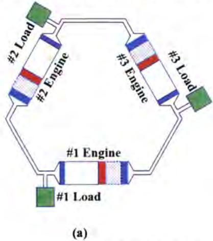

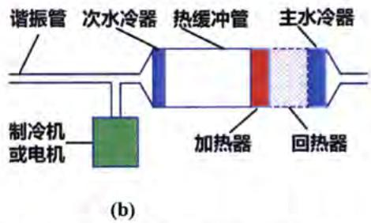  
图 3.1 三单元环路三负载系统结构：(a) 整机系统 (b) 热声核心单元  
Figure 3.1 Structure of looped three-units system with three loads: (a) overall system (b) thermoacoustic core unit

三单元环路三负载系统通过细长的谐振管将上一热声核心单元未完全消耗的声功回收至下一热声核心单元，有效保证了系统对声功的充分运用。对于谐振管中的工作气体，当对上一热声发动机单元为膨胀作用时，对下一热声发动机单元即为压缩作用，因此这种双作用型的环路结构，不仅保证了声功的利用效率，同时也提升了系统的结构紧凑性。

高效的环路结构热声发动机系统满足回热器和谐振管中都尽可能实现行波占主的声场相位。因为回热器是发动机唯一产生声功的部件，其中的行波比例越高，表示声功放大的能力越强；谐振管由于回收和传递声功的过程中也在消耗声功，因此尽可能靠近行波相位可以降低声功损失。也即，最理想的三单元环路三负载系统的结构应该满足所有热声发动机和所有谐振管中都是行波占主的声场。

发动机输出声功的主要部分将提供给负载消耗，如何让更多声功输入到负载是一个重要目标。而负载本身的特性不仅影响热声发动机单元的热声转换特性，同时也会影响谐振管中的声功传递与损耗量。此外，谐振管的结构条件也会影响热声发动机单元的声功放大性能与流入负载中的声功占比。因此，负载、谐振管和热声发动机单元之间存在一定的耦合关系，良好的耦合有助于回热器中声功高效放大、谐振管中声功低消耗传输。

本章研究的目的在于基于目前的结构条件，从最可调控的外接负载入手。通过改变外接负载阻抗值，分析阻抗对变温条件下整机系统热声转换特性的影响，进一步获得最佳负载阻抗分布区域。

系统的结构条件由于先前已经选定，具体参数如表 3.1 所示。

表 3.1 热声核心单元结构参数  
Table 3.1 Structural parameters of thermoacoustic core unit

<table><tr><td>热声核心单元</td><td>部件</td><td>结构参数(mm)</td><td>备注</td></tr><tr><td rowspan="5">热声发动机</td><td>主水冷器</td><td> $\Phi 80 \times 60$ </td><td>管壳式,孔隙率0.4</td></tr><tr><td>回热器</td><td> $\Phi 80 \times 60$ </td><td>丝径Dwire=0.05mm,孔隙率0.8</td></tr><tr><td>加热器</td><td> $\Phi 80 \times 80$ </td><td>翅片式,孔隙率0.4</td></tr><tr><td>热缓冲管</td><td> $\Phi 80 \times 120$ </td><td>直管</td></tr><tr><td>次水冷器</td><td> $\Phi 80 \times 40$ </td><td>管壳式,孔隙率0.4</td></tr><tr><td>谐振管</td><td>谐振管</td><td> $\Phi 20 \times 3000$ </td><td>弯管</td></tr></table>

## 3.2.2 热力学条件

## 3.2.2.1 变温热源温度

变温热源条件的原型为工厂排出的废气或者废水的温度随时间增加不断降低，在当今全球能源危机越来越严峻的情况下，对能源的利用采取开源节流的策略已经成为世界各国的首要选择。因此开发热声发动机对低品位热能的利用潜力，充分利用环路结构的热声系统具有良好的发展前景。

表 3.2 变温热源条件下三热声核心单元加热温度  
Table 3.2 The heating temperature of three thermoacoustic core units under the distributed-temperature heat sources condition

<table><tr><td></td><td>温差 ΔT/K</td><td>#1/K</td><td>#2/K</td><td>#3/K</td></tr><tr><td>方案 1</td><td>0</td><td>923</td><td>923</td><td>923</td></tr><tr><td>方案 2</td><td>50</td><td>923</td><td>873</td><td>823</td></tr><tr><td>方案 3</td><td>100</td><td>923</td><td>823</td><td>723</td></tr></table>

由于三单元环路三负载系统结构的高度对称性，设定变温热源条件为：高温热源温度按照等差数列的方式从最高923K(650℃)开始逐步递减，低温热源温度恒定为环境温度303K(30℃)。

定温热源条件作为变温热源条件的特例，实质上是高温热源温差为0时的情况，因此本章的研究也将定温热源条件下的系统性能囊括进来。

变温热源条件下，三热声核心单元耦合的高温热源的温度分布情况如表 3.2 所示。

## 3.2.2.2 工作气体及平均压力

当热声发动机系统中充入的工作气体不同时，为了达到设定的声功放大和输出目标，所要求的充气压力、加热和冷却温度等都会因此不同，也即工作气体将和整机结构、制作材料等成为系统基本属性的一部分。根据第二章中定义可知，压力波动和体积流率是热声发动机系统中的核心基本量，因此系统内的平均压力一旦设定也将成为系统的基本属性之一。本文研究的三单元环路三负载系统内充入的工作气体为氦气(He)，充气压力为7MPa。

## 3.2.2.3 系统性能判定指标

本章所研究的三单元环路三负载结构的热力学性能将通过以下几个重要的热力学指标进行判定：

热声转换效率 $\eta_{1}$ 用来衡量输出到三个旁接负载的净声功总和占高温热源输入到热声发动机加热器总热量的比例：

$$
\eta_ {1} = \frac {W a}{Q} = \frac {W a _ {1} + W a _ {2} + W a _ {3}}{Q _ {1} + Q _ {2} + Q _ {3}}\tag{... (3.1}
$$

其中 Wa 为净声功总和，单位 W， $Wa_{i}$ 即为输入到第 i 号负载的净声功量；Q 为高温热源输出的总加热量，单位 J， $Q_{i}$ 即为第 i 号热声发动机耦合的高温热源输出的加热量。

相对卡诺效率 $\eta_{2}$ 用来衡量输出到三个旁接负载的净声功总和占高温热源输入到热声发动机加热器总热烟的比例：

$$
\eta_ {2} = \frac {W a _ {1} + W a _ {2} + W a _ {3}}{Q _ {1} \left(1 - \frac {T _ {L 1}}{T _ {H 1}}\right) + Q _ {2} \left(1 - \frac {T _ {L 2}}{T _ {H 2}}\right) + Q _ {3} \left(1 - \frac {T _ {L 3}}{T _ {H 3}}\right)}\tag{...(3.2}
$$

其中， $T_{L}$ 表示热声发动机耦合的低温热源温度，单位 K， $T_{H}$ 表示热声发动机耦合的高温热源温度，单位为 K， $T_{Li}$ 即为第 i 号热声发动机耦合的低温热源的温度， $T_{Hi}$ 即为第 i 号热声发动机耦合的高温热源的温度。

此外，定义当地声阻抗：

$$
Z = \frac {p}{U}\tag{...(3.3}
$$

其中，Z 即阻抗，单位为 $Pa \cdot s/m^{3}$ 。p 为当地压力波动，单位为 Pa。U 为当地氦气的体积流率，单位为 $m^{3}/s$ 。需要强调的是，Z 为复数量，相角 $\theta_{Z}$ 等于 p 和 U 的相位差 $\Phi_{pU}$ ，单位为度，即 “°”。

## 3.2.2.4 基本参数沿程分布与综合热力学性能

为了清晰展示一个热声核心单元中的热声转换过程，图 3.2 展示了一个热声核心单元中，当高温热源温度为 923K，低温热源温度为 303K，外接负载的等效阻抗值为 $3.0 \, E7 \, Pa \cdot s/m^{3} @ 65^{\circ}$ 时，声功、pU 相位差、压力波动和体积流率的沿程分布情况。

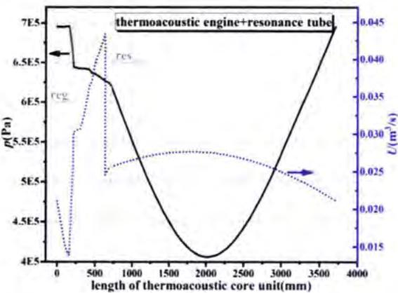

(a)  
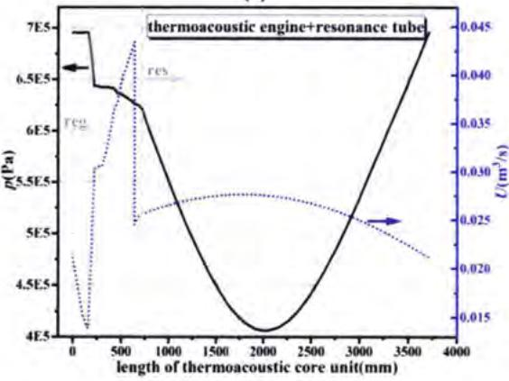  
(b)  
图 3.2 热声核心单元基本参数沿程分布：(a) 声功与相位差 (b) 压力波动与体积流率  
Figure 3.2 The distribution of basic parameters of thermoacoustic core unit:(a)acoustic power and pU phase difference (b)pressure wave amplitude and volume flow rate

声功沿程分布显示：在热声发动机入口处，声功仅为4.5kW；在回热器中，因为热声效应的作用，声功将被放大到9.7kW；随后加热器、热缓冲管和次水冷器对声功进行小幅度消耗；在旁接负载的位置，接近2.8kW的声功流入负载，剩余6.6kW的声功流入谐振管中；声功在谐振管的传输过程中，将被损耗2.1kW，最后到达谐振管出口的声功仍然为4.5kW。在一个完整的环路系统中，谐振管出口处的4.5kW声功将被回收给下一个热声核心单元。

pU 相位差沿程分布显示：在热声发动机入口处，pU 相位差为 $52^{\circ}$ ，是偏驻波的声场；在回热器中，pU 相位差从 $22^{\circ}$ 变化到 $-6.3^{\circ}$ ，整个回热器中行波声场占主；随后加热器、热缓冲管和次水冷器中的行波比例继续下降；在旁接负载的位置，由于声功与工作气体的分流，pU 相位差出现从 $-46.7^{\circ}$ 到 $-41.2^{\circ}$ 的一个突变；此后在谐振管中，pU 相位差从 $-34.4^{\circ}$ 一直增大到 $52^{\circ}$ ，行波比例先上升后下降，整体是一个偏行波的声场环境。

压力波动沿程分布表明: 在热声发动机入口处, 压力波动最大, 接近 7.0E5Pa; 随后压力波动逐渐降低, 尤其是在回热器中出现较为明显的降低; 此后, 在加热器、热缓冲管和次水冷器中压力波动持续缓慢降低; 在外接负载位置, 压力波动未出现明显变化; 当进入谐振管后, 压力波动先降低后升高。

体积流率沿程分布表明：在热声发动机入口位置，体积流率为 $0.021 \, m^{3}/s$ ，随后，体积流率逐渐降低；当进入回热器时，体积流率以明显斜率从 $0.014 \, m^{3}/s$ 迅速增加到 $0.030 \, m^{3}/s$ ；而当进入加热器后，体积流率的增加速度迅速放缓；此后，进入热缓冲管到旁接负载位置，体积流率持续快速增加，并在外接负载位置由于负载分流而突变下降；进入谐振管后，体积流率先缓慢增加后缓慢降低。

整体上，回热器和谐振管中都是行波占主的声场，表明该热声系统结构条件良好；而在回热器中压力波动明显降低，体积流率明显升高，表明当回热器中工作气体的流速增大，一定程度上将有助于热声效应的发生；在谐振管中，压力波动和体积流率的变化趋势完全相反，并且在压力波动达到极小值时，体积流率刚好达到极大值，结合pU相位差沿程分布可知在极值位置处，接近纯行波声场。

表 3.3 展示了该热声核心单元的综合热力学性能，由表可以看出：输入到负载的声功和谐振管中的声功损失量之和占回热器声功放大量的主体，表明谐振管是热声核心单元主要的声功损失部件；此外，该热声核心单元的热声转换效率仅为 24.77%，相对卡诺效率为 40.74%，表明当外接负载的等效阻抗值为 $3.0E7Pa\cdot s/m^{3}@65^{\circ}$ 时，该热声核心单元的热力学性能还存在可优化的空间。

表 3.3 热声核心单元综合热力学性能  
Table 3.2 Comprehensive thermodynamic properties of thermoacoustic core unit

<table><tr><td rowspan="2">工况参数</td><td>工作气体</td><td>He</td><td>高温热源温度(K)</td><td>923</td></tr><tr><td>平均压力(MPa)</td><td>7</td><td>低温热源温度(K)</td><td>303</td></tr><tr><td rowspan="4">热力学性能</td><td>工作频率(Hz)</td><td>65.41</td><td>热声转换效率(%)</td><td>24.77</td></tr><tr><td>发动机入口压比</td><td>1.221</td><td>相对卡诺效率(%)</td><td>40.74</td></tr><tr><td>加热功率(W)</td><td>11130</td><td>回热器声功放大量(W)</td><td>5212</td></tr><tr><td>负载声功(W)</td><td>2757</td><td>谐振管声功损失量(W)</td><td>2069</td></tr></table>

## 3.2.3 计算结果

在确定变温条件下，为直观探索、主要突出和展示加热温度对系统性能的影响，不同热声核心单元外接负载的阻抗值应该完全相等。因此本章对最佳负载阻抗分布区域的探索，将在三个负载阻抗值完全相等、同步变化的基础上展开。

## 3.2.3.1 温差为 0 时，最佳外接负载阻抗

当变温条件选取方案 1，也即高温热源之间温差为 0 时，由于整机结构的高度对称性，为加速研究进程可选择只计算一个热声核心单元。

由图 3.3 中(a)可见，随着外接负载阻抗的变化，系统的热力学性能也发生了较为明显的变化：在小阻抗相角范围，即 $-80^{\circ}$ 到 $-40^{\circ}$ 之间，随着阻抗幅值的增大，输出到负载的声功逐渐减少，系统的热声转换效率也逐渐降低；在中等阻抗相角范围，即 $-40^{\circ}$ 到 $40^{\circ}$ 之间，阻抗幅值增大的同时输出到负载的声功也在逐渐增大，但系统的热声转换效率逐渐降低，在 pU 相位差为 0 附近，系统的热声转换效率达到最大值；在大阻抗相角范围内，也即 $40^{\circ}$ 到 $80^{\circ}$ 之间，随着阻抗幅值的增加，热声转换效率逐渐降低，输出到负载的声功在阻抗幅值大于 $5.0E7Pa\cdot s/m^{3}$ ，阻抗相角大于 $70^{\circ}$ 后，随阻抗幅值的增大而迅速减小。

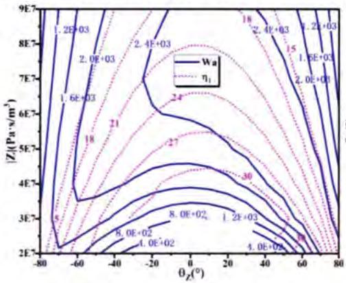  
(a)

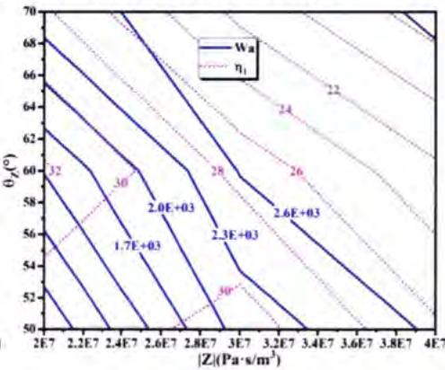  
(b)  
图 3.3 $T_{H}=923K$ 时负载阻抗对热声核心单元热力学性能的影响：(a) 全局范围 (b) 局部放大  
Figure 3.3 Dependence of thermodynamic performance of thermoacoustic core unit on load impedance when $T_{H}=923K$ : (a) the global scope (b) partial enlargement

温差为0时的最佳外接负载阻抗值应使得系统能同时实现热声转换效率较高和输出到负载的声功值较大，根据图(a)可知，最佳阻抗分布区域应该位于右下侧。图3.3中(b)为(a)右下侧区域的局部放大图，其中负载阻抗幅值范围为(2.0,4.0)E7Pa·s/m³，阻抗相角范围为(50,70)°。根据图(b)可知，随着负载阻抗幅值的增大，阻抗相角越大，系统热声转换效率越低，输出到负载的声功则呈现逐渐增大的趋势。因此，该最佳阻抗分布区域存在一个优选值，根据同时达到热声转换效率较高和输出到负载的声功值均较大的双目标要求，首先取优选阻抗相角为60°，然后沿着声功逐渐增大的方向，可知负载获得最大输出声功的位置在阻抗幅值为3.0E7Pa·s/m³处。

因此，当系统选择方案 1 ，即高温热源之间温差为 0 时，最佳外接负载阻抗分布区域的优选值为 $3.0E7Pa\cdot s/m^{3}@60^{\circ}$ 。

## 3.2.3.2 温差不为 0 时，最佳外接负载阻抗

当变温条件选择方案 2 和方案 3，即高温热源之间温差不为 0 时，探索系统可匹配的最佳外接负载阻抗分布区域应该考虑耦合不同温度热源的热声核心单

元之间的相互影响。

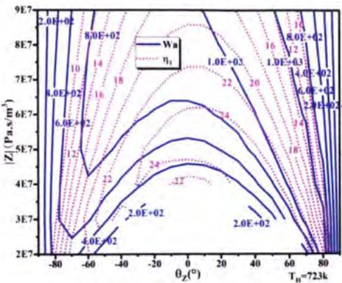  
(a)

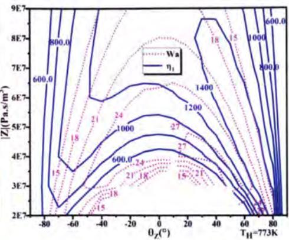  
(b)

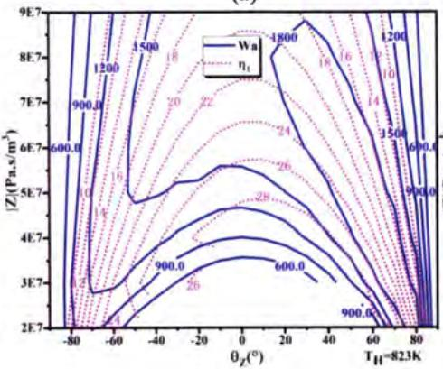  
(c)

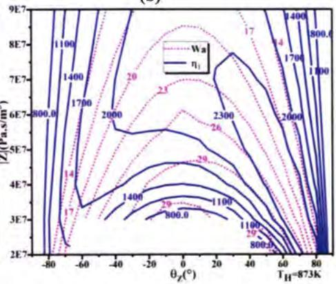  
(d)  
图 3.4 不同 $T_{H}$ 时负载阻抗对热声核心单元热力学性能的影响：(a) $T_{H}=723K$ (b) $T_{H}=773K$ (c) $T_{H}=823K$ (d) $T_{H}=873K$  
Figure 3.4 Dependence of thermodynamic performance of thermoacoustic core unit on load impedance at different heating temperatures $(\mathrm{T_H})$ : (a) $\mathrm{T_H} = 723\mathrm{K}$ (b) $\mathrm{T_H} = 773\mathrm{K}$ (c) $\mathrm{T_H} = 823\mathrm{K}$ (d) $\mathrm{T_H} = 873\mathrm{K}$

为了直观描述温度对热声核心单元可匹配的最佳外接负载阻抗分布区域的影响，图3.4展示了高温热源温度分别为723K、773K、823K和873K时随着外接负载阻抗变化，核心单元输出到负载的声功和热声转换效率变化的关系图。据图可知，尽管高温热源的温度依次相差50K，但为了同时实现热声转换效率较高和输出到负载的声功值较大的目标，各个热声核心单元对应的最佳负载阻抗分布区域都位于右下侧。这表明：高温热源温度对各核心单元可匹配的最佳外接负载阻抗分布区域的影响可能较为有限。

声学研究中常常运用电声类比的手段，如电学中有电阻、电容和电感等电阻抗器件，声学中也相应有声阻、声容和声感等声阻抗器件。在电学研究中，为使电路系统实现良好的对外输出特性，需要考虑外接电负载（可等效为电阻、电感、电容等器件）和电路系统本身阻抗之间的适配度。当外部负载同电路系统内部负载特性相配合时，称为匹配，整机系统性能将获得极大程度的发挥，否则称为失配，整机系统性能可能受到明显抑制。对声学系统的研究也类似，因此，文章决定从考察整机系统内部阻抗的沿程分布入手，以获得不同变温方案下的最佳外接负载阻抗分布区域。

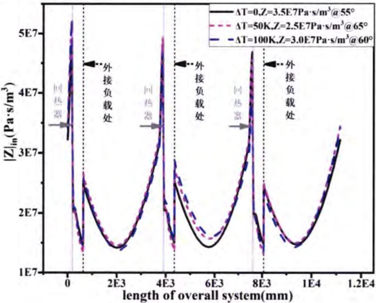

(a)  
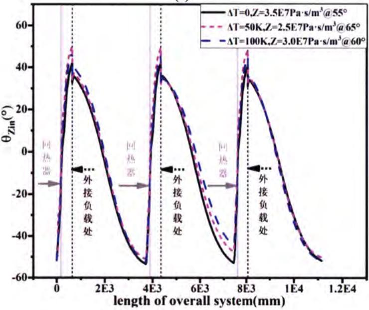  
(b)  
图 3.5 整机系统内部声场阻抗：(a) 阻抗幅值 (b) 阻抗相角  
Figure 3.5 Internal acoustic impedance of the overall system: (a) impedance amplitude (b) impedance argument

由图 3.4 已知，不同加热温度热声核心单元对应的最佳外接负载阻抗分布区域接近完全重合。因此，可以温差为 0 时的最佳外接负载阻抗优选值为中心，扩大外接负载阻抗的考察范围，以进一步观察整机系统内部声场阻抗的变化：当选择方案 1 时，外接负载阻抗为 $3.5E7Pa \cdot s/m^{3}@55^{\circ}$ ，当选择方案 2 时，外接负载阻抗为 $2.5E7Pa \cdot s/m^{3}@65^{\circ}$ ，当选择方案 3 时，外接负载阻抗为 $3.0E7Pa \cdot s/m^{3}@60^{\circ}$ 。

图 3.5 展示了不同变温条件下外接负载阻抗取值不同时整机系统内部声场阻抗的沿程分布图， $|Z|_{in}$ 和 $\theta_{Zin}$ 分别为系统内部声场阻抗的幅值和相角，图中特意标示出了关键部件回热器和外接负载的位置。由图可知：尽管三单元环路三负载系统耦合的高温热源温度变化差值和外接负载的阻抗值都不同，但三大系统内部声场阻抗的沿程分布基本上接近完全重合。

声学研究表明，整机系统内部声场阻抗本质上是氦气在能量转换过程中的一种固有特性，该种特性和氦气的密度、声速等参数相关[126]。而当各个热声核心单元加热器耦合的高温热源温度不同时，氦气密度、声速等参数受到的影响非常有限，因此整机系统内部声场的阻抗特性随温度的变化也非常有限。所以，三大变温方案对应的外接负载最佳阻抗分布区域的变化也将非常微小。

参照 3.3.3.1 节的研究成果，当变温条件选择方案 2 和方案 3，可继续选择 $3.0E7Pa \cdot s/m^{3}@60^{\circ}$ 为外接负载阻抗最佳分布区域的优选值。

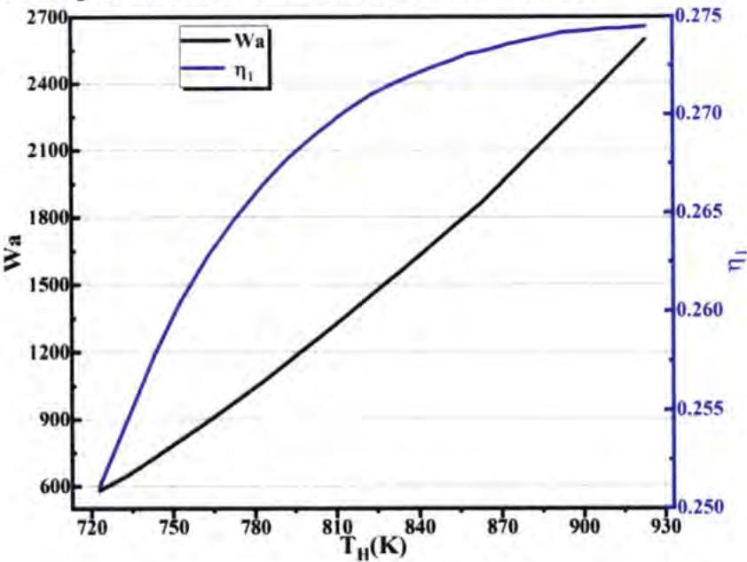  
图 3.6 最佳阻抗时核心单元热声转换性能与高温热源温度关系  
Figure 3.6 Dependence of thermoacoustic conversion performance of core unit on the temperature of hot reservoir at optimum impedance

图 3.6 展示了外接负载阻抗取最优值 $3.0 \, E7 \, Pa \cdot s/m^{3} @ 60^{\circ}$ 时，热声核心单元输出到外接负载的声功和相对应的热声转换效率随着高温热源温度变化的关系图。由图可知：高温热源温度对热声核心单元的热声转换和声功输出特性的影响较为显著，实质上这代表了回热器内温度梯度的影响；输出声功和热声转换效率均随着温度梯度的增加而增加，因此在变温系统中尽可能构建大温度梯度有助于保障整机性能；注意到热声转换效率随着温度梯度增大而增大的速度先较大后较小，这表明在一定程度内提升高温热源温度将对整机系统性能带来显著提升，而超过限度的提升一方面对热源的温度要求较高难以满足，另一方面对热烟的利用效率可能反而降低。

因此，良好的变温热源方案一方面要发挥最高加热温度单元对输出声功和热声转换效率的积极作用，产生尽可能多的声功以驱动外接负载；另一方面也要合理控制热源之间的温差以保证输入到系统的热烟得到充分高效的利用，实质上是保证系统的相对卡诺效率；最后应该考虑到最低加热温度核心单元温度梯度较小的限制，尽可能因势利导，保证其性能。

在对热声核心单元性能进行了充分分析的基础上,接下来的工作将继续回转到以整机系统为研究对象。

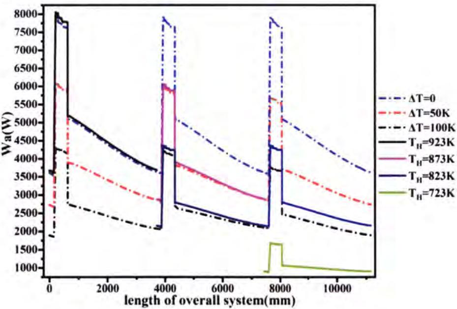  
图 3.7 最佳阻抗时整机系统和热声核心单元声功沿程分布  
Figure 3.7 Distribution of acoustic power of overall system and thermoacoustic core unit at optimum impedance

图 3.7 展示了全部外接负载阻抗统一取最优值 $3.0 \, E7 \, Pa \cdot s/m^{3} @60^{\circ}$ 时，三大变温方案下整机系统内部声场声功的沿程分布情况。由图可知：当取变温方案 1，即高温热源之间温差为 0 时，整机系统三个热声核心单元的沿程分布同单个热声核心单元在加热温度为 923K 时接近完全重合；当取变温方案 2，即高温热源之间温差为 50K 时，整机系统第一、第二个热声核心单元的沿程分布同单个热声核心单元在加热温度为 873K 时接近完全重合，但第三个热声核心单元声功的沿程分布在相同位置的数值却明显大于单个热声核心单元在加热温度为 823K 时的分布数值；当取变温方案 3，即高温热源之间温差为 100K 时，整机系统第一、第二个热声核心单元的沿程分布同单个热声核心单元在加热温度为 823K 时接近完全重合，但第三个热声核心单元声功的沿程分布在相同位置的数值却明显大于单个热声核心单元在加热温度为 723K 时的分布数值。

由上：整机系统中处于最高加热温度即 923K 的第一个热声核心单元声功的沿程分布，与单个热声核心单元在加热温度为 923K 时的声功沿程分布在相同位置的数值相比较小，且随着高温热源之间的温差的增大，其差值也越大，即总体趋势是越变越小；而整机系统中处于最低加热温度即 823K 或者 723K 的第三个热声核心单元声功的沿程分布，与单个热声核心单元在加热温度为 823K 或者 723K 时的声功沿程分布在相同位置的数值相比较大，且随着高温热源之间温差的增大，差值也越大，即总体趋势是越变越大；对于整机系统中处于中间加热温度即 923K、873K 或者 823K 的第二个热声核心单元声功的沿程分布，与单个热声核心单元在加热温度为 923K、873K 或者 823K 时的声功沿程分布在相同位置的数值相比接近完全相等，且随着高温热源之间的温差增大，差值无明显变化，即总体趋势是保持相等。

因此，对于整机系统，变温条件会在一定程度上削弱最高加热温度热声核心单元的内部声场声功的沿程分布数量，不影响中间加热温度的热声核心单元的内部声场声功的沿程分布数量，同时增强最低加热温度热声核心单元的内部声场声功的沿程分布数量。

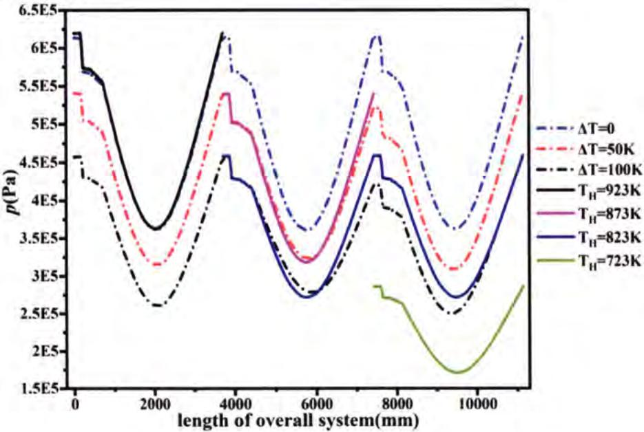  
图 3.8 最佳阻抗时整机系统和热声核心单元压力波动沿程分布

Figure 3.8 Distribution of pressure wave amplitude of overall system and thermoacoustic core unit at optimum impedance

图 3.8 展示了全部外接负载阻抗统一取最优值 $3.0E7Pa \cdot s/m^{3}@60^{\circ}$ 时，三大变温方案下整机系统内部声场压力波动的沿程分布情况。分析该图可知：同声功沿程分布的结果一致，变温条件对于整机系统内部声场中压力波动的沿程分布数量的影响，于最高加热温度热声核心单元起到削弱作用，不影响中间加热温度的热声核心单元，同时于最低加热温度的热声核心单元起到加强作用。

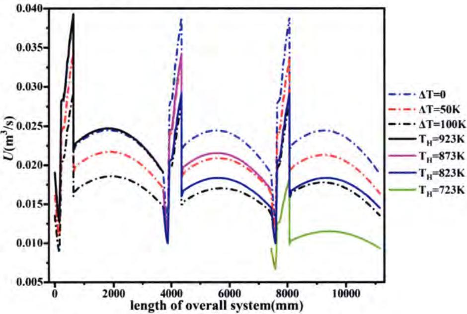  
图 3.9 最佳阻抗时整机系统和热声核心单元体积流率沿程分布  
Figure 3.9 Distribution of volume flow rate of overall system and thermoacoustic core unit at optimum impedance

图 3.9 展示了全部外接负载阻抗统一取最优值 $3.0E7Pa \cdot s/m^{3}@60^{\circ}$ 时，三大变温方案下整机系统内部声场体积流率的沿程分布情况。分析该图可知：同声功沿程分布的结果稍稍有所不同，变温条件对于整机系统内部声场中体积流率的沿程分布数量上的影响，于最高加热温度热声核心单元起到明显削弱作用，但于中间加热温度的热声核心单元却起到一定的削弱作用，同时于最低加热温度的热声核心单元起到明显加强作用。

结合变温条件对整机系统内部声场阻抗特性仅有轻微影响和声功计算表达式可知，正是由于变温条件对系统内压力波动和体积流率的削弱和加强作用，才使得不同热声核心单元内的基本参数沿程分布出现削弱或加强。为了更加直接地描述这种削弱和加强作用对三单元环路三负载结构的热声系统性能带来的综合结果，表3.4对比了外接负载统一取阻抗优选值 $3.0E7Pa\cdot s/m^{3}@60^{\circ}$ 时，变温系统、对应各加热温度的单个热声核心单元计算结果直接相加获得的叠加系统的热力学性能。此外，由于观察到整机系统的第一和第三热声核心单元性能总是趋向于与第二核心单元相等，所以同时也对比了将第一和第三核心单元加热温度直接等同于第二热声核心单元（即以中间加热温度为三个高温热源温度构建的恒温系统）时的恒温系统的热力学性能。

表 3.4 三类系统综合热力学性能对比  
Table 3.4 Comparison of comprehensive thermodynamic properties of three systems

<table><tr><td colspan="2"></td><td>变温系统</td><td>叠加系统</td><td>恒温系统</td></tr><tr><td>方案1</td><td rowspan="3">总吸热量(W)</td><td>27860</td><td>28401</td><td>28401</td></tr><tr><td>方案2</td><td>21360</td><td>22092</td><td>21792</td></tr><tr><td>方案3</td><td>15220</td><td>17141</td><td>16083</td></tr><tr><td>方案1</td><td rowspan="3">输入负载总声功(W)</td><td>7656</td><td>7794</td><td>7794</td></tr><tr><td>方案2</td><td>5849</td><td>6039</td><td>5964</td></tr><tr><td>方案3</td><td>4122</td><td>4631.8</td><td>4359</td></tr><tr><td>方案1</td><td rowspan="3">压比</td><td>1.192</td><td></td><td>1.194</td></tr><tr><td>方案2</td><td>1.167</td><td></td><td>1.167</td></tr><tr><td>方案3</td><td>1.140</td><td></td><td>1.140</td></tr><tr><td>方案1</td><td rowspan="3">热声转换效率</td><td>0.2748</td><td></td><td>0.2745</td></tr><tr><td>方案2</td><td>0.2739</td><td></td><td>0.2736</td></tr><tr><td>方案3</td><td>0.2709</td><td></td><td>0.2710</td></tr><tr><td>方案1</td><td rowspan="3">相对卡诺效率</td><td>0.4091</td><td></td><td>0.4087</td></tr><tr><td>方案2</td><td>0.4197</td><td></td><td>0.4190</td></tr><tr><td>方案3</td><td>0.4294</td><td></td><td>0.4289</td></tr></table>

根据表 3.4 可知，对于系统从高温热源获得的总吸热量，变温系统为三类系统中最低，但三类系统之间相差较为微小；对于输入到负载的总声功，变温系统依然为三类系统中最低，同时三类系统之间的相差也极为微小；由于叠加系统实际上并不存在，因此对于压比、热声转换效率和相对卡诺效率三个参量只能在变温系统和恒温系统之间进行对比，实际结果表明，这三个参量在两大系统之间也几乎没有任何差别。实际上，在输出声功量接近的前提下，吸收热量越少，表明对热烟的利用能力越强，系统性能也越好。

因此，变温系统相对恒温系统在热力学性能上不但不存在明显的差别和劣势，相反，变温系统采用“取长补短”的方式有效拓宽了三单元环路三负载系统的工作温区：对不同加热温度的热声核心单元产生一定的削弱或者加强作用，最后使得整机系统在变温条件下具有良好的综合热力学性能，充分发挥了环路结构热声发动机系统对低品位热能的利用潜力。

## 3.3 实验探究

在系统匹配最佳外接负载阻抗值且变温热源条件下的工作机理已经阐明的

前提下，开展实验工作来验证理论结果至关重要。

## 3.3.1 三单元系统实验和理论分析

对于该三单元环路三负载系统，本课题组在2017年已经开展了变温热源条件下的相关实验探究[125]工作，实验中以直线电机作为外接负载，将声功转化为电功，结果表明：变温条件对系统的工作频率和热电转换效率没有显著影响，但会因为各热声核心单元的不一致性而使得系统的压力波动水平降低，同时系统输出的电功也降低了。对此，本章所做工作可以做出解释：

（1）工作频率实质上是由系统的结构参数决定，是系统的基本属性之一。本章和2017年课题组研究的系统结构高度对称且全程无任何变化，因此基本属性不会改变。所以，变温条件不影响系统的工作频率。

（2）系统实现热电转换需要先后经历热声转换和声电转换两个过程，热声转换需要实现能量品味的提升，而声电转换无需实现能量品味的跨越，实际上后一转换过程的效率往往会高于前者。实验结果表明，变温条件对整机系统的热电转换效率几乎无影响，但是电功输出量降低。这一方面是因为实验过程中没有更改声电转换装置，并且声电转换无需从外部热源吸热，也即完全屏蔽变温热源条件的影响，所以系统的声电转换效率实质上不会改变；第二是因为高温热源温度梯级变化，系统的吸热量和输出声功量相对于定温条件均会降低，表3.4和图3.7可对此分析结果进行验证，但系统的热声转换效率实质上受到的影响也较小，由表3.4变温系统中不同方案对应的热声转换效率几乎无变化可以验证。因此，耦合变温热源后，系统可以参与声电转换的声功总量减小，输出电功会降低，但整机系统中可实现热电转换的热量比例不变，所以热电转换效率没有明显变化。

（3）对于实验结果中系统压力波动的降低，可与本章图3.8的分析结果互相验证。结合本章对变温热源条件的作用机理分析可知，最高加热温度热声核心单元的性能受到抑制，声功、压力波动和体积流率的沿程分布均降低，且整机系统中最高加热温度热声核心单元中的压力波动值最高，因此变温条件下整机系统的压力波动值降低。

至此，三单元环路三负载系统的实验结果根据本章分析内容均可以得到解释，这也表明本章对变温热源条件下系统内部热声转换机理的揭示与实验效果吻合良好，具备学术参考价值。

## 3.3.2 四单元系统实验和理论分析

基于对三单元环路三负载系统的实验结果，课题组在2017年继续对四单元环路四负载系统进行了研究，并发现四单元系统在定温条件下的综合热力学性能优于三单元系统[125]。然而之前并未对四单元环路四负载系统开展变温热源条件下的实验探索，因此，本课题进行了相关实验工作。四单元系统的结构示意如图3.10所示：

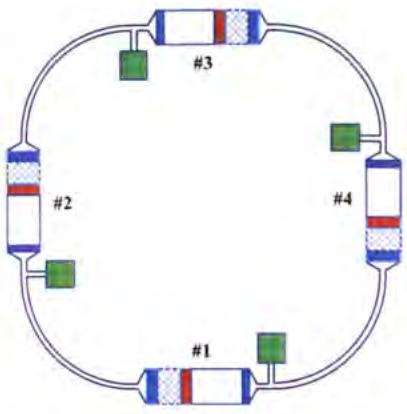  
(a)

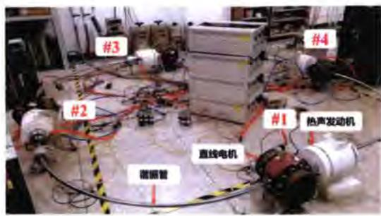  
(b)  
图 3.10 四单元环路四负载系统结构：(a) 示意图 (b) 实物图  
Figure 3.10 Structure of looped four-unit system with four loads: (a)schematic diagram (b)real system

实验中的工作介质依然是氦气(He)，充气压力为 6MPa，外接负载为直线电机，低温热源温度则恒定为 298K(即 25℃)。

对于热声发动机系统，核心单元数量越多，需要考虑的物理量也越多。因此，当四单元四负载系统耦合变温热源时，流动型的高温热源将先后经过四个加热器，如果各加热器之间的温差过大，有可能因为各热声核心单元之间不一致性过强，使得最低温度的热声核心单元无法正常工作，最终影响整机系统的性能。因此，实验决定合理控制高温热源的温度，最大温差不超过50K。

表 3.5 四单元系统热声核心单元结构参数  
Table 3.5 Structural parameters of thermoacoustic core unit of four-unit system

<table><tr><td>热声核心单元</td><td>部件</td><td>结构参数(mm)</td><td>备注</td></tr><tr><td rowspan="5">热声发动机</td><td>主水冷器</td><td> $\Phi 80 \times 60$ </td><td>管壳式,孔隙率0.2</td></tr><tr><td>回热器</td><td> $\Phi 80 \times 70$ </td><td>丝径Dwire=0.05mm,孔隙率0.8</td></tr><tr><td>加热器</td><td> $\Phi 80 \times 80$ </td><td>翅片式</td></tr><tr><td>热缓冲管</td><td> $\Phi 80 \times 152$ </td><td>直管</td></tr><tr><td>次水冷器</td><td> $\Phi 80 \times 40$ </td><td>管壳式,孔隙率0.4</td></tr><tr><td>谐振管</td><td>谐振管</td><td> $\Phi 20 \times 2000$ </td><td>弯管</td></tr></table>

表 3.5 和 3.6 分别展示了四单元环路四负载系统各核心单元的结构参数和高温热源温度的分布。

如表 3.5 所示，高温热源温度 $(T_{\mathrm{Hi}})$ 分别按照温差 $\Delta T=20/25/50K$ 的方式逐级递增，case25 即代表热源温差为 25K，1 和 2 为实验编号。实际实验中，热源之间的温差难以精确控制，因此真实的加热温度并非梯级排布，而是在目标温度附近有所波动。

表 3.6 变温热源条件下四热声核心单元加热温度  
Table 3.6 The heating temperature of four thermoacoustic core units under the distributed-temperature heat sources condition

<table><tr><td>case</td><td>case20</td><td>case25-1</td><td>case25-2</td><td>case50</td></tr><tr><td> $T_{H1}$ </td><td>538.3</td><td>573.4</td><td>476.9</td><td>544.2</td></tr><tr><td> $T_{H2}$ </td><td>549.1</td><td>599.5</td><td>491.8</td><td>609.2</td></tr><tr><td> $T_{H3}$ </td><td>573.4</td><td>625.6</td><td>525.8</td><td>658.1</td></tr><tr><td> $T_{H4}$ </td><td>601.4</td><td>649.9</td><td>550.2</td><td>668.3</td></tr></table>

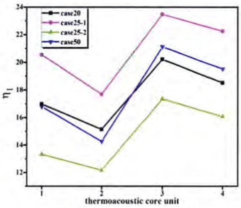  
图 3.11 核心单元热声转换效率  
Figure 3.11 Thermoacoustic conversion efficiency of thermoacoustic core unit

图 3.11 展示了四组实验中，各个热声核心单元的热声转换效率。由图可知，不同变温方案下核心单元热声转换效率的分布情况相同：#3>#4>#1>2。结合加热温度对单个热声核心单元的作用机理，可知：温度越高，核心单元的热声转换效率越高。对于该四单元系统：变温条件使得#4 热声核心单元的性能被削弱，#1 热声核心单元性能被增强，#2 和#3 热声核心单元性能几乎不受影响，因此#3 核心单元的热声转换效率高于#4，同时#1 高于#2。该规律同变温条件在三单元环路三负载系统中的作用规律一致。

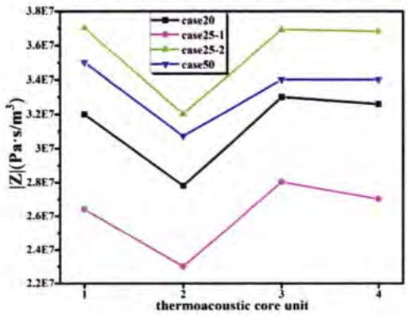  
(a)

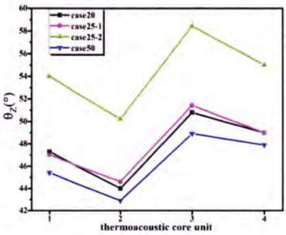  
(b)

图 3.12 核心单元外接负载阻抗: (a) 阻抗幅值 (b) 阻抗相角

Figure 3.12 Load impedance of thermoacoustic core unit:(a) amplitude (b) argument

图 3.12 展示了各热声核心单元负载直线电机的等效阻抗值。由图可知：每一组实验内部的四个外接负载的等效阻抗值受加热温度变化的影响较为微弱，且各组实验的阻抗值较为接近，幅值均在 $(2.2,3.8)$ E7Pa·s/m $^{3}$ 的区间内，相角均在 $(42,60)^{\circ}$ 的区间内。结合对三单元系统的分析可对此进行解释：变温条件不影响整机系统的内部声场特性，各变温方案下外接负载的等效阻抗值接近，因此外接负载阻抗会趋向某一中间值。

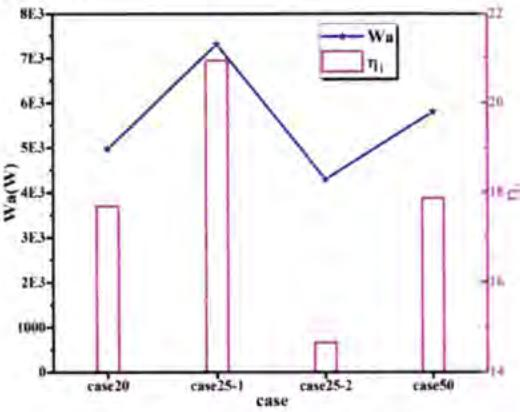  
图 3.13 四单元系统综合性能  
Figure 3.13 Comprehensive performance of four-unit system

图 3.13 展示了四组实验的整机热声转换效率和输出声功值。由图可知：所有变温方案下整机系统的声功产出均在 4kW 以上，热声转换效率均在 14% 以上，数值分布总体上呈现高温热源温度越高，中间温差越小，输出声功越多、热声转换效率越高的变化趋势，这也同三单元系统的规律一致。

实际上，变温条件下三单元系统的声功产出往往低于四单元系统，这一方面有加热温度的原因，另一方面也同系统的结构有关。四单元系统中的每一核心单元中的压力波动和体积流率变化均为 $90^{\circ}$ ，即使有两个单元中出现纯驻波声场没有任何声功产出，也会有两个接近纯行波声场的热声核心单元高效率产出声功来进行弥补；而对于三单元系统，每一核心单元中的相角变化为 $120^{\circ}$ ，因此可能每一个核心单元的热声转换能力都比较有限。所以，虽然四单元系统耦合变温热源时影响到的物理量更多，但其输出声功量依然可能大于三单元系统。

此外，考虑到两单元系统的加热器数量较少，变温条件下可以利用的余热资源分布温区较窄，且其核心单元中的压力波动和体积流率相位角变化为 $180^{\circ}$ ，热声转换过程相对更容易受限。因此，尽管三单元系统声功产出小于四单元系统，但依然是一种性能良好的回收余热的热声发动机系统。基于此，下一章的分析将从结构优化入手，旨在提升三单元环路三负载系统的声功产量。

## 3.3.3 最佳阻抗无量纲化处理

基于对三单元系统和四单元系统耦合变温热源时的性能分析，发现两大系统的最佳外接负载阻抗值相近。因此： $3.0E7Pa\cdot s/m^{3}$ 可能是两种结构热声发动机系统的通用最优负载阻抗幅值。

为了验证这一猜想, 需要在三单元环路三负载系统中定义无量纲数来消除系统结构、温度等参数的影响, 为此, 引入无量纲阻抗 z:

$$
z = \frac {A p}{\rho_ {0} \alpha_ {0} U}\tag{...(3.4}
$$

上式中，A 为流道横截面积，单位 $m^{2}$ ， $\rho_{0}$ 为工作介质的密度，单位为 $m^{3}/s$ ， $\alpha_{0}$ 为工作气体的声速，单位为 m/s。

实际上，对于三单元环路三负载系统，压力波动和体积流率的比值已经固定为 $3.0\mathrm{E}7\mathrm{Pa}\cdot \mathrm{s} / \mathrm{m}^3 @60^\circ$ ，因此该无量纲阻抗数将由外接负载位置处的流道截面积、气体密度和声速共同决定。进一步分析可知，工作气体的密度与温度、压力有关，声速与温度、气体常数有关。而根据图3.8可知，随着高温热源之间温差增大，压力波动的沿程分布数值逐渐减小，因此不同核心单元外接负载位置处工作气体的密度将可能互不相同。而在外接负载的位置，工作气体已经接近环境温度，因此声速将保持不变。综上分析可知，最终无量纲声阻抗将由流道横截面积和密度（实质上是当地压力波动）来决定。

然而并非所有流道的横截面积都可以精确测量，且体积流率又与流速和流道截面积有关，因此，式 3.4 可进一步转化为：

$$
z = \frac {A p}{\rho_ {0} \alpha_ {0} U} = \frac {A p}{\rho_ {0} \alpha_ {0} v A} = \frac {p}{\rho_ {0} \alpha_ {0} v}\tag{...(3.5}
$$

上式中，v 为流速，单位为 m/s。

由上式可知，工作介质流速是影响无量纲阻抗的物理量之一。在负载阻抗相同的前提下，如果各负载的入口流道横截面积相等，则所有流速也相等。

对于本课题研究的三单元环路三负载系统，表3.7列出了3种变温方案下各外接负载阻抗值均取 $3.0E7Pa\cdot s/m^{3}@60^{\circ}$ 时的无量纲化值。

表 3.7 整机系统无量纲阻抗值  
Table 3.7 Dimensionless impedance of overall system

<table><tr><td></td><td>z1</td><td>z2</td><td>z3</td></tr><tr><td>方案 1</td><td>2.65</td><td>2.641</td><td>2.639</td></tr><tr><td>方案 2</td><td>2.647</td><td>2.639</td><td>2.638</td></tr><tr><td>方案 3</td><td>2.643</td><td>2.636</td><td>2.638</td></tr></table>

根据表 3.7 可知：每一变温方案内部，各负载的无量纲阻抗值之间略有波动，且随着热源温差的增大，无量纲阻抗值及其波动量均会逐渐减小。相对而言，在每一变温方案中，z1 和 z2 的差值大于 z2 和 z3 的差值。

实质上，每一变温方案内部和不同变温方案之间，负载的无量纲阻抗值接近相等，均在2.641上下波动。也即，变温热源条件下，加热温度不同的各个热声核心单元可匹配的最佳外接负载阻抗无量纲值相等。

表 3.8 热声核心单元无量纲阻抗  
Table 3.8 Dimensionless impedance of thermoacoustic core unit

<table><tr><td> $T_H$ </td><td>923</td><td>873</td><td>823</td><td>723</td></tr><tr><td>z</td><td>2.647</td><td>2.644</td><td>2.641</td><td>2.636</td></tr></table>

表 3.8 展示了取单个核心单元且外接负载阻抗值等于 $3.0E7Pa \cdot s/m^{3}@60^{\circ}$ 计算时获得的无量纲阻抗值，实质上这代表了定温系统的特性。由表可知：单个计算的热声核心单元，负载阻抗的无量纲值之间也几乎没有差别，均值为 2.642，同变温整机系统的负载无量纲均值变化量仅在 3.8%。

综上所述，变温条件下的最佳负载阻抗的无量纲值均在 2.642，热声发动机系统内部声场特性较为稳定，几乎不受温度条件影响。

## 3.4 本章总结

本章对三单元环路三负载结构的热声发动机系统可以匹配的最佳外接负载阻抗的分布区域进行了探究，系统在变温条件下最终获得了不亚于恒温系统的综合热力学性能，发挥了环路结构热声系统对低品位热能的良好利用潜力，此外分别对三单元环路三负载系统和四单元环路四负载系统进行了实验和理论探究，并对对负载阻抗做了无量纲化处理。本章主要研究内容如下：

(1)揭示了热声核心单元内部基本参数的沿程分布即热声能量转换及传输特性。理论计算表明，当热声核心单元耦合的高温热源温度为923K，低温热源温度为303K，外接负载的等效阻抗值为 $3.0E7Pa\cdot s/m^{3}@65^{\circ}$ 时，核心单元输出到负载的声功为2757W、热声转换效率达24.77%、相对卡诺效率达40.74%，显示出良好的热声转换和声功输出特性。根据相位差的沿程分布可知，回热器和谐振管中都是以行波为主的声场，表明所研究的系统具有良好能量转换和传输性能。回热器中的声功放大量为5212W，但谐振管在传输声功的过程中就消耗了2069W，也即谐振管是一个主要的声功损耗部件。

(2)找到变温条件下最佳外接负载阻抗分布区域的优选值。首先从定温条件出发，根据结构和温度条件的高度对称性选择计算一个热声核心单元性能随着外接负载阻抗值变化的关系图，找到变温方案1对应的最佳外接负载阻抗优选值为 $3.0E7Pa\cdot s/m^{3}@60^{\circ}$ 。然后拓展计算并获得所有加热温度条件下热声核心单元性能随着外接负载阻抗值变化的关系图，分析发现当高温热源温度变化时，热声核心单元对应的最佳外接负载阻抗分布区域基本无任何变化。最后根据电声学理论类比及整机计算分析可知：变温条件对热声发动机系统内部声场的阻抗特性影响较小。因此，所有变温方案下外接负载阻抗的优选值均取为 $3.0E7Pa \cdot s/m^{3}@60^{\circ}$ 。

(3)探究了所有负载阻抗统一取优选值 $3.0\mathrm{E}7\mathrm{Pa}\cdot \mathrm{s} / \mathrm{m}^3 @60^\circ$ 时，热声核心单元和整机系统热声转换与输出特性所受变温条件的影响。首先分析了热声核心单元输出声功和热声转换效率受回热器内部温度梯度的影响，然后将研究对象转化为整机系统，不仅对比了整机系统内部声场基本参数随温度的变化情况，而且也将单个计算的耦合不同温度高温热源的热声核心单元的基本参数引入对比。综合分析发现：无论是声功、压力波动还是体积流率的沿程分布数据，变温条件对最高加热温度的热声核心单元起到削弱作用，对中间加热温度的热声核心单元几乎无影响，对最低加热温度的热声核心单元则起到加强作用。

(4)对比了变温系统、叠加系统和恒温系统的热力学性能。结果表明：变温系统不仅具有不亚于恒温系统的热力学性能，而且借助对不同加热温度热声核心单元的削弱和加强作用，“取长补短”，有效拓宽了三单元环路三负载结构的热声发动机系统的工作温区，较好地发挥了环路热声发动机系统对低品位热能的利用潜力。

(5)根据理论分析结果，对三单元环路三负载系统的变温实验结果给出了合理解释；对四单元环路四负载系统开展了变温实验工作，并结合对三单元系统的变温条件作用机理对实验结果进行了合理分析。

(6)由于变温条件对三单元系统和四单元系统的作用机理相通，且两种系统可匹配的外接负载阻抗值相近，因此对外接负载阻抗进行无量纲化处理引。最终结果表明，系统内部声场阻抗特性较为稳定，几乎不受变温条件的影响，所有变温方案下外接负载阻抗的无量纲值均在2.641附近。

## 第 4 章 三单元环路三负载系统结构优化研究

## 4.1 本章引论

在上一章中，我们探索了串联型三单元环路三负载结构的热声发动机系统置于变温热源条件下的热声能量转换及整机输出特性，并获得不同变温方案下外接负载阻抗优选值均为 $3.0\mathrm{E}7\mathrm{Pa}\cdot \mathrm{s} / \mathrm{m}^3 @60^\circ$ 的结论。然而在外接负载处于最佳阻抗值条件下，当我们对比变温系统与恒温系统的热力学性能时，发现变温系统除具有不亚于恒温系统的热力学性能外，最大的优势只是拓宽了该三单元环路三负载热声发动机系统的工作温区，发挥了该系统对低品位热能的利用潜力。

而在上一章的研究中我们也已经发现，谐振管是一个主要的声功损耗部件。此外，对变温系统和恒温系统热力学性能的比较是在结构完全相同的条件下进行的。当环路热声发动机系统耦合变温热源时，我们的实际目标不仅仅要求其热力学性能应当优于恒温热源系统，同时也要求其主要产品“声功”越多越好。因此，对于上一章研究的三单元环路三负载系统，本章决定进一步优化其结构，旨在降低关键部件如回热器、谐振管中的声功损失，尽可能提升回热器与谐振管中双行波声场环境的质量，以期达到进一步提升变温系统综合热力学性能的目的。

## 4.2 理论计算及机理研究

本节基于上一章中变温条件下三单元环路三负载系统外接负载阻抗优选值为 $3.0E7Pa \cdot s/m^{3}@60^{\circ}$ 的结论继续使用 Sage 软件开展计算，首先对单个热声核心单元开展了结构性能优化，然后将优化结果整合应用于整机系统，最终使得变温系统获得了更优的内部声场环境和输出特性。

## 4.2.1 回热器结构

研究表明，谐振管与回热器是环路结构热声发动机系统中声功损失最多的两个部件[127]，而声功损失与系统内部声场特性息息相关，系统内部声场特性又与系统结构直接关联。因此，开展结构优化可以从本质上促进系统内部声场阻抗特性的优化，最终提升系统的热力学性能。本节决定先从回热器开始，在变温条件下探究其内部填充不锈钢丝网的丝径、外部直径对热声核心单元性能的影响，寻找相应参数的可优化空间，以进一步改善三单元环路三负载系统内部声场特性。

## 4.2.1.1 回热器丝径

回热器作为热声发动机唯一产生声功的部件，对其结构进行优化具有至关重要的意义。回热器由致密的不锈钢丝网填充至套筒中制成，丝网结构对回热器性能具有重要影响。图4.1展示了在不改变回热器内不锈钢丝网孔隙率的前提下，回热器丝网丝径改变对不同加热温度热声核心单元热力学性能的影响。

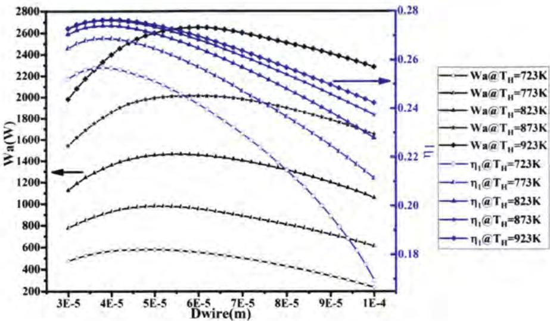  
图 4.1 回热器丝径对热声核心单元性能的影响  
Figure 4.1 Dependence of thermoacoustic core unit performance on the wire diameter of regenerators

由图 4.1 可知，高温热源温度对热声核心单元最适应的回热器丝径值的分布范围影响较小，各热声核心单元输出到负载的声功线和热声转换效率线随着丝径的增大变化趋势相同。当为了使负载获得的声功尽可能大时，丝径值应该取 4E-5 到 7E-5m，而当为了使热声核心单元的热声转换效率尽可能高时，丝径值应该取 3E-5 到 5E-5m。因此，为了同时获得较高的声功输出和热声转换效率，现有回热器的不锈钢丝网丝径取值为 5E-5m 已不再具有非常明显的可优化空间，回热器丝网丝径的优选值依然取 5E-5m。

## 4.2.1.2 回热器直径

热声发动机中，主水冷器、回热器、加热器、热缓冲管和次水冷器依次通过焊接相连成为一个整体，单纯地只改变回热器的直径必将在主水冷器出口和加热器入口造成截面积突变，对工作气体形成较大的流动阻力，从而引发较大的流动损失，这与结构优化的初衷相矛盾。因此，改变回热器直径的同时必须改变主水冷器、加热器、热缓冲管和次水冷器的直径，也即实质上改变热声发动机的直径。

图 4.2 展示了回热器直径（热声发动机直径）改变对不同加热温度热声核心单元热力学性能的影响。

由图 4.2 可知，高温热源温度不同对热声核心单元最适应的回热器直径值的分布范围影响较小，各热声核心单元输出到负载的声功量线和热声转换效率线随着直径的增大变化趋势相同。当为了使负载获得的声功尽可能大时，直径值应该取 0.080 到 0.090m，当为了使热声核心单元的热声转换效率尽可能高时，直径值应该取 0.075 到 0.085m。因此，为了同时获得较高的声功输出和热声转换效率，现有回热器的直径取值为 0.080m 已不再具有明显的可优化空间，回热器直径优选值的大小依然取 0.080m。

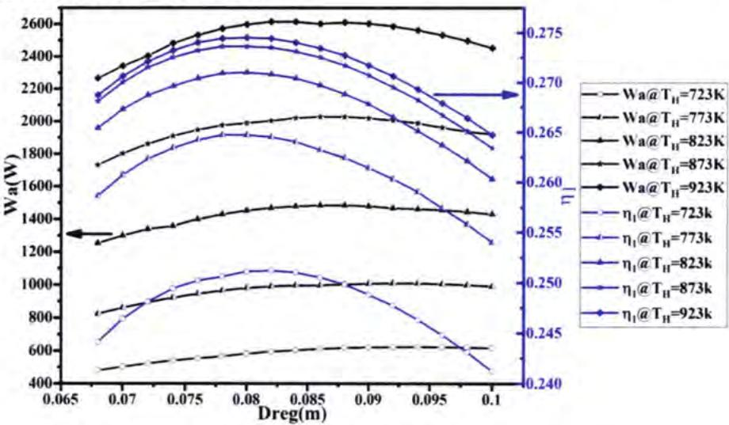  
图 4.2 回热器直径对热声核心单元性能的影响  
Figure 4.2 Dependence of thermoacoustic core unit performance on the diameter of regenerators

## 4.2.2 谐振管结构

在回热器结构参数不需要改变的前提下，谐振管的结构参数将成为影响热声核心单元或整机系统热力学性能的主要因素。本节决定先从谐振管直径开始，在变温条件下逐步优化谐振管结构参数，以进一步改善系统内部的声场特性。

## 4.2.2.1 回热器与谐振管横截面积比

注意到对回热器进行直径或者横截面积优化时，为了保证系统密封性和降低工作气体流阻，还需要改变主水冷器、加热器、热缓冲管和次水冷器的横截面积，而当多个部件同时发生结构变化时，很可能掩盖主要部件结构变化对系统性能的影响。此外，回热器和谐振管同时作为系统中主要的声功损耗部件和行波声场环境，二者的尺寸之间应当存在某种关联，然而这种关联至今仍然不是十分清晰。因此，如果在优化谐振管结构尺寸的同时也能够理清谐振管直径和回热器结构尺寸之间的关系，必将显著提升计算效率。

基于上述分析, 本节决定根据上一节回热器直径值已无非常明显的优化空间的结论, 在本节中继续保持回热器横截面积不变 (实质上就是回热器直径不变), 主要改变谐振管直径以优化系统内部声场特性, 从而实现同时降低回热器和谐振管中声功损失的目标。定义关联参数 a 即回热器与谐振管横截面积比:

$$
a = \frac {A r e g}{A r e s}\tag{... (4.1}
$$

上式中，Areg 和 Ares 分别为回热器和谐振管横截面积，单位均为 $m^{2}$ 。

上一章中已知变温条件对系统内部声场阻抗特性的影响较小，耦合不同温度高温热源的热声核心单元可匹配的外接负载阻抗最佳分布区域十分接近。根据上一节的分析也已知回热器的结构参数实质上已经处于最优值区间。因此，在对谐振管进行结构优化可以直接影响到整机系统的热力学性能的前提下，为直观展示不同加热温度下谐振管结构对系统性能的影响，本节的研究决定继续从耦合不同温度高温热源的热声核心单元开始，统一所有外接负载的等效阻抗值均为优选值 $3.0E7Pa\cdot s/m^{3}@60^{\circ}$ ，首先考察面积比a对核心单元热力学性能的影响。

由图 4.3 可见，面积比对热声核心单元性能具有显著影响。各个热声核心单元最大声功输出量与最高热声转换效率对应最优面积比不同：前者对应的最优面积比在 8 到 9 之间，热声核心单元耦合高温热源温度越高越接近 9；后者对应的最优面积比在 16 到 20 之间，热声核心单元耦合高温热源温度越高越接近 20。综合考虑声功输出和热声转换效率，热声核心单元最优面积比的合理取值范围应该为 8 到 20，当面积比偏离该范围时热声核心单元性能会显著下降，比如当面积比小于 6 或大于 25 后，部分热声核心单元的声功产出和效率分别低于 500W 和 0.1125，实际上热声发动机系统此时已不能正常工作。

为取得较好的优化效果, 各个热声核心单元的结构参数在优化时必须进一步做出折中处理。因此, 根据图 4.1 的结果将回热器与谐振管横截面积比的最优取值范围进一步确定在 11 到 16 之间, 对应谐振管直径从 24mm 变化到 20mm。

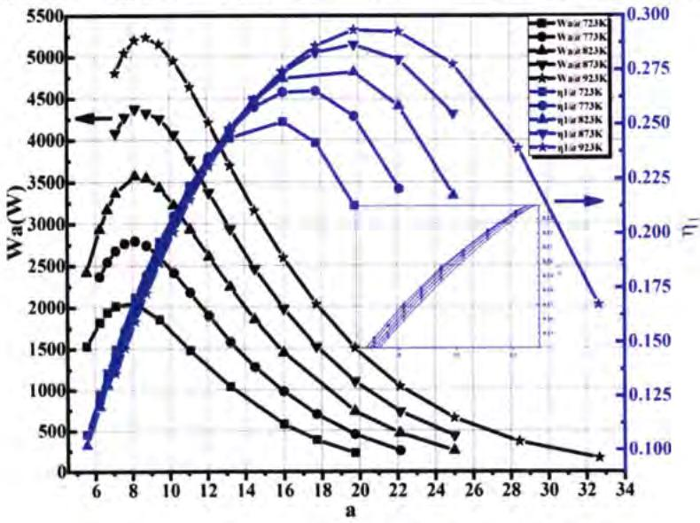  
图 4.3 不同加热温度时面积比对热声核心单元性能的影响  
Figure 4.3 Dependence of thermoacoustic core unit performance on the flow-area ratio at different heating temperatures

## 4.2.2.2 谐振管直径与长度

根据上节分析可知，谐振管直径 Dres 从 24mm 变化到 20mm 可以使得加热温度不同的各个热声核心单元同时实现较高的声功产出和热声转换效率，因此本节计算决定选取谐振管直径分别为 20mm, 22mm 和 24mm，每一确定直径下改变谐振管长度 Lres 以获取其最佳长度尺寸。

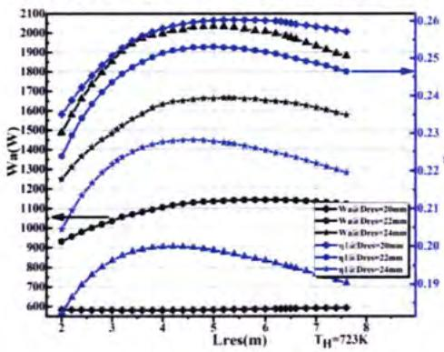  
(a)

  
(b)

  
(c)

  
(e)

(d)  

  
(f)  
图 4.4 不同加热温度时谐振管长度对热声核心单元性能的影响  
Figure 4.4 Dependence of thermoacoustic core unit performance on the length of resonance tube: (a) $T_{H}=723K$ (b) $T_{H}=773K$ (c) $T_{H}=823K$ (d) $T_{H}=873K$ (e) $T_{H}=923K$ (f) comparison

图 4.4 展示了高温热源温度分别为 723K、773K、823K、873K 和 923K，谐振管直径分别为 20mm, 22mm 和 24mm 时谐振管长度对热声核心单元热力学性能的影响。由图(b)到图(e)可见，当谐振管直径最小，即 Dres=20mm 时，不同加热温度下热声核心单元输出到负载的声功相对其他直径的谐振管都最小，但热声转换效率却往往最高；当谐振管直径最大，即 Dres=24mm 时，不同加热温度下的热声核心单元输出到负载的声功相对其他直径的谐振管都最大，但热声转换效率却总是最低。因此，为了同时实现输出到负载的声功较高和热声转换效率较高，决定采用折中处理策略，即对于 773K、823K、873K 和 923K 这 4 种加热温度的热声核心单元的谐振管直径最优值均取 22mm，此时回热器和谐振管横截面积比 a 均为 13.2。而由图(a)可见，当谐振管直径为 24mm 时热声核心单元可同时实现较高的声功产出和热声转换效率，因此，当热声核心单元耦合的高温热源温度为 723K 时，谐振管直径最优值取 24mm，此时回热器和谐振管横截面积比 a 为 11.1。

表 4.1 列出了所有温度条件下当谐振管直径取最优值时的最优长度尺寸及此时核心单元的输出声功量和热声转换效率，可见理想的谐振管长度都在 4.4m 以上。考虑到整机实验系统匹配 4.4m 长以上的谐振管时将大幅增加占地面积，并且由于谐振管过长，其质量将相应增大，可能给其两端的密封性能带来一定影响。因此，再度折中处理选定谐振管长度为 3.5m。图 4.2 中(f) 对比了谐振管直径取 22mm 或 24mm、长度取 3.0m 和 3.5m 时耦合不同温度高温热源的热声核心单元性能的前后变化情况，可见无论是输出到负载的声功还是热声转换效率都升高。

表 4.1 谐振管最优结构参数时热声核心单元热力学性能  
Table 4.1 Thermodynamic properties of thermoacoustic core unit with optimal structural parameters of resonance tubes

<table><tr><td> $T_{H}/K$ </td><td>Dres(mm)</td><td>Lres(m)</td><td>Wa(W)</td><td> $η_1$ </td></tr><tr><td>723</td><td>24</td><td>4.6</td><td>1657</td><td>0.2282</td></tr><tr><td>773</td><td>22</td><td>4.8</td><td>1744</td><td>0.2566</td></tr><tr><td>823</td><td>22</td><td>4.4</td><td>2422</td><td>0.2568</td></tr><tr><td>873</td><td>22</td><td>4.6</td><td>3138</td><td>0.2559</td></tr><tr><td>923</td><td>22</td><td>4.4</td><td>3921</td><td>0.2537</td></tr></table>

图 4.5 展示了当谐振管尺寸取优选值 Dres=22mm，Lres=3.5m 时，整机系统在变温方案 1，即 $\Delta T=0$ 下的内部声场基本参数声功 Wa、压力波动 p 和体积流率 U 的沿程分布情况。由图可知，体积流率和压力波动在同一部件中的数值在谐振管结构优化后都增加了，这样的综合结果使得内部声场声功在同一部件的数值增加，在发生突变的位置（实际上分别是回热器和外接负载处）变化幅度也明显增加，这表明整机系统内部声功放大量和对外输出的声功量都明显增加了。

  
图 4.5 $\Delta T=0$ 时优化谐振管尺寸前后对整机系统性能的影响

Figure 4.5 The influence of resonance tube dimensions optimization on the overall system performance when $\Delta T=0$  
  
图 4.6 $\Delta T=50K$ 时优化谐振管尺寸前后对整机系统性能的影响

Figure 4.6 The influence of resonance tube dimensions optimization on the overall system performance when $\Delta T = 50\mathrm{K}$

图 4.6 展示了当谐振管尺寸均取优选值 Dres=22mm，Lres=3.5m 时，整机系统在变温方案 2，即 $\Delta T=50K$ 下的内部声场基本参数声功 Wa、压力波动 p 和体积流率 U 的沿程分布情况。由图可知，同方案 1 下的优化结果一致：体积流率和压力波动在同一部件中的数值在谐振管结构优化后都增加了，这样的综合结果使得内部声场声功在同一部件中的数值增加，在发生突变的位置变化幅度也明显增大，整机系统内部声功放大量和对外输出的声功量也都明显增加了。

  
图 4.7 $\Delta T=100K$ 时优化谐振管尺寸前后对整机系统性能的影响  
Figure 4.7 The influence of resonance tube dimensions optimization on the overall system performance when $\Delta T = 100\mathrm{K}$

图 4.7 展示了当第一和第二热声核心单元谐振管尺寸取优选值 Dres=22mm，第三热声核心单元谐振管尺寸取优选值 Dres=24mm，所有谐振管长度均取 Lres=3.5m 时，整机系统在变温方案 3，即 $\Delta T=100K$ 下的内部声场基本参数声功 Wa、压力波动 p 和体积流率 U 的沿程分布情况。由图可知，依然同方案 1 下的优化结果一致：体积流率和压力波动在同一部件中的数值在谐振管结构优化后都增加了，这样的综合结果使得内部声场声功在同一部件中的数值增加，在发生突变的位置变化幅度也明显增大，整机系统内部声功放大量和对外输出的声功量都明显增加了。

因此，将根据热声核心单元性能随谐振管直径和长度变化获得的尺寸优化数据应用到整机系统中同样获得了良好的性能提升效果。为更清晰地展现谐振管尺寸优化对整机系统性能的这种促进、提升作用，图4.8和图4.9分别展示了谐振管结构尺寸优化前后整机系统内部声场阻抗幅值和相角的沿程分布情况。

由图 4.8 可知，内部声场阻抗幅值在三个热声核心单元关键部件回热器中的分布都在谐振管尺寸优化后降低了，但对于谐振管中的沿程分布，仅在变温方案 3 条件下的第二热声核心单元中明显增大，在其他两个变温方案下和变温方案 3 下的变化都相对比较微弱。此外注意到在变温方案 3 条件下的第一和第三热声核心单元的谐振管中，内部声场阻抗幅值在结构优化后数值明显降低。

  
图 4.8 谐振管尺寸优化前后对整机系统内部声场阻抗幅值的影响

Figure 4.8 The influence of resonance tube dimensions optimization on the overall system internal acoustic field impedance amplitude  

图 4.9 谐振管尺寸优化前后对整机系统内部声场阻抗相角的影响

Figure 4.9 The influence of resonance tube dimensions optimization on the overall system internal acoustic field impedance argument

由图 4.9 可知，内部声场阻抗相角在三个热声核心单元关键部件回热器中的分布都在谐振管尺寸优化后更加趋向于 $0^{\circ}$ ，也即回热器中的行波比例升高，声场环境质量获得提升，更有益于回热器中声功的放大；对于谐振管中声场阻抗相角的变化，三个热声核心单元在结构优化后也均更趋向于 $0^{\circ}$ ，即行波比例也都在上升。此外注意到：对于谐振管声场中的行波比例，在变温方案 3 条件下，第一热声核心单元的提升较为微弱，低于其余变温方案；第二热声核心单元谐振管中的提升较为显著，明显高于其他变温方案；第三热声核心单元的提升也相当微弱，明显低于其余变温方案。

回热器内部声场阻抗幅值和行波比例的提高（声阻抗相角更趋近于 $0^{\circ}$ ）有助于降低流动损失，提升回热器中声功增益的质量，分析图4.8可知结构化后回热器中的声阻抗幅值降低，分析图4.9可知回热器中的行波比例上升，因此回热器的性能将是流动损失增加和声功增益上升的综合效果。

对于谐振管，内部声场阻抗特性同回热器类似，分析图4.8可知谐振管中声阻抗幅值在变温方案1和2中具有一定程度的提升，但在变温方案3中仅第二热声核心单元明显上升，第一和第三热声核心单元明显下降。因此，由于内部声场阻抗变化在谐振管中引起的流动损失，对于变温方案1和2，将表现为降低，对于变温方案3，于第二热声核心单元中将表现为明显降低，于第一和第三热声核心单元则反而会表现为增加；此外分析图4.9可知对于谐振管中的行波比例在结构优化后都有一定程度的提升。因此，谐振管对声功的传输性能在变温方案1和2中将受到流动损失下降和行波声场环境质量提升带来的综合作用效果，在变温方案3中将是第二核心单元中流动损失下降和第一、第三热声核心单元中流动损失增加及行波环境质量提升带来的综合作用效果。

图 4.10 中(a)到(c)展示了 3 种变温方案下，谐振管结构优化前后对关键部件回热器中声功产出量 Ei-reg(W)、谐振管中声功损耗量 Wlossi-res(W)、三个外接负载声功输入量 Wi(W) 的影响。据图可知，所有变温方案中，谐振管结构优化均提升了回热器中的声功放大量。而发生在谐振管中的声功损耗量经过结构优化后均增大，对于变温方案 1 和 2，这表明尽管谐振管内部声场在结构优化后阻抗幅值增大降低了流动损失，阻抗相角更趋向于 $0^{\circ}$ 提升了行波环境质量，但谐振管直径的增大和长度的增加增大了声功传输的距离和可引起声功损耗的内表面积，内部声场质量优化带来的有益效果因此被抵消。同时每一个负载中输入的声功量均增加，作为变温系统最首要的产出，这表明系统的性能实际上获得了提升。

  
(a),

  
(b)

  
(c)

  
(d)  
图 4.10 优化谐振管尺寸前后对关键部件和整机系统性能的影响：(a) $\Delta T=0$ (b) $\Delta T=50K$ (c) $\Delta T=100K$ (d) 整机系统  
Figure 4.10 The influence of resonance tube dimensions optimization on the key components and overall system performance: (a) $\Delta T=0$ (b) $\Delta T=50K$ (c) $\Delta T=100K$ (d) overall system

此外注意到对于变温方案3，第二热声核心单元中的谐振管损失量不仅明显小于其余两个热声核心单元，而且还达到了所有变温方案下全部谐振管中的最小声功损耗量。结合图4.8可知该谐振管内部声场阻抗是所有变温方案下全部谐振管中最大的，结合图4.9可知该谐振管内部声场的行波比例也是所有变温方案下全部谐振管中最高的，也即取变温方案3时第二热声核心单元的谐振管达到了最佳优化性能。然而该谐振管中的声功损耗量依然明显大于未进行结构优化之前，这进一步表明谐振管半径的增大和长度的增加增大了声功传输的距离和可发生声功损耗的内表面积是此时造成谐振管中声功损耗的主要原因。

图 4.10 中(d)展示了三种变温方案下整机系统从高温热源吸热总量、输出到负载声功总量、热声转换效率和相对卡诺效率在谐振管结构优化前后的对比。据图可知：结构优化后总吸热量的增加带来更多声功输出，同时系统热声转换效率均下降，最大降低量达到2.4%，系统相对卡诺效率也下降，最大降低量达到3.6%。

注意到对谐振管进行结构优化前后，变温条件下总是变温方案3的相对卡诺效率最高，而相对卡诺效率与高低温热源温度直接相关，因此这一方面表明该三单元环路三负载系统对变温热源条件具有极强的耦合效应，高温热源之间温度差越大对热烟的转化能力越强，另一方面也表明系统对低品位热能的利用潜力得到了进一步发挥。

从实用角度看，整机系统输出的声功是外接负载最需要的，也是最可能转化为经济价值的产品，因此声功输出量较高一直是结构优化的首要目标。同时因为系统热声转换效率和相对卡诺效率的下降量较小，整机系统在结构优化后性能获得了提升，因此该优化结果具备一定的现实指导意义。

## 4.3 本章总结

本章对外接负载阻抗均取优选值 $3.0E7Pa \cdot s/m^{3}@60^{\circ}$ 时不同变温方案下三单元环路三负载热声发动机系统进行了结构优化，提升了整机系统内部声场环境的质量，变温系统获得了更高的声功产量，整机性能获得提升，主要研究内容如下：

（1）分析了回热器不锈钢丝网丝径大小对热声核心单元热力学性能的影响。耦合不同温度高温热源的热声核心单元的热力学性能受到不锈钢丝网丝径大小变化的影响相仿，当前的回热器丝网丝径值5E-5m处于满足热声核心单元同时实现较高的声功产出和热声转换效率的优选值区间内，故无需进一步优化。

（2）分析了回热器直径，实质上是热声发动机直径对热声核心单元热力性能的影响。耦合不同温度高温热源的热声核心单元热力学性能受到回热器直径大小变化的影响相仿，当前的回热器直径值0.080m处于满足热声核心单元同时实现较高的声功产出和热声转换效率的优选值区间内，故无需进一步优化。

（3）根据回热器和谐振管同时是环路热声系统中主要的声功损耗部件和行波声场环境，定义二者尺寸关联参数即回热器与谐振管横截面积之比 $a$ ，分析了耦合不同温度高温热源的热声核心单元热力学性能随该横截面积比改变时的变化趋势。在三大变温方案的温度区间内，最佳横截面积比取值为11到16之间，谐振管直径相应从24mm变化到20mm。

（4）取谐振管直径分别为20mm、22mm和24mm，分析谐振管长度变化对耦合不同温度高温热源热声核心单元热力学性能的影响。当高温热源温度为723K时，最佳谐振管直径为24mm，此时回热器与谐振管横截面积比a为11.1；当高温热源温度为773K、823K、873K和923K时，最佳谐振管直径均为22mm，此时回热器与谐振管横截面积比a均为13.2。最优数据显示最优谐振管长度均在4.4m以上，考虑到谐振管长度过长将大幅增加实验系统占地面积和对系统密封性能的影响，最终选择所有温度条件下的谐振管长度均为3.5m。

（5）对比了谐振管直径和长度优化前后变温系统综合热力学性能的变化。结构优化后系统内部声场阻抗幅值仅在变温方案3中出现下降，系统内部声场行波比例在所有变温方案中均上升。整机对外输出特性将是结构变化引起发生声功损耗面积增加、内部声阻抗幅值下降引起较大的流动损失、内部声场阻抗幅值上升使得流动损失减少和行波声场质量提升降低声功损耗等多因素的综合作用。最终结果表明，整机系统从高温热源的吸热量上升，对外输出声功量也明显增加，同时谐振管中的声功损耗量也明显增大，整机系统的热声转换效率和相对卡诺效率在三大变温方案中均出现了小幅度的下滑。总体上，整机系统的对外输出特性获得了提升，该三单元环路三负载结构的热声发动机系统对低品位热能的利用潜力得到了进一步发挥。

## 第 5 章 三单元环路单负载系统研究

## 5.1 本章引论

串联型三单元环路三负载系统结构高度对称，每一热声发动机单元出口均旁接一个负载进行声功输出。但由于温度梯级变化，各级热声发动机单元对声功放大的能力和效率实际上均具有一定的上限，因此，这种结构对称的三负载系统在部分条件下可能出现耦合最低加热温度热源的热声核心单元难以驱动负载，而耦合最高加热温度热源的热声核心单元过度驱动负载。基于此，更好的处理策略可以选择将三负载系统转换为单负载系统，也即只在一个热声发动机单元的出口连接负载来消耗声功。

对于单负载系统负载的连接位置，可以选择为最低加热温度发动机单元的出口或者最高加热温度发动机单元的出口。理论上，在低温热源温度相同的条件下，加热温度越高的热声发动机单元回热器内形成的温度梯度越大，声功放大能力也越强。因此，低温端输出面临着声功虽然逐级积累但声功放大能力逐级减弱的问题，高温端输出则完全相反。所以，单负载系统优先选择在高温端连接负载进行声功输出。

对于本章仅在高温端连接负载进行声功输出的论述，将先从变温方案3，即高温热源温差 $\Delta T = 100\mathrm{K}$ 开始，然后逐级降低到温差 $\Delta T = 50\mathrm{K}$ 和 $\Delta T = 0$ 。在所有的论述中，为了提供制冷系统和发电系统或者综合联产系统的通用解决方案，外接负载依然是以等效声阻抗值的方式代入。该单负载系统中的工作气体也同三负载系统相同，依然为氦气(He)，工作压力也依然为 $7\mathrm{MPa}$ 。

## 5.2 理论计算及机理研究

## 5.2.1 系统结构

图 5.1(a)为三单元环路单负载系统结构示意图。该系统同三单元环路三负载系统的不同在于第二和第三热声核心单元的外接负载被直接消除，仅保留耦合加热温度为923K高温热源的第一热声核心单元的外接负载。因此，这是一种不对称结构，整机系统的性能也将同高度对称的三单元环路三负载系统明显不同，所以解耦探索单个热声核心单元的性能将无法满足对整机系统性能的深入研究和揭示。基于上述分析，本章所有的探索和论述都将直接以整机系统作为研究对象。

该三单元环路单负载热声系统的结构尺寸同三单元环路三负载热声发动机系统未进行结构优化前完全一致，因此本章将不再重复列出。

该三单元环路单负载系统内部的能量转化过程与三单元环路三负载系统不同：声功在#3 热声发动机的回热器中被放大后，先后经过加热器、热缓冲管、次水冷器被少量消耗，然后进入谐振管中消耗较大部分后传输至#2 热声发动机的主水冷器，在被该主水冷器少量消耗后，声功将在#2热声发动机的回热器中经历第二次放大，此后同#3热声发动机中的过程一致，声功先后在加热器、热缓冲管、次水冷器进行少量消耗，然后进入谐振管中消耗大部分后被传输至#1热声发动机的主水冷器；在#1热声发动机中，主水冷器对声功进行少量消耗后，声功将在回热器中经历第三次放大过程，由于#1热声发动机中的温度梯度最大，因此该次放大将使得声功值达到整机系统内部声场中声功沿程分布的最大值，然后声功将依次在加热器、热缓冲管和次水冷器中被少量消耗，最后出次水冷器分成两路，一路进入负载，一路通过谐振管回收至#3热声发动机中。

  
图 5.1 三单元环路单负载结构示意图  
Figure 5.1 Structure schematic of looped three-units system with single load

实际上，这种结构不对称的三单元环路单负载系统，相对于结构高度对称的三单元环路三负载系统，由于声功是从较低加热温度的热声核心单元向最高加热温度的热声核心单元汇集后再放大，因此不仅保障了热声发动机系统对低品位热能的利用能力，避免了较低加热温度热声核心单元不能正常工作或者最高加热温度热声核心单元过度驱动负载的问题，而且将最高温度梯度回热器内的热声转换能力发挥到最大。因此，这种声功集中输出的热声发动机系统在变温热源条件下有望对大功率负载实现直接、高效地驱动。

对于三单元环路单负载系统在变温条件下的整机系统性能优化，热源温度设定依然同三单元环路三负载系统相一致，此处不再重复列出。本章对各变温方案下整机系统性能的探索和优化依然将从系统可匹配最佳外接负载阻抗值、谐振管结构参数和回热器结构尺寸等参数出发，以期使得整机系统同时实现较高的声功输出、热声转换效率和相对卡诺效率。

## 5.2.2 系统性能判定指标

对于该三单元环路单负载系统，定义如下整机系统综合性能判定指标：

热声转换效率 $\eta_{1}$ 用来衡量输出到旁接负载的净声功占高温热源输入到热声

发动机加热器总加热量的比例：

$$
\eta_ {1} = \frac {W a}{Q} = \frac {W a}{Q _ {1} + Q _ {2} + Q _ {3}}\tag{...(5.1}
$$

其中 Wa 为输入到外接负载的净声功，单位 W；Q 为高温热源输出的总加热量，单位 J， $Q_{i}$ 即为第 i 号热声发动机耦合的高温热源输出的加热量。

相对卡诺效率 $\eta_{2}$ 用来衡量输出到旁接负载的净声功占高温热源输入到热声发动机加热器总热烟的比例：

$$
\eta_ {2} = \frac {W a}{Q _ {1} \left(1 - \frac {T _ {L 1}}{T _ {H 1}}\right) + Q _ {2} \left(1 - \frac {T _ {L 2}}{T _ {H 2}}\right) + Q _ {3} \left(1 - \frac {T _ {L 3}}{T _ {H 3}}\right)}\tag{... (5.2}
$$

其中， $T_{L}$ 表示热声发动机耦合的低温热源温度，单位 K， $T_{H}$ 表示热声发动机耦合的高温热源温度，单位为 K， $T_{Li}$ 即为第 i 号热声发动机耦合的低温热源的温度， $T_{Hi}$ 即为第 i 号热声发动机耦合的高温热源的温度。

此外，定义当地声阻抗：

$$
Z = \frac {p}{U}\tag{... (5.3}
$$

其中，Z 即阻抗，单位为 $Pa \cdot s/m^{3}$ 。p 为当地压力波动，单位为 Pa。U 为当地氦气的体积流率，单位为 $m^{3}/s$ 。需要强调的是，Z 为复数量，相角 $\theta_{Z}$ 等于 p 和 U 的相位差 $\Phi_{pU}$ ，单位为度，即 “°”。

## 5.2.3 温差 100K 时整机系统性能优化

当取变温方案 3，即 $\Delta T=100K$ 时，先获得整机系统可匹配的最佳外接负载阻抗值，然后在最佳负载阻抗条件下对谐振管、回热器进行了结构优化，最终提升了整机系统的性能。

## 5.2.3.1 最佳外接负载阻抗

如图 5.2 所示，是在高温热源之间温度差 $\Delta T=100K$ 时，整机系统对外输出声功 Wa 和热声转换效率 $\eta_{1}$ 随外接负载阻抗幅值和阻抗相角变化的等高线图。

由图可知：随着负载阻抗幅值的增加，输出声功 Wa 也逐渐增大；但对于某一固定的负载阻抗幅值，随着阻抗相角的增大，热声转换效率往往先增大后减小；而最高输出声功等高线同系统最高热声转换效率等高线并不相交。

因此，为同时实现较高的声功输出和热声转换效率，必须采用折中处理策略。首先取外接负载最优阻抗幅值为 $2.0E7Pa \cdot s/m^{3}$ ，接下来考察负载阻抗相角变化对整机系统性能的影响。

如图 5.2 所示，是在高温热源之间温度差为 100K，外接负载阻抗幅值为 $2.0E7Pa \cdot s/m^{3}$ 时，整机系统对外输出声功 Wa 和热声转换效率 $\eta_{1}$ 随外接负载阻抗相角变化的等高线图。

  
图 5.2 $\Delta T=100K$ 时负载阻抗对整机系统热力学性能的影响  
Figure 5.2 Dependence of thermodynamic performance of overall system on load impedance when $\Delta T=100K$

由图 5.2 可知：随着负载阻抗相角的增加，整机系统对外输出声功 Wa，热声转换效率 $\eta_{1}$ 和相对卡诺效率 $\eta_{2}$ 均表现出先增大后减小的变化趋势，且当阻抗相角为 $15^{\circ}$ 时，Wa、 $\eta_{1}$ 和 $\eta_{2}$ 同时达到了最大值。因此，对于变温方案 3，即高温热源之间的温差 $\Delta T=100K$ 时，三单元环路单负载系统外接负载阻抗最优值为 $2.0E7Pa\cdot s/m^{3}@15^{\circ}$ 。

  
图 5.3 $\Delta T=100K,\quad|Z|=2.0E7Pa\cdot s/m^{3}$ 时,负载阻抗相角对整机系统热力学性能的影响  
Figure 5.3 Dependence of thermodynamic performance of overall system on load impedance arguments when $\Delta T = 100\mathrm{K}$ and $|\mathbf{Z}| = 2.0\mathrm{E}7\mathrm{Pa}\cdot \mathrm{s} / \mathrm{m}^3$

## 5.2.3.1 谐振管直径

根据上一章论述已知，谐振管的结构尺寸对变温系统性能具有至关重要的影响，因此，非对称结构的三单元环路单负载系统在对谐振管进行结构优化时，考虑将耦合不同温度高温热源的各个热声核心单元的谐振管直径相关联，定义直径比 b:

$$
\mathrm{b} = \frac {\mathrm{Dres} _ {\mathrm{k}}}{\mathrm{Dres} _ {\mathrm{j}}} = \frac {\mathrm{Dres} _ {\mathrm{i}}}{\mathrm{Dres} _ {\mathrm{k}}}\tag{...(5.4}
$$

上式中，Dres 表示谐振管直径，单位为 m；i=1, j=2, k=3。

根据整机系统内能量传输方向，划定一个能量传输周期是从第三热声核心单元的主水冷器入口开始，到第一热声核心单元的谐振管出口结束。据此可知，可将第二热声核心单元的谐振管直径设定为所有谐振管直径中的最大值或者最小值。此外，考虑到#1热声发动机出口连接负载，因此第一和第二热声核心单元谐振管中的声功将分别是所有谐振管中的最小值和最大值，据此决定保持第三热声核心单元谐振管直径 $Dres_{3}=20mm$ 恒定不变，表5.1展示了所有直径比b下各个热声核心单元谐振管的直径数据：

表 5.1 不同 b 对应谐振管直径  
Table 5.1 Resonance tube diameters with different b

<table><tr><td>b</td><td>1.2</td><td>1.1</td><td>1</td><td>0.9</td><td>0.85</td><td>0.8</td></tr><tr><td>Dres $_{1}$ (m)</td><td>2.40E-02</td><td>2.20E-02</td><td>2.00E-02</td><td>1.80E-02</td><td>1.70E-02</td><td>1.60E-02</td></tr><tr><td>Dres $_{2}$ (m)</td><td>1.70E-02</td><td>1.80E-02</td><td>2.00E-02</td><td>2.20E-02</td><td>2.40E-02</td><td>2.50E-02</td></tr><tr><td>Dres $_{3}$ (m)</td><td>2.00E-02</td><td>2.00E-02</td><td>2.00E-02</td><td>2.00E-02</td><td>2.00E-02</td><td>2.00E-02</td></tr></table>

  
(a)

  
(b)  
图 5.4 $\Delta T=100K, Z=2.0E7Pa\cdot s/m^{3}@15^{\circ}$ 时，谐振管直径比对 pU 相位差的影响：(a) 回热器 (b) 谐振管  
Figure 5.4 Dependence of pU phase difference on resonance tube diameter when $\Delta T=100K$ and $Z=2.0E7Pa\cdot s/m^{3}@15^{\circ}$ : (a)regenerator (b)resonance tube

如图 5.4 所示，是在高温热源之间温度差为 100K，外接负载阻抗取最优值为 $2.0E7Pa \cdot s/m^{3} @ 15^{\circ}$ 时，谐振管直径比 b 变化引起回热器和谐振管出入口处 pU 相位差的变化情况。

由图(a) 可见，#1 热声发动机回热器入口位置的 pU 相位差随着直径比 b 的增大而不断趋向于 $0^{\circ}$ ，出口位置的 pU 相位差随着直径比 b 的增大在 $0^{\circ}$ 上下波动，表明随着谐振管直径比的增大，#1 回热器出入口位置的行波声场质量都获得提升，实质上整个 #1 回热器内部声场的行波比例也都获得提升。#2 热声发动机回热器出口和入口处的 pU 相位差均随着直径比 b 的增大而不断下降，表明随着直径比的增加 #2 热声发动机回热器出入口处行波声场环境质量都受到了持续破坏，实质上整个 #2 回热器内部声场的行波比例也在随之下滑。#3 热声发动机回热器入口位置处的 pU 相位差随着直径比 b 的增大先趋向于 $0^{\circ}$ 后在达到 $-35^{\circ}$ 左右的位置轻微波动，也即 #3 热声发动机回热器入口处的行波声场环境质量先随着 b 的增加得到优化，此后维持基本不变；#3 热声发动机回热器出口位置处的 pU 相位差随着直径比 b 的增大持续增大，且在直径比 b=1.20 时接近 $0^{\circ}$ ，表明随着直径比的增加 #3 热声发动机回热器出口处行波声场环境质量不断上升，在直径比 b=1.20 时接近纯行波声场，实质上整个 #3 回热器内部行波比例都在随着谐振管直径比 b 的增大而增大。

由图(b) 可见，随着谐振管直径比 b 的增大，#1 热声发动机谐振管入口 pU 相位差不断趋向于 $0^{\circ}$ ，出口则从 $-70^{\circ}$ 左右增长到了 $-60^{\circ}$ 左右，也即 #1 谐振管入口和出口处的行波声场环境质量随着直径比 b 的增加而持续上升，实质上整个 #1 谐振管内部的行波比例都在上升。#2 热声发动机谐振管入口位置的 pU 相位差随着直径比 b 的增大而不断远离 $0^{\circ}$ ，而谐振管出口位置的 pU 相位差却不断趋向 $0^{\circ}$ ，也即 #2 谐振管入口和出口处的行波声场环境质量随着直径比 b 的增加分别持续下降和升高，实质上由图(b) 可见整个 #2 谐振管内部的行波比例在上升，也即内部声场行波比例的升高量大于其降低量。#3 热声核心单元谐振管入口位置处的 pU 相位差随着直径比 b 的增大保持不小于 $40^{\circ}$ 且不断增大，也即 #3 热声发动机谐振管入口处的行波声场环境质量随着直径比 b 的增加持续受到破坏；#3 热声核心单元谐振管出口位置处的 pU 相位差随着直径比 b 的增大持续减小，且在直径比 b=1.20 时接近 $-80^{\circ}$ ，表明随着直径比的增加 #3 热声发动机谐振管出入口处行波声场环境质量都在不断下降，因此实质上整个 #3 谐振管内部的行波比例都在随着 b 的增加而下降。

基于上述分析，谐振管直径比 b 对各热声核心单元回热器和谐振管内行波声场质量均具有显著影响，而回热器和谐振管作为整机系统主要的声功损耗部件，尽可能提升两大部件中的行波比例至关重要。因此，采用折中处理策略可选定最佳谐振管直径比 b 为 0.85，0.90 和 0.95。

如图 5.5 所示，是在高温热源之间温度差为 100K，外接负载阻抗取最优值为 $2.0E7Pa \cdot s/m^{3} @ 15^{\circ}$ 时，谐振管直径比 b 变化时回热器和谐振管出入口处内部

声场阻抗幅值的变化情况。

由图(a) 可见，#1 热声发动机回热器入口和出口位置的声阻抗幅值均随着 b 的增加而减小，尤其是 #1 热声发动机回热器出口位置在 b 大于 1.05 后声阻抗幅值小于 $1.00E7Pa \cdot s/m^{3}$ ，这表明后随着 b 的增大发生在 #1 回热器中的流动损失将不可避免增大。#2 热声发动机回热器入口和出口位置的声阻抗幅值均随着 b 的增加而增大，并且在 b 大于 1.10 后趋于不变，这表明后随着 b 的增大发生在 #2 回热器中的流动损失有望降低。#3 热声发动机回热器入口和出口位置处的声场阻抗幅值均随着直径比 b 的增大先略微降低后持续增大，也即随着 b 的增加，整个 #3 回热器内部声场阻抗幅值先略微降低，而回热器中声阻抗幅值增大有助于降低流动损失，因此随着 b 的增大发生在 #3 回热器中的流动损失有望降低。

此外，注意到对于三个回热器均是入口处的声阻抗幅值大于出口处的声阻抗幅值，表明回热器中的流动损失容易发生在后半段区域。

  
(a)

  
(b)  
图 5.5 $\Delta T=100K$ , $Z=2.0E7Pa\cdot s/m^{3}@15^{\circ}$ 时, 谐振管直径比对阻抗幅值的影响: (a) 回热器 (b) 谐振管  
Figure 5.5 Dependence of impedance amplitude on resonance tube diameter when $\Delta T = 100\mathrm{K}$ and $Z = 2.0\mathrm{E}7\mathrm{Pa}\cdot \mathrm{s} / \mathrm{m}^3 @15^\circ$ : (a)regenerator (b)resonance tube

由图(b) 可见, #1 热声核心单元谐振管出入口声阻抗幅值随着直径比 b 的增大分别单调降低和升高, 在 b 小于 0.90 之前, 谐振管出入口处的声阻抗幅值都不断向 $2.9 \mathrm{E} 7 \mathrm{~Pa} \cdot \mathrm{s} / \mathrm{m}^{3}$ 靠近, 当 b 大于 0.90 后, 出入口处的声阻抗幅值的差值不断增大; 结合图 5.4 中(b) 可知, 随着直径比 b 的不断增大, 在 b 的取值不太大的范围内, #1 谐振管中的行波比例和声阻抗幅值都在增大, 因此#1 谐振管中的声功损耗有望降低。#2 热声核心单元谐振管入口和出口位置的声阻抗幅值均随着 b 的增加分别持续增大和减小, 尤其是#2 谐振管入口位置在 b 大于 1.125 后声阻抗幅值超过 $5.0 \mathrm{E} 7 \mathrm{~Pa} \cdot \mathrm{s} / \mathrm{m}^{3}$ , 相对而言, 整个#2 谐振管内部声阻抗幅值的上限和下限经历了较大的波动, 在 b 小于 1.0 之前, 谐振管出入口处的声阻抗幅值都不断向 $2.8 \mathrm{E} 7 \mathrm{~Pa} \cdot \mathrm{s} / \mathrm{m}^{3}$ 靠近, 当 b 大于 1.0 后, 上限和下限的差值不断增大; 结合图 5.4中(b)可知，随着直径比 b 的不断增大，#2 谐振管中的行波比例和声阻抗幅值都在增大，因此#2 谐振管中的声功损耗在一定程度上同样有望降低，但由于 b 大于 1.125 后声阻抗幅值超过 $5.0E7Pa \cdot s/m^{3}$ ，因此这种降低有可能在直径比较大时逐渐减小甚至转换为加剧损耗。#3 热声核心单元谐振管入口和出口位置处的声场阻抗幅值随着直径比 b 的增大分别持续降低和增加，相对而言，整个#3 谐振管中的声阻抗幅值的上限和下限波动较小；结合图 5.4 中(b)可知，直径比 b 增大引起#3 谐振管中行波声场环境质量发生较为明显地下降，因此，发生在#3 谐振管中的声功损耗将更多是由于行波比例下降造成的。

基于上述分析，谐振管直径比 b 对各热声核心单元回热器和谐振管内部声场声阻抗幅值具有显著影响，在一定程度上提升这两大部件中的声场声阻抗幅值有助于降低流动损失、对提升整机系统性能具有重要影响。所以，继续采用折中处理策略，0.90、0.95 和 1.00 均是谐振管直径比 b 的优选值。

  
(a)

  
(b)  
图 5.6 $\Delta T=100K, Z=2.0E7Pa\cdot s/m^{3}@15^{\circ}$ 时，谐振管直径比对声功的影响：(a) 回热器 (b) 谐振管  
Figure 5.6 Dependence of acoustic power on resonance tube diameter when $\Delta T = 100\mathrm{K}$ and $Z = 2.0\mathrm{E}7\mathrm{Pa}\cdot \mathrm{s} / \mathrm{m}^3 @15^\circ$ : (a)regenerator (b)resonance tube

如图 5.6 所示，是在高温热源之间温度差为 100K，外接负载阻抗取最优值为 $2.0E7Pa \cdot s/m^{3} @ 15^{\circ}$ 时，谐振管直径比 b 变化时回热器和谐振管出入口处声功及其内部声场总声功变化量的变化情况。

由图(a) 可见，当谐振管直径比 b 小于 1.00 时，回热器入口、出口声功均满足：#1>#2>#3，这一方面是因为声功从#3 热声核心单元开始先后向#2 热声核心单元和#1 热声核心单元积累，另一方面是因为回热器中的温度梯度越来越高，对声功的放大能力越来越强。当直径比b从1.00增大到1.1，#3回热器入口、出口声功及其内部声场声功总放大量开始逐渐超越#2回热器，当b大于1.1后，回热器入口、出口声功及其内部声场声功总放大量的分布格局稳定为#1>#3>#2；根据前述对图5.4和图5.5的分析可知，随着谐振管直径比b的增大，尽管#2谐振管内部声场阻抗幅值、行波比例都将明显高于#1谐振管，由表5.1还可知#1谐振管可发生声功损耗的内表面积高于#2谐振管，但在#2谐振管内部声场声阻抗幅值过大时，反而会抵消其内声场行波比例更高对降低声功损耗的有益效用；此外，#3谐振管中驻波比例大幅上升，行波声场环境质量连续下降，将使得#3谐振管中的声功损耗持续上升；基于此，在#1谐振管和#2谐振管中的声功是等量耗散的前提下，尽管进入#3回热器的声功先被负载大幅度分流，进入#2回热器的声功先被#3回热器放大了一次，但#3谐振管将大幅耗散声功，使得#3>#2；而进入#1回热器的声功先经过#2回热器的放大，然后在#2谐振管中发生相对较低的消耗，声功积累效应将继续发挥作用，因此满足#1>#3>#2稳定成立。

由图(b) 可见，当谐振管直径比 b 小于 0.9 时，谐振管出入口处声功均满足：#2>#3>#1，而谐振管内部的声功总消耗量分布格局则为 #1>#2>#3；前者主要是因为声功从 #3 热声核心单元开始先后向 #2 热声核心单元和 #1 热声核心单元积累，进入 #1 谐振管之前，声功已经被负载大幅度分流，结合图 5.4 和图 5.5 可知，后者主要是因为 #1 谐振管中驻波比例相对最高，#2 谐振管入口处的声阻抗幅值相对较低。当 b 从 0.9 增大到 1.0，谐振管出入口处声功依然满足 #2>#3>#1，但内部声场声功总消耗量则为 #3>#1>#2；前者依然是因为声功积累所致，后者却是因为 #3 谐振管内部驻波比例明显上升。此后谐振管直径比 b 从 1.0 增大到 1.2，谐振管入口声功从 #2>#3>#1 先过渡到 #3>#2>#1，最后为 #3>#1>#2，即 #2 谐振管入口声功持续降低，这主要是因为 #2 谐振管入口声阻抗幅值越来越大，过大的声阻抗幅值抵消了谐振管中行波比例上升带来的有益效果，此外 #3>#1 持续成立实质上还是由于声功进入 #1 谐振管之前被负载分流所致。

基于上述分析，谐振管直径比 b 对各热声核心单元回热器和谐振管出入口声功、内部声场声功总消耗量具有显著影响，在直径比过小时，回热器中声功放大量较小，在直径比过大时，谐振管中声功损耗量较大。所以，为使得整机系统同时实现较高的声功输出。热声转换效率和相对卡诺效率，应尽可能使回热器中声功放大量增加，使谐振管中声功损耗量减小，因此继续采用折中处理策略，取 0.9 和 1.0 作为谐振管直径比 b 的优选值。

  
图 5.7 $\Delta T=100K,\quad Z=2.0E7Pa\cdot s/m^{3}@15^{\circ}$ 时,谐振管直径比对烟损失率的影响  
Figure 5.7 Dependence of the exergy-loss ratio on resonance tube diameter when $\Delta T = 100\mathrm{K}$ and $\mathbf{Z} = 2.0\mathrm{E}7\mathrm{Pa}\cdot \mathrm{s} / \mathrm{m}^3@\mathbf{15^\circ}$

图 5.7 展示了高温热源之间温度差为 100K，外接负载阻抗取最优值为 2.0E7Pa·s/m3@15° 时，谐振管直径比 b 变化时各个热声核心单元中回热器和谐振管的烟损失率及同类部件中的总烟损失率。定义了三个参数：

(1)回热器总烟损失率 PXlossreg，即确定谐振管直径比下三个回热器中的总烟损失占系统输入热烟的百分比：

$$
\mathrm{PXlossreg} = \frac {\mathrm{Xlossreg} _ {1} + \mathrm{Xlossreg} _ {2} + \mathrm{Xlossreg} _ {3}}{Q _ {1} \left(1 - \frac {T _ {L 1}}{T _ {H 1}}\right) + Q _ {2} \left(1 - \frac {T _ {L 2}}{T _ {H 2}}\right) + Q _ {3} \left(1 - \frac {T _ {L 3}}{T _ {H 3}}\right)}\tag{...(5.4}
$$

上式中，Xlossregi 表示第 i 热声核心单元回热器中发生的焓损失量，单位为 W，i 取值为 1、2 和 3。

(2) 谐振管总烟损失率 PXlossres，即确定谐振管直径比下三个谐振管中的总烟损失占系统输入热烟的百分比：

$$
\mathrm{PXlossres} = \frac {\mathrm{Xlossres} _ {1} + \mathrm{Xlossres} _ {2} + \mathrm{Xlossres} _ {3}}{Q _ {1} \left(1 - \frac {T _ {L 1}}{T _ {H 1}}\right) + Q _ {2} \left(1 - \frac {T _ {L 2}}{T _ {H 2}}\right) + Q _ {3} \left(1 - \frac {T _ {L 3}}{T _ {H 3}}\right)}\tag{...(5.5}
$$

上式中， $Xlossres_{i}$ 表示第 i 热声核心单元谐振管中发生的烟损失量，单位为 W，i 取值为 1、2 和 3。

(3) 回热器和谐振管总烟损失率 Xadd，即确定谐振管直径比下三个回热器和三个谐振管中的总烟损失占系统输入热烟的百分比：

$$
\mathrm{Xadd} = \mathrm{PXlossreg} + \mathrm{PXlossres}\tag{...(5.6}
$$

由图 5.7 可知，在所有谐振管直径比 b 的取值范围内，回热器中发生的烟损失总满足：#1>#2>#3；当 b<1.0 时，谐振管中发生的烟损失满足：#1>#2>#3；当 b>=1.0 时，谐振管中发生的烟损失满足：#3>#1>#2；对于谐振管或回热器中烟损失率的总和，当 b<1.0 时，谐振管中相对更高，当 b>=1.0 时，谐振管中相对较低；对于谐振管与回热器中全部烟损失率之和，当 b=0.85 时达到最小值 38.72%，也即谐振管和回热器依然是整机系统中发生声功损耗的主要部件。

基于上述分析，取 0.80, 0.85 和 0.90 作为谐振管直径比 b 的优选值。

  
图 5.8 $\Delta T=100K,\ Z=2.0E7Pa\cdot s/m^{3}@15^{\circ}$ 时,谐振管直径比对整机系统性能的影响  
Figure 5.8 Dependence of the overall system performance on resonance tube diameter when $\Delta T = 100\mathrm{K}$ and $Z = 2.0\mathrm{E}7\mathrm{Pa}\cdot \mathrm{s} / \mathrm{m}^3@\mathbf{15}^\circ$

由图 5.8 可知，随着谐振管直径比 b 的取值发生变化，整机系统对负载输出的声功、热声转换效率和相对卡诺效率都发生了较为明显的变化。当输出声功达到极大值时，b=0.9；而当 b=0.85 时，系统的热声转换效率和相对卡诺效率同时达到极大值。考虑到热声系统最为实用的产品是声功，因此选取谐振管直径比 b 的优选值为 0.9。

综上所述，确定变温方案3下谐振管直径比b优选值为0.9，此时整机系统的综合热力学性能如表5.2所示。

由表 5.2 可见，在最佳谐振管直径比下，回热器和谐振管中的依然发生了大量的声功损耗，因此，整机系统还具有进一步的优化空间，下一步将直接分析回热器的结构参数。

表 5.2 当 b=0.9 时整机系统综合热力学性能  
Table 5.2 Comprehensive thermodynamic properties of overall system when b=0.9

<table><tr><td rowspan="3">工况参数</td><td>工作气体</td><td>He</td><td>#1 谐振管直径(m)</td><td>0.018</td></tr><tr><td>平均压力(MPa)</td><td>7.000</td><td>#2 谐振管直径(m)</td><td>0.022</td></tr><tr><td>压比</td><td>1.122</td><td>#3 谐振管直径(m)</td><td>0.020</td></tr><tr><td rowspan="3">热力学性能</td><td>工作频率(Hz)</td><td>58.33</td><td>热声转换效率(%)</td><td>26.90</td></tr><tr><td>加热功率(W)</td><td>16030</td><td>相对卡诺效率(%)</td><td>41.87</td></tr><tr><td>负载声功(W)</td><td>4311</td><td>回热器和谐振管中烟损失率(%)</td><td>40.59</td></tr></table>

## 5.2.3.1 回热器长度

由图 5.7 可知，即使整机系统取最佳外接负载阻抗值 $2.0E7Pa \cdot s/m^{3}@15^{\circ}$ ，谐振管直径比 b 也取最佳值 0.9，回热器依然是一个主要的烟损失部件。因此，本节决定从回热器长度开始，探索回热器结构尺寸对整机系统性能的影响。

考虑到回热器作为热声系统唯一产生声功的部件，该三单元环路单负载系统输出到负载的声功先后在三个回热器中被放大，因此在保持中间加热温度单元回热器，即#2回热器的长度不变的前提下，定义回热器长度比c来关联加热温度不同的三个回热器的尺寸：

$$
\mathrm{c} = \frac {\mathrm{Lreg} _ {\mathrm{j}}}{\mathrm{Lreg} _ {\mathrm{k}}} = \frac {\mathrm{Lreg} _ {\mathrm{i}}}{\mathrm{Lreg} _ {\mathrm{j}}}\tag{...(5.7}
$$

上式中，Lreg 表示回热器长度，单位为 m；i=1, j=2, k=3。

表 5.3 展示了不同 c 时三大回热器的长度数据，图 5.7 则展示了整机系统运用变温方案 3，取最佳外接负载阻抗值 $2.0E7Pa \cdot s/m^{3}@15^{\circ}$ ，谐振管直径比 b 也取最佳值 0.9 时，随着回热器长度比 c 的变化，回热器和谐振管出入口位置 pU 相位差值的变化。

表 5.3 不同 c 对应谐振管直径  
Table 5.3 Regenerator lengths with different c

<table><tr><td>c</td><td>1.3</td><td>1.2</td><td>1.1</td><td>1.0</td><td>0.9</td><td>0.8</td><td>0.7</td><td>0.6</td></tr><tr><td> $Lreg_1(m)$ </td><td>0.078</td><td>0.072</td><td>0.066</td><td>0.060</td><td>0.054</td><td>0.048</td><td>0.042</td><td>0.036</td></tr><tr><td> $Lreg_2(m)$ </td><td>0.060</td><td>0.060</td><td>0.060</td><td>0.060</td><td>0.060</td><td>0.060</td><td>0.060</td><td>0.060</td></tr><tr><td> $Lreg_3(m)$ </td><td>0.046</td><td>0.050</td><td>0.055</td><td>0.060</td><td>0.067</td><td>0.075</td><td>0.086</td><td>0.100</td></tr></table>

由图(a)可知，随着长度比 c 的不断增大，#1 回热器出入口处的 pU 相位差均在远离 $0^{\circ}$ ，也即 #1 回热器内的行波比例下降。而 #2 回热器出入口处的 pU 相位差均在趋向 $0^{\circ}$ ，但这种趋势较为微弱，因此 #2 回热器内的行波比例将只会有少量的提升。对于 #3 回热器，其入口位置处的 pU 相位差在不断靠近 $0^{\circ}$ ，其出口位置处的 pU 相位差在不断远离 $0^{\circ}$ ，出入口 pU 相位差的平均值波动较小，因此 #3 回热器内的行波比例可能小幅波动。

  
(a)

  
(b)  
图 5.9 回热器长度比对 pU 相位差的影响：(a) 回热器 (b) 谐振管  
Figure 5.9 Dependence of the pU phase difference on length ratio of regenerators in: (a)regenerators (b)resonance tubes

由图(b)可知，随着回热器长度比 c 的不断增大，#1 谐振管和#2 谐振管的入口位置的 pU 相位差都在趋向于 $0^{\circ}$ ，而出口位置的都在远离 $0^{\circ}$ ，但这种变化趋势依然较为微弱，所以#1 谐振管和#2 谐振管中的行波比例依然可能只是小幅度波动。对于#3 谐振管，无论是入口位置还是出口位置，其 pU 相位差均在远离 $0^{\circ}$ ，但观察到出入口 pU 相位差的平均值波动较小，因此#3 谐振管内的行波比例也可能只是小幅波动。

基于上述分析，为使整机系统同时实现较高的声功输出、热声转换效率和相对卡诺效率，回热器长度比相对而言影响力较小，因此 c 的取值范围相对较大，考虑到过度不对称的结构可能给系统的密封性能带来挑战，取 0.8,0.9,1.0 和 1.1 作为回热器长度比的优选值。

  
(a)

  
(b)  
图 5.10 回热器长度比对声阻抗幅值的影响：(a) 回热器 (b) 谐振管  
Figure 5.10 Dependence of the acoustic impedance amplitude on length ratio of regenerators in: (a) regenerators (b) resonance tubes

如图 5.10 所示，是在高温热源之间温度差为 100K，外接负载阻抗取最优值为 $2.0E7Pa\cdot s/m^{3}@15^{\circ}$ ，谐振管直径比 b 取最优值 0.9 时，回热器和谐振管出入口处声阻抗幅值随着回热器长度比 c 变化的关系图。

由图(a)可知，#1回热器出入口位置处的声阻抗幅值受回热器长度比c变化的影响均较小，入口位置一直维持在 $3.7\mathrm{E}7\mathrm{Pa}\cdot \mathrm{s} / \mathrm{m}^3$ 左右，出口位置从 $1.49\mathrm{E}7\mathrm{Pa}\cdot \mathrm{s} / \mathrm{m}^3$ 下降到 $1.42\mathrm{E}7\mathrm{Pa}\cdot \mathrm{s} / \mathrm{m}^3$ ，结合图5.9中(a)可知#1回热器内部声场除行波比例下降外，声阻抗幅值基本维持不变，也即发生在#1回热器中的声功损耗将主要由行波比例下降引起，并且这种下降很可能加剧回热器中的烟损失率。此外，#2回热器出入口位置处的声阻抗幅值均随着c的增加而增大，然而观察到这种增长的趋势均较为微弱，因此出入口位置处声阻抗幅值的均值也波动较小，结合图5.9中(a)可知#2回热器内部声场行波比例微弱上升，平均声阻抗幅值轻微波动，其内发生的声功损耗变化将主要归结为谐振管长度变化引起的可发生声功损耗的内表面积的变化。对于#3回热器，随着回热器长度比c的增大，其入口位置的声阻抗幅值明显增大，出口位置则轻微降低，因此#3回热器内部的平均声阻抗幅值将轻微增大，结合图5.9中(a)可知#3回热器内部声场行波比例下降、平均声阻抗幅值轻微增大，有可能引起#3回热器更大的能量损失。

由图(b)可知，随着回热器长度比 c 的增加，#1 谐振管入口位置声阻抗幅值保持基本不变，出口位置则分别从 $2.7E7Pa \cdot s/m^{3}$ 增大到了 $3.0E7Pa \cdot s/m^{3}$ ，结合 5.9 中(b) 可知 #1 谐振管内部声场主要变化为平均声阻抗幅值的增大。随着回热器长度比 c 的增大，#2 谐振管入口位置维持基本不变，出口位置从 $3.1E7Pa \cdot s/m^{3}$ 下降到了 $2.8E7Pa \cdot s/m^{3}$ ，结合 5.9 中(b) 可知 #2 谐振管内部声场主要变化也为平均声阻抗幅值的下降。对于 #3 谐振管，c 增加的同时其入口位置的声阻抗幅值维持基本不变，出口位置则从 $2.6E7Pa \cdot s/m^{3}$ 增大到了 $2.8E7Pa \cdot s/m^{3}$ ，结合 5.9 中(b) 可知 #3 谐振管内部声场主要变化为平均声阻抗幅值的上升。

基于上述分析，考虑到过高和过低的声阻抗幅值都可能引起较大的流动损失，且随着 c 不断增大时，#1 和 #2 回热器的出口，以及 #2 谐振管的入口均处于较低声阻抗幅值区，而 #1 回热器入口则处于相对高的声阻抗幅值区，据此取 0.8、0.9 和 1.0 为回热器长度比的优选值。

如图 5.11 所示，是在高温热源之间温度差为 100K，外接负载阻抗取最优值为 $2.0E7Pa \cdot s/m^{3}@15^{\circ}$ 时，谐振管直径比 b 取最优值 0.9 时，随着回热器长度比 c 的增大，回热器和谐振管出入口处声功及其内部声场总声功变化量的变化关系图。

由图(a)可知，在所有回热器长度比 c 的取值范围内，回热器出入口位置的声功及其内部声场总声功的变化量均满足：#1>#2>#3，且各处声功量随着 c 的增大变化趋势较为平缓，结合对图 5.9 和图 5.10 的分析可知，对谐振管直径比 b 取最优值 0.9 后，改变回热器长度比 c 对其内部声场的影响相对较为有限，声功积累效应此时已经成为影响回热器各处声功分布的决定性因素。

  
(a)

  
(b)  
图 5.11 回热器长度比对声功的影响：(a) 回热器 (b) 谐振管  
Figure 5.11 Dependence of the acoustic power on length ratio of regenerators in:(a)regenerators (b)resonance tubes

由图(b)可知，随着回热器长度c的增大，谐振管入口和出口位置声功的分布格局稳定为：#2>#3>#1，这依然是因为声功积累效应此时处于决定性地位，声功经#3回热器放大后先进入#3谐振管，再经#2回热器放大后进入#2谐振管，随后经#3回热器放大，但在进入谐振管之前，大部分声功将被负载分流，因此#1谐振管入口处声功是最低值，#2谐振管入口处声功为最高值。对于谐振管中的净声功消耗量，随着回热器长度比c的增大，#1谐振管稳定高于#3谐振管，这主要时因为#1谐振管中的驻波比例高于#3谐振管，故而声功损耗更高；注意到#2谐振管中的净声功消耗量持续增大，从三者中的最小值升到了最大值，结合图5.9和5.10可知，#2谐振管入口声阻抗幅值较低且持续下降，虽然下降趋势趋缓但较低的阻抗幅值本身就预示着大幅的声功损耗，同时#2谐振管内部声场行波比例也在持续下降，在#2谐振管长度恒定的前提下，声阻抗幅值与行波比例持续下降造成了#2谐振管中净声功损耗量持续上升。

基于上述分析，由于各大参数的变化量较小且总的分布格局非常稳定，因此对于回热器 c 的最佳取值最需要考虑的对象是#2 谐振管，考虑到声功由#2 谐振管进入#1 发动机，而#1 发动机入口声功受到回热器长度比 c 的影响较小，因此为尽可能保障整机结构的密封性，选取 0.8、0.9 和 1.0 作为回热器长度比 c 的优选值。

图 5.12 展示了高温热源之间温度差为 100K，外接负载阻抗取最优值为

2.0E7Pa·s/m³@15°时，谐振管直径比b取最优值0.9时，随着回热器长度比c的不断增大，各个热声核心单元中回热器和谐振管的焓损失率及同类部件中的总焓损失率变化。

  
图 5.12 回热器长度比对焓损失率的影响  
Figure 5.12 Dependence of the exergy-loss ratio on length ratio of regenerators

由图 5.12 可知，在所有回热器长度比 c 的取值范围内，回热器中发生的烟损失总满足：#1>#2>#3；当 c<1.1 时，谐振管中发生的烟损失满足：#1>#2>#3，当 c>=1.1 时，谐振管中发生的烟损失满足：#2>#1>#3；对于谐振管或回热器中烟损失率的总和，在所有 c 的取值范围内，总是回热器中相对更高；对于谐振管与回热器中全部烟损失率之和，当 c=0.8 时达到最小值 40.44%，但在全部 c 的取值范围内也没有超过 41.3%，相对于图 5.7 总烟损失率随谐振管直径比 b 的变化情况，尽管谐振管和回热器依然是整机系统中发生声功损耗的主要部件，但其中的声功损耗已经明显降低。

基于上述分析，取 0.8,0.9 和 1.0 作为回热器长度比 c 的优选值。

由图 5.13 可知，随着回热器长度比 c 的取值发生变化，整机系统对负载输出的声功、热声转换效率和相对卡诺效率都发生了较为明显的波动。当输出声功达到极大值时，c=1.2；而当 c=0.8 时，系统的热声转换效率达到极大值；当 c=0.9 时，系统的相对卡诺效率达到极大值。考虑到热声系统最为实用的产品是声功，当 c 取 0.9 时系统的热声转换效率同极大值几乎相等，同时系统输出到负载的声功同极大值仅仅波动 2.9%，因此，回热器长度比 c 取为 0.9 时可使得整机系统同时实现较高的声功输出、热声转换效率和相对卡诺效率。

  
图 5.13 回热器长度比对整机性能的影响  
Figure 5.13 Dependence of overall system performance on length ratio of regenerators

综上所述，确定变温方案3下回热器长度比c的优选值为0.9，此时整机系统的综合热力学性能如表5.4所示。

基于前述分析可知，在谐振管直径比 b 取最优值 0.9 的前提下，进一步的结构优化可取回热器长度比的最优值 c 为 0.9，对比表 5.2 和表 5.4 可知，整机系统对外输出声功下降了 1.99%，但热声转换效率从 26.90% 提升到了 27.03%，相对卡诺效率从 41.87% 提升到了 42.02%。此外回热器和谐振管中的烟损失率从 40.59% 下降到 40.45%，尽管烟损失率的下降较为微弱，但发生在回热器和谐振管中的声功损耗总量却从 4187W 下降到了 4067W，下降百分比为 2.66%。实际上，输出到外接负载的声功下降比略小于回热器和谐振管中总消耗声功下降百分比则表明，回热器还要进一步结构优化的空间。图 5.12 显示当 c=0.9 时，#1 回热器中的烟损失率高达 12.05%，因此，下一步决定取回热器直径为优化参数。

表 5.4 当 c=0.9 时整机系统综合热力学性能  
Table 5.4 Comprehensive thermodynamic properties of overall system when c=0.9

<table><tr><td rowspan="3">工况参数</td><td>工作气体</td><td>He</td><td>#1回热器长度(m)</td><td>0.054</td></tr><tr><td>平均压力(MPa)</td><td>7.000</td><td>#2回热器长度(m)</td><td>0.060</td></tr><tr><td>压比</td><td>1.119</td><td>#3回热器长度(m)</td><td>0.067</td></tr><tr><td rowspan="3">热力学性能</td><td>工作频率(Hz)</td><td>58.20</td><td>热声转换效率(%)</td><td>27.03</td></tr><tr><td>加热功率(W)</td><td>15630</td><td>相对卡诺效率(%)</td><td>42.02</td></tr><tr><td>负载声功(W)</td><td>4225</td><td>回热器和谐振管中烟损失率(%)</td><td>40.45</td></tr></table>

## 5.2.3.2 回热器直径

由前述分析已知，在变温方案3下，即使整机系统取最佳外接负载阻抗值 $2.0\mathrm{E}7\mathrm{Pa}\cdot \mathrm{s} / \mathrm{m}^3 @15^\circ$ ，谐振管直径比b取最优值0.9，回热器长度比c也取最优值0.9时，单个回热器中的烟损失依然可能高达 $12.05\%$ 。因此，本节决定继续探索回热器直径尺寸对整机系统性能的影响。

根据上一章的分析已知，作为热声发动机单元唯一产生声功的部件，回热器同主水冷器、加热器、热缓冲管和次水冷器等径，只改变回热器的直径很可能因为截面积突变而引发较大的流动损失，因此，应当同步改变主水冷器、回热器、加热器、热缓冲管和次水冷器的直径，也即实质上改变的是热声发动机的直径。

考虑到#2回热器中的声功承前启后，因此在保证其直径不变的前提下，定义回热器直径比d来关联加热温度不同的三个回热器的直径尺寸：

$$
\mathrm{d} = \frac {\mathrm{Dreg} _ {\mathrm{k}}}{\mathrm{Dreg} _ {\mathrm{j}}} = \frac {\mathrm{Dreg} _ {\mathrm{j}}}{\mathrm{Dreg} _ {\mathrm{i}}}\tag{...(5.7}
$$

上式中，Dreg 表示回热器长度，单位为 m；i=1, j=2, k=3。

表 5.5 展示了不同 d 时三大回热器的直径数据，图 5.14 则展示了整机系统运用变温方案 3，取最佳外接负载阻抗值 $2.0E7Pa \cdot s/m^{3}@15^{\circ}$ ，谐振管直径比 b 取最佳值 0.9，回热器长度比 c 也取最佳值 0.9 时，回热器和谐振管出入口位置 pU 相位差值的变化。

表 5.5 不同 d 对应回热器直径  
Table 5.5 Regenerator diameters with different d

<table><tr><td>d</td><td>1.4</td><td>1.3</td><td>1.2</td><td>1.1</td><td>1</td><td>0.9</td><td>0.8</td><td>0.7</td></tr><tr><td>Dreg1(m)</td><td>0.057</td><td>0.062</td><td>0.067</td><td>0.073</td><td>0.080</td><td>0.089</td><td>0.100</td><td>0.114</td></tr><tr><td>Dreg2(m)</td><td>0.080</td><td>0.080</td><td>0.080</td><td>0.080</td><td>0.080</td><td>0.080</td><td>0.080</td><td>0.080</td></tr><tr><td>Dreg3(m)</td><td>0.112</td><td>0.104</td><td>0.096</td><td>0.088</td><td>0.080</td><td>0.072</td><td>0.064</td><td>0.056</td></tr></table>

  
(a)

  
(b)  
图 5.14 回热器直径比对 pU 相位差的影响：(a) 回热器 (b) 谐振管

Figure 5.14 Dependence of the pU phase difference on diameters ratio of regenerators in:(a)regenerators (b)resonance tubes

由图(a)可知，随着回热器直径比d的增大，实质上是整机系统各热声核心单元的结构发生明显变化时，回热器出入口位置pU相位差的变化情况。对于#1回热器，其入口和出口位置的pU相位差均随着d的增加而不断增大，但入口位置是在不断靠近纯行波声场、出口位置处则是先靠近纯行波声场、后远离纯行波声场，总体而言，#1回热器内部声场变化趋势为行波比例先上升，后略有下降。对于#2回热器，其入口和出口位置的pU相位差均随着d的增加先缓慢增大后不断减小，也即入口和出口位置的行波比例均为先增大后减小，总体而言，#2回热器中的行波声场环境质量先升高后降低。对于#3回热器，其入口和出口位置的pU相位差均随着d的增加而不断减小，但对于入口位置是在不断远离纯行波声场，出口位置为先靠近纯行波声场，后远离纯行波声场，总体而言，#3回热器中的行波比例不断下降。

根据图(b)可知，随着回热器直径比 d 的增大，#1 谐振管入口和出口位置的 pU 相位差均随着 d 的增加而不断远离 $0^{\circ}$ ，总体而言，#1 谐振管中的行波比例在下降。对于 #2 谐振管，其入口位置的 pU 相位差随着 d 的增加不断减小，先趋近于 $0^{\circ}$ ，后远离 $0^{\circ}$ ，其出口位置的 pU 相位差则持续增大趋向于 $0^{\circ}$ ，总体而言，#2 谐振管中的行波比例先增大后又略有降低。#3 谐振管入口和出口位置的 pU 相位差均随着 d 的增加先缓慢趋向离 $0^{\circ}$ ，后又缓慢远离 $0^{\circ}$ ，总体而言，#3 谐振管中行波比例轻微上升后又略有下降。

图 5.15 展示了随着回热器直径比 d 增大时，回热器和谐振管出入口位置声阻抗幅值的变化。

  
(a)

  
(b)  
图 5.15 回热器直径比对声阻抗幅值的影响：(a) 回热器 (b) 谐振管  
Figure 5.15 Dependence of the acoustic impedance amplitude on diameters ratio of regenerators in: (a)regenerators (b)resonance tubes  
由图(a)可知，#1 回热器入口和出口位置的声阻抗幅值随着回热器直径比 d

的增大均不断增大，对于入口位置，声阻抗幅值不断增大到超过 $5.0E7Pa\cdot s/m^{3}$ ，可能反而会引起较大的流动损失，而出口位置的声阻抗幅值一直处于低于 $2.0E7Pa\cdot s/m^{3}$ 的范围，因此其值的增长对减小流动损失的作用较为有限。#2 回热器入口和出口位置的声阻抗幅值均随着 d 的增大而减小，注意到当 d 较小时，入口位置的声阻抗幅值较高，而当 d 较大时，出口位置的声阻抗幅值又较低，因此，#2 回热器内部声场在 d 的全部取值范围内几乎总处于不合适声场。对于 #3 回热器，当 d 不断增大时，入口位置声阻抗幅值不断减小，但出口位置几乎维持不变，此外注意到当 d 较小时，入口位置处于较高的声阻抗幅值范围内，由此可能带来较高的流动损失；总体而言，#3 回热器内部声场阻抗幅值的上限不断减小，在 d 一定的取值范围内可能有助于减小声功损耗。

根据图(b)可知，随着回热器直径比的不断增大，#1 谐振管入口位置处的声阻抗幅值几乎维持不变，但出口位置处的声阻抗幅值却不断降低，注意到当 d 取值为 1.0 时，出入口处的声阻抗幅值相等且略小于 $3.0E7Pa \cdot s/m^{3}$ ，因此，在 d 取值从 0.9 变化到 1.1 的范围内，谐振管内部声功损耗有可能小于 d 取为其他值时。#2 谐振管出入口位置处的声阻抗幅值在 d 取值小于 0.9 之前均小于 $2.5E7Pa \cdot s/m^{3}$ ，此后随着 d 的不断增大，入口处的声阻抗幅值持续降低，出口处的声阻抗幅值不断增大，总体而言，#2 谐振管内部声场阻抗幅值的变化范围不断扩大。对于 #3 谐振管，随着回热器直径比 b 的不断增大，入口位置的声阻抗幅值先缓慢增大后略微减小，出口位置的声阻抗幅值则持续下降，注意到当 d 大于 1.1 后，入口和出口位置的声阻抗幅值均小于 $2.5E7Pa \cdot s/m^{3}$ ，有可能在 #3 谐振管中引发进一步的声功损耗，总体而言，#3 谐振管内部声场的声阻抗幅值变化区域先减小后增大。

基于上述分析可知，回热器和谐振管出入口位置的 pU 相位差和声阻抗幅值随回热器直径比 b 的增大变化较为明显且趋势互不相同，由此可见当回热器直径发生变化，实际上是热声发动机发生尺寸变化时，这种多部件多参数的变化必将引起整机系统性能的显著变化，这种变化的综合作用将在图 5.16 中得到体现。

图 5.16 展示了随着回热器直径比 d 增大时，回热器和谐振管出入口位置声功和其内部声功总变化量的变化情况。

由图(a)可知，在几乎所有的回热器长度比 d 的取值范围内，回热器入口、出口处的声功和其内部声功放大量分布格局不仅均稳定为：#1>#2>#3，这主要是由于声功先后从#3 回热器、#2 回热器向#1 回热器集聚；此外观察到三个回热器三个参数的变化趋势也完全形同，当回热器直径比 d 从 0.7 增加到 0.8，三个参数都增加到了最大值，此后随着 d 的增大，三个参数均持续减小，表明回热器内部的声场环境在 d=0.8 时达到最佳质量。

对于#1回热器，d从0.7增大到0.8，实质上是行波比例的上升和出入口声阻抗均由较低幅值范围上升同时带来的有益效果使得其内声功放大量达到最大，而#1回热器入口声功由于积累效应本身已经是3个回热器中的最大值，因此其出口位置必然也是三个回热器中的最大值；当d继续增大，#1回热器中的行波

(a)

(b)

比例和出入口处的声阻抗幅值也都在上升，但内部声功的放大量在 d>0.9 后明显降低，结合图 5.14 可知，#1 回热器中行波比例先增大后减小，但变化趋势较缓，也即行波比例实质上并无明显变化，结合图 5.15 可知，当 d>0.9 后#1 回热器入口位置声阻抗幅值将大于 $3.2E7Pa\cdot s/m^{3}$ ，因此回热器中声功放大量明显降低将主要归结为入口位置声阻抗幅值较大带来了大幅的流动损失， $3.2E7Pa\cdot s/m^{3}$ 可能是合适声阻抗幅值与较高声阻抗幅值的分界点。

  
图 5.16 回热器直径比对声功的影响：(a) 回热器 (b) 谐振管  
Figure 5.16 Dependence of the acoustic power on diameter ratio of regenerators in:(a)regenerators (b)resonance tubes

对于#2回热器，d从0.7增大到0.8，内部声功放大量达最大值，这实质上依然是行波比例上升和出入口声阻抗均从较高幅值区域下降的综合效果；d继续增大，内部声场行波比例先于 $d = 0.9$ 时达到极大值，后持续下降，而出入口声阻抗幅值一直下降，因此，声功放大量在 $d > 0.9$ 后持续减小，#2回热器出口位置声功随着其内部放大量的减少而相应减少；结合图5.15知，当 $d = 0.9$ 时出口位置声阻抗幅值为 $2.2\mathrm{E}7\mathrm{Pa}\cdot \mathrm{s} / \mathrm{m}^3$ ，这可能是合适声阻抗幅值与较低声阻抗幅值的分界点。

对于#3回热器，d从0.7增大到0.8，其内部声场行波比例未有明显变化，但其入口处声阻抗幅值从较高范围有所下降，因此声功放大量达到极值可归结为入口声阻抗幅值的下降；随着d继续增大，#3回热器入口处的声阻抗幅值继续降低，但保持不小于 $3.0E7Pa\cdot s/m^{3}$ ，同时#3回热器出入口位置处的pU相位差也在不断远离 $0^{\circ}$ ，也即回热器内部的驻波比例在不断提升，因此回热器内部声功放大量的减小将是行波声场质量的下降与入口位置声阻抗幅值较高的综合效果。

由图(b)可知，在所有回热器直径比 d 的取值范围内，谐振管入口和出口位置的声功分布格局均稳定为：#2>#3>#1，这主要还是因为声功不断积累和进入#1 谐振管的声功需要先经过负载分流所致；而谐振管中的声功总损耗量一直满足#2 谐振管与#3 谐振管持平，这主要是因为尽管#2 谐振管内部声场阻抗幅值从较高值过渡到较低值，但#2 谐振管内的行波比例依然高于#3 谐振管；此外#1 谐振管中的声功损耗量先增大后减小，并从最小谐振管声功损耗量过渡到了最大谐振管声功损耗量，这主要是因为#1 谐振管在 d=0.9 前后其内部声场声阻抗幅值适中，同时行波比例处于全部 d 取值范围中的较高水品，当 d>1.0 后#1 谐振管中的声功损耗量达到了全部谐振管中的最大值则是因为其内驻波比例的不断上升。

综上，回热器直径比 d 对回热器和谐振管性能的影响较为显著，为保证系统具有较高的声功输出、热声转换效率和相对卡诺效率，因此回热器中的声功放大量应该尽可能大、谐振管中的声功损耗应该尽可能小，为此折中处理取 0.9 作为 d 的优选值。

  
图 5.17 回热器直径比对焓损失率的影响  
Figure 5.17 Dependence of the exergy-loss ratio on diameters ratio of regenerators

图 5.17 则展示了回热器直径比对回热器和谐振管内烟损失率的影响，由图可知：在几乎所有 d 的取值范围内，回热器中的声功损耗总满足 #1 > #2 > [[3；随着]] d 的增大，#1 谐振管中的烟损失率先增大后减小，#2 和 #3 谐振管中的烟损失率均持续减小；对于烟损失率之和，随着 d 不断增大，全部回热器中的烟损失率不断增大，全部谐振管中的烟损失率不断减小；当 d = 1.1 时，全部回热器和谐振管中的烟损失率达到了最低值 40.11。基于上述分析，取 0.9，,10 和 1.1 作为回热

器直径比 d 的优选值。

图 5.18 展示了随着回热器直径比 d 的增大，整机系统性能的变化情况。

根据图 5.18 可知，当 d=0.9 时，整机系统对外输出声功量达到极值，而当 d=1.1 时，整机系统的热声转换效率和相对卡诺效率同时达到极大值。观察到当 d 从 0.9 增大到 1.1，系统输出声功量下降了 42.74%，热声转换效率仅从 25.34% 上升到 27.54%，相对卡诺效率仅从 39.49% 上升到 42.76%，因此，继续采取折中处理策略取 0.9 位回热器直径比 b 的优选值。

  
图 5.18 回热器直径比对整机性能的影响  
Figure 5.18 Dependence of overall system performance on diameter ratio of regenerators

综上所述，取 0.9 为回热器直径比 d 的优选值，此时整机系统综合热力学性能如表 5.6 所示。

表 5.6 当 d=0.9 时整机系统综合热力学性能  
Table 5.6 Comprehensive thermodynamic properties of overall system when d=0.9

<table><tr><td rowspan="3">工况参数</td><td>工作气体</td><td>He</td><td>#1回热器直径(m)</td><td>0.089</td></tr><tr><td>平均压力(MPa)</td><td>7.000</td><td>#2回热器直径(m)</td><td>0.080</td></tr><tr><td>压比</td><td>1.145</td><td>#3回热器直径(m)</td><td>0.072</td></tr><tr><td rowspan="3">热力学性能</td><td>工作频率(Hz)</td><td>58.73</td><td>热声转换效率(%)</td><td>25.34</td></tr><tr><td>加热功率(W)</td><td>20020</td><td>相对卡诺效率(%)</td><td>39.49</td></tr><tr><td>负载声功(W)</td><td>5073</td><td>回热器和谐振管中烟损失率(%)</td><td>42.50</td></tr></table>

对比表 5.4 与表 5.6 可知，当回热器直径比 d（即热声发动机直径比）取值为 0.9 时，相对于各热声发动机等径，整机系统性能明显提升：输出到外接负载的声功从 4225W 增加到 5073W，相应涨幅为 20.07%，系统热声转换效率从 27.03% 下降到 25.34%，相对卡诺效率从 42.02% 下降到 39.49%；此外，尽管回热器与谐振管中总的声功损失量从 4067W 增加到了 5459W，相应涨幅为 34.22%，但实际上回热器和谐振管中的烟损失率变化仅从 40.45% 上升到 42.50%。

综上所述，取变温方案3，即高温热源之间温差为100K时，整机系统最佳外接负载阻抗取值为 $2.0E7Pa\cdot s/m^{3}@15^{\circ}$ ，谐振管直径比b取值为0.9，回热器长度比c取值为0.9，回热器直径比d（实际上为热声发动机直径比）也取值0.9，整机系统可以实现5kW及以上的声功输出目标，实现对大功率负载的驱动。

## 5.2.4 温差 50K 时整机系统性能优化

当取变温方案 2，即 $\Delta T=50K$ 时，采取同变温方案 3 同样的研究策略，先获得整机系统最佳可匹配外接负载阻抗值，然后再最佳负载阻抗条件下对谐振管、回热器进行了结构优化，最终提升了整机系统的性能。

## 5.2.4.1 最佳外接负载阻抗

如图 5.19 所示，是在高温热源之间温度差 $\Delta T$ 为 50K 时，整机系统对外输出声功 Wa 和热声转换效率 $\eta_{1}$ 随外接负载阻抗幅值和阻抗相角变化的等高线图。由图可知：Wa 和 $\eta_{1}$ 取极大值时的等高线并不相交，考虑到变温方案 2 下整体加热温度较高，输入热烟较多，声功产出也会相应增加，所以采用折中处理策略时会更加偏重效率。基于此，先取外接负载最优阻抗幅值为 $2.0E7Pa\cdot s/m^{3}$ ，接下来进一步考察负载阻抗相角变化对整机系统性能的影响。

  
图 5.19 $\Delta T=50K$ 时负载阻抗对整机系统热力学性能的影响  
Figure 5.19 Dependence of thermodynamic performance of overall system on load impedance when $\Delta T=50K$

如图 5.20 所示，是在高温热源之间温度差为 50K，外接负载阻抗幅值为 $2.0E7Pa \cdot s/m^{3}$ 时，整机系统对外输出声功 Wa、热声转换效率 $\eta_{1}$ 和相对卡诺效率 $\eta_{2}$ 随外接负载阻抗阻抗相角变化的关系图。由图可知：随着负载阻抗相角的增加，整机系统对外输出声功 Wa，但热声转换效率 $\eta_{1}$ 和相对卡诺效率 $\eta_{2}$ 均表现出先增大后减小的变化趋势，且当阻抗相角为 $15^{\circ}$ 时，Wa、 $\eta_{1}$ 和 $\eta_{2}$ 同时达到了最大值。因此，对于变温方案 2，即高温热源之间的温差 $\Delta T=50K$ 时，三单元环路单负载系统外接负载阻抗最优值为 $2.0E7Pa\cdot s/m^{3}@15^{\circ}$

  
图 5.20 $\Delta T=50K,\quad|Z|=2.0E7Pa\cdot s/m^{3}$ 时,负载阻抗相角对整机系统热力学性能的影响  
Figure 5.20 Dependence of thermodynamic performance of overall system on load impedance arguments when $\Delta T = 50\mathrm{K}$ and $|\mathbf{Z}| = 2.0\mathrm{E}7\mathrm{Pa}\cdot \mathrm{s} / \mathrm{m}^3$

根据对图 5.19 和图 5.20 的分析可知，变温方案 2 和变温方案 3 对应的外接负载阻抗优选值相同，这是因为两种变温条件下的三单元环路单负载系统结构参数完全相同，且温度对整机系统内部声场阻抗特性的影响较为有限，因此变温方案 3 和变温方案 3 对应的外接负载阻抗相等实际上必然成立。但在不同温度条件下的结构优化并不可以此类推，因此接下来将继续考察谐振管与回热器结构尺寸对整机系统热力学性能的影响。

由于对变温方案2下谐振管直径比b、回热器长度比c和回热器直径比d对系统性能影响的研究方法完全相同，因此相关分析不再一一列出，此处直接给出分析结果，具体如表5.7所示。

由表 5.7 可知，在变温方案 2 下，当外接负载取最佳值 $2.0E7Pa\cdot s/m^{3}@15^{\circ}$ 时，整机系统综合热力学性能在对谐振管直径比进行优化后即达到了较高水平，此后再对回热器的长度比和直径比做结构优化后均未获得更佳效果。因此可认定，谐振管直径比 b 取 0.9，回热器长度比 c 取 1.0，回热器直径比 d 取 1.0 时整机系统可获得较优的热力学性能，可实现对声功消耗超过 5kW 负载的高效驱动。

表 5.7 当 $\Delta T=50K$ 时整机系统综合热力学性能  
Table 5.7 Comprehensive thermodynamic properties of overall system when $\Delta T=50K$

<table><tr><td rowspan="6">b=0.9</td><td colspan="2">工作气体</td><td>He</td><td>#1 谐振管直径(m)</td><td>0.018</td></tr><tr><td>工况参数</td><td>平均压力(MPa)</td><td>7</td><td>#2 谐振管直径(m)</td><td>0.022</td></tr><tr><td></td><td>压比</td><td>1.147</td><td>#3 谐振管直径(m)</td><td>0.020</td></tr><tr><td rowspan="3">热力学性能</td><td>工作频率(Hz)</td><td>58.53</td><td>热声转换效率(%)</td><td>26.09</td></tr><tr><td>加热功率(W)</td><td>21680</td><td>相对卡诺效率(%)</td><td>39.66</td></tr><tr><td>负载声功(W)</td><td>5657</td><td>回热器和谐振管中烟损失率(%)</td><td>42.38</td></tr><tr><td rowspan="6">c=1.0</td><td colspan="2">工作气体</td><td>He</td><td>#1 回热器长度(m)</td><td>0.06</td></tr><tr><td>工况参数</td><td>平均压力(MPa)</td><td>7</td><td>#2 回热器长度(m)</td><td>0.06</td></tr><tr><td></td><td>压比</td><td>1.147</td><td>#3 回热器长度(m)</td><td>0.06</td></tr><tr><td rowspan="3">热力学性能</td><td>工作频率(Hz)</td><td>58.53</td><td>热声转换效率(%)</td><td>26.09</td></tr><tr><td>加热功率(W)</td><td>21680</td><td>相对卡诺效率(%)</td><td>39.66</td></tr><tr><td>负载声功(W)</td><td>5657</td><td>回热器和谐振管中烟损失率(%)</td><td>42.38</td></tr><tr><td rowspan="6">d=1.0</td><td colspan="2">工作气体</td><td>He</td><td>#1 回热器直径(m)</td><td>0.08</td></tr><tr><td>工况参数</td><td>平均压力(MPa)</td><td>7</td><td>#2 回热器直径(m)</td><td>0.08</td></tr><tr><td></td><td>压比</td><td>1.147</td><td>#3 回热器直径(m)</td><td>0.08</td></tr><tr><td rowspan="3">热力学性能</td><td>工作频率(Hz)</td><td>58.53</td><td>热声转换效率(%)</td><td>26.09</td></tr><tr><td>加热功率(W)</td><td>21680</td><td>相对卡诺效率(%)</td><td>39.66</td></tr><tr><td>负载声功(W)</td><td>5657</td><td>回热器和谐振管中烟损失率(%)</td><td>42.38</td></tr></table>

## 5.2.5 温差 0 时整机系统性能优化

当取变温方案 1，即 $\Delta T=0$ 时，依然采取同变温方案 3 和 2 同样的研究策略，先获得整机系统可匹配的最佳外接负载阻抗值，然后再在最佳负载阻抗条件下对谐振管、回热器进行了结构优化，最终实现对整机系统热力学性能的提升。

## 5.2.5.1 最佳外接负载阻抗

  
图 5.21 $\Delta T=0$ 时负载阻抗对整机系统热力学性能的影响  
Figure 5.21 Dependence of thermodynamic performance of overall system on load impedance when $\Delta T=0$

如图 5.21 所示，在高温热源之间温度差为 0 时，实际上此时为定温热源条件，当外接负载的等效阻抗值为 $2.0E7Pa \cdot s/m^{3}$ 时，整机系统可同时获得较高的声功输出和热声转换效率。在确定了负载阻抗幅值后，应进一步确定阻抗相角，图 5.22 即是固定等效负载阻抗幅值为 $2.0E7Pa \cdot s/m^{3}$ 时，改变负载阻抗相角获得的整机性能。

如图 5.22 所示，是在高温热源之间温度差为 0，外接负载阻抗幅值为 $2.0E7Pa \cdot s/m^{3}$ 时，整机系统对外输出声功 Wa、热声转换效率 $\eta_{1}$ 和相对卡诺效率 $\eta_{2}$ 随外接负载阻抗阻抗相角变化的关系图。由图可知：随着负载阻抗相角的增加，整机系统对外输出声功 Wa，但热声转换效率 $\eta_{1}$ 和相对卡诺效率 $\eta_{2}$ 均表现出先增大后减小的变化趋势，且当阻抗相角为 $15^{\circ}$ 时，Wa、 $\eta_{1}$ 和 $\eta_{2}$ 同时达到了最大值。因此，对于变温方案 1，即高温热源之间的温差 $\Delta T=0$ 时，三单元环路单负载系统外接负载阻抗最优值为 $2.0E7Pa \cdot s/m^{3}@15^{\circ}$ 。

  
图 5.22 $\Delta T=0,\quad|Z|=2.0E7Pa\cdot s/m^{3}$ 时,负载阻抗相角对整机系统热力学性能的影响  
Figure 5.22 Dependence of thermodynamic performance of overall system on load impedance arguments when $\Delta T = 0$ and $|\mathbf{Z}| = 2.0\mathrm{E}7\mathrm{Pa}\cdot \mathrm{s} / \mathrm{m}^3$

对变温方案 1 下谐振管直径比 b、回热器长度比 c 和回热器直径比 d 对系统性能影响的研究方法与变温方案 2 和 3 完全相同，因此相关分析不再一一列出，此处直接给出分析结果，具体如表 5.8 所示。

表 5.8 是取变温方案 1，即高温热源之间温差 $\Delta T=0$ 时，依次优化谐振管直径比 b、回热器长度比 c 和回热器直径比 d 获得的整机系统综合热力学性能。由表可知，当谐振管直径比 b 取 0.9 时，整机系统可以向负载输出高达 6956W 的声功，可以实现驱动声功消耗在 7kW 左右的大功率负载的设计要求；注意到当进一步优化回热器长度比 c 后，整机系统输出声功微弱减小到 6843W，相对下降百分比为 1.62%，同时热声转换效率和相对卡诺效率上仅仅获得微弱提升，此外注意到回热器和谐振管中的烟损失率从 44.18% 下降到 43.37%，这表明进一步改进回热器的结构对提升整机系统性能的作用已经非常微弱，当谐振管直径比 b=0.9 时系统已经接近最佳性能。也即实际上当谐振管直径比取 0.9 后，可不再对整机系统继续做结构优化。

表 5.8 当 $\Delta T=0$ 时整机系统综合热力学性能  
Table 5.8 Comprehensive thermodynamic properties of overall system when $\Delta T=0$

<table><tr><td rowspan="6">b=0.9</td><td rowspan="3">工况参数</td><td>工作气体</td><td>He</td><td>#1谐振管直径(m)</td><td>0.018</td></tr><tr><td>平均压力(MPa)</td><td>7</td><td>#2谐振管直径(m)</td><td>0.022</td></tr><tr><td>压比</td><td>1.171</td><td>#3谐振管直径(m)</td><td>0.02</td></tr><tr><td rowspan="3">热力学性能</td><td>工作频率(Hz)</td><td>58.73</td><td>热声转换效率(%)</td><td>25.27</td></tr><tr><td>加热功率(W)</td><td>27520</td><td>相对卡诺效率(%)</td><td>37.62</td></tr><tr><td>负载声功(W)</td><td>6956</td><td>回热器和谐振管中烟损失率(%)</td><td>44.18</td></tr><tr><td rowspan="6">c=0.8</td><td rowspan="3">工况参数</td><td>工作气体</td><td>He</td><td>#1回热器长度(m)</td><td>0.048</td></tr><tr><td>平均压力(MPa)</td><td>7</td><td>#2回热器长度(m)</td><td>0.06</td></tr><tr><td>压比</td><td>1.166</td><td>#3回热器长度(m)</td><td>0.075</td></tr><tr><td rowspan="3">热力学性能</td><td>工作频率(Hz)</td><td>58.48</td><td>热声转换效率(%)</td><td>25.82</td></tr><tr><td>加热功率(W)</td><td>26500</td><td>相对卡诺效率(%)</td><td>38.44</td></tr><tr><td>负载声功(W)</td><td>6843</td><td>回热器和谐振管中烟损失率(%)</td><td>43.37</td></tr><tr><td rowspan="6">d=1.0</td><td rowspan="3">工况参数</td><td>工作气体</td><td>He</td><td>#1回热器直径(m)</td><td>0.08</td></tr><tr><td>平均压力(MPa)</td><td>7</td><td>#2回热器直径(m)</td><td>0.08</td></tr><tr><td>压比</td><td>1.166</td><td>#3回热器直径(m)</td><td>0.08</td></tr><tr><td rowspan="3">热力学性能</td><td>工作频率(Hz)</td><td>58.48</td><td>热声转换效率(%)</td><td>25.82</td></tr><tr><td>加热功率(W)</td><td>26500</td><td>相对卡诺效率(%)</td><td>38.44</td></tr><tr><td>负载声功(W)</td><td>6843</td><td>回热器和谐振管中烟损失率(%)</td><td>43.37</td></tr></table>

综上所述，当取变温方案1，即高温热源之间温差为0时，整机系统可匹配的最佳外接负载阻抗指为 $2.0E7Pa\cdot s/m^{3}@15^{\circ}$ ，当谐振管直径比b取0.9后，整机系统的综合热力学性能已经足以驱动声功消耗接近7kW的大功率负载，如若继续对回热器长度比和直径比做结构优化，可在整机系统的输出声功略有下降的代价下使回热器和谐振管中的烟损失率获得微量上升、整机系统的热声转换效率和相对卡诺效率也将微弱上升。

图 5.23 展示了经过结构优化后，3 种变温方案下整机系统基本参数的沿程分布图。为了直观展示声功是由最低加热温度热声核心单元向最高加热温度单元积累，因此以#3 热声核心单元主水冷器的入口为起始点，以#1 热声核心单元谐振管出口为终点作图，起始点和终点实质上重合。由图可知，3 种变温方案下各基本参数沿程分布的变化趋势完全相同，数量则与加热温度明显相关，温度差越小，其压力波动、体积流率和声功在同一位置的数值均越大，这同 3 种变温方案下温度差越小，最后输出到外接负载的声功数量越大相一致；特别注意到声功 Wa 的沿程分布图，随着加热温度的不断增加，3种变温方案下，同一位置的声功量总是在最高加热温度单元取得最大值，可见声功得到不断积累，这同前述对回热器、谐振管出入口声功同各参数的关系分析结果相一致；对于表征系统内部阻抗特性的阻抗相角与阻抗幅值，温度差的影响相对较为有限，各变温方案下的最优结构内部声场阻抗非常接近，这也反向证明了3种变温方案下的最佳外接负载阻抗值相等。此外注意到在所有的回热器和谐振管中均实现了行波声场，也即该三单元单负载环路系统虽然是高度不对称结构，但依然具有双行波声场的特性，整机系统具备高效的声功转换和传输能力。

  
图 5.23 整机系统基本参数沿程分布  
Figure 5.23 Distribution of basic system parameters along the whole machine

注意到#2热声核心单元和#3热声核心单元内部的基本参数沿程分布同#1热声核心单元在体积流率U、声功Wa、内部阻抗相角 $\theta_{z}$ 和内部阻抗幅值|Z|in具有明显区别，可知外接负载的连接方式不仅会对系统性能产生重大影响，实际上整机性能也将反过来直接影响到负载是否可以正常运行。因此，选择声功从最高加热温度热声核心单元输出，不仅保证了热烟向声功的高效转化，也充分保证了变温系统对大功率负载的驱动能力。

## 5.3 本章总结

本章对一种三单元环路单负载结构的热声发动机系统开展了变温热源条件下的综合性能探索，即只在最高加热温度热声核心单元谐振管的入口处旁接负载，创造性地将声功从低温加热热声核心单元向高温加热热声核心单元不断累积后集中输出，整机系统可满足对声功消耗超过5kW的大功率负载实现直接驱动。在3种变温方案下，当外接负载均取最佳阻抗值时，继续开展谐振管直径比b、回热器长度比c和回热器直径比d的结构优化分析工作，最终使得整机系统均获得了较为高效的热声转换效率和相对卡诺效率，同时发生在回热器和谐振管中的烟损失降低，也即系统的声功传输能力实现提升。主要研究内容如下：

（1）在3种变温方案下，先取不同的外接负载阻抗幅值，分析整机系统输出到负载的声功和热声转换效率随其变化的增减趋势。在同时获得较高的声功输出和热声转换效率的目标前提下，确定3种变温方案对应的最佳负载阻抗幅值均为 $2.0E7Pa\cdot s/m^{3}$ 。将负载阻抗幅值设定为最佳值后，进一步改变阻抗相角，分析整机系统输出声功、热声转换效率和相对卡诺效率随其变化的增减趋势，在3个参数同时取较高值的目标前提下，确定3种变温方案对应的最佳负载阻抗相角均为 $15^{\circ}$ 。也即，3种变温方案下最佳外接负载阻抗值均为 $2.0E7Pa\cdot s/m^{3}@15^{\circ}$ 。该结果同3种变温方案下整机系统内部声场阻抗幅值和相角的沿程分布线差异较小，可匹配的最佳外接负载阻抗值相近的分析结果一致。

（2）在3种变温方案下，均先后取谐振管直径比b、回热器长度比c和回热器长度比d为优化参数，以整机系统输出到负载的声功量、热声转换效率、相对卡诺效率同时较高，以及回热器和谐振管中的烟损失率较低为优化目标，展开了一系列结构优化分析工作。最后使得3种变温方案下整机系统均能实现高效驱动声功消耗超过5kW的大功率负载，并成功降低了回热器与谐振管中的烟损失率，提升了系统内的热声转换和声功传输效率。

（3）分析了3种变温方案下，整机系统结构参数为最佳值时内部声场基本参数压力波动p、体积流率U、声功Wa、阻抗相角 $\theta_{z}$ 和阻抗幅值|Z|in的沿程分布，阐明了声功从最低温加热核心单元向最高温加热核心单元的工作机理。同时证明了3种变温方案可匹配的最佳外接负载阻抗值相等、声功从最高温核心单元输出对热烟可实现更高效应用的优越性。

## 第 6 章 全文总结与工作展望

## 6.1 全文总结

环路结构的双作用双行波热声发动机系统不仅结构紧凑，在回热器和谐振管中均构建行波占主的声场，因此具备更高效的热声转换效率和声功传输能力。过往对该环路结构热声发动机系统的研究集中于各热声核心单元耦合完全相同的高低温热源，整机结构高度对称。然而现实环境中存在大量的变温热源，因此直接运用该环路系统中各热声核心单元可耦合不同高低温热源的结构优势，开展整机系统耦合变温热源时的相关热力学性能的探索，必将对开发环路热声发动机系统应用低品位热能的潜力、实现变温余热回收利用以及探索变温环路热声发动机系统驱动大功率负载的特性提供一定的借鉴和指导价值。本文主要工作如下：

## 1. 深入分析三单元环路三负载系统耦合变温热源时的能量转换与输出特性

三单元环路三负载系统结构高度对称，因此可划分为三个结构完全相同的热声核心单元，相关分析可对耦合不同高低温热源的核心单元分分别展开。首先考察了核心单元中基本参数声功 Wa、压力波动 P、体积流率 U 和 pU 相位差的沿程分布，可以确定系统回热器和谐振管内都是偏行波的声场环境，具备较高效的热声转换和声功传输能力。然后改变外接负载阻抗值，分别分析阻抗幅值和阻抗相角对各核心单元输出声功、热声转换效率和相对卡诺效率的影响，据此可获得各加热温度下各热声核心单元可匹配的最佳外接负载阻抗。

研究分析表明，变温条件对整机系统内部声场的阻抗沿程分布影响较小，这同各热声核心单元可匹配的最佳外接负载阻抗值相等的结果互相印证。最终取3种变温方案下全部外接负载的阻抗值均为 $3.0E7Pa\cdot s/m^{3}@60^{\circ}$ ，将其代入并转化为以整机系统为研究对象。分析表明，变温条件对最高加热温度热声核心单元性能起到一定的削弱作用，对最低加热温度热声核心单元性能起到一定的加强作用，这种加强和削弱实质上拓宽了环路结构热声发动机系统的有效工作温区，并且变温系统在这种加强和削弱的综合作用下实现了优于恒温系统的整机性能。

对三单元环路三负载系统和四单元环路四负载系统展开了实验探究和理论分析，结果表明：变温条件对三单元和四单元系统的作用机理相同，各外接负载的阻抗值接近。基于此，对负载阻抗值进行了无量纲化处理，结果表明：温度对热声发动机内部声场阻抗特性的影响较小，所有负载的无量纲阻抗值均为2.641。

## 2. 对三单元环路三负载系统开展了结构优化工作

在外接负载的阻抗值均取 $3.0E7Pa \cdot s/m^{3}@60^{\circ}$ 的前提下，结构高度对称的环路结构仍然具备一定的性能优化空间。因此首先考察了回热器不锈钢丝网丝径、外部直径对各热声核心单元性能的影响，取二者最优值分别为 5E-5m 和 0.080m。考虑到回热器和谐振管是系统发生声功损失最多的两个部件，因此定义关联参数，即回热器与谐振管截面积比 a 以获取最佳谐振管直径取值范围。在不同的谐振管直径下，改变各热声核心单元谐振管长度取值，综合分析取所有谐振管长度均为3.5m，加热温度为723K的热声核心单元谐振管直径取24mm，对应a为11.1，其余热声核心单元谐振管直径均为22mm，对应a均为13.2。

将各部件优化参数代入整机系统，3种变温方案下均可实现更高的声功输出，但与此同时系统的热声转换效率和相对卡诺效率在三大变温方案中均出现了小幅度的下滑，同时发生在谐振管中的声功损耗和系统从高温热源的总吸热量增加。总体上，整机系统的对外输出特性获得提升，进一步发挥了系统对低品位热能的利用潜力。

## 3. 探究了三单元环路单负载结构热声发动机系统在变温条件下的综合性能

探究了三单元环路单负载结构的热声发动机系统在变温条件下的综合性能，该系统仅在最高加热温度热声核心单元的谐振管入口旁接负载，声功从最低加热温度热声核心单元开始向更高较热温度热声核心单元不断累积，最后集中输出，可对声功消耗超过5kW的大功率负载实现高效、直接地驱动。

以整机系统为研究对象，首先考察了不同外接负载阻抗值对系统输出声功和热声转换效率的影响，在同时获得较高的声功输出和热声转换效率的双目标前提下，确定最优阻抗幅值，然后分析不同阻抗相角下声功输出、热声转换效率和相对卡诺效率的变化趋势。最终结果表明，3种变温方案下的最佳外接负载阻抗值均为 $2.0E7Pa\cdot s/m^{3}@15^{\circ}$ 。该结果同3种变温方案下整机系统内部声场阻抗幅值和相角的沿程分布线差异较小，可匹配的最佳外接负载阻抗值相近的分析结果相一致。

先后考察了谐振管直径比 b、回热器长度比 c 和回热器直径比 d 对整机系统性能的影响，并在 3 种变温方案下分别获得其最优值。最后使得各变温方案下整机系统均能实现高效驱动声功消耗超过 5kW 的大功率负载，并成功降低了回热器与谐振管中的烟损失率，提升了系统内的热声转换和声功传输效率。

该项工作表明环路单负载热声发动机系统应用变温热源驱动大功率负载方面具备良好的发展潜力和应用前景。

## 6.2 主要创新点

1. 将变温热源条件应用于环路结构的热声发动机系统，充分发挥了环路多级热声发动机系统各热声核心单元可耦合多种高低温热源的结构优势。在结构相同的前提下，各热声核心单元可匹配的最佳外接负载阻抗值相等，变温系统可获得优于恒温系统的输出特性，在开展结构优化工作后，系统对低品位热能的利用潜力也将进一步发挥。

2. 对一种三单元环路单负载结构的热声发动机系统进行了变温热源条件下的综合性能研究，该系统一方面可避免对称结构的三单元环路三负载系统可能不正常驱动负载工作的问题，而且由于声功集中于最高加热温度的热声核心单元输出，因此不仅可满足对声功消耗超过 5kW 的大功率负载的驱动，还能保证对热烟的高效转化。该项工作表明环路单负载结构热声发动机系统耦合变温热源驱动大功率负载具备良好的发展潜力和应用前景。

## 6.3 今后工作展望

本文对变温条件下三单元环路三负载热声发动机系统和三单元环路单负载热声发动机系统内部能量转换、外部声功输出特性展开了研究，然而由于时间仓促，仍然有许多工作等待开展：

## 1. 不同加热温度下回热器内部声功损失机理

论文将回热器与谐振管的尺寸进行关联，一方面高效获得了研究结论，另一方面也因此简省了对回热器内部声功损失机理的深入探索。回热器和谐振管作为热声发动机系统中声功损失最多的两大部件，探究其内部损失机理具有重要的学术意义，本文主要在宏观层面揭示了回热器结构与系统内部声功损耗的关系。因此，接下来的工作需着重从微观层面探索回热器内部致密丝网结构对声功损耗的作用机理。

## 2.数值模拟计算的进一步深入

本文的数值模拟工作集中处于一维模型条件下，建模时存在很多理想化忽略，在对各部件进行分析时往往只关注最主要因素。因此开展二维和三维模型的研究不仅可以进一步精确研究结论，而且可使得研究结果更具有现实参考意义。

## 3. 实验研究的进一步深入

本文的研究以数值计算模拟为主，为使得研究成果可直接运用于生活生产中，需要将模拟计算深入与且大量实验研究相结合，从而推动环路结构的热声发动机系统在变温热源条件下的实际运用。

## 参考文献

[1] Backhaus S, Swift G W. A thermoacoustic Stirling heat engine [J]. Nature, 1999, 399(6734):335-338.

[2] Backhaus S, Swift G W. A thermoacoustic-Stirling heat engine: Detailed study [J]. The Journal of the Acoustic Society of America, 2000, 107(6):3148-3166.

[3] Chen RL, Garrett S L. Solar/heat driven thermoacoustic engine [J]. The Journal of the Acoustic Society of America, 1998, 103(5):2841.

[4] Wu ZH, Dai W, Man M, et al. A solar-powered traveling-wave thermoacoustic electricity generator [J]. Solar Energy, 2012, 86(9):2376-2382.

[5] Zhang S, Wu ZH, Zhao RD, et al. Study on a basic unit of a double-acting thermoacoustic heat engine used for dish solar power [J]. Energy Conversion & Management, 2014, 85(9):718-726.

[6] Blok K D. Novel 4-Stage Traveling Wave Thermoacoustic Power Generator [C]// ASME 2010 3rd Joint US-European Fluids Engineering Summer Meeting collocated with 8th International Conference on Nanochannels, Microchannels, and Minichannels. Montreal Canada: American Society of Mechanical Engineers, 2010:73--79.

[7] Yu ZB, Jaworski A J, Backhaus S. A low-cost electricity generator for rural areas using a travelling-wave looped-tube thermoacoustic engine [J]. Proceedings of the Institution of Mechanical Engineers, Part A: Journal of Power & Energy, 2010, 224(A6):787-795.

[8] Yu ZB, Jaworski A J, Backhaus S. Travelling-wave thermoacoustic electricity generator using an ultra-compliant alternator for utilization of low-grade thermal energy [J]. Applied Energy, 2012, 99(2):135-145.

[9] 李潜葛, 罗恩博, 吴张华, 等. 太阳能热声发电技术研究进展[J]. 中国电机工程学报, 2016, 36(12):3242-3249.

[10] Li DH, Chen YY, Luo EC, et al. Study of a liquid-piston traveling-wave thermoacoustic heat engine with different working gases [J]. Energy, 2014, 74(5):158-163.

[11] Zhang S, Luo EC. The Thermodynamic Performance of a Double-Acting Traveling-Wave Thermoacoustic Engine with Liquid-Water Piston [J]. International Journal of Green Energy, 2015, 12(3):198-206.

[12] Zhang S, Wu ZH, Zhao RD, et al. Study on a basic unit of a double-acting thermoacoustic heat engine used for dish solar power [J]. Energy Conversion & Management, 2014, 85(9):718-726.

[13] 李东辉. 新型双作用行波热声发动机的研究[D]. 中国科学院大学, 2014.

[14] 赵瑞东. 双作用热声发动机热功转换机理研究[D]. 中国科学院大学, 2013.

[15] Zhang LM, Hu JY, Wu ZH, et al. A 1 kW-class multi-stage heat-driven thermoacoustic cryocooler system operating at liquefied natural gas temperature range [J]. Applied Physics Letters, 2015, 107(3):205-220.

[16] 童欢. 声学双作用热驱动热声制冷系统的理论与实验研究[D]. 中国科学院大学, 2015.

[17] 张爽，陈燕燕，罗二仓．热声驱动的气-液双作用行波热声制冷机[J]. 低温工程，2012(6):5-9.

[18] 杨卓, 罗二仓, 陈燕燕. 新型热声制冷-双作用行波热声制冷机热力特性的数值模拟研究[J]. 制冷学报, 2012, 33(5):20-25.

[19] 陈国邦，汤珂. 小型低温制冷机原理[M]. 科学出版社，2009.

[20] Putnam A A, Dennis W R. Survey of Organ-Pipe Oscillations in Combustion Systems [J]. The Journal of the Acoustical Society of America, 1956, 28(2): 246-259.

[21] Feldman K T. Review of the literature on Rijke thermoacoustic phenomena [J]. Journal of Sound & Vibration, 1968, 7(1):83-89.

[22] Rijke P L. Notiz über eine neue Art, die in einer an beiden Enden offenen Röhre enthaltene Luft in Schwingungen zu versetzen [J]. Annalen Der Physik, 1859, 183(6):339-343.

[23] Riess P. Das Anblasen offener Röhren durch eine Flamme [J]. Annalen Der Physik, 1859, 184(12):653-656.

[24] Feldman K T. Review of the literature on Sondhauss thermoacoustic phenomena [J]. Journal of Sound and Vibration, 1968, 7(1): 71-82.

[25] Taconis K W. Vapor-liquid equilibrium of solutions of He3-He4 [J]. Physica, 1949, 15:738.

[26] Carter R L, White M, and Steele A M. (private communication of Atomics International Division of North American Aviation, Inc., 1962).

[27] FELDMAN K T. A study of heat generated pressure oscillations in a closed end pipe [D]. Missouri: University of Missouri, 1966.

[28] Feldman K T, Carter R L. A Study of Heat Driven Pressure Oscillations in a Gas [J]. Journal of Heat Transfer, 1970, 92(3):536.

[29] Wheatley J, Cox A. Natural engines [J]. Physics Today, 1985, 38(8): 50-58.

[30] Swift GW, Migliori A, Wheatley J. Measurements with an optimized regenerator for a liquid working-substance heat engine [J]. Journal of Applied Physics, 1983, 54(12):6934-6840.

[31] Swift GW, Migliori A, Hofler T, Wheatley J. Theory and calculation for an intrinsically irreversible acoustic prime mover using liquid sodium as primary working fluid [J]. The Journal of the Acoustical Society of America, 1985, 78(2):767-781.

[32] Swift GW. A Stirling engine with a liquid working subsnce [J]. Journal of Applied Physics, 1989,65 (11):4157-4172.

[33] Olson J R, Swift G W. A loaded thermoacoustic engine [J]. Journal of the Acoustical Society of America, 1995, 98(5):2690-2693.

[34] Godshalk K M, Jin C, Kwong Y K, et al. Characterization of 350 Hz thermoacoustic driven orifice pulse tube refrigerator with measurements of the phase of the mass flow and pressure [M]//Advances in cryogenic engineering. Springer, Boston, MA, 1996: 1411-1418.

[35] 陈国邦, 赵莉, 金滔, 方良. 用于脉管制冷机的热声压缩机的实验研究 [J]. 低温工程, 1997, (3): 6-11.

[36] Chen GB, Jin T, Bai X, et al. Experimental study on a thermoacoustic engine with brass screen stack matrix [J]. Advances in cryogenic engineering, 1998, 43a: 713-718.

[37] 白恒, 金滔, 陈国邦. 热声压缩机的实验研究 [J]. 低温与超导, 1997; (4): 10-17

[38] Bai X, Jin T, Chen GB. Experimental study on a thermoacoustic prime mover [C]. Proceedings of ICCR, Hangzhou, China, 1998:522-525.

[39] Tang K, Lei T, Jin T, et al. A standing-wave thermoacoustic engine with gas-liquid coupling oscillation [J]. Applied Physics Letter, 2009, 94: 254101.

[40] Chen R, Garrett S L. Solar/heat - driven thermoacoustic engine [J]. Journal of the Acoustical Society of America, 1998, 103(5):2841-2841.

[41] 戴巍, 罗二仓, 胡剑英等. 改进型驻波热声发动机的实验研究[J]. 工程热物理学报, 2005, 26(3): 376-378.

[42] Li XM, Ling H, Dai W. et al. Effect of resonance tube shape on performance of thermoacoustic engine [J]. Advances in Cryogenic Engineering, 2006, 51(B):1109-1114.

[43] Dai W, Yu GY, Zhu SL, et al. 300 Hz thermoacoustically driven pulse tube cooler for temperature below 100 K [J]. Applied physics letters, 2007, 90(2): 024104.

[44] Zhu SL, Yu GY, Zhang XD, et al. A 300 Hz high frequency thermoacoustically driven pulse tube cooler [J]. Chinese Science Bulletin, 2008 (53): 1270-1271.

[45] 王晓涛. 超高频脉管制冷机的特性研究[D]. 中国科学院理化技术研究所, 2011.

[46] 张晓青. 热声热机系统的仿真与优化研究——仿真软件的研制与实验验证[D]. 华中科技大学, 2001.

[47] Hao X H, Ju Y L, Beh era U, et al. Influence of working fluid on the performance of a standing-wave thermoacoustic prime mover [J]. Cryogenics, 2011, 51(9):559-561.

[48] 刘迎文, 何雅玲, 黄竞, 等. 混合工质热声发动机热力特性的试验研究[J]. 工程热物理学报, 2008, 29(1): 19-21.

[49] Shen C, He Y, Li Y, et al. Performance of solar powered thermoacoustic engine at different tilted angles [J]. Applied Thermal Engineering, 2009, 29(13):2745-2756.

[50] 沈超, 何雅玲, 卢杰, 等. 安装倾角对热声发动机性能影响的试验研究[J]. 热能动力工程, 2008, 23(4):421-424.

[51] 张明研. 热驱动热声热机特性实验研究[D]. 中南大学, 2010.

[52] Hao X H, Ju Y L, Beh era U, et al. Influence of working fluid on the performance of a standing-wave thermoacoustic prime mover [J]. Cryogenics, 2011, 51(9):559-561.

[53] Ceperley P H. A pistonless Stirling engine - The traveling wave heat engine [J]. Journal of the Acoustical Society of America, 1979, 66(5):1508-1513.

[54] Ceperley P H. Gain and efficiency of a traveling wave heat engine [J]. Journal of the Acoustical Society of America, 1982, 72(6):1688-1694.

[55] Ceperley P H. Gain and efficiency of a short traveling wave heat engine [J]. Journal of the Acoustical Society of America, 1985, 75(3):1239-1244.

[56] Yazaki T, Iwata A, Maekawa T, et al. Traveling Wave Thermoacoustic Engine in a Looped Tube[J]. Phys. rev.lett, 1998, 81(15):3128-3131.

[57] Gedeon D. DC Gas Flows in Stirling and Pulse Tube Cryocoolers [M]// Cryocoolers 9. Springer US, 1997:385-392.

[58] Olson J R, Swift G W. Acoustic streaming in pulse tube refrigerators: tapered pulse tubes[J]. Cryogenics, 1997, 37(12):769-776.

[59] Backhaus S, Swift GW. A thermoacoustic-Stirling heat engine [J]. Nature, 1999, 399: 335-338.

[60] Backhaus S, Swift G W. A thermoacoustic-Stirling heat engine: Detailed study [J]. The Journal of the Acoustical Society of America, 2000, 107(6): 3148-3166.

[61] Biwa T, Ueda Y, Yazaki T, et al. Work flow measurements in a thermoacoustic engine[J]. Cryogenics, 2001, 41(5):305-310.

[62] Biwa T, Ueda Y, Yazaki T, et al. Thermodynamical mode selection rule observed in thermoacoustic oscillations [J]. EPL (Europhysics Letters), 2002, 60(3): 363.

[63] Ueda Y, Biwa T, Mizutani U, et al. Acoustic field in a thermoacoustic Stirling engine having a looped tube and resonator [J]. Applied Physics Letters, 2002, 81(27):5252-5254.

[64] Ueda Y, Biwa T, Mizutani U, et al. Experimental studies of a thermoacoustic Stirling prime mover and its application to a cooler [J]. Journal of the Acoustical Society of America, 2004, 115(3):1134-1141.

[65] 刘海东, 罗二仓, 梁惊涛, 等. 高效热致声发动机的新方案探索及其热力分析[J]. 低温工程, 1999, 4: 90-94.

[66] 刘海东, 罗二仓, 梁惊涛, 等. 行波型热声发动机的实验研究 [J]. 低温工程, 2000, 115(3): 23-28.

[67] 刘海东. 行波热声发动机的热力分析和实验研究[D]. 北京：中国科学院理化技术研究所, 2000.

[68] 杨梅，罗二仓，李晓明,等. 同轴型行波热声热机的实验研究[J]. 低温与超导，

2002,30(4):5-8.

[69] 杨梅. 行波型热声发动机的热力分析和实验研究[D]. 浙江大学, 2003.

[70] Luo EC, Ling H, Dai W, et al. A high pressure-ratio, energy-focused thermoacoustic heat engine with a tapered resonator [J]. Chinese Science Bulletin, 2005, 50(3): 284-286.

[71] 凌虹. 热声发动机热动力学特性的数值模拟及其重要改进-聚能型行波热声发动机[D]. 北京：中国科学院理化技术研究所, 2005.

[72] Yu GY, Luo EC, Dai W, et al. An energy-focused thermoacoustic-Stirling heat engine reaching a high pressure ratio above 1.40 [J]. Cryogenics, 2007, 47(2): 132-134.

[73] 戴巍，罗二仓，胡剑英等. 用于热声驱动脉冲管制冷机的新耦合机制一声学放大器[J]. 科学通报, 2005, 50(19): 2178-2179.

[74] 满满. 行波热声发电系统工作机理的研究[D]. 北京: 中国科学院理化技术研究所, 2011.

[75] Wu J, Li Q, Guo F. Experimental investigation of self-sustained oscillation in a traveling wave thermoacoustic system [J]. Journal of Thermal Science, 2003, 12(1): 51-56.

[76] Yu Z B, Li Q, Chen X, et al. Investigation on the oscillation modes in a thermoacoustic Stirling prime mover: mode stability and mode transition [J]. Cryogenics, 2003, 43(12):687-691.

[77] Yu Z B, Li Q, Chen X, et al. Experimental investigation on a thermoacoustic engine having a looped tube and resonator [J]. Cryogenics, 2005, 45(8):566-571.

[78] Sun DM, Qiu LM, Zhang W, et al. Investigation on traveling wave thermoacoustic heat engine with high pressure amplitude [J]. Energy Conversion and Management, 2005, 46(2):281-291.

[79] Qiu LM, Sun DM, Tan YX, et al. Effect of pressure disturbance on onset processes in thermoacoustic engine [J]. Energy Conversion & Management, 2006, 47(11 - 12):1383-1390.

[80] Qiu LM, Sun DM, Tan YX, et al. Investigation on Gedeon Streaming in a Traveling Wave Thermoacoustic Engine [C]. American Institute of Physics, 2006:1115-1122.

[81] Sun DM, Qiu LM, Wang B, et al. Transmission characteristics of acoustic amplifier in thermoacoustic engine [J]. Energy Conversion & Management, 2008, 49(5):913-918.

[82] Sun DM, Qiu LM, Wang B, et al. Output characteristics of Stirling thermoacoustic engine [J]. Energy Conversion & Management, 2008, 49(5):1265-1270.

[83] Qiu LM, Wang B, Sun DM, et al. A thermoacoustic engine capable of utilizing multi-temperature heat sources [J]. Energy Conversion & Management, 2009, 50(12):3187-3192.

[84] Wang B, Qiu LM, Sun DM, et al. Study on energy flows in thermoacoustic engines utilizing two-temperature heat sources [J]. Energy Conversion & Management, 2011, 52(2):1066-1072.

[85] Wang B, Qiu LM, Sun DM, et al. Visualization observation of onset and damping behaviors in a traveling-wave thermoacoustic engine by infrared imaging [J]. International Journal of Heat & Mass Transfer, 2011, 54(23):5070-5076.

[86] Wang B, Qiu LM, Wang K, et al. Infrared imaging as a means of visually characterizing the thermoacoustic onset process influenced by a Helmholtz resonator [J]. Applied Acoustics, 2012, 73(5):508-513.

[87] Tijani MEH, Spoelstra S. A high performance thermoacoustic engine [J]. Journal of Applied Physics, 2011, 110:093519.

[88] Gardner D L, Swift G W. A cascade thermoacoustic engine [J]. Journal of the Acoustical Society of America, 2003, 114(1):1905-1919.

[89] Gusev V V, Job S, Bailliet H, et al. Acoustic streaming in annular thermoacoustic

prime-movers [J]. Journal of the Acoustical Society of America, 2000, 108:934.

[90] Joba S, Gusev V, Lotton P, et al. Acoustic streaming measurements in annular thermoacoustic engines [J]. Journal of the Acoustical Society of America, 2003, 113(1):1892-9.

[91] Penelet G, Gaviot E, Gusev V, et al. Experimental investigation of transient nonlinear phenomena in an annular thermoacoustic prime-mover: observation of a double-threshold effect [J]. Cryogenics, 2002, 42(9):527-532.

[92] Berchowitz D M, Kwon Y R. Multiple-cylinder, free-piston, alpha configured stirling engines and heat pumps with stepped pistons: US, US7171811 [P]. 2007.

[93] De Blok C M. MULTISTAGE TRAVELING WAVE THERMOACOUSTIC ENGINE WITH PHASE DISTRIBUTED POWER EXTRACTION: WO, WO 2010107308 A1 [P].2010.

[94] Blok K D. Novel 4-Stage Traveling Wave Thermoacoustic Power Generator [C]// ASME 2010, Joint Us-European Fluids Engineering Summer Meeting Collocated with, International Conference on Nanochannels, Microchannels, and Minichannels. 2010:73-79.

[95] De Blok. Novel 4-stage traveling wave thermoacoustic power generator [C]. ASME conference proceedings, 2010, 49491:73-79.

[96] De Blok, Maria C. Multistage traveling wave thermoacoustic engine with phase distributed power extraction [P]: International Patent Number: WO 2010/107308 A1.

[97] Wu ZH, Yu GY, Zhang LM, et al. Development of a 3 kW double-acting thermoacoustic Stirling electric generator [J]. Applied Energy, 2014, 136:866-872.

[98] 李东辉. 新型双作用行波热声发动机的研究[D]. 中国科学院大学, 2014.

[99] 李东辉, 张丽敏, 吴张华, 等. 气-液双作用行波热声发动机的数值模拟[J]. 低温工程, 2012(4): 1-7.

[100]李东辉，罗二仓，陈燕燕,等.气-液双作用行波热声发动机实验特性的研究[J].工程热物理学报,2013,34(12):2218-2222.

[101] Li DH, Chen YY, Luo EC, et al. Study of a liquid-piston traveling-wave thermoacoustic heat engine with different working gases [J]. Energy, 2014, 74(5):158-163.

[102]Xu J, Hu J, Zhang L, et al. A looped three-stage cascade traveling-wave thermoacoustically-driven cryocooler [J]. Energy, 2016, 112:804-809.

[103] Xu J, Hu J, Zhang L, et al. Numerical Investigation on a Looped Thermoacoustically-Driven Cryocooler for Natural Gas Liquefaction [J]. Energy Procedia, 2017, 105:1725-1729

[104]赵瑞东. 双作用热声发动机热功转换机理研究[D]. 中国科学院大学, 2013.

[105]毕天骄，吴张华，余国瑶,等. 热声发动机核心单元热功转换性能的研究[J]. 工程热物理学报, 2017(12):2542-2547.

[106]Jin T, Yang R, Wang Y, Feng Y, Tang K. Low temperature difference thermoacoustic prime mover with asymmetric multi-stage loop configuration [J]. Scientific Reports, 2017, 7665.

[107]杨睿. 环路行波热声发动机声阻抗匹配的机理与优化研究[D]. 浙江：浙江大学, 2017.

[108] Jin T, Yang R, Wang Y, Liu Y, Feng Y. Phase adjustment analysis and performance of a looped thermoacoustic prime mover with compliance/resistance tube [J]. Applied Energy, 2016, 183: 290 - 298.

[109]Al-Kayiem A, Yu, Z. Using a side-branched volume to tune the acoustic field in a looped-tube travelling-wave thermoacoustic engine with a RC load [J]. Energy Conversion and Management, 2017, 150, 814-821.

[110]Senga M, Hasegawa S. Four-stage loop-type cascade traveling-wave thermoacoustic engine [J]. Applied Thermal Engineering, 2016, 104: 258 - 262.

[111]Kirchhoff G. Ueber den Einfluss der Warmeleitung in einem gas aufdie Schallbewegung [J].

Ann Phys (Leipzig), 1868,177: 134.

[112]Rayleigh L. The theory of sound [M]. Dover, New York: 1945. 2: Sec.322.

[113]Rott N. Damped and thermally driven acoustic oscillations in wide and narrow tubes [J]. Zeitschrift Fur Angewandte Mathematic Und Physik, 1969, 20(2): 230-243.

[114]Rott N. Thermally driven acoustic oscillations. Part II: Stability limit for helium [J]. Zeitschrift Fur Angewandte Mathematik Und Physik, 1973, 24 (1):54-72.

[115]Rott N. Thermally driven acoustic oscillations. Part III : Second-order heat-flux [J]. Zeitschrift Fur Angewandte Mathematic Und Physik, 1975, 26(1):43-49.

[116]Rott N, Zouzoulas G. Thermally driven acoustic oscillations. Part IV: Tubes with variable cross-section [J]. Zeitschrift Fur Angewandte Mathematic Und Physik, 1976, 27(2):197-224.

[117]G. Zouzoulas, N. Rott. Thermally driven acoustic oscillations, part V: Gas-liquid oscillations [J]. Zeitschrift für angewandte Mathematik und Physik ZAMP, 1976(27): 325-334.

[118]U. A. Müller, N. Rott. Thermally driven acoustic oscillations, Part VI: Excitation and power[J]. Zeitschrift für angewandte Mathematik und Physik ZAMP, 1983(34): 609-626.

[119]G. W. Swift. Thermoacoustic engines [J]. The Journal of the Acoustical Society of America, 1988(84): 1145-1180.

[120]J. Xiao. Thermoacoustic heat transportation and energy transformation Part 1: Formulation of the problem. Cryogenics [J], 1995(35): 15-19.

[121]J. Xiao. Thermoacoustic heat transportation and energy transformation Part 2: Isothermal wall thermoacoustic effects [J]. Cryogenics, 1995(35): 21-26.

[122]J. Xiao. Thermoacoustic heat transportation and energy transformation Part 3: Adiabatic wall thermoacoustic effects [J]. Cryogenics, 1995(35): 27-29.

[123]肖家华. 热声效应与回热式低温制冷机（热机）的热声理论[D]. 中国科学院物理研究所,1990.

[124]G. W. Swift. Thermoacoustics: A Unifying Perspective for Some Engines and Refrigerators. Acoustical Society of America [M], Sewickley, PA, 2002.

[125]毕天骄. 声学双作用行波热声发电技术的理论及实验研究[D]. 中国科学院大学, 2017.

[126]杜功焕，朱哲民，龚秀芬.声学基础[M].南京：南京大学出版社，2012.

[127]徐静远. 天然气液化温区新型高效热声驱动脉管制冷机的理论与实验研究[D]. 中国科学院大学, 2018.

## 致谢

三年时光弹指一挥，研究生岁月短短长长又暖暖。当时钟走到了写致谢的这一刻，过去快一千个日子里的酸甜悲欢一起涌上心头。硕士生涯是我们青春的赞歌，也是我们通往科研、实现理想的黄金赛道。

首先，我要感谢我的导师罗二仓老师。罗老师才华横溢、旁征博引，总能令迷途中的我获得耀眼的启示。向罗老师请教问题是一种享受，接受罗老师的知识考查往往让我从办公室拜别的时候感觉仿佛又登上了一座高山。罗老师总在孜孜不倦地学习新知识，总能从现有事务中快速找出新观点、新方向，跟随罗老师学习让我知晓科学家的智慧与拼搏、自律与伟岸。而罗老师于科研、工作之外还不忘关照同学们的生活，平易近人的他给予我们许多感动，每当别人问起我的导师，我都会感到非常自豪。

我要感谢吴张华老师在我硕士期间给予了我学术上充分地指导，不仅仅让我找到一个清晰的奋斗目标，还教会了我如何书写学术论文，那些奔波于北京和廊坊的清晨与夜晚，注定在我的记忆中留下明丽的一面，许许多多的磨炼让我获得了成长。感谢张丽敏老师的循循善诱，把我的问题一个一个解除，让我一步一步学会了如何真正地开启一个学术问题甚至课题的研究。丽敏姐的知心疏导，让我的内心更加坚强，丽敏姐的悉心指导，让我的思路更加清晰，丽敏姐的智慧通达，让我的眼界更加开阔。

感谢胡剑英老师教会我如何书写专利，胡老师的高效工作令我满怀景仰。感谢余国瑶老师对我的信任与鼓励，严格自律与辛勤努力的余老师将成为我永远的榜样。感谢陈燕燕老师对我开展课题研究与学习外语的真诚鼓励，和燕姐交流总能在轻松的氛围中获得事半功倍的学习成果。

感谢戴巍老师在我苦苦思索参考书时给出的及时建议，感谢戴老师提供机会让我们聆听原汁原味的外国专家学者学术讲座，戴老师的幽默机智总能巧妙化解我的困境。感谢王晓涛老师的指点建议，王老师的随和幽默与积极进取给予我们很多欢乐与鼓励。

还要感谢廊坊园区的马英、王亚雷等工程师给予我在实验技巧和人生道路上的指导和建议，期待热声组在您们的努力拼搏之下日新月异、大放异彩。感谢姜秘书、戴老师和丁老师精心呵护我们的成长，您们的细心与认真一直在为我们的学习和生活保驾护航，期待热声组在您们的陪伴下更加壮大、更有战斗力。

在过去的三年岁月里，还要非常感谢那些陪我一同走过这一程的同门们。感谢徐静远、王亚男师姐任何时候都能及时提供答疑解惑；感谢侯茗予师兄教我如何搭建实验台；感谢朱顺敏、刘冬冬、王慧志师兄教会我学会各类软件，教会我高效查找文献；感谢罗开琦师姐，孙岩雷、闫存刚师兄在日常学习和生活上的彼此鼓励、相互支持，我们一直在路上；感谢王欣、贾子龙、崔运浩、刘贤贤的陪伴与相识，从雁栖湖到中关村，我们见证了彼此的成长；感谢江志杰、马航宇、俎红叶、李萍师妹和蒋超师弟的陪伴，你们的来到使实验室有了更多快乐。愿我们所有人都能不负韶华，砥砺前行，前程似锦。

此外还要感谢我的父母，你们默默地用辛勤劳作支持我一路读到大学，并在我决定读研究生的时候未作阻拦。这份鼓励、信任、理解与包容支撑我走过另一个又一个难关。感谢我的姐姐从小就给我树立了学习的榜样，遥忆儿时，深知我们的努力与坚持多么难能可贵。

还有许许多多要感谢的人，庆幸我们能在这个时代相遇，庆幸我们亲历彼此的成长与悲喜。未来我所能做的，依然是不忘初心，努力前行，一起共建我们的美好新时代。

祝福所有人幸福圆满，吉祥安康！

最后，再次感谢百忙之中仍然抽空阅读我论文的各位老师们，期待我们能够早日重逢。

喻绍飞

2020年5月

## 作者简历及攻读学位期间发表的学术论文与研究成果

## 作者简历：

2012 年 09 月——2016 年 07 月，在北京科技大学机械工程学院获得学士学位。
2017 年 09 月——2020 年 07 月，在中国科学院理化技术研究所攻读硕士学位。
获奖情况：2020 年获得中国科学院大学三好学生

## 已发表（或正式接受）的学术论文：

1. 喻绍飞，吴张华，胡剑英，张丽敏，罗二仓. 变温热源热声发动机热功转换特性研究[C]. 中国工程热物理学会学术会议，2019.

2. 喻绍飞, 罗二仓, 张丽敏, 等. 变温热源环路热声发动机系统的阻抗匹配[J]. 低温与超导, 2020, 48(01): 7-11.

3. 喻绍飞，罗二仓，张丽敏，等. 变温热源热声发动机驱动制冷机性能[J]. 低温工程, 2020(1):1-7+35.

## 申请或已获得的专利：

1. 罗二仓，喻绍飞，罗开琦，等. 环路热声驱动冷热电联产系统结构. 中国发明专利：CN110454344A.(公开)

## 参加的研究项目：

1. 国家重点计划研发项目（No. 2016YFB0901403）：多能互补与综合梯级利用的分布式能源系统

2. 国家自然科学基金青年基金项目（No. 51506211）：声学双作用行波型热声发动机高效热声转换工作机理研究
