# 自由活塞式斯特林直线发电机技术综述

周寿明1,2，吴红星1，肖 翀2，李立毅

(1. 哈尔滨工业大学电气工程及自动化，哈尔滨150001；2. 北京精密机电控制设备研究所，北京100076)

摘要：永磁直线发电机介入自由活塞式斯特林发电系统，其作为电系统具有的快响应可控性使得自由活塞斯特林发电机具备了优良的系统可控性和快响应能力，弥补了传统斯特林机控制装置复杂、响应慢的劣势。文中针对斯特林直线发电机系统工作原理进行描述，阐述自由活塞式斯特林发电系统的发展历程，对用永磁直线发电机为斯特林发电部件技术进行综述，分析了各类直线发电机法案应用的优缺点。

关键词：斯特林发电机；直线电机；自由活塞式

中图分类号：TP351；TM359.4

文献标志码：A

文章编号：1001-6848(2013)12-0007-05

# Technology Review of Free Piston Sterling Linear Generator System

ZHOU Shouming' , WU Hongxing, XIAO Chong2 , LI Liyi

( 1. Harbin Institution of Technology, Electrical Engineering and Automation, Harbin 150001 , China; 2. Beijing Research Institute of Precise Mechatronic Controls, Beijing 100076, China)

Abstract: Linear permanent magnet generator in the free piston Stirling power system, fast response as the electrical system with controllable makes free piston Stirling generator system with controllable excellent and fast response ability, make up the traditional Stirling engine control device is complex, slow response. In this paper, the Sterling linear generator system working principle were described, the development of free piston Sterling power system, the paper used linear permanent magnet generator for Sterling power component technology, analyzed the advantages and disadvantages of the application of linear generator act.

Key words: sterling generator system; linear motor; free piston

## 0引言

随着世界能源资源的紧张和环境保护的要求，斯特林循环机械装置作为清洁、适用性广的替代动力装置在21世纪初重新成为研究热点。斯特林发动机具有燃料多样化、效率高、噪音和污染小等优点，在促进能源的综合利用、减少环境污染、实现环境保护与可持续发展方面有着极其重要的意义。

自由活塞斯特林发动机可联结多种负载形式，特别地，当其联结直线发电机作为动力输出负载，通过直线发电机将斯特林发动机机械能转化为电能输出，通过两者的一体化设计，实现热能到电能的转换，该装置称为自由活塞斯特林发电机。直线发电机的接入，其作为电系统具有的快响应可控性使得自由活塞斯特林发电机具备了优良的系统可控性和快响应能力，弥补了传统斯特林机控制装置复杂、响应慢的劣势；并且通过设计和控制使直线发电机具备启动电动机能力，使自由活塞斯特林发动机具有了可靠的自起动能力。

因此，自由活塞斯特林发动机和直线电机的结合，使两者各自优势充分发挥，从而使自由活塞斯特林发电机具备了高效、高比功率、高可靠、低噪声的热电转换能力，进而在太阳能、核能、燃料能等的利用领域凸显其独特的竞争力。并且，随着我国在深空探测、地面太阳能发电等领域对特种热电转换装置的需求日益突出，自由活塞斯特林发电机以其独特的性能优势将成为新的研究热点。

## 1 斯特林直线发电机工作原理

斯特林发动机是一种用外部加热使活塞往复运动的外燃机，1916年由苏格兰人罗伯特·斯特林发明而命名。斯特林发动机的循环回路由膨胀腔、压缩腔、动力活塞、配气活塞和回热器组成。图1为活塞式斯特林发电机模型。

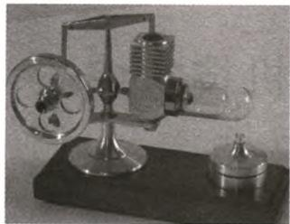  
图1 活塞式斯特林发电机模型

自由活塞斯特林发动机和直线发电机的结合，使两者的性能特点和优势得到充分发挥，但同时两者形成强耦合系统，发电机和发动机的匹配性将直接决定系统热电输出功率和转换效率，甚至影响到系统能否稳定可靠运行，这对直线发电机的特性提出了更高要求。

自由活塞斯特林直线发电机主体结构由自由活塞斯特林发动机和直线发电机两部分耦合而成，如图2所示，并配备自由活塞斯特林发电机控制器。

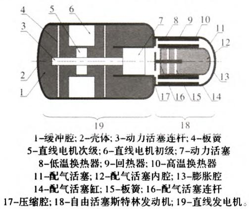  
图2 自由活塞式斯特林发电机结构示意图

自由活塞斯特林直线发动机(以β型结构为例)主要部件包括配气活塞、配气活塞支撑板簧组件、高温换热器(加热器)、回热器、低温换热器(冷却器)、动力活塞，配气活塞顶部与发动机顶部壳体之间空腔称为膨胀腔，配气活塞底部与动力活塞顶部之间空腔称为压缩腔，两腔间存在连通流道，流道内布置有三个热交换器—加热器、回热器、冷却器。加热器和冷却器用于更加有效地加热和冷却工质，使得工质在进入热腔和冷腔之前分别达到热腔和冷腔温度。回热器为储热元件，当工质由热腔流向冷腔时，回热器从工质吸收热量；当工质由冷腔流向热腔时，回热器将热量释放回工质，回热器的这种功能使循环效率大幅提高。通过板簧径向支撑，配气活塞可沿轴向往复运动，使工质在循环回路中往复流动(配气活塞上下端压力近似一致，对外界无功率传递)。工作时，动力活塞前腔(压缩腔)和背腔(缓冲腔)形成大的波动压力差，从而驱动动力活塞往复运动，对外输出机械功。

直线发电机为圆筒形结构，主要部件包括动力活塞连杆、直线发电机初级、直线发电机次级、动力活塞连杆支撑板簧，动力活塞连杆与动力活塞连杆支撑板簧、直线发电机次级、动力活塞固联，共同组成直线发电机运动部件，通过动力活塞连杆支撑板簧的径向支撑可实现该运动部件的往复运动。工作时，自由活塞斯特林发动机的动力活塞带动直线发电机运动部件相对静止的直线发电机初级往复运动，从而实现机械能向电能的转换，电能由直线发电机初级线圈输出。

自由活塞斯特林发动机和直线发电机为耦合系统，系统的稳定运行要求两者具备匹配性。同时为保证系统运行可控，需配备自由活塞斯特林发电机控制器。

## 2 斯特林直线发电机发展历程

1816 年，英国人 Robert Stirling 发明了外部燃烧的闭式循环热空气机，即斯特林发动机，用以替代蒸汽机，以解决当时蒸汽机工作很不可靠，效率极低的问题。在十九世纪中叶，当高效率的内燃机出现后，斯特林发动机的研制工作就停止了。该阶段称为斯特林发动机发展的第一阶段。

1938年，荷兰菲利普(Philips)公司开始了现代斯特林发动机的研制工作，该公司对斯特林发动机技术作了根本性的改革，使斯特林发动机的效率与功率大幅度提高。该公司的第一代斯特林发动机采用菱形传动机构，保证了活塞和活塞杆作直线运动，改进了密封的工作状态，提高了工质的循环压力和循环功；采用传热性好、比重轻和粘度小的氢气或氦气作为工质，显著地提高了热交换器的效率和降低了工质在循环过程中的流动阻力损失，使斯特林发动机的效率提高了50%。此外，该公司还发明了“袜套式密封”装置，为研制高效密封装置开辟了新路。

1958 年，美国 GM(General Motors)公司第一个与菲利普公司签订合同，研制了卫星用太阳能斯特林发动机发电机组和军用3千瓦轻便式“无声”发电机组。

1972年，美国福特汽车公司与菲利普公司合作，共同研制了4-215型斯特林发动机，并装车试用。斯特林发动机最成功的车用成果是由美国能源部资助、NASA管理的“车用斯特林发动机”项目，主要承接商是Mechanical Technology Incorporated(MTI);MTI 与瑞典 United Stirling technology(UST)公司继续进行了四缸双曲轴斯特林发动机的开发，工作一直进行到八十年代中期，发动机效率超过38%，制造成本低于同等柴油机。

其后，作为Philips技术延续，在联合循环发电、生物能应用等方面对斯特林发动机应用的探索仍在进行。UST公司也在继续其斯特林发动机在潜艇中应用的研究。至此，斯特林发动机发展的第二阶段结束。

1970年代，自由活塞斯特林机在陆上发电、热泵、空间能源转换的潜在应用逐渐被认识，但在发展初期研究主要集中在使其可靠运行(而非整机性能)，所有的研究功率水平低于5kW。

在空间应用方面，自由活塞斯特林发电机以其长寿命、高可靠性、高比功率替代了运动式斯特林系统在该方向的应用。上世纪九十年代初期，NASA支持 MTI 公司开展名为 SP - 100 的自由活塞斯特林发电机相关技术研究。项目分为演示验证(SPDE)和关键技术研究(CTPC)两个阶段。采用两配气活塞、两动力活塞，两直线电机，共用同一个膨胀空间，样机功率为25kW(运行温度比为2.0时热转化为电能的效率为20%，高于运行条件类似的其它形式转换装置)，稳定运行寿命超过1500小时。

在同期，NASA-GRC开展了自由活塞斯特林发电机在高效同位素动力系统的应用研究，系统采用四个或八个热源舱(布置在斯特林热头四周)，对置自由活塞斯特林发电机，电能输出为240W或480W，设计功率密度达到8.0W/kg，如图3所示。

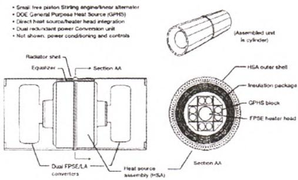  
图 3 1991 年 GRC 研究中的 FPSC 结构

直到1999年，美国Infinia 公司研制的基于非接触运行的10 W自由活塞斯特林发电机可稳定运行超过50000小时，确证了斯特林转换器在深空探测作为长寿命高可靠性动力装置的可能。

2000 年，NASA 和 DOE 支持开展了面向深空探测应用的100 W斯特林同位素发电机(SRG110，放射性同位素热源，两台 55 W斯特林发电机对置安装，全系统比功率约为3.6 W/kg)研究；通过前期的积累，使得对自由活塞斯特林发电系统的研究从先前的自由活塞斯特林发电机单机运行性能和可靠性转向自由活塞斯特林发电系统的系统集成性能。SRG110斯特林发电机结构模型如图4所示，SRG110斯特林发电系统模型如图5所示。

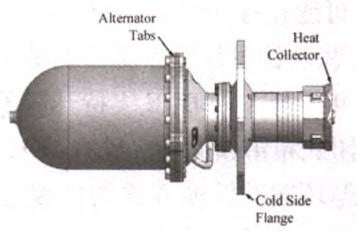

图4 SRG110 斯特林发电机结构模型  
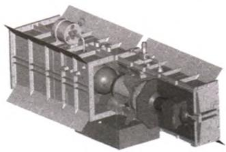  
图 5 SRG110 斯特林发电系统模型

2002年，NASA支持开展“先进斯特林转换器”项目，项目的目标为发展安全、可靠、高效、低质量的斯特林发电机，项目分三个阶段，第一阶段围绕高频运行斯特林发电机开展，通过一年时间，温比3(高温端650℃，低温端35℃)，运行频率达到105Hz，热电效率达到36%；第二阶段主要研究高温(850℃)长寿命运行实现，该阶段也于2006年顺利结题；第三阶段采用整体密封式结构进一步实现高温运行的轻量化设计。项目进一步与SRG110项目结合，成为“先进同位素斯特林发电机(ASRG)”项目(2005年，能源部支持，作为SRG110项目的后续)的一部分，研究表明该新一代同位素斯特林发电机效率超过30%，比功率超过8 W/kg，效率和比功率分别为新一代同位素温差电池(MMRTG)的4\~5倍和3倍。

到2008年，ASRG项目进入集成测试阶段，其测试样机如图6所示，同位素加热用电加热替代，并于2009年通过发射振动试验，而针对自由活塞斯特林发电机(近20台)所进行的大气环境和真空环境运行试验累计时间已超过18万小时。

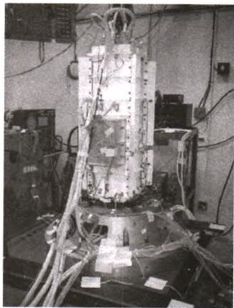  
图6 ASRG 项目集成测试

2004年，NASA提出新一轮登月计划，计划到2018年最长可能在月球停留14天以上，功率需求达到30\~50千瓦。针对月球探测和火星探测的大功率需求，2007年NASA和DOE支持开展了基于自由活塞斯特林、闭式布雷顿循环、PbTe/TAGS温差电池、通用布雷顿循环四种转换方式的核裂变技术的可行性评估，评估认为采用自由活塞斯特林转换方式、NaK冷却剂的UO2堆为最优方式，并且该系统可进一步面向火星探测应用，如图7所示。

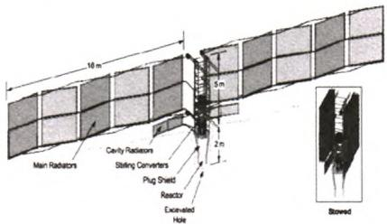  
图7 基于自由活塞斯特林热电转换的空间核电源系统

我国自由活塞斯特林发电机的研究尚处于起步阶段，虽然曲柄连杆式斯特林发动机、斯特林制冷机等已成功应用于我国的若干重大工程系统上，为自由活塞斯特林发电机的研制提供了一定技术参考，但自由活塞斯特林发电机具有其特殊运行条件和运行特性，需要进行针对性研究，特别是对于其系统匹配性设计和系统控制的研究基本处于空白，而在该方面国外也鲜有公开研究文献发表。

## 3 斯特林用直线发电机技术概况

直线发电机及其控制驱动器是自由活塞斯特林热机发电系统的重要组成部分之一，主要功能包括：(1)起动自由活塞斯特林发动机；(2)将自由活塞斯特林发动机工作时发出的机械能转换为电能，并确保电能品质满足要求：(3)配合上级主控制器指令，完成输出功率控制等系统运行调节。

目前自由活塞斯特林发电机的主流结构可分为两类，分别以美国 Infinia 公司(图8)和 Sunpower 公司(图9)为代表。两类结构系统主件和运行原理相同：系统主要由自由活塞斯特林发动机和直线发电机(包含定子和动子(动力活塞组件))两部分组成，两者为同轴结构：在自由活塞斯特林发电机中，靠近冷却器一侧的活塞称为动力活塞，靠近加热器一侧的活塞称为配气活塞，二者为自由活塞斯特林发电机运动部件。配气活塞推动气体在压缩腔和膨胀腔之间来回运动，当气体经过具有温度梯度(由两端高低温换热器建立)的多孔介质回热器时，有效功得以放大，同时气体从高温端吸热，进而推动发电机

## 万方数据

活塞运动，与动力活塞连接在一起的磁体(动磁式)或线圈(动圈式)随之运动产生感生电势，从而具备向外界输出电功的能力。

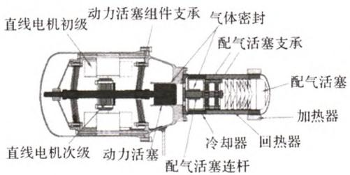

图8 自由活塞式斯特林发电机结构示意图(Infinia 公司)  
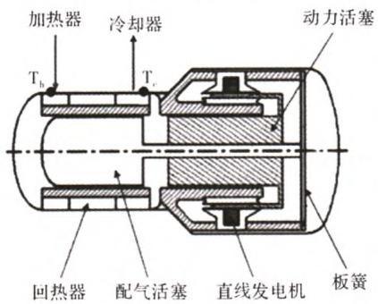  
图9 自由活塞式斯特林发电机结构示意图(Sunpower 公司)

两类结构的差别体现在配气活塞组件和动力活塞组件的支承形式上：在Infinia公司的结构中，发动机和发电机部分相对独立，各自用板簧独立支承；在Sunpower公司的结构中，配气活塞杆穿越动力活塞进入背腔，然后通过板簧支承，在尺寸配合上动力活塞与配气活塞关联在一起。相比较，Infinia结构更简单，易进行各部件的独立设计加工，而Sun-power结构更紧凑，但加工装配复杂，并需采用气体轴承支承。整机的结构差别使得相应的直线电机设计差别较大，并且性能特性也存在较大差异。

Infinia公司开发的斯特林发电机功率从10 W到3 kW不等，热电转换效率介于25%\~40%之间。图10 为 Infinia 公司研发的 3.1 kW 自由活塞斯特林直线发电机斯特林部件图。自由活塞式斯特林发动机活塞作直线运动，推动永磁体往复运动，在线圈中产生感应电流。

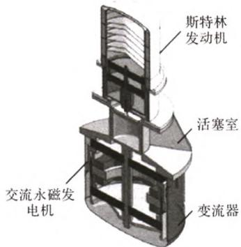  
图10 3.1 kW 自由活塞斯特林直线发电机斯特林部件图

相比旋转电机，直线电机在本体设计和控制上难度都明显增大。在控制方面，由于直线是变速运动，难以采用速度控制方式，只能采用推力控制方式，也就是电流控制方式，根据动子所处位置、速度和运动方向调整绕组中的电流，从而控制推力，通过推力来控制运行的速度和频率。

直线电机按驱动方式不同可分为动圈式、动铁心式和动磁式。美国 Sunpower公司的研究结果表明：动圈式直线电机设计容易，行程易控制，但其磁路气隙小，驱动力较小，效率低，不适宜较大功率应用；动铁心式电机能产生较大的驱动力，但是这种结构动子在气隙中的运动不稳定，容易偏离气隙中心轴线，进而在活塞上产生很大的径向力，这对于期望选择间隙密封的自由活塞斯特林发电机是极为不利的；相比之下，动磁式更宜用于自由活塞斯特林发电机中，动磁式直线电机能够使电机结构更加紧凑，进而能使电机体积更小、动力更大、效率更高，并且无动圈式驱动方式存在飞线问题，可靠性和加工性都得到提高。因此，通常自由活塞斯特林发电机中直线电机采用动磁型式。

在动磁式直线电机中，依据采用的永磁体布置和绕组相数等的不同可进一步分类。其中，依据绕组相数可分为单相和三相动磁式直线电机：与单相电机相比，三相电机在作为电动机运行时可以根据动子位置控制各相电流的大小和相位，从而提供最恰当的驱动力，因此起动性能优于单相方案；另外，由于是三相同时作用，推力的平稳性更好，在运行过程中对推力的控制也更加灵活；在作为发电机运行时三相方案输出的电压纹波更小，电能质量更好。三相方案的不足是电机本体和控制器的结构比单相方案复杂，成本较高。

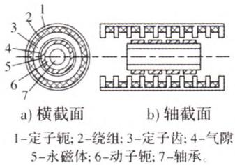  
图11 圆筒型永磁直线发电机示意图

国内的浙江大学、哈尔滨工业大学等研究学者近年来也对斯特林直线发电机做了相关研究。圆简型永磁直线发电机的示意图如图11所示。哈尔滨工业大学提出的圆筒型斯特林直线发电机如图12所示，并正在进行相关深入研究；中国科学院贾红书等人提出一种动线圈式斯特林直线发电机，对该种

## 万方数据

发电机的输出特性进行了相关研究和测试，其结构如图13所示，设计的动圈式发电机的输出系统效率最高为 20%。

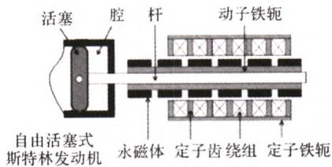  
图12 斯特林发动机-圆筒型永磁直线发电机结构图

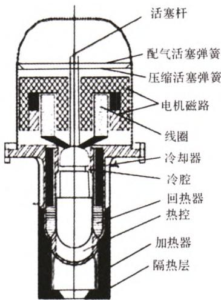  
图13 动圈式自由活塞斯特林发电机结构

## 4 结 语

自由活塞斯特林发动机和直线发电机的结合，使两者的性能特点和优势得到充分发挥，自由活塞斯特林发电机是具有强耦合、非线性、大惯性、参数时变和不确定因素的典型复杂系统。目前国内外尚未有明确的自由活塞斯特林发电机控制系统目标、结构与策略体系。针对斯特林-直线发电机的研究工作，对于完成高效、高比功率、高可靠运行的自由活塞斯特林发电机的理论研究和样机研制都具有重要意义，从而为自由活塞斯特林发电机应用到空间、水下、地面太阳能应用等领域奠定决定性基础。

## 参考文献

[1 ] Neill Lane. Commercialization Status of Free-Piston Stirling Machines[ C ]. Durham: 12th International Stirling Engine Conference, 2005: 1-2.

[2] 李丰，陈鸿伟.斯特林发动机在能源利用领域中的应[J]. 能源研究与利用，2006(4)：30-32.

[3] Lewandowski, et al. Stirling System Modeling for Space Nuclear Power Systems[C]. NASA/CR-2008-215146, 2008: 14-18.

(下转第16页)

后，各阶固有频率显著增加，对比机座加入端盖，接线盒的加入几乎没有对机座的固有频率产生影响，也就是说接其质量和刚度对于固有频率的影响相互抵消了。接线盒的内部结构复杂，仿真中不容易准确建模，但介于它对机座振动贡献很小，因此在计算机座固有频率时可以忽略。

再来观察约束底脚后对机座固有频率的影响，约束底脚后将会使电机整体刚度大大增加，与无约束的情况相比固有频率要显著增加，通过仿真发现其振型除了底脚变化外基本与模型V类似且形变的程度不是很大。三、四阶模态固有频率值为：885.77 Hz 和1351.7 Hz。

## 3 结论

本文以一台变频起动永磁同步电动机的机座为研究对象，建立了电机机座各结构部件的三维有限元仿真模型并进行了模态分析，经分析研究得出了以下结论：

(1)电机机座上各结构部件的低阶径向模态阵型基本相同，其二到四阶阵型分别近似为椭圆形，三角形和四边形等，与理论研究结果一致。且在同一阶模态下，机座各部件沿轴向方向前后均会出现对称和反对称的阵型。

(2)电机机座上的散热筋和底脚会使机座各阶对应的固有频率降低，而端盖会使其各阶的固有频率显著增加，接线盒对机座的固有频率影响不大，

(上接第11页)

[4] 周志宏. 直线发电机的方案设计—自由活塞式内燃直线发电机研究进展(二)[J]. 石油机械，2003，31(11)：62-64.

[5] Thieme G.. Stirling Technology Development at NASA GRC[ C]. NAS 1. 15: 211315; NASA/TM-2001-211315, E-13119, 2001： 14.

[6] Ezekiel Holliday, Douglas E Keiter. Control Electronics for Palm Power 35W Free-piston Stirling Engine[ J]. 2005(8) : 1-4.

[7] M Hendrickson, T Podlesak, J Huth. Stirling Engines for Military Applications[ C]. IECEC 2005, San Francisco, CA August 2005, currently in process of publication: 1-5.

[8] 陈刚. 混合动力车用自由活塞横向磁通永磁直线发电机的研究[D]. 哈尔滨：哈尔滨工业大学，2009：40-50.

[9]肖翀，左正兴. 自由活塞式内燃发电机动态仿真与特性分析[J]. 农业机械学报，2009(02)：46-49.

在约束底脚和不约束底脚情况下，电机机座的各阶模态阵型除在底脚处不同外，其它地方阵型相似，但前者会使机座固有频率显著增加。

## 参考文献

[1] 吴建华. 基于物理模型开关磁阻电机定子模态和固有频率的研究[J]. 中国电机工程学报，2004，24(8)：110-114.

[2] 王宏华，王治平，江泉. 开关磁阻电机固有频率解析计算[J].中国电机工程学报，2005，25(12)：133-137.

[3] 孙剑波，詹琼华，黄进，等.开关磁阻电机的定子振动模态分析[J]. 中国电机工程学报，2005，25(22)：148-152.

[4] 王天煜，王凤祥，大型异步电动机定子振动与模态分析[J].中国电机工程学报，2007，27(12)：41-45.

[5] 王旬，邱阿瑞.大中型异步电动机定子模态的仿真分析[J].大电机技术，2010，26(9).

[6] Cai Willimam, Pillay P. An Investigation into Vibration in Switched Reluctance Motors [ J]. IEEE Trans. on Industry Application, 1999, 35(3): 589-596.

[7] Long S A, Zhu Z Q, Howe D. Vibration Behavior of Stators of Switched Reluctance Motors [J]. IEEE Proc. on Electrical Power Application, 2001, 148(3): 257-264.

[8] 莫岳平，胡敏强，徐志科，等. 超声波电机振动模态有限元分析[J]. 中国电机工程学报，2002，22(11)：92-96.

[9] Ishibashi F, Kamimoto K, Hayashi T. Natural Frequency of Stator Core of Small Induction Motor[J]. IEEE Proc. on Electrical Power Application, 2003, 150(2): 210-214.

{ 10] Cai Willimam, Pillay P , Omekanda . Analytical Formulae for Calculating SRM Modal Frequencies for Reduced Vibration and Acoustic Noise Design[ C]. IEEE-IEMDC Boston, 2011: 203-207.

[10] 黄程伟. 基于 Stirling 循环的直线发电系统概念设计及仿真[D]. 哈尔滨：哈尔滨理工大学，2009：30-50.

[11] Wood J G, Carroll C. Advanced Stirling Convertor Program Update [ C]. Proceedings of the 2nd International Energy Conversion Engineering Conference, 2004: 1-2.

[ 12] Hew W P, et al. Fabrication and Testing of Linear Electric Generator for Use with A Free-piston Engine[ C ]. National Power Engineering Conference, 2003: 3-5.

[13] Geng S M, et al. Overview of NASA Magnet and Linear Alternator Research Efforts[ C]. NASA Glenn Research Center, 2005: 20.

[14] Raymond L Kirby, Nick Vitale. Update on Development of a Control System for a 5 Kilowatt Free Piston Stirling Engine Convertor [ J ]. American Institute of Aeronautics and Astronautics, 2008：5761.
