Article

# Thermal Management System Optimization for a Parallel Hybrid Aircraft Considering Mission Fuel Burn

Eytan J. Adler \*①, Benjamin J. Brelje ① and Joaquim R. R. A. Martins ①

MDO Lab, University of Michigan, Ann Arbor, MI 48109, USA; bbrelje@umich.edu (B.J.B.); jrram@umich.edu (J.R.R.A.M.)

\* Correspondence: eytana@umich.edu

Citation: Adler, E.J.; Brelje, B.J.; Martins, J.R.R.A. Thermal   
Management System   
Optimization for a Parallel Hybrid Aircraft Considering Mission Fuel Burn. Aerospace 2022, 9, 243.   
https://doi.org/10.3390/   
aerospace9050243

Academic Editor: Dimitri Mavris

Received: 8 March 2022   
Accepted: 22 April 2022   
Published: 26 April 2022

Publisher's Note: MDPI stays neutral with regard to jurisdictional claims in published maps and institutional affiliations.

Abstract: Electrified aircraft propulsion enables new aircraft designs with fewer emissions. One challenge of electrified architectures is handling the electrical components' waste heat. This is because batteries and other electrical components are sensitive to high temperatures and accumulate heat within their structure. In this work, we investigate using a thermoacoustic refrigerator to cool the battery of a parallel hybrid single-aisle commercial transport aircraft. This thermoacoustic refrigeration system is powered by waste heat from the turbofan engine core, whereas a conventional refrigerator consumes electricity from the battery or shaft power offtakes. Compared to a conventional vapor cycle refrigerator, the thermoacoustic refrigeration system results in greater mission fuel burn because of pressure losses attributable to the extraction of heat from the turbofan to drive the thermoacoustic refrigerator. Heat exchangers with very low pressure losses may render the thermoacoustic refrigeration system beneficial compared to conventional refrigeration in certain use cases, such as low-altitude missions.

Copyright: © 2022 by the authors. Licensee MDPI, Basel, Switzerland. This article is an open access article distributed under the terms and conditions of the Creative Commons Attribution (CC BY) license (https:// creativecommons.org/licenses/by/ 4.0/).

Keywords: aircraft design optimization; hybrid-electric propulsion; thermoacoustic refrigeration; parallel hybrid turbofan; thermal management system

## 1. Introduction

Environmental impact is an increasingly important factor in designing next-generation transportation systems. The aerospace industry has begun transitioning to zero-emission technologies in small pockets, focusing primarily on electrification. Batteries and hydrogen have received the most attention as sources of energy. Companies such as magniX and Joby Aviation have successfully flown fully electric, battery-powered aircraft. Other ventures such as ZeroAvia have flight-tested hydrogen fuel cell aircraft.

Eliminating the emissions of turbofan-powered commercial airplanes is particularly challenging. All-electric designs are not feasible for most commercial missions because batteries do not have high enough specific energy for these weight-sensitive long-range and high-capacity flights. Alternative fuels, such as hydrogen, are challenging because they require extensive modifications to the architecture and overall form of existing aircraft, which are already highly optimized.

One potential option to decrease (but not eliminate) fuel burn is to partially electrify commercial aircraft using a hybrid propulsion architecture. This approach replaces some of the shaft power originally generated by combustion with electric power and some of the fuel with batteries. The parallel hybrid propulsion architecture, shown in Figure 1, has garnered interest from Boeing, NASA, Rolls Royce, and United Technologies [1,2]. Bradley and Droney [1] investigated a parallel hybrid single-aisle concept for the 2030–2035 timeframe, known as the Boeing SUGAR Volt. GE Aviation and Safran have partnered on the CFM RISE program, which includes the development of hybrid-electric engines [3]. NASA, GE Aviation, Boeing, and Aurora Flight Sciences plan to flight test a hybrid-electric propulsion system in the mid-2020s [4,5]. Electra.aero is designing and building a hybrid-electric short takeoff and landing aircraft [6].

In a parallel hybrid turbofan, electrical and combustion power contribute power to the fan's shaft. This allows the electric propulsion subsystem to scale with the hybrid power used. The parallel hybrid can be more weight- and cost-efficient than the alternative series-hybrid design, which requires electric propulsion sized to the full propulsive power of the airplane even when fuel is the primary energy source [7].

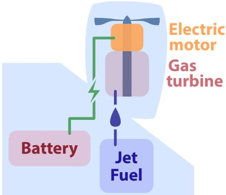  
Figure 1. Parallel hybrid propulsion architecture.

While it may help to decrease fuel burn, a hybrid architecture introduces thermal management challenges. Unlike a conventional turbine engine that exhausts waste heat into the freestream, batteries and electric motors accumulate waste heat within their structure. Furthermore, the operating temperatures of electric propulsion components are very modest compared to turbine exhaust. If ambient conditions are warm (e.g., at a low altitude on a hot day), it may not be possible to keep component temperatures sufficiently low without refrigerating the coolant. A lightweight and efficient thermal management system (TMS) is critical to reaping the benefits of electrification.

## 1.1. Review of Thermal Management Architectures and Modeling Approaches

There are two general design approaches to aircraft thermal management systems: direct air cooling and liquid cooling. The air-cooled approach uses heat sinks to enhance the convection from each electrical component to freestream air. The X-57 Maxwell demonstrator uses this approach [8–10]. An advantage of this approach is system simplicity and reliability. A significant disadvantage is that each electrical component requires direct access to an airflow path, increasing configuration complexity and potentially increasing drag.

The liquid-cooled approach uses coolant loops to transfer heat from the electrical components throughout the aircraft to a heat exchanger that can reject the heat into the air [11]. This approach usually reduces the number of cooling air ducts. Liquid cooling can be feasible when direct air cooling is not, especially for high-power-density components such as high-power fuel cell stacks [12]. Liquid-cooled systems may also optionally use a refrigeration cycle to improve heat rejection. However, the liquid cooling architecture is arguably a more complex system design (with more failure modes and moving parts). Some aircraft may use a combination of liquid cooling and direct air cooling.

The more recent industry-funded electric aircraft demonstrators have tended to be liquid-cooled. The Pipistrel Velis Electro uses a liquid-cooled battery and motor TMS. The motors used by magniX in the Cessna Caravan and DeHavilland Beaver demonstrators (magni250 and magni500) also use liquid cooling. The more recent Siemens (now Rolls-Royce) motors have also been liquid-cooled, including the SP200D used on the CityAirbus and the SP260D used in the Extra 330LE demonstrator. Finally, the European Hy4 fuel cell demonstrator uses a liquid-cooled architecture, including a prominent ducted heat exchanger reminiscent of the P-51. Liquid cooling is used in electric ground vehicles as well, such as the Tesla Model 3 (for the motors and battery) [13].

Detailed NASA design study results have been published for the X-57. Clarke et al. [14] described wire design trade studies, including resistive heating considerations.

Schnulo et al. [9] described the design and analysis of a flow-through air-cooled motor and inverter. Falck et al. [8] described trajectory optimization subject to thermal constraints; the study found that X-57's air-cooled motors reach temperature limits and constrain the climb rate. The heat exchanger area can be reduced significantly if climb rate requirements are relaxed. Edwards and Smith [10] designed and tested a direct air-cooled sink for the X-57's low-power high-lift motors and power electronics that conforms to the outer nacelle line (omitting fins).

In industry, ESAero has published most extensively on the thermal management of conventional electrical machines. Freeman et al. [15] described the general electric propulsion thermal management design problem, analysis methods, and solutions. These methods were used to design and analyze the ECO-150R [16]. The ECO-150R produces nearly 1.5 MW of waste heat at the critical top-of-climb condition. The authors described the design and analysis of a recirculating liquid cooling system with a ram-air radiator. The radiator is designed to use heated air to generate some thrust to offset the radiator drag. This strategy has been referred to as the Meredith effect (after a North American Aviation P-51 Mustang designer, the first aircraft to demonstrate the phenomenon). Including the Meredith effect, the direct cooling system contribution to drag was around 2–3% at cruise. The total cooling system was 20% of the weight of all the power electronics and motors.

United Technologies created a parallel hybrid geared turbofan (GTF) engine concept, including a sized liquid cooling system [11]. The critical condition was on a hot day before takeoff; a fan was required to pull cooling air through the radiator duct until sufficient ram air became available in flight. The authors concluded that once weight and drag increases from the TMS were included, the concept was not competitive with a conventional GTF. The paper included a design sensitivity of TMS weight with maximum battery temperature; heat-sensitive batteries require more cooling power and weight. A Rolls-Royce/Georgia Tech study of a parallel hybrid engine similarly identified the challenge of cooling the batteries and that the TMS was thermally constrained by air temperatures on a hot day before takeoff [17]. Vratny et al. [18] presented analytic equations for the conceptual design of an electric aircraft TMS, including a rough consideration of liquid coolant properties (density, viscosity, and specific heat capacity).

The work of the NASA team of Chapman et al. [19] modeled ducted heat exchangers for a light aircraft, but, like the earlier work by Schnulo et al. [9], the codebase for this project is not publicly available. Bell and Litt [20] developed thermal models of similar fidelity in the MATLAB/Simulink ecosystem. Byahut and Uranga [21] modeled the propulsion system of an all-electric Twin Otter aircraft considering thermal management weight including the effect of system voltage and the insulator thickness on the wiring. However, this project did not consider unsteady thermal profiles and sized the TMS for the climb condition only.

## 1.2. Efficient Thermal Management for a Parallel Hybrid Transport Aircraft

NASA is actively exploring the possibility of a 1 MW-scale electric propulsion flight demonstrator intended to ease the path toward the electrification of commercial aircraft. A particularly inventive concept for thermal management has been proposed as part of NASA's electrification push. Known as the Thermal Recovery Energy Efficient System (TREES), the concept exploits thermoacoustics to provide refrigeration without additional power consumption or moving parts [22,23]. The TREES thermal management system works by extracting waste heat from the core exhaust of the gas turbine and converting it to mechanical power in the form of acoustic energy using a thermoacoustic engine. The acoustic energy is transmitted to a chiller through an array of inert-gas tubes. The acoustic energy then drives the thermoacoustic chiller, which supplies coolant below ambient temperature to the aircraft's electrical components. The bulk of the thermoacoustic refrigeration system's mass and size is made up of the acoustic tubes to transport acoustic energy around the aircraft. These tubes may be able to be directly integrated into the aircraft's primary structure [24], resulting in no additional mass or aerodynamic penalty.

The sensitivity of the conclusions to this assumption is investigated further in Section 3.1.2 by varying the additional tube weight from the best- to worst-case value and reoptimizing the aircraft.

Thermoacoustic chillers are not new to the aerospace industry. Thermoacoustic cooling systems (often called pulse tube cryocoolers) are a popular choice for space telescope cryocoolers, including the James Webb Space Telescope [25], because they have few moving parts and are cryogen-free [26]. This makes them reliable and low-maintenance. These benefits also apply to TREES because it employs the same core concept, adding to the desirability of the system.

An alternative possibility for providing chilled coolant is to use a more conventional chiller, such as a vapor cycle system (VCS). While based on well-established technology, a thermal management architecture based on vapor cycle refrigeration consumes additional electrical power, which compounds the energy storage challenge.

## 1.3. Objectives

The primary purpose of this study is to assess the performance of the TREES concept compared to a more conventional TMS architecture using a vapor cycle chiller. There are two secondary objectives: first, to compare hybrid-electric aircraft performance to a conventional aircraft with similar technological assumptions; second, to develop OpenConcept models and methods sufficient for NASA to perform system sizing and optimization for the single-aisle hybrid demonstrator program.

## 2. System Description and Methods

This section describes a series of three aircraft designs developed and analyzed for this study. The designs share many common elements but have significant differences in their propulsion and thermal management systems. Each design is based on a single-aisle transport aircraft conceptually similar to the Boeing 737–800, but uses advanced technology equivalent to 2030 or beyond. NASA has internally referred to this technology generation as "N+3". Such an aircraft carries approximately 180 passengers with their baggage and potentially additional cargo. The three concepts are the following:

1. N+3 Conventional: single-aisle airframe with advanced technology GTFs and no hybrid propulsion system. This represents the baseline N+3 aircraft attained by continuing to refine existing technology.

2. Vapor cycle hybrid: single-aisle airframe with advanced technology GTFs, each with 1 MW hybrid-electric boost and a vapor cycle chiller. This is a representative parallel hybrid aircraft with a conventional thermal management system against which we can compare the TREES architecture.

3. TREES hybrid: single-aisle airframe with advanced technology GTFs, each with 1 MW hybrid-electric boost and the TREES thermoacoustic chiller system driven by engine waste heat recovery.

In the absence of historical trends, we use bottom-up computer modeling and simulation to estimate aircraft performance. We use a software framework called Open-Concept: https://github.com/mdolab/openconcept (accessed on 23 April 2022) [27,28]. OpenConcept is an open-source aircraft conceptual design toolkit built with electric aircraft and optimization in mind. It includes efficient gradients with respect to design variables (which enables fast and accurate multidisciplinary design optimization), as well as a library of components for electric aircraft, such as batteries, electric motors, and thermal management systems.

## 2.1. Concept of Operations

Current single-aisle aircraft such as the A320neo and 737 MAX can fly commercial missions well over 3000 nmi, sufficient for transcontinental and even some trans-Atlantic flights. However, only a small fraction of flights use the full range of the aircraft. The median commercial flight in the United States is less than 1000 nmi, so most single-aisle aircraft operating in the United States take off below the maximum takeoff weight (MTOW). If a modular battery system could be developed, aircraft could use the excess takeoff weight capacity to store energy when flying non-range limited flights. For this study, we examine missions centered around 800 nmi with a 20,000 kg payload (accounting for about 180 passengers and associated baggage). We assume that the airplane remains sized for a non-hybrid long-range mission to preserve operational flexibility.

While conventional aircraft must refuel, unload and load baggage, and disembark and embark passengers at each airport turn, an electric aircraft may also need to refrigerate or pre-chill its electrical components in preparation for the takeoff run. To account for this, most of our mission analyses account for a “chilldown" procedure where the aircraft prechills its batteries to $3 5 ^ { \circ } \dot { C }$ (down from the maximum of 45 °C) by landing. This chilldown procedure incurs a cost in fuel burn, battery energy, or both. Some sensitivity studies were performed without considering chilldown, and this is noted when applicable below.

## Airframe and Weights

Because airframe design is not the focus of this trade study, the N+3 conventional and hybrid airplanes all use the aerodynamic and structural weight characteristics of the 737–800. We use a quadratic drag polar based on an empirical drag polar of the 737–800 found in Nita and Scholz [29]. Empty weight data for the 737–800 are based on publicly available data [30]. The 737–800 aerodynamic and weight data are listed in Table 1. We assume no change in the N+3 conventional operating empty weight (OEW) due to two offsetting effects: the 737–800's aluminum airframe could be lightened with judicious use of composite materials, but the higher bypass ratio (BPR) N+3 engine and installation is heavier than the 737–800's CFM56 turbofans. We also assume no change in the baseline drag polar, again due to offsetting effects of incremental aero improvements and higher installation drag for the higher BPR engine. However, for the hybrid airplanes, empty weight and drag increments attributable to the hybrid propulsion and thermal management systems are added on top of the baseline OEW and drag.

Table 1. Boeing 737–800 aerodynamic and weight data [29,30]. Takeoff zero lift drag coefficient is factored up from cruise zero lift drag coefficient using engineering judgment and Raymer [31].
<table><tr><td>Quantity</td><td>Value</td></tr><tr><td>Oswald efficiency</td><td>0.801</td></tr><tr><td>Zero lift drag coefficient (takeoff)</td><td>0.03</td></tr><tr><td>Zero lift drag coefficient (cruise)</td><td>0.01925</td></tr><tr><td>Maximum lift coefficient (takeoff)</td><td>2.0</td></tr><tr><td>Operating empty weight</td><td>92,310 lbs</td></tr><tr><td>Maximum takeoff weight</td><td>174,170 lbs</td></tr><tr><td>Maximum landing weight</td><td>146,275 lbs</td></tr><tr><td>Maximum fuel weight</td><td>46,329 lbs</td></tr></table>

## 2.2. Propulsion

The propulsion system begins with the N+3 geared turbofan engine for all airplanes. The N+3 turbofan is a NASA concept for a conventional (non-hybrid) geared turbofan with 2030-level technology, sized for a single-aisle airplane [32,33]. The VCS aircraft adds a parallel hybrid system to the N+3 GTF where a 1 MW electric motor contributes power to the low-speed shaft. To the VCS aircraft's engine, the TREES aircraft adds heat exchangers in the turbofan's core and bypass, extracting the heat to generate 10 kW of thermoacoustic power. These heat exchangers incur total pressure losses. Including TREES also transfers heat from the core to the bypass, slightly recuperating the cycle.

The heat transfer and pressure loss characteristics of the TREES core exhaust heat exchanger are based on pre-publication computational fluid dynamics (CFD) data for a Jet Propulsion Laboratory (JPL) design. This exchanger array captures about 10% of the exhaust mass flow (11% in the JPL data at a slightly higher mass flow rate than our model).

The captured air undergoes a 10% total pressure loss inside the heat exchanger (10.6% in the JPL model). The JPL model predicts a heat transfer of 36.7 kW from the core exhaust. This produces approximately 10 kW of acoustic power at the predicted temperatures and efficiencies. Therefore, the TREES model uses a 10% mass capture ratio, 10% total pressure loss of the captured mass, and 10 kW acoustic power production—each of these is a slightly optimistic rounding from JPL data. Unfortunately, no data are available at the time of this publication for the bypass heat exchanger. We assume 0.25% total pressure loss overall and conduct a sensitivity analysis addressing this assumption in Section 3.1.1.

The engines are modeled in pyCycle [32]; the source code is available at https:// github.com/OpenMDAO/pyCycle/tree/3.2.0/example\_cycles/ (accessed on 23 April 2022). pyCycle is an open-source software package developed by NASA that enables gradient-based modeling and the optimization of gas turbine engine cycles. pyCycle is built using the OpenMDAO framework (https://openmdao.org/; accessed on 23 April 2022) [34], which facilitates analytic derivative calculations for efficient optimization. It uses a modeling approach similar to NASA's Numerical Propulsion System Simulation (NPSS). However, it provides more accurate gradient information for optimization in three orders of magnitude less computation time because of its analytic derivatives.

## 2.2.1. Optimization Problem

Parallel hybrid propulsion systems primarily benefit from directly replacing fuel energy with electrical energy. However, there may also be benefits at the corners of the flight envelope that result in a more efficient thermodynamic cycle at the cruise condition [11]. To capture this effect, we solve the engine cycle design optimization problem of the N+3 accounting for hybrid power and thermal management effects for the TREES concept. The existing pyCycle model contains a multi-design point (MDP) optimization problem definition for the N+3. MDP signifies that performance requirements at off-design conditions constrain the engine cycle design. The cycle design consists of design flow rates, BPR, and turbomachinery pressure ratios, such as the low-pressure compressor (LPC) pressure ratio and the overall pressure ratio (OPR) (which, in this parameterization, sets the highpressure compressor pressure ratio). In the case of the N+3 GTF, there are minimum thrust specifications for the top of climb (TOC), cruise (CRZ), sea-level static (SLS), and rejected takeoff (RTO), as outlined in Table 2. The design point (where design pressure ratios and mass flows are matched) is the TOC point.

Table 2. Operating points for the N+3 hybrid engine design problem.
<table><tr><td>Condition</td><td>Mach</td><td>Altitude (ft)</td><td>Thrust Required (lb)</td></tr><tr><td>RTO</td><td>0.25</td><td>0</td><td>22,800</td></tr><tr><td>SLS</td><td>0.0</td><td>0</td><td>28,621</td></tr><tr><td>Cruise</td><td>0.8</td><td>35,000</td><td>5510</td></tr><tr><td>TOC (design)</td><td>0.8</td><td>35,000</td><td>6200</td></tr></table>

We slightly modify the original optimization problem parameterization for clarity, defining the engine design problem as listed in Table 3. In all three cases, we use the SNOPT optimizer and OpenMDAO's pyOptSparse wrapper [34–36].

## 2.2.2. Optimized Engine Designs

The optimized engine design parameters are listed in Table 3. The optimal design for the conventional engine in Table 3 differs slightly from the baseline cycle in the N+3 paper [33] because the paper uses a manual procedure to select the final design. Despite a significant hybrid boost at sea-level conditions, which reduces $T _ { 4 }$ (the temperature at the end of the combustor and start of the turbine) markedly, the VCS hybrid engine reduces cruise fuel burn (hybrid power off) by only 0.37% compared to the optimized conventional design. This modest cycle-only improvement may reflect that the baseline engine is not temperature-limited at the RTO and SLS conditions, thus reducing the value of temperature reductions at those conditions. The TREES turbofan burns 1% more fuel than the N+3 conventional baseline. The modest benefits from hybridization at off-design conditions plus recuperating heat from the exhaust are outweighed by the pressure losses caused by the heat exchangers.

Table 3. Optimization definition and results for the N+3 engine MDP problem. Bold numbers indicate that bounds are active.
<table><tr><td colspan="2"></td><td>Units</td><td>Lower</td><td>Upper</td><td>Optimum (Conventional)</td><td>Optimum (Hybrid VCS)</td><td>Optimum (Hybrid TREES)</td></tr><tr><td>minimize</td><td>CRZ fuel burn</td><td>lb/s</td><td></td><td></td><td>0.6652</td><td>0.6627</td><td>0.6711</td></tr><tr><td rowspan="9">with respect to</td><td> $\mathrm { f a n P R _ { \mathrm { d e s } } }$ </td><td></td><td>1.2</td><td>1.4</td><td>1.307</td><td>1.308</td><td>1.310</td></tr><tr><td> $\mathrm { L P C P R _ { d e s } }$ </td><td></td><td>2.5</td><td>4.0</td><td>4.0</td><td>4.0</td><td>4.0</td></tr><tr><td>OPR</td><td></td><td>40</td><td>70</td><td>64.54</td><td>65.71</td><td>65.77</td></tr><tr><td> $V _ { \mathrm { b y p a s s } } / V _ { \infty }$ </td><td></td><td>1.35</td><td>1.45</td><td>1.35</td><td>1.35</td><td>1.35</td></tr><tr><td> $\mathrm { B } \mathrm { \bar { P } } \mathrm { \bar { R } } \mathrm { \ a t \ T O C }$ </td><td></td><td>17.0</td><td>24.5</td><td>19.53</td><td>19.66</td><td>19.65</td></tr><tr><td> $\dot { m } { \mathrm { ~ a t ~ T O C ~ } }$ </td><td>lb/s</td><td>780</td><td>850</td><td>810.92</td><td>810.92</td><td>810.92</td></tr><tr><td> $P _ { m } \mathrm { a t R T O }$ </td><td>kW</td><td>0</td><td>1000</td><td></td><td>1000</td><td>1000</td></tr><tr><td> $P _ { m } \mathrm { a t } \mathrm { S L S }$ </td><td>kW</td><td>0</td><td>1000</td><td></td><td>1000</td><td>1000</td></tr><tr><td> $P _ { m } \mathrm { a t T O C }$ </td><td>kW</td><td>0</td><td>1000</td><td></td><td>0</td><td>0</td></tr><tr><td rowspan="3">subject to</td><td> $T _ { 4 } \mathrm { a t R T O }$ </td><td>R R</td><td></td><td>3400 3230</td><td>3176 2932</td><td>3097 2927</td><td>3116</td></tr><tr><td> $T _ { 4 } \mathrm { a t T O C }$ </td><td></td><td></td><td>100</td><td>100</td><td>100</td><td>2945</td></tr><tr><td> $d _ { \mathrm { f a n } }$ </td><td>inch</td><td></td><td></td><td></td><td></td><td>100</td></tr></table>

The TREES hybrid N+3 engine has a total of three changes compared to the N+3 conventional engine:

1. An electric motor provides up to 1 MW power to the fan shaft.

2. 10 kW thermoacoustic power is generated by extracting heat from the core exhaust and transferring it to the bypass duct (thus slightly recuperating the cycle).

3. Heat exchangers in the core exhaust and fan bypass ducts incur total pressure losses.

Figure 2 shows the full-throttle thrust of the optimized, conventional N+3 turbofan across a variety of flight conditions. Maximum thrust at each operating point is limited by the shaft speed of each spool and $T _ { 4 } .$ As expected, the thrust lapses quickly with speed and altitude.

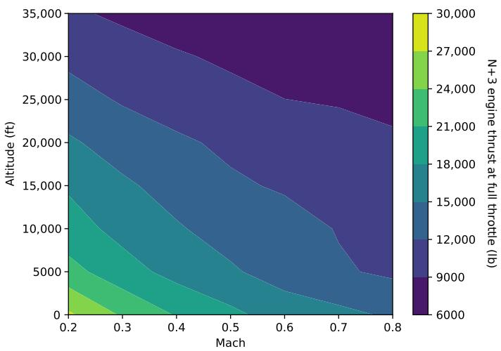  
Figure 2. The maximum thrust of the N+3 engine decreases quickly with increasing speed and altitude. The maximum thrust values are constrained by spool shaft speed and turbine inlet temperature limits.

Figure 3 shows the thrust-specific fuel consumption (TSFC) of the optimized hybrid engine approximately at cruise throttle (90%) with zero electrical power. At the cruise condition $\mathsf { \bar { ( } M = 0 . 8 , 3 5 , 0 0 0 f t }$ altitude), the TSFC is significantly better than the 737–800's

CFM56-7 engine, which is two generations behind in technology. Off-design effects of hybridization result in a slight improvement in fuel burn compared to the non-hybrid N+3 engine.

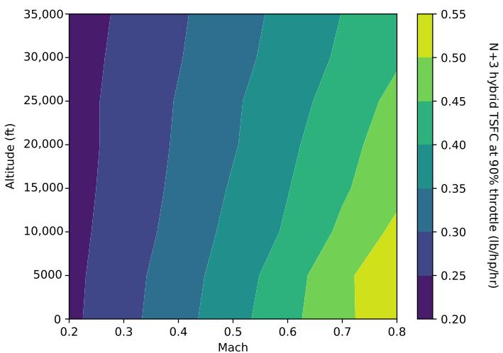  
Figure 3. Thrust-specific fuel consumption of the optimized parallel hybrid N+3 at cruise throttle (90%) and zero electrical power input to the electric motor.

Adding hybrid power reduces fuel consumption significantly. Figure 4 shows that 10–25% TSFC savings at a given thrust level is achieved with 1 MW hybrid power. The relative fuel burn benefit is more pronounced at lower throttle settings.

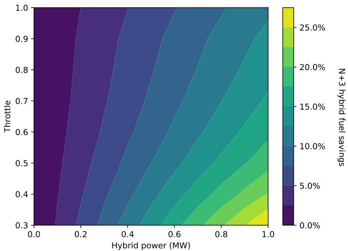  
Figure 4. Compared to the fuel burn with electrical power off shown in Figure 3, adding electric power to the parallel hybrid N+3 engine's electric motor reduces fuel burn by up to 25%. The flight condition in this plot is cruise at M = 0.8 and 35,000 ft.

## 2.2.3. Integration into Aircraft Model

Directly incorporating the pyCycle model of the optimized engine in OpenConcept is not feasible for two reasons. Firstly, pyCycle uses a Newton solver to converge the systems of equations defining the model and thus requires good guesses of the thermodynamic states at each station if reliable convergence is to be achieved. OpenConcept feeds dramatically different flight conditions to the engine model as it converges, which has a high likelihood of causing pyCycle itself to fail to converge. Secondly, pyCycle is relatively expensive to compute per flight condition compared to the rest of OpenConcept's models.

Instead of coupling pyCycle to OpenConcept directly, we use a surrogate modeling approach. We generate an “engine deck" for the conventional and hybrid N+3 engines by computing fuel flow, thrust, and surge margins at a full-factorial grid of flight conditions.

The independent variables on the grid are altitude, Mach number, and throttle. The hybrid engine includes the hybrid-electric power setting as a fourth variable. Generating the deck with pyCycle is a one-time expense—a few hours on a desktop computer. After generating the deck, we fit a surrogate model to the data using the kriging method. Kriging allows OpenConcept to query the engine model by interpolating between points in the engine deck.

## 2.3. Thermal Management System

The parallel hybrid aircraft concepts add electrical components (battery, motor, and fault protection) to the system that require cooling to maintain at acceptable temperatures. Past studies have shown that the thermal management system can increase fuel burn by as much as 5% depending on the mission, aircraft size, and hybridization approach [11,28,37–43]. This increase in fuel burn may be on the same order of magnitude as the fuel savings from switching to a hybrid propulsion architecture, so it is vital to consider the TMS's effects at the system level. This section discusses the architectures of the two thermal management systems we investigate: the vapor cycle chiller and the TREES architecture.

To model each TMS and perform the mission analysis, we use OpenConcept, a software toolkit developed for mission analysis of electric and hybrid-electric fixed-wing aircraft. Similar to pyCycle, it is built using the OpenMDAO framework [34].

OpenConcept is the first publicly-available electric propulsion mission analysis code to include thermal analysis, which is necessary for capturing the critical constraints of electrified aircraft. Over time, we have added more detailed thermal analysis capabilities, including unsteady thermal components and active refrigeration.

To enable the analysis of unsteady components, as well as other features of the toolkit, OpenConcept includes an efficient ordinary differential equation (ODE) integration scheme. For performance, OpenConcept uses vectorized computations in each mission segment, meaning that time-marching ODE integration approaches cannot be used (because vectorized quantities must be computed all at once). Instead, OpenConcept uses an implementation of Simpson's Rule for numerical integration [44].

The synthesis of detailed aircraft models, time-dependent thermal management systems, and mission analysis gives OpenConcept a unique aircraft design ability: it can optimize the aircraft component sizing (in particular the TMS), time-dependent control of the TMS (e.g., refrigeration power setting), and mission profile while considering unsteady constraints such as battery temperature. OpenConcept captures the coupled interaction between these design factors to find a truly optimal design, something that sequential optimization of the mission profile and TMS design is unable to do.

## 2.3.1. VCS Aircraft

The vapor cycle thermal management system, shown in Figure 5, actively cools the battery with a VCS chiller and passively cools the electric motor and its fault protection. This system is duplicated for each side of the airplane.

The battery cooling uses a bandolier system [13] with parallel liquid coolant ribbons passing through the battery array. We assume each coolant ribbon is 21 battery cells long, and the battery cells are 2170 lithium-ion cells (21 mm diameter, 70 mm tall). Active cooling, provided by the vapor cycle chiller, is used on the battery loop because the batteries have a more restrictive temperature limit (we assume $4 5 ^ { \circ } \mathrm { C } )$ than the other electrical components. The chiller includes a bypass mode that can turn off active cooling and route the coolant directly to the ducted heat exchanger. The vapor cycle chiller is powered by a DC bus from the battery.

The electric motor is liquid-cooled with a cooling jacket, which absorbs heat through the radial face of the motor. Our model assumes that the heat transfer is proportional to the radial surface area of the motor using a constant heat transfer coefficient, which we determine using publicly-available empirical data on state-of-the-art aerospace motors.

The motor and fault protection coolant loops are convectively cooled by the freestream air using ducted heat exchangers. The motor's limit temperature is assumed to be $9 0 ^ { \circ } \mathrm { C }$ The maximum coolant inflow temperature of the fault protection is set to $5 0 ^ { \circ } \mathrm { C }$

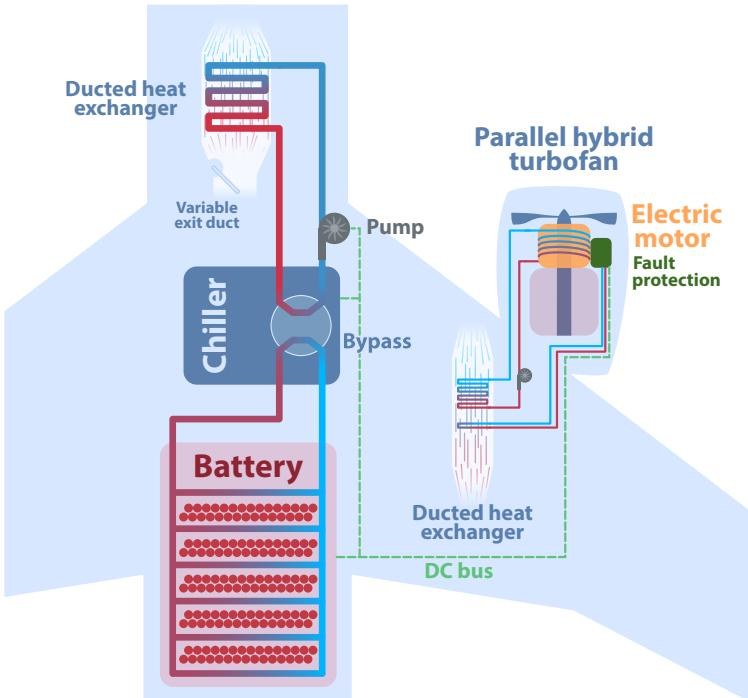  
Figure 5. The VCS thermal management system actively cools the battery with an electricallypowered vapor cycle chiller and passively cools the electric motor and its fault protection.

Heat is transferred by glycol-water liquid coolant and subsequently exits the system into the freestream using a ducted liquid-to-air heat exchanger. Coolant pumps, which consume electric power from the battery, are included in the battery and motor loops to drive the coolant flow. We account for the weight of the batteries, electric motor, chiller, pumps, coolant hoses, and heat exchangers. The weight metrics used for each component are listed in Table 4.

Table 4. Weight of components introduced by the hybrid propulsion system.
<table><tr><td>Component</td><td>Weight Metric</td></tr><tr><td>Battery</td><td>400 Wh/kg</td></tr><tr><td>Electric motor and power electronics</td><td> $5 \mathrm { k W / k g }$ </td></tr><tr><td>Chiller</td><td> $2 0 0 W / \mathrm { k g }$ </td></tr><tr><td>Coolant pump</td><td> $4 5 0 W / \mathrm { k g }$ </td></tr><tr><td>Coolant hose</td><td>1356  $\mathrm { k g } / \mathrm { \bar { m } } ^ { 3 } ,$  , sized for 300 psi hoop stress [45]</td></tr><tr><td>Heat exchanger</td><td>Weight from aluminum case, plates, and fins</td></tr></table>

## 2.3.2. TREES Aircraft

The TREES TMS configuration, shown in Figure $^ { 6 , }$ is identical to the vapor cycle architecture shown in Figure 5, except that the vapor cycle chiller is replaced with a thermoacoustic chiller powered by heat from the gas turbine (transported via acoustic waves) as opposed to electrical power from the battery. The conversion of waste heat to acoustic power is done by a thermoacoustic engine, which converts a temperature differential to acoustic energy. For this application, a temperature differential is created using two heat exchangers in the turbofan engine. The cold heat exchanger, shown as a blue rectangle, sits in the turbofan's bypass and uses the cold freestream air to achieve low temperatures. The hot heat exchanger, shown as a red rectangle, extracts waste heat from the core exhaust of the gas turbine. The thermoacoustic chiller uses the same cycle as the thermoacoustic engine but in reverse, converting acoustic energy to a temperature differential that is used to chill the battery coolant.

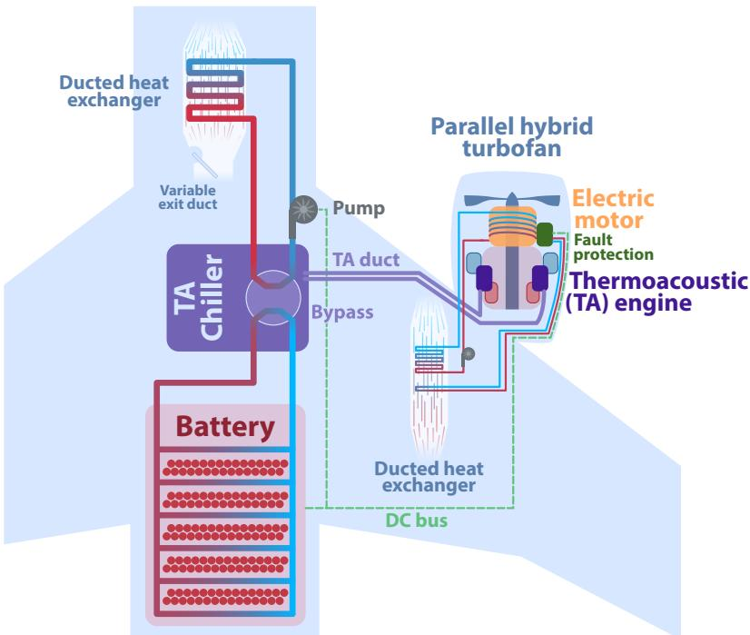  
Figure 6. Thermal management system with TREES thermoacoustic chiller.

These differences between the vapor cycle and TREES architectures appear in the OpenConcept model as four changes. Firstly, a different engine deck is used to account for the pressure drop attributable to the heat exchangers in the turbofan's bypass and core, as explained in Section 2.2. Secondly, unlike the VCS design, the TREES chiller consumes no battery power. Thirdly, the chiller's thermal efficiency is adjusted to match the thermoacoustic chiller's anticipated efficiency of 25% of the Carnot efficiency. Finally, the chiller weight is assumed to be negligible, and the weight of the thermoacoustic tubes is accounted for separately.

While the weight of aluminum tubing is easy to compute, part of the TREES concept involves using the thermoacoustic tubes as a multifunctional aircraft structure. Dyson [24] proposed replacing sections of the primary structure with the pressurized acoustic tubes, resulting in zero additional structural weight. Without a more detailed structural design, we make the best-case assumption that the tubes can be perfectly integrated into the wing structure with no structural penalty (i.e., we assume that the net increase in empty weight attributable to the thermoacoustic tubes is zero). The assumption of no structural weight penalty may not be entirely feasible for a production aircraft. In the worst-case scenario, all of the acoustic tubing is additional structure (and weight). In Section 3.1.2, we investigate the effect this assumption has on the fuel burn by varying the tube weight between the best- and worst-case assumptions and rerunning the optimization.

## 2.4. Optimization Problem Formulation

OpenConcept's mission- and aircraft-level optimization, shown in Table 5, minimizes fuel burn for the mission. The optimizer controls the TMS and battery sizing, time-dependent TMS and hybrid control parameters, and cruise altitude. Constraints are included to ensure that the electrical components stay within acceptable temperature ranges, the TMS heat exchangers are small enough to fit in the ducts, and the battery state of charge does not dip too low. The payload weight is accounted for by adding takeoff weight as a design variable and including a constraint so that a sufficient margin is available for payload (as expected, this constraint is active).

Table 5. Optimization problem definition and results for mission profile and TMS sizing and control. Bold optimal values indicate that the bound or constraint is active.
<table><tr><td colspan="2"></td><td>Unit</td><td>Lower</td><td>Upper</td><td>Optimum VCS</td><td>Optimum TREES</td></tr><tr><td>minimize</td><td>Mission fuel burn</td><td>kg</td><td></td><td></td><td>3732.7</td><td>3795.2</td></tr><tr><td rowspan="2">with respect to</td><td>Cruise altitude</td><td>ft</td><td>29,000</td><td>35,000</td><td>35,000</td><td>35,000</td></tr><tr><td>Takeoff weight</td><td>kg</td><td>50,000</td><td>79,002</td><td>72,413</td><td>72,432</td></tr><tr><td>Batry ssenm</td><td>Battery weight</td><td>kg</td><td>3000</td><td>12,500</td><td>3160.0</td><td>3151.6</td></tr><tr><td rowspan="4"></td><td>HX channels wide (cold side)</td><td></td><td>2 3</td><td>1500 75</td><td>204.8</td><td>204.8</td></tr><tr><td>HX fins long (cold side)</td><td></td><td></td><td></td><td>13.60</td><td>10.76</td></tr><tr><td>HX channels wide (cold side)</td><td></td><td>50</td><td>1500</td><td>413.2</td><td>413.2</td></tr><tr><td>HX fins long (cold side)</td><td>inch²</td><td>3</td><td>75</td><td>16.32</td><td>16.32</td></tr><tr><td rowspan="5">Motor ssenm Colant sdops</td><td>Duct nozzle area HX number of stacks</td><td></td><td>5 10</td><td>60 25</td><td>15.61</td><td>15.61</td></tr><tr><td></td><td></td><td>1</td><td>4</td><td>17.04 3.72</td><td>17.04</td></tr><tr><td>Fault protection HX fins long</td><td></td><td></td><td></td><td></td><td>3.72</td></tr><tr><td>Chiller power rating</td><td>kW</td><td>0.1</td><td>7</td><td>2.214</td><td></td></tr><tr><td>Battery coolant pump power Motor coolant pump power</td><td>kW kW</td><td>0.1 0.1</td><td>5 5</td><td>0.77</td><td>0.80</td></tr><tr><td rowspan="5">Hid throte</td><td>Battery hose diameter</td><td>inch</td><td>0.5</td><td>2</td><td>0.13 1.285</td><td>0.13 1.284</td></tr><tr><td>Motor hose diameter</td><td>inch</td><td>0.5</td><td>2</td><td>0.73</td><td>0.73</td></tr><tr><td>Climb start</td><td></td><td>0.02</td><td>1</td><td>1</td><td>1</td></tr><tr><td>Climb end</td><td></td><td>0.02</td><td>1</td><td>1</td><td>1</td></tr><tr><td>Cruise start</td><td></td><td>0.02</td><td>1</td><td>1</td><td>1</td></tr><tr><td rowspan="5"></td><td>Cruise end</td><td></td><td>0.02</td><td>1</td><td>1</td><td>1</td></tr><tr><td>Descent start</td><td></td><td>0.02</td><td>0.3</td><td>0.3</td><td>0.3</td></tr><tr><td>Descent end</td><td></td><td>0.02</td><td>0.3</td><td>0.3</td><td>0.3</td></tr><tr><td>Climb start</td><td></td><td>0 (chill)</td><td>1 (bypass)</td><td></td><td></td></tr><tr><td>Climb end</td><td></td><td>0</td><td>1</td><td>1 1</td><td>0</td></tr><tr><td rowspan="5">Chiiiler ypdss</td><td>Cruise start</td><td></td><td>0</td><td>1</td><td>1</td><td>0 0</td></tr><tr><td>Cruise end</td><td></td><td>0</td><td>1</td><td>1</td><td>0</td></tr><tr><td>Descent start</td><td></td><td>0</td><td>1</td><td>0</td><td>0</td></tr><tr><td>Descent end</td><td></td><td>0</td><td>1</td><td>0</td><td>0</td></tr><tr><td>Ground roll start</td><td>inch²</td><td></td><td></td><td></td><td></td></tr><tr><td rowspan="7">Bat tuct noze aəązzea</td><td>Ground roll end</td><td>inch²</td><td>5 5</td><td>150 150</td><td>5 5</td><td>10.5 5</td></tr><tr><td>Climb start</td><td>inch²</td><td>5</td><td>150</td><td>9.4</td><td>5</td></tr><tr><td>Climb end</td><td>inch²</td><td>5</td><td>150</td><td>34.5</td><td>27.9</td></tr><tr><td></td><td>inch²</td><td>5</td><td>150</td><td></td><td></td></tr><tr><td>Cruise start Cruise end</td><td>inch2</td><td></td><td></td><td>17.8</td><td>24.9</td></tr><tr><td>Descent start</td><td>inch2</td><td>5</td><td>150</td><td>34.8</td><td>26.1</td></tr><tr><td>Descent end</td><td>inch2</td><td>5 5</td><td>150 150</td><td>8.6 15.7</td><td>5.3 5</td></tr><tr><td rowspan="2">subject to</td><td>Payload</td><td>kg</td><td>20,000</td><td></td><td>20,000</td><td>20,000</td></tr><tr><td>Battery final state of charge</td><td></td><td>0.05</td><td></td><td>0.05</td><td>0.05</td></tr><tr><td rowspan="3">Temp Iiits</td><td>Battery</td><td>℃</td><td></td><td>45</td><td>max = 45</td><td>max = 45</td></tr><tr><td>Motor</td><td>℃</td><td></td><td>90</td><td>max = 90</td><td>max = 90</td></tr><tr><td>Fault protection</td><td>℃</td><td></td><td>50</td><td>max = 50</td><td>max = 50</td></tr><tr><td rowspan="8">TMS</td><td>Battery HX width</td><td>m</td><td></td><td>1.2</td><td>0.297</td><td>0.297</td></tr><tr><td>Battery HX cross-section area</td><td>inch²</td><td>70</td><td>300</td><td>300</td><td>300</td></tr><tr><td>Motor HX width</td><td>m</td><td></td><td>0.6</td><td>0.6</td><td>0.6</td></tr><tr><td>Motor HX height</td><td>m</td><td></td><td>0.3</td><td>0.3</td><td>0.3</td></tr><tr><td>Motor HX cross-section area</td><td>inch²</td><td>70</td><td>300</td><td>206.3</td><td>206.3</td></tr><tr><td></td><td></td><td></td><td></td><td></td><td></td></tr><tr><td>Battery pump sizing margin</td><td></td><td></td><td>1</td><td>1</td><td>1</td></tr><tr><td>Motor pump sizing margin</td><td></td><td></td><td>1</td><td>1</td><td>1</td></tr></table>

To maintain safe surge margins (greater than 10%), we limit the engine hybrid power to 300 kW during descent. At low engine throttle with hybrid power above the imposed 300 kW constraint, the N+3 engine has low or negative surge margins. Descent is flown at or near flight idle, so bounding the hybrid power in the descent phase keeps surge margins within the acceptable range.

## 3. Relative Performance of Architectures

This section compares airplanes with both thermal management system architectures to the conventional N+3 configuration with no hybridization and then to each other. We discuss the sensitivity of each thermal management system's performance to relevant technology metrics and uncertain design parameters.

Figure 7 shows the contributions to the fuel burn from the parallel hybrid with a vapor cycle chiller flying the baseline mission of 800 nmi with a battery energy density of 400 Wh/kg. The conventional N+3 geared turbofan configuration provides the baseline (0% change in fuel burn on the chart). Adding the parallel hybrid system alone (without accounting for thermal requirements) reduces the fuel burn by 3.51%. This is done by supplementing the stored fuel energy with battery energy and some of the turbofan core's shaft power with power from an electric motor. While the hybrid system saves fuel, it results in a heavier aircraft and a substantially more complex propulsion system. The electrical components that come with the hybrid system, namely the electric motor, battery, and fault protection, produce heat that must be rejected by a thermal management system. We estimate that an optimized cooling system, including vapor cycle refrigeration of the battery coolant loop, incurs a 0.20% fuel burn penalty. This results in an overall fuel savings of 3.31% for the parallel hybrid aircraft with a vapor cycle thermal management system.

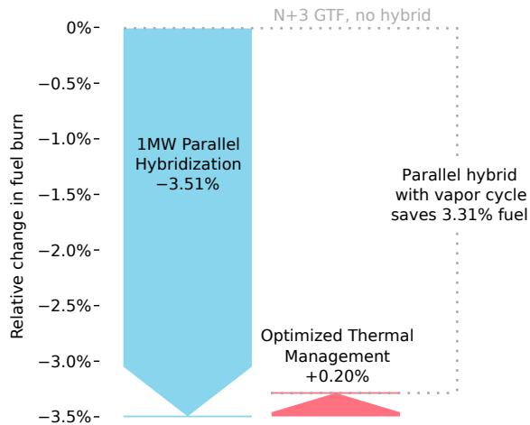  
Figure 7. Relative to the conventional N+3 configuration with a geared turbofan, the parallel hybrid system with a vapor cycle chiller saves 3.31% fuel burn on an 800 nmi mission with 400 Wh/kg batteries.

Figure 8 repeats the same process but now compares the conventional N+3 geared turbofan to a parallel hybrid with the TREES thermal management system. Before the thermal management systems are counted, the parallel hybrid with TREES gains the same 3.51% fuel savings over the N+3 GTF aircraft. Adding on the thermal management system and the heat transfer in the turbofan core and bypass (but not any pressure losses from the heat exchangers for the thermoacoustic engine) increases the fuel burn by 0.14%. This increase is less than the TMS penalty for the vapor cycle chiller system for two reasons. Firstly, the heat added to the turbofan's bypass increases the engine's efficiency since it is moving heat from a less useful (core) to a more useful location (bypass). Secondly, the TREES chiller is assumed to be of negligible weight, whereas the vapor cycle chiller adds weight. The remaining 0.14% penalty is due to electricity from the battery used to power the coolant pumps and the added weight from the pumps and hoses. Drag from the ducted heat exchangers may also contribute for some flight conditions, but they often produce thrust because of the Meredith effect.

If we assume zero pressure losses from the heat exchangers in the engine, the TREES concept burns a few hundredths of a percent less fuel than the vapor cycle system. However, the TREES architecture takes on an additional 1.68% fuel burn penalty when the pressure losses are considered. The majority of this penalty comes from the heat exchanger in the bypass. While 0.25% total pressure loss was considered for this study, the sensitivity to this value is investigated in Section 3.1.1. These pressure losses result in only a 1.69% benefit for the TREES parallel hybrid design over the conventional N+3 aircraft. The vapor cycle system saves an additional 1.62% fuel burn compared to TREES.

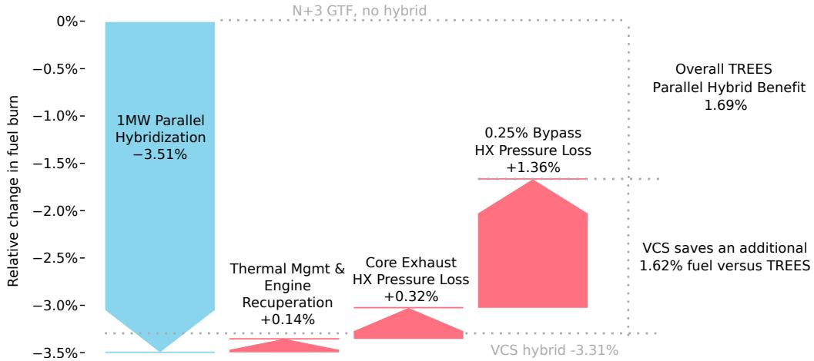  
Figure 8. TREES has a smaller initial thermal management penalty due to the lighter cooling system and useful heat transfer to the turbofan's bypass. The total pressure losses from the heat exchangers in the turbofan's core and bypass negate this benefit

## 3.1. Sensitivity Analysis

A conceptual design study necessitates making assumptions about uncertain technology and performance parameters. Sensitivity analysis helps establish the robustness of results to uncertain parameters, such as bypass total pressure loss. It also exposes technology improvements that could make the most difference in the performance of TREES.

In this section, we explore the sensitivity of the relative performance of the VCS and TREES concepts with respect to the following parameters:

1.Engine bypass heat exchanger total pressure loss.

2.Thermoacoustic tube weight.

3. Battery-specific energy.

4. Design range.

5. Thermoacoustic chiller efficiency.

6. Vapor cycle chiller-specific power.

7. Battery temperature limit.

All plots in this section show the performance of TREES relative to the vapor cycle chiller. In other words, they plot the difference between the two systems, not the absolute performance of either.

## 3.1.1. Engine Bypass Heat Exchanger Total Pressure Loss

The largest source of uncertainty in this study is the amount of pressure loss incurred by the engine bypass (cold side) heat exchanger. CFD analysis of this heat exchanger is not complete at the time of publication. Figure 9 shows the sensitivity of fuel burn to the total pressure loss of the bypass heat exchanger.

The performance of TREES relative to the vapor cycle concept is almost entirely dependent on the pressure loss performance of this heat exchanger. Whereas a perfect heat exchanger with no pressure loss results in TREES and the vapor cycle system burning a comparable amount of fuel, a less efficient heat exchanger severely degrades the desirability of TREES for all the mission lengths we explored. However, anything other than a nearlylossless heat exchanger results in the vapor cycle architecture outperforming the TREES design. The surface air-cooled oil cooler in the GEnx-1B engine (which is conformal and flush with the duct surface) demonstrates that this may be feasible in practice. Additional analysis and design in this area will be high-leverage.

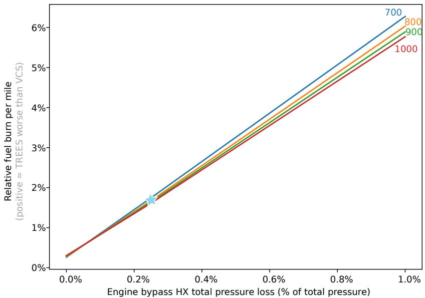  
Figure 9. The bypass heat exchanger's total pressure loss is by far the most significant technology parameter in determining the effectiveness of TREES. For these studies, we assume a baseline total pressure loss of 0.25%, marked by the blue star.

## 3.1.2. Thermoacoustic Tube Weight

Until now, we have made a best-case assumption that the thermoacoustic tube weight is negligible because the tubes could theoretically replace primary aircraft structure [24,46]. However, the technology is still in its infancy, so the validity of this assumption is uncertain. To address this, we investigate the sensitivity of the TREES concept's fuel burn to the thermoacoustic tube weight. We vary the tube weight from the best-case (no additional weight) to the worst-case scenario (all tube weight is additional).

For the sensitivity study, we take the thermoacoustic tubes to be aluminum 7075 $( 2 . 8 1 \mathrm { g } / \mathrm { c m } ^ { 3 } )$ with a 2 in outer diameter and 3 mm wall thickness. Each tube is 10 ft long, the distance between the engine pylon and wing-body fairing on the 737–800 (estimated with photogrammetry). There are 30 tubes within each wing. This results in a total thermoacoustic system weight of just over 500 lbs if we assume the thermoacoustic tubes are entirely additional weight and cannot be integrated into the airframe's primary structure. We investigate the fuel burn's sensitivity to the tube weight by varying the additional weight from 0 lbs (all primary structure) to just over 500 lbs (all extra weight).

Because the lift-to-drag ratio is constant within a small range of lift coefficients, linearly adding a small amount of weight (small relative to the weight of the aircraft) should result in a linear increase in fuel burn (as seen in Figure 10). Varying the thermoacoustic tube weight has the second-largest impact on the fuel burn of all the critical parameters investigated. The tube weight is one of the more uncertain parameters, though it would almost certainly fall within the range we investigate.

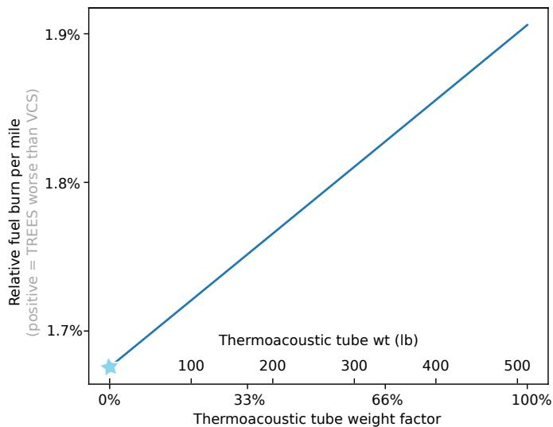  
Figure 10. Increasing thermoacoustic tube weight from the baseline of 0 lbs to the full weight of the tubes results in over a 0.2% increase in fuel burn.

## 3.1.3. Battery-Specific Energy and Design Range

Figure 11 shows how the relative fuel burn per mile changes with battery-specific energy and mission range. Relative to the vapor cycle chiller, the performance of TREES tends to improve for longer missions and lower battery-specific energies. This comes down to the energy sources for the two systems. The vapor cycle chiller is powered by electricity stored in the battery, while TREES is powered indirectly by jet fuel combustion in the turbine core. While TREES is said to be powered by waste heat, there is a significant total pressure loss from the heat exchangers in the engine. This requires a higher fuel burn for the same thrust. Thus, both thermal management systems incur a weight penalty as the mission range is increased; TREES incurs that in jet fuel and the vapor cycle in battery weight. The energy density of jet fuel is orders of magnitude higher than that of batteries, so the TREES weight penalty is much less than the vapor cycle weight penalty as the mission range increases. This results in improved performance of TREES relative to the performance of the vapor cycle system for longer missions.

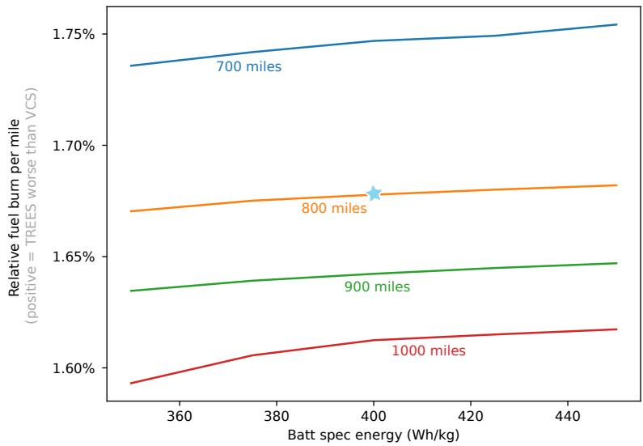  
Figure 11. The vapor cycle chiller needs to carry batteries to power it, whereas TREES does not. This results in better relative performance for TREES on longer missions and with lower battery-specific energies than on shorter missions and with higher battery-specific energies. The blue star identifies the baseline mission.

Similarly, the TREES architecture improves relative to the vapor cycle system for lower battery-specific energies. The weight penalty of the vapor cycle system worsens as the battery-specific energy decreases, further hindering its performance.

## 3.1.4. Thermoacoustic Chiller Efficiency

Another key technology metric is the efficiency of the thermoacoustic chiller. Current NASA estimates predict that it is 25% of Carnot efficiency, and we investigate efficiencies up to 40%, shown in Figure 12. The thermoacoustic chiller does not use energy from the battery and is set to a constant power rating of 10 kW (based on CFD predictions of the amount of heat extracted from the turbine engine core). Because of these two factors, the only impact the thermoacoustic chiller efficiency has is how much heat it can pump away from the battery into the heat exchanger in the variable area duct [46]. The variable area duct with the heat exchanger produces thrust, via the Meredith effect, for the entire mission with the TREES architecture. This means that with higher efficiencies, more heat is rejected into the duct, and more thrust is produced. The thrust from the duct, which ranges from 4 to 8 Newtons at cruise, is the driving factor behind the fuel savings. The difference in fuel burn between a chiller efficiency of 25% and 40% is on the order of only half a pound of fuel, so improving the efficiency would have a minimal effect on the overall performance.

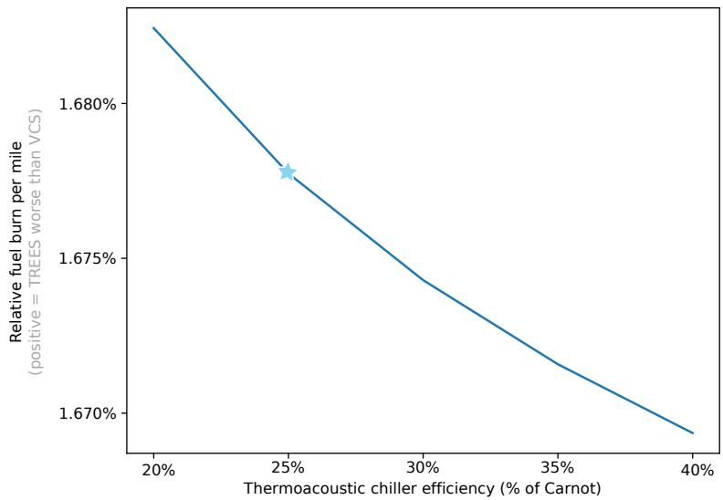  
Figure 12. Higher thermoacoustic chiller efficiencies can pump more heat from the battery to the duct, which generates more thrust in the duct, saving fuel. The blue star marks the baseline chiller efficiency of 25%.

## 3.1.5. Vapor Cycle Chiller-Specific Power

The specific power of the vapor cycle chiller determines the chiller's contribution to the weight of the aircraft. We vary only the specific power of the vapor cycle chiller and not of the thermoacoustic chiller (because it is already accounted for in the thermoacoustic tube weight computed separately).

Our model computes chiller weight as chiller-rated power divided by chiller-specific power. Thus for a given chiller power, specific power is inversely proportional to chiller weight. As weight increases (leftward in Figure 13), the VCS airplane uses more fuel, narrowing the gap with TREES. However, the state-of-the-art specific power is already at the point of diminishing returns, and continued weight reduction of the VCS chiller is not expected to widen its advantage over TREES by very much. This sensitivity was conducted without including the chilldown procedure.

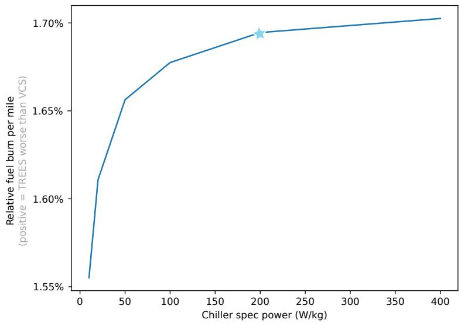  
Figure 13. Varying vapor cycle chiller-specific power, we recover the expected fuel burn trend of decreasing fuel burn for the vapor cycle system aircraft that tapers off as specific power increases. The blue star shows the baseline specific power of 200 W/kg.

## 3.1.6. Battery Temperature Limit

Next, we investigate the potential change in fuel burn if we could use batteries with a temperature limit higher than the baseline of $4 5 ^ { \circ } \mathrm { C } .$ Higher battery temperature limits tend to favor the vapor cycle chiller architecture over the TREES architecture, as shown in Figure 14.

For the TREES system, there is no penalty for running the thermoacoustic chiller for the whole mission because the heat is extracted from the turbofan core whether the chiller is being used or not. This means that the only benefit in fuel burn the TREES architecture can find from the increase in the battery's maximum temperature is that if the batteries, and thus the battery coolant loops, are kept hotter, the heat can be more easily rejected into the freestream. This enables a more efficient heat exchanger, leading to a duct that produces less net drag via the Meredith effect and saves fuel.

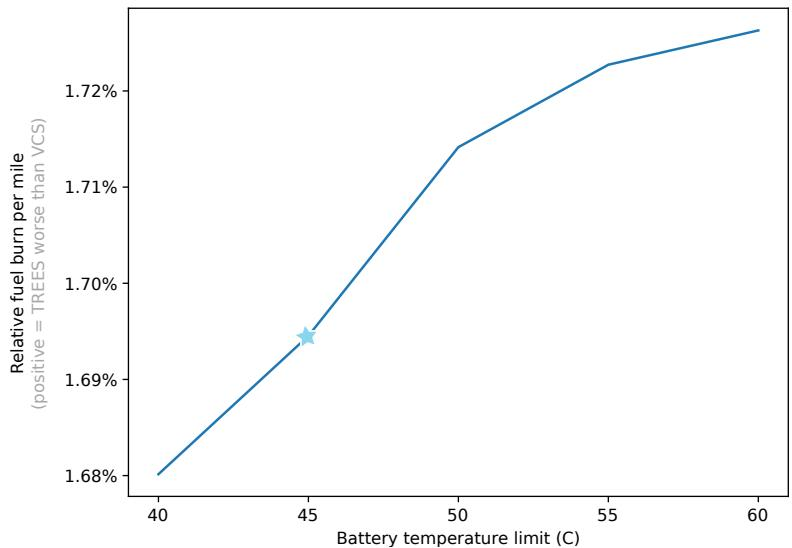  
Figure 14. Increasing battery temperature limits favor the vapor cycle system because they allow a lighter chiller and smaller heat exchanger, whereas TREES can only shrink the heat exchanger, since the chiller is assumed to weigh nothing. The blue star marks the baseline battery temperature limit of $4 5 ^ { \circ } \mathrm { C } .$

While the TREES system gains efficiency with increasing battery temperature limits, the vapor cycle system increases efficiency by an even more significant margin. Two factors contribute to the vapor cycle system's fuel savings. The first is that, as with the TREES system, hotter batteries mean the heat exchanger and duct can be sized to produce less net drag. The second contribution is that hotter batteries enable a chiller that requires less power due to the higher coefficient of performance. Less power means less weight to carry, which saves fuel. These two factors increasingly favor the vapor cycle system as the battery temperature limit increases.

The decrease in fuel burn between batteries with a temperature limit of $4 5 ~ ^ { \circ } \mathrm { C }$ and those with a limit of $6 0 ^ { \circ } \mathrm { C }$ for both designs is less than 3 lbs. This indicates that investing time and money in batteries with a higher temperature limit is not a top priority for this application. This sensitivity was conducted without including the chilldown procedure.

## 4. Vapor Cycle TMS Design Sensitivities

In the previous section, we examined the effect of different input assumptions on the performance difference between the VCS and TREES thermal management approaches. Having established that the VCS is preferred on this mission, this section examines the sensitivity of the VCS thermal management performance in absolute terms to the following input assumptions:

1. Range.

2. Specific power of the chiller.

3. Specific energy of the battery.

4.Temperature limits of the battery.

Each sensitivity includes two types of figures. Sweep plots show the effect of the parameter in question on scalar design and performance quantities, with the sensitivity variable on the x axis. Trajectory plots illustrate the effect of the parameter on dynamic parameters such as component temperatures and control parameters across the duration of the mission, with distance traveled in the x axis. The complete data for this sensitivity study is presented in tabular form in Appendix A.

## 4.1. Effect of Range

Figure 15 illustrates how the optimal parallel hybrid airplane design changes as the mission range increases. Fuel burn increases linearly with the mission length. However, we see jumps in some design parameters between 720 and 740 nmi. At this range, the optimum cruise altitude jumps from around 30,000 ft to the upper bound of 35,000 ft. The higher altitude reduces cruise drag, so the aircraft can reduce the size of the battery and reduce takeoff weight. The colder temperatures cause a jump downward in the size of the chiller and the size and weight of the battery heat exchanger.

We also see a slight linear trend in coolant pump size and hose diameter. This is a very subtle tradeoff. As the mission becomes longer, the penalty for carrying batteries increases, which penalizes anything that uses electrical power. A larger pump that can overcome the pressure losses in smaller, lighter hoses is favored at short ranges. At long range, the electricity consumption of the larger pump is penalized, and a larger hose with less pressure drop is favored.

Figures 16 and 17 show the trajectories of state variables and control parameters. There are no major discontinuities in the trajectories as the range increases, but there are subtle differences in the duct nozzle control scheduling.

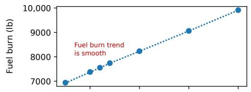

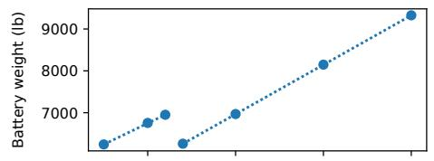

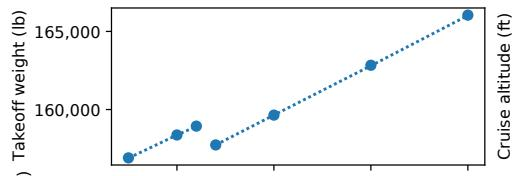

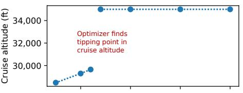

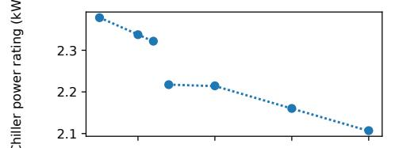

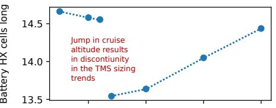

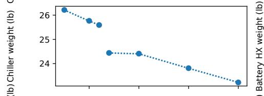

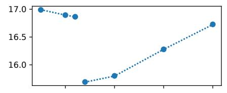

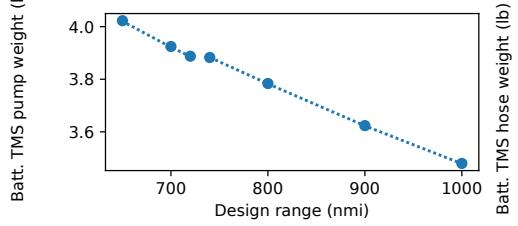

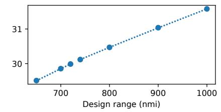  
Figure 15. Effect of mission range on optimal design.

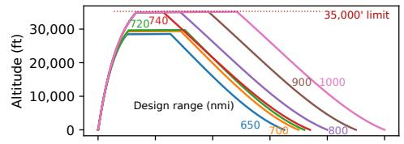

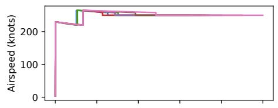

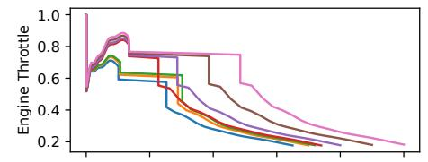

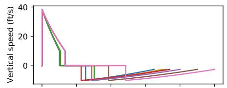

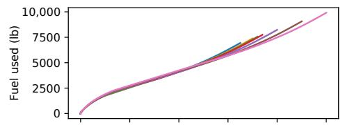

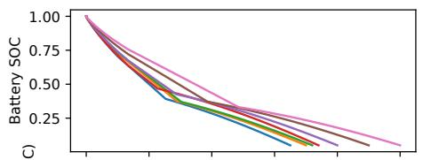

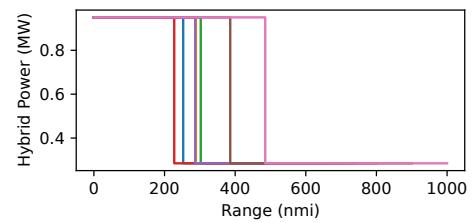

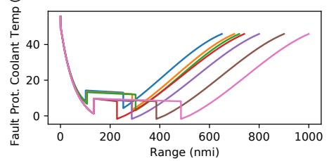  
Figure 16. Optimized flight profile and control parameters—various ranges.

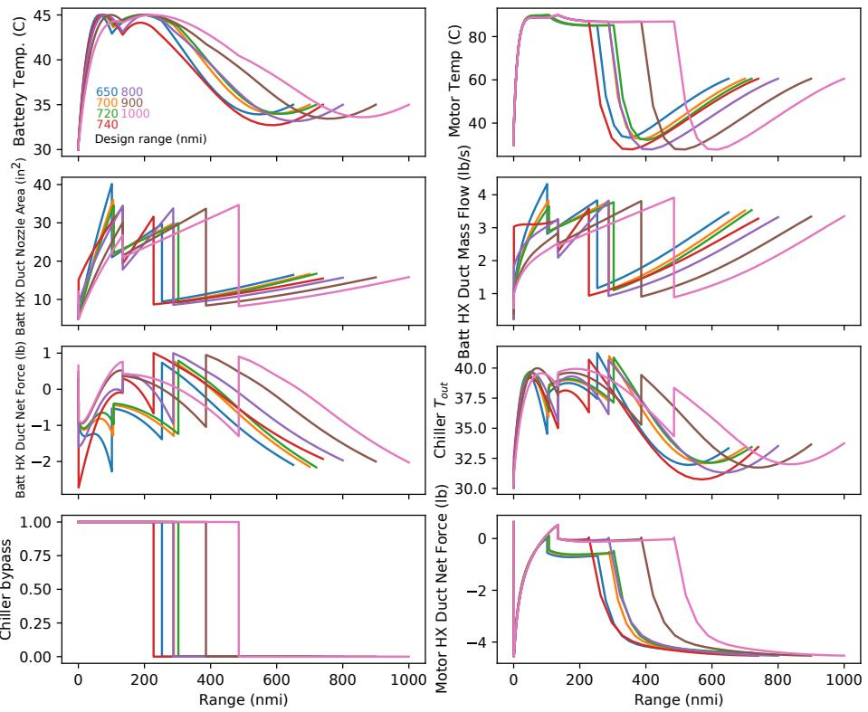  
Figure 17. Optimized thermal trajectory and control parameters for various ranges.

## 4.2. Effect of Chiller-Specific Power

For this TMS trade study, a key technological parameter is the specific power of the chiller. Lower specific power favors using a smaller chiller and larger heat exchanger. Figure 18 shows the effect of specific power on the TMS design for two mission profiles. The “chilldown" scenario requires the airplane to land with a battery temperature of 35 °C or less (to enable the airplane to take off again quickly after unloading and loading). The "no chilldown" requirement imposes a flat $4 5 ^ { \circ } \dot { \mathrm { C } }$ limit on battery temperature across the whole mission. For both scenarios, fuel burn decreases sharply as specific power increases to about 100 W/kg. Beyond 200 W/kg (which is our best estimate of the state-of-theart), the returns diminish greatly. Therefore, it is likely that dramatic improvements in chiller weights are not on the critical path to hybrid propulsion for this type of mission. However, this parameter may be more significant for an electric aircraft at a lower altitude (e.g., eVTOL).

For all specific powers, the “no chilldown" scenario burns less fuel and uses a smaller chiller than for the "chilldown" scenario. The higher the chiller-specific power (the lighter the chiller), the lower the fuel burn penalty attributable to a chilldown requirement. Figures 19 and 20 show trajectories and control parameters for the chilldown and no-chilldown scenarios, respectively. As the specific power increases, the TMS keeps the battery temperature more consistent across the mission. At low specific power, the optimizer does not provide much chiller capacity, so the optimizer has to cool down the battery at altitude to accumulate enough cold thermal mass for the descent.

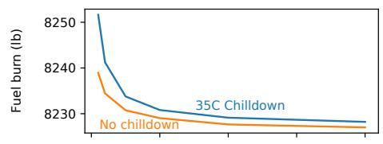

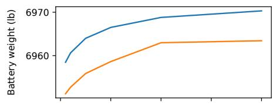

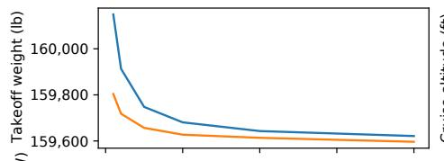

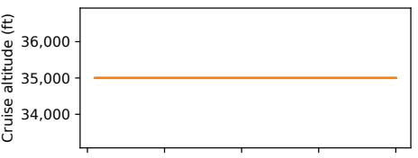

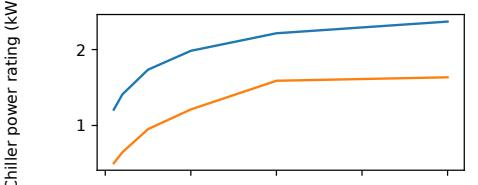

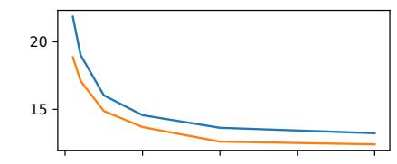

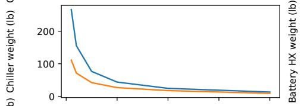

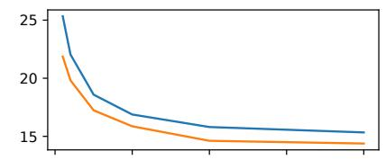

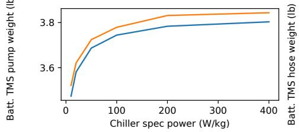

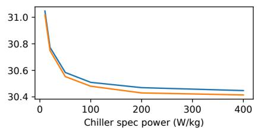  
Figure 18. Effect of chiller-specific energy on optimal design.

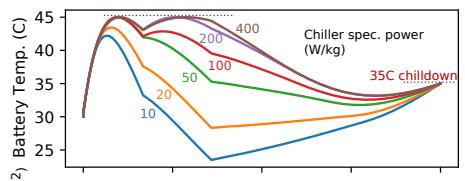

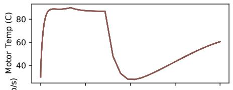

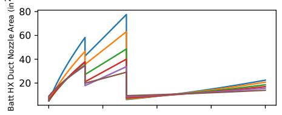

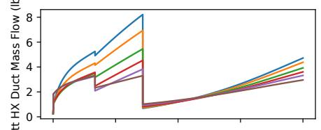

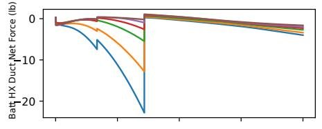

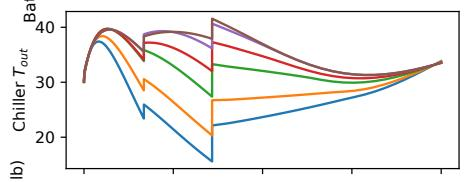

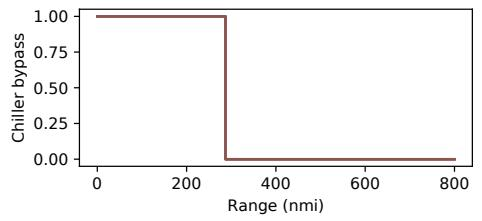

  
Figure 19. Optimized thermal trajectory and control parameters for various chiller-specific powers, with chilldown.

  
Figure 20. Optimized thermal trajectory and control parameters for various chiller-specific powers without chilldown.

## 4.3. Effect of Battery-Specific Energy

For this 2030+ trade study, the technological performance of the battery (in particular, specific energy) is highly uncertain. Figure 21 shows the effect of specific energy on aircraft design variables and performance. Because range and specific energy are so tightly linked, we plot sweep lines for ranges between 700 and 1000 nautical miles and normalize fuel burn by range to collapse the plot. The fuel burn reduction due to battery-specific energy improvement is not large (2.5% fuel burn reduction per 100 Wh/kg improvement). This is likely due to the mild power and energy hybridization of this configuration. On the other hand, 2.5% is quite significant compared to the 3.3% fuel burn improvement of the baseline hybrid.

Battery-specific energy affects the TMS design in diverse ways depending on the range. Figure 22 shows that specific energy does not strongly influence control parameters or states; the family of trajectories for the 800 nmi mission look qualitatively similar. Figure 23 shows the variation in chiller sizing with range and specific energy. For example, from 700 to 900 nmi range, the chiller power is not strongly influenced by the battery-specific energy. At 1000 nmi, the chiller power increases somewhat with the battery-specific energy. If the battery-specific energy is low and the range is long, the battery pack is heavy (and therefore has a lot of thermal mass), which smooths out thermal transients. On the other hand, battery-specific energy does strongly influence the hose and pump design subproblem in a similar way to the range. The lighter the battery, the more pump power becomes favored versus hose diameter (and weight), and we see a linear trend similar to Section 4.1.

  
Figure 21. Effect of battery-specific energy on optimal design for various design ranges.

  
Figure 22. Optimized thermal trajectory and control parameters for various battery-specific energies (800 nmi flight).

  
Figure 23. Optimal chiller size variation with flight length and battery-specific energy.

## 4.4. Effect of Battery Thermal Limitations

In principle, there is a design tradeoff between the electrical performance of a battery cell and its thermal stability (the degree to which this can be controlled in the battery design process is uncertain). Therefore, it is useful to know how much of an airplane-level performance improvement would result from relaxing thermal management requirements for the battery. Figure 24 shows the effect of the battery temperature constraint on the aircraft design and performance. Figure 25 shows the trajectory with states and control parameters and illustrates the variation in the thermal constraint more tangibly.

  
Figure 24. Effect of battery temperature limit on optimal design (800 nmi flight).

In this application, fuel burn is only a weak function of the temperature limit. Increasing the temperature limit from $4 0 ~ ^ { \circ } \mathrm { C }$ (cool for a battery) to $6 0 ^ { \circ } \mathrm { C }$ (hot) only reduces fuel burn by about 5 lbs, or 0.05%. One interesting trend is using the chiller as the temperature limit is relaxed. Figure 24 shows that the optimizer removes the chiller altogether once the maximum temperature is $5 0 ^ { \circ } \mathrm { C }$ or above; these are the only cases in this trade study where the optimizer did not elect to preserve at least some chiller capability. It is likely that a lower-altitude aircraft that flies longer in warmer air is more sensitive to battery operating limits than this concept.

  
Figure 25. Optimized thermal trajectory and control parameters for various battery temperature limits.

## 5. Conclusions and Recommendations

Our results indicate that a vapor cycle thermal management system can provide adequate thermal management to a parallel hybrid propulsion system without an excessive system-level fuel burn penalty. This result is robust to assumptions about mission range, battery temperature requirements, and chiller weight. Because some aircraft currently in service use vapor cycle refrigeration for environmental control systems, this represents a relatively low-risk approach to managing waste heat for a parallel hybrid demonstrator.

Despite making generous (and in some cases, unrealistic) assumptions, we could not find a significant benefit attributable to the TREES thermoacoustic system for this particular mission. Figure 8 illustrates that when the heat recuperation effects of TREES are considered and all weight and engine pressure losses are neglected, it reduces fuel burn by 0.06% relative to the vapor cycle TMS. The 0.06% fuel burn reduction is not yet a fair comparison with the vapor cycle system because it ignores pressure losses in the turbofan engine from the inclusion of the heat exchangers, which are necessary to power the thermoacoustic refrigeration system. The vapor cycle TMS outperforms the TREES concept when a CFD-based best estimate of the engine core pressure loss is included. This gap widens considerably if any bypass pressure loss is incurred, as shown in Figure 9. Furthermore, if the thermoacoustic tubes cannot be integrated as the primary structure with zero net weight gain, the concept becomes uncompetitive with a more conventional design, as illustrated in Figure 10.

<table><tr><td>BPR</td><td>Bypass ratio Computational fluid dynamics</td></tr><tr><td>CFD</td><td></td></tr><tr><td>CRZ</td><td>Cruise</td></tr><tr><td>GTF</td><td>Geared turbofan</td></tr><tr><td>HX</td><td>Heat exchanger</td></tr><tr><td>LPC</td><td>Low pressure compressor</td></tr><tr><td>MDP</td><td>Multi-design point</td></tr><tr><td>ODE</td><td>Ordinary differential equation</td></tr><tr><td>OEW</td><td>Operating empty weight</td></tr><tr><td>OPR</td><td>Overall pressure ratio</td></tr><tr><td>PR</td><td>Pressure ratio</td></tr><tr><td>RTO</td><td>Rejected takeoff</td></tr><tr><td>SLS</td><td>Sea level static</td></tr><tr><td>SOC</td><td>State of charge</td></tr><tr><td>TA</td><td>Thermoacoustic</td></tr></table>

However, there may be other missions where thermoacoustic thermal management is favored. The heat extraction available for this single-aisle design is limited by the volume in the compact engine core, which restricts the heat exchanger's size. A larger engine may afford a more significant recuperation opportunity. Additionally, thermoacoustic chillers may be favored across longer-range missions. If the chiller is driven by a propulsive battery, the battery weight required for thermal management alone grows for longer missions, tipping the balance in favor of the thermoacoustic concept. Unfortunately, longer-range missions are less viable for parallel hybridization with the battery technology reasonably foreseeable in the medium term.

To improve the viability of the TREES concept, we recommend developing a conformal heat exchanger in the bypass duct to avoid any pressure losses there.

Finally, both the VCS and TREES studies illustrate the value of full-mission trajectory analysis and optimization for unsteady thermal states. Batteries and motors have appreciable thermal mass, which can be used to reduce the performance penalty of the TMS by not sizing the system for the most challenging phases of flight (such as rolling takeoff). Our thermal management penalty estimates are of a similar order of magnitude but substantially lower than previous estimates for a parallel hybrid based on quasi-steady point designs [11,38]. The OpenConcept software and pyCycle engine modeling tool provided sufficient flexibility and numerical performance to fully couple the transient thermal states to the unsteady flight conditions and aircraft design features.

Author Contributions: Conceptualization, E.J.A. and B.J.B.; methodology, E.J.A. and B.J.B.; software, E.J.A. and B.J.B.; validation, E.J.A. and B.J.B.; investigation, E.J.A. and B.J.B.; writing—original draft preparation, E.J.A. and B.J.B.; writing—review and editing, E.J.A., B.J.B. and J.R.R.A.M.; visualization, E.J.A. and B.J.B.; supervision, J.R.R.A.M.; funding acquisition, J.R.R.A.M. and B.J.B. All authors have read and agreed to the published version of the manuscript.

Funding: This research was funded by NASA Glenn Research Center under NASA award 80NSSC18M0151.

Institutional Review Board Statement: Not applicable.

Informed Consent Statement: Not applicable.

Data Availability Statement: All publicly is presented within the contents of this manuscript.

Acknowledgments: The authors would like to thank Rodger Dyson of the NASA Glenn Research Center for his foundational work on the TREES concept, valuable insights, and technical feedback.

Conflicts of Interest: The authors declare no conflict of interest.

## Abbreviations

The following abbreviations are used in this paper:

<table><tr><td>TMS</td><td>Thermal management system</td></tr><tr><td>TOC</td><td>Top of climb</td></tr><tr><td>TREES</td><td>Thermal Recovery Energy Efficient System</td></tr><tr><td>TSFC</td><td>Thrust-specific fuel consumption</td></tr><tr><td>VCS</td><td>Vapor cycle system</td></tr><tr><td>XS</td><td>Cross sectional</td></tr></table>

## Appendix A. Optimized VCS TMS Design Data

The following tables include design variable and constraint data from Section 4 in tabular form.

Table A1. Sensitivity of design and performance with respect to range.
<table><tr><td>Range</td><td>nmi</td><td>650</td><td>700</td><td>720</td><td>800</td><td>900</td><td>1000</td></tr><tr><td>Battery-specific energy</td><td>Wh/kg</td><td>400</td><td>400</td><td>400</td><td>400</td><td>400</td><td>400</td></tr><tr><td>Chiller-specific power</td><td>W/kg</td><td>200</td><td>200</td><td>200</td><td>200</td><td>200</td><td>200</td></tr><tr><td>Design Variables Cruise altitude</td><td>ft</td><td>28,479</td><td>29,293</td><td>29,649</td><td>35,000</td><td>35,000</td><td>35,000</td></tr><tr><td>Takeoff weight</td><td>lbm</td><td>156,906</td><td>158,371</td><td>158,937</td><td>159,643</td><td>162,834</td><td>166,043</td></tr><tr><td>Battery weight</td><td>lbm</td><td>6242.8</td><td>6756.3</td><td>6951.5</td><td>6968.8</td><td>8148.2</td><td>9326.4</td></tr><tr><td>Battery TMS</td><td></td><td></td><td></td><td></td><td></td><td></td><td></td></tr><tr><td>Chiller power rating</td><td>kW</td><td>2.38</td><td>2.34</td><td>2.32</td><td>2.21</td><td>2.16</td><td>2.11</td></tr><tr><td>Battery HX cells wide</td><td></td><td>204.81</td><td>204.81</td><td>204.81</td><td>204.81</td><td>204.81</td><td>204.81</td></tr><tr><td>Battery HX cells long</td><td></td><td>14.66</td><td>14.58</td><td>14.55</td><td>13.64</td><td>14.05</td><td>14.44</td></tr><tr><td>Coolant pump power</td><td>kW</td><td>0.82</td><td>0.80</td><td>0.79</td><td>0.77</td><td>0.74</td><td>0.71</td></tr><tr><td>Hose diameter</td><td>inch</td><td>1.27</td><td>1.27</td><td>1.28</td><td>1.29</td><td>1.30</td><td>1.31</td></tr><tr><td>Motor TMS</td><td></td><td></td><td></td><td></td><td></td><td></td><td></td></tr><tr><td>Motor HX cells wide</td><td></td><td>413.22</td><td>413.22</td><td>413.22</td><td>413.22</td><td>413.22</td><td>413.22</td></tr><tr><td>Motor HX cells long</td><td></td><td>17.27</td><td>17.14</td><td>17.08</td><td>16.32</td><td>16.34</td><td>16.35</td></tr><tr><td>Motor HX cells tall</td><td></td><td>17.04</td><td>17.04</td><td>17.04</td><td>17.04</td><td>17.04</td><td>17.04</td></tr><tr><td>Fault prot. HX cells long</td><td></td><td>3.78</td><td>3.78</td><td>3.78</td><td>3.72</td><td>3.72</td><td>3.72</td></tr><tr><td>Nozzle area</td><td>inch²</td><td>15.21</td><td>15.24</td><td>15.26</td><td>15.61</td><td>15.61</td><td>15.61</td></tr><tr><td>Coolant pump power</td><td>kW</td><td>0.14</td><td>0.14</td><td>0.14</td><td>0.13</td><td>0.13</td><td>0.12</td></tr><tr><td>Hose diameter</td><td>inch</td><td>0.72</td><td>0.72</td><td>0.73</td><td>0.73</td><td>0.74</td><td>0.74</td></tr><tr><td>Objective Fuel burn</td><td>lbm</td><td>6938.18</td><td>7377.20</td><td>7553.04</td><td>8229.13</td><td>9061.01</td><td>9912.62</td></tr><tr><td>Constraints</td><td></td><td></td><td></td><td></td><td></td><td></td><td></td></tr><tr><td>Final SOC Battery HX width</td><td></td><td>0.05</td><td>0.05</td><td>0.05</td><td>0.05</td><td>0.05</td><td>0.05</td></tr><tr><td>Battery HX XS area</td><td>inch inch²</td><td>11.71</td><td>11.71</td><td>11.71</td><td>11.71</td><td>11.71</td><td>11.71</td></tr><tr><td>Motor HX width</td><td></td><td>300.00</td><td>300.00</td><td>300.00</td><td>300.00</td><td>300.00</td><td>300.00</td></tr><tr><td></td><td>inch</td><td>23.62</td><td>23.62</td><td>23.62</td><td>23.62</td><td>23.62</td><td>23.62</td></tr><tr><td>Motor HX height</td><td>inch</td><td>11.81</td><td>11.81</td><td>11.81</td><td>11.81</td><td>11.81</td><td>11.81</td></tr><tr><td>Motor HX XS area</td><td>inch²</td><td>206.30</td><td>206.30</td><td>206.30</td><td>206.30</td><td>206.30</td><td>206.30</td></tr><tr><td>Payload Outputs</td><td>lbm</td><td>44,092.45</td><td>44,092.45</td><td>44,092.45</td><td>44,092.45</td><td>44,092.45</td><td>44,092.45</td></tr><tr><td>Chiller weight</td><td>lbm</td><td>26.22</td><td>25.77</td><td></td><td></td><td></td><td></td></tr><tr><td>Battery HX weight</td><td>lbm</td><td></td><td></td><td>25.59</td><td>24.41</td><td>23.81</td><td>23.23</td></tr><tr><td>Batt. ™MS pump weight</td><td></td><td>16.99</td><td>16.89</td><td>16.86</td><td>15.80</td><td>16.28</td><td>16.73</td></tr><tr><td></td><td>lbm</td><td>4.02</td><td>3.92</td><td>3.89</td><td>3.78</td><td>3.62</td><td>3.48</td></tr><tr><td>Batt. TMS hose weight</td><td>lbm</td><td>29.51</td><td>29.85</td><td>29.99</td><td>30.47</td><td>31.04</td><td>31.58</td></tr><tr><td>Motor HX weight</td><td>lbm</td><td>13.98</td><td>13.88</td><td>13.83</td><td>13.21</td><td>13.23</td><td>13.24</td></tr><tr><td>Motor TMS pump weight</td><td>lbm</td><td>0.69</td><td>0.67</td><td>0.67</td><td>0.65</td><td>0.63</td><td>0.61</td></tr><tr><td>Motor TMS hose weight</td><td>lbm</td><td>4.77</td><td>4.82</td><td>4.85</td><td>4.92</td><td>5.02</td><td>5.10</td></tr></table>

Table A2. Sensitivity of design and performance with respect to chiller-specific power—35 °C chilldown.
<table><tr><td>Chiller-Specific Power</td><td>W/kg</td><td>10</td><td>20</td><td>50</td><td>100</td><td>200</td><td>400</td></tr><tr><td>Range</td><td>nmi</td><td>800</td><td>800</td><td>800</td><td>800</td><td>800</td><td>800</td></tr><tr><td>Battery-specific energy</td><td>Wh/kg</td><td>400</td><td>400</td><td>400</td><td>400</td><td>400</td><td>400</td></tr><tr><td>Design Variables Cruise altitude</td><td>ft</td><td>35,000</td><td>35,000</td><td>35,000</td><td>35,000</td><td>35,000</td><td>35,000</td></tr><tr><td>Takeoff weight</td><td>lbm</td><td>160,149</td><td>159,913</td><td>159,748</td><td>159,681</td><td>159,643</td><td>159,621</td></tr><tr><td>Battery weight</td><td>lbm</td><td>6958.5</td><td>6960.6</td><td>6964.0</td><td>6966.5</td><td>6968.8</td><td>6970.3</td></tr><tr><td>Battery TMS</td><td></td><td></td><td></td><td></td><td></td><td></td><td></td></tr><tr><td>Chiller power rating</td><td>kW</td><td>1.21</td><td>1.41</td><td>1.74</td><td>1.98</td><td>2.21</td><td>2.37</td></tr><tr><td>Battery HX cells wide</td><td></td><td>204.81</td><td>204.81</td><td>204.81</td><td>204.81</td><td>204.81</td><td>204.81</td></tr><tr><td>Battery HX cells long</td><td></td><td>21.86</td><td>19.02</td><td>16.04</td><td>14.57</td><td>13.64</td><td>13.24</td></tr><tr><td>Coolant pump power</td><td>kW</td><td>0.71</td><td>0.73</td><td>0.75</td><td>0.76</td><td>0.77</td><td>0.78</td></tr><tr><td>Hose diameter</td><td>inch</td><td>1.30</td><td>1.29</td><td>1.29</td><td>1.29</td><td>1.29</td><td>1.29</td></tr><tr><td>Motor TMS</td><td></td><td></td><td></td><td></td><td></td><td></td><td></td></tr><tr><td>Motor HX cells wide</td><td></td><td>413.22</td><td>413.22</td><td>413.22</td><td>413.22</td><td>413.22</td><td>413.22</td></tr><tr><td>Motor HX cells long</td><td></td><td>16.31</td><td>16.32</td><td>16.32</td><td>16.32</td><td>16.32</td><td>16.32</td></tr><tr><td>Motor HX cells tall</td><td></td><td>17.04</td><td>17.04</td><td>17.04</td><td>17.04</td><td>17.04</td><td>17.04</td></tr><tr><td>Fault prot. HX cells long</td><td></td><td>3.72</td><td>3.72</td><td>3.72</td><td>3.72</td><td>3.72</td><td>3.72</td></tr><tr><td>Nozzle area</td><td>inch²</td><td>15.62</td><td>15.61</td><td>15.61</td><td>15.61</td><td>15.61</td><td>15.61</td></tr><tr><td>Coolant pump power Hose diameter</td><td>kW</td><td>0.13</td><td>0.13</td><td>0.13</td><td>0.13</td><td>0.13</td><td>0.13</td></tr><tr><td>Objective</td><td>inch</td><td>0.74</td><td>0.73</td><td>0.73</td><td>0.73</td><td>0.73</td><td>0.73</td></tr><tr><td>Fuel burn Constraints</td><td>lbm</td><td>8251.63</td><td>8241.23</td><td>8233.77</td><td>8230.81</td><td>8229.13</td><td>8228.22</td></tr><tr><td>Final SOC</td><td></td><td>0.05</td><td>0.05</td><td>0.05</td><td>0.05</td><td>0.05</td><td>0.05</td></tr><tr><td>Battery HX width</td><td>inch</td><td>11.71</td><td>11.71</td><td>11.71</td><td>11.71</td><td>11.71</td><td>11.71</td></tr><tr><td>Battery HX XS area</td><td>inch²</td><td>300.00</td><td>300.00</td><td>300.00</td><td>300.00</td><td>300.00</td><td>300.00</td></tr><tr><td>Motor HX width</td><td>inch</td><td>23.62</td><td>23.62</td><td>23.62</td><td>23.62</td><td>23.62</td><td>23.62</td></tr><tr><td>Motor HX height</td><td>inch</td><td>11.81</td><td>11.81</td><td>11.81</td><td>11.81</td><td>11.81</td><td>11.81</td></tr><tr><td>Motor HX XS area</td><td>inch²</td><td>206.30</td><td>206.30</td><td>206.30</td><td>206.30</td><td>206.30</td><td>206.30</td></tr><tr><td>Payload</td><td>lbm</td><td>44,092.45</td><td>44,092.45</td><td>44,092.45</td><td>44,092.45</td><td>44,092.45</td><td></td></tr><tr><td>Outputs</td><td></td><td></td><td></td><td></td><td></td><td></td><td>44,092.45</td></tr><tr><td>Chiller weight</td><td>lbm</td><td>266.64</td><td>155.41</td><td>76.52</td><td>43.73</td><td>24.41</td><td>13.05</td></tr><tr><td>Battery HX weight</td><td>lbm</td><td>25.33</td><td>22.04</td><td>18.59</td><td>16.88</td><td>15.80</td><td>15.34</td></tr><tr><td>Batt. TMS pump weight</td><td>lbm</td><td>3.47</td><td>3.58</td><td>3.69</td><td>3.74</td><td>3.78</td><td>3.80</td></tr><tr><td>Batt. TMS hose weight</td><td>lbm</td><td>31.05</td><td>30.77</td><td>30.58</td><td>30.51</td><td>30.47</td><td>30.45</td></tr><tr><td>Motor HX weight</td><td>lbm</td><td>13.21</td><td>13.21</td><td>13.21</td><td>13.21</td><td>13.21</td><td>13.21</td></tr><tr><td>Motor TMS pump weight</td><td>lbm</td><td>0.63</td><td>0.64</td><td>0.65</td><td>0.65</td><td>0.65</td><td>0.65</td></tr><tr><td>Motor TMS hose weight</td><td>lbm</td><td>5.02</td><td>4.97</td><td>4.94</td><td>4.93</td><td>4.92</td><td>4.92</td></tr><tr><td></td><td></td><td></td><td></td><td></td><td></td><td></td><td></td></tr></table>

Table A3. Sensitivity of design and performance with respect to chiller-specific power—no chilldown.
<table><tr><td>Chiller-Specific Power</td><td>W/kg</td><td>10</td><td>20</td><td>50</td><td>100</td><td>200</td><td>400</td></tr><tr><td>Range</td><td>nmi</td><td>800</td><td>800</td><td>800</td><td>800</td><td>800</td><td>800</td></tr><tr><td>Battery-specific energy</td><td>Wh/kg</td><td>400</td><td>400</td><td>400</td><td>400</td><td>400</td><td>400</td></tr><tr><td>Design Variables Cruise altitude</td><td>ft</td><td>35,000</td><td>35,000</td><td>35,000</td><td>35,000</td><td>35,000</td><td>35,000</td></tr><tr><td>Takeoff weight</td><td>lbm</td><td>159,804</td><td>159,718</td><td>159,657</td><td>159,627</td><td>159,614</td><td>159,596</td></tr><tr><td>Battery weight</td><td>lbm</td><td>6951.2</td><td>6952.7</td><td>6955.9</td><td>6958.6</td><td>6963.0</td><td>6963.4</td></tr><tr><td>Battery TMS</td><td></td><td></td><td></td><td></td><td></td><td></td><td></td></tr><tr><td>Chiller power rating</td><td>kW</td><td>0.50</td><td>0.65</td><td>0.95</td><td>1.21</td><td>1.59</td><td>1.63</td></tr><tr><td>Battery HX cells wide</td><td></td><td>204.81</td><td>204.81</td><td>204.81</td><td>204.81</td><td>204.81</td><td>204.81</td></tr><tr><td>Battery HX cells long</td><td></td><td>18.87</td><td>17.10</td><td>14.88</td><td>13.69</td><td>12.61</td><td>12.41</td></tr><tr><td>Coolant pump power Hose diameter</td><td>kW</td><td>0.72</td><td>0.74</td><td>0.76</td><td>0.77</td><td>0.78</td><td>0.78</td></tr><tr><td>Motor TMS</td><td>inch</td><td>1.30</td><td>1.29</td><td>1.29</td><td>1.29</td><td>1.29</td><td>1.28</td></tr><tr><td>Motor HX cells wide</td><td></td><td>413.22</td><td>413.22</td><td>413.22</td><td>413.22</td><td>413.22</td><td>413.22</td></tr><tr><td>Motor HX cells long</td><td></td><td>16.32</td><td>16.32</td><td>16.32</td><td>16.32</td><td>16.32</td><td>16.32</td></tr><tr><td>Motor HX cells tall</td><td></td><td>17.04</td><td>17.04</td><td>17.04</td><td>17.04</td><td>17.04</td><td>17.04</td></tr><tr><td>Fault prot. HX cells long</td><td></td><td>3.72</td><td>3.72</td><td>3.72</td><td>3.72</td><td>3.72</td><td>3.72</td></tr><tr><td>Nozzle area</td><td>inch²</td><td>15.61</td><td>15.61</td><td>15.61</td><td>15.61</td><td>15.61</td><td>15.61</td></tr><tr><td>Coolant pump power</td><td>kW</td><td>0.13</td><td>0.13</td><td>0.13</td><td>0.13</td><td>0.13</td><td>0.13</td></tr><tr><td>Hose diameter</td><td>inch</td><td>0.74</td><td>0.73</td><td>0.73</td><td>0.73</td><td>0.73</td><td>0.73</td></tr><tr><td>Objective Fuel burn</td><td>lbm</td><td>8238.95</td><td>8234.43</td><td>8230.75</td><td>8229.04</td><td>8227.66</td><td>8227.01</td></tr></table>

Table A3. Cont.
<table><tr><td>Chiller-Specific Power</td><td>W/kg</td><td>10</td><td>20</td><td>50</td><td>100</td><td>200</td><td>400</td></tr><tr><td>Constraints</td><td></td><td></td><td></td><td></td><td></td><td></td><td></td></tr><tr><td>Final SOC</td><td></td><td>0.05</td><td>0.05</td><td>0.05</td><td>0.05</td><td>0.05</td><td>0.05</td></tr><tr><td>Battery HX width</td><td>inch</td><td>11.71</td><td>11.71</td><td>11.71</td><td>11.71</td><td>11.71</td><td>11.71</td></tr><tr><td>Battery HX XS area</td><td>inch²</td><td>300.00</td><td>300.00</td><td>300.00</td><td>300.00</td><td>300.00</td><td>300.00</td></tr><tr><td>Motor HX width</td><td>inch</td><td>23.62</td><td>23.62</td><td>23.62</td><td>23.62</td><td>23.62</td><td>23.62</td></tr><tr><td>Motor HX height</td><td>inch</td><td>11.81</td><td>11.81</td><td>11.81</td><td>11.81</td><td>11.81</td><td>11.81</td></tr><tr><td>Motor HX XS area</td><td>inch²</td><td>206.30</td><td>206.30</td><td>206.30</td><td>206.30</td><td>206.30</td><td>206.30</td></tr><tr><td>Payload</td><td>lbm</td><td>44,092.45</td><td>44,092.45</td><td>44,092.45</td><td>44,092.45</td><td>44,092.45</td><td>44,092.45</td></tr><tr><td>Outputs</td><td></td><td></td><td></td><td></td><td></td><td></td><td></td></tr><tr><td>Chiller weight</td><td>lbm</td><td>111.14</td><td>71.36</td><td>41.99</td><td>26.71</td><td>17.52</td><td>9.01</td></tr><tr><td>Battery HX weight</td><td>lbm</td><td>21.86</td><td>19.82</td><td>17.24</td><td>15.86</td><td>14.62</td><td>14.38</td></tr><tr><td>Batt. MS pump weight</td><td>lbm</td><td>3.52</td><td>3.62</td><td>3.72</td><td>3.78</td><td>3.83</td><td>3.84</td></tr><tr><td>Batt. TMS hose weight</td><td>lbm</td><td>31.02</td><td>30.75</td><td>30.55</td><td>30.48</td><td>30.43</td><td>30.41</td></tr><tr><td>Motor HX weight</td><td>lbm</td><td>13.21</td><td>13.21</td><td>13.21</td><td>13.21</td><td>13.21</td><td>13.21</td></tr><tr><td>Motor TMS pump weight</td><td>lbm</td><td>0.63</td><td>0.64</td><td>0.65</td><td>0.65</td><td>0.65</td><td>0.65</td></tr><tr><td>Motor TMS hose weight</td><td>lbm</td><td>5.01</td><td>4.97</td><td>4.94</td><td>4.93</td><td>4.92</td><td>4.91</td></tr></table>

Table A4. Sensitivity of design and performance with respect to battery-specific energy.
<table><tr><td>Battery-Specific Energy</td><td>Wh/kg</td><td>350</td><td>375</td><td>400</td><td>425</td><td>450</td></tr><tr><td>Range</td><td>nmi</td><td>800</td><td>800</td><td>800</td><td>800</td><td>800</td></tr><tr><td>Chiller-specific power</td><td>W/kg</td><td>200</td><td>200</td><td>200</td><td>200</td><td>200</td></tr><tr><td>Design Variables</td><td></td><td></td><td></td><td></td><td></td><td></td></tr><tr><td>Cruise altitude</td><td>ft</td><td>35,000</td><td>35,000</td><td>35,000</td><td>35,000</td><td>35,000</td></tr><tr><td>Takeoff weight</td><td>lbm</td><td>161,707</td><td>160,606</td><td>159,643</td><td>158,793</td><td>158,038</td></tr><tr><td>Battery weight</td><td>lbm</td><td>7963.9</td><td>7433.1</td><td>6968.8</td><td>6559.0</td><td>6194.7</td></tr><tr><td>Battery TMS</td><td></td><td></td><td></td><td></td><td></td><td></td></tr><tr><td>Chiller power rating</td><td>kW</td><td>2.18</td><td>2.20</td><td>2.21</td><td>2.22</td><td>2.23</td></tr><tr><td>Battery HX cells wide</td><td></td><td>204.81</td><td>204.81</td><td>204.81</td><td>204.81</td><td>204.81</td></tr><tr><td>Battery HX cells long</td><td></td><td>13.72</td><td>13.66</td><td>13.64</td><td>13.68</td><td>13.75</td></tr><tr><td>Coolant pump power</td><td>kW</td><td>0.72</td><td>0.75</td><td>0.77</td><td>0.79</td><td>0.81</td></tr><tr><td>Hose diameter</td><td>inch</td><td>1.30</td><td>1.30</td><td>1.29</td><td>1.28</td><td>1.27</td></tr><tr><td>Motor TMS</td><td></td><td></td><td></td><td></td><td></td><td></td></tr><tr><td>Motor HX cells wide</td><td></td><td>413.22</td><td>413.22</td><td>413.22</td><td>413.22</td><td>413.22</td></tr><tr><td>Motor HX cells long</td><td></td><td>16.29</td><td>16.30</td><td>16.32</td><td>16.33</td><td>16.34</td></tr><tr><td>Motor HX cells tall</td><td></td><td>17.04</td><td>17.04</td><td>17.04</td><td>17.04</td><td>17.04</td></tr><tr><td>Fault prot. HX cells long Nozzle area</td><td></td><td>3.72</td><td>3.72</td><td>3.72</td><td>3.72</td><td>3.72</td></tr><tr><td>Coolant pump power</td><td>inch² kW</td><td>15.62</td><td>15.62</td><td>15.61</td><td>15.61</td><td>15.61</td></tr><tr><td>Hose diameter</td><td>inch</td><td>0.13 0.74</td><td>0.13 0.74</td><td>0.13 0.73</td><td>0.14 0.73</td><td>0.14</td></tr><tr><td>Objective</td><td></td><td></td><td></td><td></td><td></td><td>0.72</td></tr><tr><td>Fuel burn Constraints</td><td>lbm</td><td>8302.01</td><td>8262.99</td><td>8229.13</td><td>8199.47</td><td>8173.27</td></tr><tr><td>Final SOC</td><td></td><td>0.05</td><td>0.05</td><td>0.05</td><td>0.05</td><td></td></tr><tr><td>Battery HX width</td><td>inch</td><td>11.71</td><td>11.71</td><td>11.71</td><td>11.71</td><td>0.05</td></tr><tr><td>Battery HX XS area</td><td>inch²</td><td>300.00</td><td>300.00</td><td>300.00</td><td>300.00</td><td>11.71</td></tr><tr><td>Motor HX width</td><td>inch</td><td>23.62</td><td>23.62</td><td>23.62</td><td>23.62</td><td>300.00</td></tr><tr><td>Motor HX height</td><td>inch</td><td>11.81</td><td>11.81</td><td>11.81</td><td></td><td>23.62</td></tr><tr><td>Motor HX XS area</td><td></td><td></td><td></td><td></td><td>11.81</td><td>11.81</td></tr><tr><td></td><td>inch2</td><td>206.30</td><td>206.30</td><td>206.30</td><td>206.30</td><td>206.30</td></tr><tr><td>Payload Outputs</td><td>lbm</td><td>44,092.45</td><td>44,092.45</td><td>44,092.45</td><td>44,092.45</td><td>44,092.45</td></tr><tr><td></td><td></td><td></td><td></td><td></td><td></td><td></td></tr><tr><td>Chiller weight</td><td>lbm</td><td>24.07</td><td>24.21</td><td>24.41</td><td>24.49</td><td>24.53</td></tr><tr><td>Battery HX weight</td><td>lbm</td><td>15.90</td><td>15.83</td><td>15.80</td><td>15.85</td><td>15.93</td></tr><tr><td>Batt. MS pump weight</td><td>lbm</td><td>3.55</td><td>3.67</td><td>3.78</td><td>3.89</td><td>3.99</td></tr><tr><td>Batt. TMS hose weight</td><td>lbm</td><td>31.37</td><td>30.90</td><td>30.47</td><td>30.08</td><td>29.72</td></tr><tr><td>Motor HX weight</td><td>lbm</td><td>13.19</td><td>13.20</td><td>13.21</td><td>13.22</td><td>13.23</td></tr><tr><td>Motor TMS pump weight</td><td>lbm</td><td>0.61</td><td>0.63</td><td>0.65</td><td>0.67</td><td>0.68</td></tr><tr><td>Motor TMS hose weight</td><td>lbm</td><td>5.07</td><td>4.99</td><td>4.92</td><td>4.86</td><td>4.80</td></tr></table>

Table A5. Sensitivity of design and performance with respect to battery temperature limit.
<table><tr><td>Battery Temperature Limit</td><td>°℃</td><td>40</td><td>45</td><td>50</td><td>55</td><td>60</td></tr><tr><td>Range</td><td>nmi</td><td>800</td><td>800</td><td>800</td><td>800</td><td>800</td></tr><tr><td>Battery-specific energy</td><td> $W \mathrm { h / k g }$ </td><td>400</td><td>400</td><td>400</td><td>400</td><td>400</td></tr><tr><td>Chiller-specific power</td><td> ${ \cal W } / { \bf k g } ^ { \mathrm { ~ * ~ } }$ </td><td>200</td><td>200</td><td>200</td><td>200</td><td>200</td></tr><tr><td>Design Variables Cruise altitude</td><td>ft</td><td>35,000</td><td>35,000</td><td>35,000</td><td>35,000</td><td>35,000</td></tr><tr><td>Takeoff weight</td><td>lbm</td><td>159,626</td><td>159,614</td><td>159,549</td><td>159,543</td><td>159,538</td></tr><tr><td>Battery weight</td><td>lbm</td><td>6963.6</td><td>6963.0</td><td>6947.8</td><td>6948.0</td><td>6947.8</td></tr><tr><td>Battery TMS</td><td></td><td></td><td></td><td></td><td></td><td></td></tr><tr><td>Chiller power rating</td><td>kW</td><td>1.68</td><td>1.59</td><td>0.10</td><td>0.10</td><td>0.10</td></tr><tr><td>Battery HX cells wide</td><td></td><td>204.81</td><td>204.81</td><td>204.81</td><td>192.46</td><td>162.75</td></tr><tr><td>Battery HX cells long</td><td></td><td>15.96</td><td>12.61</td><td>12.63</td><td>11.12</td><td>10.86</td></tr><tr><td>Coolant pump power</td><td>kW</td><td>0.76</td><td>0.78</td><td>0.78</td><td>0.79</td><td>0.78</td></tr><tr><td>Hose diameter</td><td>inch</td><td>1.29</td><td>1.29</td><td>1.28</td><td>1.28</td><td>1.28</td></tr><tr><td>Motor TMS</td><td></td><td></td><td></td><td></td><td></td><td></td></tr><tr><td>Motor HX cells wide</td><td></td><td>413.22</td><td>413.22</td><td>413.22</td><td>413.22</td><td>413.22</td></tr><tr><td>Motor HX cells long</td><td></td><td>16.32</td><td>16.32</td><td>16.32</td><td>16.32</td><td>16.32</td></tr><tr><td>Motor HX cells tall</td><td></td><td>17.04</td><td>17.04</td><td>17.04</td><td>17.04</td><td>17.04</td></tr><tr><td>Fault prot. HX cells long</td><td></td><td>3.72</td><td>3.72</td><td>3.72</td><td>3.72</td><td>3.72</td></tr><tr><td>Nozzle area Coolant pump power</td><td>inch²</td><td>15.61</td><td>15.61</td><td>15.61</td><td>15.61</td><td>15.61</td></tr><tr><td>Hose diameter</td><td>kW inch</td><td>0.13 0.73</td><td>0.13 0.73</td><td>0.13 0.73</td><td>0.13 0.73</td><td>0.13</td></tr><tr><td>Objective</td><td></td><td></td><td></td><td></td><td></td><td>0.73</td></tr><tr><td>Fuel burn</td><td>lbm</td><td>8229.26</td><td>8227.66</td><td>8225.79</td><td>8224.89</td><td>8224.44</td></tr><tr><td>Constraints Final SOC</td><td></td><td></td><td></td><td></td><td></td><td></td></tr><tr><td>Battery HX width</td><td></td><td>0.05</td><td>0.05</td><td>0.05</td><td>0.05</td><td>0.05</td></tr><tr><td></td><td>inch</td><td>11.71</td><td>11.71</td><td>11.71</td><td>11.00</td><td>9.30</td></tr><tr><td>Battery HX XS area</td><td>inch²</td><td>300.00</td><td>300.00</td><td>300.00</td><td>281.91</td><td>238.39</td></tr><tr><td>Motor HX width</td><td>inch</td><td>23.62</td><td>23.62</td><td>23.62</td><td>23.62</td><td>23.62</td></tr><tr><td>Motor HX height</td><td>inch</td><td>11.81</td><td>11.81</td><td>11.81</td><td>11.81</td><td>11.81</td></tr><tr><td>Motor HX XS area</td><td>inch²</td><td>206.30</td><td>206.30</td><td>206.30</td><td>206.30</td><td>206.30</td></tr><tr><td>Payload</td><td>lbm</td><td>44092.45</td><td>44092.45</td><td>44092.45</td><td>44092.45</td><td>44092.45</td></tr><tr><td>Outputs</td><td></td><td></td><td></td><td></td><td></td><td></td></tr><tr><td>Chiller weight</td><td>lbm</td><td>18.54</td><td>17.52</td><td>1.10</td><td>1.10</td><td>1.10</td></tr><tr><td>Battery HX weight</td><td>lbm</td><td>18.49</td><td>14.62</td><td>14.64</td><td>12.19</td><td>10.28</td></tr><tr><td>Batt. ™MS pump weight</td><td>lbm</td><td>3.73</td><td>3.83</td><td>3.83</td><td>3.88</td><td>3.83</td></tr><tr><td>Batt. TMS hose weight</td><td>lbm</td><td>30.44</td><td>30.43</td><td>30.42</td><td>30.38</td><td>30.37</td></tr><tr><td>Motor HX weight</td><td>lbm</td><td>13.21</td><td>13.21</td><td>13.21</td><td>13.21</td><td>13.21</td></tr><tr><td>Motor TMS pump weight</td><td>lbm</td><td>0.65</td><td>0.65</td><td>0.65</td><td>0.65</td><td>0.66</td></tr><tr><td>Motor TMS hose weight</td><td>lbm</td><td>4.92</td><td>4.92</td><td>4.91</td><td>4.91</td><td>4.91</td></tr></table>

## References

1. Bradley, M.K.; Droney, C.K. Subsonic Ultra Green Aircraft Research: Phase II—Volume II—Hybrid Electric Design Exploration; Contractor Report NASA/CR—2015-218704/VOL2; NASA Langley Research Center: Hampton, VA, USA, 2015.

2. NASA Glenn Research Center. Electrified Aircraft Propulsion (EAP)—Hybrid Electric. Available online: https://www1.grc.nasa. gov/aeronautics/eap/airplane-concepts/hybrid-electric/ (accessed on 21 June 2021).

3. GE Aviation Press Release. GE Aviation and Safran Launch Advanced Technology Demonstration Program for Sustainable Engines; Extend CFM Partnership to 2050. 2021. Available online: https://www.geaviation.com/press-release/other-newsinformation/ge-aviation-and-safran-launch-advanced-technology (accessed on 14 February 2022).

4. GE Aviation Press Release. GE Aviation Selected by NASA for Hybrid Electric Technology Demonstrator. 2021. Available online: https://www.geaviation.com/press-release/other-news-information/ge-aviation-selected-nasa-hybrid-electric-technology (accessed on 14 February 2022).

5. GE Aviation Press Release. GE Aviation to Partner with Boeing on Hybrid Electric Flight Test Demonstration Program. 2022. Available online: https://www.geaviation.com/press-release/other-news-information/ge-aviation-partner-boeing-hybridelectric-flight-test (accessed on 14 February 2022).

6. Electra.aero Press Release. Electra Charts the Course for Hybrid-Electric eSTOL Certification. 2021. Available online: https://www.prnewswire.com/news-releases/electra-charts-the-course-for-hybrid-electric-estol-certification-301357070. html?tc=eml\_cleartime (accessed on 14 February 2022).

7. Brelje, B.; Martins, J.R.R.A. Electric, Hybrid, and Turboelectric Fixed-Wing Aircraft: A Review of Concepts, Models, and Design Approaches. Prog. Aerosp. Sci. 2019, 104, 1–19. [CrossRef]

Falck, R.D.; Chin, J.; Schnulo, S.L.; Burt, J.M.; Gray, J.S. Trajectory Optimization of Electric Aircraft Subject to Subsystem Thermal Constraints. In Proceedings of the 18th AIAA/ISSMO Multidisciplinary Analysis and Optimization Conference, Denver, CO, USA, 5–9 June 2017. [CrossRef]

Schnulo, S.L.; Chin, J.; Smith, A.D.; Dubois, A. Steady State Thermal Analyses of SCEPTOR X-57 Wingtip Propulsion. In Proceedings of the 17th AIAA Aviation Technology, Integration, and Operations Conference, Denver, CO, USA, 5–9 June 2017; pp. 1–14. [CrossRef]

10. Edwards, R.; Smith, A. Design and Test of a Structurally-Integrated Heat Sink for the Maxwell X-57 High Lift Motor Controller. 2019. Available online: https://ntrs.nasa.gov/citations/20190033145 (accessed on 25 April 2022).

11. Lents, C.E.; Hardin, L.W.; Rheaume, J.; Kohlman, L. Parallel Hybrid Gas-Electric Geared Turbofan Engine Conceptual Design and Benefits Analysis. In Proceedings of the 52nd AIAA/SAE/ASEE Joint Propulsion Conference, Salt Lake City, UT, USA, 25–27 July 2016. [CrossRef]

12. Nöst, M.; Doppler, C.; Klell, M.; Trattner, A. Thermal Management of PEM Fuel Cells in Electric Vehicles. In Comprehensive Energy Management—Safe Adaptation, Predictive Control and Thermal Management; SpringerBriefs in Applied Sciences and Technology; Springer International Publishing: Cham, Switzerland, 2017; pp. 93–112. [CrossRef]

13. Bower, G. Tesla Model 3 Battery Cooling Much-Improved...Track Mode? 2018. Available online: https:/ /insideevs.com/news/ 338711/tesla-model-3-battery-cooling-much-improved-track-mode/ (accessed on 25 April 2022).

14. Clarke, S.; Redifer, M.; Papathakis, K.V.; Samuel, A.; Foster, T. X-57 power and command system design. In Proceedings of the 2017 IEEE Transportation and Electrification Conference and Expo (ITEC 2017), Chicago, IL, USA, 22–24 June 2017; pp. 393–400. [CrossRef]

15. Freeman, J.; Osterkamp, P.; Green, M.W.; Gibson, A.R.; Schiltgen, B.T. Challenges and opportunities for electric aircraft thermal management. Aircr. Eng. Aerosp. Technol. 2014, 86, 519–524. [CrossRef]

16. Schiltgen, B.T.; Freeman, J. Aeropropulsive Interaction and Thermal System Integration within the ECO-150: A Turboelectric Distributed Propulsion Airliner with Conventional Electric Machines. In Proceedings of the 16th AIAA Aviation Technology, Integration, and Operations Conference, Washington, DC, USA, 13–17 June 2016. [CrossRef]

17. Trawick, D.; Perullo, C.A.; Armstrong, M.J.; Snyder, D.; Tai, J.C.; Mavris, D.N. Development and Application of GT-HEAT for the Electrically Variable Engine Design. In Proceedings of the 55th AIAA Aerospace Sciences Meeting, Grapevine, TX, USA, 9–13 January 2017. [CrossRef]

18. Vratny, P.C.; Kuhn, H.; Hornung, M. Influences of voltage variations on electric power architectures for hybrid electric aircraft. CEAS Aeronaut. J. 2017, 8, 31–43. [CrossRef]

19. Chapman, J.W.; Schnulo, S.L.; Nitzsche, M.P. Development of a Thermal Management System for Electrified Aircraft. In Proceedings of the AIAA Scitech 2020 Forum, Orlando, FL, USA, 6–10 January 2020. [CrossRef]

20. Bell, M.E.; Litt, J.S. An Electrical Modeling and Thermal Analysis Toolbox for Electrified Aircraft Propulsion Simulation. In Proceedings of the AIAA Propulsion and Energy 2020 Forum, Virtual Event, 24–28 August 2020. [CrossRef]

21. Byahut, S.; Uranga, A. Power Distribution and Thermal Management Modeling for Electrified Aircraft. In Proceedings of the 2020 AIAA/IEEE Electric Aircraft Technologies Symposium (EATS), New Orleans, LA, USA, 26–28 August 2020; pp. 1–15. [CrossRef]

22. Dyson, R.W. Novel Thermal Energy Conversion Technologies for Advanced Electric Air Vehicles. In Proceedings of the 2018 AIAA/IEEE Electric Aircraft Technologies Symposium (EATS), Cincinnati, OH, USA, 12–14 July 2018; pp. 1–14.

23. Dyson, R.W.; Rodriguez, L.; Roth, M.E.; Raitano, P. Solid-State Exergy Optimized Electric Aircraft Thermal and Fault Management. In Proceedings of the 2020 AIAA/IEEE Electric Aircraft Technologies Symposium (EATS), New Orleans, LA, USA, 26–28 August 2020; pp. 1–16.

24. Dyson, R.W. Electric Aircraft Cryogenic Cooling with Thermo-acoustic Exergy Management. In Proceedings of the 2019 Cryogenic Engineering Conference and International Cryogenic Materials Conference, Hartford, CT, USA, 21–25 July 2019.

25. Durand, D.; Adachi, D.; Harvey, D.; Jaco, C.; Michaelian, M.; Nguyen, T.; Petach, M.; Raab, J. Mid InfraRed Instrument (MIRI) cooler subsystem design. Cryocoolers 2009, 15, 7–12.

26. Ross, R., Jr.; Johnson, D. NASA's advanced cryocooler technology development program (ACTDP). AIP Conf. Proc. Am. Inst. Phys. 2006, 823, 607–614.

27. Brelje, B.J.; Martins, J.R.R.A. Development of a Conceptual Design Model for Aircraft Electric Propulsion with Efficient Gradients In Proceedings of the AIAA/IEEE Electric Aircraft Technologies Symposium, Cincinnati, OH, USA, 12–14 July 2018. [CrossRef]

28. Brelje, B.J.; Jasa, J.P.; Martins, J.R.R.A.; Gray, J.S. Development of a Conceptual-Level Thermal Management System Design Capability in OpenConcept. In Proceedings of the NATO Research Symposium on Hybrid/Electric Aero-Propulsion Systems for Military Applications (AVT-RSY-323), Trondheim, Norway, 7–9 October 2019. [CrossRef]

29. Nita, M.; Scholz, D. Estimating the Oswald Factor from Basic Aircraft Geometrical Parameters. In Proceedings of the Deutscher Luft- und Raumfahrtkongress, Berlin, Germany, 10–12 September 2012.

30. 737 Technical Site. Technical Specifications. 2021. Available online: http://www.b737.org.uk/techspecsdetailed.htm (accessed on 25 April 2022).

31. Raymer, D.P. Aircraft Design: A Conceptual Approach, 5th ed.; AIAA: Reston, VA, USA, 2012.

32. Hendricks, E.S.; Gray, J.S. pyCycle: A Tool for Efficient Optimization of Gas Turbine Engine Cycles. Aerospace 2019, 6, 87. [CrossRef]

33. Jones, S.M.; Haller, W.J.; Tong, M.T. An N+3 Technology Level Reference Propulsion System; Technical Report NASA/TM—2017- 219501; NASA Glenn Research Center: Cleveland, OH, USA, 2017.

34. Gray, J.S.; Hwang, J.T.; Martins, J.R.R.A.; Moore, K.T.; Naylor, B.A. OpenMDAO: An open-source framework for multidisciplinary design, analysis, and optimization. Struct. Multidiscip. Optim. 2019, 59, 1075–1104. [CrossRef]

35. Gill, P.E.; Murray, W.; Saunders, M.A. SNOPT: An SQP Algorithm for Large-Scale Constrained Optimization. SIAM Rev. 2005, 47, 99–131. [CrossRef]

36. Wu, N.; Kenway, G.; Mader, C.A.; Jasa, J.; Martins, J.R.R.A. pyOptSparse: A Python framework for large-scale constrained nonlinear optimization of sparse systems. J. Open Source Softw. 2020, 5, 2564. [CrossRef]

37. Brelje, B. Multidisciplinary Design Optimization of Electric Aircraft Considering Systems Modeling and Packaging. Ph.D. Thesis, University of Michigan, Ann Arbor, MI, USA, 2021.

38. Rheaume, J.M.; Macdonald, M.; Lents, C.E. Commercial Hybrid Electric Aircraft Thermal Management System Design, Simulation, and Operation Improvements. In Proceedings of the 2019 AIAA/IEEE Electric Aircraft Technologies Symposium (EATS), Indianapolis, IN, USA, 22–24 August 2019. [CrossRef]

39. Rheaume, J.; Lents, C. Energy Storage for Commercial Hybrid Electric Aircraft; SAE Technical Paper 2016-01-2014, SAE 2016 Aerospace Systems and Technology Conference; SAE Technical Paper: Hartford, CT, USA, 2016. [CrossRef]

40. Lents, C.; Hardin, L. Fuel Burn and Energy Consumption Reductions of a Single-Aisle Class Parallel Hybrid Propulsion System. In Proceedings of the 2019 AIAA/IEEE Electric Aircraft Technologies Symposium (EATS), Indianapolis, IN, USA, 22–24 August 2019; pp. 1–8.

41. Rheaume, J.; Lents, C.E. Design and simulation of a commercial hybrid electric aircraft thermal management system. In Proceedings of the 2018 AIAA/IEEE Electric Aircraft Technologies Symposium, Cincinnati, OH, USA, 9–11 July 2018. [CrossRef]

42. Kellermann, H.; Lüdemann, M.; Pohl, M.; Hornung, M. Design and Optimization of Ram Air-Based Thermal Management Systems for Hybrid-Electric Aircraft. Aerospace 2021, 8, 3. [CrossRef]

43. Hendricks, T.J.; Tarau, C.; Dyson, R.W. Hybrid Electric Aircraft Thermal Management: Now, New Visions and Future Concepts and Formulation. In Proceedings of the 2021 20th IEEE Intersociety Conference on Thermal and Thermomechanical Phenomena in Electronic Systems (iTherm), San Diego, CA, USA, 1–4 June 2021; pp. 467–476.

44. Weisstein, E.W. Simpson's Rule, from MathWorld—A Wolfram Web Resource. 2003. Available online: http://mathworld. wolfram.com/SimpsonsRule.html (accessed on 25 April 2022).

45. Eaton Aeroquip. Rubber Hose, Fittings and Assemblies for Aerospace Applications. 2013. Available online: https://shop.boeing. com/medias/TF100-16E-Rubber-Hose-Fittings-Assys.pdf (accessed on 25 April 2022).

46. Dyson, R.W.; NASA Glenn Research Center. Personal communication, 2020.