# ENERGY AND EXERGY ANALYSIS OF THERMOACOUSTICS ASSISTED GAS TURBINE ENGINES

Kaveh Ghorbanian   
Sharif University of Technology   
Dept. of Aerospace Engineering 11365-11155, Tehran, Iran ghorbanian@sharif.edu

## ABSTRACT

Possible performance enhancement of a small gas turbine power plant through the employment of different thermoacoustic systems is investigated. A simple gas turbine cycle is selected as the base cycle. The thermoacoustic subsystem, considered in this paper, is powered only by the waste heat of the gas turbine. Three different gas turbine configurations are considered: a thermoacoustic heat pump assisted gas turbine (THG), a thermoacoustic refrigerator assisted gas turbine (TRG), and a combined thermoacoustic heat pump and refrigeration assisted gas turbine (CTHRG). Exergy, rational efficiency, power gain, and SFC reduction of these configurations are compared with those from the base gas turbine engine with and without a regenerator. The results indicate that the integration of thermoacoustic system to a simple gas turbine cycle will not only increase the exergy efficiency for the overall plant but also will reduce the exergy waste substantially. A cycle optimization, and hence a proper selection of the thermoacoustic configuration, depends on the optimization requirements to the base gas turbine engine.

Mohsen Karimi   
Sharif University of Technology   
Dept. of Aerospace Engineering 11365-11155, Tehran, Iran m\_karimi@ae.sharif.edu

## NOMENCLATURE

$C _ { p }$ Gas specific heat at constant pressure   
$E x , e x$ Exergy , specific exergy   
$E ^ { \dot { C } H E }$ Chemical exergy rate   
$\dot { E ^ { T } }$ Thermal exergy rate   
$\dot { E ^ { P } }$ Mechanical exergy rate   
$\dot { E ^ { D } }$ Exergy destruction rate   
$E ^ { \dot { W } }$ Shaft work exergy rate   
$H$ Enthalpy   
$I$ Lost work, exergy destruction   
$\dot { m }$ Mass flow rate   
$N$ Molar flow   
$P$ Pressure   
$Q$ Heat (heat flow Rate)   
$R$ Gas constant   
$R _ { p }$ Pressure ratio   
$S$ Entropy   
$T$ Temperature   
$W$ Work (power)   
$\gamma$ Gas specific heats ratio   
$\alpha$ Mass ratio   
$\beta$ Acoustic power ratio   
$\eta$ Energy efficiency   
$\psi$ Exergetic efficiency   
$\mu$ Chemical specific exergy   
$\varepsilon$ Rational efficiency   
τ Task efficiency   
REG Gas turbine engine equipped with regenerator   
THG Thermoacoustic heat pump assisted gas turbine   
TRG Thermoacoustic refrigerator assisted gas turbine Combined thermoacoustic heat pump and refrigeration   
CTHRG assisted gas turbine   
SFC Specific fuel consumption Subscripts:   
Ambient Ambient conditions   
e Exit   
Exhaust Exhaust   
flow Flow   
$H i g h$ High temperature   
i Inlet   
$k i n$ Kinetic   
low Low temperature   
$p h$ Physical   
$p o$ Potential   
$Q$ Thermal   
0 Reference environment, chemical exergy

## INTRODUCTION

The limited sources of fossil fuels, international environmental policies, the liberalization of the power market, and the expanding demand for electricity have led in the last three decades to a growing interest in technical means to either upgrade the existing power generating systems or to develop new systems to provide more work output while consuming less fuel and emitting less pollution and greenhouse gases. With regard to gas turbine cycles, in principle, the simplest modification to enhance the performance cycle has been thorough improvements in materials and cooling methods and/or through partial recovery of the exhaust energy. The exhaust energy of the gas turbine is of high heat content that could be further utilized for regeneration and reheats in the form of steam generation, drying, process fluid heating, and preheating of combustion air. The potential users might be industries like chemical, petrochemical, textile, metals, paper, agricultural plants or space heating, and air conditioning [1].

While the use of the high grade rejected exhaust gases of the gas turbine in augmenting power output has led to thermodynamic cycle developments (recuperative, inter-cooled, or reheat cycles) or cycle integration (steam injection gas turbine or humid air turbine), the focus of this paper is on gas turbine engines where there is either no on-site application for the waste heat or utilization of the waste heat with current well developed technologies is not of economic benefit due to the adverse effect of the economics of scale. Consequently, the introduction of technical means, similar to the regeneration process, to increase the heat content of the compressed air delivered into the combustion chamber without affecting the cycle work output is of great interest provided the technical means are simple, robust, scalable, and of short construction time and low cost. The present work attempts to explore the possible performance enhancement of a small gas turbine power plant through the employment of a thermoacoustic system. The thermoacoustic system considered in this paper is powered only by the waste heat of the gas turbine. A simple gas turbine cycle is selected as the base cycle and three suitable configurations for the thermoacoustic subsystem are chosen as the integrated gas turbine thermoacoustic engine "IGTTE". A comprehensive cycle analysis of IGTTE is carried out from an exergy flow diagram point of view. It should be mentioned that while, for power plant cycles, energy efficiency demonstrates the actual losses; it does not clearly reveal the hidden potential for cycle improvement. Further, since thermoacoustics is in a developing stage and is not a mature applicable technology yet, an analysis based on the exergy flow diagram can be considered to reveal the thermodynamic aspects of the complex system of IGTTE.

## THERMOACOUSTIC SUBSYSTEM

Typical thermoacoustic systems deal with the conversion of heat energy to sound energy and vice versa and the phenomenon dates back more than a century. Recent advances in the field of thermoacoustics have altered the working mechanism of many conventional heating and cooling devices. However, intensive investigations in this field were started about two decades ago by Swift and colleagues at the Los Alamos National Laboratory where different types of thermoacoustic refrigerators and heat engines were developed [2,3]. Since then, other research groups in US, China, the Netherlands, and Japan have joined this community, focusing on cryogenic devices [4,5].

The basic mechanism of thermoacoustic systems is very simple and is based on the wave interaction processes of gas particles with their surrounding environment. The theoretical and analytical foundation of thermoacoustics is developed by Rott [6] and a thorough historical review may be found in an article by Swift [2]. The proof of concept of thermoacoustic systems has been demonstrated in a number of devices. Further, a series of experimental and numerical attempts has been made either to increase the capacity and the reservoir temperature difference or to optimize the subsystems related to the geometries or working conditions [3-5].

Although thermoacoustic refrigerators have been developed since the early 1980s, and despite recent remarkable achievements in developing thermoacoustic refrigerator theory and improving component efficiencies, to the knowledge of the authors, less attention has been given to the application of thermoacoustic prime movers and heat pumps.

In recent years, efforts have been made to develop heat engines operating on waste heat. In 2005, Symko et al. began a five-year heat-sound-electricity conversion research project named Thermal Acoustic Piezo Energy Conversion (TAPEC) at the University of Utah with collaborators at Washington State University and the University of Mississippi. A thermoacoustic heat engine has been designed and developed that utilizes heat from a microcircuit to produce sound [7]. Hatazawa et al. proposed a heat engine that utilizes waste heat from a fourstroke automobile gasoline engine [8]. Zoontjens et al. studied the feasibility of using a thermoacoustic refrigerator that operates on the waste heat from the engine to replace the vaporcompression refrigeration system, for automotive air conditioning [9]. Their analysis showed that the device could produce a cooling power equal to 10% of the waste heat input. Since 2001, the Energy Research Centre of Netherlands (ECN) has developed, together with partners from business and universities, a traveling-wave thermoacoustic system to either upgrade waste heat to process heat or to generate cooling. In a recent attempt, they have demonstrated heat to mechanical conversion with 48% of the maximum possible efficiency [10]. Babaei has investigated the application of a thermoacoustically driven refrigerator in a gas turbine cycle and demonstrated that this will improve the efficiency by 3-4% [11].

Recently, experimental attempts are also made on the utilization of waste heat by considering thermoacoustic systems in relative larger scales. For example, Babaei et. al has designed, constructed, and tested a thermoacoustic system with the capacity of 1 kW cooling and 1.4 kW heating load which uses waste heat to drive the thermoacoustic prime mover [11]. Piccolo et.al [12] and Arman et. al [13] have constructed a thermoacoustic refrigerator with a 7 kW cooling capacity. They have constructed a natural gas liquefier with a capacity of 500 gallons per day. The next phase of the project is announced to consider a thermoacoustic gas liquefier with the capacity of

20000 gallons per day. Spoelstra et. al are working on a 1 MW gas turbine power plant project considering thermoacoustic system. They have reported a 5-kW prototype [14]. Swift et. al reported a thermoacoustic prime mover with the capacity of 17 kW acoustic work [15].

The authors would like to point out that the present paper should be considered as a seed for possible novel improvements of power plants through the utilization of thermoacoustic systems. Thus, the main focus of this paper is on small scale gas turbine power plant where there is either no on-site application for the waste heat or an effective utilization of the waste heat with current well developed technologies is not of economic benefit. Nevertheless, in this paper, due to the availability of the required experimental and exergy data of a gas turbine engine with and without the regenerator, the analysis is performed by considering a 116 MW gas turbine power plant.

In the present investigation, first, the thermoacoustic subsystem is considered to be powered only by the waste heat of the gas turbine. Second, the system is assumed to be able to operate at the temperature levels of the engine waste heat, the environment, and the process heat and hence to deliver the desired temperature rise/fall. A schematic illustration of the thermoacoustic system is given in Fig. 1.

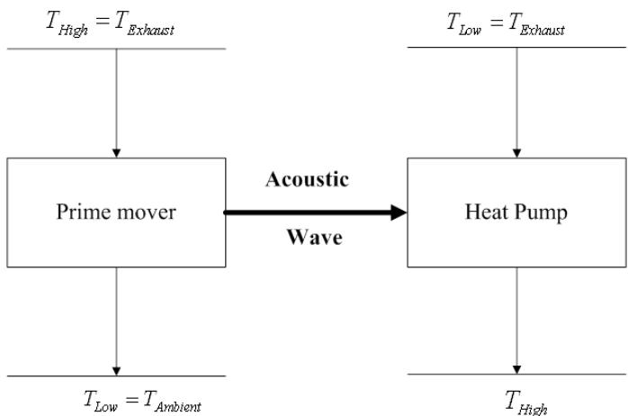  
Figure 1 – Thermoacoustic system: a prime mover coupled with a refrigerator

In the present thermoacoustic prime mover, the engine waste heat and the ambient atmosphere are used as the two temperature reservoirs to generate the required acoustic power. Then, the generated acoustic power flows in a thermoacoustic heat pump (refrigerator) to increase (decrease) the temperature of the air entering the burner (compressor). From a thermodynamic point of view, since the thermoacoustic system uses waste heat to generate the useful heat, the overall cycle efficiency is automatically improved.

A fraction of the waste heat may be passed through the prime mover where the heat content is used to generate some acoustic power. This fraction of the waste heat leaves the prime mover at the ambient temperature and pressure. The generated acoustic power is then employed in the thermoacoustic heat pump (refrigerator) to increase (decrease) the temperature level of the air which may be subsequently forwarded to the burner (compressor) of the base gas turbine engine. The literature on the topic of thermoacoustic is rich and an appraisal on the working principle amply goes beyond the limits of this paper. Nevertheless, a brief introduction is provided in the following paragraphs.

Thermoacoustic systems, including prime movers and heat pumps, may be categorized in two main groups: standing wave and traveling wave thermoacoustic devices. Standing wave thermoacoustic devices have relatively a more simple structure and working mechanism and are of lower efficiency and capacity compared to traveling wave thermoacoustic devices. Here, for simplicity, the working mechanism of a standing wave thermoacoustic heat pump is described. For a more detailed description, the reader is referred to [2].

The main purpose of a thermoacoustic heat pump is to transfer heat from a low reservoir to a high reservoir via consuming acoustic power. The basic mechanism of a standing wave thermoacoustic heat pump is very simple and is based on the wave interaction processes of gas particles with their surrounding environment. The essential components of a standalone thermoacoustic heat pump include an acoustic driver (i.e., a loudspeaker), a resonance tube, a stack of plates, and heat exchangers, Fig.2.

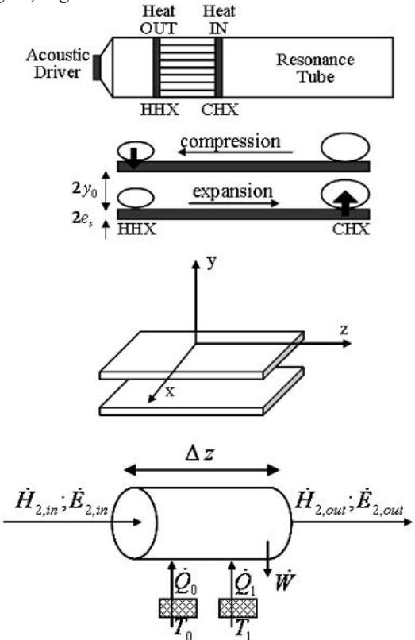  
Figure 2 – Schematic illustration of the fluid and heat transfer behavior of a gas parcel in a standing wave thermoacoustic heat pump

Consider that a loudspeaker generates a standing acoustic wave with wavelength equal to twice the resonator tube length within the tube. The plates are initially in thermal equilibrium with the gas. An acoustic wave which is nothing more than a periodic compression and expansion of gas particles forces the gas particles to undergo pressure and temperature fluctuations. Hence, all gas particles are expanded and cooled as they move to the right and in a similar way compressed and heated as they move to the left. In other words, each gas particle goes through a thermodynamic cycle in which the particle is both compressed and heated and rejects heat at the left end of its oscillation range as well as expanded and cooled and absorbs heat at the right end of its oscillation range. As a result, gas particles transport some heat from cold to the hot during each cycle of the sound wave and trace a local temperature gradient by this oscillatory motion. Finally, the plates will acquire a temperature distribution which at every point has a gradient similar to that traced by the gas particles during their acoustic motion.

The purpose of a thermoacoustic prime mover is to produce acoustic power while transferring heat from a hot reservoir to a cold reservoir. The working mechanism of a standing wave thermoacoustic prime mover is relatively similar to a heat pump. Here, the temperature gradient across the stack serves as the excitation source for the sound wave in the resonator. In this regard, the temperature gradient of the gas parcels inside the stack must be less than the temperature gradient across the stack. Hence, a thermoacoustic system may be envisioned as the coupling of a thermoacoustic heat engine with a thermoacoustic refrigerator. To be precise, the heat engine will take the heat as an input and will deliver sound as an output. Then, in the thermoacoustic refrigerator, this sound is taken as an input to pump heat from a cold reservoir to a hot reservoir.

## IGTTE CYCLE

A base gas turbine engine, as schematically illustrated in Fig. 3, with technical data as given in Table 1, is considered [16-18]. The energy efficiency is calculated based on the chemical energy of the input fuel and the exergetic efficiency is calculated by using equation 9 in section 5 of this paper.

The possible advantages of adding a thermoacoustic system to the base gas turbine engine, IGTTE, Figs. 4, 5, and 6 from an energy and exergy point of view are investigated. Changes in energy and exergy efficiencies of the IGTTE cycle are discussed. The equations for energy and exergy efficiency are obtained by simple thermodynamic analysis. For simplicity, losses such as pressure drop and thermal losses in pipe lines are not considered. Although these assumptions may not lead to very accurate results, they help us to obtain the trend in a simple cycle analysis and a preliminary investigation of the overall integrated engine performance.

A fraction of the exhaust gas from the turbine, determined by 1-α, is used to drive the thermoacoustic prime mover and hence to generate acoustic power. The remaining fraction of the exhaust gas, determined by α, is guided to the heat pump to raise its temperature by thermoacoustic means. The hot gases from the heat pump are then passed through a non-mixing heat exchanger to transfer their energy to the air leaving the compressor.

Figure (4) shows the first configuration of IGTTE hereinafter referred to THG (Thermoacoustic Heat Pump Assisted Gas Turbine).

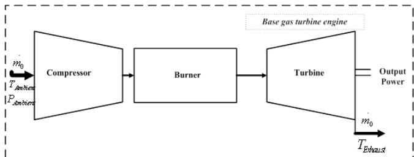  
Figure 3 – Schematic illustration of the base gas turbine engine

Table 1: Technical data of the base gas turbine engine
<table><tr><td>Compression Ratio</td><td>8.5</td></tr><tr><td>Engine Energy Efficiency</td><td>0.17</td></tr><tr><td>Engine Exergetic Efficiency</td><td>0.167</td></tr><tr><td>Output Power (kW)</td><td>116010</td></tr><tr><td>Turbine Inlet Temperature (K)</td><td>1320</td></tr><tr><td>Inlet Air Flow (kg/s)</td><td>497</td></tr><tr><td>Exhaust Temperature (K)</td><td>861</td></tr></table>

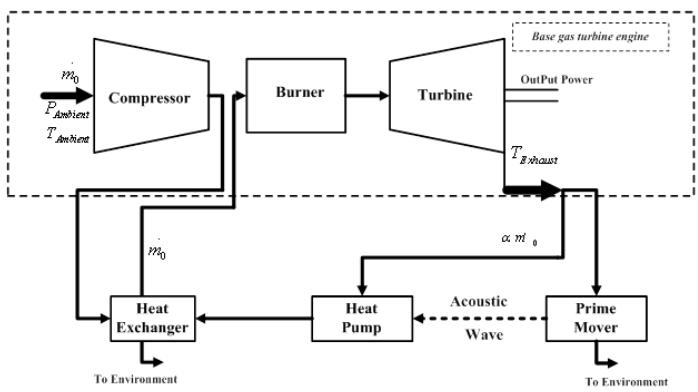  
Figure 4 – THG configuration

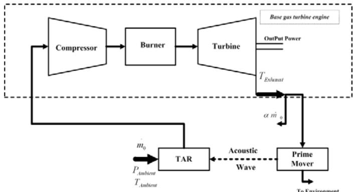  
Figure 5 – TRG configuration

The second configuration of IGTTE, which hereinafter is referred to TRG (Thermoacoustic Refrigerator Assisted Gas Turbine),is shown in figure (5). In this configuration, the acoustic power produced by the thermoacoustic prime mover is transferred to a thermoacoustic refrigerator. The refrigerator consumes the acoustic power and lowers the temperature of the inlet air to the compressor.

Finally, the third configuration of IGTTE, which hereinafter is referred to CTHRG (Combined Thermoacoustic Heat Pump and Refrigeration Assisted Gas Turbine), is shown in figure (6). Here, a fraction of the produced acoustic power (determined by β) is transferred to the heat pump to elevate the temperature level of the exhaust gases and the remained acoustic power is delivered to the thermoacoustic refrigerator to lower the temperature of the air entering the compressor.

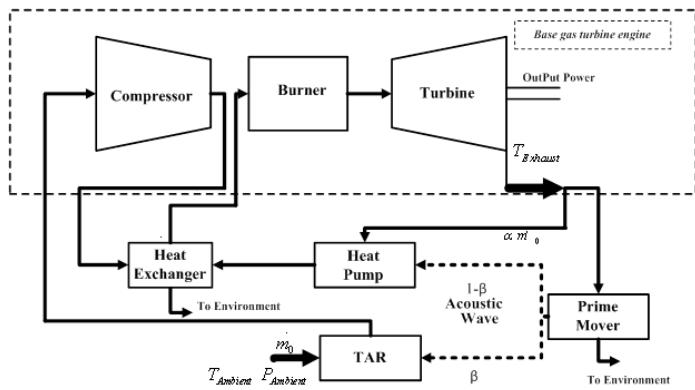  
Figure 6 – CTHRG configuration

## ENERGY ANALYSIS

Previously, a comprehensive cycle analysis from an energy and exergy view point for the abovementioned IGTTE, as outlined in Fig. 4, was performed by the authors [16-18]. The configuration for the base gas turbine engine, regenerative cycle, IGTTE, and the values of the component efficiencies are given in the Appendix. For the energy analysis, it is assumed that the turbine inlet temperature, inlet air flow, compressor pressure ratio, and isentropic efficiencies for compressor and turbine remain constant. Further, the energy efficiency for the thermoacoustic prime mover is assumed as 0.2 (corresponding to 0.3 of Carnot efficiency). It should be emphasized that the efficiencies considered in the present paper are very conservative compared to the ECN report [10].

Figures (7) and (8) represent the values of normalized power gain and normalized SFC reduction, respectively, for the abovementioned three IGTTE configurations as well as the base gas turbine engine equipped with a regenerator called hereafter as REG configuration. It should be taken into consideration that the SFC reduction is defined as follows:

$$
S F C ~ R e d u c t i o n = - \frac { S F C _ { I G T T E ~ o r ~ R E G } - S F C _ { b a s e ~ e n g i n e } } { S F C _ { b a s e ~ e n g i n e } }
$$

It can be seen by inspection from figure (7) that, as expected, there is no change in power for both THG and REG configurations since the recovered exhaust heat is transferred to the air entering the burner and lowering only the fuel input However, while the values for the power gain are relatively high for TRG configuration, they are lower for CTHRG. Further, it is evident that the power gain decreases with mass ratio (α) for both TRG and CTHRG configurations.

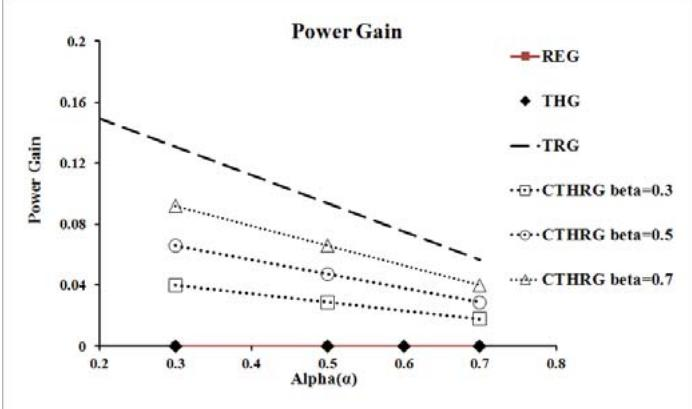  
Figure 7 – Powergain vs. mass ratio (α)

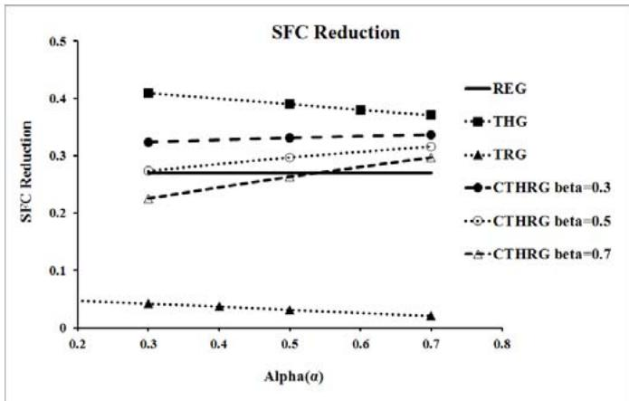  
Figure 8 – SFC reduction vs. mass ratio (α)

In TRG configuration, a lower mass ratio (α) means a higher recovery of the waste heat which results in a higher cooling of the inlet air and consequently a more reduction of the required compressor work. Similar, in CTHRG configuration, an increase of α at a constant β results in a lower transfer of the acoustic power to the refrigerator and so a lower cooling of the inlet air.

From figure (8), it is evident that the value of SFC is decreased for all configurations. Further, in TRG configuration, SFC reduction decreases with increasing mass ratio (α). Also, in THG configuration, SFC reduction decreases with increasing mass ratio (α). The highest value for SFC reduction is obtained in THG configuration where the reduction has a higher trend as α decreases. Further, it can be seen by inspection that SFC reduction decreases with β in CTHRG configuration.

In general, one may conclude from figures (7) and (8) that the THP and CTHRG configurations have lower values of SFC compared to the REG configuration. On the other hand, the TRG configuration provides the highest possible increase in power output at a cost of higher SFC values. Consequently, there is a compromise between the power output and SFC considerations. The CTHRG configuration is a strong candidate to meet both of these requirements.

Figure (9) shows the values of SFC reduction and power gains versus β for CTHRG configuration.

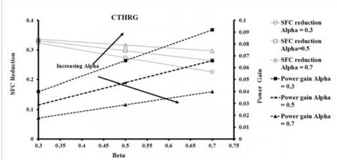  
Figure 9 – SFC and power gains vs. β for different values of α in CTHRG

It can be seen by inspection that while power gain increases with β, SFC reduction is decreased. Further, higher values of α results in lower power gain while SFC reduction increases. The results indicate again of a comprise to be met between the SFC and power gains for reaching an overall optimization.

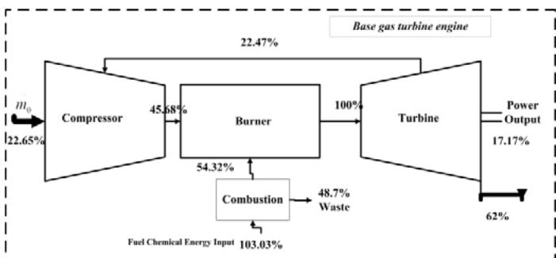  
Figure 10 – Energy flow diagram for the base engine

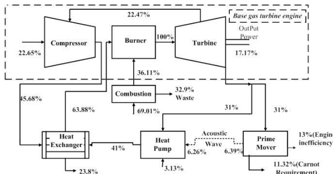  
Figure 11 – Energy flow diagram for THG with α=0.5

Figures (10) and (11) show the energy flow diagrams for the base gas turbine engine and the THG configuration with $\mathrm { \sf { q = } 0 . 5 , }$ respectively.

As evident, the employment of the thermoacoustic subsystem demonstrates that the amount of input fuel will decrease for a fixed power output. It should be also pointed out that the energy waste in the combustion chamber is decreased too (from 48.7% to 32.9%).

## EXERGY ANALYSIS

Exergy analysis is a second law based thermodynamic analysis technique which provides an alternative mean of assessing and comparing processes and systems. In particular, exergy analysis describes how actual performance departures from the ideal and identifies the causes and locations of thermodynamic losses. Consequently, exergy analysis may serve as a valuable assistance in improving and optimizing power plant designs [19]. The exergy of a flowing stream of matter is the sum of the non-flow exergy and the exergy associated with the flow work of the stream [19].

$$
E x _ { f l o w } = E x _ { p h } + E x _ { 0 } + E x _ { k i n } + E x _ { p o t }\tag{1}
$$

Alternatively, it can be expressed in terms of physical, chemical, kinetic, and potential components:

$$
E x _ { 0 } = \sum _ { i } ( \mu _ { i 0 } - \mu _ { i 0 0 } ) N _ { i }\tag{2}
$$

$$
E x _ { f l o w , p h } = ( H - H _ { 0 } ) - T _ { 0 } ( S - S _ { 0 } )\tag{3}
$$

Exergy of thermal energy is expressed as:

$$
E x _ { Q } = \int _ { i } ^ { f } ( 1 - \frac { T _ { 0 } } { T } ) \delta Q\tag{4}
$$

One may obtain the exergy balance by combining the conservation law for energy and non-conservation law for entropy. Exergy is consumed due to irreversibilities and is proportional to entropy creation. While energy is conserved, exergy may serve as a measure of energy quality or work potential.

$$
\begin{array} { c } { { \displaystyle \sum _ { i } m _ { i } e x _ { i } - \sum _ { i } m _ { e } e x _ { e } + \sum _ { i } E x _ { 0 1 , 2 } - \left( E x _ { w 1 , 2 } \right) } } \\ { { - \left( W _ { n e t 1 , 2 } \right) - I _ { 1 , 2 } = E x _ { 2 } - E x _ { 1 } } } \end{array}\tag{5}
$$

In equation (5), the term I represents the exergy destruction. The exergy efficiency is an efficiency based on the $2 ^ { \mathrm { n d } }$ law of thermodynamics (SLT) and is often used to measure the performance of thermodynamic processes. Many of these expressions are based on energy and are thus based on the 1st law of thermodynamics (FLT). Further, one may recall that the SLT-based efficiencies overcome the drawbacks imposed by the FLT-based efficiencies. Finally, considering a control volume at steady-state, the following definition may clarify the difference between the energy and exergy balances:

$$
\begin{array} { l } { \displaystyle \sum ( E n e r g y i n ) = \sum ( E n e r g y o u t p u t i n p r o d u c t ) } \\ { + \sum ( E n e r g y \mathrm { e m i t e t d w i t h w a s t e } ) } \end{array}\tag{6}
$$

$$
\begin{array} { l } { \displaystyle \sum ( E x e r g y i n ) = \sum ( \mathit { E x e r g y o u t p u t i n p r o d u c t } ) } \\ { + \sum ( \mathrm { E n e r g y e m i t e t d w i t h w a s t e } ) } \\ { + \mathrm { E x e r g y d e s t r u c t i o n } } \end{array}\tag{7}
$$

In the above equations, the first term in the RHS equation may refer to the shaft work, power, some kind of heat transfer, exergy of exit streams, or some combination of the above. On the other hand, the combination of the last two terms in the exergy balance will illustrate the exergy losses; i.e., waste heat and stack gases. It should be mentioned that the exergy destruction term in the exergy balance is caused by the internal irreversibility.

Employing the above definitions, one may define energy efficiency η and exergy efficiency Ψ as follows:

$$
\eta = { \frac { e n e r g y o u t p u t i n p r o d u c t } { e n e r g y i n p u t } }\tag{8}
$$

$$
\psi = { \frac { e x e r g y o u t p u t i n p r o d u c t } { e x e r g y i n p u t } }\tag{9}
$$

In addition, one may define further SLT-based efficiencies, rational efficiency and task efficiency, as follows, respectively:

$$
\varepsilon = { \frac { t o t a l e x e r g y o u t p u t } { t o t a l e x e r g y i n p u t } } = 1 - { \frac { e x e r g y d e s t r u c t i o n } { t o t a l e x e r g y i n p u t } }\tag{10}
$$

$$
\tau = \frac { m i n i m u m ~ e x e r g y ~ r e q u i r e d } { e x e r g y ~ i n p u t }\tag{11}
$$

It is clear that while the exergy efficiency shows how exergy input is converted to the useful exergy products and considers the exergy loss as emitted waste and exergy destruction, the rational efficiency only accounts for the destruction of exergy in the component by considering the total exergy output including the products and waste streams.

At this point, the authors would like to point out that, due to the high internal irreversibilities of thermoacoustic refrigerators, a different approach for analysis and optimization is needed. A rational basis for defining the exergy efficiency is the comparison of the COP of the system with the COP of a Carnot system [20]. Hence, the exergy efficiency of the whole system is considered instead of the thermoacoustic refrigerator only.

The thermal and mechanical components of the exergy stream for an ideal gas with constant specific heat may be written as [21]:

$$
\dot { E } ^ { T } = \dot { m } C _ { p } ( T - T _ { 0 } ) - T _ { 0 } l n \frac { T } { T _ { 0 } }\tag{12}
$$

$$
\dot { E } ^ { P } = \dot { m } R T _ { 0 } l n \frac { P } { P _ { 0 } }\tag{13}
$$

Table 2 reports the chemical, thermal, and mechanical exergy flow rates at various state points in the cycle from reference [17,18] which is to be investigated in this paper.

The net flow rates of the exergy crossing the boundary of each component of the base gas turbine plant along with the exergy destruction are shown in Table 3. Positive values indicate the exergy flow rate of products while negative values represent the exergy flow rate of inputs. It should be taken into consideration that the sum of the exergy flow rates of products, inputs, and destruction should equal zero for each component and for the total plant

Table 2: Chemical, thermal, and mechanical exergy flows at various state points of the base gas turbine plant
<table><tr><td>State</td><td>mn(kg/s)</td><td> $T ( K )$ </td><td> $\overline { { P ( b a r ) } }$ </td><td> $E ^ { \dot { C } H E } ( k W )$ </td><td> $\dot { E ^ { T } } ( k W )$ </td><td> $\dot { E ^ { P } } ( k W )$ </td></tr><tr><td>1</td><td>497</td><td>299</td><td>1.013</td><td>0</td><td>0</td><td>0</td></tr><tr><td>2</td><td>497</td><td>603</td><td>8.611</td><td>0</td><td>47034</td><td>91318</td></tr><tr><td>4</td><td>13.8</td><td>299</td><td>30</td><td>696900</td><td>0</td><td>7260</td></tr><tr><td>5</td><td>510.8</td><td>1320</td><td>8.0</td><td>0</td><td>335766</td><td>91015</td></tr><tr><td>6</td><td>510.8</td><td>861</td><td>1.1</td><td>0</td><td>143181</td><td>2613</td></tr></table>

Table 3: Net exergy flow rates and exergy destruction for the base gas turbine plant at rated condition
<table><tr><td>Component</td><td>E&#x27;W(kW)</td><td> $E ^ { \dot { C } H E } ( k W )$ </td><td> $\dot { E ^ { T } } ( k W )$ </td><td>EP(kW)</td><td>ED(kW)</td></tr><tr><td>Compressor</td><td>-151814</td><td>0</td><td>47034</td><td>91318</td><td>13462</td></tr><tr><td>Burner</td><td>0</td><td>-696900</td><td>291210</td><td>-6892</td><td>41573</td></tr><tr><td>Turbine</td><td>267824</td><td>0</td><td>-192585</td><td>-88402</td><td>13163</td></tr><tr><td>Total plant</td><td>116010</td><td>-696900</td><td>144240</td><td>-4630</td><td>439310</td></tr></table>

As a next step, the introduction of a regenerative heat exchanger to the base gas turbine engine is considered and the relevant energy and exergy calculations are repeated. The results are summarized in tables 4 and 5.

Table 4: Property values and chemical, thermal and mechanical exergy flows of the combined heat exchanger and the base gas turbine plant
<table><tr><td>State</td><td>m(kg/s)</td><td>T(K)</td><td>P(bar)</td><td> $E ^ { \dot { C } H E } ( k W )$ </td><td> $\dot { E ^ { T } } ( k W )$ </td><td>EP(kW)</td></tr><tr><td>1</td><td>497</td><td>299</td><td>1.013</td><td>0</td><td>0</td><td>0</td></tr><tr><td>2</td><td>497</td><td>603</td><td>8.611</td><td>0</td><td>47034</td><td>91318</td></tr><tr><td>3</td><td>497</td><td>796</td><td>8.267</td><td>0</td><td>102221</td><td>89580</td></tr><tr><td>4</td><td>10</td><td>299</td><td>30</td><td>508566</td><td>0</td><td>5298</td></tr><tr><td>5</td><td>507</td><td>1320</td><td>8.019</td><td>0</td><td>335766</td><td>91015</td></tr><tr><td>6</td><td>507</td><td>861</td><td>1.075</td><td>0</td><td>143181</td><td>2613</td></tr><tr><td>7</td><td>507</td><td>695</td><td>1.032</td><td>0</td><td>83699</td><td>817</td></tr></table>

Table 5: Net exergy flow rates and exergy destruction in the gas turbine plant with regenerator
<table><tr><td>Component</td><td>E&#x27;W(kW)</td><td>ECHE(kW)</td><td>ET(kW)</td><td>EP(kW)</td><td>ED(kW)</td></tr><tr><td>Compressor</td><td>-151814</td><td>0</td><td>47034</td><td>91318</td><td>13462</td></tr><tr><td>Burner</td><td>0</td><td>-508566</td><td>23354</td><td>-3863</td><td>278884</td></tr><tr><td>Turbine</td><td>267824</td><td>0</td><td>-192585</td><td>-88402</td><td>13163</td></tr><tr><td>Regenerative HX</td><td>0</td><td>0</td><td>-4295</td><td>-3534</td><td>7829</td></tr><tr><td>Total plant</td><td>116010</td><td>-508566</td><td>83699</td><td>-4481</td><td>313338</td></tr></table>

As the third step, the integration of a thermoacoustic subsystem to the base gas turbine engine (THG) is investigated from the exergy point of view. The results are summarized in Tables 6 and 7 for α=0.5 and heat pump COP=1.5.

Table 6: Chemical, thermal, and mechanical exergy flows of THG
<table><tr><td>State</td><td>mn(kg/s)</td><td>T(K)</td><td>P(bar)</td><td> $E ^ { \dot { C } H E } ( \mathbf { k } \mathbf { W } )$ </td><td> $\dot { E ^ { T } } ( \mathbf { k } \mathbf { W } )$ </td><td> $\dot { E ^ { P } } ( k W )$ </td></tr><tr><td>1</td><td>497</td><td>299</td><td>1.013</td><td>0</td><td>0</td><td>0</td></tr><tr><td>2</td><td>497</td><td>603</td><td>8.611</td><td>0</td><td>47034</td><td>91318</td></tr><tr><td>3</td><td>497</td><td>808</td><td>8.6</td><td>0</td><td>116760</td><td>91320</td></tr><tr><td>4</td><td>9.19</td><td>299</td><td>30</td><td>463480</td><td>0</td><td>4830</td></tr><tr><td>5</td><td>506.8</td><td>1320</td><td>8.019</td><td>0</td><td>335766</td><td>91015</td></tr><tr><td>6</td><td>506.8</td><td>861</td><td>1.075</td><td>0</td><td>143181</td><td>2613</td></tr><tr><td>9</td><td>253.4</td><td>299</td><td>1.013</td><td>0</td><td>0</td><td>0</td></tr><tr><td>10</td><td>253.4</td><td>1150</td><td>1.013</td><td>0</td><td>106290</td><td>0</td></tr><tr><td>11</td><td>253.4</td><td>739</td><td>1.013</td><td>0</td><td>27270</td><td>0</td></tr></table>

Table 7: Net exergy flow rates and exergy destruction of THG
<table><tr><td>Component</td><td> $E ^ { \dot { w } } ( k W )$ </td><td> $E ^ { \dot { C } H E } ( k W )$ </td><td> $\dot { E ^ { T } } ( k W )$ </td><td> $\dot { E ^ { P } } ( k W )$ </td><td> $\dot { E ^ { D } } ( \mathrm { k W } )$ </td></tr><tr><td>Compressor</td><td>-151814</td><td>0</td><td>47034</td><td>91318</td><td>13462</td></tr><tr><td>Burner</td><td>0</td><td>-463480</td><td>219010</td><td>-5130</td><td>249600</td></tr><tr><td>Turbine</td><td>267824</td><td>0</td><td>-192585</td><td>-88402</td><td>13163</td></tr><tr><td>TA</td><td>0</td><td>0</td><td>-46190</td><td>-2610</td><td>48800</td></tr><tr><td>subsystem Total plant</td><td>116010</td><td>-463480</td><td>27270</td><td>-4830</td><td>325030</td></tr></table>

As a next step, the integration of a thermoacoustic subsystem to the base gas turbine engine (TRG) is investigated from the exergy point of view. The results are summarized in Tables 8 and 9 for $\mathtt { q } { = } 0 . 5$ and thermoacoustic refrigerator COP=0.25.

Table 8: Chemical, thermal, and mechanical exergy flows of TRG
<table><tr><td>State</td><td>m(kg/s)</td><td>T(K)</td><td>P(bar)</td><td> $E ^ { \dot { C } H E } ( \mathbf { k } \mathbf { W } )$ </td><td> $\dot { E } ^ { T } ( \mathbf k \mathbf W )$ </td><td> $\dot { E ^ { P } } ( k W )$ </td></tr><tr><td>1</td><td>497</td><td>269.5</td><td>1.013</td><td>0</td><td>790</td><td>0</td></tr><tr><td>2</td><td>497</td><td>543.5</td><td>8.611</td><td>0</td><td>32780</td><td>91320</td></tr><tr><td>4</td><td>13</td><td>299</td><td>30</td><td>761770</td><td>0</td><td>7936</td></tr><tr><td>5</td><td>510</td><td>1320</td><td>8.19</td><td>0</td><td>335770</td><td>91015</td></tr><tr><td>6</td><td>510</td><td>861</td><td>1.075</td><td>0</td><td>143180</td><td>2613</td></tr><tr><td>9</td><td>255</td><td>299.1</td><td>1.013</td><td>0</td><td>0</td><td>2613</td></tr><tr><td>12</td><td>497</td><td>299.1</td><td>1.013</td><td>0</td><td>0</td><td>0</td></tr></table>

Table 9: Net exergy flow rates and exergy destruction of TRG
<table><tr><td>Component</td><td> $E ^ { \dot { w } } ( k W )$ </td><td> $E ^ { \dot { C } H E } ( k W )$ </td><td> $\dot { E ^ { T } } ( k W )$ </td><td> $\dot { E ^ { P } } ( k W )$ </td><td> $\dot { E ^ { D } } ( \mathbf { k W } )$ </td></tr><tr><td>Compressor</td><td>-140940</td><td>0</td><td>36287</td><td>91320</td><td>13335</td></tr><tr><td>Burner</td><td>0</td><td>-745000</td><td>299090</td><td>-8066.1</td><td>453980</td></tr><tr><td>Turbine</td><td>267824</td><td>0</td><td>-192585</td><td>-88402</td><td>13163</td></tr><tr><td>TA subsystem</td><td>0</td><td>0</td><td>-71198</td><td>1306.5</td><td>69891</td></tr><tr><td>Total plant</td><td>126880</td><td>-745000</td><td>71590.5</td><td>-3841.6</td><td>550370</td></tr></table>

Finally, the integration of a thermoacoustic subsystem to the base gas turbine engine (CTHRG) is investigated from the exergy point of view. The results are summarized in Tables 10 and 11 for α=0.5 and β=0.5.

Table 10: Chemical, thermal, and mechanical exergy flows of CTHRG
<table><tr><td>State</td><td>m(kg/s)</td><td>T(K)</td><td>P(bar)</td><td> $E ^ { \dot { C } H E } ( k W )$ </td><td> $\dot { E ^ { T } } ( k W )$ </td><td> $\dot { E ^ { P } } ( k W )$ </td></tr><tr><td>1</td><td>497</td><td>288</td><td>1.013</td><td>100</td><td>0</td><td>0</td></tr><tr><td>2</td><td>497</td><td>581</td><td>8.611</td><td>41750</td><td>91320</td><td>0</td></tr><tr><td>3</td><td>497</td><td>787</td><td>8.611</td><td>99020</td><td>91320</td><td>0</td></tr><tr><td>4</td><td>10.1881</td><td>299</td><td>30</td><td>0</td><td>5398</td><td>518130</td></tr><tr><td>5</td><td>510</td><td>1320</td><td>8.19</td><td>335770</td><td>91015</td><td>0</td></tr><tr><td>6</td><td>510</td><td>861</td><td>1.075</td><td>143180</td><td>2613</td><td>0</td></tr><tr><td>12</td><td>497</td><td>299</td><td>1.013</td><td>0</td><td>0</td><td>0</td></tr><tr><td>13</td><td>255</td><td>861</td><td>1.075</td><td>71590</td><td>1306</td><td>0</td></tr><tr><td>14</td><td>255</td><td>861</td><td>1.075</td><td>71590</td><td>1306</td><td>0</td></tr><tr><td>15</td><td>255</td><td>1026</td><td>1.075</td><td>91680</td><td>1301</td><td>0</td></tr><tr><td>16</td><td>255</td><td>626</td><td>1.075</td><td>27160</td><td>1301</td><td>0</td></tr><tr><td>17</td><td>255</td><td>299</td><td>1.013</td><td>0</td><td>0</td><td>0</td></tr></table>

Table 11: Net exergy flow rates and exergy destruction of CTHRG
<table><tr><td>Component</td><td> $E ^ { \dot { w } } ( k W )$ </td><td> $E ^ { \dot { C } H E } ( k W )$ </td><td>ET(kW)</td><td>EP (kW)</td><td>ED(kW)</td></tr><tr><td>Compressor</td><td>-146310</td><td>0</td><td>41659</td><td>91320</td><td>13335</td></tr><tr><td>Burner</td><td>0</td><td>-518130</td><td>236750</td><td>-5702.7</td><td>287080</td></tr><tr><td>Turbine</td><td>267824</td><td>0</td><td>-192585</td><td>-88402</td><td>13163</td></tr><tr><td>TA subsystem</td><td>0</td><td>0</td><td>-58665</td><td>-1312.4</td><td>59977</td></tr><tr><td>Total plant</td><td>121510</td><td>-518.13</td><td>27160</td><td>-4097.1</td><td>373560</td></tr></table>

Table 12a illustrates the exergy and rational efficiency of each component of the base gas turbine plant as well as that of the total plant. It can be seen by inspection that the exergy efficiency of the combustion chamber is lower than that of the other components due to the high irreversibility. Further, it is evident that a large extent of the exergy output is in the form of waste heat through the exhaust gases (20% of the exergy input which is presented by the difference between the turbine exergy and rational efficiency) which may be recovered and further utilized.

Table 12a: Exergy and rational efficiency for components of the base gas turbine engine
<table><tr><td>Component</td><td>Exergy Efficiency</td><td>Rational Efficiency</td></tr><tr><td>Compressor</td><td>0.91</td><td>0.91</td></tr><tr><td>Burner</td><td>0.51</td><td>0.51</td></tr><tr><td>Turbine</td><td>0.63</td><td>0.97</td></tr><tr><td>Plant</td><td>0.167</td><td>0.38</td></tr></table>

Table 12b illustrates the exergy and rational efficiency of each component of the base gas turbine plant, the regenerator, and the total plant.

Table 12b: Exergy and rational efficiency for components of the base gas turbine engine with regenerator
<table><tr><td>Component</td><td>Exergy Efficiency</td><td>Rational Efficiency</td></tr><tr><td>Compressor</td><td>0.91</td><td>0.91</td></tr><tr><td>Burner</td><td>0.60</td><td>0.60</td></tr><tr><td>Regenerator</td><td>0.67</td><td>0.97</td></tr><tr><td>Turbine</td><td>0.97</td><td>0.97</td></tr><tr><td>Plant</td><td>0.22</td><td>0.39</td></tr></table>

A comparison of the above tables reveals that the exergy efficiency of the burner is improved by 9% through the utilization of the regenerative heat exchanger and consequently there is an improvement of 5% in the total plant efficiency. Further, it can be seen by inspection that the integration of the regenerator causes the exergy efficiency of the turbine to become equal to the rational efficiency due to the fact that the exergy of the exhaust gases are recovered and is considered as useful exergy output.

Table 12c illustrates the exergy and rational efficiency of each component of the THG as well as that of the total plant. It is apparent that while the integration of the regenerator increases the rational efficiency and the integration of thermoacoustic subsystem (with heat pump COP =1.5 and α=0.5) decreases the rational efficiency of the plant, it increases the exergy efficiency approximately by 3-4% over the regenerative cycle which is favorable to the user. In addition, increasing the heat pump COP and/or prime mover efficiency results in higher rational and exergy efficiencies.

Table 12c: Exergy and rational efficiency for components of THG
<table><tr><td>Component</td><td>Exergy Efficiency</td><td>Rational Efficiency</td></tr><tr><td>Compressor</td><td>0.91</td><td>0.91</td></tr><tr><td>Burner</td><td>0.63</td><td>0.63</td></tr><tr><td>Turbine</td><td>0.97</td><td>0.97</td></tr><tr><td>TA subsystem</td><td>0.73</td><td>0.83</td></tr><tr><td>Plant</td><td>0.25</td><td>0.30</td></tr></table>

Table 12d illustrates the exergy and rational efficiency of each component of the TRG as well as that of the total plant.

Table 12d: Exergy and rational efficiency for components of TRG
<table><tr><td>Component</td><td>Exergy Efficiency</td><td>Rational Efficiency</td></tr><tr><td>Compressor</td><td>0.91</td><td>0.91</td></tr><tr><td>Burner</td><td>0.48</td><td>0.48</td></tr><tr><td>Turbine</td><td>0.97</td><td>0.97</td></tr><tr><td>TA subsystem</td><td>0.0054</td><td>0.0054</td></tr><tr><td>Plant</td><td>0.169</td><td>0.27</td></tr></table>

Table 12erepresents the exergy and rational efficiency of each component of the TRG as well as that of the total plant.

Table 12e: Exergy and rational efficiency for components of CTHRG
<table><tr><td>Component</td><td>Exergy Efficiency</td><td>Rational Efficiency</td></tr><tr><td>Compressor</td><td>0.91</td><td>0.91</td></tr><tr><td>Burner</td><td>0.6</td><td>0.6</td></tr><tr><td>Turbine</td><td>0.97</td><td>0.97</td></tr><tr><td>TA subsystem</td><td>0.68</td><td>0.78</td></tr><tr><td>Plant</td><td>0.23</td><td>0.29</td></tr></table>

From tables 12a-e, one may conclude that the integration of thermoacoustic subsystems with gas turbine engine increases the exergy efficiency while decreasing the rational efficiency. Further, while the exergy efficiency of the burner is decreased in TRG, it is increased in THG and CTHRG due to the preheating of the air entrainment to the burner.

It should be emphasized that, in this study, the assumed values for efficiency of the heat engine and non-mixing heat exchanger and the COP of the thermoacoustic heat pump, are conservatively low. It can be seen that the thermoacoustic subsystems divide the exergy of the exhaust flow into two parts. While the first part is inverted to useful shaft work, the second part is destroyed in the thermoacoustic subsystem.

Table 12 illustrates that, for IGTTE, the exergy efficiency is improved greatly. On the other hand, an inspection of Tables 5-11 reveals that the exergy destruction of IGTTE is greater; however, IGTTE recovers the emitted exergy from the hot exhaust gas. Therefore, if one is interested in the shaft work output, the thermoacoustic system can be a suitable choice. Further, it is evident that by integrating the thermoacoustic system into the base gas turbine plant, the exergy output from the cycle in the form of waste heat is greatly decreased.

Figure (12) represents the exergetic efficiency gains for different configurations. As illustrated, the exergetic efficiency gain for TRG configuration is relatively low and decreases as α increases. In addition, the value of exergetic efficiency gain for THG configuration decreases as α increases. Further, the value of exergetic efficiency gain decreases as β increases for CTHRG configuration.

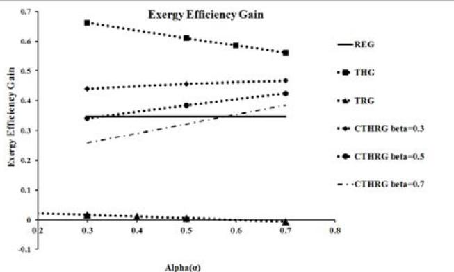  
Figure 12 – Exergetic efficiency gain vs. mass ratio

Figures (13) and (14) show the variation of rational efficiency gain as well as the exergy waste and exergy destruction with the mass ratio (α), respectively.

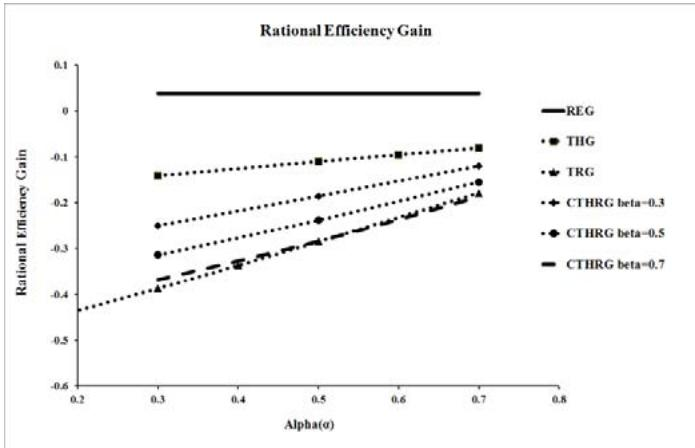  
Figure13 – Rational efficiency gain vs. mass ratio

It can be seen by inspection that thermoacoustics tends to decrease the rational efficiency except in THG configuration. It should be recalled that the exergy of the exhaust flow is divided in two parts. While the first part is converted to useful shaft work, the second part is destroyed in the thermoacoustic subsystem.

Figure (15) shows the exergy efficiency and power gains for CTHRG for different values of α and β. For a constant α, the exergy efficiency gain decreases while the power gain increases with β. In addition, for a constant β, the exergy efficiency gain and the power gain decreases as α increases. Consequently, a proper selection of α and β depends strongly on the purpose of the cycle improvement which can be either an efficiency oriented- or a power gain oriented optimization.

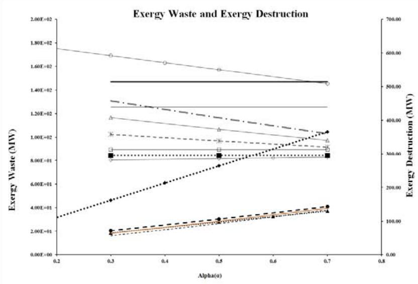

Figure 14 – Exergy waste and exergy destruction vs. mass ratio  
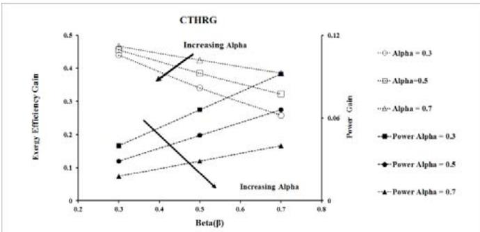  
Figure15 – Exergy efficiency gain and power gain vs. β

## CONCLUSION

Performance enhancement of a small gas turbine power plant through possible scenarios in utilizing thermoacoustic systems is investigated. A simple gas turbine cycle is selected as the base cycle. The exergy of the exhaust flow of the base gas turbine cycle is divided in two parts. While the first part is converted to useful shaft work, the second part is destroyed in the thermoacoustic subsystem. The thermoacoustic subsystem, considered in this paper, is powered only by the waste heat of the gas turbine.

Three different integrated gas turbine thermoacoustic configurations are considered: a thermoacoustic heat pump assisted gas turbine (THG), a thermoacoustic refrigerator assisted gas turbine (TRG), and a combined thermoacoustic heat pump and refrigeration assisted gas turbine (CTHRG). Energy and exergy analysis of these configurations are compared with those from the base gas turbine engine with and without a regenerator.

The results indicate that by employing the thermoacoustic subsystem not only the exergy efficiency for the overall plant increases but also the exergy waste will be reduced substantially. Further, a cycle optimization, and hence a proper selection of the thermoacoustic configuration along with the associated α and β, depends on the purpose and application of the base gas turbine engine.

Finally, the authors would like to emphasize that, in this study, the values for efficiency of thermoacoustic heat pump/refrigerator and heat engine are considered conservatively very low. Obviously, an improvement in the efficiency of the thermoacoustic system may turn this technology into a potential alternative to conventional waste heat recovery technologies in large scale plants. The authors believe that in small scale power plant where it is not technically or economically possible to utilize the waste heat, thermoacoustic is a good candidate for improving the overall efficiency.

## ACKNOWLEDGMENTS

The present work has been supported in part by the office of research at Sharif University of Technology.

## REFERENCES

[1] Poullikkas, A., “An Overview of Current and Future Sustainable Gas Turbine Technologies", Renewable and Sustainable Energy Reviews, Vol. 30, 2005, pp. 409-443.

[2] Swift, G.W., "Thermoacoustic Engines," Journal of the Acoustical Society of America, Vol. 84, 1998, pp. 1145-1180.

[3] Swift, G.W., "Thermoacoustics: A Unifying Perspective for Some Engines and Refrigerators", Melville: Acoustic Society of America, 2002.

[4] Tijani, M.E.H., Zeegers, J.C.H., and De Waele, A.T.A.M., "Design of Thermoacoustic Refrigerators", Journal of Cryogenics, Vol. 42, 2002.

[5] Tijani, M.E.H. and Spoelstra S., "Study of Coaxial ThermoacousticStirling Cooler", Journal of Cryogenics, Vol. 48, 2008.

[6] Rott, N., "Damped and Thermally Driven Acoustic Oscillations in Wide and Narrow Tubes," Z. Angew. Math. Phys., Vol. 20, pp. 230-243, 1969.

[7] Symko, O.G., Abdel-Rahman, E., Kwon, Y.S., Emmi, M. and Behunin, R., "Design and Development of High-Frequency Thermoacoustic Engines for Thermal Management in Microelectronics" Micro Electronics Journal, Vol. 35, 2004.

[8] Hatazawa, M., Sugita, H., Ogawa, T., and Seo, Y., "Performance of a Thermoacoustic Sound Wave Generator Driven with Waste Heat of Automobile Gasoline Engine", Trans. Japan Soc. Mech. Eng., 70, pp. 292-299, 2004.

[9] Zoontjens, L., Howard, C., Zander, A., and Cazzolate, B., "Feasibility Study of an Automotive Thermoacoustic Refrigerator", Proceedings of Acoustics, Busselton, Australia, November 9-11, 2005.

[10] Spoelstra, S., "Record of Efficiency in Conversion of Heat to Sound", ECN Energy Efficiency in Industry, 15 January 2009.

[11] Babaei, H. and Seddiqui, K., "Sustainable Thermoacoustic Refrigeration System for Gas Turbine Power Plants", IAGT 2007.

[12] Piccolo, A. and Cannistraro, G., “Convective Heat Transport along a Thermoacoustic Couple in the Transient Regime “, International Journal of Thermal Sciences, Vol. 41, pp.1067–1075, 2002.

[13] Arman, B., Wollan, J., Kotsubo, V., Backhaus, S., and Swift, G., "Operation of ThermoacousticStirling Heat Engine Driven Large Multiple Pulse Tube Refrigerators", proceedings of the 13th Int'lCryocooler Conf.

[14] Spoelstra, S. and Tijani, M.," Thermoacoustic Heat Pumps for Energy Savings", Conf. "Boundary Crossing Acoustics", Acoustical Society of the Netherlands 2005.

[15] Swift, G. and Wollan, J., “Thermoacoustics for Liquefaction of Natural Gas ", LNG Technology, 2002.

[16] Ghorbanian, K., Karimi, M., and Gholamrezaei, M., “Application of Thermoacoustics in Small Gas Turbine Power Plants", 8th Annual International Energy Conversion Engineering Conference, AIAA 2010.

[17] Ghorbanian, K. and Karimi, M., "Exergy Analysis of an Integrated Gas Turbine Thermoacoustic Engine", International conference on Energy Sustainability, ASME2010.

[18] Karimi, M., Ghorbanian, K., Gholamrezaei, M., "Energy and Exergy Analysis of an Integrated Gas Turbine Thermoacoustic", Accepted for Publication, International Journal of Power and Energy, 2010.

[19] Dincer, I. and Rosen, M.A., "Exergy, Energy, Environment and Sustainable Development"2007.

[20] Razani, A., Roberts, T., andFlake, B., "The Second-Law Based Thermodynamic Optimization Criteria for Pulse Tube Refrigerators",Cryocoolers 14, 2007.

[21] Ebadi, M. and Gorji, M., "Exergetic Analysis of Gas Turbine Plants", International Journal of Exergy, Vol. 2, No.1, pp.31-39, 2005.

## APPENDIX

## State Point Locations

Fig. A-1 shows the configuration of the base gas turbine engine. The incoming air has a temperature of 26°C and a pressure of 1.013 bar. The compressor and turbine have an isentropic efficiency of 0.83 and 0.88, respectively. The fuel is injected at 26°C and 30 bar.

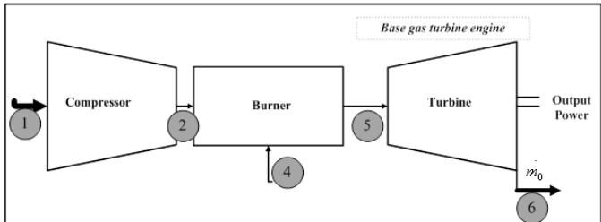  
Figure A-1: Base Gas Turbine Engine

Fig. A-2 shows the configuration of the base gas turbine engine with regenerator. The incoming air has a temperature of 26°C and a pressure of 1.013 bar. The compressor and turbine have an isentropic efficiency of 0.83 and 0.88, respectively. The fuel is injected at 26°C and 30 bars. The regenerative heat exchanger has an effectiveness of 0.75.

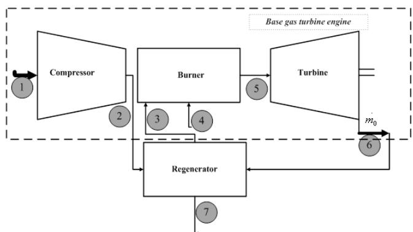  
Figure A-2: Base Gas Turbine Engine with Regenerator

Fig. A-3 shows the configuration of the THG. The incoming air has a temperature of 26°C and a pressure of 1.013 bar. The compressor and turbine have an isentropic efficiency of 0.83 and 0.88, respectively. The fuel is injected at 26°C and 30 bars. Investigated efficiencies for the thermoacoustic prime mover and COPs for the heat pump are 0.2 and 1.5, 2respectively.

Fig. A-4 shows the configuration of the TRG. The incoming air has a temperature of $2 6 \mathrm { { } ^ { \circ } C }$ and a pressure of 1.013 bar. The compressor and turbine have an isentropic efficiency of 0.83 and 0.88, respectively. The fuel is injected at 26°C and 30 bars. Investigated efficiencies for the thermoacoustic prime mover and COP for the Refrigerator are 0.2 and 0.25respectively.

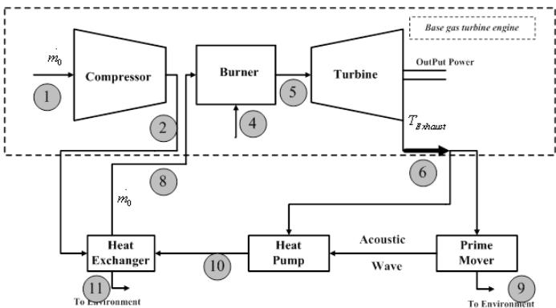  
Figure A-3: THG Configuration

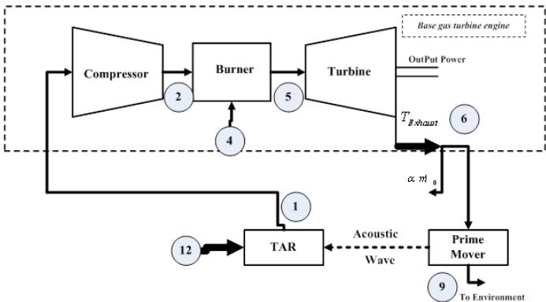  
Figure A-4: TRG Configuration

Fig. A-5 shows the configuration of the CTHRG. The incoming air has a temperature of 26°C and a pressure of 1.013 bar. The compressor and turbine have an isentropic efficiency of 0.83 and 0.88, respectively. The fuel is injected at 26°C and 30 bars. Investigated efficiencies for the thermoacoustic prime mover and COP for the heat pump/Refrigerator are 0.2 and 2/0.25 respectively.

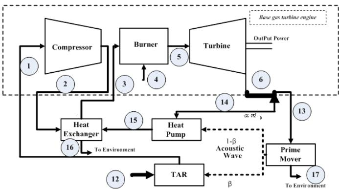  
Figure A-5: CTHRG Configuration