Research Paper

# Efficient cascade waste heat utilization using thermoacoustic engine with variable temperature heat sources

Yiwei Hu a,b, Zhijie Jiang a,c,d, Kaiqi Luo e, Dan Zhao f, Yuanhang Chen a,b, Geng Chen g, Ercang Luo a,b,1,\*, Jingyuan Xu h,1,\*

a Key Laboratory of Cryogenic Science and Technology, Technical Institute of Physics and Chemistry, Chinese Academy of Sciences, Beijing 100190, China b University of Chinese Academy of Sciences, Beijing 100049, China

c Institute of Refrigeration and Cryogenics, Zhejiang University, Hangzhou 310027, China

d The Institute of Service-oriented Manufacturing (Hangzhou) CO., LTD. Hangzhou 310027, China

e State Key Laboratory of Mesoscience and Engineering, Institute of Process Engineering, Chinese Academy of Sciences, Beijing 100190, China

f Department of Mechanical Engineering, College of Engineering, University of Canterbury, Private Bag 4800, Christchurch, 8041, New Zealand

g National Engineering Research Center of Power Generation Control and Safety, School of Energy and Environment, Southeast University, Nanjing 210096, China

h Institute of Microstructure Technology, Karlsruhe Institute of Technology, Karlsruhe 76344, Germany

## A R T I C L E I N F O

Keywords:   
Thermoacoustic   
Multi-stage heat exchangers   
Waste heat recovery   
Bypasses

## A B S T R A C T

Waste heat recovery is vital for greenhouse gas emissions reduction and meeting increasing power demands. Thermoacoustic engines present a promising solution. However, existing research predominantly focuses on single heating temperatures, which restricts their efficiency in harnessing heat sources with variable temperatures. To overcome this limitation, this work proposed a novel concept of thermoacoustic engine containing multistage heat exchangers capable of cascade waste heat recovery by incorporating bypass orifices to address this issue. By organizing decreasing temperatures of heat source across heat exchangers with decreasingly lower temperatures, multiple heat-to-power energy conversions can be achieved. Theoretical analyses demonstrate that the total exergy utilization efficiency of single-stage (37.7 %), two-stage (47.6 %), and three-stage systems (51.2 %) significantly increases when increasing the stage number up to three. Further increasing the stage number results in less efficiency improvement (only a 1.3 % increase in a four-stage system). Simulation results show that the three-stage thermoacoustic engine can achieve an acoustic power of 2.7 kW and a total exergy utilization efficiency of 51.2 % for recovering 12 kW variable-temperature heat sources. Coupling the engine with a linear alternator increases electricity production by 12 % with higher waste heat utilization rate compared to traditional single-stage thermoacoustic generators. The experimental results further underscore the capability of the proposed thermoacoustic generator to effectively utilize heat sources with variable temperatures.

## 1. Introduction

Industrialization and population growth are driving a continuous increase in the world’s energy demand by 28 % between 2015 and 2040 [1,2], leading to increased attention on energy conservation and emission reduction. Waste heat recovery is a promising technology to supplement current electricity production since it offers the potential for efficient energy use and reduced greenhouse gas emissions. The primary sources of waste heat include biomass [3,4], nuclear [5,6], geothermal [7,8], and industrial processes [9,10], with the current main waste heat recovery systems being heat pumps [11,12] and organic Rankine cycles [13]. However, these systems are typically designed for larger scales, on the order of megawatts, which makes them cost-effective but inefficient when scaled down to smaller sizes. This creates a gap in waste heat recovery for rural and impoverished areas worldwide, where smallerscale waste heat sources are abundant but overlooked by the larger systems. As a result, there is a growing demand for waste heat recovery systems that operate at either kilowatt or hectowatt scales.

The rational use of renewable energy represents a viable option for increasing energy efficiency and reducing greenhouse gas emissions. The thermoacoustic engine has broad application scenarios in the utilization of renewable energies, such as solar energy, geothermal energy, etc. [14,15], as well as the utilization of waste heat at various temperatures. One of its key advantages is high reliability and long lifespan, attributed to the absence of mechanical moving parts [16,17]. Furthermore, its environmental compatibility is enhanced by the utilization of eco-friendly working fluids, such as air, helium, and nitrogen [18,19]. When powered by waste heat, thermoacoustic engines present an economical and eco-conscious energy solution, catering to domestic and industrial needs [20].

<table><tr><td colspan="2">Nomenclatures</td><td> $T _ { 0 }$ </td><td>ambient temperature, K</td></tr><tr><td colspan="2"></td><td> $T _ { h }$   $T _ { i }$ </td><td>initial temperature of variable-temperature heat source, K temperature of the i-th HHX of the n-stage thermoacoustic</td></tr><tr><td>Symbols  $A$ </td><td>cross section area  $\mathrm { m } ^ { 2 }$ </td><td></td><td>engine, K</td></tr><tr><td> $A _ { o }$ </td><td> $\mathrm { m } ^ { 2 }$ </td><td></td><td>temperature of heat after heat exchange with n-th stage</td></tr><tr><td> $A _ { h }$ </td><td>cross-section area of the orifice, housing area,  $\mathrm { ~ m } ^ { 2 }$ </td><td> $T _ { n }$ </td><td>HHX, K</td></tr><tr><td> $C _ { d }$ </td><td>discharge coefficient</td><td> $T _ { w }$ </td><td>surface temperature, K</td></tr><tr><td> $C _ { p }$ </td><td>specific heat capacity at constant pressure, J/(kg·K)</td><td>u</td><td>mean-flow velocity,  $\mathbf { m } / s$ </td></tr><tr><td> $d _ { h }$ </td><td>hydraulic diameter, mm</td><td> $U _ { 1 }$ </td><td>first-order flow rate,  $\mathbf { m } / s$ </td></tr><tr><td> $D _ { p }$ </td><td>diameter of piston, mm</td><td> $V _ { b }$ </td><td>volume of back space,  $\mathfrak { m } ^ { 3 }$ </td></tr><tr><td> $e$ </td><td>a defined term,  $\kappa + u ^ { 2 } / 2 .$ </td><td> $V _ { f }$ </td><td>volume of front space,  $\mathbf { m } ^ { 3 }$ </td></tr><tr><td> $E _ { n }$ </td><td>actual utilized exergy of the system, W</td><td> $W _ { a }$ </td><td>acoustic power, W</td></tr><tr><td> $E _ { n , \mathrm { m a x } }$ </td><td>maximum utilized exergy of the system under Carnot</td><td> $W _ { e l e c }$ </td><td>outlet electric power, W</td></tr><tr><td></td><td>efficiency, W</td><td> $W _ { e , h }$ </td><td>output electric power, W</td></tr><tr><td> $E _ { n , o p t }$ </td><td>optimal utilized exergy of the system, W</td><td> $W _ { i n }$ </td><td>acoustic power at the inlet of thermoacoustic engine, W</td></tr><tr><td> $E _ { t o t a l }$ </td><td>total exergy contained in the waste heat source, W</td><td></td><td>acoustic power at the outlet of thermoacoustic engine, W</td></tr><tr><td> $f$ </td><td>Darcy friction factor</td><td> $W _ { o u t }$   $z$ </td><td>acoustic impedance, Pa·s/m³</td></tr><tr><td> $F$ </td><td>viscous pressure gradient</td><td></td><td></td></tr><tr><td> $h$ </td><td> ${ \sf W } / { \left( { \bf { m } } ^ { 2 } { \cdot } { \bf { K } } \right) }$  surface convective heat transfer coefficient,</td><td>Greek letters</td><td></td></tr><tr><td> $i$ </td><td> $n ^ { \mathrm { t h } }$  typical stage of thermoacoustic engine; image unit</td><td>Nalt</td><td>engine acoustic-to-electric efficiency</td></tr><tr><td> $k$ </td><td>gas conductivity</td><td> $\eta _ { t a }$ </td><td>engine thermal-to-acoustic efficiency</td></tr><tr><td> $K$ </td><td>total local loss coefficient</td><td> $\eta _ { t e }$ </td><td>engine thermal-to-electric efficiency</td></tr><tr><td> $K _ { m }$ </td><td>stiffness, N/m</td><td> $\eta _ { e x }$ </td><td>exergy efficiency</td></tr><tr><td>L</td><td>length of heat exchanger or regenerator, m</td><td> $\eta _ { e x , e n }$ </td><td>exergy efficiency of the engine</td></tr><tr><td> $M _ { p }$ </td><td>mass of piston, kg</td><td> $\eta _ { e x , g e }$ </td><td>exergy efficiency of the generator</td></tr><tr><td> $m$ </td><td>mass, kg</td><td> $\rho$ </td><td>gas density,  ${ \mathrm { k g / m } } ^ { 3 }$ </td></tr><tr><td> $n$ </td><td>stage number</td><td> $\rho _ { \mathrm { e } }$ </td><td>representative density</td></tr><tr><td> $N u$ </td><td>Nusselt number</td><td> $\kappa$ </td><td>mass-specific internal gas energy</td></tr><tr><td> $P$ </td><td>Pressure wave, Pa</td><td> $\tau$ </td><td>motor constant, N/A</td></tr><tr><td> $Q _ { i }$ </td><td>input thermal power of the i-th stage, W</td><td> $\theta _ { p u }$ </td><td>phase angle of pressure wave and mean-flow velocity,°</td></tr><tr><td> $Q _ { n }$ </td><td>actual input thermal power of the ststem, W</td><td colspan="2">Special symbol</td></tr><tr><td> $Q _ { n , \mathrm { m a x } }$ </td><td>maximum input thermal energy of n-stage the system</td><td></td><td>notation for an imaginary value</td></tr><tr><td></td><td>under Carnot efficiency, W</td><td>i Re[]</td><td>real part of</td></tr><tr><td> $Q _ { t o t a l }$ </td><td>total thermal energy contained in the waste heat sources,</td><td>Im[]</td><td>imaginary part of</td></tr><tr><td></td><td>W</td><td>II</td><td>magnitude of the complex number</td></tr><tr><td> $Q _ { w }$ </td><td>heat flow per unit length through the surface perpendicular to the axial direction due to the film heat</td><td>*</td><td>complex conjugation</td></tr><tr><td></td><td>transfer</td><td> $\Delta P$ </td><td>flow drop</td></tr><tr><td> $q$ </td><td>gas axial-conductive heat flux</td><td>Abbreviation</td><td></td></tr><tr><td> $r _ { e x }$ </td><td>total exergy utilization efficiency</td><td>AHX</td><td>ambient temperature heat exchanger</td></tr><tr><td> $r _ { Q }$ </td><td>waste heat utilization rate</td><td>BP</td><td>bypass</td></tr><tr><td> $R _ { e , i n }$ </td><td>internal resistance of piston, Ω</td><td>HHX</td><td>high temperature heat exchanger</td></tr><tr><td> $R _ { e , o u t }$ </td><td>external resistance of piston, Ω</td><td>REG</td><td>regenerator</td></tr><tr><td> $R m$ </td><td>resistance of piston, kg/s</td><td>SAHX</td><td>secondary ambient temperature heat exchanger</td></tr><tr><td> $S _ { \mathbf { x } }$ </td><td>wetted perimeter, m</td><td>TBT</td><td>thermal buffer tube</td></tr><tr><td> $T$ </td><td>temperature, K</td><td></td><td></td></tr></table>

Recent years have witnessed extensive research on thermoacoustic engines, tracing their initial designs to the standing-wave principle. The standing-wave thermoacoustic engine operates based on the phase relationship between the pressure wave and volume flow rate in regenerators and resonators, predominantly influenced by the standing wave. In the 1980 s, Wheatley et al. [21,22] introduced the “natural engine”, marking the inception of the original thermoacoustic engine.

Subsequently, in 1992, Swift et al. [23] proposed a more efficient model of the thermoacoustic engine, achieving a thermal-to-acoustic efficiency of 9 %. However, the thermal efficiency of the standing-wave thermoacoustic engine has been constrained to around 20 % [24]. To enhance thermal efficiency, the second-generation standing-travelingwave hybrid thermoacoustic engine was developed [25], featuring a combination of traveling-wave and standing-wave phase relationships in regenerators and resonators, respectively. Tijani et al. [26] improved the thermal efficiency of this model by over 30 % compared to its standing-wave counterpart. In 2009, Qiu et al. [27] proposed a thermoacoustic engine driven by multiple heat sources at different temperature levels, offering important references for low grade heat recovery. Despite such advancements, non-compact size and limited efficiency have hindered its broader application.

The latest iteration in this technology is the looped traveling-wave thermoacoustic engine, where traveling-wave acoustic fields dominate both regenerators and resonators. This innovative design has propelled the thermoacoustic engine into the forefront for various applications: cooling [28], heating [29], and power generation [30]. Thermoacoustic systems have been rapidly advancing for recovering waste heat energy due to the development of third generation thermoacoustic engines. In 2012, De Blok [31] proposed a 4-stage looped thermoacoustic generator for low-grade heat recovery, which achieved a relative Carnot efficiency of 38 %. In 2014, Mumith et al. [32] numerically studied a prototype of a thermoacoustic engine for waste heat recovery, which was expected to deliver 1 kW of output acoustic power matched with an exergy efficiency of 17 % driven by a waste heat source of 423 K. In addition to such developments, Wu et al. [33] and Bi et al. [34], developed seriesconnected and side-connected double-acting thermoacoustic enginedriven electric generators, respectively. Their configurations attained a thermal-to-electric conversion efficiency of 16.8 % and 18.4 %, respectively, at a heating temperature of 923 K. In 2017, Jin et al. [35] reported on three-stage looped thermoacoustic engines for waste heat recovery, which experimentally realized an exergy efficiency of 11 % at a heating temperature of 590 K. In 2018, Hu et al. [36] proposed a displacer-coupled thermoacoustic-Stirling engine featuring multiple stages. Although the high-temperature heat exchangers in different stages are still set to the same heating temperature, it still provides a new idea to utilize variable-temperature heat sources. In In 2023, Jiang et al. [37] conducted simulations on a Stirling generator designed for the recovery of variable-temperature waste heat. In the same year, Hamood et al. [38] proposed a multistage thermoacoustic engine by replacing the displacers with inertance tubes based on the study of Hu et al [36]. Their study showed that the two-stage and three-stage thermoacoustic engines were able to exhibit considerable performance in a compact size. In 2024, Hu et al. demonstrated the potential of a refrigerator driven by a thermoacoustic engine for cooling and heating using medium/low-grade heat sources [18].

Current thermoacoustic engines designed for waste heat recovery are typically limited to operating with single-temperature heat sources. Even in some multi-stage thermoacoustic engines that were innovatively proposed in the context of waste heat recovery [36,38], it is still the same temperature heat source that is utilized in the different stages. However, the nature of waste heat recovery involves a decrease in the temperature of the heat source after its initial use. This diminished temperature prevents the heat source from being effectively reused by the engine. Such limitations significantly hinder the advancement of thermoacoustic engines tailored for waste heat recovery. To surmount these challenges and achieve cascade waste heat recovery with higher energy utilization efficiency, the key issue is the necessity to design thermoacoustic engines with heat exchangers whose temperatures can be closely matched to the cooling curve of variable heat source temperatures during the heat transfer process. This study introduces an innovative generation of thermoacoustic engines equipped with bypasses and multi-stage heat exchangers designed for cascade waste heat recovery, and supplements related literature with several contributions:

• The proposed system innovatively incorporates bypass orifices to facilitate the utilization of variable heating temperatures, thereby enabling multiple energy conversion processes within a single thermoacoustic engine. This design efficiently utilizes the reduced temperature heat source through multi-stage heat exchangers. The effect of the stage number on the thermoacoustic engine is also investigated from the perspective of exergy analysis, and recommendations for the stage number are then given with a balance of performance and structural complexity.

• The evaluation indexes of thermoacoustic engines in waste heat utilization, such as waste heat utilization rate, are deduced and presented in detail. The effects of temperature distribution and number of stages are analyzed, and reasonable suggestions are provided both theoretically and practically, which provide important references for the development of this new thermoacoustic engine.

• The possibility of applying this novel thermoacoustic engine for thermoelectric conversion is explored, and a compact two-stage thermoacoustic power generation system is constructed and experimentally tested for the first time, showing great potential of utilizing variable-temperature heat sources.

## 2. System description

## 2.1. System configuration and working principle

Fig. 1 (a) shows a schematic diagram of a traditional single-stage thermoacoustic engine. The traditional engine mainly consists of the ambient-temperature heat exchanger (AHX), regenerator (REG), hightemperature heat exchanger (HHX), thermal buffer tube (TBT), and secondary ambient-temperature heat exchanger (SAHX). When the temperature gradient across the REG surpasses a crucial level, self-exited thermoacoustic transition from thermal energy to acoustic power will occur [18]. The number of stages can vary depending on the specific application, where the stages are connected in series. Fig. 1 (b-d) shows the schematic diagrams of the variable temperature heat source utilization core sections with the proposed thermoacoustic engines containing multi-stage heat exchangers, including two-stage, three-stage, and four-stage configurations. In the thermoacoustic engine core sections, each stage consists of two heat exchangers and a regenerator. The two heat exchangers are divided into a relatively higher temperature HHX and a relatively lower temperature HHX (AHX in the first stage). It should be noted that the flow rate through the bypasses can be controlled by orifice diameter, and an appropriate amount of copper meshes is necessary to suppress disturbances to the gas flow, considering the turbulence at the gas confluence. Additionally, two virtual pistons are arranged at the inlet and outlet of the engine, with the first piston being recognized as the acoustic power generator, which is to generate an initial pressure fluctuation in the system to initiate the system. The second piston is a phase modulation piston, whose displacement amplitude and phase are optimized to modulate the acoustic filed of the system. This arrangement allows the proposed engine core to operate independently of the complete thermoacoustic engine system, thus eliminating the influence of traditional phase modulators (such as resonator tubes [39], liquid pistons [29], or displacers [40]) on the system and enabling an exploration of the engine core’s efficiency alone.

The thermoacoustic engine with two-stage HHXs shown in Fig. 2 is presented the first to gain insight into the working principle of the thermoacoustic engine proposed in this study. In the proposed system, following the acoustic power flow (as shown by blue arrows), the acoustic power is amplified in the 1st REG. A portion of this power then flows through the bypass orifice into the TBT, and the remaining acoustic power is amplified again as it passes through the 2nd REG and then flows through the whole thermal buffer tube, mixing with the previously mentioned part of acoustic power. The bypass orifices connect the REGs and the TBTs, where a part of the working gas enters and flows out due to the pressure drop in the REGs. The proposed system has two thermal cycles. The first thermal-to-acoustic conversion occurs in the 1st REG, where the acoustic power flows to the TBT via the BP; the second conversion occurs in the 1st and 2nd ${ \mathrm { R E G s } } ,$ where the acoustic work does not go through the BP but flows directly into the TBT. In such configuration, the 1st HHX’s macroscopic performance is heat absorption, which enables the thermal energy to be cascade utilized at HHXs with different heating temperatures (directions are shown with red arrow). Therefore, the proposed thermoacoustic engines can operate at variable heating temperatures, e.g., $T _ { 2 } , T _ { 1 } ,$ thus utilizing the initial heat source $( T _ { \mathrm { h } } )$ multiple times and contributing to the improvement of thermal energy utilization.

## 2.2. Metrics of interest

In an ideal scenario where the thermophysical properties of the heat source remain constant, a waste heat recovery system can perform heat exchange with variable-temperature heat sources (such as flue gas) with no heat transfer temperature difference or heat loss during the heat exchange process. As a result, it is possible to calculate the total thermal energy contained in the waste heat source $( Q _ { t o t a l } )$ and the total exergy contained in the waste heat source $( E _ { \mathrm { t o t a l } } )$ as follows:

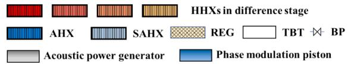

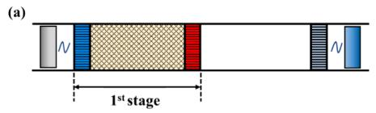

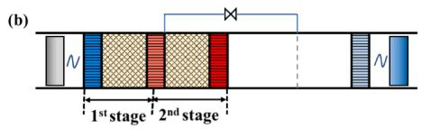

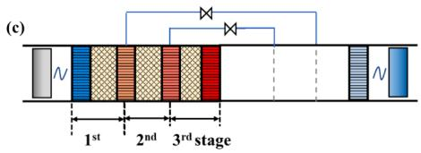

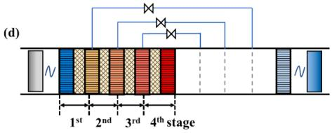  
Fig. 1. Schematic of the variable temperature heat source utilization core sections with (a) the traditional single-stage thermoacoustic engine and the proposed thermoacoustic engines with bypasses and multi-stage heat exchangers: (b) two-stage system, (c) three-stage system, and (d) four-stage system.

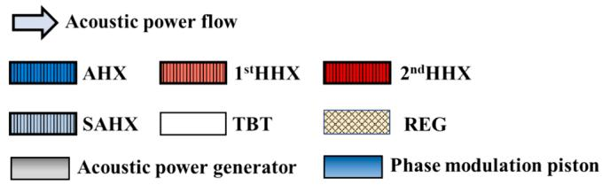

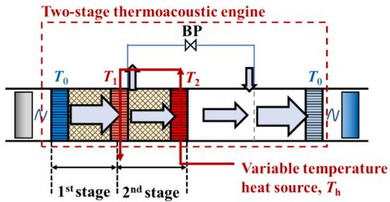  
Fig. 2. Schematic of a variable temperature heat source utilization core section with a two-stage thermoacoustic engine.

$$
Q _ { t o t a l } = m C _ { p } ( T _ { h } - T _ { 0 } )\tag{1}
$$

$$
E _ { t o t a l } = \int _ { T _ { 0 } } ^ { T _ { h } } m C _ { p } ( 1 - \frac { T _ { 0 } } { T } ) d T = m C _ { p } ( T _ { h } - T _ { 0 } ) - m C _ { p } T _ { 0 } \mathrm { l n } \frac { T _ { h } } { T _ { 0 } }\tag{2}
$$

where $T _ { \mathrm { h } }$ and $T _ { 0 }$ represent the initial temperature of the variabletemperature heat source and the ambient temperature. $C _ { p }$ and m are the specific heat capacity and mass of the heat carrier.

The utilization rate of waste heat, denoted as $r _ { \mathrm { Q } } ,$ is an important metric for evaluating the performance of waste heat recovery systems and can be calculated as:

$$
r _ { Q } = \frac { Q _ { n } } { Q _ { t o t a l } }\tag{3}
$$

where $Q _ { \mathrm { n } }$ is the input thermal energy utilized by an n-stage thermoacoustic engine.The total exergy utilization efficiency $( r _ { e x } )$ is a comprehensive metric for evaluating the system performance of a proposed

thermoacoustic engine:

$$
r _ { e x } = \frac { E _ { n } } { E _ { t o t a l } }\tag{4}
$$

where $E _ { \mathrm { n } }$ is the utilized exergy by the n-stage thermoacoustic engine system.

To simplify the calculation, the temperatures of the hightemperature heat exchangers are assumed to have an equidistant temperature distribution. Specifically, in an n-stage thermoacoustic engine, the temperature at the $i ^ { \mathrm { { t h } } }$ stage HHX (Ti) is calculated using the following equation:

$$
T _ { i } = T _ { 0 } + \frac { T _ { h } - T _ { 0 } } { n + 1 } i ( i \leq n )\tag{5}
$$

Since an ideal state of the Carnot cycle can be achieved in each stage, the maximum input thermal energy $( Q _ { n , \operatorname* { m a x } } )$ and the maximum utilized exergy $( E _ { n , \operatorname* { m a x } } )$ can be calculated as:

$$
Q _ { n , m a x } = m C _ { p } ( \frac { T _ { h } - T _ { 0 } } { n + 1 } ) n\tag{6}
$$

$$
\begin{array} { l } { { \displaystyle E _ { n , m a x } = \sum _ { i = 1 } ^ { n } m C _ { p } \left( \frac { T _ { h } - T _ { 0 } } { n + 1 } \right) \left( \frac { T _ { i } - T _ { 0 } } { T _ { i } } \right) } } \\ { { \displaystyle \qquad = \sum _ { i = 1 } ^ { n } m C _ { p } \left( \frac { T _ { h } - T _ { 0 } } { n + 1 } \right) ( 1 - \frac { T _ { 0 } ( n + 1 ) } { T _ { 0 } ( n + 1 ) + ( T _ { h } - T _ { 0 } ) i } ) } } \end{array}\tag{7}
$$

Substituting Eqs. (1) (2) (6) (7) to Eqs. (3) (4), the ideal waste heat utilization rate $( r _ { Q , i d e } )$ and the ideal total exergy utilization efficiency $( r _ { e x , i d e } )$ for an n-stage thermoacoustic engine is expressed as:

$$
r _ { Q , i d e } = \frac { Q _ { n , m a x } } { Q _ { t o t a l } } = \frac { n } { n + 1 }\tag{8}
$$

$$
r _ { e x , i d e } = \frac { E _ { n , m a x } } { E _ { t o t a l } } = \frac { \sum _ { i = 1 } ^ { n } \left( \frac { T _ { h } - T _ { 0 } } { n + 1 } \right) ( 1 - \frac { T _ { 0 } ( n + 1 ) } { T _ { 0 } ( n + 1 ) + ( T _ { h } - T _ { 0 } ) i } ) } { ( T _ { h } - T _ { 0 } ) - T _ { 0 } \mathrm { l n } \frac { T _ { h } } { T _ { 0 } } }\tag{9}
$$

Fig. 3 depicts the changes in the ideal waste heat utilization rate $( r _ { Q }$ $i d e )$ and the ideal total exergy utilization efficiency $( r _ { e x , i d e } )$ for different stages of thermoacoustic engines (n = 1–100). For the thermoacoustic engines from 1 to 4 stage, the $r _ { Q , i d e }$ is 50 %, 66.7 %, 75 %, 80 % and the $r _ { e x , i d e }$ is 55.5 %, 71.9 %, 79.5 %, 83.9 %, respectively. As the number of stages continues to increase, both the $r _ { Q , i d e }$ and $r _ { e x , i d e }$ keep growing progressively slower. In the limit, as the number of stages approaches infinity, the ideal values of $r _ { e x }$ and $r _ { \mathrm { Q } }$ approach 100 %.

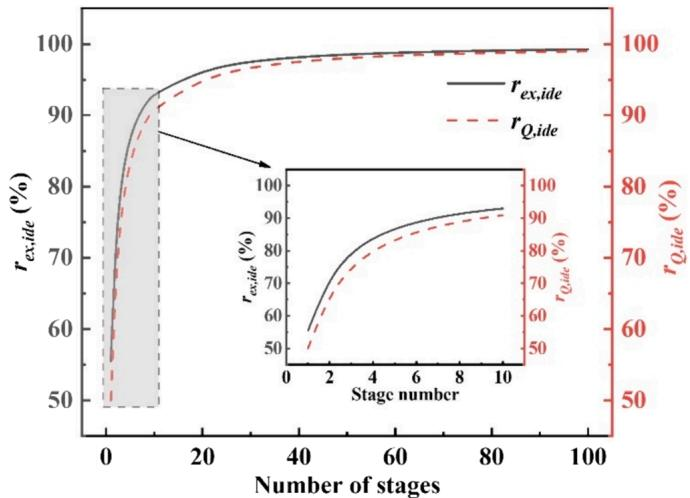  
Fig. 3. Ideal total exergy utilization efficiency $( r _ { e x , i d e } )$ and ideal waste heat utilization rate $( r _ { Q , i d e } )$ for n-stage thermoacoustic engines under Carnot cycle.

## 3. Effect of temperature distribution on system performance

This section is dedicated to examining the effects of optimal temperature distributions in high-temperature heat exchangers (HHXs) on the system performance, specifically focusing on contrasting these effects against those resulting from equidistant temperature distributions. Hence, the initial temperature of the heat source remains constant; the total input thermal energy negatively correlates with the temperature of each high temperature heat exchanger. Meanwhile, the thermal-toacoustic efficiency of the thermoacoustic engine $( \eta _ { t a } )$ is directly proportional to the temperature difference between the two junctions of each regenerator. Thus, a reasonable temperature distribution of the high temperature heat exchanger is crucial in improving the total exergy utilization efficiency. Here, the engine’s thermal-to-acoustic efficiency of each stage $( \eta _ { t a } \ : ( T _ { \mathrm { i } } ) )$ is fitted to a second-order polynomial [41], which involves the numerical value of the temperature of each high temperature heat exchanger using the Sage program (detailed explanation is in Section 4.1) as follows:

$$
\eta _ { t a } ( T _ { i } ) = \frac { W _ { o u t , i } - W _ { i n , i } } { Q _ { i } } = 1 . 7 8 \times 1 0 ^ { - 3 } T _ { i } - 8 . 1 9 \times 1 0 ^ { - 7 } T _ { i } ^ { 2 } - 0 . 4 1 4\tag{10}
$$

where $W _ { \mathrm { i n , i } }$ and $W _ { \mathrm { o u t , i } }$ denote the acoustic power of the inlet and outlet of the stage i of an n-stage engine.

The input thermal energy in the stage i of the thermoacoustic engine (Qi) is calculated as:

$$
Q _ { i } = m C _ { p } ( T _ { i + 1 } - T _ { i } ) \left( 1 \leq i \leq \mathbf { n } , T n + 1 = T h \right)\tag{11}
$$

If the system is under the optimal temperature distribution, the output acoustic power of the n-stage thermoacoustic engine $( W _ { a , n } )$ reaches:

$$
\begin{array} { l } { { \displaystyle W _ { a , n } = \sum _ { i = 1 } ^ { n } \eta _ { t a } ( T _ { i } ) Q _ { i } } } \\ { { \displaystyle \ = m C _ { p } \sum _ { i = 1 } ^ { n } ( 1 . 7 8 \times 1 0 ^ { - 3 } T _ { i } - 8 . 1 9 \times 1 0 ^ { - 7 } T _ { i } ^ { 2 } - 0 . 4 1 4 ) ( T _ { i } - T _ { i - 1 } ) } } \end{array}\tag{12}
$$

Substituting Eqs. (2) and (12) to Eq. (4), the optimal total exergy utilization efficiency $( r _ { e x , o p t } )$ can be expressed as:

$$
\begin{array} { l } { { r _ { e x , o p t } = \displaystyle \frac { E _ { n , o p t } } { E _ { t o t a l } } = \frac { W _ { a , n } } { E _ { t o t a l } } \qquad } } \\ { { \quad \quad = \displaystyle \frac { \sum _ { i = 1 } ^ { n } ( 1 . 7 8 \times 1 0 ^ { - 3 } T _ { i } - 8 . 1 9 \times 1 0 ^ { - 7 } { T _ { i } } ^ { 2 } - 0 . 4 1 4 ) ( T _ { i } - T _ { i - 1 } ) } { ( T _ { h } - T _ { 0 } ) - T _ { 0 } \ln { \frac { T _ { h } } { T _ { 0 } } } } } } \end{array}\tag{13}
$$

For the single-stage thermoacoustic engine, the waste heat utilization rate $( r _ { Q , 1 } )$ can be expressed as:

$$
r _ { Q , 1 } = { \frac { Q _ { 1 } } { Q _ { t o t a l } } } = { \frac { T _ { h } - T _ { 1 } } { T _ { h } - T _ { 0 } } }\tag{14}
$$

where $T _ { 1 }$ is the temperature of the HHX of the single-stage thermoacoustic engine.

To explore the optimal temperature distribution of the hightemperature heat exchangers (HHXs) in the thermoacoustic engines, it is appropriate to start the discussion with the 1-stage and 2-stage systems. Fig. 4 (a) illustrates the waste heat utilization rate $( r _ { Q , 1 } ) $ , thermalto-acoustic efficiency $( \eta _ { t a } ) ,$ , and optimal total exergy utilization efficiency $( r _ { e x , o p t } )$ in single-stage thermoacoustic engines. The initial heat source and ambient temperature were set to 900 K and 300 K, respectively. An increase in the HHX (T1) temperature has an opposite effect on the waste heat utilization rate and the thermal-to-acoustic efficiency. Furthermore, an excessively low or high $T _ { 1 }$ markedly diminishes the total exergy utilization efficiency. The optimal output for total exergy utilization efficiency, observed at 41.4 %, occurs at a $T _ { 1 }$ of 546 K. Fig. 4 (b) illustrates the relationship between the total exergy utilization efficiency and the temperature distributions of the HHXs in the two-stage thermoacoustic engine. The efficiency peaks at 53.5 %, corresponding to HHX temperatures, $\mathbf { i . e . , } T _ { 1 } = 4 4 4 \mathrm { \ : K }$ and $T _ { 2 } = 6 4 8$ K in the first and second stages, respectively.

Table 1 presents a comparative analysis of the total exergy utilization efficiencies under optimal and equidistant HHX temperature distributions in thermoacoustic engines, encompassing stages 1 to 6. A key observation from this comparison is the maximum divergence in total exergy utilization efficiency between these distributions, which stands at approximately 3 %. As the number of stages increases, this efficiency gap narrows, converging to around 1 %. This trend shows that thermoacoustic engines with multi-stage heat exchangers perform pretty well even when HHX temperatures are evenly spaced. An added benefit of using evenly spaced temperatures is that it makes calculations easier and allows for a consistent way to evaluate engines with different numbers of stages. Because of these advantages, the rest of this paper will use the method of evenly spaced HHX temperatures.

## 4. Simulation results and discussion

## 4.1. Simulation model

The simulation model was implemented using Sage, a widely used tool for simulating and optimizing the steady operation of thermoacoustic networks. The program combines specific model instances, such as regenerators, heat exchangers, pistons, and others, by integrating them with appropriate parameter values for mass, momentum, and energy transfer within the system. In the thermoacoustic engine, the governing equations of continuity, momentum, and energy for the gas domain are:

$$
\frac { \partial \rho A } { \partial t } + \frac { \partial \rho u A } { \partial x } = 0\tag{15}
$$

$$
\frac { \partial \rho u A } { \partial t } + \frac { \partial u \rho u A } { \partial x } + \frac { \partial p } { \partial x } A - F A = 0\tag{16}
$$

$$
\frac { \partial \rho e \mathsf { A } } { \partial { \sf t } } + p \frac { \partial \mathsf { A } } { \partial { t } } + \frac { \partial } { \partial { x } } ( u \rho e A + u p A + q ) - Q _ { \mathrm { w } } = 0\tag{17}
$$

where p and u denote the pressure and mean-flow velocity, respectively. A and $\rho$ represent cross-section area and gas density, respectively. The mass-specific total gas energy (e) is formulated using the mass-specific internal gas energy (κ) and the mean-flow velocity (u), and the relation expression is $e = \kappa + u ^ { 2 } / 2$ . Additionally, $F , Q _ { \mathrm { w } } ,$ and q represent the viscous pressure gradient, heat flow per unit length through the surface perpendicular to the axial direction due to film heat transfer, and gas axial-conductive heat flux, respectively. These terms are formulated as follows:

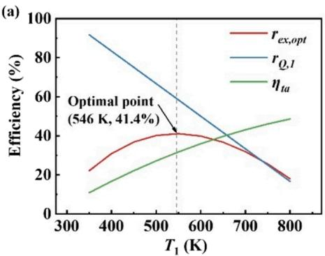

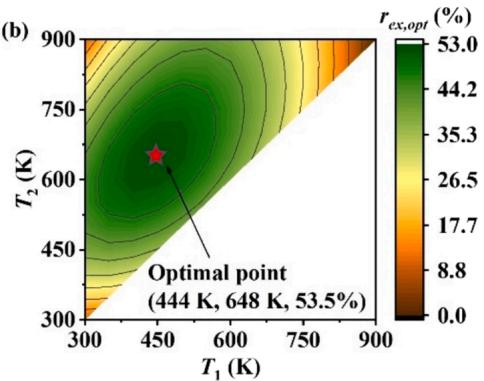  
Fig. 4. (a) Effect of the temperature of HHX $( T _ { 1 } )$ on the output total exergy utilization efficiency $( r _ { e x , o p t } ) _ { ; }$ waste heat utilization rate $( r _ { Q , 1 } ) ,$ and engine’s thermal-toacoustic efficiency $( \eta _ { t a } )$ for the single-stage thermoacoustic engine. (b) Effect of the temperatures of 1st HHX (T1) and 2nd HHX (T2) on the output total exergy utilization efficiency $( r _ { e x , o p t } )$ for the two-stage thermoacoustic engine. The initial heat source $( T _ { \mathrm { h } } )$ and ambient temperature (T ) are set to 900 K and 300 K, respectively.

Performance comparison between optimal and equidistant temperature distributions in high-temperature heat exchangers (HHXs). The initial heat source temperature $\left( T _ { \mathrm { h } } \right)$ and ambient temperature (T0) are set to 900 K and 300 K, respectively.
<table><tr><td>Stage number</td><td></td><td>1</td><td>2</td><td>3</td><td>4</td><td>5</td><td>6</td></tr><tr><td rowspan="4">Optimal temperature distributions</td><td rowspan="4">T1 (K) T2 (K)  $T _ { 3 }$  (K)  $T _ { 4 }$  (K)  $T _ { 5 }$  (K)  $T _ { 6 }$  (K)</td><td>546</td><td>444</td><td>396 540</td><td>368</td><td>350</td><td>338</td></tr><tr><td></td><td>648</td><td>703</td><td>479</td><td>441</td><td>414</td></tr><tr><td></td><td></td><td></td><td>600</td><td>538 643</td><td>495</td></tr><tr><td></td><td></td><td></td><td>737</td><td>761</td><td>581 674</td></tr><tr><td rowspan="5">Equidistant temperature distributions</td><td>rex,opt (%)</td><td>41.1</td><td>53.5</td><td>58.7</td><td>62.1</td><td>64.2</td><td>778 65.7</td></tr><tr><td>T1 (K)</td><td>600</td><td>500 700</td><td>450 600</td><td>420</td><td>400</td><td>386</td></tr><tr><td>T2 (K)</td><td></td><td></td><td>750</td><td>540</td><td>500</td><td>471</td></tr><tr><td> $T _ { 3 }$  (K)  $T _ { 4 }$  (K)</td><td></td><td></td><td></td><td>660 780</td><td>600</td><td>557</td></tr><tr><td>(K)</td><td></td><td></td><td></td><td></td><td>700</td><td>643</td></tr><tr><td></td><td> $T _ { 5 }$   $T _ { 6 }$  (K)</td><td></td><td></td><td></td><td></td><td>800</td><td>729</td></tr><tr><td></td><td></td><td>39.8</td><td>51.9</td><td></td><td></td><td></td><td>814</td></tr><tr><td></td><td>rex,opt</td><td></td><td></td><td>57.7</td><td>61.1</td><td>63.4</td><td>65</td></tr><tr><td></td><td>(%)</td><td></td><td></td><td></td><td></td><td></td><td></td></tr></table>

$$
F = - ( f _ { D } / d _ { \mathrm { h } } + K _ { l o s } / l ) \rho u | u | / 2\tag{18}
$$

$$
Q _ { \mathrm { w } } = N u \big ( k _ { \mathrm { g } } / d _ { \mathrm { h } } \big ) S _ { \mathrm { x } } \big ( T _ { \mathrm { w } } - T \big )\tag{19}
$$

$$
{ \boldsymbol { q } } = - N _ { \mathrm { { k } } } { k _ { \mathrm { { g } } } } { \frac { \partial { T } } { \partial { x } } } { \boldsymbol { A } }\tag{20}
$$

where $f _ { \mathrm { D } } , d _ { \mathrm { h } } , l , K _ { \mathrm { l o s } } , N u , k _ { \mathrm { g } } , S _ { \mathrm { x } }$ and $T _ { \mathrm { w } }$ are Darcy friction factor, hydraulic diameter, length of the heat exchanger or regenerator, total local loss coefficient, Nusselt number, gas conductivity, wetted perimeter, and surface temperature, respectively.

Besides the momentum, continuity and energy equations, the mass flow rate via the bypass orifice is governed by

$$
\dot { m } = - C _ { d } A _ { 0 } \sqrt { \frac { \rho _ { e } \Delta P } { \left( 1 - A _ { 0 } / A _ { h } \right) ^ { 2 } } }\tag{21}
$$

where $C _ { \mathrm { d } } , \rho _ { \mathrm { e } } ,$ A0 and $A _ { \mathrm { h } }$ denote the discharge coefficient, representative density, the cross-section area of the orifice and housing area (upstream and downstream flow area), respectively. $\Delta P$ is the pressure drop between the upstream and downstream flow.

Acoustic power is defined as

$$
W _ { a } = \frac { 1 } { 2 } \mathrm { R e } [ p \bullet U ^ { \ast } ] = \frac { 1 } { 2 } | p | | U | \mathrm { c o s } \theta _ { p - U }\tag{22}
$$

The acoustic impedance is given by

$$
Z = { \frac { p } { U } } = \operatorname { R e } ( Z ) + i \bullet \operatorname { I m } ( Z ) = { \frac { \left| p \right| } { \left| U \right| } } \mathbf { c o s } \theta _ { p - U } + i \bullet { \frac { \left| p \right| } { \left| U \right| } } \mathbf { s i n } \theta _ { p - U }\tag{23}
$$

The total exergy utilization efficiency of the thermoacoustic engine can be expressed as the ratio of actual utilized exergy (amplified acoustic power in the engine) to the total exergy contained in the waste heat source:

$$
r _ { e x , e n } = \frac { E _ { n } } { E _ { t o t a l } } = \frac { W _ { o u t } - W _ { i n } } { E _ { t o t a l } }\tag{24}
$$

The exergy efficiency of the thermoacoustic engine can be expressed as the ratio of the actual utilized exergy (amplified acoustic power in the engine) to the maximum utilized exergy:

$$
\eta _ { e x , e n } = \frac { E _ { n } } { E _ { n , m a x } } = \frac { W _ { o u t } - W _ { i n } } { \sum _ { i = 1 } ^ { n } Q _ { i } ( 1 - \frac { T _ { 0 } } { T _ { i } } ) }\tag{25}
$$

The Sage model is validated using experimental results of a singlestage thermoacoustic-stirling generator [42]. Fig. 5 presents a comparative analysis between the numerical simulations and experimental data that focuses on two key parameters: the electric power output (We) and the overall exergy efficiency of the system $( \eta _ { e x } )$ . The observed mean deviation lies within a 10 % threshold, underscoring a high degree of consistency between the simulation outcomes and the experimental findings, both in numerical values and observed trends. This close alignment reinforces the reliability of the simulation results reported in this study.

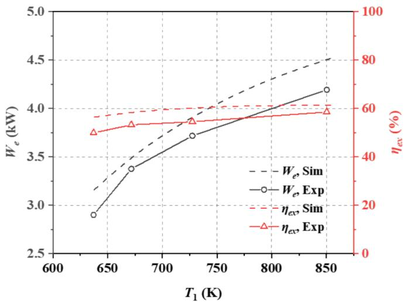  
Fig. 5. Comparison of numerical and experimental results [42] for the electric power $\mathrm { ( W _ { e } ) }$ and overall exergy efficiency $\left( \eta _ { \mathrm { e x } } \right)$ of the single-stage thermoacoustic-Stirling generator. $\mathrm { T } _ { 1 }$ is the temperature of HHX.

## 4.2. System design method

This section focuses on calculating the optimal structural configuration of thermoacoustic engines across various stage numbers. The heat source parameters are defined as follows: a total thermal energy $( Q _ { t o t a l } )$ of 12 kW and an initial temperature setting of 900 K. The engines are designed to operate at 300 K ambient temperature. As the number of stages increases, the total input thermal energy utilized by the n-stage system $\left( Q _ { n } \right)$ shows a proportional increase. To illustrate, for the thermoacoustic engines from stages 1 to $^ { 4 , }$ the total available input thermal energy $( Q _ { n } )$ is calculated to be $6 , 8 , 9 ,$ and 9.6 kW, respectively, corresponding to the waste heat utilization rate $( r _ { Q , i d e } )$ of 50 %, 66,7% 75 %, and 80 % (as previously explained in Section 2.2). Assuming an equidistant temperature distribution among the HHXs and AHX, the input thermal energy in each stage (Qi) can be determined as an equalized portion of the total input thermal energy $( Q _ { n } ) .$ , according to Eqs. (5) and (11). Therefore, for each stage of the thermoacoustic engine, the available input thermal energy per stage is 6 kW, 4 kW, 3 kW, and 2.4 kW for systems sequentially ranging from 1 to 4 stages, respectively, listed in Table 2.

The thermoacoustic engine is filled with helium at 3 MPa pressure. It operates at a stable frequency of approximately 55 Hz. Furthermore, the structural parameters for each engine stage are maintained uniformly, as detailed in Table 3. This consistent configuration ensures comparability across different stages of the engine.

Specific structural guidelines are implemented to streamline the optimization process of the thermoacoustic engines with multi-stage heat exchangers. Fig. 2 illustrates that the lengths of the regenerators (REGs) and the high-temperature heat exchangers (HHXs) in each stage are designed to be equal to their respective sections in the thermal buffer tube (TBT). A bypass orifice (BP) is strategically placed between the HHX and the subsequent stage’s REG; uniformity is also maintained in the ambient-temperature heat exchangers (AHXs) lengths. During the optimization phase, two key variables are adjusted: the diameter of the BP and the length of the REGs to meet the specific requirement of maintaining an equidistant temperature distribution among the HHXs and AHX. Moreover, to maximize total exergy utilization efficiency, the acoustic impedance at both ends of the thermoacoustic engine is optimized and used as a boundary condition. The optimization efforts encompass the dimensions of the thermoacoustic engines ranging from 1 to 4 stages. The outcomes of these optimizations, including the specific dimensional adjustments, are detailed in Tables 4 and 5.

## 4.3. System performance comparison with varying numbers of stages

This section examines the variations of performance characteristics of the thermoacoustic engines with varying stage numbers. Fig. 6 (a) and (b) show the results for the total exergy utilization efficiency $( r _ { e x , e n } ) ,$ waste heat utilization rate $( r _ { Q , e n } )$ , and exergy efficiency $( \eta _ { e x , e n } )$ of the thermoacoustic engines under different stage numbers and the varying acoustic impedance amplitude at the outlet of the secondary ambienttemperature heat exchanger (SAHX). Notably, the $r _ { e x , e n }$ experiences a marked increase with the addition of more stages. Yet, as the number of stages continues to increase, the rate of this efficiency growth gradually diminishes. Meanwhile, it tends to increase and then decrease with the increase of the acoustic impedance amplitude. Fig. 6 (b) shows that the $r _ { Q , e n }$ of the thermoacoustic engines shows a similar variation trend to the $r _ { e x , e n }$ as the stage number increases, independently of the change of acoustic impedance amplitude. The $\eta _ { e x , e n }$ experiences a decline from 1- stage to 2-stage and then levels off as the stage number increases. Consequently, the primary factor contributing to the heightened total exergy utilization efficiency, observed with increasing stages, is attributed to the enhanced waste heat utilization rate instead of the exergy efficiency. Additionally, it is noteworthy that the optimal amplitude of outlet acoustic impedance, which correlates with the peak total exergy utilization efficiency, consistently approximates $1 . 4 \times 1 0 ^ { 7 }$ Pa $\cdot s / \mathrm { m } ^ { 3 }$ across all stage numbers.

Table 2  
The input thermal energy utilized by each engine stage (Q ) under equidistant temperature distribution of HHXs for varying stages.
<table><tr><td>Input thermal energy utilized by each engine stage</td><td></td></tr><tr><td>Single- stage</td><td>6 kW @ 600 K (1st HHX)</td></tr><tr><td>Two-stage Three-</td><td>4 kW @ 500 K (1st HHX), 4 kW @ 700 K (2nd HHX) 3 kW @ 450 K (1st HHX), 3 kW @ 600 K (2nd HHX), 3 kW @ 750 K (3rd</td></tr><tr><td>stage Four-stage</td><td>HHX)</td></tr><tr><td></td><td>2.4 kW @ 420 K (1st HHX), 2.4 kW @ 540 K (2nd HHX), 2.4 kW @ 660 K (3rd HHX), 2.4 kW @ 780 K (4th HHX)</td></tr></table>

Table 3  
Structural parameters of each stage in the thermoacoustic engines.
<table><tr><td>Components</td><td>Details</td></tr><tr><td>AHX/SAHX</td><td>Shell-tube type, 100 mm in external diameter, 40 mm in length, 1 mm in shell tube diameter, 20 % in porosity;</td></tr><tr><td>REG</td><td>Stainless steel mesh (SS400), 50 μm in wire diameter, 80 % in porosity;</td></tr><tr><td>HHX</td><td>Shell-tube type, 2 mm in shell tube diameter, 20 % in porosity.</td></tr></table>

Table 6 presents the performance metrics of thermoacoustic engines across 1 to 4 stages, with the output acoustic impedance consistently set at $1 . 4 \times 1 0 ^ { 7 } \mathrm { P a } { \cdot } \varsigma / \mathrm { m } ^ { 3 }$ and $4 2 ^ { \circ } .$ . Notably, the four-stage thermoacoustic engine exhibits an acoustic power output of 2840 W, achieving a total exergy utilization efficiency of 52.5 %. A clear trend emerges as the number of stages increases from 1 to 4; there is a general enhancement in most performance indicators. However, an exception is observed in the engine’s exergy efficiency, demonstrating a contrasting downward trend. This can be attributed to the decreasing temperature differential across the regenerator ends as more stages are added, adversely affecting the conversion of heat energy into acoustic power. These findings indicate that while escalating the stage number reduces thermoacoustic conversion efficiency, it concurrently amplifies the system’s capacity for waste heat utilization, increasing the total exergy utilization efficiency $( r _ { e x , e n } )$ with increasing stage number. However, it is further observed in Fig. 6 (a) that the increase in total exergy utilization efficiency at the optimal acoustic impedance condition $( | Z _ { a } | = 1 . 4 \times 1 0 ^ { 7 }$ $\mathrm { P a } { \cdot } s / \mathrm { m } ^ { 3 } , \theta _ { Z } = 4 2 ^ { \circ } )$ slows down as the number of stages increases; for instance, a 2.5 % increase when going from 3 to 4 stage compared to 7.5 % increase from 1 to 2 stage. Balancing system performance against structural complexity, the three-stage thermoacoustic engine emerges as an optimal choice. It strikes an effective equilibrium between high efficiency and manageable structural simplicity, positioning it as a prime candidate for advanced research and development efforts.

## 4.4. Axial distributions of key parameters

This section delves into the acoustic field distribution of a three-stage thermoacoustic engine, utilizing the optimal dimensions established in Section 5.2. Fig. 7 illustrates the axis distributions for several key parameters: the amplitude and phase of the pressure wave and volume flow, the phase difference between these two elements, and the resultant acoustic power, as calculated by the Sage program. The x-axis of the graph extends from the inlet of the ambient-temperature heat exchanger (AHX) to the outlet of the secondary ambient-temperature heat exchanger (SAHX).

Table 4  
Optimized lengths for each stage in the thermoacoustic engine with multi-stage heat exchangers.
<table><tr><td rowspan="2">Stage</td><td colspan="8">Length/mm</td></tr><tr><td colspan="2">1#</td><td colspan="2">2#</td><td colspan="2">3#</td><td colspan="2">4#</td></tr><tr><td></td><td>REG</td><td>HHX</td><td>REG HHX</td><td>REG</td><td>HHX</td><td>REG</td><td>HHX</td><td></td></tr><tr><td>One-stage</td><td>37</td><td>60</td><td></td><td></td><td></td><td></td><td></td><td>97</td></tr><tr><td>Two-stage</td><td>22</td><td>40</td><td>10</td><td>40</td><td></td><td></td><td></td><td>112</td></tr><tr><td>Three-stage</td><td>14</td><td>30</td><td>9</td><td>30</td><td>5 30</td><td></td><td></td><td>118</td></tr><tr><td>Four-stage</td><td>12</td><td>24</td><td>10</td><td>24</td><td>6</td><td>24 5</td><td>24</td><td>129</td></tr></table>

Table 5

Optimized dimensions of bypasses in the thermoacoustic engine with multistage heat exchangers. $D _ { b p }$ is the diameter of the BP orifice and $r _ { b p }$ is the ratio of the mass flow rate in the $i ^ { \mathrm { { t h } } }$ BP orifice to that in $i ^ { \mathrm { { t h } } }$ HHX.
<table><tr><td>Stage</td><td> $D _ { b p } / \mathrm { m m }$ </td><td> $r _ { b p } / \%$ </td></tr><tr><td>Two-stage</td><td>25.4 (1st bypass)</td><td>61.9 (1st bypass)</td></tr><tr><td>Three-stage</td><td>17.5 (1st bypass)</td><td>39.3 (1st bypass)</td></tr><tr><td rowspan="3">Four-stage</td><td>25.1 (2nd bypass)</td><td>58.1 (2nd bypass)</td></tr><tr><td>13.1 (1st bypass)</td><td>26.9 (1st bypass)</td></tr><tr><td>18.7 (2nd bypass)</td><td>42.7 (2nd bypass)</td></tr><tr><td></td><td>21.1 (3rd bypass)</td><td>51 (3rd bypass)</td></tr></table>

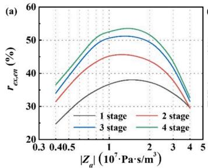

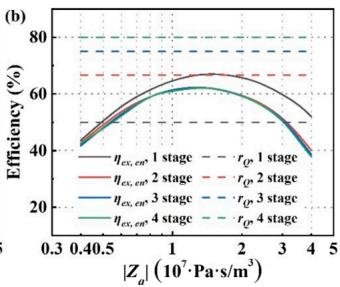  
Fig. 6. Effect of the acoustic impedance amplitude at the outlet of the secondary ambient-temperature heat exchanger (SAHX) on (a) the total exergy utilization efficiency $( r _ { e x , e n } ) ,$ (b) the exergy efficiency $( \eta _ { e x , e n } ) _ { \ast }$ , and the waste heat utilization rate $( r _ { Q , e n } ) .$ The phase of acoustic impedance (θ ) is fixed at 42◦.

Thermodynamic performance of the thermoacoustic engines with varying numbers of stages with a total thermal energy $( Q _ { t o t a l } )$ of 12 kW and an initial temperature setting $\left( T _ { \mathrm { h } } \right)$ of 900 K $( | Z _ { a } | = 1 . 4 \times 1 0 ^ { 7 }$ Pa⋅s/m3, $\theta _ { Z } = 4 2 ^ { \circ } )$
<table><tr><td>Numbers of stages</td><td>1</td><td>2</td><td>3</td><td>4</td></tr><tr><td>Total input thermal energy utilized  $( Q _ { n } , \mathrm { k W } )$ </td><td>6</td><td>8</td><td>9</td><td>9.6</td></tr><tr><td>Waste heat utilization rate  $( r _ { Q , e n } , \% )$ </td><td>50</td><td>66.7</td><td>75</td><td>80</td></tr><tr><td>Exergy efficiency  $( \eta _ { e x , e n } ,$  %)</td><td>67.7</td><td>62.9</td><td>62.9</td><td>62.9</td></tr><tr><td>Acoustic power at the outlet of the  $\operatorname { S A H X } \left( W _ { a } , \operatorname { W } \right)$ </td><td>2039</td><td>2482</td><td>2771</td><td>2844</td></tr><tr><td>Total exergy utilization efficiency  $( r _ { e x , e n } , \% )$ </td><td>38.4</td><td>45.9</td><td>51.6</td><td>54.1</td></tr></table>

As shown in Fig. 7 (a), the amplitude of volume flow rate (|U|) shows a decreasing trend in the heat exchangers and an increasing trend in the regenerators and thermal buffer tubes as a whole. It undergoes significant abrupt changes in the BP orifices, reflecting the gas flow from regenerators to thermal buffer tubes due to the pressure drops in the regenerators. The creation of traveling-wave dominated acoustic fields within the REGs is pivotal for optimal energy conversion in thermoacoustic systems. The $\theta _ { p - U }$ for the 1st (−50◦ to −40◦), 2nd $( - 3 7 ^ { \circ } \mathrm { t } 0 - 2 7 ^ { \circ } )$ and 3rd (40◦ to 24.6◦) REGs in $\mathrm { F i g . 7 ( b ) }$ approach traveling-wave fields, suggesting enhanced energy conversion efficiency through the cascaded regenerator design. The primary cause of the phase shift is the decrease in the volume flow rate phase angle for the 1st (72.7◦ to 62.7◦), 2nd (60◦ to 48.8◦), and 3rd (−16◦ to 0◦) REGs, contrasted by the pressure wave phase angle which remains relatively stable, fluctuating around 20◦.

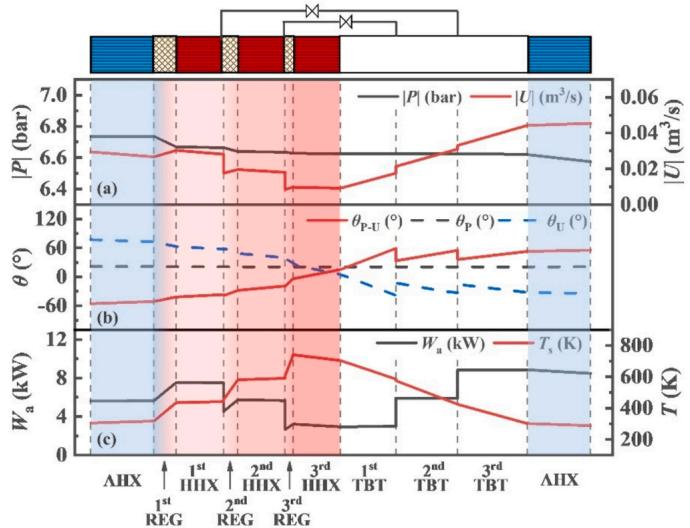  
Fig. 7. Axis distributions of the pressure wave (p), volume flow rate (U), acoustic power (Wa), working gas temperature (T), and phase difference $( \theta _ { \mathrm { p - U } } )$ in the three-stage thermoacoustic engine $( | Z _ { a } | = 1 . 5 \times 1 0 ^ { 7 }$ Pa⋅s/m3, $\theta _ { Z } = 4 2 ^ { \circ } )$

Furthermore, Fig. 7 (c) illustrates the resulting axial distribution of acoustic power and working gas temperature. Each stage consumes an average input thermal energy of 4 kW, resulting in acoustic power amplification of 1892 W, 1210 W, and 549 W in the $^ { 1 s t , }$ 2nd, and 3rd REGs, respectively. In total, approximately 3651 W of acoustic power is amplified in the three-stage thermoacoustic engine. The working gas temperature rises from the ambient temperature to 305 K to 435 K, 581 K, and 741 K in the three REGs. It then gradually decreases to 302 K in the thermal buffer tube (TBT) and secondary ambient-temperature heat exchanger (SAHX). The working gas temperature in each hightemperature heat exchanger (HHX) is slightly lower than the heat source temperature (i.e., 435 K vs 450 K for 1-stage, 581 K vs 600 K for 2- stage, and 741 K vs 750 K for 3-stage), the necessary heat transfer temperature difference between the wall surface and the internal working gas that exists due to the consideration of non-ideal heat transfer.

Additionally, Fig. 7 illustrates the impact of BPs on the acoustic field. The amplitude of pressure wave at the REG side of the BPs exhibits a smooth variation, while the amplitude of volume flow rate exhibits a sharp drop. At the TBT side of the BPs, the corresponding working gas enters the tube, increasing the volume flow rate amplitude (0.004 $\mathbf { m } ^ { 3 } / s$ for the 1st BP and $0 . 0 0 2 \mathrm { m } ^ { 3 } / s$ for the 2nd BP) and phase angle (25.7◦ for the 1st BP and 18.8◦for the 2nd BP). Consequently, the acoustic power shows a staircase-like decreasing and increasing pattern at the inlet and outlet ends of the BPs, respectively. Meanwhile, the BPs structures influence the distribution of the working gas temperature, with the temperature lifts of 12 K and 16 K observed at the two BPs, respectively.

Table 7

## 5. Future application on thermoacoustic generator

## 5.1. Simulation results of a three-stage generator

The previous section concentrated on thermoacoustic engines, primarily examining their ability to generate acoustic power. The concept of pairing a thermoacoustic engine with a linear alternator, facilitating the conversion of acoustic power into electrical energy, presents an intriguing avenue for exploration. Consequently, this section delves into the realm of thermoacoustic generators, which integrate both components. Fig. 8 shows a detailed illustration of the three-stage thermoacoustic generator. The system works on the principle that the engine utilizes waste heat to amplify the acoustic power, and the generated acoustic power enters the linear alternator to be converted into electrical power output. It should be noted that in the proposed system, a compressor is placed at the inlet of the engine as the initial acoustic power producer. Therefore, to clarify the thermal-to-acoustic conversion and the subsequent acoustic-to-electric conversion belonging to the engine part, and thus to better understand the engine’s performance, it is necessary to separate the initial acoustic power supplied by the compressor in the calculations.

The working gas is helium, and the pressure is 3 MPa. The three-stage thermoacoustic engine’s configurations and parameters are maintained as discussed in Section 4.2. The coupled linear alternator is designed and optimized based on the optimal acoustic impedance conditions at the outlet of the engine $( | Z _ { a } | = 1 . 4 \times 1 0 ^ { 7 } \mathrm { P a } { \cdot } s / \mathrm { m } ^ { 3 } , \theta _ { Z } = 4 2 ^ { \circ } )$ obtained in the previous section. Meanwhile, the linear alternator’s dimensions remain uniform when coupled with thermoacoustic engines of different stages. This uniformity ensures that the alternator’s design is synergistically aligned with the engine’s operational characteristics, regardless of the number of stages. The detailed design dimensions of the linear alternator are outlined in Table 7.

Simulations were carried out using the Sage program to evaluate the thermodynamic performance of the three-stage thermoacoustic generator. The simulation model incorporated a constrained piston module, which included a damper and spring mechanism specifically designed for the linear alternators. Considering the separation of the initial acoustic power supplied by the compressor, the electric power converted from the utilized thermal energy of the thermoacoustic engine is calculated as follows:

$$
W _ { e } = W _ { e l e c } \left( \frac { W _ { o u t } - W _ { i n } } { W _ { o u t } } \right) = W _ { e l e c } \left( 1 - \frac { W _ { i n } } { W _ { o u t } } \right)\tag{26}
$$

where $W _ { e l e c }$ is the total electric power obtained in the linear alternator, $W _ { i n }$ and $W _ { o u t }$ are the acoustic power at the inlet and outlet of the thermoacoustic engine, respectively. Meanwhile, $W _ { i n }$ is numerically equal to the acoustic power supplied by the compressor $\left( W _ { c o m } \right)$

In addition to the exergy efficiency $( \eta _ { e x , e n } )$ mentioned in Eq. (25), the thermal-to-electric exergy efficiency $( \eta _ { h e , g e } )$ and alternator efficiency $( \eta _ { a l t } )$ are proposed to evaluate the proposed system and defined as:

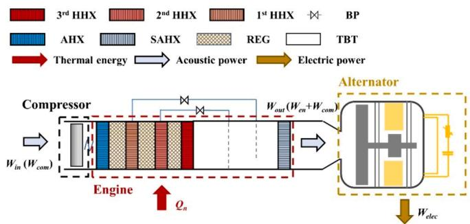  
Fig. 8. Schematic of a three-stage thermoacoustic generator.

Designed parameters of linear alternator in the three-stage thermoacoustic generator.
<table><tr><td>Symbol</td><td>Definition</td><td>Value</td></tr><tr><td> $D _ { p }$ </td><td>the diameter of the alternator piston, mm</td><td>110</td></tr><tr><td> $M _ { p }$ </td><td>the moving mass of the alternator piston,  ${ \bf k } g$ </td><td>6</td></tr><tr><td> $\hat { R m }$ </td><td>the mechanical damping, kg/s</td><td>50</td></tr><tr><td> $R _ { e , i n }$ </td><td>the internal electrical resistance, Ω</td><td>1</td></tr><tr><td> $\tau$ </td><td>the transduction coefficient for the alternator, N/A</td><td>100</td></tr><tr><td> $K _ { m }$ </td><td>the mechanical spring stiffness, N/m</td><td> $1 . 5 \times 1 0 ^ { 5 }$ </td></tr><tr><td> $V _ { f }$ </td><td>the volume of the front space, L</td><td>0.25</td></tr><tr><td> $V _ { b }$ </td><td>the volume of the back space, L</td><td>2</td></tr></table>

$$
\eta _ { e x , g e } = \frac { W _ { e l e c } ( 1 - \frac { W _ { i n } } { W _ { o u t } } ) } { \sum _ { i = 1 } ^ { n } { Q _ { i } ( 1 - \frac { T _ { 0 } } { T _ { i } } ) } }\tag{27}
$$

where $Q _ { i }$ and $T _ { i }$ are the input thermal energy of the i stage of the engine and the temperature of the $i ^ { \mathrm { { t h } } }$ HHX, respectively. The alternator efficiency is defined as the ratio of output electric power $( W _ { e l e c } )$ to the acoustic power at the inlet of the alternator that is numerically equal to the acoustic power at the outlet of the engine $( W _ { o u t } ) ;$

$$
\eta _ { a l t } = { \frac { W _ { e l e c } } { W _ { o u t } } }\tag{28}
$$

The total exergy utilization efficiency of the thermoacoustic generator is the ratio of the actual utilized exergy (generated electric power) to the total exergy contained in the waste heat source:

$$
r _ { e x , g e } = \frac { E _ { n } } { E _ { t o t a l } } = \frac { W _ { e l e c } ( 1 - \frac { W _ { i n } } { W _ { o u t } } ) } { \sum _ { i = 1 } ^ { n } Q _ { i } ( 1 - \frac { T _ { 0 } } { T _ { i } } ) }\tag{29}
$$

Fig. 9 (a) shows the system performance of the three-stage thermoacoustic generator, including the thermal-to-electric exergy efficiency $( \eta _ { e x , g e } ) ,$ thermal-to-acoustic exergy efficiency $( \eta _ { e x , e n } ) ,$ and alternator efficiency $( \eta _ { a l t } )$ under varying external resistance $( R _ { e , o u t } ) .$ These three efficiencies all show a trend of increasing and then decreasing with increasing external resistance. An optimal $\eta _ { e x , e n }$ of 54.9 % and $\eta _ { e x , g e }$ of 64.5 % are observed at the external resistance of 18 Ω, while an ideal $\eta _ { a l t }$ of 86.3 % is observed at the optimal external resistance of 16 Ω. Fig. 9 (b) presents the ratio $r _ { b p }$ and the optimized diameter of BPs $( D _ { b p } )$ under varying external resistance. It can be noticed that the $r _ { b p }$ and $D _ { b p }$ of the 2nd BP are larger than those of the 1st BP. Notably, according to the definition of $r _ { b p } ,$ the absolute amplitude of the mass flow in the 2nd BP orifice is smaller; its mass flow accounts for a larger proportion of the corresponding stage’s engine exit, exceeding a significant proportion of 50 %.

The comparison results of system performance between the threestage and single-stage thermoacoustic generators under different external resistances are presented in Fig. 10 (a) and (b), where the external resistance $( R _ { e , o u t } )$ is optimized to achieve maximum total exergy utilization efficiency. Under different external resistances, the total exergy utilization efficiency $( r _ { e x , g e } )$ of the three-stage system is higher than that of the single-stage system, and both show a trend of first increasing and then decreasing with the increase of external resistance. The total exergy utilization efficiency of the three-stage system peaks at 45 % at an external resistance of 18 Ω, while the single-stage engine exhibits a similar curve with a peak value of 33.2 % at an external resistance of 18 Ω. Fig. 10 (b) shows that the waste heat utilization rate $( r _ { Q } )$ only depends on the stage number. The variations in thermal-toelectric exergy efficiency $( \eta _ { e x , g e } )$ of the single-stage and three-stage engines are relatively the same. Although the exergy efficiency of the single-stage system is higher than that of the three-stage system, the final total exergy utilization efficiency of the three-stage system is higher, mainly because of its larger waste heat utilization rate, which reflects the better cascading waste heat utilization potential of the multistage system.

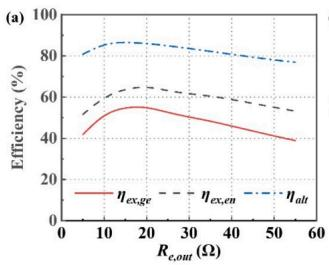

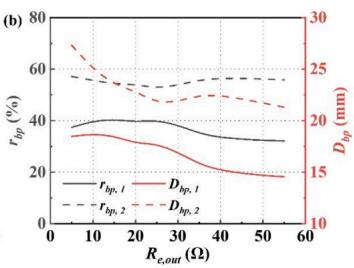  
Fig. 9. Effect of external resistance $( R _ { e , o u t } )$ on (a) the thermal-to-electric exergy efficiency $( \eta _ { e x , g e } ) _ { ; }$ , thermal-to-acoustic exergy efficiency $( \eta _ { e x , e n } ) ,$ and alternator efficiency (ηalt) and (b) the ratio of the mass flow rate in the $i ^ { \mathrm { { t h } } }$ BP orifice to that in $i ^ { \mathrm { t h } } \operatorname { H H X } { ( r _ { b p , i } ) }$ and the optimized diameter of bypass orifice $( D _ { b p } )$ of the threestage thermoacoustic generator.

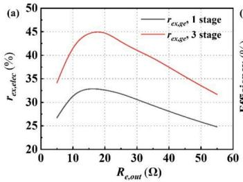

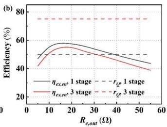  
Fig. 10. Comparison results of effect of external resistance $( R _ { e , o u t } )$ on (a) the total exergy utilization efficiency $( r _ { e x , g e } )$ and (b) the thermal-to-electric exergy efficiency $( \eta _ { e x , g e } )$ and waste heat utilization rate $( r _ { Q } )$ between the three-stage and single-stage thermoacoustic generators.

Table 8 summarizes the optimal performance of the three-stage and single-stage thermoacoustic generators at the optimal external resistance of 18 Ω. It can be observed that the energy conversion efficiencies, including the thermal-to-acoustic exergy efficiency $( \eta _ { e x , e n } ) ,$ , the alternator efficiency $( \eta _ { a l t } )$ , and the thermal-to-electric exergy efficiency $( \eta _ { e x , }$ $_ { g e } )$ show minimal differences of less than 3 % between the three-stage and single-stage systems. This is because the higher total exergy utilization efficiency and waste heat recovery rate of the three-stage system enables its higher electric power to be produced by the thermoacoustic engine of approximately 651 W than the single-stage system.

## 5.2. Experimental investigation of a two-stage generator

The prototype of a thermoacoustic-Stirling [40,43] generator is established and tested in this section based on the above analysis. The stage number is chosen as two to further simplify the experiment. Fig. 11 illustrates the experimental setup of the proposed two-stage thermoacoustic-Stirling generator, which is composed of a two-stage thermoacoustic engine and an alternator. To improve the system compactness, the thermoacoustic engine is the coaxial structure [44,45], which means that the regenerators (REGs) and high-temperature heat exchangers (HHXs) are designed as the toroidal structure, and the thermal buffer tube (TBT) is set in a position coaxial to the above components. This arrangement additionally minimizes the complexity caused by bypass structures. When the bypass orifices are closed and the thermal power is only supplied to 2nd HHX, this system can be simplified to a single-stage thermoacoustic-Stirling generator system. Such structure corresponds to Fig. 1 (b). The original acoustic power generation piston is eliminated because the proposed system is already a complete thermoacousticstirling generator system, capable of operating spontaneously after absorbing thermal energy, thus obviating the need for initial acoustic power. The original phase modulation piston is replaced with a displacer to transmit acoustic power and modulate the acoustic field in the loop. The detailed dimensions of the system are shown in Table 9.

Table 8  
Performance of the three-stage and single-stage thermoacoustic generators.
<table><tr><td>Number of stages</td><td>T (K)</td><td>Qi (kW)</td><td> $r _ { Q }$  en (%)</td><td> $\eta _  e x , \}$  en (%)</td><td>ηalt (%)</td><td> $\eta _  e x , \}$  ge (%)</td><td>We (W)</td><td> $r _ { e x , g e }$  (%)</td></tr><tr><td>1</td><td>600</td><td>6</td><td>50</td><td>67.6</td><td>86.7</td><td>58.2</td><td>1788</td><td>33.1</td></tr><tr><td>3</td><td>450;</td><td>3;3;</td><td>75</td><td>65.2</td><td>86.0</td><td>55.3</td><td>2439</td><td>45.1</td></tr><tr><td></td><td>600;</td><td>3</td><td></td><td></td><td></td><td></td><td></td><td></td></tr></table>

As shown in Fig. 11 (d), the solid wall temperature of HHXs $( T _ { 1 }$ and $T _ { 2 } )$ is measured by two K-type thermocouple thermometers. The cooling water temperatures $( T _ { 0 \mathrm { i n } }$ and $T _ { \mathrm { 0 o u t } } )$ are measured by PT100 (MIK-WZPK) Platinum resistance thermometer. The current and voltage of the alternator are measured by a current probe (PINTECH, PT-2710) and a voltage probe (PINTECH, N1000A). The dynamic pressure (p) is measured by a high precision dynamic manometer from PCB Piezotronics (113B26). The acceleration (a) of the power piston is measured by a high precision accelerometer sensor from PCB Piezotronics (M353B18). Temperature signals are handled by digital multimeter (KEYSIGHT-34970A), pressure and acceleration signals are handled by National Instruments Dynamic Signal Acquisition Card (model NI PXI-1033), and all the final data are processed in LabView. The HHXs are heated by the two stages of electric heaters to facilitate simulation of variable temperature heat sources. The input thermal power is measured by the power meters. The experimental results are shown in Table 10.

In the experiment, the ambient temperature (T0) is 300 K, the external resistance is 30 Ω, the input thermal power for the HHX in the single-stage thermoacoustic-Stirling generator is 2.5 kW, and the input thermal power for the 1st HHX and 2nd HHX in the two-stage thermoacoustic-Stirling generator is 1 kW and 2.5 kW, respectively. The results show that the single-stage thermoacoustic-Stirling generator obtains an acoustic power of 268 W and an electric power of 187 W, and the two-stage generator obtains an acoustic power of 432 W and an electric power of 317 W. The initial heat source temperature can be simulated combined with Eq. (11). The waste heat utilization rate for the single-stage and two-stage thermoacoustic-Stirling generators are 50 % and 66 %, respectively.

Some issues were reflected in the experiment, for example, the temperature distributions of the systems with different number of stages are not as expected, and the obtained acoustic and electric power are significantly lower than the simulated results. There are several possible reasons for this: 1) The inherent flaws of the electric heating method make it difficult to accurately simulate the process of thermal fluid heat transfer; 2) Improper matching of the engine to the alternator results in inefficient alternator efficiency; 3) The highly coupled coaxial configuration makes the flow in the thermal buffer tube complex and its loss mechanism unclear. Nonetheless, these results are a preliminary validation of the potential of the thermoacoustic-Stirling generator with multi-stage heat exchangers to utilize variable-temperature heat sources and provide an important reference for conducting practical waste-heat tests on this prototype.

## 6. Conclusions

This study introduces an innovative design for a thermoacoustic engine specifically engineered to cascade and recover waste heat. The configuration coupling with bypass orifices and multi-stage heat exchangers is uniquely compact, enabling an enhanced cascade utilization of heat. This leads to a notably higher rate of waste heat recovery in comparison to conventional single-stage thermoacoustic engines. The study encompasses a simulation of the steady-state performance and working characteristics of systems with varying stages. The findings are summarized as follows:

(1) This study explores the feasibility of attaining optimal total exergy utilization efficiency and waste heat utilization in a thermoacoustic engine containing multiple stages, with each stage functioning under ideal Carnot cycle conditions. The findings suggest that both the total exergy utilization efficiency and waste heat utilization rates can reach near-perfect levels, approaching 100 %, when the engine is configured with infinite stages.

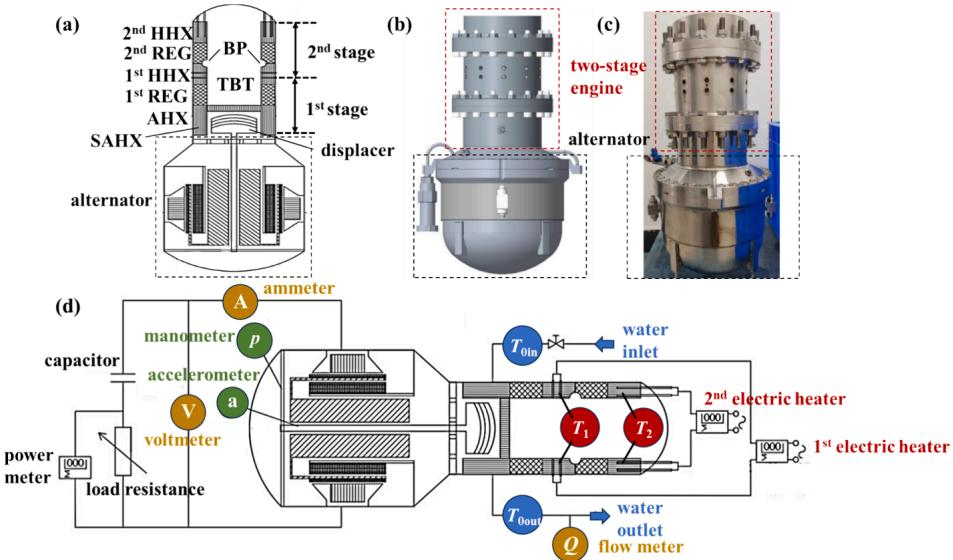  
Fig. 11. Experimental setup of the two-stage thermoacoustic-Stirling generator. (a) section schematic, (b) prototype profile, and (c) prototype photograph of the system. (d) schematic of auxiliary systems including heating, cooling, load, and measuring systems.

Table 9  
Detailed dimensions of the two-stage thermoacoustic-Stirling generator.
<table><tr><td>Component</td><td>Detail</td></tr><tr><td>AHX</td><td>Shell tube type, 65 mm in length, 47 mm in internal diameter, 120 mm in external diameter</td></tr><tr><td>REG</td><td>47 mm in internal diameter, 111 mm in external diameter, 80 % in porosity, 40 mm in length for 1st stage, 30 mm in length for 2nd stage</td></tr><tr><td>HHX</td><td>Plate-fin type, 47 mm in internal diameter, 111 mm in external diameter, 30 mm in length for both stages</td></tr><tr><td>TBT</td><td>44 mm in diameter, 130 mm in length</td></tr><tr><td>BP Alternator</td><td>854 mm² in total flow area</td></tr><tr><td></td><td>2.1 kg in moving piston mass, 71 kN/m in spring stiffness, 1.17 Ω in internal resistance</td></tr></table>

Table 10  
Experimental results of the two-stage thermoacoustic generator.
<table><tr><td>Number of stages</td><td>T0 (K)</td><td>Qi (kW)</td><td>T (K)</td><td>Wa (W)</td><td>We (W)</td><td>rQ,en (%)</td></tr><tr><td>1</td><td>300</td><td>2.5</td><td>933</td><td>268</td><td>187</td><td>50</td></tr><tr><td>2</td><td>300</td><td>1; 2.5</td><td>747;</td><td>432</td><td>317</td><td>66</td></tr><tr><td></td><td></td><td></td><td>963</td><td></td><td></td><td></td></tr></table>

(2) Simulation results show that the total exergy utilization of the system with optimal temperature distribution of hightemperature heat exchangers is only slightly higher than that of the system with equidistant temperature distribution. This suggests that the equidistant temperature distribution is sufficient to achieve relatively satisfactory system performance in a multistage thermoacoustic engine.

(3) As the number of stages increases, the waste heat recovery rate and total exergy utilization efficiency of the multi-stage system are significantly improved. For the stage 1–4 systems, the total exergy utilization efficiencies are 37.7 %, 47.6 %, 51.2 %, 52.5 %, and the waste heat recovery rate are 50 %, 66.7 %, 75 %, and 80 %, respectively, which is considered as the leading reason for the superiority of the 4-stage system.

(4) The thermoacoustic generator coupled with a linear alternator is further discussed. Simulation results of a three-stage thermoacoustic generator show that it can generate 2439 W of electric power with a total exergy utilization efficiency of 45.1 %, representing a 36.4 % increase in electrical power and a 12 % increase in total exergy utilization efficiency compared to a singlestage generator. Experimental results of a two-stage thermoacoustic-Stirling generator demonstrate the potential of the thermoacoustic generator with multi-stage heat exchangers to efficiently utilize variable-temperature heat sources.

This work suggests that the proposed thermoacoustic engine can cascade the utilization of waste heat with high energy utilization, which has a promising prospect in waste heat recovery for kilowatt-scale applications.

## CRediT authorship contribution statement

Yiwei Hu: Writing – original draft, Visualization, Validation, Software, Methodology, Investigation. Zhijie Jiang: Writing – original draft, Validation, Software, Methodology. Kaiqi Luo: Writing – review & editing, Investigation. Dan Zhao: Writing – review & editing. Yuanhang Chen: Writing – review & editing, Validation, Software. Geng Chen: Writing – review & editing. Ercang Luo: Writing – review & editing, Supervision, Methodology, Investigation, Funding acquisition. Jingyuan Xu: Writing – review & editing, Supervision, Software, Methodology, Investigation, Conceptualization.

## Declaration of competing interest

The authors declare that they have no known competing financial interests or personal relationships that could have appeared to influence the work reported in this paper.

## Data availability

Data will be made available on request.

## Acknowledgments

This work was supported by the Key Laboratory of Cryogenic Science and Technology (NO. CRYO20230103) and the National Natural Science Foundation of China (No. 51906250).

## References

[1] U.S. Energy Information Administration (EIA). International Energy Outlook, 2017. Available at: https://www.eia.gov/todayinenergy/detail.php?id=32912. (Accessed: 17th April 2024).

[2] Muriuki L, Wafula Wekesa D, Njoka F. Modeling, simulation and techno-economic evaluation of a micro-grid system based on steam gasification of organic municipal solid waste. Energ Convers Manage 2024;299:117813.

[3] Goswami R, Ganguly S, Das R. Waste heat recovery from the biomass engine for effective power generation using a new array-based system. Sustain Energy Techn 2024;63:103630.

[4] Tera I, Zhang S, Liu G. A conceptual hydrogen, heat and power polygeneration system based on biomass gasification, SOFC and waste heat recovery units: Energy, exergy, economic and emergy (4E) assessment. Energy 2024;295:131015.

[5] Almomani B, Alkhalidi A, Olabi AG, Jouhara H. Expert opinions on strengths, weaknesses, opportunities, and threats of utilizing nuclear reactor waste heat for water desalination. Desalination 2023;564:116777.

[6] Zhong Z, Burhan M, Ng KC, Cui X, Chen Q. Low-temperature desalination driven by waste heat of nuclear power plants: A thermo-economic analysis. Desalination 2024;576:117325.

[7] Mana AA, Kaitouni SI, Kousksou T, Jamil A. Enhancing sustainable energy conversion: Comparative study of superheated and recuperative ORC systems for waste heat recovery and geothermal applications, with focus on 4E performance. Energy 2023;284:128654.

[8] Al-Sayyab AKS, Mota-Babiloni A, Navarro-Esbrí J. Renewable and waste heat applications for heating, cooling, and power generation based on advanced configurations. Energ Convers Manage 2023;291:117253.

[9] Du S, Xu Z, Wang R, Yang C. Development of direct seawater-cooled LiBr–H2O absorption chiller and its application in industrial waste heat utilization. Energy 2024;294:130816.

[10] Ma D, Sun Y, Ma S, Li G, Zhou Z, Ma H. Study on the working medium of high temperature heat pump suitable for industrial waste heat recovery. Appl Therm Eng 2024;236:121642.

[11] Xu Z, Mao H, Liu D, Wang R. Waste heat recovery of power plant with large scale serial absorption heat pumps. Energy 2018;165:1097–105.

[12] Brückner S, Liu S, Miro ´ L, Radspieler M, Cabeza LF, L¨avemann E. Industrial waste heat recovery technologies: An economic analysis of heat transformation technologies. Appl Energy 2015;151:157–67.

[13] Tchanche BF, Lambrinos G, Frangoudakis A, Papadakis G. Low-grade heat conversion into power using organic Rankine cycles – A review of various applications. Renew Sustain Energy Rev 2011;15:3963–79.

[14] Ahmed Al-Mufti O, Janajreh I. High fidelity analysis and optimization of a quarter wavelength thermo-acoustically driven refrigerator. Energ Convers Manage 2024; 299:117884.

[15] Fang J, Yang M, Fan Y, Luo T, Li H, Liu T, et al. Thermodynamic evaluation of a combined cooling, heating, hydrogen, and power multi-generation system for fullspectrum solar energy utilization. Energ Convers Manage 2024;300:118019.

[16] Chen G, Tang L, Mace B, Yu Z. Multi-physics coupling in thermoacoustic devices: A review. Renew Sustain Energy Rev 2021;146:111170.

[17] Blanc N, Laufer M, Frankel S, Ramon GZ. High-fidelity numerical simulations of a standing-wave thermoacoustic engine. Appl Energy 2024;360:122817.

[18] Hu Y, Xu J, Zhao D, Yang R, Hu J, Luo E. Analysis on a single-stage direct-coupled thermoacoustic refrigerator driven by low/medium-grade heat. Appl Energy 2024; 361:122958.

[19] Xiao L, Luo K, Wu Z, Luo E. An efficient and eco-friendly heat-driven thermoacoustic refrigerator with bypass configuration. Appl Phys Lett 2024;124: 023902.

[20] Liu L, Liu Y, Duan F. Effect of the characteristic time on the system performance of a three-stage looped traveling-wave thermoacoustic engine. Energ Convers Manage 2020;224:113367.

[21] Wheatley J, Hofler T, Swift GW, Migliori A. An intrinsically irreversible thermoacoustic heat engine. J Acoust Soc Am 1983;74:153–70.

[22] Wheatley J, Hofler T, Swift GW, Migliori A. Understanding some simple phenomena in thermoacoustics with applications to acoustical heat engines. Am J Phys 1985;53:147–62.

[23] Swift GW. Analysis and performance of a large thermoacoustic engine. J Acoust Soc Am 1992;92:1551 63.

[24] Backhaus S, Swift GW. A thermoacoustic-Stirling heat engine: Detailed study. J Acoust Soc Am 2000;107:3148.

[25] Backhaus S, Swift GW. A thermoacoustic Stirling heat engine. Nature 1999;399: 335–8.

[26] Tijani MEH, Spoelstra S. A high performance thermoacoustic engine. J Appl Phys 2011;110:093519.

[27] Qiu L, Wang B, Sun D, Liu Y, Steiner T. A thermoacoustic engine capable of utilizing multi-temperature heat sources. Energ Convers Manage 2009;50: 3187–92.

[28] Xiao L, Chi J, Luo K, Xu J, Zhao D, Wu Z, et al. A highly efficient eco-friendly heatdriven thermoacoustic refrigerator using nitrogen and water. Energ Convers Manage 2024;304:118251.

[29] Chi J, Xiao L, Wu Z, Xu J, Yang Y, Hu Y, et al. A high-efficiency gas–liquid coupled heat-driven thermoacoustic heat pump. Int J Refrig 2023;155:296–304.

[30] Bi T, Wu Z, Chen W, Zhang L, Luo E, Zhang B. Numerical and experimental research on a high-power 4-stage looped travelling-wave thermoacoustic electric generator. Energy 2022;239:122131.

[31] K. de Blok. Novel 4-Stage Traveling Wave Thermoacoustic Power Generator. Proceedings of the Asme Fluids Engineering Division Summer Conference. 2 (2010) 73-9.

[32] Mumith JA, Makatsoris C, Karayiannis TG. Design of a thermoacoustic heat engine for low temperature waste heat recovery in food manufacturing: A thermoacoustic device for heat recovery. Appl Therm Eng 2014;65:588–96.

[33] Wu Z, Yu G, Zhang L, Dai W, Luo E. Development of a 3 kW double-acting thermoacoustic Stirling electric generator. Appl Energy 2014;136:866–72.

[34] Bi T, Wu Z, Zhang L, Yu G, Luo E, Dai W. Development of a 5 kW traveling-wave thermoacoustic electric generator. Appl Energy 2017;185:1355–61.

[35] Jin T, Yang R, Wang Y, Feng Y, Tang K. Low temperature difference thermoacoustic prime mover with asymmetric multi-stage loop configuration. Sc Rep-Uk 2017;7:7665.

[36] Hu JY, Luo EC, Zhang LM, Chen YY, Wu ZH, Gao B. Analysis of a displacer-coupled multi-stage thermoacoustic-Stirling engine. Energy 2018;145:507–14.

[37] Jiang Z, Xu J, Yu G, Yang R, Wu Z, Hu J, et al. A Stirling generator with multiple bypass expansion for variable-temperature waste heat recovery. Appl Energy 2023; 329:120242.

[38] Hamood A, Jaworski AJ. Thermoacoustic cascade engine free from resonance length. Energy 2023;271:126881.

[39] Hu Y, Luo K, Wu Z, Luo E. Efficiency enhancement in a heat-driven single-unit thermoacoustic refrigeration system. Appl Energy 2024;369:123604.

[40] Chang D, Sun Y, Hu J, Zhang L, Chen Y, Luo E. Numerical study on a Franchot double-acting heat-driven thermoacoustic-Stirling cryocooler for natural gas liquefaction. Int J Hydrogen Energ 2024;63:881–95.

[41] Xu J, Hu J, Luo E, Zhang L, Dai W. A cascade-looped thermoacoustic driven cryocooler with different-diameter resonance tubes. Part I: Theoretical analysis of thermodynamic performance and characteristics. Energy 2019;181:943–53.

[42] Jiang Z, Yu G, Zhu S, Dai W, Luo E. Advances on a free-piston Stirling engine-based micro-combined heat and power system. Appl Therm Eng 2022;217:119187.

[43] Hsu S-H, Li Y-T. Estimation of limit cycle amplitude after onset threshold of thermoacoustic Stirling engine. Exp Therm Fluid Sci 2023;147:110956.

[44] Li X, Liu B, Yu G, Dai W, Hu J, Luo E, et al. Experimental validation and numeric optimization of a resonance tube-coupled duplex Stirling cooler. Appl Energy 2017;207:604–12.

[45] Hu Y, Wang X, Wu Z, Zhang L, Chen G, Xu J, et al. A thermoacoustic cooler with a bypass expansion for distributed-temperature heat loads. Appl Phys Lett 2022;121: 203905.