# Thermoacoustic micro-CHP system for low-grade thermal energy utilization in residential buildings

Yiwei Hu a,b, Kaiqi Luo c, Dan Zhao d, Jiaxin Chi a,b, Geng Chen e, Yuanhang Chen a,b, Ercang Luo a,b,\*\*, Jingyuan Xu f,\*

a Key Laboratory of Cryogenic Science and Technology, Technical Institute of Physics and Chemistry, Chinese Academy of Sciences, Beijing, 100190, China b University of Chinese Academy of Sciences, Beijing, 100049, China

c Building Energy Research Center, Tsinghua University, Beijing, 100084, China

d Department of Mechanical Engineering, College of Engineering, University of Canterbury, Private Bag 4800, Christchurch, 8041, New Zealand

e National Engineering Research Center of Power Generation Control and Safety, School of Energy and Environment, Southeast University, Nanjing, 210096, China

f Institute of Microstructure Technology, Karlsruhe Institute of Technology, Karlsruhe, 76344, Germany

## A R T I C L E I N F O

Handling Editor: G Chicco

Keywords:   
Thermoacoustic   
Heat pump   
Power generation   
Combined heating and power (CHP)   
Low-grade thermal energy utilization

## A B S T R A C T

Effectively utilizing low-grade thermal energy is a promising approach to mitigating greenhouse gas emissions while reducing the burden on centralized power grids. Current thermoacoustic heat pumps and power generators face challenges such as high onset temperature differentials and low performance. This paper addresses these challenges by introducing a gas-liquid resonator into a thermoacoustic combined heat and power systems to recover low-grade thermal energy in residential buildings. Through Sage modeling and calculations, the internal characteristics of the proposed system and its output performance under different operating conditions are explored. At a heating temperature of 350 ◦C, the system can generate 6.4 kW of output thermal power, 0.9 kW of electricity, and overall exergy efficiency is 79.3 %. Combining neural network models with case studies conducted in Spain and Finland, the system can annually save 5.6 MWh and 20.7 MWh in fuel energy, reduce emissions of 1374 kg and 5180 kg of carbon dioxide, and save a total cost of €611 and €2324, respectively. Furthermore, comparisons with other emerging micro-CHP systems highlight the efficiency of the proposed system. These results indicate the high potential of thermoacoustic combined heat and power systems in recovering low-grade thermal energy and achieving energy savings and emission reductions.

## 1. Introduction

The buildings, transportation, construction, and agriculture industries stand as significant global energy consumers, utilizing energy for both heat and electricity production [1]. Distributed heat and power generation systems, leveraging renewable and low-grade thermal energy sources, hold promise in curbing greenhouse gas emissions and enhancing energy efficiency. Additionally, this approach offers secure, reliable, cost-effective, and sustainable clean energy solutions, particularly benefiting rural areas in developing nations where access to electricity and grid infrastructure is limited [2].

There has been a growing focus on micro combined heat and power (micro-CHP) systems to enhance the efficiency of distributed energy generation by producing power and heat locally [3]. Micro-CHP is a decentralized system that generates both heat and electricity and is linked to low voltage grids operating at the consumer level [4]. However, developing a small-scale, compact, and highly efficient micro-CHP system for domestic heating and electricity applications remains challenging. Thermoacoustic technology offers a promising alternative to conventional energy conversion systems and is widely used for cooling [5,6], heating [7], and power generation [8]. These systems can operate efficiently in the power range of tens of watts to tens of kilowatts [9], offering several advantages, such as low vibration and better reliability due to the lack of mechanical moving components [10]. Additionally, they are environmentally friendly due to using a pollution-free working gas [11] and low-grade heat sources. These advantages make thermoacoustic combined heat and power technology a promising alternative for small-scale distributed energy systems.

Thermoacoustic technology has gained increasing popularity in the fields of power generation and heat pump systems. Backhaus et al. [12] proposed a thermoacoustic generator achieving a power output of 58 W and a thermal-electric efficiency of 15 %. Since then, researchers have been working to improve the performance of thermoacoustic generators. For instance, Luo et al. [13] achieved a hundred-watt-level traveling wave thermoacoustic generator. In 2013, Wu et al. [14] developed a series-connection type thermoacoustic power generation system, which reached a maximum power output of 1565 W with the highest thermal-electric efficiency of 16.8 %. In 2015, the same team proposed a side-branch type thermoacoustic generator [15], achieving a maximum power output of 4.69 kW and the highest thermal-electric efficiency of 18.4 %. This system has lower requirements for consistency of working parameters among multiple units, making it more practical than the series-connection type. In recent years, the field of thermoacoustic heat pumps has garnered significant attention, as evidenced by the increasing number of experimental studies being conducted in this area. Notably, Yang et al. [16] designed a linear-compressor-driven thermoacoustic heat pump which achieved 260 W output thermal power and a coefficient of performance $\left( \mathrm { C O P _ { h } } \right)$ of 2.1. Similarly, Widyaparaga et al. [17] reported a maximum temperature difference of ${ } ^ { 2 3 } ^ { \circ } \mathrm { C }$ for a dual-acoustic driver thermoacoustic heat pump. In 2022, Yang et al. [6] proposed a two-stage looped thermoacoustic system for combined cooling and heating, achieving a maximum COPh of 1.24. More recently, Chi et al. [18] developed a gas-liquid coupled thermoacoustic heat pump with a maximum $\mathrm { C O P _ { h } }$ of 1.5.

Although research on thermoacoustic combined heating (or cooling) and power systems remains scarce, some recent studies have made progress in this area. For instance, Hou et al. (2018) [19] proposed a thermoacoustic combined cooling and power system for natural gas liquefaction, which achieved an exergy efficiency of 58 %. In addition, Xu et al. (2021) [9] simulated a thermoacoustic combined cooling, heating, and power (CCHP) system for waste heat and LNG cold energy recovery, achieving an overall exergy efficiency of 24.1 %. Similarly, Guo et al. (2022) [20] developed a model for a multistage thermoacoustically-driven combined cooling and power system, which attained an exergy efficiency of 25.8 %.

Thermoacoustic heating and power generation technologies encounter several challenges that impede their widespread adoption: 1) They often necessitate large onset temperature differentials. Current systems, particularly in power generation, often maintain heating temperatures above $5 0 0 ^ { \circ } \mathrm { C } ,$ constraining the utilization of low-grade thermal energy. Attempts to match the engine’s low-temperature heat exchanger with the temperature zone of liquefied natural gas (LNG) have been made to increase the temperature difference [9]. However, these efforts prove inefficient for household applications, compromising the initially feasible matching of engine heat exchangers’ low temperatures with output temperatures for adequate heat supply. 2) Existing thermoacoustic CHP or CCHP systems still exhibit low efficiency. The main reason is the utilization of traditional long resonant tubes in their phase-shift structures, leading to significant losses that severely impact system efficiency. Novel and efficient thermoacoustic CHP systems are yet to be developed. 3) Present thermoacoustic CHP systems, in terms of energy conservation and emissions reduction, remain a qualitative concept lacking quantitative data support. Simultaneously, there is a lack of in-depth exploration regarding electricity generation, heat supply, and the output ratio between the two, especially in comparison with other CHP systems. The application potential of thermoacoustic CHP systems currently lacks scientific analysis in existing literature. Therefore, this paper proposes the following innovative aspects to address these issues or supplement these gaps:

• Introducing a gas-liquid resonator into the existing three-unit thermoacoustic CHP system for the first time. Research indicates that this method can achieve lower onset temperatures, facilitating the recovery of low-grade thermal energy.

• Conducting a comprehensive analysis of the proposed new system, including the distribution of internal characteristic parameters and loss distribution, as well as performance under different operating conditions, providing new supplements to the feasible solutions of thermoacoustic CHP systems.

• Introducing a simple yet effective neural network model. The case study on the application of thermoacoustic CHP systems in residential buildings is conducted for the first time, quantitatively providing the heating temperature required for covering the annual heating demand of typical households and the coverage of electricity demand.

• Comparing thermoacoustic CHP systems with other micro-CHP systems for the first time in terms of electricity generation, heat supply, and the output ratio between the two, providing important references for the performance of thermoacoustic CHP systems among emerging CHP systems.

## 2. Thermoacoustic micro-CHP system

## 2.1. System configuration

Fig. 1 illustrates the schematic of a domestic thermoacoustic micro-CHP system, which comprises three identical energy-conversion subunits. Each subunit consists of a thermoacoustic engine, an alternator, a thermoacoustic heat pump, and a U-type gas-liquid resonator. The thermoacoustic engine includes an output heat exchanger (OHXe), a regenerator $( \mathrm { R E G } _ { \mathrm { { e } } } ) ,$ , a heating heat exchanger (HHX), and a thermal buffer tube (TBT) The alternator comprises a resonant linear motor, a front-space, and a back-space, where the motor compresses gas in the front-space and is completely enclosed in a bolted pressure vessel. The thermoacoustic heat pump includes an output heat exchanger (OHX ), a regenerator $\mathrm { ( R E G _ { h } ) }$ , and an ambient-temperature heat exchanger (AHX). The U-type gas-liquid resonator, serving as the phase-shifter unit, provides appropriate acoustic field matching for the system and consists of two gas volumes and a liquid volume. Table 1 lists the geometric dimensions of the thermoacoustic units, which are similar to the dimensions of the experimental prototype used for model validation in the thermoacoustic heat pump [21]. The designed parameters for the alternator of the thermoacoustic micro-CHP system are listed in Table 2, obtained under the premise of optimizing the highest exergy efficiency.

Fig. 2 depicts the proposed configuration of a domestic thermoacoustic micro-CHP system designed for low-grade thermal energy utilization. The system operates through a self-excited thermoacoustic oscillation that initiates the conversion of heat to acoustic power. This conversion is triggered by the axial temperature gradient produced across the regenerator, excessing a critical value. The amplified acoustic power generated is employed to drive both the alternator and heat pump. Subsequently, the alternator converts the acoustic power into electrical power while the heat pump converts it into thermal energy. The HHX of the engine is heated by a low-grade heat source: solar, geothermal, or waste heat. The ambient-temperature heat source (e.g. air) cools the AHX. The OHXs of both the engine and heat pump are utilized to supply heat for the circulating water while working at desired temperatures.

## 2.2. Model description and validation

The dynamic control equation of the power piston, which is the key component connecting the thermoacoustic system to the linear alternator [22], can be written as:

$$
A _ { p } \widetilde { P } _ { c } - \tau \widetilde { I } + K _ { m } \widetilde { x } _ { p } - R _ { m } \widetilde { \nu } _ { p } - M _ { p } \widetilde { a } _ { p } = 0\tag{1}
$$

The electric balance equation of linear alternator can be written as:

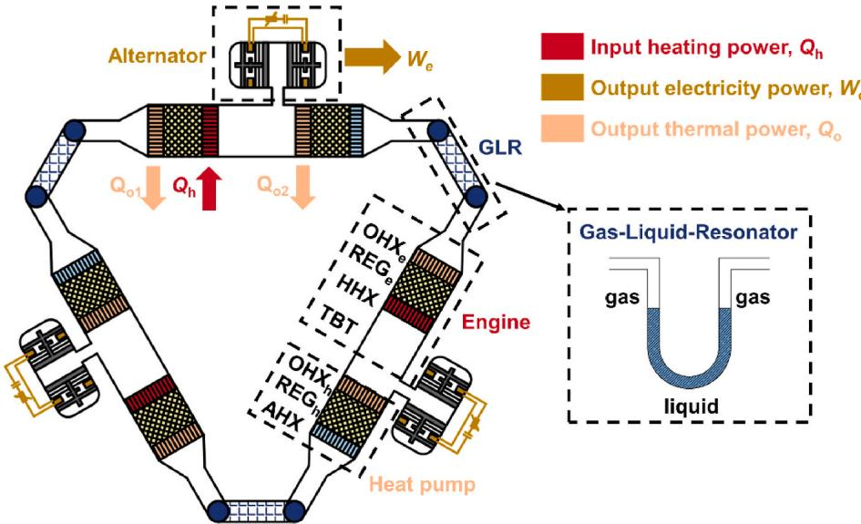  
Fig. 1. Schematic of a three-stage thermoacoustic micro-CHP system.

Table 1  
Dimensions of each component of the thermoacoustic micro-CHP system.
<table><tr><td>Subunit</td><td>Parts</td><td>Diameter (mm)</td><td>Length (mm)</td><td>Other dimensions</td></tr><tr><td>Engine</td><td>OHXe</td><td>110</td><td>35</td><td>Shell tube type, 20 % in porosity, 1 mm in tube internal diameter, 1.4 mm in tube external diameter</td></tr><tr><td></td><td> $\mathrm { R E G _ { e } }$ </td><td></td><td>40</td><td>80 % in porosity, 50 μm in wire diameter</td></tr><tr><td></td><td>HHX</td><td></td><td>40</td><td>Shell tube type, 20 % in porosity, 1 mm in tube internal diameter,</td></tr><tr><td>Heat</td><td>TBT</td><td></td><td>300</td><td>1.4 mm in tube external diameter 5 mm in wall thickness</td></tr><tr><td>pump</td><td>OHXh</td><td>110</td><td>40</td><td>Shell tube type, 20 % in porosity, 1 mm in tube internal diameter,</td></tr><tr><td></td><td>REGh</td><td></td><td>40</td><td>1.4 mm in tube external diameter 80 % in porosity, 50 μm in wire diameter</td></tr><tr><td></td><td>AHX</td><td></td><td>40</td><td>Shell tube type, 20 % in porosity, 1 mm in tube internal diameter, 1.4 mm in tube external diameter</td></tr><tr><td>GLR</td><td>Gas</td><td>60</td><td>100</td><td>U-type tube, 3 mm in wall</td></tr><tr><td></td><td>Liquid</td><td></td><td>600</td><td>thickness</td></tr><tr><td></td><td>Gas</td><td></td><td>100</td><td></td></tr></table>

Table 2  
Designed parameters for the alternator.
<table><tr><td>Parameter</td><td>Definition</td><td>Value</td></tr><tr><td> $D _ { \mathrm { { p } } }$ </td><td>diameter of the alternator piston, mm</td><td>100</td></tr><tr><td> $M _ { \mathrm { p } }$ </td><td>moving mass of the alternator piston, kg</td><td>18</td></tr><tr><td> $R _ { m }$ </td><td>mechanical damping, kg/s</td><td>40</td></tr><tr><td> $R _ { \mathrm { e , i n } }$ </td><td>internal electrical resistance, Ω</td><td>0.8</td></tr><tr><td> $T$ </td><td>transduction coefficient for the alternator, N/A</td><td>90</td></tr><tr><td> $K _ { \mathrm { m } }$ </td><td>mechanical spring stiffness, N/m</td><td> $6 . 9 \times 1 0 ^ { 4 }$ </td></tr><tr><td> $V _ { \mathrm { f } }$ </td><td>volume of the front space, L</td><td>0.53</td></tr><tr><td> $V _ { \mathrm { b } }$ </td><td>volume of the back space, L</td><td>4</td></tr></table>

$$
\widetilde { Z } _ { e l e c } \widetilde { I } = \tau \widetilde { \nu } _ { p }\tag{2}
$$

Thus, Eq. (1) can be expressed as:

$$
\frac { \widetilde { P } _ { c } } { A _ { p } \widetilde { \nu } _ { p } } { = } \frac { \tau ^ { 2 } } { { A _ { p } } ^ { 2 } \widetilde { Z } _ { e l e c } } { + } \frac { 1 } { { A _ { p } } ^ { 2 } } \left( R _ { m } + i \omega M _ { p } - i \frac { K _ { m } } { \omega } \right)\tag{3}
$$

Eq. (3) explains the primary matching principle between the thermoacoustic system and the linear alternator, i.e., the acoustic impedance at the surface of the power piston $( Z _ { p i s - F } )$ equals the imped ance of the linear alternator $( Z _ { p i s - e } ) .$ . It can be decomposed into two equations with real and imaginary parts:

$$
R e \left[ \widetilde { Z } _ { p i s - F } \right] { A _ { p } } ^ { 2 } = \frac { \tau ^ { 2 } \left( R _ { e , i n } + R _ { e , o u t } \right) } { \left| \widetilde { Z } _ { e l e c } \right| ^ { 2 } } + R _ { m }\tag{4}
$$

$$
I m \big [ \widetilde { Z } _ { p i s - F } \big ] { A _ { p } } ^ { 2 } = \bigg ( \omega M _ { p } - \frac { K _ { m } } { \omega } \bigg ) - \frac { \tau ^ { 2 } \bigg ( \omega L - 1 _ { / \omega C } \bigg ) } { \big | \widetilde { Z } _ { e l e c } \big | ^ { 2 } }\tag{5}
$$

The Sage program [23], renowned for its proficiency in modeling and simulating thermoacoustic devices [24–26], was selected to conduct numerical simulations in this study. The detailed model of each component is presented in Appendix. A. The program employs a time-domain model that integrates the conservation equations of mass, momentum, and energy in the pertinent gas domain, as outlined below:

$$
\frac { \partial \rho A } { \partial t } + \frac { \partial \rho u A } { \partial x } = 0\tag{6}
$$

$$
\frac { \partial \rho u A } { \partial t } + \frac { \partial u \rho u A } { \partial x } + \frac { \partial p } { \partial x } A - F A = 0\tag{7}
$$

$$
\frac { \partial \rho e A } { \partial t } + p \frac { \partial A } { \partial t } + \frac { \partial } { \partial x } ( u \rho e A + u p A + q ) - Q _ { w } = 0\tag{8}
$$

To comprehensively evaluate the performance of the thermoacoustic micro-CHP system, several key efficiency metrics must be defined, including thermal efficiency $( \eta _ { \mathrm { t h } } ) ,$ electrical efficiency $( \eta _ { \mathrm { e l e c } } ) _ { \mathrm { i } }$ , overall energy efficiency $( \eta _ { \mathrm { e n } } ) ,$ and overall exergy efficiency $( \eta _ { \mathrm { e x } } )$ . These efficiency metrics can be mathematically expressed as follows:

$$
\eta _ { \mathrm { t h } } = \frac { Q _ { \mathrm { o } } } { Q _ { \mathrm { h } } } = \frac { Q _ { \mathrm { o l } } + Q _ { \mathrm { o 2 } } } { Q _ { \mathrm { h } } }\tag{9}
$$

$$
\eta _ { \mathrm { e l e c } } = \frac { W _ { \mathrm { e } } } { Q _ { \mathrm { h } } }\tag{10}
$$

$$
\eta _ { \mathrm { e n } } = \frac { Q _ { \mathrm { o l } } + Q _ { \mathrm { o 2 } } + W _ { \mathrm { e } } } { Q _ { \mathrm { h } } }\tag{11}
$$

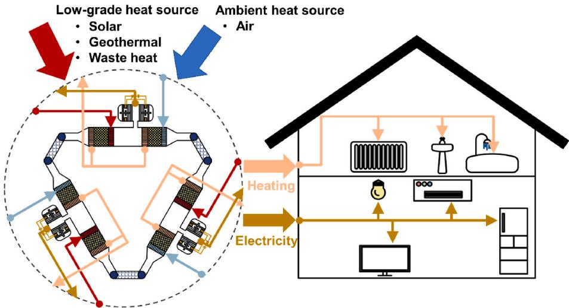  
Fig. 2. Envisioned configuration of a thermoacoustic micro-CHP system designed for the utilization of low-grade thermal energy in domestic application.

$$
\eta _ { \mathrm { e x } } = \frac { \left( Q _ { \mathrm { o l } } + Q _ { \mathrm { o 2 } } \right) \times \left( 1 - \frac { T _ { \mathrm { a } } } { T _ { \mathrm { o } } } \right) + W _ { \mathrm { e } } } { Q _ { \mathrm { h } } \times \left( 1 - \frac { T _ { \mathrm { o } } } { T _ { \mathrm { h } } } \right) }\tag{12}
$$

The model validation was made with the experimental data obtained from a three-stage thermoacoustic gas-liquid heat pump [21] featuring identical thermoacoustic core units consisting of a thermoacoustic engine, a thermoacoustic heat pump, and a gas-liquid resonator. The results indicate that the overall error between simulation and experiment does not exceed 15 %. The main causes of the difference may stem from: 1) SAGE being a 1D heat transfer model, which means that the details of temperature changes in the heat exchanger rely on heat transfer corrections under given average conditions. Additionally, the empirical formulas it employs may deviate from actual conditions. 2) Possible errors in the heat load required to maintain the temperature for each heat exchanger in the experiment due to heat leakage. 3) Inadequate consideration of acoustic streaming typically encompassing Rayleigh flow, jet flow, and Gedeon flow. While SAGE considers Gedeon flow, Rayleigh flow and jet flow have not been well accounted for. 4) In the experiments, efforts were made to reduce liquid displacement and minimize the effect of liquid motion on the elastic membrane structure by increasing the cross-sectional area of the gas column in the gas-liquid resonator. However, it should be noted that SAGE tends to underestimate the local frictional pressure-drop loss coefficient, resulting in an underestimation of losses. The differences between experiments and simulations fall within an acceptable range for engineering purposes. Therefore, it can be said that the thermoacoustic micro-CHP system presented in this study can be accurately estimated using the Sage program.

3. Thermodynamic performance of the thermoacoustic micro-CHP system

## 3.1. System performance

To examine the sensitivity of the performance output of the thermoacoustic micro-CHP system to various parameters, it is also crucial to evaluate its performance under specific working conditions. Table 3 presents the simulation results of the proposed micro-CHP system operating under nominal conditions suitable for domestic applications. Specifically, the output temperature $( T _ { 0 } )$ is set at $6 0 ~ ^ { \circ } \mathrm { C }$ as a typical household space heating temperature $[ 2 7 ]$ , and the ambient temperature $\left( T _ { \mathsf { a } } \right)$ is set at $7 ~ ^ { \circ } \mathrm { C }$ following the standard industrial practice in the heat pump field [28]. Additionally, the heating temperature $( T _ { \mathrm { h } } )$ is kept constant at $3 5 0 ^ { \circ } \mathrm { C } ,$ indicating the utilization of low-grade temperature heat. Under these operational parameters, the micro-CHP system yields an output thermal power $\left( Q _ { 0 } \right)$ of 6.4 kW, an output electricity power (We) of 0.9 kW, an overall energy efficiency $\left( \eta _ { \mathrm { e n } } \right)$ of 1.4, and an overall exergy efficiency $( \eta _ { \mathrm { e x } } )$ of 79.3 %.

Performance of the thermoacoustic micro-CHP system for the specific working condition in residential buildings.
<table><tr><td>Symbol</td><td>Parameter</td><td>Value</td></tr><tr><td> $P _ { \mathrm { m } }$ </td><td>Mean pressure (MPa)</td><td>6</td></tr><tr><td> $p r$ </td><td>Pressure ratio at inlet of engine stage</td><td>1.09</td></tr><tr><td> $T _ { \mathrm { h } }$ </td><td>Temperature of the heating heat exchanger (°C)</td><td>350</td></tr><tr><td> $T _ { a }$ </td><td>Temperature of the ambient heat exchanger (°C)</td><td>7</td></tr><tr><td> $T _ { \mathbf { o } }$ </td><td>Temperature of the output heat exchanger (°C)</td><td>60</td></tr><tr><td> $f$ </td><td>Working frequency (Hz)</td><td>28.5</td></tr><tr><td> $Q _ { \mathrm { h } }$ </td><td>Input heating power in engine (kW)</td><td>4.6</td></tr><tr><td> $Q _ { 0 }$ </td><td>Output thermal power of the system (kW)</td><td>6.4</td></tr><tr><td> $W _ { \mathrm { e } }$ </td><td>Output electricity power of the system (kW)</td><td>0.9</td></tr><tr><td> $\eta _ { \mathrm { e n } }$ </td><td>Overall energy efficiency of the system</td><td>1.4</td></tr><tr><td> $\eta _ { \mathrm { e x } }$ </td><td>Overall exergy efficiency of the system</td><td>79.3 %</td></tr></table>

## 3.2. Axial distributions of key parameters

The distribution of internal characteristic parameters in thermoacoustic systems is worth attention. The Sage software, as a 1D model, facilitates the extraction of axial distributions of important parameters conveniently. The results are shown in Fig. 3(a–c). The axial 0-position is defined at the inlet of the $\mathrm { O H X } _ { \mathrm { e } } .$ The phase relationship between internal pressure wave and volume flow rate $( \theta _ { \mathrm { P - U } } )$ in oscillatory flow is particularly important, as it is one of the key factors determining the efficiency of energy conversion. It is found to increase from −37.5◦ to −23.8◦ in $\mathrm { R E G } _ { \mathrm { e } } ,$ and from 32.2◦ to 44. $. 2 ^ { \circ }$ in ${ \mathrm { R E G } } _ { \mathrm { h } } ,$ indicating significant travelingwave components. Regarding the distribution of acoustic power $( W _ { \mathrm { a } } ) ,$ the analysis shows an initial generation of 750 W is then amplified to 1300 W in the engine stage. After utilizing the alternator, the acoustic power is reduced to 966 W. Further reduction is observed after employing the heat pump, resulting in a final acoustic power of 783 W. The various components of the system exhibit varying degrees of acoustic power loss, with a final recycling of 752 W of acoustic power. These results quantitatively demonstrate the amplification of acoustic power in thermoacoustic engines and its consumption in thermoacoustic heat pumps and alternators.

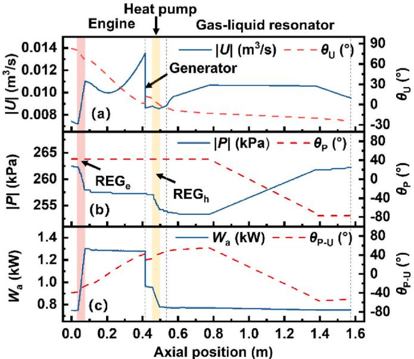  
Fig. 3. Axial distributions of key parameters of the thermoacoustic micro-CHP system. The pink and yellow area represents the engine and heat pump regenerator, respectively. (For interpretation of the references to colour in this figure legend, the reader is referred to the Web version of this article.)

## 3.3. Exergy loss analysis of key components

Internal exergy loss analysis is crucial for thermoacoustic systems. Analyzing the main sources of losses helps to further understand the level of optimization of the system. It consists of four main parts including the flow friction loss $( A E _ { f r i c } )$ , non-ideal heat transfer loss $( A E _ { Q w } ) _ { \mathrm { { i } } }$ axial heat flow loss $( A E _ { Q x } ) _ { : }$ the loss errors generated by the computational model $( A E _ { d i s } )$ , and the losses introduced by the alternator, such as winding resistance $( W _ { r i n } )$ and mechanical power consumption $( W _ { m } )$ . The mathematical expressions for these losses are given as follows:

$$
A E _ { f r i c } = - \ T _ { 0 } \times \oint _ { d t } \int _ { d x } { \frac { u A F } { T } }\tag{13}
$$

$$
A E _ { Q w } = - \ : T _ { 0 } \times \oint _ { { d t } } \int _ { { d v } } { \frac { q _ { w } \bullet \nabla T _ { w } } { T ^ { 2 } } }\tag{14}
$$

$$
A E _ { Q x } = - { T _ { 0 } } \times { \oint _ { { d t } } } { \int _ { { d v } } { \frac { q _ { x } \bullet \nabla { T _ { x } } } { { T ^ { 2 } } } } }\tag{15}
$$

$$
W _ { r i n } = \frac { 1 } { 2 } { \times } R _ { e , i n } \times | \widetilde { I } | ^ { 2 }\tag{16}
$$

$$
W _ { m } = \frac { 1 } { 2 } \times R _ { m } \times \left| \widetilde { \nu _ { p } } \right| ^ { 2 }\tag{17}
$$

Fig. 4 illustrates the exergy loss distribution in the main components. The analysis indicates that a substantial amount of exergy loss (554 W) occurs in $\mathrm { R E G _ { e } }$ due to its large acoustic impedance. The non-ideal heat transfer and axial heat flow loss contribute to the primary losses. $\mathtt { R E G } _ { \mathrm { n } }$ also exhibits a similar trend, with an exergy loss of 105 W. In the alternator, the winding resistance and mechanical damping contribute power consumptions of 49 W and 58 W, respectively. The remaining components also experience varying degrees of losses, primarily due to heat flow loss. Identifying these sources of exergy loss can provide insights into optimizing the system’s design and operation, aiming to improve its overall performance.

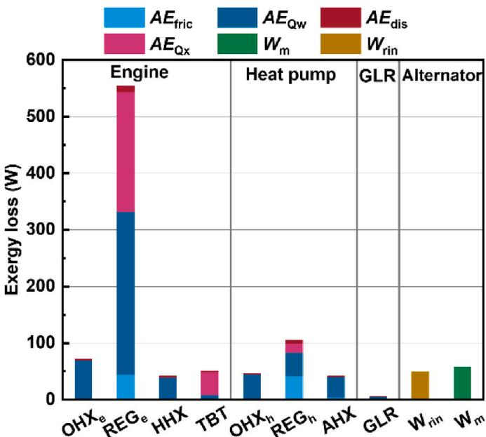  
Fig. 4. Exergy loss analysis of each component of the thermoacoustic micro-CHP system.

## 3.4. Influence of heating temperatures and ambient temperatures

In addition to assessing the feasibility of the proposed thermoacoustic micro-CHP system for residential heating and electricity applications, it is crucial to evaluate its thermodynamic performance across diverse ambient and heating temperatures. The heating temperature of the HHX is dependent on the quality of the heat source used. In this study, the performance of the micro-CHP system was evaluated while varying ambient temperatures ranging from $0 ~ ^ { \circ } \mathrm { C }$ to ${ } ^ { 2 5 } \ ^ { \circ } \mathrm { C }$ and heating temperatures ranging from 300 ◦C to 400 ◦C at 60 ◦C output temperature and 6 MPa mean pressure. Figs. 5 and 6 depict the micro-CHP system performance fluctuations. As shown in Fig. 5, the output heating and electricity power significantly increases with increasing ambient and heating temperatures. However, the overall energy efficiency increases to a certain level before stabilizing. In addition, the overall exergy efficiency shows an optimal value within the calculated range. The optimal operating condition for exergy efficiency is at an ambient temperature of $0 ~ ^ { \circ } \mathrm { C }$ and a heating temperature of $3 5 0 ~ ^ { \circ } \mathrm { C } .$ The micro-CHP system can achieve an output thermal power of 3.74 kW, an output electrical power of 0.59 kW, a total energy efficiency of 1.35, and a gross exergy efficiency of 81.1 %.

Moreover, it was observed that the output of heating and electricity are susceptible to the heating temperature, indicating that a slight increase in the heat source’s grade is sufficient to achieve high power output for heating and electricity generation. As shown in Fig. 6, the ratio of output electrical power to output thermal power $\left( W _ { \mathrm { e } } / Q _ { 0 } \right)$ shows a discernible dependence on the ambient and heating temperatures, where the higher temperatures lead to a greater ratio. Thus, $W _ { \mathrm { e } } / Q _ { 0 }$ can be adjusted by controlling those temperatures. Remarkably, when both the ambient and heating temperatures are relatively low, $W _ { \mathrm { e } } / Q _ { 0 }$ is also comparably small. When the temperature difference across the $\mathrm { R E G } _ { \mathrm { e } }$ is relatively small and across the $\mathrm { R E G } _ { \mathrm { h } }$ relatively large, limited acoustic power is converted. Then, a restricted amount of electrical power $\left( W _ { \mathrm { e } } \right)$ is generated by the acoustic power conversion. In contrast, the output thermal power, especially at the HHXe $( Q _ { 0 1 } ) ,$ , is less affected, resulting in a comparably lower $W _ { \mathrm { e } } / Q _ { 0 } .$

## 3.5. Influence of alternator external resistance and ambient temperatures

In practical applications, it is crucial to control and adjust the performance of the thermoacoustic micro-CHP system to match specific operating temperatures. A potential approach is adjusting the external resistance of the alternator. Fig. 7 illustrates the system performance variations under different alternator external resistances and ambient temperatures. In the simulation, when changing the resistance, the structural parameters of the system remain unchanged, while operational parameters such as frequency and piston displacement are set as optimization variables to ensure that the fundamental constraints of piston motion (Eq. (3)) are met. The results show that an increase in the external resistance leads to a significant increase in output thermal power while the output electricity power initially increases and then decreases. Furthermore, the overall energy efficiency shows an upward trend before stabilizing, whereas the overall exergy efficiency decreases significantly with increased external resistance. Specifically, at an ambient temperature of ${ \bf \vec { 7 } \ ^ { \circ } C } ,$ , the external resistance increases from 10 Ω to 50 Ω, the output thermal power elevates from 0.98 kW to 45.4 kW, and the output electricity power ascends from 0.17 kW to 2.64 kW, the overall energy efficiency increases from 1.27 to 1.49. In contrast, the overall exergy efficiency decreases from 73.5 % to 62.6 %. The decrease in overall exergy efficiency results from the higher-order energy of electricity power, which occupies a crucial position in the expression of exergy efficiency, as stated in $\operatorname { E q . }$ (12). Fig. 8 demonstrates that $W _ { \mathrm { e } } / Q _ { 0 }$ can be adjusted by changing the alternator external resistance. However, $W _ { \mathrm { e } } / Q _ { 0 }$ remains low over a significant range of both ambient temperatures and external resistance variations.

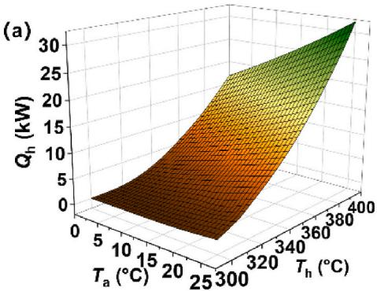

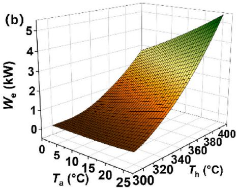

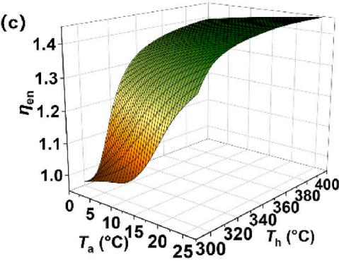

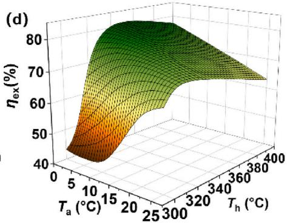  
Fig. 5. Effect of the heating temperatures and ambient temperatures on system performance: (a) overall output thermal power (Qo), (b) output electricity power $( W _ { \mathrm { e } } ) ,$ (c) overall energy efficiency $\left( \eta _ { \mathrm { e n } } \right) ;$ , (d) overall exergy efficiency $( \eta _ { \mathrm { e x } } )$ of the system.

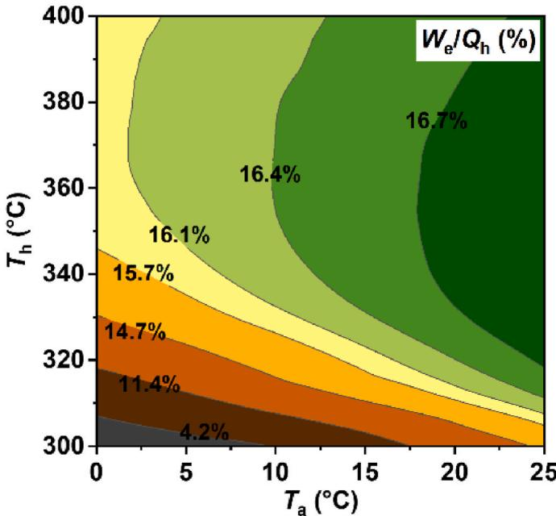  
Fig. 6. Effect of the heating temperatures (Th) and ambient temperatures (Ta) on the ratio of output electricity power to output thermal power $( W _ { \mathrm { e } } / Q _ { 0 } )$

It is important to note that the system originally underwent global optimization, with the optimized variables including mechanical spring stiffness, resistance, and the volumes of the front and back space. Changing the resistance without optimizing the other parameters will cause a mismatch in the system, resulting in a decline in the electrical efficiency and significantly impacting the overall exergy efficiency. These findings not only emphasize the importance of regulating system performance but also underscore the need for a holistic approach to system design and optimization for optimal energy and exergy efficiencies.

## 4. Case study in residential buildings

Thermoacoustic systems have been widely acknowledged in the literature as having potential applications in domestic settings [11,29, 30]. Despite this, there is a lack of quantitative assessments of thermoacoustic micro-CHP systems in terms of their ability to provide simultaneous heating and electricity supply for households. To address this gap, this section aims to conduct a case study on two typical households in Spain and Finland to evaluate the economic and environmental feasibility of the proposed thermoacoustic micro-CHP system. Fig. 9 illustrates the methodology employed for this study. Initially, the performance of the thermoacoustic micro-CHP system is analyzed under varying operational conditions (as described in Section 3.1), such as the derivation of a matrix of input variables (heating and ambient temperatures) and output performance parameters (output heating and electricity power, energy, and exergy efficiencies). Subsequently, a neural network model (detailed in Appendix. B) can be employed to derive hourly heating temperature, output electricity power, energy, and exergy efficiencies by utilizing the annual hourly heat demand as the output thermal power and the air temperatures as the ambient temperatures. Finally, the analysis of electricity power coverage and the economic-environmental assessment can be performed.

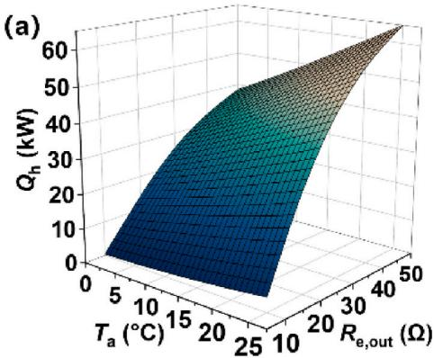

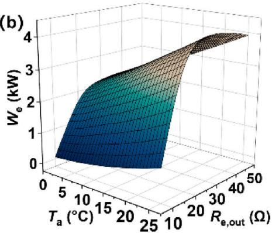

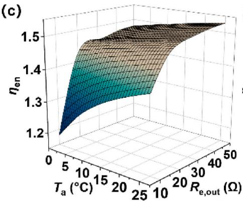

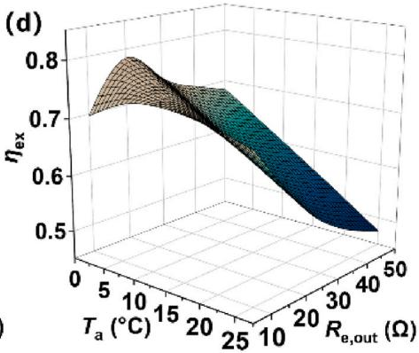  
Fig. 7. Effect of the alternator external resistance and ambient temperatures on system performance: (a) output thermal power (Qo), (b) output electricity power $( W _ { \mathrm { e } } ) ,$ (c) overall energy efficiency $( \eta _ { \mathrm { e n } } ) ,$ (d) overall exergy efficiency $( \eta _ { \mathrm { e x } } )$ of the system.

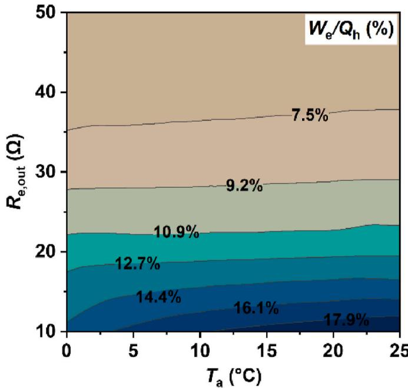  
Fig. 8. Effect of the alternator external resistance $\left( R _ { \mathrm { e x } } \right)$ and ambient temperatures $\left( T _ { \mathrm { a } } \right)$ on the ratio of electricity power and output thermal power $( W _ { \mathrm { e } } / Q _ { 0 } )$

The economic and environmental viability of the proposed thermoacoustic micro-CHP system can be evaluated using various indicators. In this regard, Table 4 presents the economic and environmental parameters employed in the calculations. The fuel energy saving (FES) is calculated as follows:

$$
F E S = \frac { Q _ { o } } { \eta _ { b o i } } \times \tau _ { o }\tag{18}
$$

The total potential $\mathrm { C O } _ { 2 }$ emission reduction $( E R _ { \mathrm { t o t } } )$ includes the $\mathrm { C O } _ { 2 }$ emission reduction by natural gas $( E R _ { \mathrm { n g } } )$ and electricity $( E R _ { \mathrm { e l } } )$

$$
E R _ { t o t } = E R _ { n g } + E R _ { e l }\tag{19}
$$

$$
E R _ { n g } = \frac { Q _ { o } } { \eta _ { b o i } } \times f _ { n g } \times \tau _ { o }\tag{20}
$$

$$
E R _ { e l } = E _ { c o \nu } \times f _ { e l } \times \tau _ { o }\tag{21}
$$

The total cost saving (TCS) includes the energy cost $( C _ { s } )$ and environmental penalty cost (EPCS):

$$
\begin{array} { r } { T C S = E P C S + C _ { s } } \end{array}\tag{22}
$$

$$
E P C S = E R _ { t o t } \times c _ { C O _ { 2 } }\tag{23}
$$

$$
C _ { s } = \bigg ( \frac { Q _ { o } } { \eta _ { b o i } } \times c _ { n g } + E _ { c o v } \times c _ { e l } \bigg ) \times \tau _ { o }\tag{24}
$$

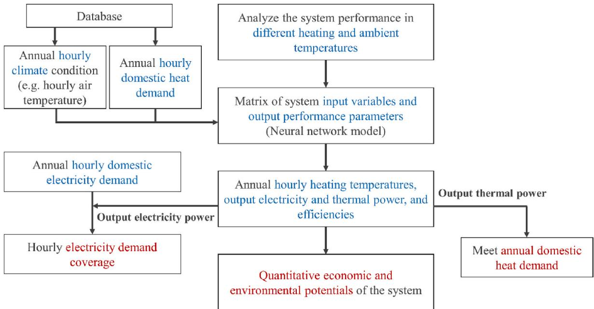  
Fig. 9. Procedure for the case study of the thermoacoustic micro-CHP system. (The heat demand is satisfied with output thermal power by adjusting the heating temperature.)

Table 4  
Economic and environmental parameters.
<table><tr><td>Parameter</td><td>Value</td></tr><tr><td>Efficiency of gas boiler,  $\eta _ { \mathrm { b o i } }$ </td><td>82 % [31]</td></tr><tr><td>Natural gas price,  $c _ { \mathrm { n g } }$ </td><td>0.0563 €/kWh [31]</td></tr><tr><td>Electricity price, Cel</td><td>0.205 €/kWh [31]</td></tr><tr><td> $\mathrm { C O } _ { 2 }$  emission factor for natural gas,  $f _ { \mathrm { n g } }$ </td><td>0.206 kgCO2/kWh [32]</td></tr><tr><td> $\mathrm { C O } _ { 2 }$  emission factor for electricity, fel</td><td>0.350 kgCO2/kWh [33]</td></tr><tr><td>Cost of unit CO2 emission, Cco2</td><td>0.12 €/kgCO2 [34]</td></tr></table>

## 4.1. Climate condition, heat demand and electricity demand from the database

Fig. 10 displays the yearly average air temperature data, heat demand, and electricity demand conditions of typical households in Spain and Finland. The air temperature data is obtained from JRC Photovoltaic Geographical Information System (PVGIS) [35]. The hourly heat demand $( Q _ { \mathrm { h , d e m } } )$ is calculated as $Q _ { \mathrm { h , d e m } } = Q _ { \mathrm { y , d e m } } \times n _ { \mathrm { h } } \times A _ { \mathrm { d } } ,$ where $Q _ { \mathrm { y , d e m } }$ represents the annual total heat load demand and is assumed as 49 $\mathrm { k W h } / \mathrm { m } ^ { 2 }$ for Spain and 169 $\mathrm { k W h } / \mathrm { m } ^ { 2 }$ for Finland [36]. The hourly heat load norm (nh) is determined according to the HOTMAPS PROJECT [36], and $A _ { \mathrm { d } }$ indicates the average floor area of occupied dwellings and is taken as 89.4 $\mathrm { ~ m } ^ { 2 }$ for Spain and 98.4 $\mathtt { m } ^ { 2 }$ for Finland based on the EU Buildings Database [37]. The hourly electricity demand $\mathrm { ( E _ { h , d e m } ) }$ is calculated as $E _ { \mathrm { h , d e m } } = E _ { \mathrm { y , d e m } } \times n _ { \mathrm { e } } ,$ where $E _ { \mathrm { y , d e m } }$ is the annual total electricity load consumption per dwelling and is taken as 3918 kWh for Spain and 7664 kWh for Finland [38], and $n _ { \mathrm { e } }$ is the hourly electricity load norm according to the HOTMAPS PROJECT [36].

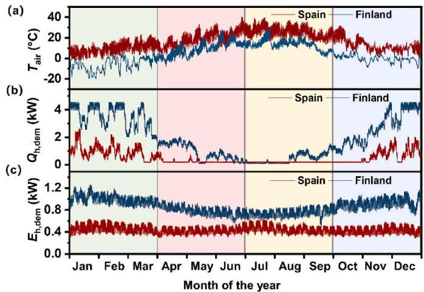  
Fig. 10. (a) Hourly average air-temperature $( T _ { \mathrm { a i r } } ) ,$ (b) hourly heat demand $( Q _ { \mathrm { h } } ,$ $\mathrm { d e m } )$ and (c) hourly electricity demand $( E _ { \mathrm { h , d e m } } ) ,$ in Spain and Finland over a year.

## 4.2. Dynamic operation of thermoacoustic micro-CHP system

Fig. 11 displays the hourly required heating temperatures, overall energy efficiency, and overall exergy efficiency of the thermoacoustic micro-CHP system over a year, where the system’s heating temperature is adjusted to meet the hourly household heat demand precisely. The results demonstrate that Finland’s higher annual heating demand requires a higher heating temperature than Spain, maintaining a heating temperature below $3 5 0 ~ ^ { \circ } \mathrm { C }$ throughout the year. Moreover, the system exhibits a promising heating performance, with an overall annual energy efficiency exceeding 1.1 and an annual exergy efficiency exceeding 50 %.

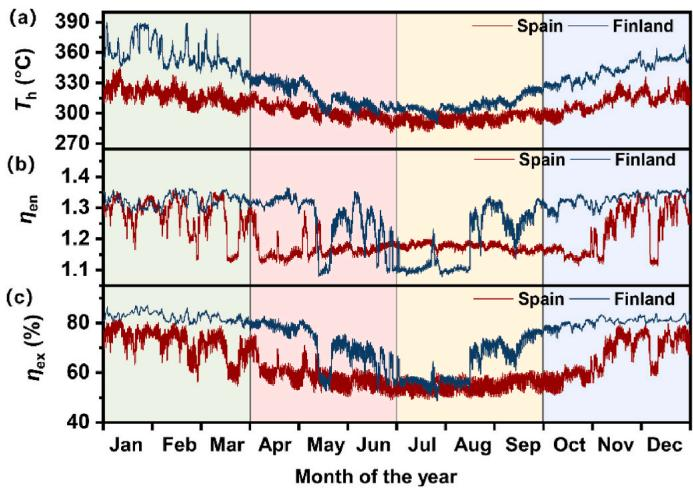  
Fig. 11. (a) Hourly required heating temperature $\left( T _ { \mathrm { h } } \right)$ of the thermoacoustic micro-CHP system that aims to meet hourly household heat demand, (b) hourly overall energy efficiency $( \eta _ { \mathrm { e n } } )$ of the system, and (c) hourly overall exergy efficiency $( \eta _ { \mathrm { e x } } )$ of the system, for Spain and Finland over a year.

Fig. 12 portrays the hourly electricity demand coverage for typical households in Spain and Finland throughout the year, during which the thermoacoustic micro-CHP system operates at requisite heating temperatures. The results indicate that the system is capable of providing annual electricity coverage of 15.9 % and 33.6 % for each household in Spain and Finland, respectively. Furthermore, during colder months with higher heating demands $( \mathrm { i . e . , }$ January to March and November to December), the system can alleviate grid pressure by 29.8 % and 54.3 % for typical households in Spain and Finland, respectively. These findings underscore the system’s potential as a promising solution for addressing electricity coverage and grid pressure concerns in both nations.

This section investigates the potential environmental and economic benefits of utilizing low-grade thermal energy to power the thermoacoustic micro-CHP system exclusively. Monthly total cost savings (TCS) and $\mathrm { C O _ { 2 } }$ emission reduction $( E R _ { \mathrm { t o t } } )$ are estimated assuming precise hourly heat demand coverage; the results are illustrated in Fig. 13 and presented in $\mathrm { T a b l e } 5 .$ . The findings demonstrate that a single system has the capability to conserve 5.6 MWh and 20.1 MWh of fuel energy, resulting in a total cost saving of 611 € and 2324 € and a reduction of $1 3 7 4 \mathrm { k g C O _ { 2 } }$ and $5 1 8 0 \mathrm { k g C O _ { 2 } }$ emissions per annum in Spain and Finland, respectively. These results highlight the potential of thermoacoustic micro-CHP systems as a promising economically and environmentally friendly solution for domestic heating and electricity.

## 5. Comparative analysis of thermoacoustic micro-CHP system against existing technologies

In this section, a thorough evaluation of the suggested thermoacoustic micro-CHP system for domestic heating and electricity generation is presented by comparing it with other established micro-CHP technologies currently under development. These technologies include fuel cell CHP [39–43], internal-combustion engine (ICE) CHP [44–50], micro-turbine (MT) CHP [51,52], and Stirling-type CHP [53–55]. The comparison is presented regarding the system’s performance relative to these technologies and the proposed system to determine its potential feasibility for household energy applications. The simulation for the thermoacoustic micro-CHP system uses an output temperature of $6 0 ~ ^ { \circ } \mathrm { C }$ with a heating temperature ranging from $3 0 0 ^ { \circ } \mathrm { C }$ to $4 0 0 ~ ^ { \circ } \mathrm { C }$

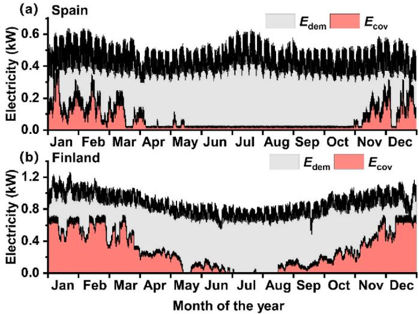  
Fig. 12. Hourly electricity demand coverage of the thermoacoustic micro-CHP system in (a) Spain and (b) Finland over one year, with heating temperature adjustment to meet household heating demands.

Fig. 14 compares the output thermal power $\left( Q _ { 0 } \right)$ and electricity power (We) for the various CHP technologies. At the same time, all of them are micro-sized, thermoacoustic, Stirling-type and fuel cell systems which may be more suitable for small-scale household applications; ICE and MT systems are better suited for large-scale applications. The straight lines depicted in the figure denote the linear regression of the power scatter plot for CHP systems of the same type passing through the origin, which characterizes the proportional relationship between heat output and electricity generation for various CHP technologies. Notably, the slope of the lines for thermoacoustic and Stirling-type CHP systems is steeper, indicating a greater tendency towards heat output, whereas fuel cell-type CHP systems exhibit a greater propensity for electricity generation.

Furthermore, Fig. 15 presents a comparison of the overall energy efficiency, which encompasses both thermal and electrical efficiency, across various micro-CHP technologies. Based on the comparison of overall energy efficiency across different micro-CHP technologies, the thermoacoustic system shows a high potential for efficiency, particularly in terms of thermal efficiency. However, it is worth noting that such comparisons may not be entirely equitable. On the one hand, the efficiency data for thermoacoustic micro-CHP is derived from the theoretical value of the thermoacoustic system itself, whereas data for other types of CHP are primarily based on experimental values or engineering values that include additional ancillary systems such as cooling water systems. On the other hand, the temperature lift $\left( T _ { 0 }  – T _ { \mathrm { a } } \right)$ at the heat pump terminal exhibits inconsistency across diverse systems, which also affects thermal and electrical efficiency. Nonetheless, this comparison still highlights the higher efficiency potential of the thermoacoustic micro-CHP system.

## 6. Conclusions

The current study presents a novel thermoacoustic micro-CHP system that effectively harnesses low-grade heat for household heating and electricity generation. The system proposed, utilizing gas-liquid resonators instead of traditional gas resonators for phase modulation, exhibits stronger phase modulation capability and lower losses. Consequently, it achieves higher system efficiency. Additionally, its structure is more compact, offering an environmentally friendly option for current distributed CHP systems. The main research findings indicate several interesting conclusions listed below.

(1) The micro-CHP system exhibits exceptional efficiency in the heating temperature range of 300 $^ { \circ } { \bf C } { \mathrm { - } } 4 0 0 \ ^ { \circ } { \bf C }$ and an ambient temperature range of $0 \ ^ { \circ } \mathrm { C } / 2 5 \ ^ { \circ } \mathrm { C } .$ The system can generate 0.2 $\mathbf { k W } \leq \mathbf { o u t p u t }$ thermal power ≤32.1 kW, 0 kW ≤ electrical power $\leq 5 . 4 \mathrm { ~ k W } , 0 . 9 6 \leq$ overall energy efficiency ${ \leq } 1 . 4 5$ , and 42.4 % ≤ overall exergy efficiency $\leq 8 1 . 1 ~ \%$

(2) The output heating and electrical power are positively influenced by the ambient and heating temperatures, while the sensitivity to changes in heating temperature suggests that a minor increase in its grade is sufficient to achieve a high power output for generating heat and electricity. Modifying the external resistance of an alternator can be a viable method to regulate the ratio of electrical output to thermal power, particularly under specific temperature conditions.

(3) Thermoacoustic micro-CHP system presents a solution to mitigate excessive reliance on electricity, particularly in areas with high annual heating demand. Based on financial and environmental perspectives, the case study results in residential buildings demonstrate that a single system can annually reduce carbon dioxide emissions by 1374 kg and 5180 kg in Spain and Finland, respectively. The proposed system can generate significant savings of 611 €/year and 2324 €/year in Spain and Finland, respectively. These findings highlight the potential of thermoacoustic technology as a sustainable alternative.

(d)  
(a)  
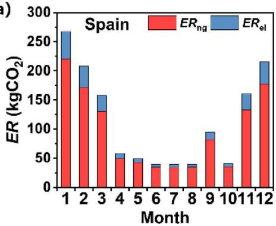

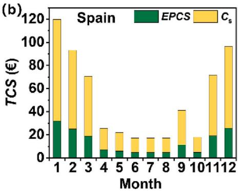

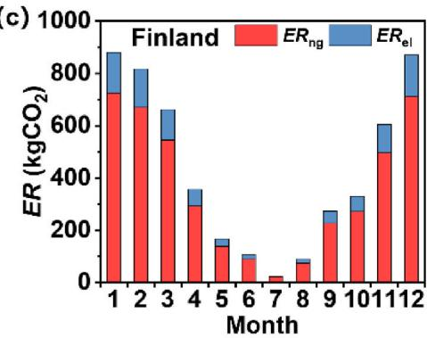

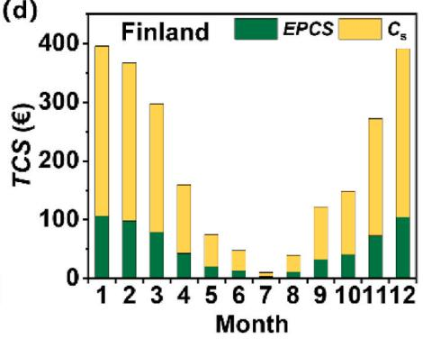  
Fig. 13. (a) Monthly $\mathrm { C O } _ { 2 }$ emission reduction (ER) in Spain, (b) Monthly total cost saving (TCS) in Spain, (c) Monthly $\mathrm { C O } _ { 2 }$ emission reduction (ER) in Finland, (d) Monthly total cost saving (TCS) in Finland over a year.

Annual economic and environmental potential of the thermoacoustic micro-CHP system.
<table><tr><td rowspan="2">Parameter</td><td colspan="2">Value</td></tr><tr><td>Spain</td><td>Finland</td></tr><tr><td>Annual fuel energy saving, FES</td><td>5.6 MWh/year</td><td>20.7 MWh/year</td></tr><tr><td>Annual total cost saving, TCS</td><td>611.1 €/year</td><td>2324.0 €/year</td></tr><tr><td>Annual environmental penalty cost saving, EPCS</td><td> $1 6 4 . 9 \mathrm { ~ } \mathrm { { ‰} }$ </td><td>621.6 €/year</td></tr><tr><td>Annual energy cost saving,  $C _ { s }$ </td><td>446.2 €/year</td><td>1702.4 €/year</td></tr><tr><td>Annual  $\mathrm { C O } _ { 2 }$  emission reduction,  $E R _ { \mathrm { { t o t } } }$ </td><td>1374 kgCO2/</td><td>5180 kgCO2/</td></tr><tr><td>Annual  $\mathrm { C O } _ { 2 }$  emission reduction by natural  $E R _ { \mathrm { n g } }$ </td><td>year  $1 1 4 8 \mathrm { k g C O _ { 2 } } /$ </td><td>year 4262 kgCO₂/</td></tr><tr><td>gas, Annual  $. { \mathrm { C O } } _ { 2 }$  emission reduction by electricity,  $E R _ { \mathrm { e l } }$ </td><td>year  $2 2 6 ~ \mathrm { k g C O _ { 2 } } /$ </td><td>year  $9 1 8 ~ \mathrm { k g C O _ { 2 } } /$ </td></tr></table>

(4) Thermoacoustic micro-CHP systems appear to be better suited for small-scale household applications compared to other micro-CHP technologies, mainly due to their relatively lower output levels of both heat and electricity. Furthermore, these systems exhibit a more pronounced ability to generate heat than electricity.

These findings underscore the contributions of this study to the development of thermoacoustic CHP systems. However, it is important to acknowledge that the system proposed is more suitable for small-scale distributed CHP energy systems. Expanding its power level would involve challenges such as increasing the area of the regenerator, leading to complexities in internal flow and other issues. Therefore, applying it to large-scale centralized CHP systems still presents challenges at present.

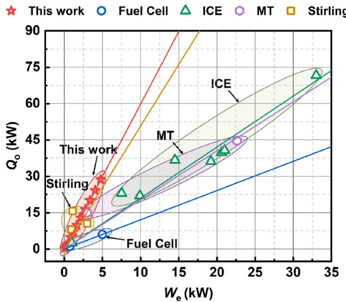  
Fig. 14. Comparison of output thermal power $\left( Q _ { \mathrm { o } } \right)$ and electricity power (We) between thermoacoustic micro-CHP system and fuel cell CHP [39,40], internal-combustion engine (ICE) CHP [44–50], micro turbine (MT) CHP [51, 52], and Stirling-type CHP [53–55].

## CRediT authorship contribution statement

Yiwei Hu: Investigation, Methodology, Software, Writing – original draft. Kaiqi Luo: Data curation, Investigation, Writing – review & editing. Dan Zhao: Writing – review & editing, Visualization. Jiaxin Chi: Data curation, Writing – review & editing. Geng Chen: Formal analysis, Writing – review & editing. Yuanhang Chen: Software. Ercang Luo: Project administration, Supervision, Validation, Writing – review & editing. Jingyuan Xu: Conceptualization, Resources,

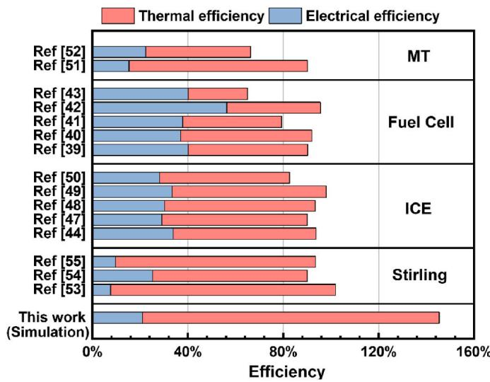  
Fig. 15. Comparison for overall energy efficiency (including thermal efficiency and electrical efficiency) of theoretical values of thermoacoustic micro-CHP systems with engineering values of fuel cell CHP [39–43], internal-combustion engine (ICE) CHP [44,47–50], micro turbine (MT) CHP [51,52], and Stirling-type CHP [53–55].

Supervision, Writing – review & editing.

## Declaration of competing interest

The authors declare that they have no known competing financial interests or personal relationships that could have appeared to influence the work reported in this paper.

## Data availability

Data will be made available on request.

## Acknowledgments

This research was financially supported by the National Natural Science Foundation of China (Grant No. 51876213 and No. 51976230), the fund of Key Laboratory of Cryogenic Science and Technology (CRYO20230103), Strategic Priority Research Programme, CAS (No. XDA21080300), and the Open Project of CAS Laboratory of Cryogenics, No. CRYO202214. D. Z is financially supported by University of Canterbury with the award No. 452DISDZ.

## Appendix. A

The terms $F , Q _ { \mathrm { w } } ,$ and q in Eqs. (7) and (8) cannot be resolved directly in a 1D Sage model. The empirical formula is shown below:

$$
F = - \left( f _ { D } \big / d _ { \mathrm { h } } + K _ { l o s } / l \right) \rho u | u | / 2\tag{A1}
$$

$$
{ q = - N _ { \mathrm { k } } k _ { \mathrm { g } } { \frac { \partial T } { \partial x } } A }\tag{A2}
$$

$$
Q _ { \mathrm { w } } = N u \big ( k _ { \mathrm { g } } \big / d _ { \mathrm { h } } \big ) S _ { \mathrm { x } } ( T _ { \mathrm { w } } - T )\tag{A3}
$$

Empirical terms $f _ { D } ,$ Nu and $N _ { k }$ for typical components in the Sage program are presented in the Table below.

<table><tr><td>Component</td><td> $f _ { \mathrm { D } }$ </td><td>Nu</td><td> $N _ { \mathrm { k } }$ </td></tr><tr><td rowspan="5">Heat exchanger</td><td> $s \mathrm { t e a d y } \colon f _ { D } = \frac { 1 6 S r } { R e }$  Laminar</td><td>Laminar steady:</td><td>Laminar:</td></tr><tr><td></td><td> $N u = 6$ </td><td> $N _ { k } = 1$ </td></tr><tr><td> $S r = \left\{ \begin{array} { c } { { 4 \mathrm { i f } V _ { a } \leq 3 2 } } \\ { { \sqrt { V _ { a } / 2 } \mathrm { i f } V _ { a } \geq 3 2 } } \end{array} \right. V _ { a } = \rho \omega { d _ { h } } ^ { 2 } / 4 \mu _ { g }$ </td><td>Turbulent:</td><td>Turbulent:</td></tr><tr><td></td><td> $N u = 0 . 0 3 6 R e ^ { 0 . 8 } \Big ( \frac { l } { d _ { h } } \Big ) ^ { - 0 . 0 5 5 } P r ^ { 0 . 3 3 }$ </td><td> $N _ { k } = 0 . 0 2 2 R e ^ { 0 . 7 5 } P r$ </td></tr><tr><td> $\mathrm { T u r b u l e n t : } f _ { D } = 0 . 1 1 \left( { \frac { \varepsilon } { d _ { h } } } + { \frac { 6 8 } { R e } } \right) ^ { 0 . 2 5 }$ </td><td></td><td></td></tr><tr><td>Regenerator</td><td> $f _ { D } = \frac { 1 2 9 } { R e } + 2 . 9 1 R e ^ { - 0 . 1 0 3 }$ </td><td> $N u = ( 1 + 0 . 9 9 R e ^ { 0 . 6 6 } ) \varphi ^ { 1 . 7 9 }$ </td><td> $N _ { k } = 1 + 0 . 5 R e ^ { 0 . 6 6 } \varphi ^ { - 2 . 9 1 }$ </td></tr></table>

The gas-liquid resonator consists of two gas column and a liquid column. The characteristic of liquid column contains a series connection of viscous resistance, inductance and compliance [56]. It is simulated as a solid piston in series with a damper with the mechanical damping coefficient $R _ { \mathrm { m } }$ and spring constant K [57].

$$
K = \frac { \rho g \pi { D _ { l } } ^ { 2 } } { 2 }\tag{A4}
$$

$$
R _ { m } = R _ { \nu } + R _ { k } = \pi ^ { 1 . 5 } D _ { l } l _ { l } \sqrt { \rho _ { l } \mu _ { l } f } + 0 . 8 4 \pi ^ { 2 } \rho _ { l } f X _ { l } { r _ { t } } ^ { 2 } E\tag{A5}
$$

## Appendix. B

The Neutral Network (NN) model is established on MATLAB platform. As shown in Fig. 5, the dataset used for training the NN model was obtained by simulating the system’s performance (including $Q _ { 0 } , W _ { \mathrm { e } } , \eta _ { \mathrm { e n } } ,$ and $\eta _ { \mathrm { e x } } )$ at different $T _ { \mathbf { a } }$ and $T _ { \mathrm { h } } .$ Following the procedure outlined in ${ \mathrm { F i g . ~ } } 9 ,$ the $Q _ { 0 }$ is equated to the practical heating demand to ensure complete coverage of the heat load. The $Q _ { 0 }$ and $T _ { \mathbf { a } }$ matrices are used as input variables, while the other four parameters are used as output variables. The training method employed is the Levenberg-Marquardt algorithm. In the dataset, 70 % serves as training data, 15 % as validation data, and the remaining 15 % as test data. The layer size is 10. The training results are shown in Fig. B1. Therefore, for any given input of $T _ { \mathsf { a } }$ and $Q _ { \mathrm { o } } ,$ corresponding values of $T _ { \mathrm { h } } , \circ W _ { \mathrm { e } } , \eta _ { \mathrm { e n } } ,$ and $\eta _ { \mathrm { e x } }$ can be obtained. Moreover, since the input variables fall within the range of the pre-calculated dataset, the predictions are relatively accurate.

(Th)  
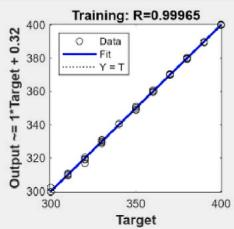

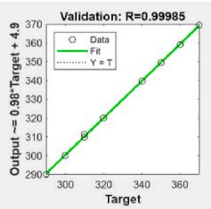

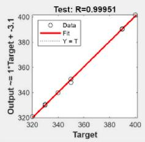

(We)  
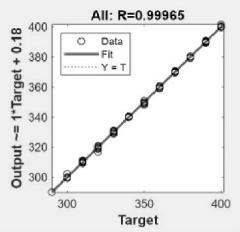

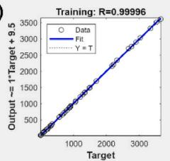

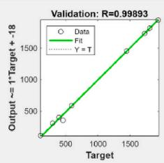

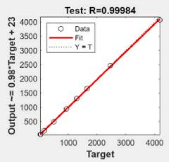

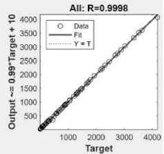

(nen)  
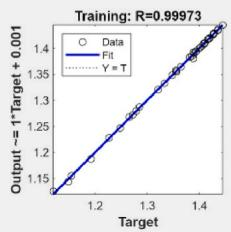

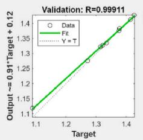

(nex)  
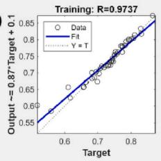

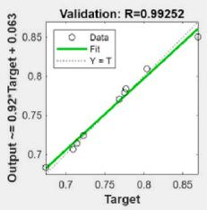

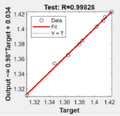

Fig. B1. The training regression results of the NN model.  
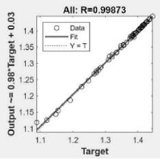

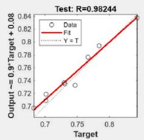

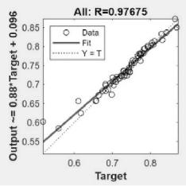

## References

[1] Martinez S, Michaux G, Salagnac P, Bouvier J-L. Micro-combined heat and power systems (micro-CHP) based on renewable energy sources. Energy Convers Manag 2017;154:262–85.

[2] Kaarsberg T, Fiskum R, Deppe A, Kumar S, Rosenfeld A, Romm J, et al. Combined heat and power for saving energy and carbon inResidential buildings. Conference: 2000 ACEEE summer study on energy efficiency inBuildings, asilomar, CA, August 21-25, 2006. Washington, DC, United States: ACEEE; 2000. Medium.

[3] Barbieri ES, Melino F, Morini M. Influence of the thermal energy storage on the profitability of micro-CHP systems for residential building applications. Appl Energy 2012;97:714–22.

[4] F.K. Bernard. Small-scale cogeneration handbook fourth ed.. Small-scale cogeneration handbook. River Publishers2011. pp. i-xiii

[5] Hu Y, Wang X, Wu Z, Zhang L, Chen G, Xu J, et al. A thermoacoustic cooler with a bypass expansion for distributed-temperature heat loads. Appl Phys Lett 2022;121: 203905.

[6] Xu J, Yu G, Zhang L, Dai W, Wu Z, Luo E. Numerical investigation on a 300Hz pulse tube cryocooler driven by a three-stage traveling-wave thermoacoustic heat engine. Cryogenics 2015;71:68–75.

[7] Yang Y, Chi J, Wu Z, Yang R, Xu J, Zhang L, et al. A heat-driven combined cooling and heating system based on thermoacoustic technology. Appl Phys Lett 2022;120: 223902.

[8] Zhu S, Yu G, Jiang C, Wang T, Zhang L, Wu Z, et al. A novel thermoacoustically driven liquid metal magnetohydrodynamic generator for future space power applications. Energy Convers Manag 2022;258:115503.

[9] Xu J, Luo E, Hochgreb S. A thermoacoustic combined cooling, heating, and power (CCHP) system for waste heat and LNG cold energy recovery. Energy 2021;227: 120341.

[10] Chen G, Tang L, Mace B, Yu Z. Multi-physics coupling in thermoacoustic devices: a review. Renew Sustain Energy Rev 2021;146:111170.

[11] Xu J, Luo E. Heat-driven thermoacoustic cooling technology:A review and perspective. Journal of Refrigeration. 2022;43:12–25.

[12] Backhaus S, Tward E, Petach M. Traveling-wave thermoacoustic electric generator. Appl Phys Lett 2004;85:1085–7.

[13] Luo E, Wu Z, Dai W, Li S, Zhou Y. A 100 W-class traveling-wave thermoacoustic electricity generator. Chin Sci Bull 2008;53:1453–6.

[14] Wu Z, Yu G, Zhang L, Dai W, Luo E. Development of a 3 kW double-acting thermoacoustic Stirling electric generator. Appl Energy 2014;136:866–72.

[15] Bi T, Wu Z, Zhang L, Yu G, Luo E, Dai W. Development of a 5 kW traveling-wave thermoacoustic electric generator. Appl Energy 2017;185:1355–61.

[16] Yang Z, Yanyan C, Guoyao Y, Ercang L, Yuan Z. Experimental investigation on a linear-compressor driven travelling-wave thermoacoustic heat pump. Energy Proc 2015;75:1844–9.

[17] Widyaparaga A, Hiromatsu T, Deendarlianto, Kohno M, Takata Y. Acoustic field alteration in a 100 Hz dual acoustic driver straight tube travelling wave thermoacoustic heat pump for thermoacoustic heat transport control. Int J Heat Mass Tran 2020;151.

[18] Guo L, Zhao D, Xu J, Tokhi MO. Predicting unsteady heat-fluid interaction features and nonlinear acoustic behaviors in standing-wave thermoacoustic engines using unsteady RANS, LES and hybrid URANS/LES methods. Int Commun Heat Mass 2023;142:106617.

[19] Hou M, Wu Z, Hu J, Zhang L, Luo E. Experimental study on a thermoacoustic combined cooling and power technology for natural gas liquefaction. Energy Proc 2019;158:2284 9.

[20] Guo X, Guo Y, Wang J, Zhang G, Wang Z, Wu W, et al. Modeling and thermodynamic analysis of a novel combined cooling and power system composed of alkali metal thermal electric converter and looped multistage thermoacoustically-driven refrigerator. Energy 2023;263:126016.

[21] Chi J, Xiao L, Wu Z, Xu J, Yang Y, Hu Y, et al. A high-efficiency gas–liquid coupled heat-driven thermoacoustic heat pump. Int J Refrig 2023;155:296–304.

[22] Jia Z, Wang R, Hu J, Zhang L, Wu Z, Chen Y, et al. Study on the coupling between engine and alternator in a free-piston Stirling generator. Appl Therm Eng 2022; 217:119222.

[23] Gedeon D. Sage - object-oriented software for cryocooler design. 8th International Cryocooler Conference (Cryocoolers 8), Vail, Colorado 1994:281–92.

[24] Chi J, Yang Y, Wu Z, Yang R, Li P, Xu J, et al. Numerical and experimental investigation on a novel heat-driven thermoacoustic refrigerator for roomtemperature cooling. Appl Therm Eng 2023;218:119330.

[25] Wang X, Xu J, Wu Z, Luo E. A thermoacoustic refrigerator with multiple-bypas expansion cooling configuration for natural gas liquefaction. Appl Energy 2022; 313:118780.

[26] Xu J, Hu J, Luo E, Zhang L, Dai W. A cascade-looped thermoacoustic driven cryocooler with different-diameter resonance tubes. Part I: theoretical analysis of thermodynamic performance and characteristics. Energy 2019;181:943–53.

[27] Sun S, Liu Z, Sun Y, Guo H, Gong M. Performance evaluation of a novel mixedrefrigerant recuperative heat pump with a large temperature lift for space heating. Appl Therm Eng 2023;221:119828.

[28] Air conditioners. Liquid chilling packages and heat pumps for space heating and cooling and process chillers, with electrically driven compressors. BSI; 2018.

[29] Jin T, Huang J, Feng Y, Yang R, Tang K, Radebaugh R. Thermoacoustic prime movers and refrigerators: thermally powered engines without moving components. Energy 2015;93:828–53.

[30] Choi S, Han U, Cho H, Review H Lee. Recent advances in household refrigerator cycle technologies. Appl Therm Eng 2018;132:560–74.

[31] Wang K, Herrando M, Pantaleo AM, Markides CN. Technoeconomic assessments of hybrid photovoltaic-thermal vs. conventional solar-energy systems: case studies in heat and power provision to sports centres. Appl Energy 2019;254:113657.

[32] Emission Factor Database. https://www.eea.europa.eu/publications/emep-eea-gui debook-2019/emission-factors-database.

[33] Caputo A. Fattori di emissione atmosferica di CO2 e altri gas a effetto serra nel settore elettrico. ISPRA Rapporti; 2017. p. 257 (in Italian), http://www.ispramb ente.gov.it/files2017/pubblicazioni/rapporto/R\_257\_17.pdf.

[34] Carlsson B, Meir M, Rekstad J, Preiß D, Ramschak T. Replacing traditional materials with polymeric materials in solar thermosiphon systems – case study on pros and cons based on a total cost accounting approach. Sol Energy 2016;125: 294–306.

[35] JRC Photovoltaic Geographical Information System (PVGIS) - European Commission (europa.eu). https://re.jrc.ec.europa.eu.

[36] Hotmaps Project, Open Data Set for the EU28, 2018. www.hotmaps-project.eu.

[37] EU Buildings Database | Energy (europa.eu). https://ec.europa.eu/energy.

[38] ELECTRICITY CONSUMPTION PER DWELLING. https://www.odyssee-mure.eu/ publications/efficiency-by-sector/households/electricity-consumption-dwelling. html.

[39] ClearEdge Power. Delivering Smart Energy Today Off. https://www.energy.gov/sit es/prod/files/2014/03/f11/webinaraug30\_graham.pdf.

[40] Vitovalor PT2 fuel cell heating system | Viessmann UK. https://www.viessmann. co.uk/en/products/fuel-cell/vitovalor-pt2.html.

[41] Adam A, Fraga ES, Brett DJL. Options for residential building services design using fuel cell based micro-CHP and the potential for heat integration. Appl Energy 2015; 138:685–94.

[42] Di Marcoberardino G, Manzolini G. Investigation of a 5 kW micro-CHP PEM fuel cell based system integrated with membrane reactor under diverse EU natural gas quality. Int J Hydrogen Energy 2017;42:13988–4002.

[43] Antonucci V, Brunaccini G, De Pascale A, Ferraro M, Melino F, Orlandini V, et al. Integration of μ-SOFC generator and ZEBRA batteries for domestic application and comparison with other μ-CHP technologies. Energy Proc 2015;75:999 1004.

[44] LichtBlick/VW Bhkw. EcoBlue 2(0). http://www.bhkw-prinz.de/lichtblick-vw-bh kw-ecoblue-2-0-zuhausekraftwerk/2348.

[45] Vaillant EcoPOWER 1.0 (Honda mCHP). http://www.cogeneurope.eu/medialibrar y/2012/03/08/e1eef810/CODE\_CS%20-%20Vaillant%20EcoPower%201%200% 20Honda%20mCHP.pdf.

[46] Unites de. micro et mini-cogeneration acondensation au gaz naturel | Cogengreen. https://www.cogengreen.com/fr/unites-de-micro-et-mini-cogeneration-condensa tion-au-gaz-naturel.

[47] Installations XRGI® compar´ees par mod\`eles. https://www.ecpower.eu/fr/syst% C3%A8mes-xrgi.html.

[48] Capaldi P. A high efficiency 20kWe microcogeneration unit based on a turbocharged automotive gas engine. Appl Therm Eng 2016;109:803–8.

[49] Zheng CY, Wu JY, Zhai XQ, Yang G, Wang RZ. Experimental and modeling investigation of an ICE (internal combustion engine) based micro-cogeneration device considering overheat protection controls. Energy 2016;101:447–61.

[50] Unites de. micro et mini-cogeneration acondensation au gaz naturel | Cogengreen. https://www.cogengreen.com/fr/unites-de-micro-et-mini-cogeneration-innovante s-lhuile-vegetale.

[51] Accelerating Energy Transition. https://enertwin.com/#:\~:text=EnerTwin%20is %20a%20small-scale%20heat%20and%20power%20plant,CO2%20emission%20r eduction%20are%20characteristics%20of%20the%20EnerTwin.

[52] Lee JJ, Jeon MS, Kim TS. The influence of water and steam injection on the performance of a recuperated cycle microturbine for combined heat and power application. Appl Energy 2010;87:1307–16.

[53] Pellematic® e-max | FM Trade Group. http://www.fmtradegroup.it/prodotti/p ellematic-e-max/.

[54] Het Autonome Huis: Sunmachine. http://www.hetautonomehuis.be/sunmachinew at/?ref=1.

[55] Valenti G, Campanari S, Silva P, Fergnani N, Ravid\`a A, Di Marcoberardino G, et al. Modeling and testing of a micro-cogeneration stirling engine under diverse conditions of the working fluid. Energy Proc 2014;61:484–7.

[56] Xiao L, Luo K, Luo E, Xu J. A Summary: dynamic and thermodynamic analysis of thermoacoustic and Stirling systems based on time-domain acoustic-electrica analogy. Appl Energy 2023;347:121377.

[57] Xu J, Luo E, Hochgreb S. Study on a heat-driven thermoacoustic refrigerator for low-grade heat recovery. Appl Energy 2020;271:115167.