1995-06

# Shipboard electronics thermoacoustic cooler

Ballister, Stephen C.; McKelvey, Dennis J.

Monterey, California. Naval Postgraduate School

http://hdl.handle.net/10945/31400

Downloaded from NPS Archive: Calhoun

Calhoun is a project of the Dudley Knox Library at NPS, furthering the precepts and goals of open government and government transparency. All information contained herein has been approved for release by the NPS Public Affairs Officer.

# NAVAL POSTGRADUATE SCHOOL MONTEREY, CALIFORNIA

19951101 167

## SHIPBOARD ELECTRONICS THERMOACOUSTIC COOLER

by

Stephen C. Ballister June 1995

Dennis J. McKelvey September 1995

Thesis Advisor:

Steven L. Garrett

Approved for public release; distribution is unlimited.

<table><tr><td rowspan=1 colspan=5>REPORT DOCUMENTATION PAGE</td><td rowspan=1 colspan=2>Form Approved OMB No. 0704-0188</td></tr><tr><td rowspan=1 colspan=7>Public reporting burden for this collection of information is estimated to average 1 hour per response, including the time for reviewing instruction, searching existing datasources, gathering and maintaining the data needed, and completing and reviewing the coliection of information. Send comments regarding this burden estimate or anyother aspect of this collection of information, including suggestions for reducing this burden, to Washington Headquarters Services, Directorate for InformationOperations and Reports, 1215 Jefferson Davis Highway, Suite 1204, Arlington, VA 22202-4302, and to the Office of Management and Budget, Paperwork ReductionProject (0704-0188) Washington DC 20503.</td></tr><tr><td rowspan=1 colspan=2>1.   AGENCY USE ONLY (Leave blank)</td><td rowspan=1 colspan=2>2.   REPORT DATEJune 1995</td><td rowspan=1 colspan=3>3.   REPORT TYPE AND DATES COVEREDMaster&#x27;s Thesis</td></tr><tr><td rowspan=1 colspan=5>4.  TITLE AND SUBTITLESHIPBOARD ELECTRONICS THERMOACOUSTIC COOLER</td><td rowspan=2 colspan=2>5.  FUNDING NUMBERS</td></tr><tr><td rowspan=1 colspan=5>6.  AUTHOR(S) Stephen C. Ballister and Dennis J. McKelvey</td></tr><tr><td rowspan=1 colspan=5>7.  PERFORMING ORGANIZATION NAME(S) AND ADDRESS(ES)Naval Postgraduate SchoolMonterey CA 93943-5000</td><td rowspan=1 colspan=2>8.  PERFORMINGORGANIZATIONREPORT NUMBER</td></tr><tr><td rowspan=1 colspan=5>9.  SPONSORING/MONITORING AGENCY NAME(S) AND ADDRESS(ES)NAVY SCIENCE ASSISTANCE PROGRAM</td><td rowspan=1 colspan=2>10. SPONSORING/MONITORINGAGENCY REPORT NUMBER</td></tr><tr><td rowspan=1 colspan=7>11.SUPPLEMENTARY NOTES The views expressed in this thesis are those of the author and do not reflect theofficial policy or position of the Department of Defense or the U.S. Government.</td></tr><tr><td rowspan=1 colspan=5>12a. DISTRIBUTION/AVAILABILITY STATEMENTApproved for public release; distribution is unlimited.</td><td rowspan=1 colspan=2>12b. DISTRIBUTION CODE</td></tr><tr><td rowspan=1 colspan=7>13. ABSTRACT (maximum 200 words)A thermoacoustic refrigerator that was optimized for preservatión of biological samples in space, was modifiedfor use as a cooler for the CV-2095 shipboard radar electronics rack. The thermoacoustic cooler was tested inthe laboratory and demonstrated at sea aboard USS DEYO (DD-989). In the laboratory, using a calibrated heatload, the data acquisition system was able to account for the total energy balance to within 4%. At the highestoperating power aboard ship, 226.6 Watts of acoustic power was used to provide 419 Watts of useful coolingpower, corresponding to a coefficient of performance of 1.85. Taking into account the 53.9% electroacousticefficiency of the loudspeakers, the Shipboard Electronics ThermoAcoustic Cooler (SETAC) provided one Wattof cooling for each Watt of electrical power input.</td></tr><tr><td rowspan=2 colspan=6>14. SUBJECT TERMS Thermoacoustics, Refrigeration, Environmental Protection</td><td rowspan=1 colspan=1>15.NUMBER OFPAGES 117</td></tr><tr><td rowspan=1 colspan=1>16.PRICE CODE</td></tr><tr><td rowspan=1 colspan=1>17. SECURITY CLASSIFI-CATION OF REPORTUnclassified</td><td rowspan=1 colspan=2>18. SECURITY CLASSIFI-CATION OF THIS PAGEUnclassified</td><td rowspan=1 colspan=3>19.SECURITY CLASSIFICA-TION OF ABSTRACTUnclassified</td><td rowspan=1 colspan=1>20.LIMITATION OFABSTRACTUL</td></tr></table>

NSN 7540-01-280-5500  
Standard Form 298 (Rev. 2-89) Prescribed by ANSI Std. 239-18 298-102

# Approved for public release; distribution is unlimited. SHIPBOARD ELECTRONICS THERMOACOUSTIC COOLER

Stephen C. Ballister Lieutenant, United States Navy B.S., United States Naval Academy, 1987

and

Dennis J. McKelvey Lieutenant, United States Navy B.S., United States Naval Academy, 1988

Submitted in partial fulfillment of the requirements for the degrees of

<table><tr><td rowspan=1 colspan=2>Accesion For</td></tr><tr><td rowspan=1 colspan=2>NTIS CRA&amp;I       中DTIC TABUnannounced        □Justification</td></tr><tr><td rowspan=1 colspan=2>ByDistribution/</td></tr><tr><td rowspan=1 colspan=2>Availability Codes</td></tr><tr><td rowspan=1 colspan=1>Dist</td><td rowspan=1 colspan=1>Avail and/ orSpecial</td></tr></table>

MASTER OF SCIENCE IN APPLIED PHYSICS MASTER OF SCIENCE IN ENGINEERING ACOUSTICS from the

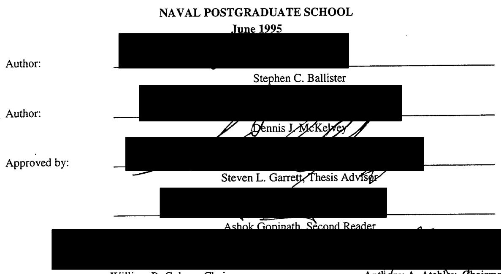  
William B. Colson, Chairman Department of Physics  
Anthny A. Atchley, hairman Engineering Acoustics Academic Committee

## ABSTRACT

A thermoacoustic refrigerator that was optimized for preservation of biological samples in space, was modified for use as a cooler for the CV-2095 shipboard radar electronics rack. The thermoacoustic cooler was tested in the laboratory and demonstrated at sea aboard USS DEYO (DD-989). In the laboratory, using a calibrated heat load, the data acquisition system was able to account for the total energy balance to within 4%. At the highest operating power aboard ship, 226.6 Watts of acoustic power was used to provide 419 Watts of useful cooling power, corresponding to a coefficient of performance of 1.85. Taking into account the 53.9% electroacoustic efficiency of the loudspeakers, the Shipboard Electronics ThermoAcoustic Cooler (SETAC) provided one Watt of cooling for each Watt of electrical power input.

## TABLE OF CONTENTS

I. INTRODUCTION 1   
A. SHIPBOARD ELECTRONIC COOLING 1   
B. CV-2095 2   
C. THERMOACOUSTICS 4   
1. Origin 4   
2. STAR and TALSR ··.．. 4   
D. BASIC LAGRANGIAN MODEL 5   
E. SCOPE AND GOALS OF THIS THESIS 8   
II. TALSR ENGINE 11   
A. BASIC GEOMETRY AND THERMOACOUSTIC SUBSYSTEMS 11   
B. DRIVER MEASUREMENTS AND ASSEMBLY 14   
III. HEAT EXCHANGERS 19   
A. FLUIDS AND HEAT EXCHANGERS 19   
B. MODIFICATIONS 20   
C. HEAT FLOW 22   
D. PRIMARY HEAT EXCHANGER PERFORMANCE   
CALCULATIONS 25   
E. THERMAL INTERFACE COMPONENTS 28   
IV. DATA ACQUISITION SYSTEM 31   
A. BACKGROUND 31   
B. INSTRUMENTATION AND GPIB 31   
C. SENSORS AND SIGNAL CONDITIONING ELECTRONICS 35   
D. SOFTWARE DESCRIPTION 38   
1. Flow Chart and Discussion 38   
2. Direct and Derived Outputs 45   
E. HARDWARE RACK 46   
V. HEAT LOAD SIMULATOR 49   
A. INTRODUCTION 49   
B. CONSTRUCTION. 49   
VI. SEA TRIALS .......... 53   
A. SHIP ......... 53   
B. LOGISTICS ············ 53   
C. INSTALLATION. .......·.. 56   
VII. SYSTEM PERFORMANCE AND ANALYSIS . . . . . . . 59   
A. OVERVIEW ········· 59   
B. DATA SUMMARY ··········· 61   
C. DETAILED ANALYSIS ············ 64   
D. SHIPBOARD RESULTS ．．····. 68   
VIII. CONCLUSIONS AND RECOMMENDATIONS . . . . 73   
A. SUMMARY OF GOALS AND RESULTS . . 73   
B. RECOMMENDATIONS FOR FURTHER RESEARCH AND   
DEVELOPMENT 74   
APPENDIX A. BELLOWS TESTING . 77   
APPENDIX B. DETERMINATION OF LOUDSPEAKER BL PRODUCT . 81   
APPENDIX C. MANUFACTURER SPECIFICATION DATA . . 85   
APPENDIX D. ELECTRICAL CONNECTOR PIN LISTS 89   
APPENDIX E. DATA ACQUISITION PROGRAM SEQUENCE LISTING . 91   
LIST OF REFERENCES 93   
INITIAL DISTRIBUTION LIST . 95

## LIST OF FIGURES

1. Basic Lagrangian Model.. ..6   
2. TALSREngine... ..12   
3. SETAC Fluid Flow Diagram. ..24   
4. Shipboard Interface Manifold. ..30   
5. Data Acquisition System.. ..34   
6. Computer Program Front Panel. .41   
7. Computer Program Flow Chart. .43   
8. Heat Load Simulator. .52   
9. USS DEYO (DD-989) ... ..55   
10. Offloading in Annapolis Harbor. ..55   
11. SETAC Installed Aboard Ship. .57   
12. April 9 Temperature Plot. .63   
13. April 9 Heat Balance Plot... .67   
14. Shipboard Data Temperature Plot. .68   
15. Shipboard Heat Balance Plot. .70   
16. Shipboard Temperature Oscillations .71   
17. Bellows Manufacturer Specification Sheet...... ..77   
18. Bellows Data Plot... ..79   
19. Loudspeaker Equivalent Circuit Diagram...... ..81   
20. Driver 2 Input Impedance Plot.. .84

## LIST OF TABLES

I. SETAC Thermoacoustic Parameters................ ..13   
II. Measured Driver Parameters....... ...17   
III.SETACSensorList...... ..39   
IV. Output File Data Format.... ...44   
V. Driver 303/304 High Power Run Log............ ..59   
VI. SETAC Data Summary...... ..62   
VII. Bellows Data Summary... ...79

# ACKNOWLEDGEMENTS

We would like to recognize Admiral J.P. Reason and Dr. J.H. McCain, whose insight launched this project funded through the Naval Science Assistance Program.

We would also like to thank Peavey Electronics and the Russell Corporation whose support and material donations were instrumental in the construction of SETAC.

We are deeply indebted to Professor Garrett for his patient tutelage and remarkable versatility which greatly enhanced our education and the success of this project.

Lastly, we would like to thank our families whose unfailing love and support allowed us to maintain the highest morale and motivation.

## I. INTRODUCTION

## A. SHIPBOARD ELECTRONIC COOLING

The cooling of electronic equipment is absolutely essential to the operation of Navy ships. Electronic consoles generate substantial quantities of heat which must be removed in order to assure optimal system performance and to keep spaces at a reasonable temperature. If there is an interruption in the heat removal process, vital systems (especially combat systems) must be shut down within minutes to prevent damage.

A ship's cooling capability is provided by vaporcompression type refrigeration plants which provide chilled water that is circulated throughout the ship and ultimately to heat exchangers within various pieces of equipment. These refrigeration plants use Chlorofluorocarbons (CFCs) or Hydrochlorofluorocarbons (HCFCs) as working fluids, both of which have been blamed for destroying the Earth's protective ozone layer (Benedick, 1991). The manufacture of CFCs has been banned worldwide as of 1996 and HCFCs are following suit and have been banned by 2000. A chemical alternative to CFCs and HCFCs, Hydrofluorocarbons (HFCs), has been developed in an attempt to placate ozone depletion objectors and sidestep restrictive legislation. However, although the new chemical is ozone safe and possibly even a better refrigerant, it is believed to be 3300 times more potent than $\mathrm { C O } _ { 2 }$ as a global warming gas (Fischer et al., 1994) and is likely to be banned in the near future. The simple fact remains that vapor-compression refrigerators are hugely chemical dependent and it appears that the development of an environmentally benign refrigerant is unlikely.

Onboard U.S. ships, refrigerant piping snakes its way through confined and poorly ventilated spaces where leaks can be lethal to shipboard personnel. Also, because the refrigeration machinery is usually located deep within the ship, elaborate piping schemes are reguired to transport cooling water throughout the ship. This piping results in added weight, is vulnerable to leaks and is highly susceptible to battle damage.

In 1993 the number two scientific concern of the Commander, Surface Naval Forces, Atlantic was how to reduce the Navy's dependence on chemical refrigerants. As a result, COMNAVSURFLANT sponsored, through the Naval Science Assistance Program (NSAP), the Shipboard Electronic ThermoAcoustic Cooler (SETAC) project. VADM J.P. Reason recognized thermoacoustic cooling as a breakthrough technology that might one day liberate the U.S. Navy from the politically and logistically frustrating world of vapor-compression refrigeration. His vision launched a project designed to upgrade and adapt an existing thermoacoustic refrigerator for installation onboard a U.S. ship to demonstrate that this new technology would work as well at sea as it does in the laboratory.

The environmental and personnel hazards associated with chemical refrigerants coupled with the tactical disadvantages of extensive piping systems make ships an ideal candidate for the application of thermoacoustic cooling. Thermoacoustic technology has eliminated the need for dangerous refrigerants and has created the possibility of meeting cooling requirements with dedicated, individual units vice elaborate piping networks.

## B. CV-2095

One of the first considerations in the development of the SETAC project was to find a piece of shipboard equipment with water cooling requirements comparable to the heat pumping capacity of the improved thermoacoustic cooler. This parameter was thought to be approximately 300 Watts based on the performance of the prototype refrigerator the

Thermoacoustic Life Sciences Refrigerator (TALSR) (Garrett, 1991). Research was conducted, with the assistance of the Combat Systems Technical Schools Command (CSTSC), Mare Island, CA, and it was determined that the most suitable piece of gear for this application was the CV-2095 Radar Azimuth Converter (RAC). There are 13 different types of RACs listed in the Navy Technical Manual and multiple units (usually two) located aboard most U.S. Navy surface ships.

The CV-2095 RAC takes an analog electrical signal, used for specifying the position of a radar antenna, and converts it to a digital signal suitable for input to a Navy Tactical Data System (NTDS) console. The RAC is a large cabinet (approximately 7' x 4' x 2') that houses a large number of circuit cards that perform the described function. In the base of the unit is a water-to-air heat exchanger and a blower that creates excellent forced air circulation throughout the sealed cabinet. The heat exchanger is attached to a loop of the ships cooling system that provides inlet water at roughly 68℉F (20°C) at a flow rate of 1.0 - 1.2 gallons per minute (GPM) .

The particular unit used in the SETAC project was the CV-2095 (V) 2/UYA-4(V) which the Navy Technical Manual lists as a D-type converter requiring a cooling water flow rate of 1.2 GPM at a nominal temperature of $7 3 \pm 3 ^ { \circ } \mathtt { F }$ (22.7±1.7°C). Cooling requirements for this unit, provided by CSTSC, were found to be 785 Btu/hr of air cooling and, more importantly, 853 Btu/hr of water cooling. The latter number converts to about 250 Watts which as mentioned earlier is well within the cooling capability of SETAC.

## C. THERMOACOUSTICS

## 1. Origin

The thermoacoustic phenomenon was first observed over a century ago by European glassblowers. In 1896, Lord Rayleigh explained that pulsed expansions of air inside a hot glass bulb attached to a glass tube resulted in work which was observable as sound energy (Swift, 1988). A comprehensive understanding of thermoacoustics developed over the years and eventually the idea of reversing the original process surfaced. J.C. Wheatley recognized that the pulse tube refrigeration effect observed by Gifford and Longsworth (Gifford and Longsworth, 1966) could operate at acoustic frequencies in a resonator. Working with T. Hofler, G.W. Swift and A. Migliori at Los Alamos National Laboratory, they were able to demonstrate a thermoacoustic heat pump which utilized the reverse effect of that observed by glassblowers (Wheatley et al., 1983). Remarkably, it has been only within the last 15 years that this relatively simple concept has been developed into thermoacoustic refrigeration.

## 2. STAR and TALSR

While the first thermoacoustic refrigerators were being built in the laboratory, the Naval Research Lab (NRL) was searching for a way to replace Stirling cycle cryogenic coolers in space. Stirling cycle refrigeration systems were too vulnerable to sliding seal failures and caused too much vibration to be suitable for space-based imaging applications. Dr. Steven Garrett, one of the pioneers of this new technology, convinced NRL that thermoacoustic refrigeration was a possible solution to their cooling problems. NRL readily agreed to provide funding for a proof-of-concept refrigerator that would demonstrate that this new method of cooling could withstand the rigors of a launch into and return from low-Earth orbit. This was the birth of the Space

ThermoAcoustic Refrigerator (STAR). Dr. Garrett and his research team at the Naval Postgraduate School (NPS) built STAR which flew on board the space shuttle Discovery (STS-42) in 1992 (Garrett et al. 1993a).

Based on the successful performance of STAR, NASA asked Dr. Garrett to build a refrigerator that could be used for maintaining biological samples within the crew's cabin. This new refrigerator, TALSR, would have to provide approximately 200 Watts of cooling power or about 40 times that of STAR. The construction of TALSR was well underway when funding was cut for no apparent reason. With the remaining supplies and support from NPS, Dr. Garrett was able to finish building TALSR and operate it in his laboratory.

In 1993, LCDR Rich Russel developed a sophisticated data acquisition system, the Russel TALSR Analysis System (RTAS) which allowed for a comprehensive evaluation of the new refrigerator's performance (Russell, 1994). It was determined that TALSR did in fact provide the 200 Watts that would have been required for its space shuttle mission. In 1995, TALSR was modified in order to be used as the cooling core for the SETAC project. After significant alterations to the plumbing, electrical and data acquisition systems, the metamorphosis was complete and SETAC was born.

## D. BASIC LAGRANGIAN MODEL

The basic concept of thermoacoustic refrigeration can be explained by using a Lagrangian model depicting a microcosmic parcel of gas contained within the working section of a heat pump. Although this elementary model provides only limited quantitative substance, it does provide an intuitively satisfying explanation as to why thermoacoustic refrigeration actually works.

Consider the gas-filled tube shown at the top of Figure 1. Note that at one end of the tube is a loudspeaker that provides sound energy with a constant wavelength that is exactly twice the length of the tube (this sets up a $\lambda / 2$ standing wave in the tube). Inside the tube is a section containing a stack of parallel plates to be referred to simplyas "the stack". It is between the plates of the stack that the thermoacoustic phenomenon occurs hence further discussion will be limited to such a parcel of gas as shown in the bottom of Figure 1.

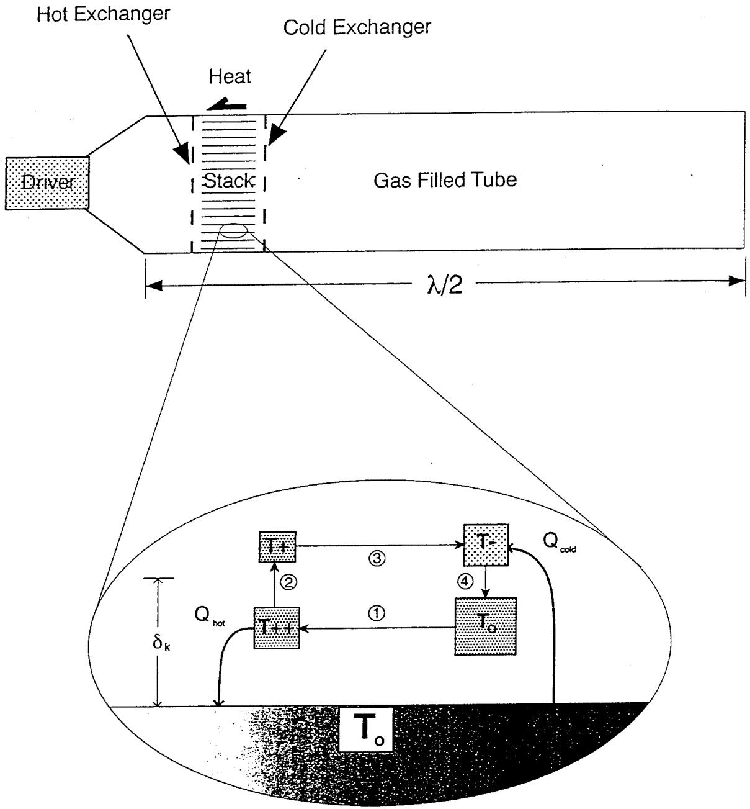  
Figure 1. Basic Lagrangian Model.

As the loudspeaker generates sound at some frequency, f, the parcel of gas experiences a combination of pressure and velocity oscillations depending on its location within the tube. A parcel near the speaker (a velocity node and pressure antinode) sees large pressure oscillations while a parcel near the center of the tube (a pressure node and velocity antinode) sees large velocity oscillations. Several factors are considered in determining the best location for the stack, but the gas within the stack must undergo both velocity and pressure oscillations.

With reference to Figure 1, assume that the parcel marked $\Sigma _ { \circ }$ is at the right-most point in its oscillation. At this point it is at its closest to the pressure node and therefore at its lowest pressure. At the first step of a repeating cycle, the parcel moves to the left, increasing in pressure which causes its temperature to rise to a maximum at $\mathbb { T } _ { + + }$ . At a distance far from the stack the temperature rises adiabatically, however, the parcel is close enough to a plate so that at step 2 it conducts some of its heat to the plate causing a local warm spot. At this point, the parcel has cooled to $\Sigma _ { + }$ . The distance from which a parcel will diffuse heat to the plate within one acoustic period (T=1/f) is called the thermal penetration depth $( \hat { \mathfrak { d } } _ { \bf x } )$ and is defined as:

$$
\mathfrak { S } _ { \kappa } = \sqrt { \frac { \kappa } { \pi \mathcal { L } \rho c _ { p } } }\tag{1}
$$

where κ is the thermal conductivity of the gas, p the gas density and cp its isobaric specific heat (Garrett, 1993a) . $C _ { \tt P }$

At step 3, the parcel moves back to the right from its highest pressure to its lowest. During this step, the parcel expands and cools as its pressure decreases. Because the parcel has given up some heat while at maximum pressure, it cools to T. which is cooler than its starting temperature, $\Sigma _ { \circ }$ As a result, at step 4 heat is actually conducted from the plate to the parcel causing cooling at that location within the stack.

The net effect of adjacent cycles occurring hundreds of times per second is a bucket brigade of heat pumping that results in a considerable difference in temperature across the stack. This temperature gradient is most easily maintained when using a stack material which is a poor thermal conductor allowing for maximum hot/cold separation. Providing a heat exchanger at the hot side that sinks heat to the atmosphere allows the cold side to be pumped to colder and colder temperatures. A heat exchanger placed at the cold side can exploit this cooling effect through some heat transfer fluid. In SETAC this heat transfer fluid was water which was chilled by SETAC and pumped through the CV-2095 to maintain a steady cabinet temperature despite the dissipative heat constantly being generated by the enclosed electronic circuit cards.

## E. SCOPE AND GOALS OF THIS THESIS

The purpose of this project was to demonstrate the suitability of thermoacoustic refrigeration for use onboard U.S. Navy ships. In order to accomplish this task a number of goals had to be met. It was imperative that SETAC be brought to a level that would support shipboard equipment heat loads. This required a cooling capability unprecedented by any thermoacoustic refrigerator. An effective data acquisition system and technique had to be developed in order to accurately measure performance and obtain reliable and verifiable results. Lastly and perhaps most importantly, this project sought to demonstrate that thermoacoustic refrigeration is suitable for applications at sea and is an environmentally benign alternative to existing chemical-based refrigeration systems. It is hoped that the results contained in this report will motivate the U.S. Navy to continue to aggressively explore this new technology.

## II. TALSR ENGINE

## A. BASIC GEOMETRY AND THERMOACOUSTIC SUBSYSTEMS

The thermoacoustic engine that provides the cooling capabilities of SETAC is the same engine that was used in TALSR and is shown in Figure 2. Table I summarizes the design parameters of the SETAC thermoacoustic engine. The engine uses a half wavelength resonator that has been configured in a U-shape in order to make it fit within the confines of a standard 19 inch equipment rack. Flaring of the resonator is intended to provide a smooth transition to the stack region preventing an impedance mismatch between the free resonator volume and the partially occluded stack. This varying of the resonator cross sectional area also has the added benefit of suppressing shock wave formation in the gas. The resonator was originally designed to operate with a mixture of Xenon and Helium (Susalla, 1988) but in the SETAC configuration uses a mixture of Argon and Helium because both of these gasses are readily available aboard U.S. Navy vessels. The static pressure of the gas mixture in the resonator is approximately 300 psia(\~2.1 MPa). The TALSR engine incorporates a dual stack design. The two stacks are placed at opposite ends of the U-shaped tube, identically displaced from the velocity nodes that occur at both ends of the half wavelength resonator. The stack is made from 52 μm thick Kapton film with 0.302 mm diameter spacers that are attached to the stack every 5.1 mm. The stack is formed by rolling the Mylar around a 6.3 mm diameter plug. The final dimensions of the stack are 110 mm in diameter and 40.4 mm in length.

The TALSR engine uses four gas-to-fluid heat exchangers (Garrett, 1992a): one cold and one hot heat exchanger for each side of the two stacks. Each of the four heat exchangers are identical. The heat exchangers use 1/4 inch diameter serpentine copper tubing inlaid into copper fins. The copper tubing serpentine makes five convolutions within the area of active heat transfer. The oscillatory displacements of the gas particles at the boundary between the stack and heat exchanger has two significant effects. First, it eliminates the need for physical contact between the heat exchanger and the stack and secondly, the amplitude of the oscillations defines the heat exchanger fin length required for maximum performance. Increasing this fin length provides no added benefit as it would in more conventional heat exchangers with single direction gas flow.

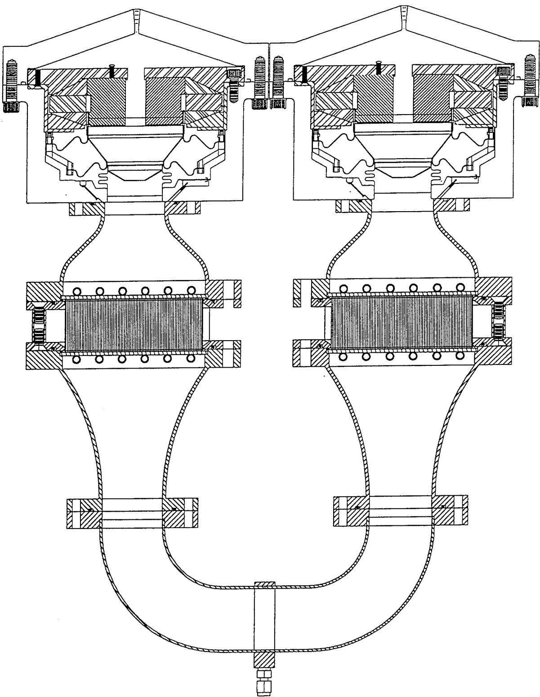  
Figure 2. TALSR Engine.

<table><tr><td>Fluid/Solid Thermophysical Parameters Symbol</td><td></td><td>Value</td><td>Units</td></tr><tr><td>Mean pressure</td><td> $\mathtt { p _ { m } }$ </td><td>2.07</td><td>MPa</td></tr><tr><td>Mean temperature in stack</td><td> $\mathtt { T } _ { \mathtt { m } }$ </td><td>290</td><td>K</td></tr><tr><td>Atomic mass (94.4%He/5.6%Ar)</td><td> $\pmb { \mathfrak { m } }$ </td><td>6.014</td><td>a.m.u.</td></tr><tr><td>Gas mixture density</td><td> $\mathfrak { p } _ { \mathtt { m } }$ </td><td>5.165</td><td>kg/m³</td></tr><tr><td>Gas mixture sound speed</td><td> $\textbf { a }$ </td><td>817.3</td><td>m/sec</td></tr><tr><td>Gas mixture isobaric specific heat</td><td> $c _ { p }$ </td><td>3.455</td><td>J/gK</td></tr><tr><td>Gas mixture polytropic coefficient</td><td> $\cos ( c _ { p } / c _ { v } )$   $\pmb { \gamma }$ </td><td>1.667</td><td></td></tr><tr><td>Gas mixture Prandtl number</td><td>σ</td><td>0.524</td><td></td></tr><tr><td>Gas mixture shear viscosity</td><td>η</td><td> $2 \cdot 0 1 4 \times 1 0 ^ { - 5 }$ </td><td>Kg/sec-m</td></tr><tr><td>Gas mixture thermal conductivity</td><td> $\pmb { \kappa }$ </td><td>1.33</td><td>mW/cm-K</td></tr><tr><td>Stack thermal conductivity</td><td> $\mathtt { K } _ { \mathbb { S } }$ </td><td>1.89</td><td>mW/cm-K</td></tr><tr><td>Stack specific heat</td><td> $\mathtt { c } _ { s }$ </td><td>1.056</td><td>J/gK</td></tr><tr><td>Stack mass density</td><td> $\pmb { \rho } _ { \pmb { s } }$ </td><td>1.42</td><td>g/cm³</td></tr><tr><td>Stack Dimensions</td><td>Symbol</td><td>Value</td><td>Units</td></tr><tr><td>Stack plate thickness</td><td>21</td><td>52</td><td>μm</td></tr><tr><td>Stack plate separation</td><td> $2 \tt y _ { 0 }$ </td><td>280</td><td>μm</td></tr><tr><td>Stack length</td><td> $\pmb { \triangle x }$ </td><td>4.03</td><td>cm</td></tr><tr><td>Center position of the stack</td><td>x</td><td>6.06</td><td>cm</td></tr><tr><td>Stack diameter</td><td>2R</td><td>11.0</td><td>cm</td></tr><tr><td>Stack perimeter</td><td> $H = \pi R ^ { 2 } / \{ y _ { 0 } + \theta \}$ </td><td>57.3</td><td>m</td></tr><tr><td>Stack heat capacity correction factor</td><td> $\pmb { \varepsilon _ { s } }$ </td><td>0.092</td><td></td></tr><tr><td>Normalized stack spacing</td><td> $\yen 0$ </td><td>1.63</td><td></td></tr><tr><td></td><td> $\yen 123,456,78$ </td><td>2.25</td><td></td></tr><tr><td>Heat Exchanger Dimensions</td><td>Symbol</td><td>Value</td><td>Units</td></tr><tr><td>Heat exchanger length</td><td> $\Delta x ^ { \tt E x }$ </td><td>2.54</td><td>mm</td></tr><tr><td>Heat exchanger plate thickness</td><td> $\boldsymbol { 2 1 } ^ { \mathtt { E x } }$ </td><td>152</td><td>μm</td></tr><tr><td>Heat exchanger plate separation</td><td> $\boldsymbol { 2 \mathrm { y _ { \circ } } } ^ { \mathtt { E x } }$ </td><td>380</td><td>μm</td></tr><tr><td>Calculated quantities</td><td>Symbol</td><td>Value</td><td>Units</td></tr><tr><td>Operating frequency</td><td>f</td><td>320</td><td>Hz</td></tr><tr><td>Operating radian frequency</td><td> $\omega = 2 \pi t$ </td><td>2011</td><td>rad/s</td></tr><tr><td>Thermal penetration depth</td><td> $\pmb { \delta } _ { \mathbf { \kappa } }$ </td><td>86.1</td><td>μm</td></tr><tr><td>Viscous penetration depth</td><td> $\delta _ { \nu }$ </td><td>62.3</td><td>μm</td></tr><tr><td>Resonator half-wavelength</td><td> $\lambda _ { \tt c o l d } / 2$ </td><td>1.23</td><td>m</td></tr><tr><td>Mean wavenumber in stack</td><td> $\textbf { k } = 2 \pi / \lambda$ </td><td>2.55</td><td> $\mathfrak { m } ^ { - 1 }$ </td></tr><tr><td>Peak acoustic pressure amplitude</td><td> $\mathtt { P _ { A } }$ </td><td>82.3</td><td>kPa</td></tr><tr><td>Peak acoustic velocity in stack</td><td> $\mathtt { < u _ { 1 } > }$ </td><td>3.8</td><td>m/s</td></tr><tr><td></td><td></td><td></td><td></td></tr><tr><td>Peak acoustic particle displacement</td><td> $d = 1 , \sin , \sin , \sin , \sin ,$ </td><td>1.9</td><td>mm</td></tr></table>

Table I. SETAC Thermoacoustic Parameters.

The acoustic power is provided by two custom designed electrodynamic loudspeakers. They operated 180 degrees outof-phase in a push/pull configuration. Only two loudspeakers were available at the start of this project. Parts for two new loudspeakers were acquired from Actran Systems of Orlando, Florida, to provide spare capabilities in the unlikely event of a failure during the shipboard portion of the SETAC experiment. Details about electrodynamic driver design, fabrication, calibration and performance have been documented previously (Harris and Volkert, 1989 and Fitzpatrick, 1988). Limitations on high power operations (Russel, 1994) caused by faulty bellows manufacturing were corrected by purchasing additional bellows. Testing and certification of all new bellows is documented in Appendix A.

## B. DRIVER MEASUREMENTS AND ASSEMBLY

The electrodynamic loudspeaker components (housing and magnetic/voice coil assembly) were provided by the manufacturer with no installed bellows, instrumentation, or wiring. Upon receipt, the loudspeakers were visually inspected and tested to establish baseline parameters prior to disassembly for instrumentation installation. The following parameters were determined using techniques described by Harris and Volkert (1989): moving mass, stiffness, BL product, and mechanical resistance. An Endevco piezoresistive differential pressure sensor, model 8514-10, used as a microphone (Stockermans, 1992) was installed in a shallow recess behind the face of the loudspeaker housing. The microphone installation incorporates a one centimeter long, four mil(102μm) bore capillary. A three mil(76μm) diameter wire is inserted into the capillary to increase the flow resistance. This capillary provides an exponential relaxation time for the microphone back volume of 6±2 seconds to air at atmospheric pressure. An Entran EGA-125-1000D accelerometer was cemented to the rear of the loudspeaker pusher cone using a two component five minute epoxy. The manufacturers' calibrations for the installed microphones and accelerometers are included in Appendix C. Additionally, a ten mil bore, two centimeter long capillary was installed through the face of the loudspeaker housing. This capillary provides adequate flow resistance to acoustically isolate the front of the loudspeaker from the rear of the pusher cone while maintaining zero static differential pressure across the driver. This capillary provided an exponential relaxation time to air at atmospheric pressure of 40±10 seconds.

Prior to reassembly following the above installations, the entire driver housing, including electrical feed-throughs was subjected to a 450 psia hydrostatic test. Reassembly and certification of the loudspeakers was a lengthy process. The first step in the reassembly was to insert the voice coil in the magnet gap. Two tests were performed to ensure the voice coil was properly aligned within the magnet gap. First, plastic feeler gages were used to check the inside and outside spacing between the voice coil and the magnet. The gap between the voice coil and the magnet varied between 0.004 and 0.007 inches. Secondly, the driver was mounted on a vertical knee mill and dial indicator measurements of concentricity were performed.

Once the voice coil had been reinstalled in the magnet, the determination of moving mass, stiffness, BL product, and mechanical resistance was repeated and compared to the baseline data taken prior to disassembly. At this point' in the assembly, the loudspeaker was driven at mechanical resonance to an 80 mil (\~2.0 mm) stroke in order to observe the pusher cone and spring suspension under strobe light illumination to check for mechanical problems. This test was performed with the driver removed from its housing and resting on a workbench.

Next the bellows was installed. First, the bellows was glued to the pusher cone with Versalok® acrylic adhesive. Then the loudspeaker, with attached bellows, was inserted into the housing and the bellows was epoxied, using Armstrong A-40, to the opening in the housing that mates to the resonator. After installation of the rubber O-ring seal, the loudspeaker and instrumentation electrical leads were soldered to their respective electrical connectors and the housing was bolted shut.

The mechanical resistance of the loudspeaker was checked one final time against the baseline values to ensure the assembly process had not resulted in any mechanical binding or rubbing. Finally, the microphone and accelerometer were calibrated against known transfer standards (Brüel & Kjær model 4228 pistonphone, serial #1681325, and Brüel & Kjær model 4294 calibration exciter, serial #1759853) and compared to the manufacturer supplied calibration sheets. These calibration constants were used in the data acquisition system to measure SETAC system performance. Electrodynamic driver parameters are summarized in Table II.

<table><tr><td></td><td></td><td>Driver #1 (serial #304) Driver #2 (serial #303)</td></tr><tr><td>Moving Mass (grams)</td><td> $3 5 . 4 ~ \pm ~ 0 . 1 5$ </td><td> $3 5 . 4 \pm 0 . 6$ </td></tr><tr><td>Stiffness (KN/m)</td><td> $1 4 2 . 8 \ \pm \ 0 . 2$ </td><td> $\texttt { l } 4 3 . 7 \texttt { \pm } \texttt { 1 . 0 }$ </td></tr><tr><td>BL-product (N/amp)</td><td> $1 9 . 0 ~ \pm ~ 0 . 2$ </td><td> $1 8 . 0 ~ \pm ~ 0 . 2$ </td></tr><tr><td>Mechanical Resistance (Kg/s)</td><td> $2 . 1 5 ~ \pm ~ 0 . 0 1$ </td><td> $2 . 2 8 ~ \pm ~ 0 . 0 2$ </td></tr><tr><td>Voice Coil Electrical Resistance (Ohms)</td><td>1.691</td><td>1.656</td></tr><tr><td>Resonant Frequency (Hz)</td><td> $3 2 0 . 1 \ \pm \ 0 . 1$ </td><td> $3 2 4 . 1 \ \pm \ 0 . 2$ </td></tr><tr><td>Microphone</td><td>36.4</td><td>31.3 (s/n AKCN4)</td></tr><tr><td>Sensitivity* (μV/Pa)</td><td>(s/n AKCN2)</td><td></td></tr><tr><td>Accelerometer Sensitivity*  $( \mu \mathrm { V } / \mathrm { m } \mathbf { S } ^ { - 2 } )$ </td><td>221 (s/n 94L93D27-P10)</td><td>209 (s/n 94L93K30- P18)</td></tr></table>

\* Microphone and accelerometer sensitivities were determined for a 10.00 VDC bias and a measured amplifier gain of 10.9(+20.75dB). $\lbrace \mathtt { s } / \mathtt { n } \ \mathtt { = }$ serial number)

Table II. Measured Driver Parameters.

## III. HEAT EXCHANGERS

## A. FLUIDS AND HEAT EXCHANGERS

There are a total of six heat exchangers used in the SETAC project, four of which are primary heat exchangers and are located inside the SETAC resonator as described in Chapter II. The other two are secondary heat exchangers located within each of the hot and cold circulating loops. The cold loop exchanger is located inside the CV-2095 cabinet where it provides the interface between SETAC and the designated heat load. The hot loop exchanger is mounted above the SETAC enclosure and is used to dissipate heat pumped from the cold loop and generated by the acoustical work produced by the drivers. This heat exchanger is also used to remove some of the heat generated by Joule heating within the drivers due to Ohmic losses in the voice coil.

The cold loop heat exchanger is manufactured specifically for the military by International Heat Transfer, Inc., in Coon Valley, WI. This particular heat exchanger, called a finnedtube coil, is used in a wide variety of electronic consoles aboard U.S. Navy ships. When provided with a water inlet temperature of $1 0 5 ^ { \circ } \mathbb { F } \quad ( 4 0 \ldots 5 ^ { \circ } \mathbb { C } )$ at a flow rate of 1.7 GPM, this exchanger can cool $1 3 5 ^ { \circ } \mathrm { F } ( 5 7 ^ { \circ } \mathrm { C } )$ inlet air, flowing at 195 cubic feet per minute (CFM), to 115°F (46°C). In doing so, the temperature of the water is raised to $1 0 9 . 5 ^ { \circ } \mathrm { F } \quad ( 4 3 ^ { \circ } \mathrm { C } )$ Under these conditions, this heat exchanger removes 3,770 Btu/hr which suggests that it is more than adequate to handle the 853 Btu/hr heat load of the CV-2095(V)2.

The heat exchanger used in the hot loop was donated by the manufacturer, Russell, Inc., for the SETAC project. The dual fan, forced ventilation, fin and tube type exchanger (model MIW28-18) is a pre-fabricated unit typically used in meat locker applications. In this application, it provides the means by which heat is ultimately expelled to the atmosphere, an effectively infinite heat sink. When tested by Russell Inc., with an air-to-water temperature differential of $\tt { 1 0 ^ { \circ } F }$ and an airflow of 380 CFM, this unit exhausts 1800 Btu/hr (530 Watts). At full power, SETAC had a thermal exhaust load of approximately 800 Watts with a mean fluid temperature of $3 1 \pm 2 ^ { \circ } \mathrm { C }$ Since the air temperature in the shipboard space was $2 0 { \pm } 2 ^ { \circ } \mathrm { C }$ the temperature differential of $\begin{array} { r l } { 1 1 ^ { \circ } \mathsf { C } } & { { } ( \sim 2 0 ^ { \circ } \mathsf { F } ) } \end{array}$ was adequate to remove the waste heat.

## B. MODIFICATIONS

In order to meet requirements associated with the SETAC project, numerous modifications were necessary, most notably to the plumbing system. Pumps had to be relocated in order to make SETAC as compact as possible and better suited for the shipboard environment. Increased pumping capacity was needed to meet the 1.2 GPM specification of the CV-2095. More resilient tubing had to be used to withstand the substantial increase in pressure and flow meters had to be changed to support the new configuration.

The only possible location for the hot and cold circulation pumps was within the SETAC enclosure. Any other location would have increased the size of the cabinet and required more penetrations through the sound-proofed walls. The only way to mount the pumps inside the enclosure was to suspend them from the ceiling, hanging them over the drivers. This created the problem of mounting them in a manner that was vibration isolating yet rigid enough to absorb torque and tensile stresses. The solution was finding a shock mount that would withstand the tensile force (2.831b/1285g) with a natural frequency equal to less than half that of the pump. The pre-fabricated mount selected (Stock Drive Products: Al0z 8-122), consisted of a simple ring of rubber with threaded studs fastened to each end. With four mounts per pump, the weight was easily supported with no discernable visual or audible oscillations.

The pumps originally used after the conversion to SETAC from TALSR were 24 Volt (V) MicroPump positive displacement gear pumps (drive [[EG0024]], pump [[G152]]) . After verifying flowmeter readings and conducting timed flow experiments in the lab, it was determined that the maximum cold side flow attainable with a 24V pump was 0.9 GPM. Although this was adequate to deliver the necessary cooling power, it did not meet the Navy's flow specifications and had to be increased. This problem was solved by purchasing 36V drive motors (EG0036) for both pumps from MicroPump. Although there was a predictable and observed trade-off between increased pumping power and back pressure, the new pump produced 1.15 GPM which is within 4.2% of the required specification. However, the increased pressure caused significant ballooning in the existing Tygon® tubing which caused occasional separations of hoses and fittings. This problem was remedied by replumbing with re-enforced Tygon® tubing with fiberglass mesh inside its walls. This tubing also provided a more secure grip on the plumbing fixtures and is recommended for similar applications in the future.

The flowmeter originally used in the methanol cold loop of TALSR had to be replaced with one designed for the higher water flow rate. The new flowmeter, manufactured by Omega, is a turbine flowmeter (FTB-101) identical to the one used in the hot loop. Both of these flowmeters had to be relocated inside the SETAC enclosure just as the pumps were. Upon doing so, it was discovered that the cold loop meter did not generate a reliable reading. This was attributed to electromagnetic interference from a power supply located in the electronic control unit (ECU) directly above. This problem was sidestepped simply by remounting the flowmeter adjacent to the hot loop flowmeter which was working perfectly. Manufacturers' specifications for the fluid pumps and calibration curves for the flow meters are included in Appendix C.

## C. HEAT FLOW

In this section a quantity of heat will be traced throughout the entire SETAC system. This is intended to provide a thorough explanation of the flow of heat from generation at the CV-2095 to its ultimate dissipation to the working area atmosphere. Figure 3 provides a line diagram that gives an indication of the configuration of SETAC in both the lab and onboard ship. Figure 3 should be helpful in following this qualitative discussion.

Heat is generated in the circuit cards inside the CV-2095 (or by an electric heater in the lab) according to the relationship P=I²R. This heat is initially absorbed until the metal of the cabinet reaches the same temperature as the air inside. The metal acts as a temperature buffer to any temperature changes within the CV-2095 causing a lag in heating and cooling effects. Heat is transferred through the heat exchanger in the bottom of the cabinet into the water of the cold loop. As the water is pumped through the cold loop a small amount of heat is also added from the pump. The water is then pumped to a heat exchanger (A) at the cold side of one of the stacks where some of the heat is transferred to the gas in the resonator. The water continues on to another heat exchanger (B) at the other stack where more heat is absorbed by the gas in the resonator. The heat is transferred through these heat exchangers to the stacks where it is thermoacoustically pumped, as described in Chapter I, to the hot side of the stacks. At the hot side there are also (A) and (B) heat exchangers that transfer the heat, plus the acoustical power dissipated in the stack and resonator, into the water of the hot loop. This heat, work from the hot loop pump, and heat from the driver cooling coils is then pumped via the hot loop water to the secondary, forced ventilation heat exchanger described in section A. The heat is then rejected to the atmosphere either in the lab or aboard ship.

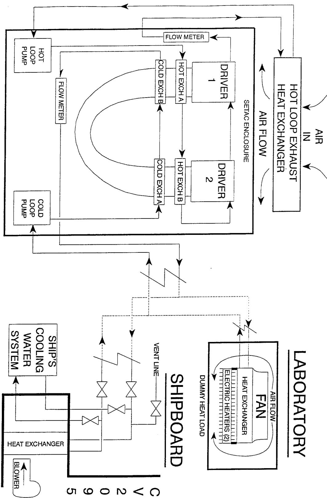  
Figure 3. SETAC Fluid Flow Diagram.

## D. PRIMARY HEAT EXCHANGER PERFORMANCE CALCULATIONS

Unlike the secondary heat exchangers described in section A, the primary hot and cold heat exchangers were fabricated at the Naval Postgraduate School and were not obtained from a commercial supplier. As a result, there are no existing manufacturer's specifications. However, it is necessary to estimate the temperature difference across the fluid-to-gas interface of the primary heat exchangers and the additional temperature span across the stack required to pump the necessary heat loads. The model used to perform this estimation is described in detail in Garrett, 1992a.

The model assumes that the working fluid gas mixture exchanges heat with the solid fin and tubing surfaces of the heat exchanger, and that the heat is transported through the tube to the liquid circulating within the tube. The calculation of the heat conducted through the copper tube and transferred from the inner tube surface to the water is a problem which has been described in' detail in the extensive heat transfer literature (White, 1988). The transfer of the heat from the acoustically oscillating gas to the fin and tube surfaces has not been studied experimentally in any systematic fashion. Although studies of this acoustical heat transfer are underway in several laboratories, .there are no results known to have been published.

The Fourier thermal diffusion equation for a timeharmonic flow over a surface (Garrett et al., 1994) can be solved to obtain a simple result for the root-mean-square convective heat transfer coefficient, $\mathtt { h } _ { \mathtt { a c } }$ . This is found in terms of the thermal conductivity of the gas mixture, κ, and the thermal penetration depth, $\delta _ { \star }$

$$
h _ { a c } = \frac { q _ { a c } } { \sqrt { 2 } \Delta T } = \frac { Q _ { a c } } { \sqrt { 2 } A \Delta T } = \frac { \kappa } { \sqrt { 2 } \& }\tag{2}
$$

Using the values from Table I, $\kappa { = } 0 . 1 3 3 ~ \mathrm { \AA W / m ^ { \circ } K }$ and $\delta _ { \kappa } { = } 8 6 . 1 ~ \mu \mathrm { m } ,$ it was found that the value of $h _ { a c } = 1 1 0 0 w / m ^ { 2 } \cdot K$

In order to determine the thermal resistance between the gas and the tube, it is necessary to determine the fin effective surface area. The expression for fin efficiency, η, is well known as

$$
\eta = \frac { \tan \left( \frac { L } { \lambda } \right) } { \frac { L } { \lambda } }\tag{3}
$$

where L is the length of the fin (8.9 mm), and λ is a characteristic length determined by the fin cross-sectional area, A, the fin perimeter, P, and the thermal conductivity of the fin material, $\kappa _ { \mathtt { C u } } = 4 0 0 ~ \mathtt { W / m ^ { \circ } K }$ (White, 1988) .

$$
\lambda = ( \frac { \kappa A } { h P } ) ^ { \frac { 1 } { 2 } }\tag{4}
$$

Again, using the parameters in Table I, it was found that λ=5.1 mm and the fin efficiency was calculated to be 54.2%. The fin surface area, $S = 8 8 7 ( m ^ { 2 }$ These results can then be combined to calculate a fin convective thermal conductance, $\sigma _ { \mathrm { { t h } } } ,$ or its inverse, a fin convective thermal resistance, $\mathbb { R } _ { \mathtt { t h } }$

$$
\sigma _ { t h } = \frac { 1 } { R _ { t h } } = h _ { a c } \eta S\tag{5}
$$

The result of this calculation is a thermal conductance of $5 2 . 5 ~ \mathrm { W } / { } ^ { \circ } \mathrm { K } ,$ or equivalently, a thermal resistance of 19.0 m°K/W.

The tubing inside the heat exchanger is also in contact with the acoustically oscillating gas mixture and will therefore account for some fraction of the heat transfer. Earlier studies showed that the tube contributed only 10% of the thermal conductance (Garrett et al., 1994), so it is reasonable to use simple modifications of the well known results for heat transfer to cylinders perpendicular to the direction of fluid flow. An expression for the Nusset number, $\Delta G _ { \Delta } ,$ , for a tube of diameter, D, : $\scriptstyle { \mathrm { ~ D ~ , ~ } }$ is given by Churchill and Bernstein (White, 1988) in terms of the Reynolds number, $\scriptstyle \mathtt { R e } _ { \mathtt { D } } = \pmb { \rho } < \mathtt { U } _ { 1 } ^ { \mathtt { s } } > \mathtt { D } / \eta$ the gas Prandtl number, Pr, the gas shear viscosity, η, and density, p.

$$
\aleph _ { D } = 0 \ . \ 3 + \frac { 0 \ . 6 \ 2 R e _ { D } ^ { \ \frac { 1 } { 2 } } P T ^ { \ \frac { 1 } { 3 } } } { \left[ 1 + \left( \frac { 0 \ . 4 } { P T } \right) ^ { \frac { 2 } { 3 } } \right] ^ { \frac { 1 } { 4 } } } \Bigg [ 1 + \left( \frac { R e _ { D } } { 2 8 2 \ , \ 0 0 0 } \right) ^ { \frac { 5 } { 8 } } \Bigg ] ^ { \frac { 4 } { 5 } }\tag{6}
$$

Since this is assumed to be a small contribution, we can use the average gas velocity at the center of the stack to estimate the Reynolds number, $\mathtt { R e _ { D } } \approx 6 , 2 0 0$ Substitution into the above expression yields $N u _ { \mathrm { 5 } } = 3 6$ .6 for the SETAC gas mixture with $\mathtt { P r } { = } 0 \ . 5 2 4$

The convective heat transfer coefficient, h, for heat $\mathtt { h , }$ transfer from the gas directly to the tube, when properly averaged for the oscillatory flow (Garrett, 1992), is approximately 584 $\bar { w } / \mathfrak { m } ^ { 2 \circ } \kappa$

$$
h { = } 0 \mathrm { ~ } . 7 6 3 \frac { \kappa } { \mathcal { D } } N u _ { D }\tag{7}
$$

For the tube of external surface area 108 cm², the thermal $\mathtt { c m } ^ { 2 }$ conductance from the gas to the tube is $6 . 3 ~ \mathrm { { \bar { w } } / { } ^ { \circ } \mathrm { { K } } . }$ Since the tube and fins conduct heat simultaneously, their thermal conductances add. This results in a net thermal conductance (gas-to-metal) of $5 8 . 8 ~ W / ^ { \circ } \mathrm { K }$ or a net thermal resistance of 17 m°K/W.

The thermal resistance between the inner and outer surfaces of the ½" copper tube is negligible (0.2 $\%$ $\mathfrak { m } ^ { \circ } \mathbb { K } / \bar { \mathbb { W } } )$ The thermal resistance between the inner surface of the tube and the water flowing at 1.2 GPM (600 lbm/hr) were found by the Dittus-Boelter formula (White, 1988) to be 6.3 m°K/W and at 0.7 GPM (330 lbm/hr) to be 10.2 m°K/W. The sum of the gas and fluid thermal resistances yield an overall cold side primary heat exchanger thermal resistance of 23.5 m°K/W and a hot side resistance of 27.4 m $E / \hat { W }$

Under typical high load conditions $\scriptstyle ( \sum _ { \mathrm { c o l d } } = 4 0 0 \quad \mathbb { W } , \quad \mathbf { I I } _ { \mathrm { a c } } = 2 0 0$ W), the estimated required temperature difference between the cold end of the stack and the cold heat exchange fluid is 4.7 °K. On the hot side, the temperature difference between the exchange fluid and the stack is estimated to be 8.2 °K.

## E. THERMAL INTERFACE COMPONENTS

A crucial design aspect of SETAC was determining how to interface our thermoacoustic cooling engine with the existing CV-2095 cooling system. The idea for the following interface method was developed during a ship visit to the USS ARKANSAS CGN-41) on October 16, 1994. Although the final SETAC experiment was performed aboard USS DEYO (DD-989), the ARKANSAS provided a target of opportunity while anchored in Monterey Bay for a port visit. The layouts of the compartments containing the CV-2095 were different on the two classes of ships, but the cooling system interfaces were the same. This allowed detailed measurements to be made of the existing cooling system piping during this visit. These measurements were confirmed in February, 1995 during a visit to two Norfolk, VA based destroyers, USS COMTE DE GRASSE (DD-974) and USS ARTHUR RADFORD (DD-968).

The CV-2095 heat exchanger is mounted within a small enclosure in the rear lower portion of the CV-2095 cabinet. The cooling water enters this enclosure through two bulkhead mounted penetrations. Two U-shaped lengths of copper tubing, approximately two inches in radius, connect the supply and return lines to the heat exchanger within this enclosure. A metal cover plate provides access to the heat exchanger and plumbing connections. This cover plate has gasket material around the perimeter and across the top of the heat exchanger. This gasket material provides an air tight seal for the enclosure and defines the CV-2095 cooling system air flow path.

The design of the interface manifold was constrained by the dimensions of the U-shaped copper connections. The goal was to build a manifold that would functionally replace these connectors and allow for rapid switching between the ship's cooling supply and SETAC. The manifold was built with ½" copper tubing, brass Swagelok® fittings, and Nupro® plug valves. All valves were located external to the cooling enclosure by using vertical riser sections of copper tubing in the manifold. A new cover plate for the cooling enclosure was fabricated to allow for penetration of these vertical risers. For ease of fabrication during shipboard installation, plexiglass was used to build this cover plate. Plexiglass had the added benefit of allowing visual inspection of the cooling enclosure during operation to detect cooling system leaks. Strips of foam rubber were attached to the plexiglass cover to provide the air tight seal required for proper operation of the CV-2095 cooling system. A vent line was incorporated into the manifold design to allow for filling the SETAC system from the ship's cooling system and provide for venting of trapped air. Figure 4 is a picture of the manifold installed aboard USS DEYO.

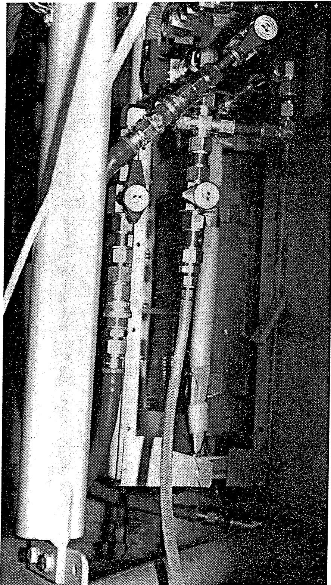  
Figure 4. Shipboard Interface Manifold.

## IV. DATA ACQUISITION SYSTEM

## A. BACKGROUND

At the onset of this project, the TALSR engine was configured to operate as a small home refrigerator. A Macintosh desktop computer was used for both data acquisition and power level control in this configuration. These functions were performed by the RTAS, a computer program written with LabVIEW software (Russel, 1994). The decision to continue to use LabVIEW° software was based on lessons learned from RTAS and to provide a smooth transition from TALSR to SETAC.

The requirement to transport the entire system from Monterey, CA to Norfolk, VA and install it aboard a U.S. Navy vessel imposed considerable size limitations on the design of the data acquisition system. These size limitations precluded the use of a desk top computer for data acquisition and control. The inability to use adesktop computer had a significant impact on the design of the data acquisition system. RTAS used a desktop computer with an internal data acquisition circuit board. An equivalent data acquisition board for use with the available laptop computer did not exist. This internal data acquisition board allowed the computer to perform power level control of the TALSR engine. The laptop computer would be unable to perform power level control of SETAC without this internal data acquisition board. Therefore, the two functions of data acquisition and control were separated. The computer was used for data acquisition only and an analog circuit was developed for power level control.

## B. INSTRUMENTATION AND GPIB

The first step in the design of the data acquisition system was to acquire a laptop computer. This computer would have to perform two primary functions: it would serve as the overall data acquisition system manager, and would record the data for subsequent analysis. The decision was made to use a Macintosh computer and operating system based on experience with RTAS. Funding was provided in the project to acquire a laptop computer. The LabVIEW® software package chosen for this project requires the computer to have a math co-processor chip. However, the Macintosh corporation was in the process of upgrading their line of laptop computers when this project was begun. They were not yet offering a new laptop computer model with a math co-processor and had discontinued sales of the older models with the math co-processor. Fortunately, Professor Jim Eagle of the Naval Postgraduate School Operations Research Department offered the use of a Macintosh Powerbook 170 for this project. This computer had the required math co-processor capability and was configured with 16 MB of RAM and an 80 MB hard disk drive.

A GPIB-SCSI-A interface box .was purchased from the National Instruments Corporation to connect the Powerbook 170 laptop computer to the other instruments in the data acquisition system. The GPIB-SCSI-A contains a 8-bit microcomputer that provides for interfacing between the computer's SCSI port and a General Purpose Interface Bus (GPIB). This interface, which is transparent to the user, allows the computer to function as the controller of other instruments on the GPIB.

GPIB, the common name for the IEEE-488 standard, is an industry standard communication system for use between two or more electronic devices. GPIB is a parallel transfer bus with 16 parallel bus lines, which are divided between data transfer(8), bus management(5), and handshaking(3) . The computer on the bus serves as the controller by telling other devices when to talk (send data to the bus) and when to listen (receive data from the bus) . The handshake procedure improves the reliability of data transfer and is performed for each byte. GPIB can accommodate up to 15 different devices on the bus simultaneously, each of which is assigned a unique primary address. These addresses vary between 0 and 30 and are generally set for each device on the bus by rear panel DIp switches.

Other instruments were required to complete the data acquisition system because the laptop computer could not accept direct input of any sensory information. The instruments used in the data acquisition system had to provide enough sensory input capability to accurately measure SETAC performance and be kept to a minimum because of size limitations. Additionally, any instruments chosen had to be compatible with the IEEE-488 standard in order to be used in conjunction with the computer through the GPIB. The instruments chosen to meet these objectives were a Hewlett-Packard (HP) multimeter model 3457A and a Keithley scanning thermometer model 740. Figure 5 is a.schematic representation of the data acquisition system that shows the relationships between these instruments, the computer, and the sensors that measure the acoustic and thermodynamic data. The Keithley scanning thermometer was configured with a model 7057A thermocouple scanner card that provided nine channels of input thermometry data. A HP-44492A reed relay multi-plexer card was installed in the HP-3457A multimeter. This multiplexer card provided ten channels of measurement capability to the HP-3457A that could be used to measure AC or DC voltage, resistance, or frequency.

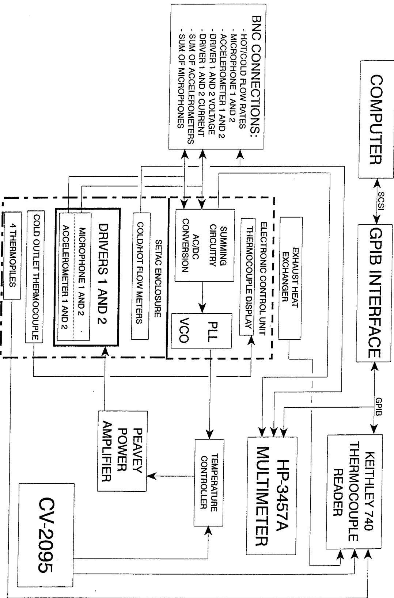  
Figure 5. Data Acquisition System.

## C. SENSORS AND SIGNAL CONDITIONING ELECTRONICS

Incorporated in the design of TALSR was an Electronic Control Unit (ECU) that performed various signal conditioning, amplification, and control functions. The ECU was also used in the SETAC configuration and is located in a box mounted above the SETAC engine enclosure. Most of the sensor data is fed to the ECU for signal conditioning and amplification prior to being sent to the computer.

It is critical that the thermoacoustic engine be operated at resonance in order to maximize the system efficiency. The ECU incorporates a phase-lock-loop (PLL) circuit to ensure the system is operated at resonance (Byrnes, 1989). An acoustic system is at resonance when its complex acoustic impedance is purely real (zero imaginary component). This occurs when the pressure and volume velocity are in-phase and their ratio is a real number. The volume velocity is the product of the effective piston area of the loudspeaker pusher cone and the pusher cone velocity. The pusher cone velocity is a time harmonic quantity with a resulting acceleration phase that is 90 degrees ahead of the velocity phase. Therefore, when an acoustic system is at resonance, the phase of the acceleration will be 90 degrees ahead of the phase of the acoustic pressure. The ECU takes the signals from each of the microphones and performs a summation. The signals from each of the accelerometers are also summed. The PLL circuit performs four quadrant multiplication of these summed signals and integrates the result as the error input to a frequency control circuit. When the system is at resonance, the signals from the accelerometers and the microphones are 90 degrees out-of-phase and the error signal is zero. Thus, the PLL circuitry ensures the thermoacoustic engine is operated exactly on resonance.

The PLL circuit controls the operating frequency of a voltage controlled oscillator (VCO). The output of the VCO was fed through a temperature control circuit and then to a Peavey model DPC 750 power amplifier. The temperature control circuit is an analog control circuit that was designed to perform as a variable gain amplifier controlling the thermoacoustic cooling power. It was designed to sense the CV-2095 inlet water temperature with an Analog Devices AD592 semiconductor temperature sensor and vary the cooling power to maintain the proper inlet water temperature (23.0±1.7°C). Unfortunately, SETAC was operated in a manual control mode due to unusual oscillations in the performance of the control circuit during the week prior to the at sea portion of the experiment. However, thermoacoustic cooling has already been proven to be compatible with a large range of control systems. Specifically, RTAS using a linear predictive proportional control system (patent pending) was able to maintain the air temperature within a commercial refrigerator enclosure to ±0.1°℃ (Russe11, 1994).

The ECU also performs direct measurements of both driver voltage and current for each of the electrodynamic loudspeakers. An analog multiplier within the ECU uses these measurements to determine the electric power input to each driver. Additionally, the ECU can measure acoustic power from the AC signals representing the sum of accelerometers and sum of microphones.

The following signals are converted within the ECU into equivalent DC voltage representations of the RMS AC voltages: sum of accelerometers, sum of microphones, drivers 1 and 2 current, drivers 1 and 2 electric power, and acoustic power. It is these DC voltages that are read by the HP-3457A multimeter and then passed to the computer for subsequent processing and storage. Table III shows how the 10 channels on the HP-3457A multimeter were assigned. In addition to the

DC voltages described above, several AC signals were also read by the multimeter. The output of the VCO (sine out) was used to measure the acoustic frequency of the system. The final two channels of the HP-3457A were assigned to measure the hot and cold coolant loop flow rates. A turbine flow meter is located in each of the circulating coolant loops. The turbine rotation rate is proportional to the fluid flow rate. The turbine rotor incorporates a permanent magnet. The flow meter houses a magnetic pick-up coil which outputs an AC voltage signal. The frequency of this signal is proportional to the fluid flow rate and is measured by the HP-3457A. Appendix C lists the manufacturers specifications for each of the installed flow meters. In order to provide for monitoring of the system performance, 12 BNC connectors were mounted on the front of the data acquisition system, adjacent to the Keithley thermometer. These connectors made it possible to monitor driver performance (current and voltage), microphone output, accelerometer output, and hot and cold flow signals. This capability was invaluable for both cross checking of data acquisition results and for troubleshooting system performance. All of the signals leaving the ECU and going to either the HP-3457A or the BNC connectors came out on a single 37 pin D-Sub connector. All 37 pins of this connector were used in the TALSR configuration, but SETAC, with a smaller number of data acquisition channels, did not use all the pins. Appendix D provides a complete summary of the pin connections available and designates which were used for the SETAC experiment. Another modification from the TALSR configuration was to move the pumps and flow meters inside the SETAC enclosure. Another connector had to be added to the rear of the SETAC enclosure to accommodate this modification. This connector was required to supply +36 or +24 volt DC power, depending on

which drive motor was installed on the fluid pumps, and a variable 0-5 volt DC control power to both pumps. This connector was also used to pass the two signals from the turbine flow meters out of the SETAC enclosure to the HP-3457A multimeter. Appendix D lists the pin connections for this new connector.

The nine channels available on the Keithley scanning thermometer were assigned as shown in Table III. Five of the channels (K-2,3,4,9,10) were configured to measure temperature outputs from E-type thermocouples. The remaining four channels were configured to perform as microvoltmeters used to measure the differential temperature across each of the four heat exchangers within the SETAC thermoacoustic engine. These differential temperatures were sensed by four T-type thermopiles with a sensitivity of 240 $\mu \mathrm { v } / \circ \mathrm { C }$ (Russe11, 1994) .

## D. SOFTWARE DESCRIPTION

## 1. Flow Chart and Discussion

The computer program that runs the SETAC data acquisition system was written using National Instruments' LABVIEW software. LabVIEW® is a graphically based computer language designed primarily for data acquisition and instrument control. LabvIEw® programs are called virtual instruments (VIs) and are similar to functions in other text based computer languages. VIs are hierarchical and can assume the form of an entire program, a subroutine (subvIs) or a single function within a program. To write the program, the programmer constructs a block diagram of vIs that are wired together in a logical manner that represents the flow of data through the program. The SETAC data acquisition program, like all VIs, has three components: the front panel, the block diagram, and the icon and connector. The front panel, which is the user interface, allows the user to control the execution of the program and pass data interactively to and

<table><tr><td>Channel</td><td>Variable</td><td>Source</td><td>Output Units</td></tr><tr><td>HP-00</td><td>Frequency</td><td>ECU</td><td>Hz</td></tr><tr><td>HP-01</td><td>Driver 1Current</td><td>ECU</td><td>mVDC</td></tr><tr><td>HP-02</td><td>Driver 2 Current</td><td>ECU</td><td>mVDC</td></tr><tr><td>HP-03</td><td>Driver 1 Power</td><td>ECU</td><td>mVDC</td></tr><tr><td>HP-04</td><td>Driver 2 Power</td><td>ECU</td><td>mVDC</td></tr><tr><td>HP-05</td><td>Sum of Accelerometers</td><td>ECU</td><td>mVDC</td></tr><tr><td>HP-06</td><td>Sum of Microphones</td><td>ECU</td><td>mVDC</td></tr><tr><td>HP-07</td><td>Cold Loop Flow Rate</td><td>Turbine</td><td>Hz</td></tr><tr><td>HP-08</td><td>Hot Loop Flow Rate</td><td>Flow Meter Turbine</td><td>Hz</td></tr><tr><td>HP-09</td><td>Acoustic Power</td><td>Flow Meter ECU</td><td>mVDC</td></tr><tr><td>HP-FR</td><td>HP-3457A Front Panel</td><td>Selectable</td><td>Selectable</td></tr><tr><td></td><td></td><td>Thermopile</td><td></td></tr><tr><td>K-2</td><td>HPX2 Diff. Temp. CPX1 Diff. Temp.</td><td>Thermopile</td><td>μVDC μVDC</td></tr><tr><td>K-3</td><td></td><td>Thermopile</td><td></td></tr><tr><td>K-4</td><td>CPX2 Diff. Temp. CV-2095 Inlet Temp.</td><td>Thermocouple</td><td>μVDC OF</td></tr><tr><td>K-5</td><td></td><td>Thermocouple</td><td></td></tr><tr><td>K-6</td><td>CV-2095 Outlet Temp.</td><td></td><td>OF</td></tr><tr><td>K-7</td><td>Heat Sink Inlet Temp.</td><td>Thermocouple</td><td>OF</td></tr><tr><td>K-8</td><td>Heat Sink Outlet Temp.</td><td>Thermocouple</td><td>OF</td></tr><tr><td>K-9</td><td>CV-2095 Air Temp.</td><td>Thermocouple</td><td>OF</td></tr><tr><td>K-10</td><td>HPX1 Diff. Temp.</td><td>Thermopile</td><td>μVDC</td></tr></table>

HP=Hewlett Packard model 3457A multimeter and K=Keithley model 740 scanning thermometer

Table III. SETAC Sensor List.

from the program. The code that controls the execution of the VI is located in the block diagram. This is where the programmer writes the program by assembling the subVIs. Finally, the icon and connector portion of the VI acts as the graphical interface between this VI and other VIs. The icon and connector was not utilized in this application because the SETAC data acquisition program was not designed to operate as a subVI. LabVIEw® software uses sequence structures to control the order in which functions are executed.

Figure 6 is the front panel from the SETAC data acguisition system virtual instrument. The front panel has three basic sections. The right side of the front panel is a graphical representation of the SETAC system that shows relative locations of the system components and sensors (such as temperature, fluid flow rate, and driver current). This section of the front panel displays all of the measured system parameters. The upper left portion of the front panel contains the user interface controls. This portion of the front panel provides control switches that can be operated by the user. One switch controls starting and stopping of the data acquisition system. Another switch selects which variable, either CV-2095 air temperature or CV-2095 inlet water temperature, is displayed on the front panel plotting output. The front panel allows the user to operate the system either with or without data storage to the computer's hard disk. The sample interval is adjustable from the front panel. Because of the limited number of measurement channels available in the data acquisition system, the capability to switch the HP-3457A multimeter from rear panel input to front panel input was included in the VI. This provided an extra channel of user selectable measurement capability that automatically records the data for future analysis. Finally, the lower left portion of the front panel is devoted to displaying calculated outputs (such as acoustic impedance, heat flows, and electro-acoustic efficiency). The block diagram portion of the SETAC data acquisition system VI provides the instructions for execution of the program. The objective of the VI was to control the measurement functions of the Keithley 740 thermometer and the HP-3457A multimeter and to gather the measured data for display, analysis and storage. A flow chart representing the data acquisition VI is shown in Figure 7. Initialization of all instruments attached to the GPIB interface is the first operation performed by the VI. The VI then opens a file for data storage, if required by the operator, based on input from the VI front panel. The VI then enters a while loop using a user selected boolean variable, provided from a stop button on the VI front panel, as the logic argument. The VI then directs the Keithley 740 thermometer and HP-3457 multimeter to measure and report all the variables listed in Table III. All the measured variables are sent over the GPIB as string variables and converted to floating point numbers by the computer for use in calculations. An alarm is given on the front panel of the VI if either driver current exceeds 5.5 Amps to alert the operator that the electrodynamic driver design limit of 6.0 Amps is being approached. The directly measured variables are processed into derived outputs for display and storage. All variables, both direct and derived, are then converted to string variables and saved to the data file, if requested by the user. Table IV lists the format of the data file and all variables that were saved to the hard disk. The user specified sample interval was implemented by causing the VI to pause prior to begin the next iteration of the while loop. Once this pause is completed, the VI checks the boolean logic of the stop button and either closes the data file (false) or begins the measurement sequence again (true). Appendix E provides a listing of each of the sequence structure frames used in the SETAC data acquisition VI.

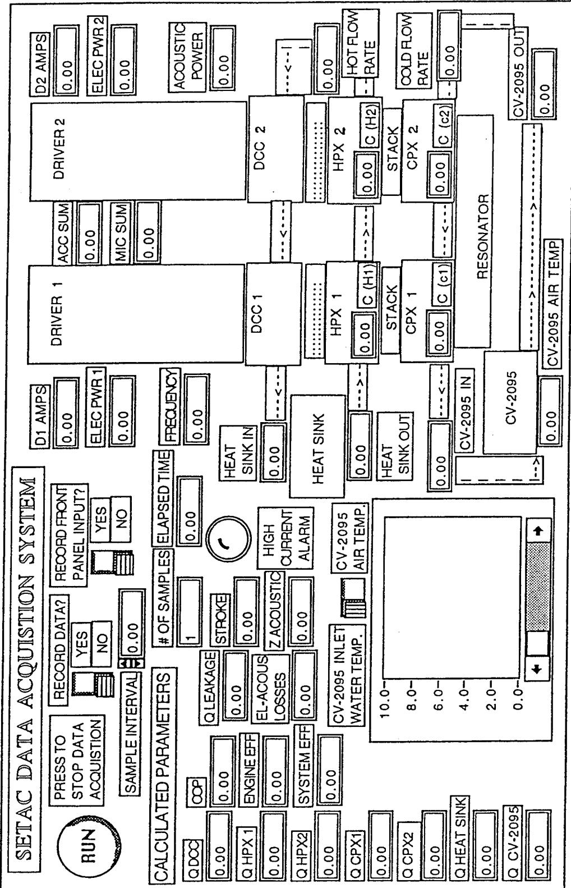  
Figure 6. Computer Program Front Panel.

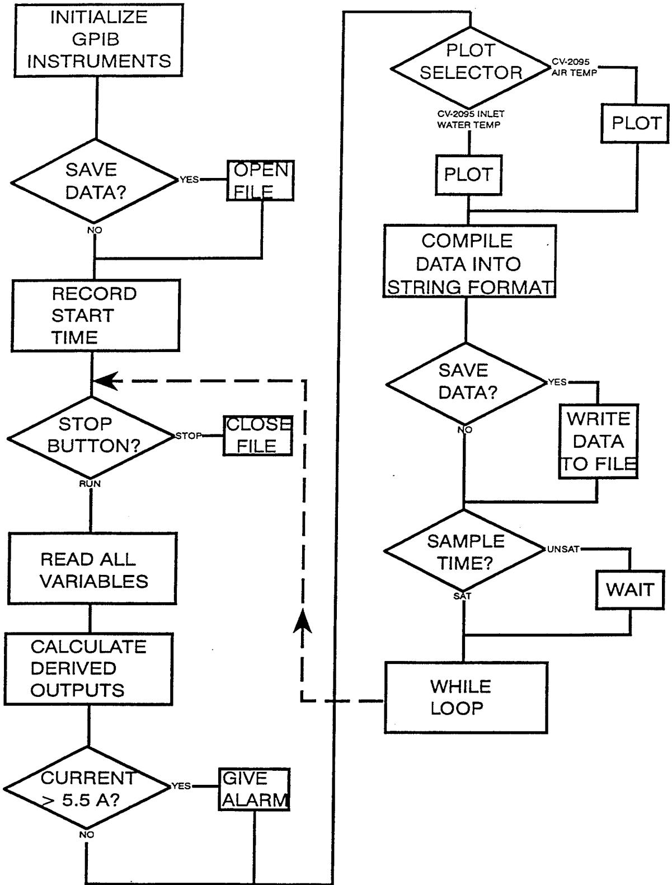  
Figure 7. Computer Program Flow Chart.

<table><tr><td>Column</td><td>Data Date</td></tr><tr><td>1</td><td>Time</td></tr><tr><td>2</td><td></td></tr><tr><td>3</td><td>Acoustic Frequency (Hz)</td></tr><tr><td>4</td><td>Driver 1 Current (Amps)</td></tr><tr><td>5</td><td>Driver 2 Current (Amps)</td></tr><tr><td>6</td><td>Driver 1 Power (W)</td></tr><tr><td>7</td><td>Driver 2 Power (W)</td></tr><tr><td>8</td><td>Sum of Accelerometers  $( \mathtt { m } / \mathtt { s } ^ { 2 } )$ </td></tr><tr><td>9</td><td>Sum of Microphones (Pa)</td></tr><tr><td>10</td><td>Cold Loop Flow Rate (LBM/Hr)</td></tr><tr><td>11</td><td>Hot Loop Flow Rate (LBM/Hr)</td></tr><tr><td>12</td><td>Acoustic Power (W)</td></tr><tr><td>13</td><td>Differential Temperature, HPX1 (OC)</td></tr><tr><td>14</td><td>Differential Temperature, HPX2 (OC)</td></tr><tr><td>15</td><td>Differential Temperature, CPX1 (OC)</td></tr><tr><td>16</td><td>Differential Temperature, CPX2 (OC)</td></tr><tr><td>17</td><td>CV-2095 Inlet Water Temperature (OC)</td></tr><tr><td>18</td><td>CV-2095 Outlet Water Temperature (OC)</td></tr><tr><td>19</td><td>Heat Sink Inlet Water Temperature (OC)</td></tr><tr><td>20</td><td>Heat Sink Outlet Water Temperature (OC)</td></tr><tr><td>21</td><td>CV-2095 Air Temperature (OC)</td></tr><tr><td>22</td><td>Heat Input from Driver Cooling Coils (W)</td></tr><tr><td>23</td><td>HPX1 Heat Transfer Rate (W)</td></tr><tr><td>24</td><td>HPX2 Heat Transfer Rate (W)</td></tr><tr><td>25</td><td>CPX1 Heat Transfer Rate (W)</td></tr><tr><td>26</td><td>CPX2 Heat Transfer Rate (W)</td></tr><tr><td>27</td><td>Heat Rejection To The Atmosphere Rate (W)</td></tr><tr><td>28</td><td>CV-2095 Heat Input Rate (W)</td></tr><tr><td>29</td><td>Coefficient Of Performance</td></tr><tr><td>30</td><td>Electroacoustic Efficiency (%)</td></tr><tr><td>31</td><td>Driver Pusher Cone Stroke&quot; (mils)</td></tr><tr><td>32</td><td>Acoustic Impedance  $( \mathbb { P } \vec { \mathsf { a } } - \mathsf { s } / \mathfrak { m } ^ { 3 } )$ </td></tr><tr><td>33</td><td>Optional Front Panel Input To HP-3457A</td></tr></table>

Table IV. Output File Data Format.

## 2. Direct and Derived Outputs

The following constants were used to convert the directly measured variables from the Keithley 740 thermometer and the HP-3457A multimeter into proper units for display and use in subsequent calculations of derived outputs.

Direct Measurements   
Acoustic Frequency (Hz) : no conversion necessary   
Driver Current (Amps-rms) : 1 VDC/10 Amps   
Driver Electric Power (W): 1 VDC/100 W   
Accelerometer Sum (m/s²-peak): (a1+a₂) VDC/1414.214 m/s²   
a1 and a2 are driver 1 and 2 accelerometer   
calibration constants listed in Table II   
Microphone Sum (Pa-peak) : (m1+m₂) VDC/1414.214 Pa   
m1 and m2 are driver 1 and 2 microphone   
calibration constants listed in Table II   
Cold Flow Rate (LBM/Hr): 2.00 LBM/Hr-Hz   
Hot Flow Rate (LBM/Hr): 1.918 LBM/Hr-Hz   
.004 Gal x998 Kg×60 min 1 m³ ×2.205 LBM=2.0 LBM (8)   
Hz-min m³ Hr 264 Ga1 Kg Hz-Hr   
Acoustic Power (W): 1 VDC/100 W   
Thermopiles (oC) : 0.240 mVDC/oC   
Thermocouples (oC) : no conversion necessary

Derived Outputs

Heat Flows (W): flow rate × ∆T × .52658

$$
4 \cdot 1 8 \frac { \mathcal { I } } { g m - ^ { \circ } \bar { \mathcal { K } } } \times \frac { 1 } { 3 6 0 0 } \frac { H x } { S } \times 1 0 0 0 \frac { g m } { \bar { \mathcal { K } } g } \times \frac { 1 \bar { \mathcal { K } } g } { 2 \cdot 2 0 5 \bar { L } B M } = . 5 2 6 5 8 \frac { \bar { W } - \bar { H } \bar { x } } { \bar { L } B M - ^ { \circ } \bar { \mathcal { K } } }\tag{9}
$$

Coefficient-of-Performance (COP): defined as the total useful cooling power divided by the acoustic power

Electro-acoustic Efficiency (%) : defined as the acoustic power divided by the sum of the driver electric powers

$$
\mathtt { S t r o k e ~ \mathtt { ( m i l . l s - p e a k . t o - p e a k ) : } \mathtt { A c c . } ~ \mathtt { S u m } ~ \times ~ \mathtt { 1 9 9 4 . 5 ~ \mathtt { ( f r e q . ) } ^ { 2 } } }
$$

$$
1 0 0 \frac { c m } { m } \times 1 0 0 0 \frac { m i 2 s } { i \pi c h } \times \frac { 1 i n c h } { 2 . 5 4 c m } \times 2 \times \frac { 1 } { 4 \pi ^ { 2 } } = 1 9 9 4 . 5 \frac { m i 2 l s } { m }\tag{10}
$$

Acoustic Impedance(Pa-s/m³) : Mic SumxFreq.×2856/Acc Sum

$$
\frac { 2 \pi } { 2 2 c m ^ { 2 } } \times ( \frac { 1 0 0 c m } { 1 m } ) ^ { 2 } = 2 8 5 6\tag{11}
$$

## E. HARDWARE RACK

A custom designed rack was built in the Physics Department machine shop at the Naval Postgraduate School. The purpose of the rack was to mount the components of the data acquisition system, the Peavey power amplifier, and the hot coolant loop exhaust heat exchanger. The lid of the ECU was used as the support base for the rack. Standard nineteen inch rack dimensions were used to accommodate the Keithley thermocouple reader, the Hewlett-Packard multimeter and the Peavey power amplifier. Twelve BNC connectors were attached to available·space on the face of the thermocouple reader rack mount to provide for monitoring of system signals. The

Macintosh powerbook 170 computer was place on top of the rack. Velcro tape was used to mount the GPIB interface box, the pump DC power supply and the temperature control module to the rack. The hot coolant loop exhaust heat exchanger was bolted to the rack using sheet metal supports.

## V. HEAT LOAD SIMULATOR

## A. INTRODUCTION

As the development of SETAC progressed, it became apparent that it would be essential to have a means for testing overall system performance in the laboratory. It would be unthinkable to waste the opportunity of a shipboard installation because of a miscalculation or an insurmountable technical problem that could have been discovered and corrected during lab testing. Also, by constructing an accurate heat load simulator, data could be obtained in the lab that would be suitable for system analysis and the writing of this thesis. Obtaining this data was of particular concern due to the unpredictability of ship's schedules and other factors beyond our control.

There were several considerations taken into account in the design of the CV-2095 heat load simulator. First, the mechanism by which heat was generated had to allow for variable heat input at a level that was comparable to that of the CV-2095. Second, the simulator had to be as close to adiabatic as possible so that virually all of the calibrated heat load was in fact delivered to the cold loop of SETAC. Lastly, it was crucial that the heat load simulator be constructed such that it was indistinguishable to the rest of the system from an actual CV-2095.

## B. CONSTRUCTION

The basic components used in the construction of the heat load simulator were an Igloo® ice chest, a finned-tube heat exchanger, two Omega® electric strip heaters, a 24V circulating fan and a variable AC voltage source. The ice chest was used as the enclosure for the load simulator with the idea that it would minimize the flow of heat into or out of the system. The heat exchanger used was exactly the same

exchanger that is used in the CV-2095 and was described in detail in Chapter III. The heaters used were two 325 Watt electrical heaters connected in parallel to permit a continuously adjustable heat input. The resistance of these heaters was tested over a wide temperature range to ensure that P=V²/R would be an accurate way to calculate the heat being put into the system. It was found that the electrical resistance of the heater elements was 22.1 Ω over the full range of temperature. In order to circulate the air within the ice chest, a 24v fan was used to draw air over the heaters and through the heat exchanger. And finally, a variac was used to control the heater supply voltage which created the capability of generating a desired heat load within 1 Watt.

The first step in the actual construction was to mount the circulating fan to the heat exchanger in a manner that would create optimal air flow. This was done by mounting the fan to a metal shroud that exactly matched the area on the exhaust side of the heat exchanger. The fan-to-shroud and shroud-to-exchanger junctions were gasketed to ensure that all air flow was along the desired path. At the intake side of the heat exchanger, the strip heaters were bolted such that their fins were ½" from and aligned with the fins of the exchanger. The air flow from the fan was adequate to maintain uniform air temperature within the ice chest.

The next step was to install the heat exchanger/fan assembly into the ice chest. This was done by drilling two holes in the side of the chest that corresponded to the inlet and outlet fittings of the heat exchanger. Through these holes, two Swagelok® quick-connectors were attached to the fittings on the heat exchanger. These quick-connectors fit snugly through the holes in the ice chest and were accessible from the outside. The electrical wiring for the heaters and fan were channeled through a conduit underneath the heat exchanger and out through a grommetted hole at the side of

the  chest opposite from the quick-connect fittings. Additionally, a wire was connected in parallel with the heaters so that instantaneous voltage and thus power could be determined accurately.

The simulator now had an electrical system that could generate exact amounts of thermal power varying from 0 to 650 Watts. This heat was well contained inside the ice chest such that, even at full power, escape heat was not observable from outside the unit. The generated heat load was delivered to SETAC through a heat exchanger, fittings, and hoses identical to those that would be used on board ship. The end result, shown in Figure 8, was a heat load simulator that could generate a heat load and flow path identical to that of the CV-2095.

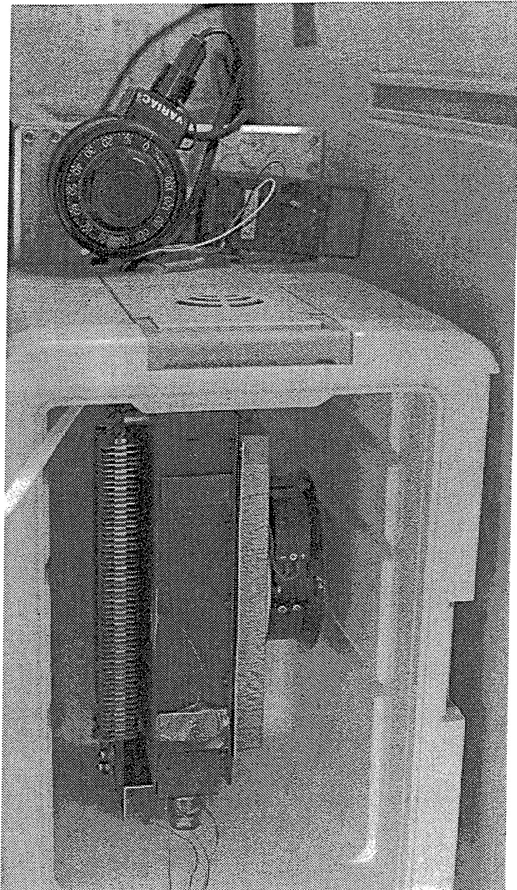  
Figure 8. Heat Load Simulator.

## VI. SEA TRIALS

## A. SHIP

One of the characteristics of the CV-2095 that made it a desirable choice for this project was the fact that it is located on a wide variety of ships. This ubiquitous availability created flexibility in the scheduling of a ship to be used for the SETAC project sea trial. In February 1995, two target ships were ship-checked to determine their suitability for the installation of SETAC. As a result, it was determined that any SPRUANCE class destroyer would be well suited for this task. After checking the schedules of several potential ships, Mr. Dan Winegrad, COMNAVSURFLANT Science Advisor, selected the USS DEYO, shown in Figure 9, as the ship of choice. Due to a schedule change of another candidate, this selection was made one week prior to installation. The resulting short lead time precluded the chance to visit the USS DEYO and brief the Commanding Officer on the project prior to the actual installation. Nonetheless, the officers and crew were extremely supportive, allowing the at sea portion of the SETAC project to proceed smoothly.

## B. LOGISTICS

Having successfully operated SETAC in the lab and acquired outstanding performance data, the next task was to relocate to the East coast and duplicate those results while underway aboard USS DEYO. This involved extensive foresight and a lot of careful packing. A principal concern was to ensure the packing of all parts and equipment that might be necessary to overcome any unforeseen obstacles. It was also crucial that all items be packed in a manner that would prevent them from being damaged during shipment. The final packing list. consisted of the SETAC enclosure and ECU inside a rock and roll speaker crate, two large utility boxes filled with parts and equipment, a tool box, and two heavily padded boxes containing three delicate driver assemblies. All items were shipped by Federal Express to COMNAVSURFLANT headquarters in Norfolk, VA, where they were received by Mr. Winegrad on 13 April. These items were to be transported by van to USS DEYO on 16 April for installation.

Loading equipment onto the ship would be relatively easy. The ship was moored to the Nauticus pier in downtown Norfolk, VA, and all gear could be carried up the fairly stable ladder to the main deck. However, off-loading while at anchor in Annapolis Harbor was a different story. Figure 10 illustrates a fine example of the logistical complications that can be associated with a shipboard installation.

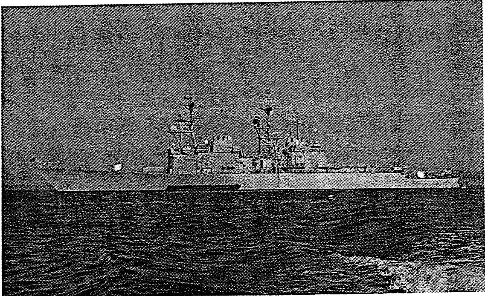  
Figure 9. USS DEYO (DD-989).

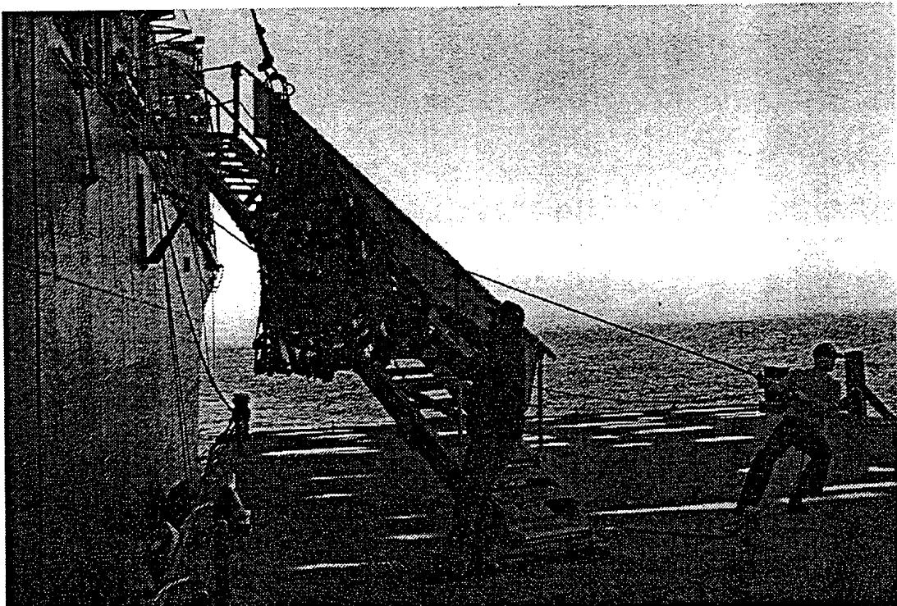  
Figure 10. Offloading in Annapolis Harbor.

## C. INSTALLATION

On the morning of 16 April, all parts and equipment, along with gas cylinders of Argon and Helium, were moved to USS DEYO for the installation of SETAC. The first step was to unpack everything and check for damage. Although all boxes appeared to have been abused during shipment, there was only one incident of damage requiring repair. One of the pumps suspended inside the SETAC enclosure was ripped from its mount, damaging three of its four vibration mounts. Previously installed safety wires prevented the pump from breaking free and causing significant damage. Fortunately, extra vibration mounts were among the spare parts packed, and the pump was quickly remounted in its initial position. Next, SETAC was restored to its operating condition. This involved re-installing the drivers, remounting the instruments in the equipment rack, reconnecting all wires and fluid connectors, and repressurizing the resonator. with the appropriate Helium/Argon mixture. Figure 11 shows SETAC after being installed aboard USS DEYO.

Now that SETAC was rebuilt, it was time to create the interface between SETAC and the CV-2095. In order to do this, the previously manufactured interface manifold, described in Chapter III, had to be attached to the heat exchanger within the CV-2095. This required that the unit be tagged out so that its cooling water could be secured. Once the installation of the manifold was completed, ship's cooling water was restored, through the SETAC manifold, and the unit was placed back in service. Meanwhile, the self-contained hot loop had been refilled with water and was operating satisfactorily. SETAC was now ready to interface with the CV-2095. Hoses with the same quick-connect fittings used in the lab, were used to connect SETAC to the manifold. By throttling one of the manifold valves, some of the ship's cooling water was diverted into the cold loop of SETAC to fill it with water. Opening the valve too far would expose the cold loop to the ship's 150 PSI system. It was experimentally determined (twice) that 150 PSI was in fact sufficient pressure to separate the internal hoses from their fittings. Once the cold loop was full, SETAC was ready to take over the cooling responsibility for the CV-2095. After an 18 hour day of installation, it was truly gratifying to see that SETAC worked as well on USS DEYO as it had in the lab.

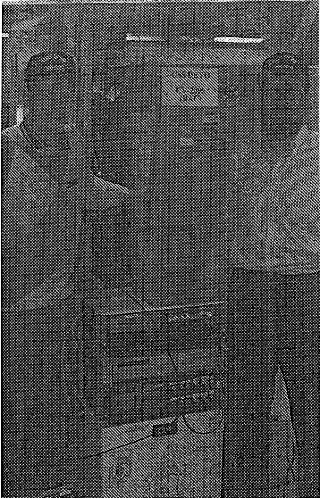  
Figure 11. SETAC Installed Aboard Ship.

## VII. SYSTEM PERFORMANCE AND ANALYSIS

## A. OVERVIEW

Prior to performing the shipboard portion of the SETAC experiment, many laboratory tests were performed. Table V is a high power run log for the two new electrodynamic loudspeakers (serial numbers 303/304). To reduce the possibility of a driver failing while at sea, it was important to accumulate as much high power run time on the drivers as possible prior to shipboard testing.

<table><tr><td>Date</td><td>Duration(Hrs)</td><td>Acoustic Power Level (W)</td><td></td></tr><tr><td>25Mar95</td><td>1.0</td><td>85</td><td></td></tr><tr><td>26Mar95</td><td>1.1</td><td>74</td><td></td></tr><tr><td>4Apr95</td><td>5.0</td><td>112</td><td></td></tr><tr><td>4Apr95</td><td>1.5</td><td>215</td><td></td></tr><tr><td>6Apr95</td><td>0.4</td><td>143</td><td></td></tr><tr><td>7Apr95</td><td>0.3</td><td>167</td><td></td></tr><tr><td>8Apr95</td><td>0.7</td><td>119</td><td></td></tr><tr><td>9Apr95</td><td>4.7</td><td>175</td><td></td></tr><tr><td>10Apr95</td><td>2.4</td><td>166</td><td></td></tr><tr><td>16Apr95</td><td>17.1</td><td>(total run hours in the lab)</td><td></td></tr><tr><td rowspan="6">17Apr95 17Apr95 17Apr95 20Apr95 21Apr95</td><td>13.0</td><td>136</td><td></td></tr><tr><td>3.3</td><td>160</td><td></td></tr><tr><td>1.1</td><td>221</td><td></td></tr><tr><td>0.4</td><td>97</td><td></td></tr><tr><td>0.7</td><td>136</td><td></td></tr><tr><td>3.0</td><td>137</td><td></td></tr><tr><td></td><td>21.5</td><td>(total hours aboard USS DEYO)</td><td></td></tr><tr><td></td><td></td><td>38.6 (total hours of run time)</td><td></td></tr></table>

Table V. Driver 303/304 High Power Run Log.

In addition to serving as a break-in period for the two new electrodynamic drivers, the 17.1 hours of laboratory testing provided an opportunity to test the operation of the data acquisition system. During this testing, it was discovered that several of the circuits within the ECU were not functioning properly. These malfunctions prevented the data acquisition system from being able to automatically measure the following direct and derived variables: driver current, driver power, acoustic power, coefficient-ofperformance (COP), and electroacoustic efficiency. Alternate methods to determine these parameters had to be identified because these failures were identified too late in the project to allow for circuit level troubleshooting of the ECU. Driver current for each driver was read with clamp-on ammeters. The driver voltage, for driver two only, was measured from the BNC output on the front of the data acquisition system. Driver electric power was determined by assuming that the two driver voltages were equal and using the currents from the clamp-on ammeter. Since driver voltages and currents were in-phase within $\pm \nobreakspace \nobreakspace \nobreakspace \nobreakspace \nobreakspace \nobreakspace \nobreakspace \nobreakspace \nobreakspace \nobreakspace \pm \nobreakspace$ , their algebraic product was used to determine electric power.

Even though the DC voltage output from the ECU representing acoustic power was not functioning, the AC signals for both the sum of the accelerometer outputs and the sum of the microphone outputs were available at the BNC outputs and were recorded by the data acquisition system. The product of these two signals was used to determine the acoustic power, since pressure and acceleration were held in quadrature by the PLL circuitry. Both COP and electroacoustic efficiency could be determined once the electrical power and the acoustic power were known.

Testing of all plumbing modifications was also conducted during these laboratory experiments and two problems were discovered. First, it was determined that the installed +24 VDC pumps had to be upgraded to +36 VDC pumps in order to meet the cooling water requirement of 1.2 GPM. It was also determined that the HP-3457A multimeter was unable to read the frequency of either flow meter signals because of excessive electrical noise and 60 Hz interference. The source of the noise was localized to magnetic fields from the DC power supplies located in the ECU. Attempts to magnetically shield the flow meters and relocate them were unsuccessful in sufficiently lowering the noise to allow the HP-3457A to read the frequency. However, by feeding the flow meter BNC output signals to a spectrum analyzer, the frequency of the flow meter signal could be easily separated from the noise. A modification to the data acquisition program was made to allow manual insertion of this frequency instead of having the HP-3457A automatically read it.

Finally, the laboratory runs were used to characterize the high power performance of the SETAC thermoacoustic engine in a more scientifically controlled environment than would be available aboard USS DEYO. During one of the runs conducted on April 4, 1995 the SETAC thermoacoustic engine provided a useful cooling capacity of 370 Watts, at that time a world record for thermoacoustic cooling. This 370 Watts of cooling capacity was adequate to provide cooling for even the most demanding model of CV-2095, which requires 345 Watts of water cooling.

## B. DATA SUMMARY

In order to check the performance of the data acquisition system and establish the consistency of the data, a single data set was subjected to detailed analysis. Table VI is a listing of data sets available for this analysis and summarizes the steady state performance parameters for each of these data sets. The data from April 9, 1995 was chosen for this detailed analysis because the cold loop temperature was comparable to the required inlet water temperature for the CV-2095. This data set was collected in the laboratory using the load simulator, which allowed for more precise measurement and control of the heat load than would be possible in the

pump. \*\*\* = Useful cooling capacity and COP unreliable because of cycling cold loop \*\* = Load simulator heat input not applicable to shipboard runs.

<table><tr><td rowspan=1 colspan=1>Date/Time</td><td rowspan=1 colspan=1>Tcold(°℃)</td><td rowspan=1 colspan=1>Thot(°℃)</td><td rowspan=1 colspan=1>IIac(W)</td><td rowspan=1 colspan=1>Iheat(W)</td><td rowspan=1 colspan=1>Vdrive(Vac)</td><td rowspan=1 colspan=1>Idrive(Aac)</td><td rowspan=1 colspan=1>Ie1(W)</td><td rowspan=1 colspan=1>Ico1d(W)</td><td rowspan=1 colspan=1>El/AC(%)</td><td rowspan=1 colspan=1>COP</td><td rowspan=1 colspan=1>Press.(KPa)</td><td rowspan=1 colspan=1>Stroke(mils)</td></tr><tr><td rowspan=1 colspan=1>4Apr951604</td><td rowspan=1 colspan=1>23.5</td><td rowspan=1 colspan=1>32.0</td><td rowspan=1 colspan=1>112</td><td rowspan=1 colspan=1>190.3</td><td rowspan=1 colspan=1>24.97</td><td rowspan=1 colspan=1>3.7/3.8</td><td rowspan=1 colspan=1>187</td><td rowspan=1 colspan=1>215</td><td rowspan=1 colspan=1>59.9</td><td rowspan=1 colspan=1>1.92</td><td rowspan=1 colspan=1>53.5</td><td rowspan=1 colspan=1>38.2</td></tr><tr><td rowspan=1 colspan=1>4Apr951927</td><td rowspan=1 colspan=1>23.6</td><td rowspan=1 colspan=1>33.0</td><td rowspan=1 colspan=1>215</td><td rowspan=1 colspan=1>344.8</td><td rowspan=1 colspan=1>35.21</td><td rowspan=1 colspan=1>5.8/6.0</td><td rowspan=1 colspan=1>415</td><td rowspan=1 colspan=1>370</td><td rowspan=1 colspan=1>51.8</td><td rowspan=1 colspan=1>1.72</td><td rowspan=1 colspan=1>79.6</td><td rowspan=1 colspan=1>49.0</td></tr><tr><td rowspan=1 colspan=1>9Apr951123</td><td rowspan=1 colspan=1>21.1</td><td rowspan=1 colspan=1>33.0</td><td rowspan=1 colspan=1>175</td><td rowspan=1 colspan=1>300.0</td><td rowspan=1 colspan=1>31.84</td><td rowspan=1 colspan=1>5.0/5.3</td><td rowspan=1 colspan=1>326</td><td rowspan=1 colspan=1>325</td><td rowspan=1 colspan=1>53.7</td><td rowspan=1 colspan=1>1.85</td><td rowspan=1 colspan=1>70.9</td><td rowspan=1 colspan=1>45.3</td></tr><tr><td rowspan=1 colspan=1>9Apr951336</td><td rowspan=1 colspan=1>3.9</td><td rowspan=1 colspan=1>30.1</td><td rowspan=1 colspan=1>166</td><td rowspan=1 colspan=1>127.2</td><td rowspan=1 colspan=1>★</td><td rowspan=1 colspan=1>5.3/5.3</td><td rowspan=1 colspan=1>★</td><td rowspan=1 colspan=1>294</td><td rowspan=1 colspan=1>★</td><td rowspan=1 colspan=1>1.77</td><td rowspan=1 colspan=1>74.9</td><td rowspan=1 colspan=1>41.0</td></tr><tr><td rowspan=1 colspan=1>10Apr951030</td><td rowspan=1 colspan=1>16.4</td><td rowspan=1 colspan=1>29.0</td><td rowspan=1 colspan=1>164</td><td rowspan=1 colspan=1>240.0</td><td rowspan=1 colspan=1>30.40</td><td rowspan=1 colspan=1>4.9/5.2</td><td rowspan=1 colspan=1>307</td><td rowspan=1 colspan=1>322</td><td rowspan=1 colspan=1>53.4</td><td rowspan=1 colspan=1>1.94</td><td rowspan=1 colspan=1>69.6</td><td rowspan=1 colspan=1>43.6</td></tr><tr><td rowspan=1 colspan=1>17Apr950452</td><td rowspan=1 colspan=1>22.8</td><td rowspan=1 colspan=1>29.1</td><td rowspan=1 colspan=1>132</td><td rowspan=1 colspan=1>*★</td><td rowspan=1 colspan=1>26.06</td><td rowspan=1 colspan=1>4.71</td><td rowspan=1 colspan=1>245</td><td rowspan=1 colspan=1>***</td><td rowspan=1 colspan=1>53.8</td><td rowspan=1 colspan=1>★**</td><td rowspan=1 colspan=1>62.3</td><td rowspan=1 colspan=1>40.6</td></tr><tr><td rowspan=1 colspan=1>17Apr951450</td><td rowspan=1 colspan=1>22.9</td><td rowspan=1 colspan=1>30.3</td><td rowspan=1 colspan=1>159</td><td rowspan=1 colspan=1>**</td><td rowspan=1 colspan=1>28.15</td><td rowspan=1 colspan=1>5.02</td><td rowspan=1 colspan=1>283</td><td rowspan=1 colspan=1>320</td><td rowspan=1 colspan=1>56.2</td><td rowspan=1 colspan=1>2.01</td><td rowspan=1 colspan=1>67.1</td><td rowspan=1 colspan=1>44.3</td></tr><tr><td rowspan=1 colspan=1>17Apr951708</td><td rowspan=1 colspan=1>21.0</td><td rowspan=1 colspan=1>33.5</td><td rowspan=1 colspan=1>216</td><td rowspan=1 colspan=1>* *</td><td rowspan=1 colspan=1>34.20</td><td rowspan=1 colspan=1>6.15</td><td rowspan=1 colspan=1>421</td><td rowspan=1 colspan=1>419</td><td rowspan=1 colspan=1>51.3</td><td rowspan=1 colspan=1>1.94</td><td rowspan=1 colspan=1>82.3</td><td rowspan=1 colspan=1>50.2</td></tr></table>

Table VI. SETAC Data Summary.

shipboard environment. The April 9, 1995 run was conducted by setting the power amplifier so that it provided a loudspeaker pusher cone stroke of approximately 0.045 inches. This resulted in a nearly constant acoustic power level of approximately 182 Watts. The heat load input was then varied throughout the run by changing the voltage supplied to the strip heaters in the heat load simulator. Figure 12 is a plot of the heat load simulator inlet temperature for this run.

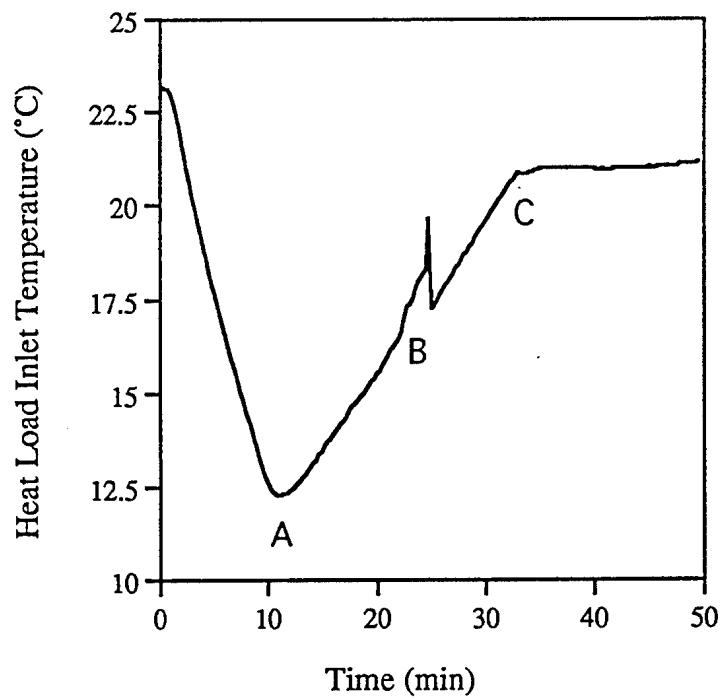  
Figure 12. April 9 Temperature Plot.

Initially, with no heat input to the load simulator, the temperature dropped rapidly to point (A). The heat input was raised to 350 Watts at point (A) and the inlet temperature then began to rise because this heat input exceeded the cooling capability of the SETAC engine at this drive level. The anomaly at point (B) is the result of opening the load simulator enclosure to check the thermal contact of the installed thermocouples. This check was made because erratic temperature indications were being observed in the data acquisition system. Once the thermocouples were reattached and the enclosure secured, the temperature continued to rise to point (C). The load simulator heat input was reduced to 300 Watts at point (C) in an attempt to stabilize the system at the target operating temperature of $2 1 . 0 ~ ^ { \circ } \mathrm { C }$ For the last 17 minutes of the data set, the system was at steady state with the heat load inlet temperature at 21.0 °C and SETAC pumping 335 Watts of useful heat out of the cold loop. It is this steady state portion of the data set that was analyzed to establish the consistency of the data.

## C. DETAILED ANALYSIS

In order to simplify the analysis, the SETAC system will be divided into three thermodynamic subsystems: the cold coolant loop, the hot coolant loop, and the thermoacoustic engine. Each of these subsystems will be analyzed to confirm agreement with the first law of thermodynamics which says that under steady state conditions, the sum of the heat input and the work performed equals the heat rejected.

Beginning with the cold coolant loop subsystem, the heat input is provided by two sources: the electric fin heaters and the circulating fan inside the load simulator. The electric fin heaters input 300.0 Watts of heat and the fan provided 13 Watts. The work in the cold coolant loop was performed by the +24 VDC pump. Pump work was determined from the following equation,

$$
\Pi _ { p u m p } \ = \ \Delta P \ \dot { U }\tag{12}
$$

where $\dot { \mathrm { ~ U ~ } }$ is the volumetric flow rate and ΔP is the pump differential pressure. Using the manufacturer's performance curves (shown in Appendix C) to determine ΔP for a given flow rate, the pump work was found to be 12 Watts. The heat rejected by the cold coolant loop subsystem is the sum of the heat rejected by the two cold primary heat exchangers in the SETAC engine which totalled 335.6 Watts. The heat rejected exceeded the sum of the heat input and the work by 10.6 Watts and represented a 3.2% deficit in the heat balance for the cold coolant loop. The additional heat from thermoviscous dissipation in the resonator U-tube was a likely cause of this discrepancy. Other possible causes include conduction directly from the atmosphere and the fluid pump. No attempt was made to quantify these possible heat input sources. When a similar analysis was attempted on a run from April 9, 1995 with a steady state load simulator input temperature of 3.9 °C, the error in the cold loop heat balance rose to 142 Watts (48.3%). In this case, the majority of the additional heat was probably due to heat leakage from the atmosphere because the size of the error increased with an increase in the differential temperature between the cold loop and the atmosphere.

The heat input to the hot coolant loop, from the sum of the hot primary heat exchangers, was 498.0 Watts. In the hot coolant loop, the pump was not operated at maximum control voltage (+5 VDC), and therefore a performance curve was not available. However, a conservative assumption of 12 Watts was used for pump work in the hot loop for this analysis. The heat rejected to the atmosphere by the Russell heat exchanger was 480.0 Watts, which was 30 Watts less than the sum of the heat input and the pump work. This 6.3% discrepancy in the hot loop heat balance was again most likely caused by additionally heat leaking directly from the hot coolant loop to the atmosphere.

The work in the thermoacoustic engine subsystem is not performed by a fluid pump, but by the electrodynamic drivers. This work is represented by the acoustic power delivered to the resonator. The acoustic power for this run was 182.1 Watts. The heat input to the thermoacoustic subsystem was simply the 335.6 Watts of heat rejected by the cold coolant loop subsystem. The 498.0 Watts of rejected heat from the thermoacoustic subsystem was the heat input source for the hot loop subsystem. The sum of the work and the heat input exceeded the heat rejected for the thermoacoustic subsystem by 19.7 Watts. This represented a 4.0% discrepancy in the heat balance. This discrepancy, like the other two, could be partially attributed to unaccounted heat leakage. However, this error was also dependent on how accurately the acoustic power was known. The measured acoustic power was dependent on an assumed effective pusher cone area of 22 cm² (Garrett and Gaitan, 1994). An uncertainty in this parameter of only ± 1 cm² would correspond to an uncertainty of 4.5% and could account for the observed discrepancy in the thermoacoustic subsystem heat balance. Figure 13 is a plot of the thermoacoustic subsystem heat balance for the entire data run. In this figure, 1st Law (W) represents the excess heat from the thermoacoustic subsystem heat balance. It is clear that during the steady state portion of the run, that the 1st law energy balance deficit is nearly zero.

Overall, this data run was performed with a total useful heat pumping capacity of 335.6 Watts, represented by the sum of the heat absorbed by the cold primary heat exchangers. This heat pumping capacity, with an acoustic power of 182.1 Watts, yields a COP of 1.84. Under these conditions, the electrodynamic drivers were consuming 326 Watts of electric power for an electroacoustic efficiency of 55.9%. Therefore the overall performance during this run was characterized by SETAC providing 103 Watts of useful cooling capacity for every 100 Watts of electric power consumed by the drivers.

During all of the laboratory runs, a peculiar phenomenon was observed in the data. The two cold primary heat exchangers did not appear to transfer equal amounts of heat from the cold loop to the thermoacoustic subsystem. The fluid flows through the two heat exchangers in series, first through the cold primary exchanger of driver two and then driver one.

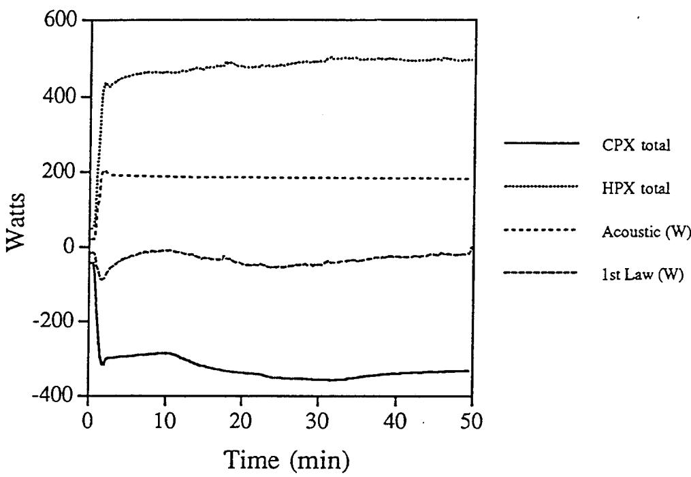  
Figure 13. April 9 Heat Balance Plot.

For the data run analyzed above, the total 335.6 Watts was comprised of 144.8 Watts from the cold heat exchanger of driver two and 190.8 Watts from the heat exchanger of driver one. The 144.8 Watts is only 75.9% of the 190.8 Watts transferred across the other cold primary heat exchanger. This ratio is typical of all the runs conducted in the laboratory. However, the hot side primary heat exchangers did not show a similar imbalance in heat load. Specifically, the hot primary heat exchanger of driver two rejected 255.0 Watts, and the heat exchanger associated with driver one rejected 243.0 of the 498.0 Watt total for the April 9 data set. Again these numbers are typical of all runs conducted in the laboratory and it has already been shown that the overall heat balance of the thermoacoustic subsystem had only a 4.0% error. The cause of this imbalance is not known, and to further complicate the analysis, an imbalance of this magnitude was not observed during the shipboard data runs, where no consistent pattern was observed.

## D. SHIPBOARD RESULTS

During the at sea portion of this experiment, SETAC provided 21.5 hours of local thermoacoustic cooling to one of the CV-2095 RAC units aboard USS DEYO. A plot of the inlet water temperature vs. time during a four-hour shipboard run is shown in Figure 14. The first portion of the run was

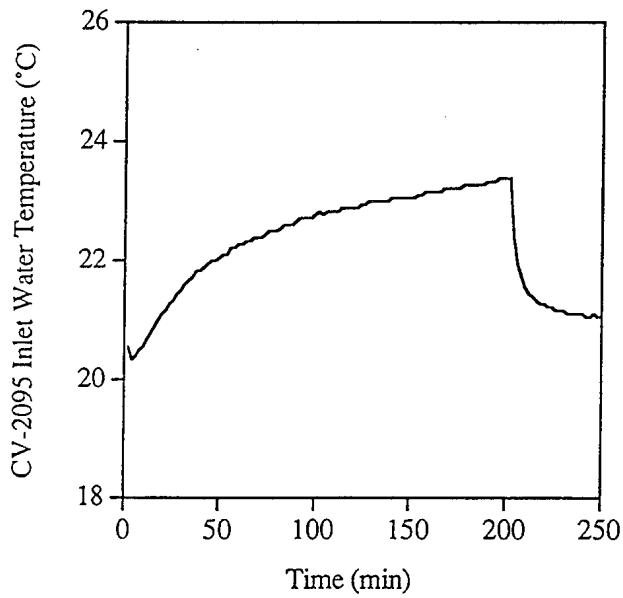  
Figure 14. Shipboard Data Temperature Plot.

conducted at an acoustic power level of approximately 160 Watts. The gradual increase in water temperature is the system approaching equilibrium temperature based on the set acoustic power level. After approximately 200 minutes of operation, the acoustic power was increased to approximately 220 Watts to evaluate the high power performance of the SETAC thermoacoustic engine. The system was then allowed to reach a steady state temperature of 21.1 °C which occurred approximately four hours into the run. The steady state portion of this run will be discussed in detail because it was the highest power level ever achieved with the SETAC thermoacoustic engine.

During this portion of the run, the thermoacoustic subsystem had a heat input from the cold coolant loop of 419.0 Watts, which represents the useful heat pumping capability. 226.6 Watts of acoustic power was required to provide this heat pumping capability. The heat rejected by the thermoacoustic subsystem to the hot coolant loop was 619.2 Watts. The sum of the heat input and the acoustic power exceeded the heat rejected by the thermoacoustic subsystem by 26.4 Watts. This 26.4 Watts represents a 4.3% discrepancy in the thermoacoustic heat balance. This 4.3% discrepancy is remarkably similar to the 4.0% discrepancy found during the laboratory test. The magnitude of this systematic error is consistent with the uncertainty of the effective pusher cone area (Garrett and Gaitan, 1994). Figure 15 shows a thermoacoustic subsystem heat balance plot, similar to Figure 13, for this entire run. The increases in all power levels are clearly shown at about 200 minutes into the run, while the excess heat from the heat balance, represented by the variable 1st Law (W), remains constant at approximately a 26 Watt deficit. This run was the highest power level ever reached by SETAC. The 419.0 Watts of useful heat pumping capacity was provided at a supply temperature of 21.1 °C. The COp for this run was 1.85. A total of 420.6 Watts of electrical power were consumed by the drivers to provide this cooling capacity resulting in an electroacoustic efficiency of 53.9%. In more practical terms, aboard USS DEYO, SETAC was able to provide one Watt of useful cooling capability for every Watt of electric power consumed by the drivers.

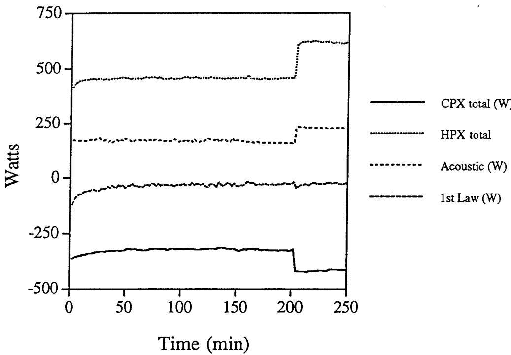  
Figure 15. Shipboard Heat Balance Plot.

During each of the first two runs aboard ship, an unusual transient condition was observed. Figure 16 is a plot of CV-2095 inlet water temperature vs. time and clearly shows oscillations in the inlet water temperature. The cause of these oscillations was not immediately apparent. Eventually, it became clear that the cold loop pump was periodically cycling on and off causing flow in the cold loop to start and stop. When the flow stopped, the continual input of heat by the CV-2095 to the stagnant water in the heat exchanger caused a rapid rise in temperature seen just to the left of the peaks in the temperature plot. Flow stopped for approximately three minutes. Also, while the flow was stopped the SETAC engine was cooling the stagnant water in the two cold primary heat exchangers. This cooling effect caused corresponding drops in mean resonator pressure and increases in acoustic impedance of the gas. When flow resumed, the cold slug of water from the primary heat exchangers was pumped to the CV-2095 causing a instantaneous drop in the inlet temperature that can be seen

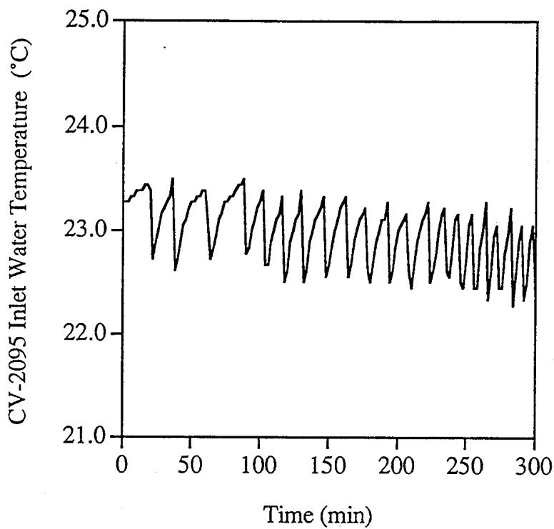  
Figure 16. Shipboard Temperture Oscillations.

in the plot. Once normal flow was reestablished the temperature gradually increased towards equilibrium for the current power level. However, after six minutes and before the equilibrium temperature could be reached, the pump would shut off and the cycle would restart. The cause of the pump cycling was an automatic high temperature shut down feature on the pump. This problem was never encountered in the laboratory because the +24 VDC pumps did not generate enough heat to shut down. The +36 VDC pumps were first installed while aboard USS DEYO where the problem subsequently surfaced.

After diagnosing the problem, it was discovered that the pump technical manual discussed this over temperature shut down feature. It stated that the shut down occurs at 80 °C and that the pumps should not be operated inside an enclosure without adequate ventilation. It is interesting to note that coincidentally, this unexpected oscillation had the effect of automatically controlling the CV-2095 inlet water temperature within the required operating range of $2 3 . 0 \pm 1 . 7 ^ { \circ } \mathrm { C }$ Once the problem was discovered, the sides of the SETAC enclosure were removed to try to provide more ventilation for pump cooling, but this did not solve the problem. Four hours into the run plotted in Figure 16, a noticeable change in the periodicity of pump oscillations occurred. At this time, to lower the audible noise in the space, the sides were reinstalled on the SETAC enclosure which increased the rate at which the pump was cycling on and off. All subsequent shipboard runs were conducted with the sides removed and a small fan rigged to provide sufficient ventilation to prevent pump shutdown.

## VIII. CONCLUSIONS AND RECOMMENDATIONS

## A. SUMMARY OF GOALS AND RESULTS

The most generalized goal of this thesis was to transform TALSR into a systemthat could perform all of the missions defined in the SETAC project. This was clearly accomplished. For over 20 hours SETAC easily provided all required cooling for a CV-2095 Radar Azimuth Converter aboard USS DEYO, both in-port and underway. In doing so, SETAC set a new world record for thermoacoustic cooling capability while maintaining an impressive 1-to-1 ratio of useful cooling power to electrical power consumed. While operating aboard ship, SETAC imposed no operational limitations and its presence was undetectable outside the confines of the local installation area.

The subsystems of SETAC were originally designed for optimal performance when there was a 50 °C temperature differential between the hottest and coldest parts of the system. Although the temperature difference in this application was only 20 °C, SETAC operated with a surprisingly high coefficient-of-performance of 2.0.

Perhaps the best subsidiary attribute of SETAC was that the data acquisition method allowed for scrupulous accounting of all energy, both into and out of the system. The energy balance according to the first law of thermodynamics was consistly calculated using various methods, to within 5%.

As expected with any worthwhile endeavor, shortfalls were experienced during this project. Some electrical signals simply did not work and did not warrant the time that it would have taken to troubleshoot them. One of the fluid pumps overheated but fortunately, did not detract from the experiment. Pumps used in similar applications should be adequately ventilated to avoid overheating. Lastly, overzealousness on the part of an unnamed graduate student resulted in the freezing of water inside the primary heat exchangers of the cold loop. This caused unnecessary delays and should be closely monitored when using water as a heat transfer fluid.

## B. RECOMMENDATIONS FOR FURTHER RESEARCH AND DEVELOPMENT

The data collected during this project should be closely analyzed using existing computer models to determine if the results agree with current theory (Swift, 1988). Close agreement would be justification for an upward scaling (Olsen and Swift, 1994) to guide the design of a larger refrigerator that might have useful military industrial applications. The 420 Watt output of SETAC in a non-optimal application, is an increase of two orders-of-magnitude from STAR just one generation ago. This suggests that great strides are still easily attainable in this field and should be pursued without hesitation.

A specific phenomena observed during the SETAC project that warrants further research is the peculiar division of heat transfer between the two primary heat exchangers. Further analysis might reveal an explanation that would be useful in optimizing individual subsystems for specific applications. Optimization is clearly one of the factors that will help to exploit the full potential of thermoacoustic refrigeration. Other factors will undoubtedly be discovered with continued research and development by commercial corporations which have expressed growing interest in this blossoming technology.

The successful performance of SETAC aboard USS DEYO has demonstrated that thermoacoustic refrigeration is a viable candidate for replacement of existing chemical-based shipboard systems. The U.S. Navy should continue to develop this technology and seize the opportunity to create an environmentally safe and potentially more efficient and reliable means of refrigeration.

## APPENDIX A. BELLOWS TESTING

The bellows serves as a flexible pressure boundary between the moving loudspeaker pusher cone and the stationary face of the loudspeaker housing. Figure 17 shows the manufacturers supplied specification sheet for the custom bellows. The bellows is made from electrodeposited nickel. The maximum displacement of the voice coil pusher cone, .080 inches, subjects the bellows to a cyclic stress. In order to provide adequate strength and meet an infinite lifetime design criteria, the bellows requires a wall thickness of 0.003 inches (Garrett, 1992b).

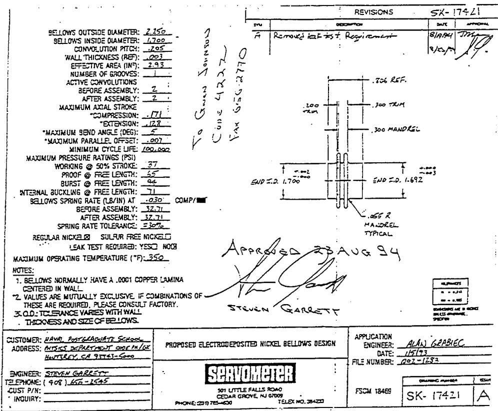  
Figure 17. Bellows Manufacturer Specification Sheet.

18 new bellows were purchased from Servometer, Inc., to support the SETAC experiment. Upon receipt of the first 13, each of the bellows was visually inspected and assigned an identification number (S1-S13). Measurements of mass and stiffness were made to ensure the bellows met the design specifications. The masses were measured on an analytical balance. Stiffness was measured using a special test fixture. This fixture held the bellows and allowed a compressive force to be applied by suspended weights. The displacement of the bellows, under the force of the applied weights, was measured with a linear variable differential transformer (LVDT) . Using Hooke's law and the slope of the LVDT output voltage vs. added mass curve, the stiffness of the bellows was determined by the following relation,

$$
B e { \cal I } { \cal I } o w s ~ S t i f f \bar { a } e s s ~ = ~ \frac { d F } { d X } ~ = ~ g \frac { d V / d X } { d V / d M }\tag{13}
$$

where $9 { = } 9 . 8 \quad \mathrm { m } / \mathrm { s } ^ { 2 }$ and dV/dx is the slope of the LVDT calibration curve. Both the bellows mass and the stiffness can be used as indirect measures of the bellows wall thickness (Garrett, 1992c). All 13 bellows were determined to have satisfactory wall thickness based on the mass and stiffness measurements. The results of these measurements are summarized in Table VII. Figure 18 is a plot of bellows stiffness vs. bellows mass and clearly shows a correlation between the two variables, which characterize the thickness of the bellows wall. The values in the table are consistent with the specified spring rate of 32.71 lbf/in (5724 N/m) for a wall thickness of .003 inches (76.2 μm).

<table><tr><td>Bellows</td><td>Mass (gm) Stiffness (N/m)</td></tr><tr><td>S1 4.3434</td><td>5760</td></tr><tr><td>S2</td><td>3.9672</td></tr><tr><td>S3 4.1042</td><td>5480 6100</td></tr><tr><td>S4</td><td>5860</td></tr><tr><td>4.0531 S5 3.9481</td><td>5570</td></tr><tr><td>S6 3.8552</td><td>5280</td></tr><tr><td>S7 3.8356</td><td>5320</td></tr><tr><td>S8 3.9784</td><td>5490</td></tr><tr><td>S9 4.0642</td><td>5930</td></tr><tr><td>S10 4.0134</td><td>5710</td></tr><tr><td>S11 4.0943</td><td>6080</td></tr><tr><td>S12 3.7313</td><td>5130</td></tr><tr><td>S13 3.7020</td><td>4920</td></tr></table>

Table VII. Bellows Data Summary.

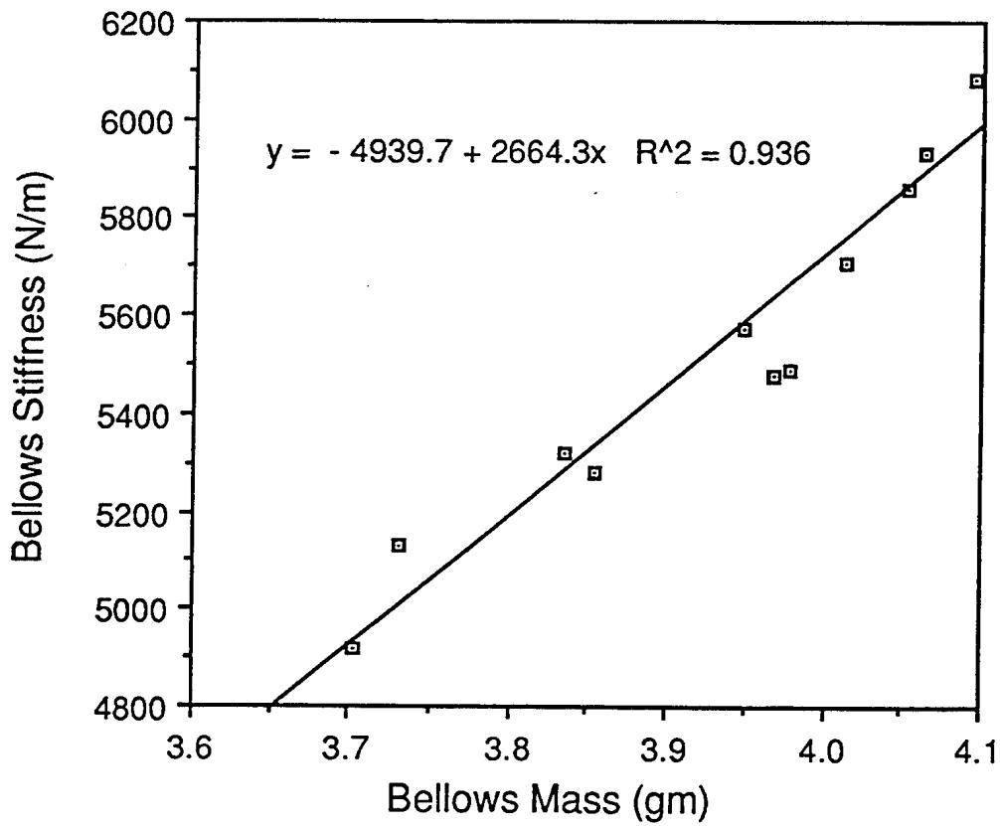  
Figure 18. Bellows Data Plot.

## APPENDIX B. DETERMINATION OF LOUDSPEAKER BL PRODUCT

An electrodynamic loudspeaker has a transformation factor, $\phi _ { \mathrm { M } } ,$ given by the product of the magnetic field strength, B, and the length of voice coil wire subject to the magnetic field, L. The method normally used to determine this BL product requires the stiffness of the loudspeaker suspension to be known and accurate measurements of pusher cone linear displacement to be made as a function of voice coil current. This method uses a static force balance between the electromagnetic force of a supplied DC drive current and the restoring force provided by the loudspeaker suspension (Harris and Vokert, 1989). This appendix documents a new, easier method for determining the BL product of an electrodynamic loudspeaker, which is particularly useful for units with high mechanical quality factors (Q).

The electrodynamic loudspeaker is modeled by an equivalent electrical circuit. Figure 19 shows an equivalent circuit model for an electrodynamic loudspeaker. $\mathtt { R } _ { 0 }$ is the

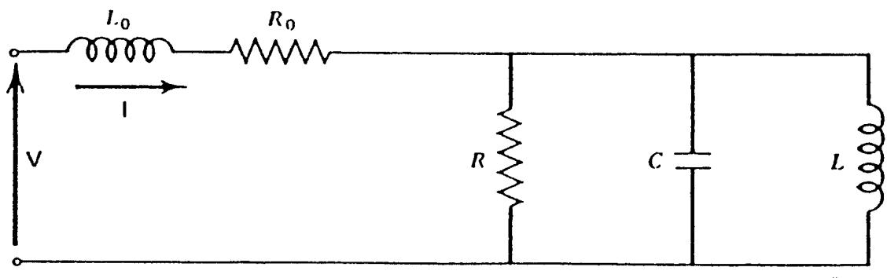  
Figure 19. Loudspeaker Equivalent Circuit Diagram. (From Kinsler et al., 1982)

voice coil electrical resistance and $\mathtt { L } _ { 0 }$ is the voice coil inductance. These two components make up the blocked electrical impedance of the loudspeaker. The remaining three components R, C, and L make up the motional impedance of the loudspeaker.

Using the HP-4194A Impedance Analyzer the parameters R, $\Gamma ,$ and L are easily determined by measuring the loudspeaker input impedance as a function of frequency near resonance. The HP-4194A has an equivalent circuit function that performs a three parameter curve fit to the measured impedance data and reports the equivalent circtuit values of $\scriptstyle { \mathbb { R } } ,$ $\mathsf { C } ,$ and L. Immediate evaluation of the quality of the fitted parameters is available because the HP-4194A can compute the impedance based on the fitted values and overlay this data on the measured impedance data. The following equations (Kinsler et al., 1982) can be used to determine BL from either the C or L values provided from the HP-4194A equivalent circuit analysis,

$$
\Phi _ { M } = B L \quad \quad \quad \quad \quad \bar { L } = \frac { \Phi _ { M } ^ { 2 } } { S }\tag{14,15}
$$

$$
C = { \frac { ( m + X _ { \bar { z } } / \omega ) } { \displaystyle \Phi _ { M } ^ { 2 } } }\tag{16}
$$

where s is the stiffness of the loudspeaker suspension (N/m), m is the loudspeaker moving mass (Kg) and ω is the angular frequency (radians/s). $\mathrm { x } _ { \mathrm { r } }$ is the complex portion of the radiation impedance, known as the radiation mass. ${ \tt X } _ { \tt r }$ is assumed to be zero because the impedance measurements were made with the loudspeaker removed from its housing. While removed from its housing the front and rear surfaces of the pusher cone are not acoustically isolated from each other and therefore the loudspeaker radiates very little sound to the air.

Figure 20 is a plot of both the measured and the calculated equivalent circuit impedance data, both magnitude and phase, over a frequency range of 150 to 450 Hz for Driver

2 (serial #303). The horizontal line drawn across the peak of the impedance plot represents the half-power bandwidth of the resonance. Driver 2 has a measured resonant frequency of 324.5 Hz. The equivalent circuit parameters provided by the HP-4194A for this data were R=144.097 Ohms, C=102.199 μF, and L=2.41654 mH. Using driver 2 stiffness, s=143.7 KN/m, and the inductive equation yields BL=18.63 N/Amp. The capacitive equation and driver 2 moving mass, m=35.4 grams, gives BL=18.61 N/Amp.

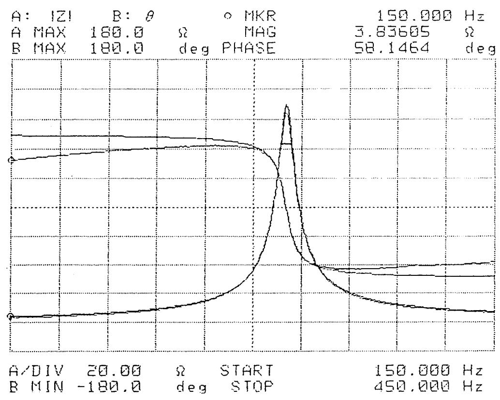  
Figure 20. Driver 2 Input Impedance Plot.

# APPENDIX C. MANUFACTURER SPECIFICATION DATA

This appendix includes the specification and calibration data supplied by the manufacturers of the following SETAC system components: Micropump cold and hot fluid pumps, Omega turbine fluid flow meters, Endevco piezoresistive differential pressure sensors (microphones), and Entran accelerometers.

<table><tr><td></td><td colspan="2"></td><td>AII TO mo6 1304</td><td>Entran</td><td>AoD To mO S1303</td><td></td></tr><tr><td>Entran°</td><td colspan="2" rowspan="2">EG</td><td rowspan="2"></td><td rowspan="2">Fairteld, NJ. USA Sersors&amp; Electronics EG⁻</td><td rowspan="2">Falrnekł, NJ. USA</td></tr><tr><td>Sensors&amp;Electronics</td></tr><tr><td></td><td>Accelerometer</td><td></td><td></td><td>Accelerometer</td><td></td></tr><tr><td>Hot EGA-125-1000D</td><td></td><td>Range (xYIZ). Ueats Freguency: 120.0 He Do not Excwec:</td><td>±1000 9 H</td><td>uEGA=125:1000D 9193K30-F181026860</td><td>_1000 ...0</td></tr><tr><td>SN94193027-P10FO.26860 Sony (XYIZ):_0298</td><td>_mvig</td><td>Excititon: 15.0</td><td>V</td><td>Smy 232 mva</td><td>(ohd:1200. DonEr. E 15.0 14</td></tr><tr><td>brou s :1249</td><td>chens</td><td>Wrng Code:  wnoRed</td><td>Qu=Gm</td><td>mu mind (xn: 1282 arme</td><td>V woing Corte:  hn-tad Out-Om</td></tr><tr><td>Ouour imo. O: 455</td><td>chris</td><td></td><td>th=8h O-</td><td>Ot r [21: 417 ohrm</td><td>n. OR.WH</td></tr><tr><td>L12</td><td>chm</td><td></td><td>D+t=Red Qux=Gm th=8k</td><td>1112 o</td><td>Coh.nnd 0d-0m</td></tr><tr><td></td><td></td><td></td><td>Briape Commpt</td><td></td><td>n.Bk</td></tr><tr><td>SENSITIVE INSTRUMENT - DO NOT DROP</td><td></td><td></td><td></td><td>SENSITIVE INSTRUMENT - DO NOT DROP</td><td>BrHOA Comn:</td></tr><tr><td>READ INSTRUCTION MANUAL BEFORE USE</td><td></td><td></td><td> Soe Calormon Shoet</td><td>READ INSTRUCTION MANUAL BEFORE USE</td><td>O Se Corteation Shel</td></tr></table>

INSTALLED ENDEVCO 1N#303 CMAR95 PRESSURE TRANSDUCER TEST REPORT

<table><tr><td>Range</td><td>10 22.82</td><td>psio mV/psi</td></tr><tr><td>Sensitivity Excitation</td><td>10.00</td><td>Vdc</td></tr><tr><td>Zero Pressure Output</td><td>-2</td><td>mv</td></tr><tr><td>Full Scale Output</td><td>226</td><td>mV</td></tr><tr><td>Non-Linearity</td><td>.2</td><td>%FSO</td></tr><tr><td>Hysteresis</td><td>.15</td><td>%FSO</td></tr><tr><td>Non-Repeatability</td><td>.09</td><td>%FSO</td></tr><tr><td>Combineo Lin. Hyst, &amp; Rep.&quot;</td><td>.27</td><td>%FSO</td></tr><tr><td>Thermal Zero Shif</td><td>1.3</td><td>%FSO</td></tr><tr><td>Zero Shit Atter 3X FSO</td><td>-.02%</td><td>XFSO</td></tr><tr><td>Thermal Sensitivity Shift</td><td>1.17</td><td>%</td></tr><tr><td>Input Resistance</td><td>2373</td><td>Ω</td></tr><tr><td>Output Resistence</td><td>1896</td><td>C</td></tr><tr><td>Isolation Resistance</td><td>&gt;100</td><td>MO</td></tr><tr><td>&#x27;RSS</td><td></td><td></td></tr></table>

## ENDEVCO∑ ASTALLEA12-3046mAL95PRESSURE TRANSDUCER TEST REPORT

<table><tr><td>MODEL B514-10</td><td></td><td>SERIAL AKCN2</td><td></td></tr><tr><td>Range</td><td></td><td>10</td><td>psip</td></tr><tr><td>Sensitivity.</td><td></td><td>23.00</td><td>mV/psi</td></tr><tr><td>Excitation</td><td></td><td>10.00</td><td>Voc</td></tr><tr><td>Zoro Pressure Output</td><td></td><td>1</td><td>mV</td></tr><tr><td>Fuli Scale Output</td><td></td><td>20</td><td>mV</td></tr><tr><td>Non-Linearity</td><td></td><td>.2</td><td>*FSO</td></tr><tr><td>Hysteresis</td><td></td><td>.01</td><td>*FSO</td></tr><tr><td>Non-Repeatability</td><td></td><td>.03</td><td>%FSO</td></tr><tr><td>Combined Lin, Hysl, &amp; Rep.</td><td></td><td>.2</td><td>%FSO</td></tr><tr><td>Thermal Zero Shitt</td><td></td><td>2.39</td><td>%FSO</td></tr><tr><td>Zero Shit After sX FSO</td><td></td><td>-.02%</td><td>XFSO</td></tr><tr><td>Thermal Sensitivity Shit</td><td></td><td>1.09</td><td>%</td></tr><tr><td>Input Resistance</td><td></td><td>2354</td><td>Ω</td></tr><tr><td>Output Resistance</td><td></td><td>1915</td><td>Ω</td></tr><tr><td>Isolation Resistance *RSS</td><td></td><td>&gt;100</td><td>MΩ</td></tr></table>

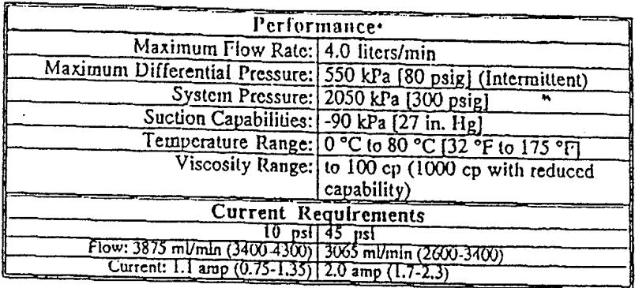  
EG-162-0024-83048 Maximum Flow (GPM)

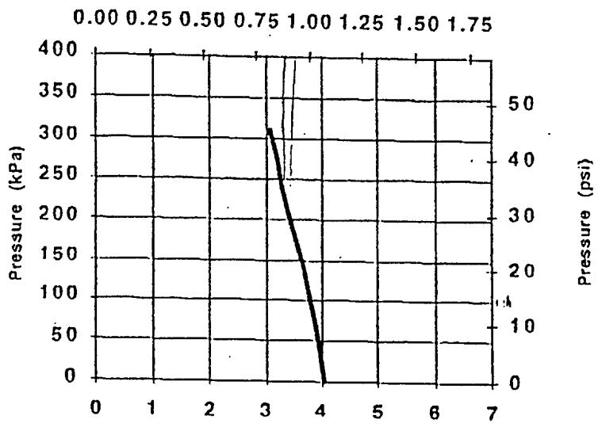  
Performance shown is bssed on sctual pcrformanca testing. but should not be construed as a gturanieed velue. Actuai performance mey vary, depending on fluid, temperwtores and syetem opereting condtione. {Ferformance Data Folm : FInld/Tempersture: Watr  20 C ± 2 C: Control Votege: 5V ± 0.1V: Snpply Votge: 24V ± Iv.  
Mieroçomp Cormrxtion maimtaine a constant progprem of product Improvement which may aflect deaign and'or speclfications. We reserve the right to make these changes without prinr notke or tability. Froduet covared by wemarty; comaet mamufacturtt for details.

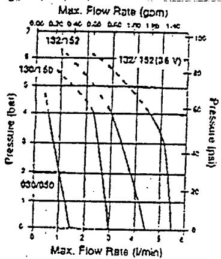

EG Drive For high performance and moderate size

24V 36 V Speed Range 500-4500 RPM 500-6500 RPM DC Voltage Input 23-32 V 33-40 V Power (@ nominal V) 75 W 105 W Current Input 4 A max. DC Speed Control 0 10 5 V\* Tachometer Output 0 to 6 V square wave (RPM=X30) Pump/Drive Weight 1.07 to 1.2 kg (2.35 1o 2.65 lbs)

MOMEL\_NUMRER: FTB-101

ACRYMINT NUMAER: MIRITIASE ORDER:

SERIAL\_ NIIMRER:4OT1E TEST RANF: 0.U616 TO 1.46S1 CA TEST FLUIY: WATER  14.7 PSIG COE, TYTE: PO4ASG 10 V DA1F0170

<table><tr><td></td><td>MFTER FRFOUFNCY</td><td>MF.TFR FLONW RATE</td><td>MFTFR</td><td>FRFQIIFNCY</td></tr><tr><td>1</td><td>(117.)</td><td>(GAL/MIM)</td><td>K FACTOR ()</td><td>VISCOSITY (AISCTS)</td></tr><tr><td></td><td></td><td></td><td></td><td></td></tr><tr><td>1.</td><td>17.652</td><td>0 4616</td><td>14374()</td><td>16.011</td></tr><tr><td>2.</td><td>176,540</td><td>0.7129</td><td>15068.67</td><td>171.201</td></tr><tr><td>1.</td><td>7.727</td><td>1.041</td><td>155.4</td><td>256.721</td></tr><tr><td>4.</td><td>750.268</td><td>1.4017</td><td>14707.78</td><td>.1402.56</td></tr><tr><td></td><td>437.239</td><td>1.7488</td><td>151.51</td><td>474 n15</td></tr><tr><td>m.</td><td>526.110</td><td>2.1Kx</td><td>14m611</td><td>510.410</td></tr><tr><td>7.</td><td>622.413</td><td>24910</td><td>14071.91</td><td>603.587</td></tr><tr><td>a.</td><td>k0.7.5</td><td>2.R140</td><td></td><td>608.572</td></tr><tr><td>a.</td><td>771.127</td><td>1.nato</td><td>15017.15</td><td>747.744</td></tr><tr><td>in.</td><td>868.440</td><td>1.4651</td><td>1467</td><td>242.171</td></tr></table>

WE CFRTIFY THAT ALL. TEST FOUIPMFNT TISED IN THE TFRFORMANCE OF TIF CAIIRRATIONS ARE ACCTIRATE AND TRACFARE TO THF NATIOWNAL, RUREAU OF STANDARIS. ALSO, WE CERTIFY THAT OUR OUALITY ASSURANCESYSTEMLSIN COAIMTJANCF WITHIMITLASZMA AND AII..STL45G62A.

XAVERAF IS02IN 1JN10.12

OPERATOR U

ENG. APTROVAL. S

## CALIBRATION DATA SHEET

#2

MODEL NUMBER: FTB-101

SERIAL NUMBER: 548J2

TEST RANGE: .3585 to 3.4783 GPM

TEST STAND: 7

REc 6FEB 95

TEST FLUID: WATER at 7OF Degrees

COIL TYPE: PC24-45G

DATE: 12/19/94

ACCOUNT NUMBER: PURCHASE ORDER: JOB NUMBER:

<table><tr><td colspan="2">METER</td><td rowspan="2">METER FLOW RATE (GAL/MIN)</td><td rowspan="2">METER K FACTOR (P/GAL)</td><td rowspan="2">FREQUENCY VISCOSITY (HZ/CTS)</td></tr><tr><td>#</td><td>FREQUENCY (HZ)</td></tr><tr><td>1</td><td>93.28</td><td>.358</td><td>15613.48</td><td>90.46</td></tr><tr><td>2</td><td>106.10</td><td>.406</td><td>15692.55</td><td>102.89</td></tr><tr><td>3</td><td>134.11</td><td>.511</td><td>15731.37</td><td>130.05</td></tr><tr><td>4</td><td>169.64</td><td>.649</td><td>15687.33</td><td>164.51</td></tr><tr><td>5</td><td>219.84</td><td>.840</td><td>15711.40</td><td>213.19</td></tr><tr><td>6</td><td>302.56</td><td>1.161</td><td>15637.53</td><td>293.40</td></tr><tr><td>7</td><td>389.46</td><td>1.495</td><td>15632.39</td><td>377.68</td></tr><tr><td>8</td><td>525.36</td><td>2.016</td><td>15638.93</td><td>509.47</td></tr><tr><td>9</td><td>646.44</td><td>2.482</td><td>15625.41</td><td>626.88</td></tr><tr><td>10</td><td>907.59</td><td>3.478</td><td>15655.93</td><td>880.14</td></tr></table>

## APPENDIX D. ELECTRICAL CONNECTOR PIN LISTS

This appendix contains the pin identifications for two of the connectors used for the SETAC modifications of the TALSR configuration. All 37 pins of the D-Sub connector used by the Electronic Control Unit for output to the data acquisition system are listed. The listing indicates which channels were used for the SETAC configuration. The new 10 pin connector (MS 3116F12-105) added to the SETAC enclosure to support the internal mounting of the pumps and fluid flow meters is also documented.

## 37 Pin D-Sub Connector

<table><tr><td>Pin Number 1</td><td>Used on Setac? No</td><td>Function +15 VDC</td></tr><tr><td>2</td><td>Yes</td></tr><tr><td>3 No</td><td>AC Signal Ground -15 VDC</td></tr><tr><td>4</td><td>Sine Out (Acoustic Frequency)</td></tr><tr><td>5</td><td>Yes Yes Microphone 2 (AC signal)</td></tr><tr><td>6</td><td>Yes Microphone 1 (AC signal)</td></tr><tr><td>7</td><td>Yes Accelerometer 2 (AC signal)</td></tr><tr><td>8 Yes</td><td>Accelerometer 1 (AC signal)</td></tr><tr><td>9 Yes</td><td>Sum of Accelerometers</td></tr><tr><td></td><td>(AC signal)</td></tr><tr><td>10 No</td><td>Hot Pump Tachometer</td></tr><tr><td>11</td><td>No Hot Loop Flow (DC signal)</td></tr><tr><td>12 No</td><td>Cold Pump Tachometer</td></tr><tr><td>13 No</td><td>Cold Loop Flow (DC signal)</td></tr><tr><td>14 No</td><td>24 VDC Ground</td></tr><tr><td>15 Yes</td><td>Driver 1 Current (DC signal)</td></tr><tr><td>16 Yes</td><td>Driver 1 Current (AC signal)</td></tr><tr><td>17 Yes</td><td>Driver 2 Voltage (AC signal)</td></tr><tr><td>18 Yes</td><td>Driver 1 Electric Power</td></tr><tr><td>19 No</td><td>(DC signal) +5 VDC</td></tr><tr><td>20</td><td>Yes Acoustic Power (DC signal)</td></tr><tr><td>21 Yes</td><td>Sum of Accelerometers</td></tr><tr><td>22 Yes</td><td>(DC signal) Sum of Microphones</td></tr><tr><td></td><td>(DC signal)</td></tr><tr><td>23 No</td><td>+10 VDČ (#4)</td></tr><tr><td>24 No</td><td>+10 VDC (#3)</td></tr><tr><td>25 No</td><td>+10 VDC (#2)</td></tr><tr><td>26 No</td><td>+10 VDC (#1)</td></tr></table>

<table><tr><td>27</td><td>Yes</td><td>Sum of Microphones (AC signal)</td></tr><tr><td>28</td><td>No</td><td>4 Wire Ohms 1 (high side)</td></tr><tr><td>29</td><td>No</td><td>4 Wire Ohms 1 (low side)</td></tr><tr><td>30</td><td>No</td><td>4 Wire Ohms 2 (high side)</td></tr><tr><td>31</td><td>No</td><td>4 Wire Ohms 2 (low side)</td></tr><tr><td>32</td><td>No</td><td>+24 VDC</td></tr><tr><td>33</td><td>Yes</td><td>Driver 2 Current (AC signal)</td></tr><tr><td>34</td><td>Yes</td><td>Driver 2 Current</td></tr><tr><td>35</td><td>Yes</td><td>(DC signal) Driver 1 Voltage</td></tr><tr><td>36</td><td>Yes</td><td>(AC signal) Driver 2 Electric Power</td></tr><tr><td>37</td><td>No</td><td>(DC signal) 5 VDC Ground</td></tr></table>

## 10 Pin Pump Connector

<table><tr><td>Pin Letter</td><td>Function</td></tr><tr><td>A B</td><td>Ground +24 or +36 VDC Pump Power</td></tr><tr><td>C</td><td>Hot Pump Adjust (0-5 VDC)</td></tr><tr><td>D</td><td>Hot Pump Tachometer</td></tr><tr><td>E</td><td>Cold Pump Adjust (0-5 VDC)</td></tr><tr><td>F</td><td>Cold Pump Tachometer</td></tr><tr><td>G</td><td>Cold Flow Meter Signal (white)</td></tr><tr><td>H</td><td>Cold Flow Meter Signal (black)</td></tr><tr><td>J</td><td>Hot Flow Meter Signal (white)</td></tr><tr><td>K</td><td>Hot Flow Meter Signal (black)</td></tr></table>

## APPENDIX E. DATA ACQUISITION PROGRAM SEQUENCE LISTING

LabvIEw® software uses sequence structures to ensure proper execution order of virtual instruments (programs) . The sequence structures appear like frames from a roll of movie film in the LabVIEW® graphical programming environment. The different frames are executed in sequential order. A listing of the frames used in the SETAC data acquisition system and their functions is provided below. Frame numbers with T or F designation refer to true or false boolean conditions.

<table><tr><td rowspan=1 colspan=2>Frame Number</td><td rowspan=16 colspan=5>FunctionInitialize computer at address(0)Clear GPIBInitialize Keithley thermocouple readerat address(14)Initialize HP-3457A multimeter ataddress (22)Open data fileDoes not open data fileRecord start time of data runSet loop iteration date and time andenter microphone and accelerometersensitivitiesComputer requests HP-00 dataComputer receives HP-00 dataComputer requests HP-01 dataComputer receives HP-01 data</td></tr><tr><td rowspan=1 colspan=2>0-0</td></tr><tr><td rowspan=1 colspan=2>0-1</td></tr><tr><td rowspan=1 colspan=2>0-2</td></tr><tr><td rowspan=1 colspan=2></td></tr><tr><td rowspan=1 colspan=2>0-3</td></tr><tr><td rowspan=1 colspan=2>1-T</td></tr><tr><td rowspan=1 colspan=2>1-F</td></tr><tr><td rowspan=1 colspan=2>2</td></tr><tr><td rowspan=1 colspan=2>3-0</td></tr><tr><td rowspan=1 colspan=2></td></tr><tr><td rowspan=1 colspan=2></td></tr><tr><td rowspan=1 colspan=2>3-1-0</td><td rowspan=1 colspan=1>Computer</td></tr><tr><td rowspan=1 colspan=2>3-1-1</td><td rowspan=1 colspan=1>Computer</td><td rowspan=1 colspan=1>receives</td><td rowspan=1 colspan=1>HP-00</td></tr><tr><td rowspan=1 colspan=2>3-2-0</td><td rowspan=1 colspan=1>Computer</td><td rowspan=1 colspan=1>requests</td><td rowspan=1 colspan=1>HP-01</td></tr><tr><td rowspan=1 colspan=2>3-2-1</td><td rowspan=1 colspan=1>Computer</td><td rowspan=1 colspan=1>receives</td><td rowspan=1 colspan=1>HP-01</td></tr><tr><td rowspan=1 colspan=2>3-3-0</td><td rowspan=1 colspan=1>Computer</td><td rowspan=1 colspan=1>requests</td><td rowspan=1 colspan=1>HP-02</td><td rowspan=2 colspan=2>datadata</td></tr><tr><td rowspan=1 colspan=2>3-3-1</td><td rowspan=1 colspan=1>Computer</td><td rowspan=1 colspan=1>receives</td><td rowspan=1 colspan=1>HP-02</td></tr><tr><td rowspan=1 colspan=1></td><td rowspan=1 colspan=1>3-4-0</td><td rowspan=1 colspan=1>Computer</td><td rowspan=1 colspan=1>requests</td><td rowspan=1 colspan=1>HP-03</td><td rowspan=1 colspan=2>data</td></tr><tr><td rowspan=1 colspan=1></td><td rowspan=1 colspan=1>3-4-1</td><td rowspan=1 colspan=1>Computer</td><td rowspan=1 colspan=1>receives</td><td rowspan=1 colspan=1>HP-03</td><td rowspan=1 colspan=2>data</td></tr><tr><td rowspan=1 colspan=1></td><td rowspan=1 colspan=1>3-5-0</td><td rowspan=1 colspan=1>Computer</td><td rowspan=1 colspan=1>requests</td><td rowspan=1 colspan=1>HP-04</td><td rowspan=1 colspan=2>data</td></tr><tr><td rowspan=1 colspan=2>3-5-1</td><td rowspan=1 colspan=1>Computer</td><td rowspan=1 colspan=1>receives</td><td rowspan=1 colspan=1>HP-04</td><td rowspan=1 colspan=1>data</td><td rowspan=1 colspan=1></td></tr><tr><td rowspan=1 colspan=2>3-6-0</td><td rowspan=1 colspan=1>Computer</td><td rowspan=1 colspan=1>requests</td><td rowspan=1 colspan=1>HP-05</td><td rowspan=1 colspan=1>data</td><td rowspan=1 colspan=1></td></tr><tr><td rowspan=1 colspan=1></td><td rowspan=1 colspan=1>3-6-1</td><td rowspan=1 colspan=1>Computer</td><td rowspan=1 colspan=1>receives</td><td rowspan=1 colspan=1>HP-05</td><td rowspan=1 colspan=1>data</td><td rowspan=1 colspan=1></td></tr><tr><td rowspan=1 colspan=1></td><td rowspan=1 colspan=1>3-7-0</td><td rowspan=1 colspan=1>Computer</td><td rowspan=1 colspan=1>requests</td><td rowspan=1 colspan=1>HP-06</td><td rowspan=1 colspan=1>data</td><td rowspan=1 colspan=1></td></tr><tr><td rowspan=1 colspan=2>3-7-1</td><td rowspan=1 colspan=1>Computer</td><td rowspan=1 colspan=1>receives</td><td rowspan=1 colspan=1>HP-06</td><td rowspan=7 colspan=2>data</td></tr><tr><td rowspan=1 colspan=2>3-8-0</td><td rowspan=1 colspan=1>Computer</td><td rowspan=1 colspan=1>requests</td><td rowspan=1 colspan=1>HP-07</td><td rowspan=1 colspan=1>data</td></tr><tr><td rowspan=1 colspan=2>3-8-1</td><td rowspan=1 colspan=1>Computer</td><td rowspan=1 colspan=1>receives</td><td rowspan=1 colspan=1>HP-07</td><td rowspan=1 colspan=1>data</td></tr><tr><td rowspan=1 colspan=2>3-9-0</td><td rowspan=1 colspan=1>Computer</td><td rowspan=1 colspan=1>requests</td><td rowspan=1 colspan=1>HP-08</td><td rowspan=1 colspan=1>data</td></tr><tr><td rowspan=1 colspan=2>3-9-1</td><td rowspan=1 colspan=1>Computer</td><td rowspan=1 colspan=1>receives</td><td rowspan=1 colspan=1>HP-08</td><td rowspan=1 colspan=1>data</td></tr><tr><td rowspan=1 colspan=2>3-10-1</td><td rowspan=1 colspan=1>Computer</td><td rowspan=1 colspan=1>requests</td><td rowspan=1 colspan=1>HP-09</td><td rowspan=1 colspan=1>data</td></tr><tr><td rowspan=1 colspan=2>3-10-1</td><td rowspan=1 colspan=1>Computer</td><td rowspan=1 colspan=1>receives</td><td rowspan=1 colspan=1>HP-09</td></tr></table>

<table><tr><td rowspan=10 colspan=10>3-11-T-03-11-T-23-11-F3-13-03-13-13-14-0</td><td rowspan=21 colspan=4>Switch HP-3457 to front terminalinput and request desiredmeasurement typeReceive requested dataReturn HP-3457A to rear terminaloperationDummy variable for false caseComputer requests K-10 dataComputer receives K-10 dataComputer requests K-2 dataComputer receives K-2 dataComputer requests K-3 dataComputer receives K-3 dataComputer requests K-4 dataComputer receives K-4 dataComputer requests K-5 dataComputer receives K-5 dataComputer requests K-6 dataComputer receives K-6 dataComputer requests K-7 dataComputer receives K-7 dataComputer requests K-8 dataComputer receives K-8 dataComputer requests K-9 data</td></tr><tr><td rowspan=1 colspan=3></td></tr><tr><td rowspan=1 colspan=3></td></tr><tr><td rowspan=1 colspan=3>3-11-T-1</td></tr><tr><td rowspan=1 colspan=3></td><td rowspan=1 colspan=7></td><td rowspan=1 colspan=2>Computer requests</td></tr><tr><td rowspan=1 colspan=6></td><td rowspan=1 colspan=1>Computer</td><td rowspan=1 colspan=1>receives</td></tr><tr><td rowspan=1 colspan=1>Computer</td><td rowspan=1 colspan=1>requests</td></tr><tr><td rowspan=1 colspan=1>Computer</td><td rowspan=1 colspan=1>receives</td></tr><tr><td rowspan=1 colspan=1>Computer</td><td rowspan=1 colspan=1>requests</td></tr><tr><td rowspan=1 colspan=2></td><td rowspan=1 colspan=3>3-14-1</td><td rowspan=1 colspan=1>Computer</td><td rowspan=1 colspan=1>receives</td></tr><tr><td rowspan=23 colspan=7></td><td rowspan=1 colspan=3>3-15-0</td><td rowspan=1 colspan=1>Computer</td><td rowspan=1 colspan=1>requests</td></tr><tr><td rowspan=1 colspan=3>3-15-1</td><td rowspan=1 colspan=1>Computer</td><td rowspan=1 colspan=1>receives</td></tr><tr><td rowspan=1 colspan=3>3-16-0</td><td rowspan=1 colspan=1>Computer</td><td rowspan=1 colspan=1>requests</td></tr><tr><td rowspan=1 colspan=2>3-16-1</td><td rowspan=1 colspan=1></td><td rowspan=1 colspan=1>Computer</td><td rowspan=1 colspan=1>receives</td></tr><tr><td rowspan=1 colspan=2>3-17-0</td><td rowspan=1 colspan=1></td><td rowspan=1 colspan=1>Computer</td><td rowspan=1 colspan=1>requests</td></tr><tr><td rowspan=1 colspan=2>3-17-1</td><td rowspan=1 colspan=1></td><td rowspan=1 colspan=1>Computer</td><td rowspan=1 colspan=1>receives</td></tr><tr><td rowspan=1 colspan=2>3-18-0</td><td rowspan=1 colspan=1></td><td rowspan=1 colspan=1>Computer</td><td rowspan=1 colspan=1>requests</td></tr><tr><td rowspan=1 colspan=2>3-18-1</td><td rowspan=1 colspan=1></td><td rowspan=1 colspan=1>Computer</td><td rowspan=1 colspan=1>receives</td></tr><tr><td rowspan=1 colspan=2>3-19-0</td><td rowspan=1 colspan=1></td><td rowspan=1 colspan=1>Computer</td><td rowspan=1 colspan=1>requests</td></tr><tr><td rowspan=1 colspan=2>3-19-1</td><td rowspan=1 colspan=1></td><td rowspan=1 colspan=1>Computer</td><td rowspan=1 colspan=1>receives</td><td rowspan=1 colspan=1>K-8</td><td rowspan=1 colspan=1>data</td></tr><tr><td rowspan=1 colspan=2>3-20-0</td><td rowspan=1 colspan=1></td><td rowspan=1 colspan=1>Computer</td><td rowspan=1 colspan=1>requests</td><td rowspan=1 colspan=1>K-9</td></tr><tr><td rowspan=19 colspan=8>Computer receives K-9 dataCalculate derived outputs frommeasured outputsCalculate more derived outputs3-23                Check for high driver currentconditionPlot CV-2095 inlet water temperature3-24-F           Plot CV-2095 air temperature3-25                Compile data into single string forCompile data for output to data file3-27               Compile data for output to data file3-28-T           Record data string to output file3-28-F           False logic to not record dataProceed to next iteration if sampleinterval time is satisfactoryWait required milliseconds to ensureproper sample intervalDetermine and display elapsed time4-T                 Close data file4-F                 False logic to not close data file</td><td rowspan=1 colspan=2>3-20-1</td><td rowspan=1 colspan=1></td><td rowspan=1 colspan=1>Computer</td><td rowspan=1 colspan=1>receives</td><td rowspan=1 colspan=1>K-9</td></tr><tr><td rowspan=1 colspan=2>3-21</td><td rowspan=1 colspan=1></td><td rowspan=1 colspan=1>Calculate</td><td rowspan=1 colspan=1>derived</td><td rowspan=1 colspan=1>outp</td></tr><tr><td rowspan=1 colspan=2></td><td rowspan=1 colspan=1></td><td rowspan=1 colspan=1>measured</td><td rowspan=1 colspan=1>outputs</td></tr><tr><td rowspan=1 colspan=2>3-22</td><td rowspan=1 colspan=1></td><td rowspan=1 colspan=1>Calculate</td></tr><tr><td rowspan=1 colspan=2>3-23</td><td rowspan=1 colspan=1></td><td rowspan=1 colspan=1>Check for</td></tr><tr><td rowspan=2 colspan=2>3-24-T</td><td rowspan=1 colspan=1></td><td rowspan=1 colspan=1>conditior</td></tr><tr><td rowspan=1 colspan=1></td></tr><tr><td rowspan=1 colspan=2>3-24-F</td><td rowspan=1 colspan=1></td></tr><tr><td rowspan=1 colspan=2>3-25</td><td rowspan=1 colspan=1></td><td rowspan=2 colspan=3>Compile data into single s</td><td rowspan=2 colspan=1>e strir</td></tr><tr><td rowspan=2 colspan=2>3-26</td><td rowspan=1 colspan=1></td><td rowspan=1 colspan=3>output to data file</td></tr><tr><td rowspan=1 colspan=1></td></tr><tr><td rowspan=1 colspan=1></td><td rowspan=1 colspan=2>3-27</td><td rowspan=1 colspan=1></td></tr><tr><td rowspan=7 colspan=6></td><td rowspan=1 colspan=1></td><td rowspan=1 colspan=2>3-28-T</td><td rowspan=1 colspan=1></td></tr><tr><td rowspan=1 colspan=2>3-28-F</td><td rowspan=1 colspan=2></td></tr><tr><td rowspan=2 colspan=4></td><td rowspan=1 colspan=2>3-29-T</td><td rowspan=1 colspan=2></td></tr><tr><td rowspan=1 colspan=2></td><td rowspan=1 colspan=2></td></tr><tr><td rowspan=1 colspan=2>3-29-F</td><td rowspan=1 colspan=2></td></tr><tr><td rowspan=1 colspan=4></td></tr><tr><td rowspan=1 colspan=2>4-T</td><td rowspan=1 colspan=2></td></tr></table>

## LIST OF REFERENCES

Benedick,R.E. 1991, Ozone Diplomacy: New Directions in Safeguarding the Planet, Harvard University Press, Cambridge, MA.

Byrnes, R.B., Jr. 1989, Electronics for Autonomous Measurement and Control of a Thermoacoustic Refrigerator in a Space Environment, Master of Science in Electrical Engineering, DTIC Report Number AD B141 388.

Fischer, S.K., Tomlinson, J.J. and Hughes, P.J. 1994, Energy and Global Warming Impact of Not-in-Kind and Next Generation CFC and HCFC Alternatives, U.S. Department of Energy , Oak Ridge National Laboratories, Oak Ridge, TN.

Fitzpatrick, M. 1988, Electrodynamic Driver for the Space Thermoacoustic Refrigerator (STAR), Master of Science in Physics, DTIC Report Number AD A192 337.

Garrett, S.L. 1991, ThermoAcoustic Life Science Refrigerator: A Preliminary Design Study, NASA Technical Report Number LS-10114, L.B. Johnson Space Center, Space and Life Sciences Directorate, Houston, TX.

Garrett, S.L. 1992a, ThermoAcoustic Life Science Refrigerator: Heat Exchanger Design and Performance Prediction, unpublished technical report.

Garrett, S.L. 1992b, TALSR Design Memorandum: Bellows Design for the ThermoAcoustic Life Science Refrigerator, unpublished technical memorandum.

Garrett, S.L. 1992c, TALSR Test Memorandum: Preliminary Bellows Thickness Determination, unpublished technical memorandum.

Garrett, S.L., Adeff, J.A. and Hofler, T.J. 1993a, ThermoAcoustic Refrigeration for Space Applications, Joumal of Thermophysics and Heat Transfer (AIÀĀ), vol. 7, No. 4, pages 595-599.

Garrett, S.L., Hofler, T.J. and Perkins, D.K. 1993b, ThermoAcoustic Refrigeration, Proceedings of 1993 Ozone Safe Cooling Conference, pages 9-23, Greenpeace, Washington, DC.

Garrett, S.L., . Perkins, D.K. and Gopinath, A. 1994,Thermoacoustic Refrigerator Heat Exchangers: Design, Analysis and Fabrication, in Heat Transfer-1994, Proceedings of the 10th International Heat Transfer Conference, vol. IV, pages 375-380.

Garrett, S.L. and Gaitan, D.F. 1994, Determination of Effective Piston Area by Three Methods, Journal of the Acousical Society of America, Vol. 96, No. 5, Pt. 2, page 3290.

Harris, D.A. and Volkert, R.E. 1989, Design and Calibration of an Electrodynamic Driver for the Space ThermoAcoustic Refrigerator, Masters of Science in Engineering Acoustics, DTIC Report Number AD A212 022.

Gifford, W.E. and Longsworth, R.C. 1966, Surface Heat Pumping, Advanced Cryogenic Engineering, Vol. 11, page 171.

Kinsler, L.E., Frey, A.R., Coppens, A.B. and Sanders, J.V. 1982, Fundamentals of Acoustics, John Wiley & Sons, New York, NY.

Olsen, J.R. and Swift, , G.W. 1994, Similitude in Thermoacoustics, Journal of the Acoustical Society of America, Vol. 95, No. 3, pages 1405-1412.

Russell, R.A. 1994, Exergy Analysis of the ThermoAcoustic Life Science Refrigerator, Master of Science in Aeronautical Engineering, DTIC Report Number AD B185 185.

Stockermans, R.J. 1992, Comparison Calibration of Piezoresistive Microphones for Acoustic Power Measurements, Master of Science in Éngineering Acoustics, DTIC Report Number AD A263 154.

Susalla, M.P. 1988, Thermodynamic Improvements for the Space ThermoAcoustic Refrigerator (STAR), Master of Science in Physics, DTIC Report Number AD A196 958.

Swift, G.W. 1988, Thermoacoustic Engines, Journal of the Acoustical Society of America, Vol. 84, No. 4, pages 1145- 1180.

Wheatley, J.C., Hofler, T., Swift, G.W., Migliori, A. 1983, An Intrinsically Irreversible Thermoacoustic Heat Engine, Journal of the Acoustical Society of America, Vol. 74, page 153.

White, F.M. 1988, Heat and Mass Transfer, Addison-Wesley, Reading, MA.

# INITIAL DISTRIBUTION LIST

Defense Technical Information Center 2   
Cameron Station   
Alexandria, VA 22304-6145   
Library, Code 0142 2   
Naval Postgraduate School   
Monterey, CA 93943-5002   
Superintendent   
Naval Postgraduate School   
Monterey, CA 93943   
ATTN: Steven Garrett, Physics Department (Code PH/Gx) 10   
Paul Marto, Dean of Research (Code 08) 1   
R. Panholzer, Chairman, SSAG (Code SP/Pz) 1   
Alan Kraus, Elect. and Comp. Engineering (Code EC/Ks) 1   
Ashok Gopinath, Mechanical Engineering (Code ME/Gp) 1   
William Colson, Chairman, Physics Department (Code PH) 1   
Anthony Atchley, Physics Department (Code PH/Ay) 1   
Robert Keolian, Physics Department (Code PH/Kn) 1   
Thomas Hofler, Physics Department (Code PH/Hf) 1   
COMNAVSURFLANT   
ATTN: VADM Katz 1   
Dan Winegrad, Science Advisor (Code N02X) 3   
1430 Mitscher Avenue   
Norfolk, VA 23511-2494   
George Stimak - Code 09N 1   
Navy Science Assistance Program   
800 N. Quincy Street   
Arlington, VA 22217   
VADM J. P. Reason 1   
DCNO for Plans, Policies and Operations   
2000 Navy Pentagon   
Washington, DC 20350   
Dr. James W. Broyles, Ph.D. 1   
1045 Monterey Vista Way   
Encinitas, CA 92024   
Dr. L. E. Hargrove - ONR 331 1   
Office of Naval Research   
800 N. Quincy Street   
Arlington, VA 22217   
U. S. Environmental Protection Agency   
ATTN: D. Hufford, Stratospheric Ozone Protection Division, Code 6205-J 1   
Bill Kopko, Global Change Division, Code 6202-J 1   
S. Anderson, Director of Technology Transfer, Code ANR-445 1   
401 M Street SW   
Washington, DC 20460   
National Institute of Standards and Technology 1   
ATTN: Dave Didion   
Building Environment Division   
Building 226, Room B114   
Gathersburg, MD 20899   
Oak Ridge National Laboratory 1   
ATTN: Steven K. Fischer   
Building Equipment Research Program   
P. O. Box 2008   
Oak Ridge, TN 37831   
Electric Power Research Institute   
ATTN: Terry Statt 1   
Wayne Krill 1   
3412 Hillview Avenue   
P. O. Box 10412   
Palo Alto, CA 94303   
LCDR Richard A. Russell 1   
1223 N. Farragut   
Colorado Springs, CO 80909   
RADM Ralph West (Ret.) 1   
Systems Planning Corp.   
1000 Wilson Blvd. (TC4-LL)   
Arlington, VA 22209   
RADM Robert C. Austin (Ret.) 1   
Austin Associates, Inc.   
9317 Maybrook Place   
Alexandria, VA 22309   
Commanding Officer 1   
USS Deyo -DD 989   
ATTN: CDR Maydoez   
FPO AE 09567-1227   
Commanding Officer 1   
USS Compte de Grasse -DD 974   
ATTN: E M O - Lt. Curia   
FPO AE 09566-1212   
Commanding Officer 1   
Aviation Supply Office   
ATTN: LCDR George Marentic (Code 0324)   
700 Robbins Avenue   
Philadelphia, PA 19111-5098   
Commander 1   
Naval Air Systems Command Detachment   
ATTN: Deborah A. Lazerson (Code 01112)   
PMA(F) 221 North Island   
P. O. Box 58   
San Diego, CA 92135-5244   
Commanding Officer   
Naval Surface Warfare Center   
ATTN: Thomas Gilmore - Code 822 1   
Alex Lardis - Code 63 1   
3A Leggett Circle   
Annapolis, MD 21402-5067   
Commanding Officer   
Naval Sea Systems Command   
ATTN: Joel Krinsky - Code 03V 1   
2531 Jefferson Davis Hwy.   
Arlington, VA 22242-5160   
Program Executive Officer 1   
PEO USW ASTO (CDR Polcari)   
Undersea Warfare   
2531 Jefferson Davis Hwy.   
Arlington, VA 22242-5169

Advanced Research Projects Agency ATTN: Lawrence H. Dubois Defense Sciences Office 3701 North Fairfax Drive Arlington, VA 22203-1714

Dr. J. H. McCain 260 S. Reynolds St. - Apt. 1604 Alexandria, VA 22304

Pennsylvania State University   
Graduate Program in Acoustics   
ATTN: Prof. J. Tichy, Chairman Dr. Richard Stern Dr. Kenneth Gilbert   
Applied Sciences Building   
P. O. Box 30   
State College, PA 16804

Pennsylvania State University ATTN: Prof. J. D. Maynard Physics Department 104 Davey Laboratory University Park, PA 16802

Ray W. Herrick Laboratories   
ATTN: Prof. James E. Braun Prof. Luc G. Mongeau Brian Minner   
School of Mechanical Engineering   
Purdue University   
West Lafayette, IN 47907   
University of Illinois at Urbana-Champaign   
ATTN: Clark Bullard   
Air Conditioning and Refrigeration Center   
Department of Mechanical and Industrial Engineering   
140 Mechanical Engineering Building, MC-244   
1206 West Green Street   
Urbana, ⅡL 61801

National Center for Physical Acoustics 1   
ATTN: Prof. H. E. Bass, Director   
University of Mississippi   
University, MS 38677   
Los Alamos National Laboratories   
ATTN: Dr. Greg W. Swift 1   
Dr. David L. Gardner 1   
P. O. Box 1664 / MS K764   
Los Alamos, NM 87545   
AT&T Bell Laboratories 1   
ATTN: James E. West - Rm. 2D-338   
600 Mountain Avenue   
Murray Hill, NJ 07974   
Sparton Electronics 1   
ATTN: Andrew D. Helseth   
P. O. Box 788   
de Léon Springs, FL 32130   
Actran Systems 1   
ATTN: Tom Aloi   
450 E. Compton Street   
Orlando, FL 32806   
United Technologies Research Center 1   
ATTN: Dr. William P. Patrick, Senior Project Engineer   
East Hartford, CT 06108   
Carrier Corporation   
ATTN: Charles Bullock 1   
R. R. Crawford, Advanced Residential Division 1   
D. C. Brondum, Advanced Commercial Division 1   
J. M. Mandyck, Manager: Government Affairs 1   
P. O. Box 4808   
Carrier Parkway   
Syracuse, NY 13221   
The Trane Company 1   
ATTN: Paul Glamm, Engineering Manager   
3600 Pammel Creek Road   
Lacrosse, WI 54601-7599   
Whirlpool Corporation   
Advanced Development and Applications   
ATTN: Dr. Nihat Cur, Program Manager 1   
Dr. Carlos J. Coe, Director 1   
Elisha Gray Ⅱ Research & Engineering Center   
Monte Road   
Benton Harbor, MI49022-2600   
York International Corp. 1   
ATTN: Jay Kohler   
P. O. Box 1592-191A   
York, PA 17405-1592   
Frigidaire Company 1   
ATTN: Ilan Cohen, Vice President, Materials Engineering   
6000 Perimeter Drive   
Dublin, OH 43017   
General Electric Research and Development Center 1   
ATTN: Fredrick Pla   
Bldg. K1, Rm. 4B32   
P. O. Box 8   
1 River Road   
Schenectady, NY 12301   
UNEP-GE Appliances 1   
ATTN: E.J. McInerney, Chief Engineer   
Appliance Park 3-215D   
Louisville, KY 40225   
Lennox Industries 1   
ATTN: David Treadwell, Vice President-Research   
1600 Metrocrest   
Carrollton, TX   
Hoechst-Celanese Corp 1   
ATTN: Dr. G. Lees   
P. O. Box 32414   
Charlotte, NC 28232-6085   
IMI Cornelius, Inc. 1   
ATTN: Beth Stoller   
One Cornelius Place   
Anoka, MN 55303-1592   
Modine Manufacturing Company   
ATTN: Mike Reinke 1   
Z. P. Saperstein, Vice President, Technical Services 1   
1500 DeKoven Avenue   
Racine, WI 53403   
Russell Corp. 1   
ATTN: Daron Marshall   
221 S. Berry Street   
P. O. Box 1030   
Brea, CA 92622-1030   
Peavey Electronics Corp.   
ATTN: Hartley Peavey, President 1   
Mike Warren, Transducers 1   
711 A Street   
Maridian, MS 39301   
Mr. Jeremy Crews 1   
Cardinal Research Corporation   
P. O. Box 45249   
Richmond, VA 23227   
David K. Perkins 1   
4713 Rockfield Road   
Richmond, VA 23237   
James A. Mayfield 1   
Rt. 2, Box 947   
Alvin, TX 77511   
Cool Sound Industries 1   
ATTN: H. F. Wighard, President   
East Port Plaza - Suite 258   
9122 South Federal Hwy.   
Port St. Lucie, FL 34952   
Dr. F. W. Giacobbe, Senior Scientist 1   
American Air Liquide   
Chicago Research Center   
5230 S. East Avenue   
Countryside, IL 60525   
Texas Research International 1   
ATTN: Dr. J. S. Thornton, President   
9063 Bee Cave Road   
Austin, TX 78733   
SunPower, Inc.   
ATTN: David Berkowitz, Chief Engineer 1   
W. T. Beale, President & Technical Director 1   
6 Byard Street   
Athens, OH 45701   
Stirling Technology Company 1   
ATTN: Pete Riggle   
2952 George Washington Way   
Richland, WA 99352   
Dennis Johnson 1   
Shop 67 Foreman   
3000 S. E. Colvea Drive   
Port Orchard, WA 98366   
Commanding Officer 1   
CSTSC (Code 103)   
695 Walnut Ave. - Suite 5050   
Mare Island, CA 94592-5050   
LT. Stephen Ballister 2   
103 Park Meadow Drive   
Pittford, NY 14534   
LT. Dennis MKelvey 2   
8673 Kendor Drive   
Buena Park, CA 90620