Y3861036

# University of Chinese Academy of Sciences

# 博士学位论文

# 新型自由活塞热驱动热声热(冷)电联供系统的理论及实验研究

作者姓名： 孙岩雷

指导教师：罗二仓 研究员 中国科学院理化技术研究所

胡剑英 研究员 中国科学院理化技术研究所

学位类别：工学博士

学科专业：工程热物理

培养单位：中国科学院理化技术研究所

2021年6月

Y3861036

University of Chinese Academy of Sciences

# 博士学位论文

## 新型自由活塞热驱动热声热(冷)电联供系统的理论及实验研究

作者姓名： 孙岩雷

指导教师：罗二仓 研究员 中国科学院理化技术研究所
胡剑英 研究员 中国科学院理化技术研究所

学位类别： 工学博士

学科专业： 工程热物理

培养单位：中国科学院理化技术研究所

2021年6月

# Study on the Theory and Experiment of a Novel Free-Piston Heat-Driven Thermoacoustic-Stirling Heating/Cooling-Power Combined System

A dissertation submitted to
University of Chinese Academy of Sciences
in partial fulfillment of the requirement

for the degree of

Doctor of Philosophy

in Engineering Thermophysics

By

Sun Yanlei

Supervisor: Professor Luo Ercang

Professor Hu Jianying

Technical Institute of Physics and Chemistry

Chinese Academy of Sciences

June 2021

## 中国科学院大学研究生学位论文原创性声明

本人郑重声明: 所呈交的学位论文是本人在导师的指导下独立进行研究工作所取得的成果。尽我所知，除文中已经注明引用的内容外，本论文不包含任何其他个人或集体已经发表或撰写过的研究成果。对论文所涉及的研究工作做出贡献的其他个人和集体，均已在文中以明确方式标明或致谢。

作者签名：孙召雷

日期：2024.5.25

## 中国科学院大学 学位论文授权使用声明

本人完全了解并同意遵守中国科学院有关保存和使用学位论文的规定，即中国科学院有权保留送交学位论文的副本，允许该论文被查阅，可以按照学术研究公开原则和保护知识产权的原则公布该论文的全部或部分内容，可以采用影印、缩印或其他复制手段保存、汇编本学位论文。

涉密及延迟公开的学位论文在解密或延迟期后适用本声明。

作者签名：孙名霄

导师签名：罗二仓

日期：2021.5.25

日期：2021.5.28

## 摘要

热驱动多联供技术可以大幅提高能源的利用效率，对于节能减排和促进可持续发展具有非常重要的意义。现有的多联供系统由多种工作原理不同的子系统组成，存在系统结构复杂、初投资成本大、小型化时效率和功率密度偏低等问题，在一定程度上限制了多联供技术的推广与应用。因此，开展针对高效紧凑式微小型多联供技术的研究则具有重要的应用价值。

热声技术是一种实现热功转换的能源利用技术，具有热源适应性广、高效可靠且工质绿色环保等特点，被广泛应用于发动机、制冷机以及热泵中。本文基于热声理论，针对中低品位热能高效利用以及紧凑式微小型多联供技术系统高效匹配耦合的科学问题，开展热驱动双效自由活塞型热声斯特林热（冷）电联供技术的研究，具有重要的科学意义和应用价值。研究工作主要包括以下方面的内容：

（1）对热驱动双效自由活塞型热声斯特林热泵系统的工作特性进行了理论研究，解释了内部能量转换和各子系统之间的耦合匹配机理，阐明了结构参数和运行参数对于系统性能的影响规律。

基于热声理论，利用 Sage 软件对热驱动双效自由活塞型热声斯特林热泵建立了计算模型并进行了数值计算，得到了设计工况下的输出特性情况，并探究了核心单元的声场分布和能流沿程分布以及各关键部件的烟损失情况；同时，采用声电类比的方法，研究了系统的等效声阻抗和系统的耦合机理；此外，本文基于拉格朗日观点下的介观热力学理论对子系统展开分析，揭示了自由活塞型热声斯特林热机内部气体微团的工作机理，阐明了热声热机与自由活塞斯特林热机之间的关系。最后，特别针对核心功能部件的结构参数和系统运行参数对系统工作特性的影响进行了计算和分析，计算表明系统输出特性对于关键参数的变化具有敏感性；为解决此问题，本文提出了一种采用谐振电机替代传统固体活塞谐振子调相的技术方案，通过调节外接电阻的方式来降低参数敏感性从而实现系统稳定运行，该方案对于同类型的热驱动热机均具有参考意义。

（2）设计并搭建了自由活塞型热声斯特林子系统实验平台并进行了电驱动和热驱动实验研究，揭示了子系统的起振特性和热功转换特性。

为了探究自由活塞型热声斯特林子系统的热功转换特性，本文采用解耦研究的方法，设计并搭建了自由活塞型热声斯特林热机子系统实验平台，并进行了电驱动和热驱动实验研究，用以验证和评估子系统运行情况以及获得不同充气压力下子系统热驱动运行时的热功转换特性。实验结果表明，热驱动时系统起振温度最低可达 $83.2^{\circ}\mathrm{C}$ ；系统的起振特性以及输出性能与充气压力和加热功率有着显著的相关性；适当的调节自由活塞型热声斯特林热机系统的充气压力有助于热驱动实验的顺利起振。

（3）研制了电驱动自由活塞型热声斯特林热泵实验系统并开展了系统性实验研究，阐释了运行参数对于系统运行性能的影响规律。

研制了电驱动自由活塞型热声斯特林热泵实验系统，阐述了热泵入口驱动压比、运行频率、平均运行压力以及泵热温差等运行参数对于系统性能的影响。在冷端和供热端温度分别为 $0^{\circ}\mathrm{C}$ 和 $45^{\circ}\mathrm{C}$ 的供暖工况时，系统可对外输出供热量为 $2253\mathrm{W}$ ，此时对应的声功计的制热系数和相对卡诺效率以及以电功计的能效比分别为2.76、 $39.06\%$ 和1.48。此外，实验结果指出，该电驱动自由活塞型热声斯特林热泵在低环温条件下具有稳定的制热性能，其整机效率与相同温区的蒸汽压缩式热泵具有可比性，在大温差泵热的条件下更具有潜在的应用价值。

（4）研制了国际首台热驱动双效自由活塞型热声斯特林热泵热（冷）电联供系统，开展了整机系统特性研究，提出并成功验证了“紧凑式冷热电一体化”的设计思路，阐释了结构和运行参数对于该新型热（冷）电联供系统运行性能的影响规律。

在子系统实验台基础上，研制了国际首台热驱动双效自由活塞型热声斯特林热泵热（冷）电联供系统，研究了结构和运行参数对系统输出性能的影响，首次在无需引入额外的装置的情况下由一台机器同时实现供热、制冷以及发电的功能，提出并成功验证了“紧凑式冷热电一体化”的设计思路。实验结果表明：在冷端和供热温度分别为-20℃和45℃的工况下，输入2.5kW的一次能源热量时系统可以获得2840W的制热量，513W的制冷量以及121W的发电量，所对应的制热系数和整机性能系数分别为1.14和1.39，与单一能源转换系统相比，该冷热电联供系统可节约39%的一次能源消耗。此外，实验结果表明，系统具有利用中低品位废热的潜力，其功率适宜微小型分布式供暖使用，该整机系统在低品位余热回收、太阳能热利用以及生物质等可再生能源利用等方面具有潜在的应用前景。

关键词：热（冷）电联供系统，热声，自由活塞，斯特林，热泵

## Abstract

Heat-driven combined cooling, heating, and power (CCHP) trigeneration technology can significantly improve the efficiency of energy utilization, which plays a crucial role in guiding the innovation of achieving efficient energy conversion and utilization and emission reduction as well as promotion of sustainable development. However, most existing conventional CCHP systems typically involve multiple energy conversion technologies and comprise various coupled subsystems with different working principles. Most of them have many shortcomings, such as bulky structure, high initial investment cost, and low energy conversion efficiency, and low power density in miniaturization. To a certain extent, the above limits the promotion and application of trigeneration technology in miniaturization and other distributed places. Therefore, it is of great application value to carry out research development on high-efficiency and compact micro/miniature multi-supply technology.

Thermoacoustic technology is an energy utilization technology that achieves thermal power conversion, widely used in engines, refrigerators, and heat pumps, which has the characteristics of wide heat source adaptability, high efficiency and reliability, and environmental protection. Based on the theory of thermoacoustics, researches on heat-driven duplex free-piston thermoacoustic-Stirling heating/cooling-power combined technology have been carried out to settle the scientific problems of high-efficiency utilization of low- and medium-grade thermal energy and efficient matching and coupling of compact micro/miniature multi-supply technology systems. The researches have important scientific significance and application value. The main research works carried out in this dissertation are as follows:

(1) The working principle and the internal energy conversion, as well as the coupling and matching mechanism of each subsystem of the heat-driven duplex free-piston thermoacoustic Stirling heat pump system are investigated. At the same time, the influences of structural parameters and operating parameters on the system are clarified.

The numerical model of the heat-driven duplex free-piston thermoacoustic-Stirling heat pump has been established and analyzed using Sage software based on the thermoacoustic theory. The output characteristics, the acoustic field, and energy flow distribution of the core unit, as well as the exergy loss of each key component of the system under the design conditions, have been obtained. At the same time, the equivalent acoustic impedance and the coupling mechanism of the system have been investigated using the method of acoustic-electro analogy. Furthermore, this dissertation analyzes the subsystem and reveals the working mechanism of the gas micro clusters inside the free-piston thermoacoustic-Stirling engine subsystems, and clarifies the relationship between the thermoacoustic heat engine and the free-piston Stirling engine based on the meso-scope thermodynamic theory under the Lagrangian viewpoint. Finally, the calculation and analysis of the influence of the structural parameters of the core components and the operating parameters on the output characteristics of the system have been mainly investigated. The calculations show that the system output characteristics are sensitive to the changes of key parameters. To solve this problem, a scheme of using an oscillating linear alternator to replace the traditional solid piston resonator for phase modulation and adjusting the external resistance to ensure the stable operation of the system is proposed. This solution has reference significance for the same type of heat-driven heat engine.

(2) The experimental platform of the free-piston thermoacoustic-Stirling subsystem has been designed and built. And the electrical-driven and heat-driven experimental investigations have been carried out to reveal the onset characteristics and heat-to-power conversion characteristics of the subsystem.

To clarify the heat-to-power conversion characteristics of the free-piston thermoacoustic-Stirling subsystem, a free-piston thermoacoustic-Stirling heat engine subsystem experimental platform is designed and built by using the way of decoupling research. And the related electrical-driven and heat-drive experimental research has been carried out to verify and evaluate operation conditions of the subsystem, and reveal the heat-to-power conversion characteristics under different charging pressures during heat-driven operation. Experimental results show that the oscillating linear alternator coupled with the free-piston thermoacoustic-Stirling heat engine subsystem can start oscillation successfully and the onset temperature can be as low as 83.2 °C; the onset characteristics and output performance of the subsystem have a significant correlation with the inflation pressure and heating power. Appropriately adjusting the charging pressure of the free-piston Stirling heat engine system is beneficial to the smooth start-up of heat-driven experiments.

(3) An electrical-driven free-piston thermoacoustic-Stirling heat pump experimental system has been developed. The numerical and experimental investigations have been carried out to systematically expound the influence of various operating parameters on the system performance.

An electrical-driven free-piston thermoacoustic-Stirling heat pump experimental system has been developed. The systematic numerical and experimental investigations have been carried out to expound the influence of various operating parameters such as inlet driving pressure ratio, operating frequency, average operating pressure, and temperature lift on the system performance. The prototype can provide heating power of 2253 W with a $COP_{h}$ of 2.76, a relative Carnot efficiency of 39.06%, and an energy efficiency ratio of 1.48 when the cold-end temperature and heating-supply temperature are respectively fixed at 0 °C and 45 °C. Besides, the experimental results indicate that the electrical-driven free-piston thermoacoustic-Stirling heat pump has stable heating performance under low-ambient temperature conditions, and its overall efficiency is comparable with that of electrical-driven vapor compression heat pumps in the same temperature zone. It has potential application value under the condition of a large temperature lift to pump heat.

(4) A novel heat-driven free-piston thermoacoustic-Stirling heating/cooling-power combined system has been proposed and built for the first time in the whole world. Investigations on the output performance of the whole system have been carried out, as well as the design idea of compact integration of combined heating, cooling, and electricity has been proposed and successfully verified for the first time. The influence of the structure and operation parameters on the performance of the system is revealed.

Based on the subsystem experimental platforms with improved structure, a novel heat-driven free-piston thermoacoustic-Stirling heating/cooling-power combined system experimental platform has been proposed and built for the first time in the whole world, which can cool, heat, and generate power using one machine without introducing additional devices, and the design idea of compact integration of combined heating, cooling, and electricity has been proposed and successfully verified for the first time. The experimental results show that the novel cogeneration system can obtain heating and cooling capacities and electric power of 2840 W, 513 W, and 121 W, respectively, when the cold-end temperature and heating-supply temperature are respectively fixed at -20 °C and 45 °C, with a $COP_{h}$ of 1.14 and the overall coefficient of performance of the system of 1.39. The system has the potential to utilize low- and medium-grade waste heat, which is suitable for decentralized micro-scale households. At the same time, the whole system has potential application prospects in low-grade waste heat recovery, solar thermal utilization, biomass, and other renewable energy utilization.

Key Words: Heating/Cooling-Power Combined System, Thermoacoustic, Free-Piston, Stirling, Heat Pump

## 目录

第1章 绪论....1
1.1 课题研究背景及意义....1
1.2 热驱动热泵技术研究进展....3
1.2.1 热泵简介....3
1.2.2 热泵循环....4
1.2.3 热泵的发展....5
1.3 热电联产技术研究进展....14
1.3.1 热电联产装置的分类....15
1.3.2 现有微型热电联产装置技术特点及研究进展....16
1.3.3 冷热电联产....23
1.4 热声热机研究进展....24
1.4.1 传统热声热机技术....24
1.4.2 斯特林型热声热机....32
1.5 本文主要工作....40
第2章 交变流动回热式热机理论分析基础....43
2.1 前言....43
2.2 热声理论....43
2.2.1 经典热声方程组....44
2.2.2 经典热声方程组的典型解....45
2.2.3 经典热声理论下的时均能量输运效应....48
2.2.4 弱非线性热声学方程组....51
2.2.5 弱非线性热声理论下的时均能量输运效应....53
2.3 斯特林热机分析理论....55
2.3.1 传统的斯特林循环....55
2.3.2 传统的斯特林热机分析理论....56
2.4 介观热力学理论下的斯特林循环....59
2.5 计算工具介绍....61
2.5.1 Sage....61
2.5.2 DeltaEC....62

2.5.3 Regen....62
2.6 本章小结....62
第3章 双效自由活塞型热声斯特林热泵数值模拟研究....65
3.1 前言....65
3.2 系统介绍....66
3.2.1 系统结构....66
3.2.2 系统工作原理....66
3.2.3 系统等效声阻抗和耦合机理....67
3.2.4 系统计算模型....72
3.2.5 系统评价和结构参数....73
3.3 系统输出特性....75
3.3.1 设计工况下系统的输出性能....75
3.3.2 设计工况下核心单元的声场沿程分布....77
3.3.2 设计工况下系统的烟损失....84
3.4 结构参数对系统性能的影响....88
3.4.1 调相器结构参数对系统性能的影响....89
3.4.2 谐振电机结构参数对系统性能的影响....100
3.4.3 热声换能器结构参数对系统性能的影响....106
3.5 运行参数对系统性能的影响....108
3.5.1 温度对系统性能的影响....108
3.5.2 压力对系统性能的影响....113
3.5.3 外接电阻对系统的影响....114
3.6 基于介观热力学观点的子系统分析....116
3.6.1 计算方法....117
3.6.2 结果讨论....118
3.7 本章小结....120
第4章 双效自由活塞型热声斯特林发动机及热泵子系统实验研究及分析....123
4.1 前言....123
4.2 谐振电机耦合自由活塞型热声斯特林子系统电/热驱动实验研究....123
4.2.1 实验台装置....123
4.2.2 自由活塞型热声斯特林热机子系统....124

4.2.3 谐振电机....129
4.2.4 辅助系统....131
4.2.5 实验结果及分析....135
4.2.6 小结....139
4.3 电驱动自由活塞型热声斯特林热泵实验研究....140
4.3.1 实验系统介绍....140
4.3.2 辅助系统....144
4.3.3 计算对照程序....146
4.3.4 实验结果对比及分析....147
4.4 本章小结....158
第5章 热驱动多输出双效自由活塞型热声斯特林热泵热（冷）电联供性能实验研究及分析....161
5.1 前言....161
5.2 整机实验系统介绍....161
5.2.1 热泵整机主体系统....162
5.2.2 辅助系统....164
5.3 实验基本流程....166
5.4 整机系统初步泵热实验....168
5.4.1 性能对比....168
5.4.2 不同加热功率下系统的性能....169
5.5 结构优化后整机系统泵热实验....174
5.5.1 系统性能....175
5.5.2 不同运行工况对系统性能的影响....176
5.6 整机系统冷热电联供实验....185
5.6.1 系统性能....186
5.6.2 不同负载工况下系统性能....187
5.6.3 不同制冷温度下系统性能....191
5.7 本章小结....193
第6章 全文总结及展望....195
6.1 全文总结....195
6.2 主要创新点....198
6.3 工作展望....199

参考文献……200
致 谢……213
作者简历及攻读学位期间发表的学术论文与研究成果……215

## 图目录

图1.1 1990\~2018年中国能源消耗量....1  
图1.2 1990\~2018年中国 $\mathrm{CO}_{2}$ 排放情况....1  
图1.3 制冷机和热泵的工作温区....4  
图1.4 理想热泵循环的p-v图和T-s图....4  
图1.5 热量倍增器示意图....5  
图1.6 联邦大厦地下水源热泵示意图....6  
图1.7 不同热源种类的热泵....7  
图1.8 电驱动蒸汽压缩式热泵供热原理图....8  
图1.9 燃气驱动蒸汽压缩式热泵基本原理....9  
图1.10 热驱动机械蒸汽再压缩热泵原理....10  
图1.11 采用R134a作为热泵工质的燃气驱动蒸汽压缩式热泵的原理和系统实物图....10  
图1.12 第一类吸收热泵原理示意图....11  
图1.13 第二类吸收热泵原理示意图....11  
图1.14 曲柄连杆式和自由活塞式VM热泵结构示意图....12  
图1.15 多特蒙德工业大学研发的复合型Stirling-VM热泵结构示意图和实物图....13  
图1.16 V-Cycle TM热泵系统结构示意图和实物图....14  
图1.17 热电联产系统示意图....15  
图1.18 主要热电联产技术....16  
图1.19 典型内燃机结构示意图....17  
图1.20 Dachs微型热电联产装置....17  
图1.21 Ecopower微型热电联产装置....18  
图1.22 Ecowill微型热电联产装置....18  
图1.23 微型涡轮式热电联产技术原理示意图....19  
图1.24 EnerTwin微型热电联产装置....19  
图1.25 Capstone Turbine Corporation公司推出的微型热电联产装置示意图...19  
图1.26 有机朗肯循环热电联产装置流程示意图....20  
图1.27 Genlec型微型热电联产装置....20  
图1.28 WhisperGen公司微型热电联产装置....21

图1.29 Microgen微型热电联产装置....22  
图1.30 Qnergy公司推出的5kWe级微型热电联产装置....22  
图1.31 Smartbolier微型热电联产装置....23  
图1.32 早期的热声现象....25  
图1.33 Swift等人1992年研制的驻波热声发动机....26  
图1.34 Swift等人1995年研制的对置驻波热声发动机....26  
图1.35 Ceperley提出的行波热声发动机示意图....27  
图1.36 Yazaki等研制的环路行波热声发动机....27  
图1.37 Backhauss和Swift研制的热声-斯特林型发动机....28  
图1.38 罗二仓等人研制的聚能型行波热声发动机....28  
图1.39 De blok等人研制的四单元环路双作用热声系统示意图....29  
图1.40 罗二仓课题组研制的环路双作用热声系统示意图....30  
图1.41 天然气热驱动热声发动机耦合脉管制冷机的天然气液化装置....31  
图1.42 聚能型热声-斯特林发动机驱动脉管制冷机....31  
图1.43 $300\mathrm{Hz}$ 驻波热声发动机驱动脉管制冷机....32  
图1.44 不同时期的斯特林发动机....33  
图1.45 三种类型的斯特林热机....34  
图1.46 双作用斯特林热机示意图....34  
图1.47 Beale早期提出的双效自由活塞斯特林热机概念示意图....35  
图1.48 SD-100型双效自由活塞斯特林热泵....36  
图1.49 Sunpower公司研制的双效自由活塞斯特林热机示意图....36  
图1.50 Sunpower公司研制的小型天然气液化装置....37  
图1.51 Sunpower公司研制的便携式制冷装置....37  
图1.52 Berchowitz等人研制的双效自由活塞斯特林热泵装置....37  
图1.53 $\mathrm{CO}_{2}$ 双效自由活塞斯特林热泵装置....38  
图1.54 长寿命双效自由活塞斯特林装置示意图....39  
图1.55 谐振管耦合型双效自由活塞斯特林制冷机....39  
图2.1 正向斯特林循环的p-v图和T-s图....55  
图2.2 正向斯特林循环工作原理图....56  
图2.3 三阶节点分析法示意图....58  
图2.4 介观热力学观点下斯特林制冷机的气体微团工作过程....60  
图2.5 斯特林热机热声换能器内部气体微团热力循环包络线....61

图3.1 热驱动双效自由活塞型热声斯特林热泵系统示意图....66  
图3.2 圆形管道的等效声阻抗图....68  
图3.3 热驱动双效自由活塞型热声斯特林热泵系统等效声阻抗图....70  
图3.4 谐振电机耦合的双效自由活塞型热声斯特林热泵声阻抗匹配原理....71  
图3.5 热驱动双效自由活塞型热声斯特林热泵Sage程序前面板图....72  
图3.6 Sage程序中各部件在.lst文件储存的计算结果....77  
图3.7 压力波动沿程分布情况....78  
图3.8 体积流率沿程分布情况....78  
图3.9 系统内部气体工质速度波动沿程分布情况....79  
图3.10 系统阻抗沿程分布情况....79  
图3.11 系统内部气体工质平均温度沿程分布情况....80  
图3.12 发动机侧热声换能器内部平均温度沿程分布....80  
图3.13 热泵侧热声换能器内部平均温度沿程分布....80  
图3.14 一个时间周期内系统各换热器中心位置处气体温度变化情况....81  
图3.15 声功沿程分布情况....82  
图3.16 热驱动双效自由活塞型热声斯特林热泵系统声功流向图....82  
图3.17 系统能流图....83  
图3.18 系统各部件的烟损失....84  
图3.19 发动机子系统和热泵子系统中热声换能器的烟损失情况....86  
图3.20 谐振电机烟损失情况....86  
图3.21 发动机子系统高温换热器和室温换热器烟损失情况....87  
图3.22 热泵子系统冷端换热器和室温换热器烟损失情况....87  
图3.23 发动机子系统和热泵子系统中调相器的烟损失情况....88  
图3.24 调相器结构示意图....89  
图3.25 发动机侧调相器动质量与刚度对系统加热量和供热量的影响....91  
图3.26 发动机侧调相器动质量与刚度对谐振电机的影响....91  
图3.27 发动机侧调相器动质量与刚度对系统效率的影响....92  
图3.28 热泵侧调相器动质量与刚度对系统加热量和供热量的影响....92  
图3.29 热泵侧调相器动质量与刚度对谐振电机性能的影响....93  
图3.30 热泵侧调相器动质量与刚度对系统效率的影响....93  
图3.31 调相器动质量与刚度对系统运行频率的影响....94  
图3.32 调相器机械阻尼对系统加热量和供热量的影响....95

图3.33 调相器机械阻尼对系统两侧供热量的影响....95  
图3.34 调相器机械阻尼对谐振电机性能的影响....96  
图3.35 调相器机械阻尼对系统频率的影响....96  
图3.36 调相器机械阻尼对系统效率的影响....97  
图3.37 调相器面积比对系统加热量和供热量的影响....98  
图3.38 调相器面积比对系统两侧供热量的影响....98  
图3.39 调相器面积比对谐振电机性能的影响....99  
图3.40 调相器面积比对系统频率的影响....99  
图3.41 调相器面积比对系统效率的影响....99  
图3.42 电机活塞动质量与刚度对系统加热量和供热量的影响....100  
图3.43 电机活塞动质量与刚度对系统运行频率的影响....101  
图3.44 电机活塞动质量与刚度对谐振电机性能的影响....101  
图3.45 电机活塞动质量与刚度对系统效率的影响....102  
图3.46 电机机械阻尼对系统加热量和供热量的影响....102  
图3.47 电机机械阻尼对电机性能的影响....103  
图3.48 电机机械阻尼对系统效率的影响....103  
图3.49 电机机械阻尼对系统频率的影响....104  
图3.50 发动机侧热声换能器孔隙率和丝径对系统加热量和供热量的影响....107  
图3.51 发动机侧热声换能器孔隙率和丝径对系统效率的影响....107  
图3.52 热泵侧热声换能器孔隙率和丝径对系统加热量和供热量的影响....107  
图3.53 热泵侧热声换能器孔隙率和丝径对系统效率的影响....108  
图3.54 冷、热端温度对系统加热量和供热量的影响....109  
图3.55 冷、热端温度对两侧供热量的影响....109  
图3.56 冷、热端温度对系统频率的影响....109  
图3.57 冷、热端温度对电机性能的影响....109  
图3.58 热端温度和冷端温度对系统效率的影响....110  
图3.59 供热温度对系统加热量和供热量的影响....111  
图3.60 供热温度对两侧供热量的影响....111  
图3.61 供热温度对系统频率的影响....111  
图3.62 供热温度对电机性能的影响....111  
图3.63 供热温度对系统效率的影响....112  
图3.64 压力对系统加热量和供热量的影响....113

图3.65 压力对两侧供热量的影响....113  
图3.66 压力对系统频率的影响....114  
图3.67 压力对电机性能的影响....114  
图3.68 压力对系统效率的影响....114  
图3.69 谐振电机作用下不同加热温度下所对应的外接电阻和电功....115  
图3.70 谐振电机作用下的加热量和总供热量....116  
图3.71 谐振电机作用下的两侧供热量....116  
图3.72 谐振电机作用下系统的性能系数和运行频率....116  
图3.73 介观热力学观点的子系统分析计算方法流程图....117  
图3.74 发动机子系统中三个典型气体微团的位置和速度随时间的变化情况118  
图3.75 发动机子系统中三个典型气体微团的p-v和T-s图....119  
图3.76 发动机子系统中气体微团的热力循环....120  
图3.77 热泵子系统中气体微团的热力循环....120  
图4.1 实验系统结构模型图....124  
图4.2 实验系统实物图....124  
图4.3 高温换热器和冷端换热器的结构模型图和实物图....125  
图4.4 内置于不锈钢外壳的高温/冷端换热器实物图....125  
图4.5 烧结丝网结构的热声换能器实物图....126  
图4.6 不锈钢丝网和紫铜丝网的实物图....126  
图4.7 室温换热器实物图....127  
图4.8 调相器结构模型图和装配实物图....127  
图4.9 调相器活塞实物图....128  
图4.10 调相器板弹簧实物图....128  
图4.11 拉压测试平台....128  
图4.12 两侧调相器板弹簧组压力—位移对应关系....129  
图4.13 谐振电机结构模型图和实物图....130  
图4.14 热驱动激励和电源（负载）系统电路图....132  
图4.15 测量和采集系统示意图....132  
图4.16 热泵子系统电驱动制冷降温曲线....136  
图4.17 热泵子系统冷头结霜现象....136  
图4.18 不同充气压力下发动机子系统热驱动起振特性....137  
图4.19 不同加热功率下热头温度和频率的变化....138

图4.20 不同加热功率下谐振电机活塞位移....138  
图4.21 不同加热功率下的压力波动变化情况....138  
图4.22 不同加热功率下压比变化情况....138  
图4.23 不同加热功率下发动机输出声功和输出电功变化....139  
图4.24 不同加热功率下热声转换效率和声电效率变化情况....139  
图4.25 电驱动自由活塞型热声斯特林热泵子系统的实物照片和结构模型图141  
图4.26 电驱动自由活塞型热声斯特林热泵实验台辅助系统的实物图和示意图....144  
图4.27 电驱动自由活塞型热声斯特林热泵Sage计算程序图....147  
图4.28 不同驱动压比下供热量受冷端温度的影响....148  
图4.29 不同驱动压比下输入声功受冷端温度的影响....148  
图4.30 不同驱动压比下输入电功受冷端温度的影响....149  
图4.31 不同驱动压比下电声转化效率受冷端温度的影响....149  
图4.32 不同驱动压比下制热系数受冷端温度的影响....150  
图4.33 不同驱动压比下相对卡诺效率受冷端温度的影响....150  
图4.34 不同驱动压比下能效比受冷端温度的影响....150  
图4.35 不同冷端温度下供热量受运行频率的影响....151  
图4.36 不同冷端温度下输入声功受运行频率的影响....151  
图4.37 不同冷端温度下输入电功受运行频率的影响....152  
图4.38 不同冷端温度下电声转化效率受运行频率的影响....152  
图4.39 不同冷端温度下制热系数受运行频率的影响....153  
图4.40 不同冷端温度下相对卡诺效率受运行频率的影响....153  
图4.41 不同冷端温度下能效比受运行频率的影响....153  
图4.42 不同冷端温度下供热量受平均运行压力的影响....154  
图4.43 不同冷端温度下输入声功受平均运行压力的影响....154  
图4.44 不同冷端温度下输入电功受平均运行压力的影响....155  
图4.45 不同冷端温度下电声转化效率受平均运行压力的影响....155  
图4.46 不同冷端温度下制热系数受平均运行压力的影响....155  
图4.47 不同冷端温度下相对卡诺效率受平均运行压力的影响....155  
图4.48 不同冷端温度下能效比受平均运行压力的影响....156  
图4.49 温度对热泵供热量的影响....157  
图4.50 温度对热泵子系统入口声功的影响....157  
图4.51 温度对压缩机输入电功的影响....157

图 4.52 温度对压缩机效率的影响....157
图 4.53 温度对制热系数的影响....158
图 4.54 温度对相对卡诺效率的影响....158
图 4.55 温度对能效比的影响....158
图 5.1 热驱动双效自由活塞型热声斯特林热泵整机实验系统图....162
图 5.2 双效自由活塞型热声斯特林热泵整机主体系统图....163
图 5.3 循环冷却系统示意图....165
图 5.4 正常运行情况下系统热头和冷头温度随时间的变化情况....167
图 5.5 正常运行情况下热泵侧室温换热器和发动机侧室温换热器出口水温随时间的变化情况....168
图 5.6 不同加热功率下整机系统供热量和冷头吸热量随冷端温度的变化情况....170
图 5.7 不同加热功率下两侧室温换热器供热量随冷端温度的变化情况....170
图 5.8 不同加热功率下压力波动随冷端温度的变化情况....171
图 5.9 不同加热功率下压比随冷端温度的变化情况....171
图 5.10 不同加热功率下谐振频率和平均压力随冷端温度的变化情况....172
图 5.11 不同加热功率下热头温度随冷端温度的变化情况....172
图 5.12 不同加热功率下谐振电机输出电压和输出电流随冷端温度的变化情况....172
图 5.13 不同加热功率下系统输出电功和电机活塞位移随冷端温度的变化情况....173
图 5.14 不同加热功率下系统制热系数随冷端温度的变化情况....173
图 5.15 不同加热功率下系统整机系统相对卡诺效率随冷端温度的变化情况174
图 5.16 不同加热功率下优化结构的整机系统供热量和冷头吸热量随冷端温度的变化情况....176
图 5.17 不同加热功率下优化结构的整机系统两侧室温换热器供热量随冷端温度的变化情况....176
图 5.18 不同加热功率下优化结构的整机系统压力波动随冷端温度的变化情况....177
图 5.19 不同加热功率下优化结构的整机系统压比随冷端温度的变化情况....177
图 5.20 不同加热功率下优化结构的整机系统开路电压和谐振电机活塞位移随冷端温度的变化情况....177
图 5.21 不同加热功率下优化结构的整机系统谐振频率和平均压力随冷端温度的变化情况....178
图 5.22 不同加热功率下优化结构的整机系统热头温度随冷端温度的变化情况

图 5.23 不同加热功率下优化结构的整机系统制热系数随冷端温度的变化情况……178
图 5.24 不同加热功率下优化结构的整机系统相对卡诺效率随冷端温度的变化情况……179
图 5.25 不同充气压力下优化结构的整机系统供热量和冷端吸热量随冷端温度的变化情况……180
图 5.26 不同充气压力下优化结构的整机系统两侧室温换热器供热量随冷端温度的变化情况……180
图 5.27 不同充气压力下优化结构的整机系统压力波动随冷端温度的变化情况……180
图 5.28 不同充气压力下优化结构的整机系统压比随冷端温度的变化情况……180
图 5.29 不同充气压力下优化结构的整机系统开路电压和谐振活塞位移随冷端温度的变化情况……181
图 5.30 不同充气压力下优化结构的整机系统热头温度和谐振频率随冷端温度的变化情况……181
图 5.31 不同充气压力下优化结构的整机系统制热系数随冷端温度的变化情况……182
图 5.32 不同充气压力下优化结构的整机系统相对卡诺效率随冷端温度的变化情况……182
图 5.33 不同泵热温差下结构优化后整机系统供热量和冷头吸热量的变化情况……183
图 5.34 不同泵热温差下结构优化后整机系统两侧室温换热器供热量的变化情况……183
图 5.35 不同泵热温差下结构优化后整机系统压力波动的变化情况……183
图 5.36 不同泵热温差下结构优化后整机系统压比的变化情况……183
图 5.37 不同泵热温差下结构优化后整机系统开路电压和谐振活塞位移的变化情况……184
图 5.38 不同泵热温差下结构优化后整机系统热头温度和谐振频率的变化情况……184
图 5.39 不同泵热温差下结构优化后整机系统制热系数的变化情况……185
图 5.40 不同泵热温差下结构优化后整机系统相对卡诺效率的变化情况……185
图 5.41 热驱动多输出自由活塞斯特林冷热电联供实验台……185
图 5.42 不同负载下冷热电联供系统输出电压和输出电流的变化情况……187
图 5.43 不同负载下冷热电联供系统运行频率的变化情况……188
图 5.44 不同负载下冷热电联供系统热头平均温度的变化情况……188

图 5.45 不同负载下冷热电联供系统平均压力的变化情况.....189
图 5.46 不同负载下冷热电联供系统压力波动的变化情况.....189
图 5.47 不同负载下冷热电联供系统压比的变化情况.....189
图 5.48 不同负载下冷热电联供系统输出功率的变化情况.....190
图 5.49 不同负载下冷热电联供系统两侧室温换热器供热量的变化情况.....190
图 5.50 不同负载下冷热电联供系统性能的变化情况.....190
图 5.51 不同制冷温度下冷热电联供系统输出电压和输出电流的变化情况.....191
图 5.52 不同制冷温度下冷热电联供系统运行频率的变化情况.....191
图 5.53 不同制冷温度下冷热电联供系统热头平均温度的变化情况.....192
图 5.54 不同制冷温度下冷热电联供系统压力波动的变化情况.....192
图 5.55 不同制冷温度下冷热电联供系统压比的变化情况.....192
图 5.56 不同制冷温度下冷热电联供系统输出功率的变化情况.....193
图 5.57 不同制冷温度下冷热电联供系统性能的变化情况.....193

## 表目录

表3.1 系统设计工况....73  
表3.2 系统主要部件结构参数....75  
表3.3 系统输出性能....76  
表3.4 烟损失分类....85  
表3.5 不同电机活塞面积下系统运行模式的性能对比情况....104  
表3.6 不同供热温度工作模式下系统运行性能对比情况....112  
表4.1 Te6160-2011-121型电机基本参数....130  
表4.2 自由活塞型热声斯特林热泵子系统主要结构参数....141  
表4.3 CP7101型 $10\mathrm{kW}$ 对置式直线压缩机基本参数....143  
表4.4 电驱动自由活塞型热声斯特林热泵的典型工况....143  
表4.5 电驱动自由活塞型热声斯特林热泵的典型工况下系统性能....147  
表5.1 发动机子系统基本结构参数....163  
表5.2 谐振电机子系统基本结构参数....163  
表5.3 热泵子系统基本结构参数....164  
表5.4 整机系统泵热实验基本工况条件....168  
表5.5 典型工况下系统性能....168  
表5.6 改进后谐振电机子系统基本结构参数....174  
表5.7 结构优化后整机系统泵热性能....175  
表5.8 结构优化后整机系统性能....186

符号说明表

<table><tr><td colspan="3">英文字母</td></tr><tr><td>A</td><td>面积</td><td> $m^2$ </td></tr><tr><td> $A_f$ </td><td>多孔介质内部流体流道的横截面积</td><td> $m^2$ </td></tr><tr><td> $a_m$ </td><td>声速</td><td>m/s</td></tr><tr><td> $a_0$ </td><td>当地声速</td><td>m/s</td></tr><tr><td>B</td><td>Beale 数</td><td></td></tr><tr><td>Bl</td><td>机电常数</td><td>N/A</td></tr><tr><td>b</td><td>纵向高度</td><td>m</td></tr><tr><td>C</td><td>声容</td><td>F</td></tr><tr><td> $COP_c$ </td><td>制冷系数</td><td></td></tr><tr><td> $COP_h$ </td><td>制热系数</td><td></td></tr><tr><td> $COP_{all}$ </td><td>整机性能系数</td><td></td></tr><tr><td> $C_p$ </td><td>定压比热容</td><td>J/(kg·K)</td></tr><tr><td>c</td><td>定压比热</td><td>J/(kg·K)</td></tr><tr><td>d</td><td>圆管内径,丝网丝径</td><td>m</td></tr><tr><td> $\dot{E}_2$ </td><td>总能流</td><td>W</td></tr><tr><td>EER</td><td>电功计能效比</td><td></td></tr><tr><td>e</td><td>体积流率源(汇)</td><td></td></tr><tr><td>F</td><td>粘性阻力作用所导致的压强梯度函数</td><td></td></tr><tr><td>f</td><td>体积力,频率</td><td>N, Hz</td></tr><tr><td> $f_\mu$ </td><td>空间平均粘性函数</td><td></td></tr><tr><td> $f_k$ </td><td>空间平均热函数</td><td></td></tr><tr><td> $f_{WT}$ </td><td>单位长度流体流道的声功产生因子</td><td></td></tr><tr><td> $f_{qx}$ </td><td>轴向导热因子</td><td></td></tr><tr><td> $g_{wk}$ </td><td>有限传热功耗因子</td><td></td></tr><tr><td> $g_{w\mu}$ </td><td>粘性功耗因子</td><td></td></tr><tr><td> $g_{qx}$ </td><td>温度梯度因子</td><td></td></tr><tr><td>h</td><td>比焓</td><td>J/kg</td></tr><tr><td>I</td><td>电流强度</td><td>A</td></tr><tr><td>i</td><td>虚数单位</td><td></td></tr><tr><td>K</td><td>热传导系数,弹簧刚度</td><td>W/(m·K), N/m</td></tr><tr><td>k</td><td>热传导系数</td><td>W/(m·K)</td></tr><tr><td> $K_{eff}$ </td><td>总等效热传导系数</td><td>W/(m·K)</td></tr><tr><td> $K_e^s$ </td><td>熵输运所导致的等效热传导系数</td><td>W/(m·K)</td></tr><tr><td>L</td><td>声感</td><td>H</td></tr><tr><td>M</td><td>动质量</td><td>kg</td></tr><tr><td>n</td><td>法向方向矢量</td><td></td></tr><tr><td>p</td><td>压力</td><td>Pa</td></tr><tr><td>Pr</td><td>普朗特数</td><td></td></tr><tr><td>Q</td><td>热流</td><td>W</td></tr><tr><td> $Q_h$ </td><td>总供热量</td><td>W</td></tr><tr><td> $Q_{heating}$ </td><td>加热量</td><td>W</td></tr><tr><td> $Q_{h,en}$ </td><td>发动机侧室温换热器对外输出供热量</td><td>W</td></tr><tr><td> $Q_{h,hp}$ </td><td>热泵侧室温换热器对外输出供热量</td><td>W</td></tr><tr><td>q</td><td>热流密度矢量</td><td></td></tr><tr><td>R</td><td>单位质量气体常数</td><td></td></tr><tr><td> $R_{elec}$ </td><td>电阻抗实部</td><td>Ω</td></tr></table>

<table><tr><td> $R_m$ </td><td>机械阻尼</td><td>N·s/m</td></tr><tr><td> $R_\mu$ </td><td>粘性声阻力</td><td>N·s/m</td></tr><tr><td> $R_k$ </td><td>热弛豫声阻力</td><td>N·s/m</td></tr><tr><td>S</td><td>熵</td><td>J/K</td></tr><tr><td> $S_{gen}$ </td><td>熵产</td><td>J/K</td></tr><tr><td>T</td><td>温度</td><td>K</td></tr><tr><td> $T_h$ </td><td>高温端加热温度</td><td>°C</td></tr><tr><td> $T_r$ </td><td>供热温度</td><td>°C</td></tr><tr><td> $T_0$ </td><td>冷端环境温度</td><td>°C</td></tr><tr><td> $T_{in}$ </td><td>入口水温</td><td>°C</td></tr><tr><td> $T_{out}$ </td><td>出口水温</td><td>°C</td></tr><tr><td>t</td><td>时间</td><td>s</td></tr><tr><td>U</td><td>体积流率</td><td>m3/s</td></tr><tr><td>u</td><td>x方向上的速度分量,速度</td><td>m/s</td></tr><tr><td>V</td><td>电压</td><td>V</td></tr><tr><td> $V_p$ </td><td>动力活塞扫气容积</td><td>m3</td></tr><tr><td>v</td><td>速度</td><td>m/s</td></tr><tr><td> $\dot{W}_2$ </td><td>声功流</td><td>W</td></tr><tr><td> $W_a$ </td><td>声功</td><td>W</td></tr><tr><td> $W_{net}$ </td><td>净输出功</td><td>W</td></tr><tr><td>w</td><td>横向宽度</td><td>m</td></tr><tr><td> $\dot{X}_2$ </td><td>烟流</td><td>W</td></tr><tr><td> $X_{elec}$ </td><td>电阻抗虚部</td><td></td></tr><tr><td>x</td><td>位移</td><td>m</td></tr><tr><td> $Y_a$ </td><td>单位长度声导率</td><td></td></tr><tr><td> $Y_c$ </td><td>单位长度流道的声导纳</td><td></td></tr><tr><td>Z</td><td>声阻抗</td><td>Pa·s/m3</td></tr><tr><td> $Z_{elec}$ </td><td>电阻抗</td><td>Pa·s/m3</td></tr><tr><td> $Z_F$ </td><td>单位长度流道的声阻抗</td><td>Pa·s/m3</td></tr><tr><td> $Z_{mech}$ </td><td>机械阻抗</td><td>Pa·s/m3</td></tr><tr><td> $Z_p$ </td><td>可压缩性导致的温度波动因子</td><td></td></tr><tr><td> $Z_T$ </td><td>温度梯度导致的温度波动因子</td><td></td></tr><tr><td colspan="3">希腊字母</td></tr><tr><td> $\beta_o$ </td><td>气体热膨胀系数</td><td>1/K</td></tr><tr><td>ρ</td><td>密度</td><td>kg/m3</td></tr><tr><td>φ</td><td>孔隙率</td><td></td></tr><tr><td>Φ</td><td>比热比</td><td></td></tr><tr><td>γ</td><td>比热容比</td><td></td></tr><tr><td>ε</td><td>比内能</td><td>J/kg</td></tr><tr><td>μ</td><td>动力粘度</td><td>Pa·s</td></tr><tr><td>σ&#x27;</td><td>粘性应力张量</td><td></td></tr><tr><td> $Ω_H$ </td><td>特征换热角频率</td><td>Hz</td></tr><tr><td>ω</td><td>角频率</td><td>rad/s</td></tr><tr><td>θ</td><td>相位角差值</td><td>deg</td></tr><tr><td>η</td><td>效率</td><td></td></tr><tr><td> $η_{e-a}$ </td><td>电声转换效率</td><td></td></tr><tr><td> $η_h$ </td><td>以热计整机相对卡诺效率</td><td></td></tr><tr><td> $δ_\mu$ </td><td>粘性穿透深度</td><td>m</td></tr><tr><td> $δ_k$ </td><td>热穿透深度</td><td>m</td></tr></table>

<table><tr><td>τ</td><td>时间周期</td></tr><tr><td colspan="2">上标</td></tr><tr><td>→</td><td>矢量符号</td></tr><tr><td>~</td><td>波动量</td></tr><tr><td>^</td><td>复频域内波动量的幅值</td></tr><tr><td>*</td><td>复数的共轭</td></tr><tr><td colspan="2">下标</td></tr><tr><td>0</td><td>平均值</td></tr><tr><td>1</td><td>一阶波动量,谐振电机背腔</td></tr><tr><td>2</td><td>二阶波动量,连接法兰背腔</td></tr><tr><td>I</td><td>发动机第一效率</td></tr><tr><td>II</td><td>发动机第二效率</td></tr><tr><td>alt</td><td>谐振电机</td></tr><tr><td>b</td><td>背腔</td></tr><tr><td>comp</td><td>压缩腔</td></tr><tr><td>crit</td><td>临界的</td></tr><tr><td>disp</td><td>与调相器有关</td></tr><tr><td>elec</td><td>电机有关</td></tr><tr><td>en</td><td>发动机侧</td></tr><tr><td>exp</td><td>膨胀腔</td></tr><tr><td>f</td><td>流体</td></tr><tr><td>hp</td><td>热泵侧</td></tr><tr><td>k</td><td>与热有关</td></tr><tr><td>loss</td><td>损失</td></tr><tr><td>pist</td><td>电机活塞</td></tr><tr><td>rod</td><td>调相器连杆</td></tr><tr><td>ref</td><td>参考值</td></tr><tr><td>s</td><td>固体</td></tr><tr><td>water</td><td>循环冷却水</td></tr><tr><td>μ</td><td>与粘性有关</td></tr><tr><td colspan="2">特殊符号</td></tr><tr><td>J0</td><td>零阶第一类贝塞尔函数</td></tr><tr><td>J1</td><td>一阶第一类贝塞尔函数</td></tr><tr><td>Im[]</td><td>取虚部</td></tr><tr><td>Re[]</td><td>取实部</td></tr><tr><td>||</td><td>对复数取模</td></tr><tr><td>&lt; &gt;</td><td>时均值</td></tr><tr><td>∇</td><td>哈密顿算子</td></tr></table>

## 第1章 绪论

本章主要对新型自由活塞热驱动热声热(冷)电联供系统的研究背景及意义、发展历程和研究现状进行了介绍。首先介绍了我国当前的能源和环境现状以及节能减排所采取的措施；接着对目前现有的热泵技术和热电联产的研究进展进行了介绍；随后，针对热声技术以及自由活塞型热机进行了详细的介绍；最后引出了本文针对热驱动双效自由活塞斯特林热机开展的相关研究工作。

## 1.1 课题研究背景及意义

近几十年来，随着我国经济和科学技术的飞速发展以及人民生活水平的日益提高，能源消耗量在不断增加，由此而引发的环境污染和能源短缺问题也日益严重。据国际能源署（International Energy Agency，IEA）最新的数据[1](图1.1和图1.2)，截至到2018年，我国的能源年消耗总量和 $\mathrm{CO}_{2}$ 年排放总量已分别达到2058Mtoe（百万吨油当量，million tons oil equivalent）和9527Mt，相比于1990年的658Mtoe和2089Mt分别增加了 $213\%$ 和 $356\%$ ，分别占比世界 $20.7\%$ 和 $28.4\%$ 。其中，能源消耗主要集中在工业、交通运输以及居住建筑等方面；而煤和石油等化石能源的消耗仍占据主要地位。2016年签署生效的《巴黎气候变化协定》[2,3]明确为2020年后全球应对气候变化的行动做出了安排，协定指出要控制全球的平均气温涨幅较前工业化时期在 $2^{\circ}\mathrm{C}$ 以内，并要努力将其限制在 $1.5^{\circ}\mathrm{C}$ 以内。而作为能源消耗量最大的国家[4]，中国更是明确提出了“碳达峰”和“碳中和”的两个目标[5,6]，力争在2030年前实现二氧化碳排放达到峰值，并在2060年前实现“碳中和”的目标。

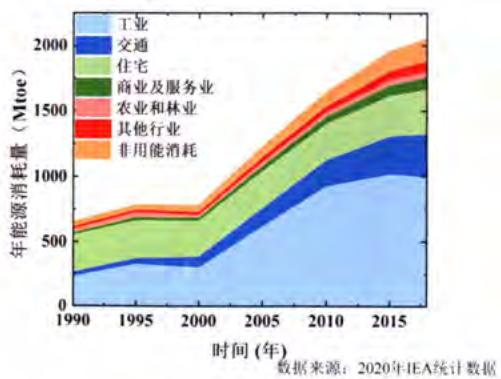  
图 1.1 1990\~2018 年中国能源消耗量  
Figure 1.1 China's energy consumption from 1990 to 2018

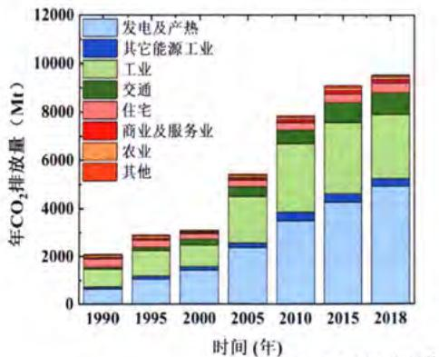  
图 1.2 1990\~2018 年中国 CO₂ 排放情况  
Figure 1.2 China's $\mathrm{CO}_{2}$ emissions from 1990 to 2018

我国北方由于其所处的地理位置偏高以及受到西伯利亚寒流的影响，冬季气温普遍较低，因此供暖成为了北方居民生活必不可少的保障措施之一。据统计数据显示[7]，截至到2018年底，我国已建成的建筑总量达到601亿 $\mathrm{m}^2$ ，其中北方采暖建筑面积达到147亿 $\mathrm{m}^2$ ，北方采暖所消耗的商品能耗为2.12亿tce（吨标准煤当量，ton of standard coal equivalent），能耗强度为 $14.4\mathrm{kg / m^2}$ ；碳排放达到5.5亿吨 $\mathrm{CO}_{2}$ ，碳排放强度为 $37\mathrm{kgCO_2 / m^2}$ 。虽然能耗强度和碳排放强度相比于往年持续下降[2]，但是与世界上其他发达国家相比，其数值仍相对较高。因此，如何既确保北方地区居民冬季采暖不受影响，同时又可以减少采暖能耗则具有非常重要的研究意义[8]。然而，目前我国北方的供暖方式仍主要是以基于传统化石燃料燃烧作为供暖热源的集中供热为主，除小部分热电联产技术外，绝大部分是依靠不同规模的锅炉，能源消耗仍然以燃煤为主[9]。这种供暖方式普遍存在能效低、污染大以及能源高质低用等不足，同时也是我国北方地区频繁出现雾霾天气的主要原因之一[10]。

为了缓解现有的能源短缺危机以及环境污染问题，需要有效降低对传统能源的依赖程度，大力加快能源转型与能源技术变革：一方面需要发展低碳清洁能源，利用工业生产中产生的大量的废热，实现能量的梯级利用，减少温室气体排放。根据国际能源署的数据[11]，热能与交通运输和电力供应相比，是最大的能源用途，其消耗的能源约占全球能源消耗量的一半以上。然而，目前的热利用效率还有待提高，例如现有的不同发电厂的热效率在 $18\% \sim 47\%$ 之间，大量的燃料热值流失到环境中去，有至少 $50\% \sim 70\%$ 的工业耗能会以各种形式的废热直接排放到外界环境而没有被加以利用，因此仍有巨大的减排潜力有待开发[12,13]。另一方面需要大力开发清洁高效可靠的能源利用技术与装置，促进生态和社会的可持续发展。与直接的电加热供热方式相比，热泵作为一种能源消耗量少、效率高的能量利用装置，可以从低品位的热源（空气、海水、地热）中抽取热量并泵送到高温端来使用，可以满足全球 $90\%$ 以上的供热需求，其实际 $\mathrm{CO}_{2}$ 排放量要明显少于采用燃料（包括化石燃料及其替代燃料）燃烧所释放的 $\mathrm{CO}_{2}$ 量[14-16]。随着燃料成本的上涨以及全球变暖日益严重，热泵在保护环境和推行节能减排等方面扮演着愈来愈重要的角色。

热驱动热泵技术主要指的是从一些高品位热源中获得驱动力从而压缩机带动系统进行工作的蒸汽压缩式热泵 $^{[17,18]}$ 或利用中低品位热源直接热驱动的吸收式或吸附式热泵 $^{[19-21]}$ 。现有发展较为成熟的热驱动热泵虽然其能效比和一次能源效率可以分别达到2\~3和1.2以上，但由于其系统复杂，成本较高且体积庞大，在北方广大农村和偏远地区的分户式供暖的实际应用中则受到了限制 $^{[22]}$ 。

现有的单一能源利用技术诸如能源单一热力发电，单一燃烧供热以及单一电驱动制冷大多存在能效较低的问题，而解决这一问题的技术路线之一则是采用热电联产技术。热电联产技术相比于传统的单一热功转换技术，回收了低温余热中可利用的热能，提升了能源的利用率。而若在热电联产技术进一步利用系统中可能产生的冷能，利用一种单一能源同时实现供热、制冷和发电的功能，则可衍生出一种更加高效、低排放的能源利用技术——冷热电三联产技术，是实现能源高效转换利用和节能减排目标的有效措施[23-25]。现有的冷热电联供系统涉及到多种能源转化技术以及需要多种工作原理不同的子系统（如内燃机、吸收式热泵、电驱动蒸汽压缩热泵制冷）相互耦合，存在系统结构复杂、运行控制复杂，初投资成本大，并且在小型化时能源转化效率降低，功率密度低等问题[26-29]。此外，我国夏季从南到北普遍高温炎热，而冬季又有广大的地区需要采暖，夏冬两季对冷热电联产装置的需求并不相同。据统计[14]，同时具有供暖和制冷功能需求的用户约占 $79\%$ ，而仅需要供暖的用户只占 $2\%$ ，因此需要研发一种适用于北方寒冷地区分户适用的冷热结合的热驱动冷热电联产技术。

热声技术是一种基于热声效应利用热声热机实现热功转换的能源利用技术[30]。热声热机按照热声循环方向的不同，可以分为两类，一类是基于热致声效应的热声发动机；另一类则是基于声制冷效应的热声制冷机或热声热泵[31,32]。与传统的热机相比，热声热机是一种外燃回热式热机，具有热源适应性广，高效可靠且工质绿色环保等优点[33]。广义的热声热机的核心部件主要是由热端换热器、热声换能器、冷端换热器以及调相器组成，不仅包括传统气体或液体调相型的驻波、行波、双作用等热声热机，还包括采用活塞调相的斯特林热机[34,35]。热声发动机可与不同的声学负载进行耦合，提供驱动力，从而构成不同的热声系统，如热声发电机、热声驱动的热声制冷机、热声驱动的脉管制冷机等。若在具有活塞调相的热声发动机和热声热泵之间串接一个往复振荡的直线电机，便可构成基于热声效应的新型自由活塞热驱动热声热(冷)电联供系统。

本文基于热声理论，采用理论计算和实验研究相结合的方法，探索研制了一种基于热驱动双效自由活塞型热声斯特林热泵系统的新型自由活塞热驱动热声热(冷)电联供系统，在无需引入额外的装置的情况下由一台机器同时实现制冷、供热以及发电的功能，系统结构紧凑、控制简单，具有能源高效转化利用和节能减排的巨大潜力。该系统针对中低品位热能进行设计，旨在突破传统冷热电联供系统存在的结构缺陷和技术瓶颈，解释了自由活塞型热声热机之间高效匹配的机理，同时阐释了各结构和运行参数对于自由活塞式热机以及热电联供系统运行性能的影响规律，首次提出并验证了“冷热电一体化紧凑式结构”的概念。最后，本课题研究也推动了自由活塞型热声斯特林热机在室温温区的实用性进程，可与其它清洁能源利用技术相结合，为提升能源利用效率，节能减排以及实现“碳达峰”和“碳中和”做出贡献。

## 1.2 热驱动热泵技术研究进展

## 1.2.1 热泵简介

热泵是一种以消耗少量外界提供的能量作为驱动力从而将低温热源中的热

(b)

(a)

量输运到高温热源中的能量装置。从原理上来说，热泵与制冷机的工作原理是相同的，均需要外界提供额外的输入功作为补偿条件，并按照逆向的热机循环进行工作，实现制热或制冷的功能。虽然二者的原理相同，但所利用热量以及热量利用的温度区间是不同的，如下图1.3所示：制冷机通常是从低于环境温度的物体中吸取热量，使得低温端的温度低于环境温度，从而达到制冷的功能；而热泵则通常是从环境中吸取热量，并在补偿功的作用下，将这部分能量与补偿功一起输送到需要被加热的物体中。根据热力学第一定律，由于能量是守恒的，对于热泵来说，其对外输出的制热量要恒大于所消耗的补偿功，其制热系数恒大于1，因此与其他的能量利用装置相比，热泵是一种节能并同时提升热量品位的装置。

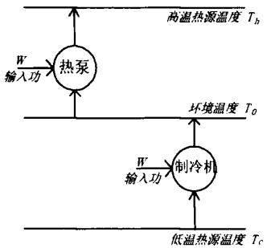

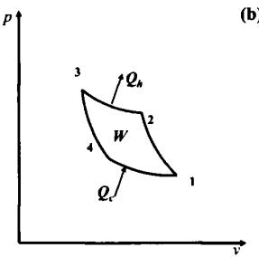  
图 1.3 制冷机和热泵的工作温区 $^{[36]}$

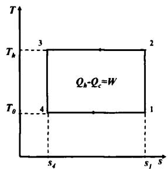  
图 1.4 理想热泵循环的 p-v 图和 T-s 图  
Figure 1.3 Working temperature zone of refrigerators and heat pumps $^{[36]}$  
Figure 1.4 The p-v diagram and T-s diagram of an ideal heat pump cycle

## 1.2.2 热泵循环

理想的热泵循环遵循的是逆卡诺循环，即热泵工作于一个恒温的高温热源和一个恒温的低温热源之间，按照逆向的热机循环进行工作，由两个可逆的等温过程和两个可逆的等熵过程组成。图1.4为理想热泵循环的p-v图和T-s图。图中1-2为等熵压缩过程；2-3为等温压缩过程；3-4为等熵膨胀过程；4-1为等温膨胀过程。理想热泵的工作原理是：首先热泵中的理想气体工质在理想热机中完成等熵压缩过程，气体工质由状态1变为状态2，温度由低温热源温度 $T_{0}$ 升高至高温热源温度 $T_{h}$ ，压力由 $p_{1}$ 升高至 $p_{2}$ ；紧接着，气体工质完成等温压缩过程，气体工质由状态2变为状态3，此时的温度保持恒定不变并同时对外释放热量 $Q_{h}$ ，而气体的压力会进一步由 $p_{2}$ 上升至 $p_{3}$ ；随后，气体工质在热机中完成等熵膨胀过程，气体工质由状态3变为状态4，此时气体压力经由绝热膨胀降至 $p_{4}$ ，温度则由高温热源温度 $T_{h}$ 降至低温热源温度 $T_{0}$ ；最后，气体工质经由等温膨胀过程从低温热源中吸取热量 $Q_{c}$ ，压力降回到起始压力 $p_{1}$ ，进而完成热泵循环。

根据热力学的理论 $^{[37]}$ ，可以得到理想热泵循环的效率即热泵的制热系数：

$$
C O P _ {h} = \frac {Q _ {h}}{W} = \frac {Q _ {h}}{Q _ {h} - Q _ {c}} = \frac {T _ {h}}{T _ {h} - T _ {0}}\tag{... (1.1}
$$

理想的热泵循环效率指出热泵的制热系数恒大于1，因此和其他供暖方式相比，热泵是一种高效节能的能量利用装置。虽然热泵系统在实际运行过程中，系统无法按照等温、可逆的过程进行工作，实际热泵的效率无法达到理想的逆卡诺循环效率，但该理论效率是热泵性能的上限，仍可作为评价热泵系统经济性和节能的重要理论指标，对于提升系统的效率具有一定的指导意义。

## 1.2.3 热泵的发展

自1824年法国科学家SadiKarnot首次在论文中提出卡诺循环[38]，热泵经历了约200年的发展历程。本文将按照时间的先后以及各时期的技术特点，对热泵的发展进行简要的介绍。热泵的发展可以划分为4个阶段，分别是概念和原型机的提出阶段，应用阶段，快速发展阶段以及成熟阶段。

## 1.2.3.1 概念和原型机的提出阶段

19 世纪前期，Sadi Karnot 首次在他的论文《Reflections on the Motive Power of Fire》 $^{[38]}$ 中提出了卡诺循环的理论，成为了热泵的起源。然而由于当时欧洲爆发的霍乱瘟疫的影响以及卡诺的逝世，卡诺循环一直未被受到重视。直到 1849 年 William Thomson (即热力学之父 Kelvin 勋爵) 到法国学习时，才真正认识到这一原理的重要性，并于 1852 年提出了一种基于逆卡诺循环原理的热量倍增器的设想 $^{[39]}$ ，也就是最早的空气源热泵原型，如图 1.5 所示。该原型机的工质是空气，由蒸汽轮机带动两个活塞分别在吸气气缸和压气气缸中运动，从而完成在储气筒中吸取热量并排放到外界建筑环境的开式循环。

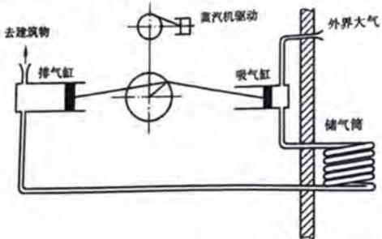  
图 1.5 热量倍增器示意图 $^{[36]}$  
Figure 1.5 Schematic of heat multiplier $^{[36]}$

## 1.2.3.2 应用阶段

1856 年，科学家 Rittinger 在奥地利设计并建造了第一台实用型工业热泵，用于对盐池中的盐干燥脱水 $^{[40]}$ 。在此之后的几十年里，科研人员对热泵的设计建造和使用开展了大量的尝试和试验研究，各种类型的热泵也逐渐进入人们的视野。根据瑞士的专利记载，世界上第一台地源热泵的概念是由 Herinrich Zoelly $^{[41]}$ 于 1912 年提出的，然而由于该热泵在极端天气以及大温差工况下存在性能大幅下降的现象，因此其应用也受到了一定的限制。同年，世界上第一台水源热泵系统也在瑞士的苏黎世安装成功，该热泵以河水作为热量的来源，进而向外界供暖[42]。1918年，Rudolph Vuilleumier[43]提出了一种热驱动的闭式循环热泵的专利，该装置可以实现热驱动制冷或制热。作为回热式斯特林热机的代表，VM热泵概念的提出也拓宽了热泵的种类和用途。而将热泵用于加热生活热水则是由Wilkes和Reed[44]二人在19世纪 $20\sim 30$ 年代提出的，并于1937年取得热泵加热热水的相关专利。同时期的英国发明家T.G.N.Haldane[45]于1927年根据“热量倍增器”的理论在苏格兰成功搭建并测试了一台家用空气源热泵，成功将热泵技术运用到住宅使用，并取得了专利授权。该热泵采用氨作为热泵工质，用于房间采暖和生活热水加热，经过实地测试发现该热泵的相对卡诺效率为 $33\% \sim 50\%$ 。同时，在该热泵的技术上提出了采用带有切换装置的循环流程来实现冬季供暖和夏季制冷模式切换的技术方案。此后，对于热泵展开研究的国家逐渐由欧洲扩散到了世界各地，并促进了一系列的技术改革和创新。

## 1.2.3.3 快速发展阶段

20世纪40年代\~60年代，由于二战及战后的能源短缺以及特殊场合需要，各种热泵技术和装置不断涌出，热泵也逐渐进入了快速发展时期。据统计，截至到1950年研究和开发热泵技术和装置的大学、科研院所以及厂商就已经超过了30多家[42]。在此时期，各式各样的热泵装置被应用于家庭采暖、商业供热、工业烘干以及医院和学校的蒸馏水提供中。其中，美国的大型商业建筑在1940年就已经成功使用热泵技术，并且这些热泵大都采用地下的井水作为低温热源。1948年在借鉴英国使用的热泵技术后，一台地下水源热泵被安装在美国波特兰市的联邦大厦中[46]。该热泵采用氟利昂113作为工质，采用两个地下温水井提供热量，该热泵的理论计算COP可以达到7.8\~14.8，虽然实测的性能会大幅下降，但据报道已连续使用长达30年，经济性和使用舒适性仍令人满意。如下图1.6所示，为该热泵的原理示意图。

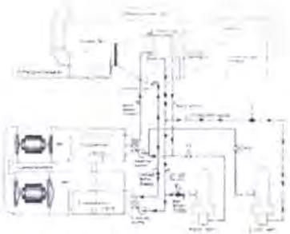  
图 1.6 联邦大厦地下水源热泵示意图 $^{[46]}$  
Figure 1.6 Schematic of groundwater source heat pump in Equitable Building [46]

## 1.2.3.4 成熟阶段

到了20世纪60年代，由于电价的降低、美国、英国等一些发达国家热泵产量增长过快、初始投资成本过高以及安装和维护使用方面未能及时跟进，导致热泵的应用受到了限制。尽管这一时期，热泵的发展遭遇了重大的挫折，但其应用范围仍在逐渐扩大。此外，在这一时期，热泵技术开始被引入中国，中国也在针对热泵的使用和研发陆续开展了研究工作[47]。

自20世纪70年代以后，由于石油危机和人类生态环保意识的提高，热泵作为高效节能的能量利用装置再次受到人们的青睐。在这一时期，人们吸取热泵在60年代衰落的教训，不断的开发新型装置和技术对热泵加以利用和维护，以改善热泵的使用性能和降低维护成本，包括新型的室外机除霜技术、可替代的环保热泵工质、不同热源结合的多热源技术、开发吸收式、吸附式以及其他替代的热泵技术。例如小型化住宅使用的空气源热泵在日本、瑞典等国家陆续被研发和使用，而大型化的商业热泵也在英国和德国等国家被用于废热回收系统中。

与一些发达国家相比，我国的热泵技术虽然起步较晚，但发展迅速。由最初只有天津大学吕灿仁教授将其引入并开展研究，逐渐发展到有大量的科研院所、高校和企业对对热泵的工作机理、性能提升以及新型热泵技术等展开研究。此外，由于中国城市化和经济的快速发展，各种蒸汽压缩式热泵和吸收、吸附式热泵逐渐成为住宅和工业场所的必需品，这同样也促进了热泵技术在中国的发展。

而随着热泵技术的不断创新和发展以及世界各国对其的重视程度日益增大，热泵技术必将在保护环境、节能减排以及维持生态和资源的可持续发展中扮演着越来越重要的角色。

## 1.2.4 热泵的分类

根据不同的分类标准，可以将热泵划分为不同的种类。按照热泵获得低品位热源的来源可以将其分为空气源热泵、地源热泵、水源热泵、太阳能-空气双源热泵以及混合热泵等。图 1.7 为目前已投入商业运营的不同热源种类的热泵。

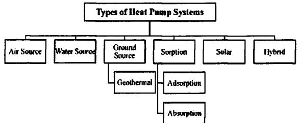  
图 1.7 不同热源种类的热泵 $^{[48]}$  
Figure 1.7 Types of Heat Pump Systems $^{[48]}$

按照制热量的功率和温度以及热量的用途的不同[42,49]，可以将其分为住宅用热泵、商业用热泵以及工业热泵。一般来说，住宅用热泵的制热量为 $1\sim 70\mathrm{kW}$ 其所需的供热温度在 $45\sim 70^{\circ}C$ 之间；商业用热泵的制热量为 $2\sim 120\mathrm{kW}$ ，供热温度一般大于 $70^{\circ}C$ ；工业用热泵的制热量则为 $0.1\sim 10\mathrm{MW}$ ，其所需温度通常在 $100^{\circ}C$

以上。

按照驱动能源的不同，可以将热泵分为电驱动热泵、化学热泵以及热驱动热泵等。其中，电驱动热泵主要是直接利用电能驱动压缩机带动工质在系统内循环流动，进而完成吸热和放热功能。目前现有使用的热泵，绝大部分都是电驱动热泵，主要以电驱动蒸汽压缩式热泵为主。传统的电驱动蒸汽压缩式热泵主要由压缩机、膨胀机构（节流阀或膨胀阀）、冷凝器和蒸发器组成。热泵工质在封闭的系统中依次经历压缩、冷凝、节流和蒸发汽化的过程，从而实现泵热的功能，如图1.8所示。化学热泵主要是利用可逆的化学反应进行间歇式存储和释放热量，通过吸/放热反应分别从低温热源吸取热量并释放到高温热源中，进而实现热泵的功能。本文研究的热驱动热声热(冷)电联供系统则属于热驱动热泵的一种，其主要是从热源中获得动力，进而驱动热泵系统进行工作，主要以燃气驱动的蒸汽压缩式热泵、吸收式/吸附式热泵以及热压缩喷射式热泵和VM热泵为主。

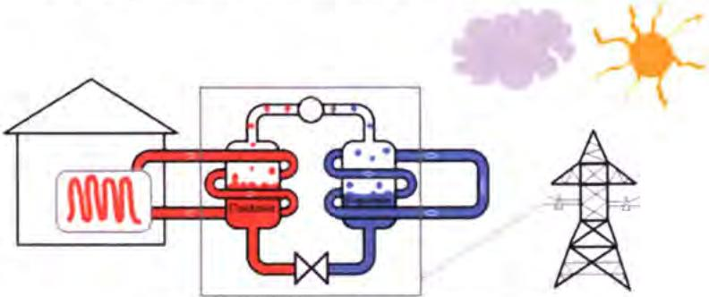  
图 1.8 电驱动蒸汽压缩式热泵供热原理图 $^{[50]}$  
Figure 1.8 Schematic of electrical-driven vapor compression heat pump $^{[50]}$

## 1.2.5 热驱动热泵

热驱动热泵直接驱动的能源来自于热能，既可以是化石燃料燃烧后获得的高品位热能，也可是来源于工厂、商场以及渔船等排放的大量废热。与电驱动热泵相比，热驱动热泵的热能不需要经历热能—电能—机械能的能量传递和转化过程，并且部分热泵还可以利用高温驱动热源的余热，因此其一次能源利用效率更高，减少了化石能源的消耗，对于节能减排和促进可持续发展具有积极的意义。目前常规的热驱动热泵主要以热驱动的蒸汽压缩式热泵和热驱动的吸收和吸附式热泵为主，此外还有一些新兴的热驱动热泵如热压缩喷射式热泵、热驱动斯特林热泵等也逐渐涌现出来。由于本课题是针对一种基于热声效应的新型热驱动双效自由活塞型热声斯特林热泵装置开展的研究工作，故特在此简要介绍几种典型的热驱动热泵技术及其相关的研究进展。

## 1.2.5.1 热驱动蒸汽压缩式热泵

热驱动蒸汽压缩式热泵技术由于其具有较高的经济性和节能性，自 1947 年提出以来[51]，便受到了国内外研究人员的持续关注，并针对其稳定性和效能提升开展了大量的工程和理论研究，其中包括在系统中添加节能器等新组件以提升整体性能、将系统由单级向多级发展以及研发一些基于热驱动蒸汽压缩技术的新系统等。

燃气驱动的蒸汽压缩式热泵是一种典型的热驱动蒸汽压缩式热泵技术，与传统的热泵技术相比，二者循环的本质相同，燃气热泵仅采用了燃气发动机驱动压缩机替代了传统的电动压缩机并同时配有余热回收装置，其基本的组件仍含有压缩机、冷凝器、蒸发器和膨胀节流装置。燃气驱动的蒸汽压缩式热泵基本原理[52]，如图1.9所示。与传统的电驱动热泵技术相比，燃气热泵可以通过控制燃烧的燃气量来控制压缩机的速度进而控制热泵的功率，回收了发动机缸套和燃气燃烧后烟气的余热，系统的一次能源效率显著提升，同时还可以利用余热进行室外机除霜，解决了传统电驱动热泵除霜时频繁启停的问题，因此近年来在供暖和制冷领域受到越来越多的关注。

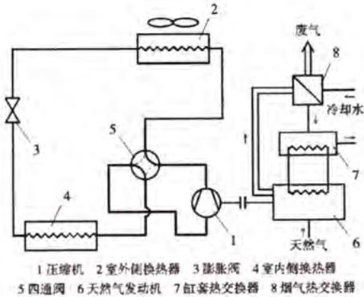  
图 1.9 燃气驱动蒸汽压缩式热泵基本原理 $^{[52]}$  
Figure 1.9 Schematic of a gas-fired heat-driven vapor compression heat pump $^{[52]}$

热驱动蒸汽再压缩热泵 $^{[49]}$ 是一种区别于常规热驱动蒸汽压缩式的热泵技术，其原理图如图1.10所示。与传统的机械蒸汽再压缩式热泵不同的是，该热泵直接采用热能作为驱动力，进一步省略了热能—机械能的转换过程，减少了能量的耗散。其工作原理是：流经燃气发动机的高温高压的工质蒸汽与流经蒸发器而来的工质蒸汽在喷射器中混合，经由喷射器喷嘴流出进入冷凝器冷凝并将热量释放给外界，从而完成供热的功能。

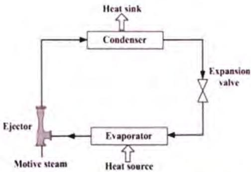  
图 1.10 热驱动机械蒸汽再压缩热泵原理 [49]  
Figure 1.10 Schematic of a thermal vapor recompression heat pump system [49]

此外，Elgendy $^{[53]}$ ，刘凤国 $^{[54]}$ ，Wu $^{[55]}$ 等人分别采用 R410A，R134a 以及 R134a/R152a 替代 R22 和 R114 作为热泵工质探究不同工况下热泵的性能，实验结果表明燃气热泵技术可以有效的回收废热，通过选用合适的热泵工质，系统的一次能源效率始终大于 1.2。图 1.11 为采用 R134a 作为热泵工质的燃气驱动蒸汽压缩式热泵的原理和系统实物图。研究人员不仅对单一燃气热泵系统开展试验研究，还针对混合型燃气热泵系统进行了相关研究。Hao $^{[56]}$ 以及 Wu 和 Ma $^{[57]}$ 等人通过将燃气热泵技术分别与太阳能和沼气等其他能源相结合，实验结果表明系统的性能可以进一步提高，系统的 COP 可以达到 4.2 以上。虽然混合式燃气热泵技术要比单一燃气热泵技术具有更高的能源效率，但其系统的复杂性也相应增加，这在一定程度上也限制了其推广应用。

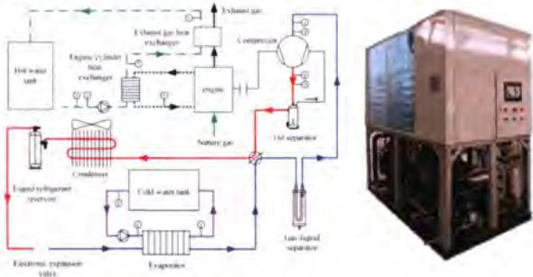  
图 1.11 采用 R134a 作为热泵工质的燃气驱动蒸汽压缩式热泵的原理和系统实物图 $^{[54]}$  
Figure 1.11 Schematic and prototype of gas engine driven heat pump system $^{[54]}$

与一些新兴的热泵技术相比，虽然热驱动热泵技术的工程经验和理论基础已经相对成熟，但其在热驱动压缩机设计、系统的控制策略、替代工质的高效性和环保性、系统结构的紧凑性、换热器的性能提升以及减少系统的烟损失方面仍具有提升的空间。

## 1.2.5.2 吸收式热泵

吸收式热泵是另外一类典型的热驱动热泵技术，与传统的热驱动蒸汽压缩式热泵相比，采用吸收器、发生器、节流阀和溶液泵取代了传统的压缩机，利用溶液对热泵工质的吸收和解析的空间不同步性实现温度和热量提升。与其原理类似的吸附式热泵则是利用固体对热泵工质的吸附和解析过程的空间不同步性实现热泵的功能。二者都可以利用化石燃料燃烧的热量、工业余热以及太阳能和生物质能作为驱动热源。吸收式热泵常见的工质对主要有：水-溴化锂、醇类-溴化锂、以及氨-水等，此外还有一些混合以及新型的工质对陆续被开发使用。

按照制热的目的不同，吸收式热泵可以被分为第一类吸收式热泵和第二类吸收式热泵。图 1.12 和图 1.13 为第一类和第二类吸收式热泵的原理示意图。二者的基本部件都是发生器、吸收器、蒸发器、冷凝器以及溶液泵和相关的热交换器，但产生的可用能在数量和质量上存在本质的不同。

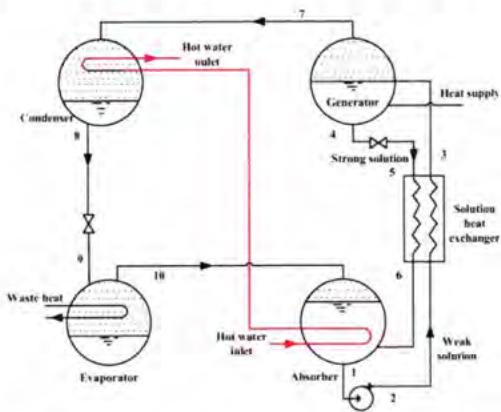  
图 1.12 第一类吸收热泵原理示意图 $^{[49]}$

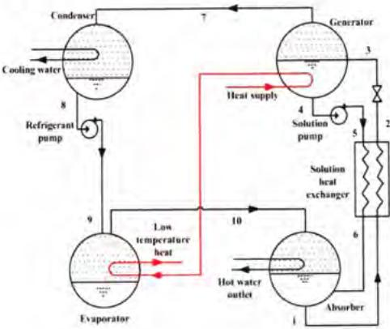  
图 1.13 第二类吸收热泵原理示意图 $^{[49]}$  
Figure 1.12 Type I absorption heat pump system $^{[49]}$  
Figure 1.13 Type II absorption heat pump system [49]

第一类吸收式热泵主要是利用少量的高温热量驱动系统工作，将低品位的热能(废热等)泵送到中温端并产生大量的中品位热能。与原先的高品位热能相比，虽然能量的品质下降了但是热量数量却增加了，因此也叫做增热型热泵。第二类吸收式热泵主要是利用大量中低品位热源之间存在的热势差作为驱动力，获得少量高品位的热能，获得的热量减少了但热能的品质却提升了，因此也叫做升温型热泵。通常第一类吸收式热泵的输出热量温度低于100℃，由于热量的数量增加了，因此其制热系数可以达到1.3以上；而对于第二类热泵其输出的热量温度可以达到100\~150℃以上，但是其消耗了大量热能，因此其制热系数通常为0.5左右 $^{[58]}$ 。为了追求更高的效率，研究学者对驱动热源的利用方式也开展了相关的研究，提出了双效、多效以及多级的热泵技术 $^{[59]}$ 。

与蒸汽压缩式热泵技术相比，吸收式热泵虽然取消了传统的压缩机结构，提升了系统的稳定性，但吸收式热泵需要工作在较高真空度的环境下，并且常用的工质对都存在一定的制约因素。对于工质对水—溴化锂来说，由于水的特性，该工质对只能工作在 $0^{\circ}$ C 以上的环境中，并且溴化锂容易结晶并对金属壁面存在腐蚀性，容易造成机组故障；对于醇类—溴化锂的工质对，虽然循环性能可在一定程度上得到提高，但醇类黏度较大，并且受热易分解，在一定程度上也制约了吸收式热泵的发展；对于氨-水工质对而言，虽然氨的特性可以使得系统工作于零度以下，但是由于氨具有冷凝压力高、毒性和易爆的特性，因此也限制了吸收式热泵的进一步的发展。为了突破这些限制，国内外的研究学者们针对不同的新型以及混合的工质对进行了研究。Sun $^{[60]}$ 等人和 Zhang $^{[61]}$ 等人通过将传统的工质对掺入硝酸锂或其他醇类来改善工质对的性能，虽然系统的制热系数相比于纯工质对得到了提升，但是新型的工质对仍可能存在对金属钢材的腐蚀性。对于广大研究吸收式热泵的科研和技术人员来说，如何选择优秀高效的工质来确保系统稳定、高效、环保以及无毒性，目前仍是一个亟待解决的问题。

## 1.2.5.3 VM 热泵

VM（Vuilleumier）热泵是一种由热能直接驱动的闭式循环热泵装置，是在Rudolph Vuilleumier于1918提出来的名为“Method and Apparatus for Inducing Heat Changes”的专利基础上发展而来的一种热驱动回热式热机[43]。与吸收式热泵类似，VM热泵也是由一台热驱动压缩机驱动一台热泵并相互耦合的热泵装置。不同的是VM热泵中采用的工质是惰性气体，利用气体温度的变化产生周期性的压力变化从而驱动冷热端活塞往复运动，最终实现泵热的效果[49,62]。根据传动结构的不同，常见的VM热泵可以分为曲柄连杆式[63]和自由活塞式[64]两种，二者的基本组成部件相同，其区别仅是热端排出器与冷端排出器之间的传动结构不同，前者利用的曲柄连杆作为传动机构，而后者则是利用气体和固体弹簧进行传动，图1.14为两种典型结构的VM热泵示意图。VM热泵采用惰性气体（通常为氦气）作为工质，其GWP值和ODP值均为0，相比于HCFC类工质而言，具有高度的环保性和稳定性优势。此外，VM热泵与传统热泵相比，还具有热源广泛性、可靠性高以及结构简单的特点[65]。

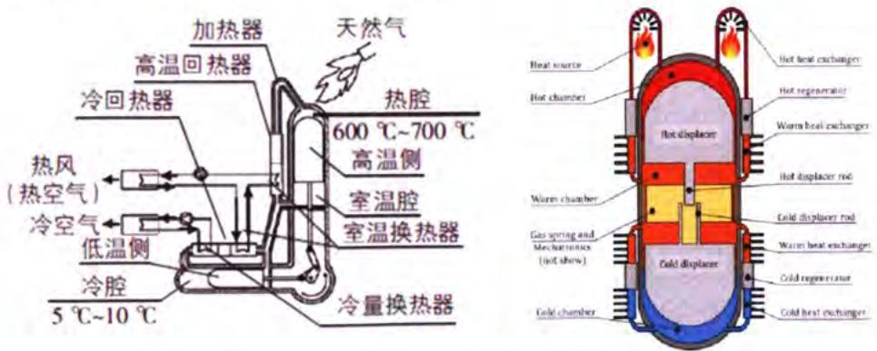  
图 1.14 曲柄连杆式和自由活塞式 VM 热泵结构示意图 $^{[63,64]}$  
Figure 1.14 Schematic of crankshaft and free-piston VM heat pump $^{[63,64]}$

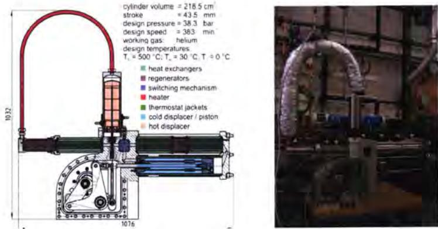  
图 1.15 多特蒙德工业大学研发的复合型 Stirling-VM 热泵结构示意图和实物图  
Figure 1.15 Schematic and prototype of the scale Stirling-VM hybrid heat pump system developed by the Dortmund University of Technology

目前，国内外对 VM 热机的研究开发多集中于低温制冷机 $^{[66-68]}$ ，而针对于 VM 热泵的研究还仅限于原型机的开发阶段，市场上并没有完全商业化的产品。

丹麦科技大学的 Carlsen 等人于上世纪 70-80 年代，对一系列 VM 热泵进行了研发和测试，并首次提出了曲柄连杆作为传动机构的 VM 热泵 $^{[69]}$ ，在加热温度为 500\~700℃，环境温度为 5℃，供热温度为 55℃的情况下可以获得 7.5 kW 的制热量，对应的制热系数为 1.6。此外，通过大量的实验证明，加大供热端与环境端之间的温差对于系统的制热量并无明显的影响，证明了 VM 热泵相比于电驱动热泵有更广泛的工作温区 $^{[70,71]}$ 。

Bosch-Viessmann Energie (BVE)公司针对曲柄连杆型 VM 热泵进行了设计开发和寿命测试。虽然所测试的 3 台原型样机的机械结构都较为复杂精密，但每台原型机的无故障运行时间都超过了 6500 小时，并且在 8 ℃、-8 ℃以及 -25 ℃ 时的制热系数分别可以达到 1.65、1.45 和 1.3。相比于传统热泵，其性能随冷端温度的下降并无剧烈的衰减，显示了该机型具有较强的低温适应性 $^{[65,72]}$ 。多特蒙德工业大学 Geue.I 等人 $^{[73-75]}$ 设计了一种复合式 Stirling-VM 热泵，如图 1.15 所示。该机型设计了一个巧妙的切换装置，通过增减附加回热器的方法实现热机系统在 γ 型斯特林发动机、混合型热电联产装置以及 VM 热泵之间相互切换。此外，日本、韩国的川崎重工、三洋电气以及三菱和三星电子等公司 $^{[76-78]}$ 也针对自由活塞式 VM 热泵进行了原型样机的研发和测试工作，试验结果表明自由活塞式 VM 热泵的制热系数可达到 1.3 以上，具有较高的发展潜力。

美国的 ThermoLift 公司是近年来对自由活塞式 VM 热泵开发和市场化探索较为前沿的科技公司，其目的是降低 VM 热泵的制造成本，并争取大幅提高系统的效率和耐用性。该公司推出的 V-Cycle TM 热泵系统，如图 1.16 所示，在 -25℃ 和 8℃ 工况下的制热系数可以达到 1.6 和 1.8，并预计通过合理优化设计内部结构可以将制热系数提升至 2 以上 $^{[79]}$ 。

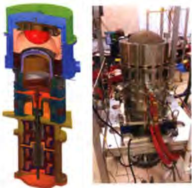  
图 1.16 V-Cycle TM 热泵系统结构示意图和实物图  
Figure 1.16 Schematic and prototype of V-Cycle TM heat pump

综上所述，热泵经历了近200年的发展历程，来自于世界各国的研究学者对其开展了大量的研究和改进工作，其中包括：大量的新型热泵技术不断涌现；热泵工质由最初的氟利昂类逐渐向可替代混合工质以及自然工质过渡；单一循环单元逐渐向多级、多效模式以及多热源模式发展；此外，针对压缩机和换热器的优化设计也在同步进行。虽然热泵技术取得了长足的进步，但关于在低温环境以及大温跨条件的紧凑式高效环保热驱动热泵的研究进展还有待提高。从这一方面出发，本文提出了一种基于热声效应的双效自由活塞型热声斯特林热泵的结构，希望能够为热泵技术在低温以及大温差环境下的高效利用提出一条新的研究思路。

## 1.3 热电联产技术研究进展

为了有效的控制化石燃料的消耗以及温室气体的排放，需要开发一种高效可靠的系统来产生热量和电量。热电联产装置是一种从单一燃料或其他较高品质能源中同时获得热能和电能的能源利用装置，如图1.17所示[80]。与传统的单一发电设备相比，热电联产装置降低了化石能源的消耗以及二氧化碳等温室气体的排放并回收了废热中可利用的热量，实现了废热资源的二次利用，符合“能量梯级利用”的准则，因此可以进一步提升能源的利用效率，满足能源利用率最大化的目的。自19世纪80年代伴随着内燃机的出现被提出以来，热电联产装置历经了近一百五十年的发展，凭借其在节能减排和改善环境中扮演着的重要角色，受到了世界各国的持续关注和政策支持，在一些发达的国家和地区如美国、英国以及欧盟等已取得了广泛的发展和应用[81-83]。相对于其他国家而言，虽然热电联产技术在我国的出现源于一五时期前苏联援建的热电厂项目，针对热电联产的相关研究工作起步较晚，但我国热电联产行业发展迅速。截止到2019年，我国热电联产装置装机容量已达到52423万千瓦[84]，位居世界第一。

现阶段，开发新型热电联产技术、利用可再生能源以及减少现有热电联产装置的能量损失并提升系统综合效率，是促进热电联产技术进一步应用的关键措施，也是当下热电联产技术的主要研究方向。

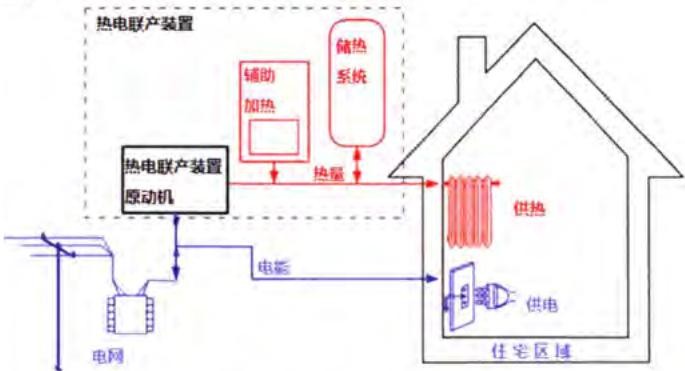  
图 1.17 热电联产系统示意图 $^{[80]}$  
Figure 1.17 Schematic of cogeneration system $^{[80]}$

## 1.3.1 热电联产装置的分类

热电联产装置按照其最大发电功率可以分为三类[81,85]：通常把最大发电功率大于1MWe的统称为大中型热电联产装置，最大发电功率小于 $50\mathrm{kWe}$ 的划归为微型热电联产装置，而介于二者之间即最大发电功率大于 $50\mathrm{kWe}$ 但小于1MWe的则称为小型热电联产装置。其中，前者主要适用大型的发电站等工业场所，其技术已经较为成熟并且商业化较好；小型热电联产装置可以有效的降低能源的传输损失、提升能源安全性、降低消费成本，目前已经广泛应用于商场、医院、学校以及大型住宅区等场所；而微型热电联产装置则主要用于住宅和小型商场以及需要采用分布式发电的场所，通过与太阳能、生物质能等可再生能源相结合，具有装机容量小，用户端调节灵活，响应迅速的特点，具有替代传统家用供暖系统的巨大潜力，逐渐成为热电联产技术的研究热点[86,87]。

微型热电联产装置按照其原动机种类的不同，可以分为微型内燃机式、微型涡轮式、微型有机朗肯循环（ORC）式、斯特林式以及燃料电池式热电联产装置等[88]。Martinez[85]、Moussawi[27]和Murugan[89]等对近年来的微型热电联产装置的发展以及与可再生能源结合的研究进行了综述，并总结了不同类型的微型热电联产装置的特性以及所使用的场合，如图1.18所示，可供用户根据其特定的需求进行选择。

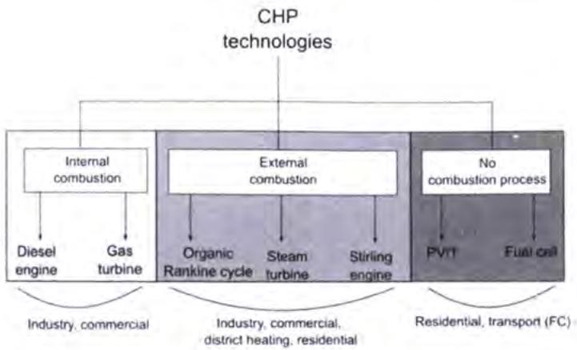  
图 1.18 主要热电联产技术 $^{[85]}$  
Figure 1.18 Main CHP technologies $^{[85]}$

由于本课题所研究的是一种基于热声效应的热驱动双效自由活塞型热声斯特林热泵机构，可以实现热电联供以及冷热电联供的功能，并且其最大发电功率小于 50 kWe，从其功能来看属于一种新型的微型热电联产装置，因此为了与现有的装置进行对比，特将现有典型的微型热电联产装置的技术特点和研究进展在此进行简要的介绍。

## 1.3.2 现有微型热电联产装置技术特点及研究进展

## 1.3.2.1 微型内燃机热电联产

微型内燃机式热电联产技术是目前最为常用以及商业化最为成熟的一种热电联产技术，其主要利用的是被喷入燃烧室的空气/燃料混合物燃烧后产生的温度和压力的波动并推动往复式活塞运动所产生的有用功，同时还回收了燃烧烟气以及发动机缸套中的部分热量，系统的综合能源利用效率可达到 $90\%$ 以上[87,90]。按照内部工质点火方式的不同，内燃机通常可分为奥托式内燃机和狄塞尔式内燃机[91]，如图1.19所示。前者是一种电火花点火发动机，利用火花点燃燃烧室中被压缩的燃料和空气的混合物从而获得有用功，通常其采用的燃料以天然气、沼泽气、氢气以及汽油为主；而后者也被称为“柴油式内燃机”，是一种压燃式发动机，通过压缩空气与燃料的混合物产生的自燃而获得有用功，通常其采用的燃料以柴油等石油产品为主。虽然微型内燃机热电联产技术和商业化已经非常成熟，其在微小型量级的热电联产技术中具有燃料转换效率高、比功率高、变负载特性好、具有较低的初投资成本和易于维护的优势，但目前仍有许多研究者围绕着进一步提升系统效率、减振降噪、废气排放以及与可再生能源结合并提升燃料的适应性等方面进行持续的优化和改进工作[92-94]。目前，商业化较好的微型内燃机热电联产装置主要有德国的SenerTec公司开发的Dachs系列产品[95]、PowerPlus Technologies公司开发的Ecopower产品[96]以及日本的本田公司开发的Ecowil产

品[97,98]等。

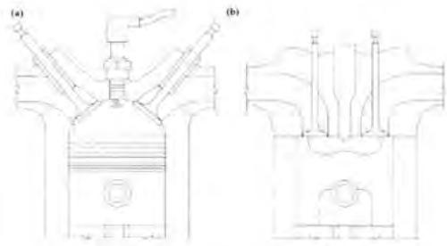  
图 1.19 典型内燃机结构示意图 $^{[91]}$  
Figure 1.19 Schematic of typical internal combustion engine structures $^{[91]}$  
注：（a）奥托式内燃机；（b）狄塞尔式内燃机  
Note: (a) Otto internal combustion engine; (b) Diesel internal combustion engine

德国 SenerTec 公司从 1979 就开始开展内燃机驱动的热电联产装置的研发工作，目前已经成为了欧洲微型热电联产装置的领军企业，其推出的 Dachs 系列产品可适用于天然气、沼气、柴油等燃料，如图 1.20 所示。该系列装置可以将 150℃ 的废气冷却至 55℃ 后排放，并提供 7.5\~14.8 kW 的供热量以及 2.9\~5.5 kW 的电量，其电效率约为 26%\~30%，热效率约为 59%\~74%，综合能源效率为 88%\~96%，可以满足大型独立式住宅以及酒店、养老院等供暖、生活热水和用电的需求。为了保证系统的可靠性和耐用性，Dachs 产品采用不锈钢和黄铜等材料进行加工组装，因此虽然其体积仅和一台家用洗衣机相近，但其重量可达 500 kg 以上。

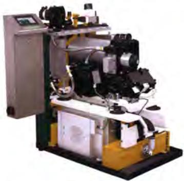  
图 1.20 Dachs 微型热电联产装置 [95]  
Figure 1.20 Photograph of Dachs micro-CHP unit developed by SenerTec $^{[95]}$

Ecopower 是欧洲大型锅炉制造商 Vaillant 下属的子公司 PowerPlus Technologies 推出的一系列微型热电联产装置，如图 1.21 所示，其主要由 Ecopower 3.0、Ecopower 4.7 和 Ecopower 20.0 组成，分别可以提供 1.5\~3 kW、1.5\~4.7 kW 以及 10\~20 kW 的发电量和 9.0 kW、13.8 kW 以及 43 kW 的供热量，其装置的电效率约为 25%\~31.5%，热效率在 70%以上，系统的综合能源效率在 90%以上，同样可以满足大型独立式住宅以及酒店、养老院等供暖、生活热水和用电的需求。但与 Dachs 相比，Ecopower 产生的发电量可以通过调节发动机的转速进行控制，其重量减少了 1/3，约为 370 kg $^{[91,96]}$ 。此外，Vaillant 还与日本本田公司联合将 Ecowill 微型热电联产装置推向欧洲市场。Ecowill 是日本本田公司于 2002 年开始研发的一款微型热电联产装置，如图 1.22 所示，到目前为止已经有四代产品相继问世 $^{[91,97,98]}$ 。与前两种装置相比，Ecowill 的整机质量小于 100 kg，系统功率相对较小，可提供 1\~1.2 kW 的发电量和 2.5 kW 的供热量，其具有 22.5%\~26.3% 的电效率以及 85.5%\~92% 的整机综合效率，更适宜运用于小型分户式住宅。

  
图 1.21 Ecopower 微型热电联产装置 $^{[96]}$  
Figure 1.21 Photograph of Ecopower micro-CHP unit $^{[96]}$

  
图 1.22 Ecowill 微型热电联产装置 $^{[98]}$  
Figure 1.22 Photograph of Ecowill micro-
CHP unit $^{[98]}$

## 1.3.2.2 微型涡轮式热电联产

涡轮技术自上世纪50年代以来就已经成功应用于航空业、大型发电站和其他工业场所。伴随着城市化的快速发展，生活和生产中需要大量的热能和电能，因此就有研究人员提出可以将涡轮技术应用于热电联产中，从而得到一种适用于分布式发电的微型涡轮式热电联产技术[99]。微型涡轮机按照工作原理可以分为微型蒸汽轮机和微型燃气轮机，目前微型涡轮式热电联产技术主要以后者为主，如图1.23所示，其工作原理是：被压缩机压缩的空气经由预热器预热后在燃烧室中与燃料混合并被点燃，燃烧后的气体在微型涡轮机中膨胀做功，从而驱动压缩机和发电机工作，由于其排放的烟气温度较高，因此除预热空气之外，还可以对外输出供热量，实现能量的梯级利用[100]。与微型内燃机式热电联产系统相比，微型涡轮式热电联产具有低振动、便于携带和安装、维护成本低的优势，虽然系统综合能源利用效率可以达到 $90\%$ 以上，但系统的电效率较低，一般在 $6\% \sim 15\%$ 之间。此外，微型涡轮式热电联产装置的效率对其尺寸具有依赖性，随着尺寸的减小，系统的效率也在逐渐降低，这也是制约其发展的关键问题[101-103]。相比于商业化成熟的微型内燃机式热电联产技术，微型涡轮技术目前还出于开发状态中，其商业化程度相对较弱，目前具有代表性的产品如荷兰的Micro Turbine Technology（MTT）公司推出的EnerTwin产品[104]、美国Capstone Turbine

Corporation 公司推出的 C 系列产品 $^{[105]}$ 。

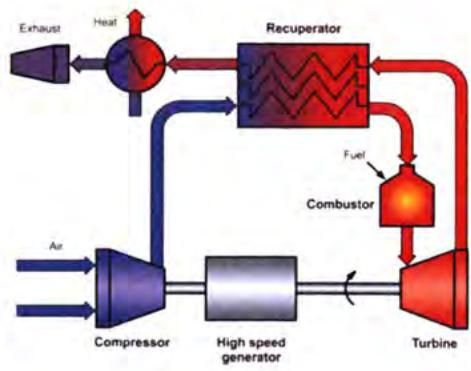  
图 1.23 微型涡轮式热电联产技术原理示意图 $^{[104]}$

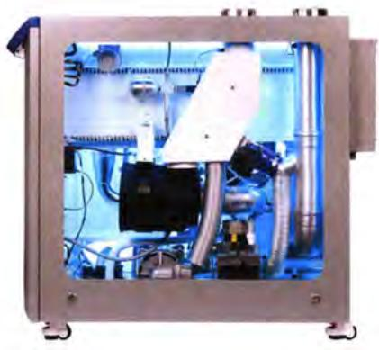  
图 1.24 EnerTwin 微型热电联产装置 $^{[104]}$  
Figure 1.24 Photograph of EnerTwin micro-CHP unit $^{[104]}$  
Figure 1.23 Schematic of the microturbine cogeneration technology $^{[104]}$

EnerTwin 是基于汽车工业中的涡轮增压器开发而来的一款产品，如图 1.24 所示 $^{[104]}$ ，采用一个 4 kW 的微型涡轮机进行发电，该装置的尺寸为 1170 x 600 x 995 mm（长 x 宽 x 高），重量为 205\~215 kg，以天然气、氢气以及液化天然气作为燃料，出水温度可达 80℃，可以提供 1.0\~3.2 kW 的发电量和 6.0\~15 kW 的供热量，其电效率为 16%，综合能源利用效率可达 94%。与微型内燃机热电联产装置相比，EnerTwin 具有低振动，静音、使用寿命长以及低维护成本的特点。

美国的 Capstone Turbine Corporation 公司推出了 C 系列的涡轮式热电联产装置，其电功率范围介于 30 kW\~1000 kW 之间，并可进行相互并联，如图 1.25 所示。其中 C30 型号的微型涡轮式热电联产装置的发电功率为 30 kW，系统的排气温度为 275 ℃，其电效率为 26%，整机综合能源效率可达 90%。

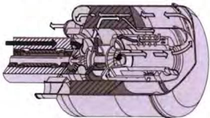  
图 1.25 Capstone Turbine Corporation 公司推出的微型热电联产装置示意图 $^{[99]}$  
Figure 1.25 Schematic of micro-CHP unit developed by Capstone Turbine Corporation $^{[99]}$

## 1.3.2.3 微型有机朗肯循环式热电联产

朗肯循环具有结构简单、外燃式热机适用于多种热源以及适用于分布式发电的特点，是一种极具潜力的热电联产技术方案，而有机朗肯循环由于其采用有机工质替代传统的水蒸气工质，可以有效的回收低品位的热能以及适用于天然气燃烧的高温热电联产系统，因此逐渐受到研究人员的青睐[106,107]。有机朗肯循环热电联产系统主要由蒸发器、冷凝器、膨胀机、发电机以及相应的工质泵和其他辅助的换热器组成[108]，如图1.26所示。有机工质在蒸发器中吸热后进入膨胀机中等熵膨胀做功，产生的机械功驱动发电机产生电能，流出膨胀机并带有一定热量的低压乏汽在冷凝器中放热，对外输出热量。目前，大中型的有机朗肯循环热电联产技术已经基本实现商业化，而微型有机朗肯循环热电联产技术还处于商业化初期和研发改进阶段。微型有机朗肯循环热电联产装置可以提供 $1\sim 10\mathrm{kW}$ 的发电量和 $8\sim 10\mathrm{kW}$ 的供热量，所对应的电效率和热效率分别约为 $6\% \sim 19\%$ 和 $77\% \sim 90\%$ ，系统的综合能源效率可以超过 $90\%^{[87]}$ 。现阶段针对微型有机朗肯循环热电联产的研究主要集中于微型膨胀机的选型以及设计和改进、有机工质种类的选择、微型装置中的蒸发器和工质泵等组件的性能设计、优化以及系统的运行和控制等方面。此外，如何快速响应热负载的变化也是影响该技术能否大规模推广和应用的关键问题[109-112]。

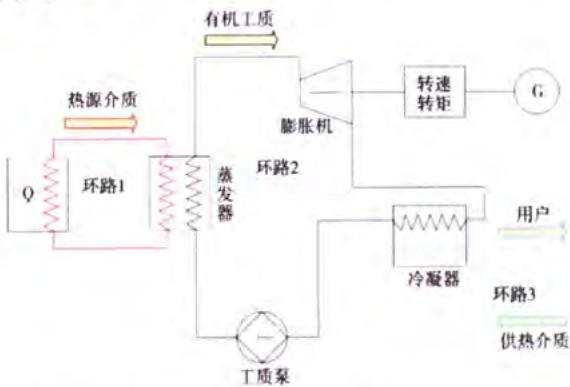  
图 1.26 有机朗肯循环热电联产装置流程示意图 $^{[108]}$

Figure 1.26 Schematic of organic Rankine cycle cogeneration unit $^{[108]}$  
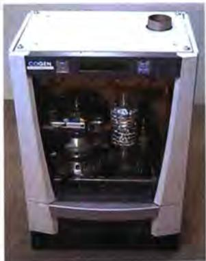  
图 1.27 Genlec 型微型热电联产装置 $^{[113]}$  
Figure 1.27 Photograph of Genlec micro-CHP unit $^{[113]}$

目前具有代表性的产品有 Energetix Genlec 公司推出的壁挂式 Genlec 型微型热电联产装置 $^{[113]}$ ，如图 1.27 所示。该装置可以提供 1\~3 kW 的发电量和 10\~30 kW 的供热量，适用于个人家庭住宅和小型商业场所。

## 1.3.2.4 微型斯特林式热电联产

斯特林热机是另外一种外燃式热机，由于其具有热量来源广泛、振动小、可靠性高、结构紧凑和工质环保等优势，正逐渐成为微型热电联产技术中一股不可或缺的力量。传统的斯特林式热电联产技术主要利用的是工作介质气体压缩和膨胀推动活塞所产生的电能以及低温端水冷器中可回收的废热，其电效率随燃料的不同而不同，当使用气体燃料时其效率可达 $30\%$ 以上，而使用固体燃料时其效率则低至 $15\%$ ，但系统的综合能源效率可达到 $90\%$ 以上[114-116]。按照发动机的内部结构可以分为曲柄连杆式斯特林热机和自由活塞式斯特林热机，而由于自由活塞斯特林热机相较于前者具有更高的可靠性和稳定性，微型斯特林式热电联产多采用此技术。目前针对此技术的研究多集中于提升系统的效率与稳定性、降低系统的制造成本以及系统的运行控制策略等方面。但由于受限于材料成本，启动需要预热以及热响应具有时间延迟性等因素的限制[117,118]，微型斯特林式热电联产技术还处于初步商业化阶段，现有成熟的产品主要有WhisperGen系列产品[119,120]、Microgen系列产品[121]、Infinia的RG-100产品[122]以及后期的Qnergy推出的产品[123]等。

WhisperGen 公司推出的微型热电联产装置是第一个商用的微型斯特林式热电联产装置，其在德国、英国、荷兰以及法国均有相关的热电联产产品应用，如下图 1.28 所示。WhisperGen 推出的是一款适用于家庭住宅的四缸 $\alpha$ 型斯特林热机产品，主要采用天然气作为燃料，其尺寸与一台洗碗机相近（491 x 838 x 563 mm），重量仅为 140 kg，可以输出 1 kW 的发电量和 7 kW 的热量，同时其还配置了额外燃烧器，可以提供额外 7 kW 的供热量。

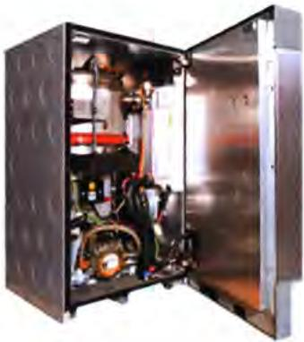  
图 1.28 WhisperGen 公司微型热电联产装置  
Figure 1.28 Photograph of micro-CHP unit developed by WhisperGen

Microgen 产品是 BG Group 公司在美国 Sunpower 公司推出的 EG-1000 原型机 $^{[124]}$ 的基础上改进而来的一款适用于壁挂式的 $\beta$ 型自由活塞斯特林微型热电联产装置，如图 1.29 所示。与 WhisperGen 产品类似，Microgen 装置也附带了一个辅助燃烧器，燃料主要以天然气为主，该装置在提供 1.1 kW 电能的同时还可以提供 3\~36 kW 的热量，电效率约为 33%，整机的综合能源利用效率超过 90%，该系统预计每年可以节省 150 英镑的开销，且每年可以减少碳排放量 1.5 吨。

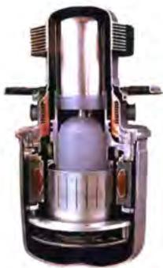  
图 1.29 Microgen 微型热电联产装置 $^{[125]}$  
Figure 1.29 Photograph of micro-CHP unit developed by Microgen [125]

LFPSE 是由美国的 Infinia 公司推出的一款微型斯特林热电联产装置，其可以输出 1 kW 的电能和 4\~40 kW 的热量，后被集成到 Ariston，Bosch 以及日本的 Rinnai 等公司的微型热电联产装置中进行应用。2013 年 Infinia 公司被以色列的 Qnergy 公司收购后，由 Qnergy 公司推出了对置的 5 kWe 级的 LFPSE 装置，如图 1.30 所示。与早前的装置相比，该装置可以提供更加稳定的动力输出，同时减少了系统的振动，系统可以输出 24 kW 的热量，据报道其输出的电效率可以达到 20% 以上 $^{[119]}$ 。

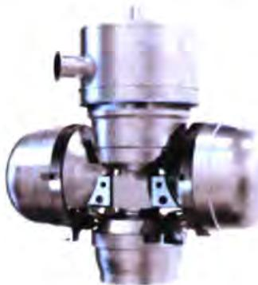  
图 1.30 Qnergy 公司推出的 5 kWe 级微型热电联产装置 $^{[119]}$  
Figure 1.30 Photograph of 5 kWe-class micro-CHP unit developed by Qnergy [119]

此外，Qnergy 公司还推出了 Smartbolier 系列产品，如图 1.31 所示 $^{[126]}$ 。该装置可以提供 2.8\~7.2 kW 的电能和 43 kW 的热量，其所对应的电效率和综合能源利用效率为 15.3% 和 99%，系统质量达到 295 kg。

  
图 1.31 Smartbolier 微型热电联产装置 $^{[126]}$  
Figure 1.31 Photograph of the micro-CHP unit developed by Smartbolier [126]

## 1.3.2.5 燃料电池式微型热电联产

与上述的几种微型热电联产装置不同的是，燃料电池式热电联产装置无需进行宏观上的机械能—电能的能量转换过程，其可以在系统内部通过化学反应将天然气、氢气等燃料的化学能转换为电能，具有较高的电效率（可达到 $60\%$ 以上）和综合能源利用效率。此外，其反应的产物主要是热量和水，具有环保无污染的特点，因此近年来成为了微型热电联产技术的研究热点，逐渐被研究开发并投入商业运用中。目前针对燃料电池式微型热电联产技术的研究主要集中于固体氧化物燃料电池（SOFC）和聚合物电解质燃料电池（PEMFC）两种，此外还有磷酸燃料电池（PAFC）和碱性燃料电池等[127]。由于其初投资成本较高，目前主要在一些发达国家如美国、日本等进行小规模商业使用[128]，而如何降低其初投资成本，并提升系统的耐用性和寿命，是当下研究人员所亟待解决的问题。

除上述已经陆续投入商业化的微型热电联产技术以外，还有热光伏技术等新的技术陆续被投入研发使用，微型热电联产装置凭借其装机容量小，用户端调节灵活，响应迅速的特点，正在逐渐替代传统家用供暖系统，在节能减排中扮演着重要的角色。

## 1.3.3 冷热电联产

冷热电联产技术，也被称为三联产技术，是在热电联产技术基础上衍生出来的一种更加高效、低排放的能源利用技术。根据冷热电联供系统的供应区域的不同可以分为集中式和分布式两种；而根据产生电量的多少可以分为微型、小型、中型以及大型的冷热电联供系统[26]。与其他的冷热电联供系统相比，分布式微型冷热电联供系统可以减少传输过程中造成的能量损失，提高分户式消耗终端的瞬态响应能力以及降低在意外关闭时的风险。由于冷热电联供系统是在热电联供系统的基础上衍生出来的一种能量利用装置，因此其原动机的类型同样也包括往复式内燃机，燃气轮机，蒸汽轮机，燃料电池，有机朗肯循环以及斯特林热机等[29,129]。现有的冷热电联供系统涉及到多种能源转化技术以及需要多种工作原理不同的子系统相互耦合，如在原有的热电联供系统中引入电驱动蒸汽压缩式制冷机或者余热驱动的吸收式、吸附式制冷系统。该技术方案存在系统结构复杂、运行控制复杂，初投资成本大，并且在小型化时能源转化效率降低，功率密度低等问题[130]，因此制约了其进一步发展和应用。

因此，本课题提出了一种基于热声效应的热驱动双效自由活塞型热声斯特林热泵结构，可以实现热电联供以及冷热电联供的功能。该机型使用自由活塞型热声斯特林发动机作为原动机，驱动中间的往复式直线电机和自由活塞型热声斯特林热泵提供电能、热能以及制冷量，进而实现热电联供和冷热电联供的功能。

## 1.4 热声热机研究进展

热声热机是利用热声效应实现热功转换的一种能源转换装置。所谓的热声效应指的是往复振荡的可压缩流体与固体介质之间由于热相互作用而产生的一种持续的自激振荡的现象，伴随着该现象产生的同时会有非线性的时均的热流与时均的功流进行相互转换的过程，因此也被称为“能量声流效应”[131]。热声热机按照热声能量循环方向的不同，可以划分为两类：一类是基于正向热声循环将热能转换为声功形式的机械能即“热致声效应”的热声发动机；另一类则与之相反，基于的是逆向热声能量循环的声致冷效应，将声波传递过来的声功形式的机械能进行消耗转化为热能并与冷端吸收的热量一起泵送至热端的热声制冷机或热声热泵[31,32]。热声发动机可与不同的声学负载进行耦合，提供驱动力，从而构成不同的热声系统，如热声发电机、热声驱动的热声制冷机、热声驱动的脉管制冷机等。热声热机中实现热声效应的核心部件主要包括热端换热器、热声换能器、冷端换热器，其中冷、热端换热器提供热声换能器两端所必要的温差，在热声换能器中实现热功转换过程，必要的时候还需要调相器进行调相，从而使得热声换能器处于合适的声场条件下进行工作。广义的热声热机不仅包括气体或液体调相型的驻波、行波以及双作用等传统热声热机，也包括采用固体活塞调相的斯特林热机。由于此前的研究多将传统的热声热机和斯特林热机分开研究，为了避免引起混淆和减少歧义，本节将分成两部分分别介绍二者的技术特点以及研究进展。

## 1.4.1 传统热声热机技术

## 1.4.1.1 热声效应的发现

科学技术的产生多数源自于对生活现象的总结和提炼，热声技术亦是如此。早在1777年，B.Higgins[132]发现如果在两端开口的竖直玻璃管内部的适当位置放置燃烧的氢气火焰，管中则会发出声响，如同火焰在管中进行歌唱，因此就把这种现象称为“歌焰现象”，并把这样的直管称之为“Higgins 管”，如图 1.32（a）所示，而这也是最早有文字记录的热致声效应。同时期，欧洲吹制玻璃的工人同样也发现了类似的现象，如果将一个细直玻璃长管插入中空的热玻璃球时，在管子中间同样会出现声响 $^{[133]}$ 。直到 1850 年，Sondhauss 才对这类现象进行了深入的研究，他发现声音的产生与玻璃无关，音阶的高低与器皿的尺寸存在定量的关系，并提出了一种一端封闭且加热而另一端开口可以发出声音的“Sondhauss 管” $^{[134]}$ ，如图 1.32（b）所示。Sondhauss 管可被认为是最早的驻波型热声发动机。随后，在 1859 年 Rijke 对采用加热的丝网代替火焰伸入两端开口的竖直空管（后来被称之为“Rijke 管”，如图 1.32（c）所示）内部同样也可以产生剧烈声响的现象进行了分析；随后，Bosscha 采用冷却的金属丝网放在与 Rijke 位置相反的部位，同样可以产生强烈的 Rijke 振荡现象 $^{[135]}$ 。1949 年，Taconis 等 $^{[136]}$ 将一端封闭的管子插入到液氦中时发现了低温领域著名的“Taconis 振荡”现象，如图 1.32（d）所示。Taconis 管与 Sondhauss 管产生声振荡的本质机理是相同的，只不过是建立冷热端温差的方式不同，前者采用的是低温液氦，后者采用的是高温加热。

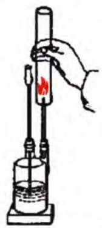  
(a) Higgins管

  
(b) Sondhauss管

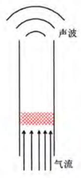  
(c) Rijke管

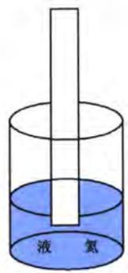  
(d) Taconis振荡  
图1.32 早期的热声现象  
Figure 1.32 Early thermoacoustic phenomenon

与热致声效应相比，声致冷效应的发现则相对较晚。1963年Gifford和Longsworth[137]发现若在一端封闭的中空管子中施加交变的压力波动时，管子的两侧会产生温度梯度，并且封闭的一端温度会升高，这就是脉管制冷机的原型，但由于其频率只有 $0.67\mathrm{Hz}$ ，因此声学特性并不显著。随后，1975年Merkli和Thomann[138]发现了更加明显的声致冷效应，他们利用活塞在一端封闭的中空驻波谐振直管内产生交变的压力波动，并发现在直管的中部温度下降而两端温度上升的现象。

热声效应的出现极大的拓宽了热机的研究领域，热声技术也逐渐引起了研究人员的兴趣，并展开了对热声热机的持续研究，热声热机的种类和理论也逐渐丰富起来。

## 1.4.1.2 热声技术的进展

## 1.4.1.2.1 热声发动机

早期针对热声效应的研究多集中于原理性的演示工作，而真正标志着热声热机进入实用化研究源自Cater[139]和Feldman[140]等人的研究工作。1962年，Cater发现如果在Sondhuass管中放入板叠，可以获得明显的热声振荡现象。随后，Feldman在他的博士课题里针对这一现象进行了研究，成功研制了世界首台驻波型热声发动机，该驻波发动机在外界输入加热量 $600\mathrm{W}$ 的条件下，可以获得27W的声功。

Swift $^{[141,142]}$ 等进一步对驻波型热声发动机开展了研究，先后在1992年和1995年研制了驻波发动机和对置的驻波热声发动机，如图1.33和图1.34所示。图1.33为Swift等人研制的一台直径128 mm，长度4320 mm的驻波发动机，该发动机在输入加热功率7 kW，系统运行压力1.38 MPa条件下可以获得630 W的声功，发动机的第一效率为9%。图1.34为Swift等人搭建的一台长度为1.38 m的对置式热声发动机，该发动机可以通过调节阻抗来研究发动机的输出特性与阻抗匹配的关系，但由于实验中负载与发动机的阻抗无法高效匹配，因此该发动机的效率并不高，仅有5%。随后他们又与Tektronix公司联合研制了一台用于驱动脉管制冷机的驻波型热声发动机 $^{[143]}$ ，该发动机在350 Hz的运行频率下可以输出超过1 kW的声功，其所对应的热声转换效率为18%。

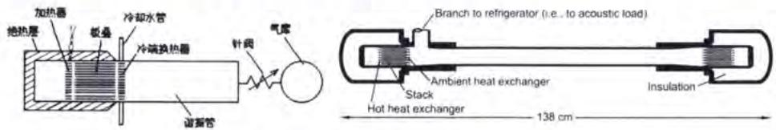  
图 1.33 Swift 等人 1992 年研制的驻波热声发动机  
图 1.34 Swift 等人 1995 年研制的对置驻波热声发动机  
Figure 1.33 The standing-wave thermoacoustic engine developed by Swift et al. in 1992  
Figure 1.34 The opposed standing-wave thermoacoustic engine developed by Swift et al. in 1995

热声发动机凭借其结构简单的特性逐渐受到研究学者的重视，陆续开始拓展其研究领域。1998年，宾夕法尼亚的Chen和Garrett[144]搭建了世界首台太阳能驱动的驻波型热声发动机，该发动机采用碟式太阳能集热器对玻璃管中的陶瓷板叠的一端进行加热，可以测得系统的工作频率为 $420\mathrm{Hz}$ ，可以产生 $120\mathrm{dB}$ 的声波。

由于驻波发动机内压力波动和体积流率的相位为驻波相位，内部存在不可逆的热力循环，不可避免的导致了系统效率的降低，因此研究人员将目光渐渐投向了行波型热声发动机。与驻波发动机相比，行波热声发动机内部核心单元中压力波动和体积流率的相位接近行波相位，理论上系统的循环效率与卡诺效率相同，因此其热声转换效率要明显高于驻波型热声发动机。

针对行波型热声发动机的研究最早可追溯到上世纪70年代，Ceperley $^{[145-147]}$ 发现斯特林热机中压力波动与体积流率的相位关系与行波相位相同，因此尝试设计一个环路结构的行波热声发动机来代替传统的机械压缩式压力波动发生器，如图1.35所示。通过控制压力波动和体积流率的相位来实现声功的放大，但由于其采用的谐振管未能对声阻抗进行高效匹配，并未取得令人满意的结果。在其基础上，1998年日本的Yazaki $^{[148]}$ 等人研制了一台环路行波热声发动机，如图1.36所示，并成功观测到了近行波声场关系的热声效应。随后，1999年Backhauss和Swift $^{[149]}$ 成功的研制出了行驻波混合型热声-斯特林型发动机，如图1.37所示，在行波环路的基础上引入了驻波形式的谐振管，通过合理的声学匹配，可以获得710W的输出声功，发动机的第一效率和第二效率分别达到了30%和41%，已经具备了和传统发动机相媲美的能力。

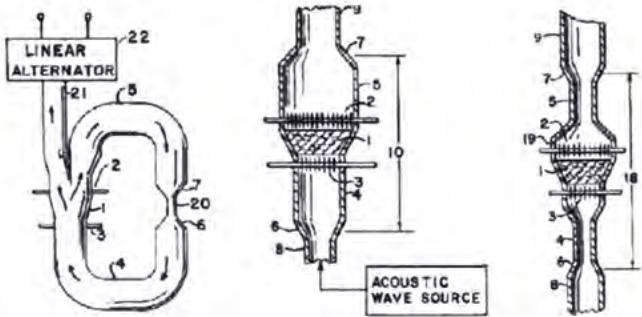  
图 1.35 Ceperley 提出的行波热声发动机示意图

Figure 1.35 Schematic of traveling-wave thermoacoustic engine proposed by Ceperley  
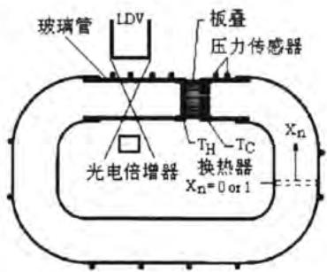  
图 1.36 Yazaki 等研制的环路行波热声发动机  
Figure 1.36 Schematic of the looped traveling-wave thermoacoustic engine developed by Yazaki et al.

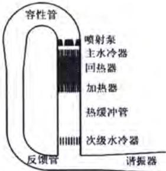  
图 1.37 Backhauss 和 Swift 研制的热声-斯特林型发动机  
Figure 1.37 Schematic of the thermoacoustic-Stirling engine developed by Backhauss and Swift

国内针对热声热机的研究始于上世纪90年代，主要研究单位有中科院理化所、浙江大学、华中科技大学等。1999年，浙江大学陈国邦等人[150]成功搭建了对称型双边热驱动驻波热声发动机，该发动机的最高压比可达1.12和1.06，对应的工作频率分别为 $24\mathrm{Hz}$ 和 $70\mathrm{Hz}$ ，并在此基础上研究了驻波热声发动机的起消振特性，提出了“滞后回路”的概念。

同年，中科院理化所罗二仓等人成功研制了国内首台行波热声发动机 $^{[151]}$ ，并在热端输入500 W的加热功率的条件下，可以获得60 W的声功；紧接着，2002年通过合理的布置回热器（即热声换能器）与热缓冲管的位置，进一步缩小了发动机的结构尺寸，成功研制了世界上第一台同轴型的行波热声发动机 $^{[152]}$ ，其最高输出压比可达1.047。随后，罗二仓所带领的课题组于2004年通过引入“共振强声”的概念，成功研制了聚能型热声—斯特林发动机 $^{[153]}$ ，如图1.38所示，该发动机可以获得最高1.30的输出压比，并驱动一台脉管制冷机成功获得了68.8 K的最低制冷温度。随后，余国瑶等人在此基础上进行了一系列的改进工作，利用氮气取代氦气作为工质，可以获得1.40的压比，系统的起振温度可以降低至73 $^{\circ}$ C $^{[154]}$ 。

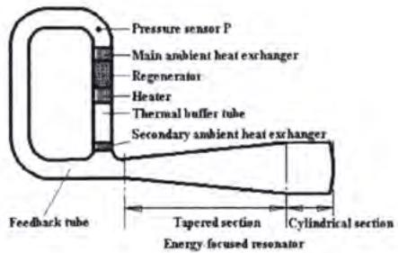  
图 1.38 罗二仓等人研制的聚能型行波热声发动机  
Figure 1.38 Schematic of the energy-focused traveling-wave thermoacoustic engine developed by Ercang Luo et al.

此外，罗二仓所带领的课题组的胡剑英等人还于2005年和2006年先后成功研制了声学压力放大器和二介质耦合声学压力放大器，成功提高了输出压比，并降低了系统的工作频率[155,156]。除了研究行波型热声-斯特林发动机，该课题组的戴巍等人随后还开展了针对 $300\mathrm{Hz}$ 和 $500\mathrm{Hz}$ 高频驻波热声发动机的研制工作，均以氦气作为工质，分别可以获得1.17和1.137的工作压比[157,158]。

虽然传统行波热声发动机相比于驻波热声发动机的效率有了大幅提升，但却存在尺寸较大，功率密度偏低等问题。针对于此，2010年荷兰的De blok[159,160]设计并搭建了一套由四台热声发动机模块首尾依次相接的四单元环路双作用热声系统，如图1.39所示。该系统采用谐振管依次连接各发动机模块，其中谐振管的截面积要明显小于发动机核心单元的截面积，从而可以有效的降低发动机核心单元处的气体流速，进而增大发动机核心单元处的声阻抗（主要是热声换能器处），降低热声换能器的粘性损失。当系统充注 $2.1\mathrm{MPa}$ 的氦气和氩气时，系统的最低起振温差可达 $42\mathrm{K}$ 和 $26\mathrm{K}$ ；此外，当热声换能器两侧的温差为 $90\mathrm{K}$ 时，系统的输出压比可以达到1.07和1.05，此时系统可以对外输出声功 $140\mathrm{W}$ 和 $250\mathrm{W}$ 。

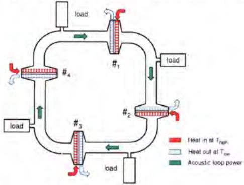  
图 1.39 De blok 等人研制的四单元环路双作用热声系统示意图  
Figure 1.39 Schematic of the four-unit double-acting traveling-wave looped thermoacoustic engine developed by De blok et al.

随后，2012年中科院理化所罗二仓所带领的课题组也提出了一种双作用的热声发动机系统[161]，系统采用多台热声发动机和谐振子依次首尾相连，如图1.40（a）所示。同时，罗二仓、李东辉等人还采用液体谐振子取代固体谐振子进行调相，提出了气液双作用的环路行波热声发动机的结构[162]，如图1.40（b）所示。系统在平均压力 $1.5\mathrm{MPa}$ ，加热功率 $1.2\mathrm{kW}$ 的工况下可以获得1.45的压比。但是由于液体谐振子的惯性的原因，系统在大振幅工况下工作时振动较大，并且采用膜结构进行密封液体容易出现薄膜破损的问题，影响系统的可靠性。此外，针对“双作用”这一结构，该课题组还陆续开展了大量的研究工作，提出了声学共振型行波双作用热声发动机以及用于发电和制冷等不同需求的结构[163-166]。

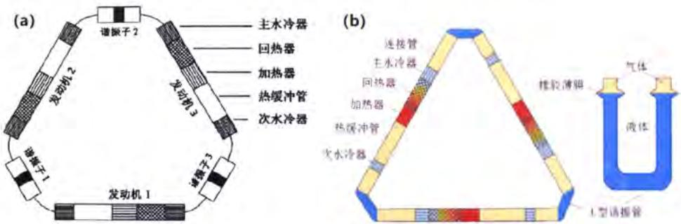  
图 1.40 罗二仓课题组研制的环路双作用热声系统示意图  
Figure 1.40 Schematic of the looped double-acting thermoacoustic system developed by Ercang Luo's lab

除了研发环路行波热声发动机系统外，2008年浙大的汤珂[167]等人还针对气液两相的驻波型热声发动机开展了相关的研究，通过引入液体振子，充分利用了气体的声容和液体的声感，最终可以降低系统的运行频率并提升系统的功率密度。此外，2010年邱利民[168]等还采用液氮作为冷源从而在板叠两侧建立温差，成功获得1.21的发动机输出压比。

## 1.4.1.2.2 热声制冷机和热声热泵

热声发动机可与不同的声学负载进行耦合，提供驱动力，从而构成不同的热声系统，最具有代表性的就是采用热声发动机驱动的热声制冷机或热声热泵，从而构建一套完全无运动部件的热声能量转换系统。

1990 年，Radebaugh 等人在 Swift 研制的驻波型热声发动机的基础上，研制出了世界上首台完全无运动部件的热声制冷机 $^{[169]}$ 。该系统采用驻波热声发动机作为压力波发生器，替代传统的电驱动压缩机，采用氦气作为运行工质，最低温度可以达到 90 K。随后又采用对置式驻波型热声发动机驱动两级脉管制冷机 $^{[143]}$ ，用于电子器件的冷却。

1994年美国的Cryenco公司、LosAlamos实验室和美国国家标准与技术研究院（NIST）联合研制一台天然气热驱动热声发动机耦合脉管制冷机的天然气液化装置[170]，如图1.41所示。该系统充气压力为 $3\mathrm{MPa}$ ，运行频率为 $40\mathrm{Hz}$ ，在冷端温度为 $130\mathrm{K}$ 时可得到 $2\mathrm{kW}$ 的制冷量，可以实现每天140加仑的液化量。随后他们又采用热声-斯特林型行波发动机替代原来的驻波发动机，旨在实现每天500加仑的液化量，但目前报道的日最大液化量为350加仑。虽然还没有达到设计目标，但却为天然气的利用拓宽了渠道，可以通过燃烧一部分天然气来液化另一部分天然气，从而便于天然气的再利用。

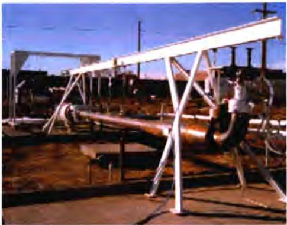  
图 1.41 天然气热驱动热声发动机耦合脉管制冷机的天然气液化装置  
Figure 1.41 Gas-fired heat-driven thermoacoustic engine coupled with pulse tube cryocooler natural gas liquefaction device

1998年国内的浙江大学的陈国邦、金滔等人也陆续开展了针对热声发动机驱动脉管制冷机的研究。他们首先成功搭建了一台驻波发动机驱动的双向进气脉管制冷机，并通过不断优化制冷机和发动机之间的声学关系，其最低制冷温度由 $88\mathrm{K}$ 降到了 $41\mathrm{K}^{[171-173]}$ 。随后，在2001年陈国邦等人又利用已经搭建好的对称双边热驱动的热声发动机搭建了热声制冷系统，驱动脉冲管制冷机，所采用的工质分别是氦气以及氦气和氩气的混合气体，最终取得了 $119.7\mathrm{K}$ 和 $117.6\mathrm{K}$ 的无负荷制冷温度[174]。

同时期中科院理化所也开展了关于热声制冷机的相关研究。罗二仓带领的课题组在2002年采用聚能型热声-斯特林发动机驱动脉管制冷机获得了68.8 K的无负荷制冷温度 $^{[153]}$ 。随后又在2003年开展了行波热声发动机驱动行波热声制冷机的研究，如图1.42所示，在2200 W加热功率下和-22 ℃制冷温度下可以获得300 W的制冷量 $^{[175]}$ 。随后又采用声学压力放大器和二介质耦合声学压力放大器等结构，分别获得了68.8 K和41 K的最低制冷温度 $^{[155,156]}$ 。

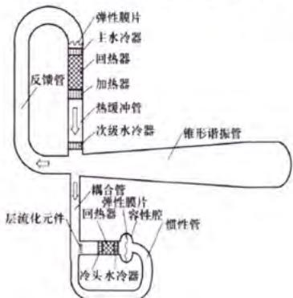  
图 1.42 聚能型热声-斯特林发动机驱动脉管制冷机  
Figure 1.42 Schematic of the pulse tube cryocooler driven by the energy-focused thermoacoustic-Stirling engine

戴巍、余国瑶等针对高频驻波热声发动机驱动脉管制冷机也开展了相应的研究[157,158,176]，其中 $300\mathrm{Hz}$ 驻波热声发动机驱动脉管制冷机的系统，可以在外界输入加热功率 $600\mathrm{W}$ 的工况下，获得 $60\mathrm{K}$ 的最低无负荷制冷温度，如图1.43所示。胡剑英、张丽敏、王慧志等人还陆续开展了环路制冷的相关理论和实验研究工作[165,177,178]。

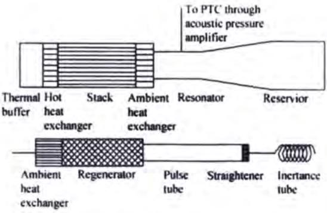  
图 1.43 300Hz 驻波热声发动机驱动脉管制冷机  
Figure 1.43 Schematic of the 300 Hz pulse tube cryocooler driven by the standing-wave thermoacoustic engine

此外，该课题组的赵阳、杨卓和童欢等人还陆续开展电驱动单元行波热声热泵的相关理论和实验研究[16,179,180]，温度范围从低环温到高环温，其中赵阳搭建的千瓦级电驱动行波热声热泵可以在运行压力为 $5.5\mathrm{MPa}$ ，冷端环境温度为 $-20^{\circ}\mathrm{C}$ ，供热温差为 $70^{\circ}\mathrm{C}$ 的工况下，输出 $1600\mathrm{W}$ 的供热量，制热系数达到了2.0，具有和同温区吸收式或蒸汽压缩式热泵竞争的潜力。

## 1.4.2 斯特林型热声热机

## 1.4.2.1 斯特林型热声热机的提出

斯特林型热声热机通常是指基于斯特林循环的需要固体活塞调相或输出/输入功的一种外燃式闭式回热循环热机，其主要包括斯特林发动机和斯特林制冷机以及与不同声学负载组成的斯特林系统。1816年英国牧师Robert Stirling首次提出了用于发动机的斯特林循环并搭建了第一台斯特林发动机，如图1.44（a）所示，标志着斯特林热机正式进入历史的舞台[181]，并成功于1818年用于带动矿井的水泵进行工作[182]。随后，1874年Alexander Kirk根据逆斯特林循环的原理成功搭建了第一台斯特林制冷机[183]。19世纪是一个工业化急速发展的时代，虽然斯特林热机由于其外燃机的特性曾经广泛用于各种采矿业和农林业的场所，但由于其当时的制造加工工艺较差，斯特林热机采用空气作为工作介质，且各换热器的性能较差，整个系统的尺寸过大、功率密度偏小、系统不稳定等问题格外突出，加之内燃机等其他热机的出现，导致斯特林热机在很长的一段时间没有得到关注和发展。这种困境直到1938年荷兰的飞利浦公司采用斯特林发电机来满足荷兰边远地区的用电需求才逐渐得以解决。随后飞利浦公司针对斯特林热机开展了持续40多年的研发工作，先后推出了不同功率的斯特林发电机、制冷机，以及为了增大发动机输出功率而研发的菱形和斜盘式的传动机构，如图1.44（b）所示，这一系列工作推动了现代斯特林热机的发展[182,184,185]。1964年，美国俄亥俄大学的Beale进一步推动了斯特林热机的发展，提出了自由活塞型斯特林发动机的概念[186]，如图1.44（c）所示。与传统的斯特林发动机相比，该结构的调相活塞（排出器）采用气浮或板弹簧进行支撑，取消了传统的曲柄连杆传动结构，依靠气体作用力进行传导从而消除了侧向力；同时，该结构采用间隙密封技术替代传统的密封结构，消除了接触式的机械磨损以及油润滑的问题，大幅提升了系统的可靠性与寿命。20世纪80年代，牛津大学的Davy等人成功的将Beale的概念应用于斯特林制冷机上，与Hymatic公司联合推出了牛津型自由活塞斯特林制冷机[187,188]，进一步推动了斯特林型热声热机的发展。

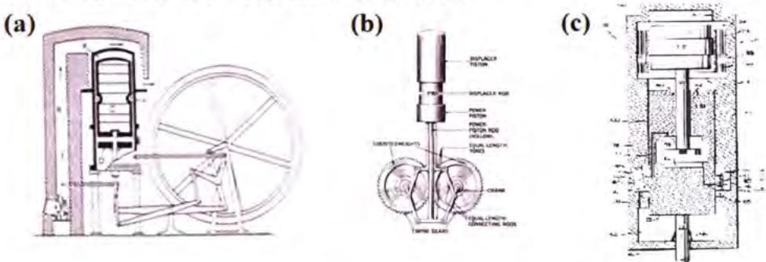  
图1.44 不同时期的斯特林发动机  
Figure 1.44 Stirling engines in different periods

由于自由活塞斯特林技术的提出以及材料和加工技术的提升，斯特林热机在上世纪70年代石油危机爆发以后，逐渐受到研究学者的重新关注和重视，针对斯特林发电、制冷、热泵以及热电联产等各种机型和应用的研究层出不穷，斯特林技术也逐渐商业化，目前主要有美国的Sunpower公司（后被AMETEK公司收购）、Infinia公司（后被以色列的Qnergy公司收购）、Mechanical Technology Incorporated（MTI）公司以及美国国家航空航天局等在进行研究。此外，国内的浙江大学、中科院理化所、华中科技大学、南京航空航天大学以及哈尔滨工业大学等研究机构曾经或正在进行应用研究。

## 1.4.2.2 斯特林型热声热机的分类

斯特林型热机按照其使用功能可以分为斯特林发动机和斯特林制冷机/斯特林热泵。若发动机与发电机进行声学耦合，则可构成斯特林发电机；若斯特林发动机与斯特林制冷机相互耦合，则可构成VM型热机或者双效斯特林热机。按照结构类型可以分为 $\alpha$ 型， $\beta$ 型和 $\gamma$ 型热机[189,190]，如图1.45所示。其中 $\alpha$ 型发动机有两个气缸，两个活塞分别处于两个气缸中，分别传递工质的压缩功和膨胀功，因此也被成为双活塞斯特林热机，如图1.45(a)所示；β型热机的典型特点是发动中只有一个气缸，两个活塞被置于同一气缸，一个称为动力活塞，一个称为配气活塞，其中动力活塞负责对内或对外传递声功，而配气活塞则负责推动气体工质往复流动，如图1.45（b）所示；另一类斯特林热机是γ型斯特林热机，虽然该结构同样也具有两个气缸并且两个活塞同样处于两个气缸中，但是与α型不同的是，γ型斯特林热机的活塞一个为配气活塞，另一个为做功活塞，如图1.45（c）所示。

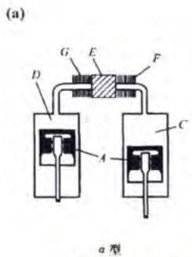

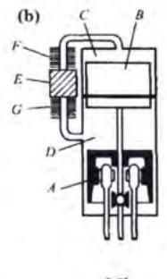

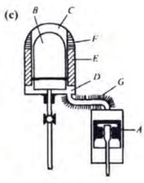  
A—活塞；B—配气活塞；C—热腔；D—冷腔；E—回热器；F—加热器；G—冷却器  
图 1.45 三种类型的斯特林热机  
Figure 1.45 Schematic of three types of Stirling engine

如若按照单个活塞的功能来分又可分为单作用斯特林发动机和双作用斯特林发动。图1.46为典型的双作用斯特林发动机的示意图，顾名思义，所谓的“双作用”指的是首尾相连的 $\alpha$ 型发动机中每个发动机单元有且仅有一个运动活塞，该活塞既作为压缩活塞使用，又作为膨胀活塞使用。一般来说，双作用的发动机的缸数至少大于等于2，但为了追求相角合适，一般选取4的倍数作为缸数使用。受此启发，荷兰的Deblok和中科院理化所罗二仓等人提出了双作用热声系统的概念，进一步证明了传统热声热机和斯特林型热声热机之间存在紧密的联系。

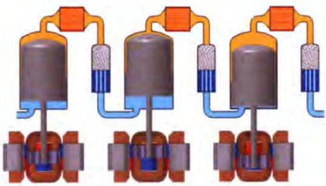  
图 1.46 双作用斯特林热机示意图  
Figure 1.46 Schematic of double-acting Stirling engines

此外，如若按照传动机构进行分类，斯特林热机可分为曲柄连杆式、菱形传动式、斜盘传动式、摇摆轭传动式以及目前的研究热门自由活塞式。相比于其他的传动类型斯特林热机而言，由于取消了活塞间的传动机构，采用气体作用力进行传动，同时采用间隙密封等技术，消除了侧向力和机械磨损以及油润滑污染的问题，自由活塞型斯特林热机的可靠性和寿命得到了大幅的提升。由于本文是针对谐振电机耦合型的双效自由活塞斯特林热机进行理论和实验研究，因此下面将主要介绍双效自由活塞斯特林热机的研究进展。

## 1.4.2.3 双效自由活塞斯特林热机研究进展

双效自由活塞斯特林热机的概念最早是由 William Beale 博士在其 1969 年发表的一篇关于自由活塞斯特林发动机的文章中提出来的[191]，如图 1.47 所示。该热机的构想是用于燃烧或太阳能热驱动的制冷用途，采用自由活塞斯特林制冷机来带替代发动机中所需要的背腔，发动机和制冷机中共用两个活塞并且二者的功能互补，前者的动力活塞为后者的调相活塞，后者的动力活塞也反过来作为前者的调相活塞，进而实现双效的功能。此外，所谓的“双效”还可以理解为在同一套系统中自由活塞斯特林热机既作为发动机也作为热泵，在同一个气缸中存在三个运动部件，其中两端的运动活塞作为调相活塞使用，中间的活塞作为做功活塞使用，分别与前后的调相活塞组成发动机子系统和热泵子系统。这与吸收式系统中的“双效”——第一级的发生器中产生的制冷剂蒸汽用作第二级发生器的热源，驱动热源在系统内被直接和间接的利用两次的概念不一样。

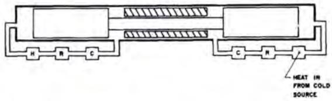  
图 1.47 Beale 早期提出的双效自由活塞斯特林热机概念示意图  
Figure 1.47 Schematic of the duplex free-piston Stirling heat engine proposed by Beale

Sunpower 公司是由 Beale 于 1974 年创建的一家专门致力于自由活塞斯特林热机和直线压缩机等机型设计、开发和研制的一家科技公司，其开创了独有的“Sunpower 型结构”即排出器上的 Rod 杆穿过动力活塞的斯特林热机结构，是自由活塞斯特林热机研发的领军企业，虽后被 AMETEK 公司收购，但目前仍从事自由活塞斯特林热机的研发和商业化工作，其代表产品有小型低温制冷机和热电联产装置等 $^{[192]}$ 。Sunpower 公司自 1978 年开始对双效自由活塞斯特林热机展开研究并搭建了相应的实验装置。起初采用的是一台 SD-100 型自由活塞斯特林发动机驱动一台自由活塞斯特林热泵，如图 1.48 所示，系统的工作压力是 1.5\~2.5 MPa，发动机可以输出 70\~100 W 的输出功，最低无负荷制冷温度可以降至 170 K $^{[184]}$ 。

随后，自1979年的近10年内，Sunpower公司针对双效自由活塞斯特林结构（即Duplex结构）开展了大量的研发工作，搭建了天然气液化器、便携式制冷机以及家用热泵的试验和演示装置[193-196]，图1.49为Sunpower公司研制的双效自由活塞斯特林结构示意图。该结构与早期的Beale提出的双效结构相比，系统内部耦合了三个活塞，其中两个为调相活塞，另一个做功活塞。自由活塞斯特林热泵与自由活塞斯特林发动机采用背靠背的同轴布置结构，二者共用同一个做功活塞。

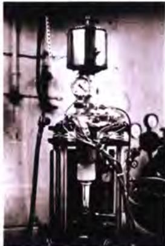  
图 1.48 SD-100 型双效自由活塞斯特林热泵

Figure 1.48 Photograph of SD-100 duplex free-piston Stirling heat pump prototype  
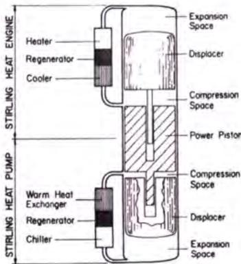  
图 1.49 Sunpower 公司研制的双效自由活塞斯特林热机示意图  
Figure 1.49 Schematic of the duplex free-piston Stirling heat engine developed by Sunpower

图 1.50 为 Sunpower 公司设计的一台小型天然气液化装置，其长度仅有 80 cm，使用的是一台 RE-1000 型号的自由活塞斯特林发动机，其系统的设计目标是发动机的输出功率为 2.5 kW，在 110 K 的制冷温度时可以获得 500 W 的制冷量。该系统共运行了 8.4 小时，最低无负荷制冷温度达到 150 K。实验中发现该液化装置对运动部件之间的间隙非常敏感，系统只能以较低的功率运行并且还需要主动控制系统进行辅助[197]。虽然该机型没有达到其设计目标，但却为分散式天然气的开发和利用提供了新的思路。此外，Sunpower公司搭建了双效自由活塞斯特林热泵实验台，但是使用电驱动压缩机替代自由活塞斯特林发动机，在冷端温度和供热端温度分别为 $-3^{\circ}\mathrm{C}$ 和 $47^{\circ}\mathrm{C}$ （即泵热温差为 $50^{\circ}\mathrm{C}$ ）时可取得制热系数为3。该系统运行了共计30小时，单次运行时间最长为4小时，若耦合自由活塞斯特林发动机后预计制热系数为1.5。图1.51为Sunpower公司研制的便携式制冷装置，系统的平均压力为 $1\mathrm{MPa}$ ，运行频率为 $32\mathrm{Hz}$ ，在加热温度为 $500\sim 600^{\circ}\mathrm{C}$ 的工况时，发动机可以输出 $30\sim 40\mathrm{W}$ 的机械功，并且可以在制冷温度为 $-20^{\circ}\mathrm{C}$ 时获得 $40\sim 50\mathrm{W}$ 的制冷量，累计运行时间超过 $1900\mathrm{h}^{[198]}$ 。

  
图 1.50 Sunpower 公司研制的小型天然气液化装置  
图 1.51 Sunpower 公司研制的便携式制冷装置  
Figure 1.50 Small-scale natural gas liquefaction device developed by Sunpower  
Figure 1.51 Portable refrigeration unit developed by Sunpower

1991 年 Berchowitz 等人 $^{[199,200]}$ 研制了一台带有同流燃烧器的适用于家用冰箱和空调场景的双效自由活塞斯特林热泵装置，如图 1.52 所示，并针对该系统的热力学特性和输出特性进行了理论分析，发现双效自由活塞斯特林热机若能解决其可靠性和负载调节性的问题，其性能能够与现有的家用冰箱和空调相媲美。

  
图 1.52 Berchowitz 等人研制的双效自由活塞斯特林热泵装置

Figure 1.52 Duplex free-piston Stirling heat pump unit developed by Berchowitz et al.

2007 年，Berchowitz 等人 $^{[201,202]}$ 搭建了一台采用 $CO_{2}$ 作为工质的双效自由活塞斯特林热泵，如图 1.53 所示。该 $CO_{2}$ 型双效自由活塞斯特林热泵与采用氦气作为工质的双效自由活塞斯特林热泵相比，发动机的性能虽然降低了 10%，但避免了发动机和 $CO_{2}$ 热泵之间工作介质掺混的问题，可以实现 $CO_{2}$ 跨临界循环的功能。与传统的热泵相比，该装置具有结构简单和外燃式热机的优点，可以实现 2.049 的一次能源转换效率，与传统的电驱动热泵具有可比性。

  
图 1.53 CO₂ 双效自由活塞斯特林热泵装置  
Figure 1.53 Schematic of the CO₂ duplex free-piston Stirling heat pump device

为了能够保证探测器可以在金星表面极端的环境工况下稳定运行，美国宇航局的 Glenn Research Center（GRC）研究中心于 2009 年开始研发了一种由同位素钚-238 作为热源的长寿命双效自由活塞斯特林制冷机，如图 1.54 所示。虽然该装置的主要设计任务是给探测器上的电子通信设备以及传感器提供低温的环境，但也可用于给地面上的混合动力汽车和分布式热电联产提供电量。由于系统存在 3 个谐振的活塞难于控制，且存在较大的振动，系统运行难度较大，相关的测试研究鲜有报道。此外，由于材料和加工装配等工艺的限制，该系统目前只能工作在 950\~1200 °C 的高温温区内：当加热温度为 1200 °C 时，系统在加热量为 9247 W 的情况下可以对外输出 400 W 的发电量，所对应的电效率为 4.3%；当温度低于 1050 °C 时，系统的效率较差，而当温度进一步低于 950 °C 时，此时系统内部的损耗占据主要地位，系统不能进行工作 $^{[203-206]}$ 。

  
图 1.54 长寿命双效自由活塞斯特林装置示意图

  
图 1.55 谐振管耦合型双效自由活塞斯特林制冷机  
Figure 1.54 Schematic of the long-life duplex free-piston Stirling device  
Figure 1.55 Photo of a resonance tube coupled duplex free-piston Stirling cooler

国内针对热驱动双效自由活塞斯特林热机的研究主要集中于中科院理化所、湖南大学以及陕西科技大学等。2016年中科院理化所李小伟等人搭建了一台由谐振管耦合的双效自由活塞斯特林热机装置，如图1.55所示，并针对该装置开展了一系列的计算和实验分析。该系统可以获得 $110\mathrm{K}$ 的无负荷最低制冷温度；计算数据表明该系统在充气压力为 $6\mathrm{MPa}$ ，运行频率为 $75\mathrm{Hz}$ ，加热温度、环境温度和冷端温度分别为 $923\mathrm{K}$ 、 $303\mathrm{K}$ 以及 $110\mathrm{K}$ 时可以获得 $2.4\mathrm{kW}$ 的制冷量并可以取得 $26.8\%$ 的烟效率[207,208]。

2017 年中科院理化所胡剑英等人针对双效自由活塞斯特林制冷机的敏感性进行了理论分析，并提出采用控制压力和引入谐振电机的方式进行控制中间谐振活塞的位移，进而降低敏感度的方法 $^{[209]}$ 。2018 年陕西科技大学郭浩增等人模拟分析一台带有余热回收装置的双效斯特林热泵，发动机和热泵均采用 $\alpha$ 型结构，设计总功率约为 30 kW，虽然该结构为典型的双 $\alpha$ 型自由活塞斯特林热机结构，但系统的分析方法和理论可适用于传统的 Duplex 结构 $^{[210]}$ 。2020 年湖南大学的罗宝军等人提出了解耦式的双效自由活塞斯特林运行概念，系统的整体性能系数在制冷和制热时可分别可达到 1.11\~1.4 和 1.7\~2.1。此外，还针对双效自由活塞斯特林热机设计了改善性能的等温换热器，系统的制热和制冷性能可相应提高 10% $^{[211]}$ 。除了上述研究之外，Erbay $^{[212]}$ 、Doğan $^{[213,214]}$ 、Hèyihin $^{[215]}$ 、Öztürk $^{[216]}$ 等人对双效自由活塞斯特林热机的热力学参数和输出特性进行了系统性的分析，提出了提升系统性能的不同方案；Boucher $^{[217]}$ 和 Dai D.D $^{[218]}$ 等人分别提出针对双效自由活塞斯特林热机的分析算法。这些研究学者共同促进了双效自由活塞斯特林热泵的发展。

虽然热驱动双效自由活塞斯特林热泵技术自提出以来已经有50多年的发展历史，但由于系统采用三个活塞相互耦合，存在着极强的敏感性，研制成功的热驱动热泵实验及演示装置寥寥无几。因此本文基于热声理论，研制一款往复式谐振电机耦合的双效自由活塞斯特林热泵技术的热（冷）电联供系统，希望能够推动双效自由活塞斯特林技术的发展，同时为提升能源利用效率，节能减排以及实现“碳达峰”和“碳中和”做出贡献。

## 1.5 本文主要工作

本文工作主要围绕基于热声效应的谐振电机耦合型双效自由活塞热驱动热声热（冷）电联供系统进行展开，分别对发动机子系统、热泵子系统以及整机系统进行了理论和实验研究。首先，利用热声理论解释自由活塞型热声热机之间高效匹配的机理；其次，通过实验与计算的对比阐释了结构和系统运行参数对于系统运行的影响规律；最后根据已得到的结果，对系统进行改善，旨在突破传统双效自由活塞斯特林热声热机存在的结构缺陷和技术瓶颈，推动热驱动自由活塞型热声热机在室温温区的实用性进程。本文主要内容如下：

（1）首先介绍了新型自由活塞热驱动热声热(冷)电联供系统的研究背景及意义，其次针对以热泵和热电联产技术为代表的能量转换装置的技术特点和发展现状进行了介绍；最后对热声技术的发展及研究进行了介绍，并引出了本文针对热驱动双效自由活塞斯特林热机开展的相关研究工作。

（2）主要针对交变流动回热式热机的理论分析基础进行了介绍。首先对热声理论的发展进行了介绍，并对经典热声理论和弱非线性热声理论的热声方程组的简化、典型解以及时均下的能量输运效应进行了详细的介绍；随后介绍了传统的斯特林循环和传统斯特林热机的分析理论；进而通过介观热力学理论阐明自由活塞斯特林热机与热声热机之间的关系；最后介绍了本文针对热驱动双效自由活塞斯特林热机进行设计和分析所采用的 Sage 计算软件以及其他交变流动回热式热机常采用的计算工具。

（3）基于热声理论的相关知识，利用 Sage 软件对热驱动双效自由活塞型热声斯特林热泵系统建立了计算模型并开展了相应的数值模拟研究。首先，介绍热驱动双效自由活塞型热声斯特林热泵系统的结构组成、系统工作原理、系统的计算模型以及系统评价参数和经过优化得到的设计结构参数；随后，针对设计工况，利用 Sage 软件对系统进行计算，得到系统在设计工况下的输出特性情况，并探究了系统核心单元的声场和能流的沿程分布以及关键部件的烟损失情况；紧接着，重点讨论了系统对于关键参数变化的敏感性以及运行参数变化对于系统的影响，并提出了一种通过调节外接电阻的方式来控制电机活塞的位移进而保证系统稳定运行的方案；最后，基于拉格朗日观点下的介观热力学理论对子系统展开分析，揭示了自由活塞型热声斯特林热机内部气体微团的工作机理。

（4）采用解耦研究的方法，基于前文计算所确定的结构参数，设计并搭建了自由活塞型热声斯特林子系统以及实验平台并进行了相关的实验研究。首先，利用 Solidworks 软件对系统进行设计并搭建了谐振电机耦合自由活塞型热声斯特林子系统实验台，在该实验台的基础上分别开展了子系统电驱动实验，用以验证和评估各子系统的装配情况；随后，在已经搭建的谐振电机耦合自由活塞型热声斯特林子系统实验台上开展了热驱动实验，探究在不同充气压力下发动机子系统的起振特性和热驱动运行时子系统的热功转换特性；最后，在已搭建的电驱动自由活塞型热声斯特林热泵实验台上系统性考察了热泵入口的驱动压比、运行频率、平均运行压力以及泵热温差等运行参数对于热泵子系统供热性能的影响，并将实验结果与子系统的计算结果进行对比。通过实验测试发现，电驱动自由活塞斯特林热泵在低环温条件下具有稳定的制热性能，其整机效率与相同温区的电驱动蒸汽压缩式热泵具有可比性，在大温差泵热的条件下更具有潜在的应用价值。

(5)在子系统的基础上搭建了热驱动双效自由活塞型热声斯特林热泵热(冷)电联供实验台，开展了整机系统的泵热性能相关研究，提出并成功验证了“紧凑式冷热电一体化”的设计思路。首先，在子系统的基础上改进并搭建了热驱动双效自由活塞型热声斯特林热泵整机系统，开展了整机系统的初步泵热实验研究，考察了整机系统的运行规律以及供热输出特性。随后，为了进一步提升整机系统的性能，对系统的电机结构进行了优化和改进。针对已优化结构的整机系统，开展了空载状态下的热驱动整机泵热实验研究，考察了整机系统在不同运行工况下的整机性能和运行特性。最后，在现有的改进结构的实验台基础上搭建了热驱动多输出自由活塞斯特林冷热电联供实验台，提出并成功验证了“紧凑式冷热电一体化”的设计思路，通过改变外界电负载的阻值，探究不同负载工况下系统的制热、制冷和发电的输出特性。系统具有利用中低品位废热的潜力，适宜北方寒冷地区的分户式供暖使用；同时，若对系统外接电负载进行合理匹配，该整机系统具有成为热驱动冷热电联供系统的能力，在低品位余热回收、太阳能热利用以及生物质等可再生能源利用等方面具有潜在的应用前景。

（6）总结全文，并针对高温热驱动双效热声斯特林热（冷）电系统的研究工作和应用前景进行展望。

## 第 2 章 交变流动回热式热机理论分析基础

## 2.1 前言

相比于热声效应，热声理论的出现则相对较晚，最早可追溯到1868年Kirchhoff针对管道内声传播现象提出的“Kirchhoff理论”[219]。针对管道的管壁和气体之间相互作用导致声波产生衰减的这一现象，Kirchhoff提出了适用于管内小振幅下的声传播线性理论。Rayleigh在1896年提出了著名的Rayleigh准则[220]，进一步定性解释了热声效应中声振荡是如何在管中产生并维持的机理，为定量化的现代热声理论的发展奠定了理论基础。Rayleigh准则指出，若能使得管中进行热功转换的工作介质的运动与热交换之间保持一个较为合适的相位角，并在工质最为致密的时候向其输入热量，在工质最为稀薄的时候取出热量，则可以使得管道内的气体声振荡得以加强，从而构成热声发动机；反之，管道内部的声振荡就会衰减，声功形式的机械能会转换为热能，从而构成热声制冷机。上述的理论都是定性的对管道中振荡现象进行分析和解释，而真正标志着热声理论可以定量化对热声效应进行理论解释的则是上世纪70\~80年代N.Rott所提出的经典热声理论。该理论的出现阐明了驻波热声热机中存在的热功转换机理，同时也建立了基于欧拉观点和守恒定律下的热声热机计算框架和理论体系[221-226]。经典热声理论的出现，推动了一系列针对热声热机的设计和优化以及分析的研究工作的开展。在随后的几十年内，美国Los Alamos的Swift以及中科院理化所的肖家华和罗二仓等人分别从不同方面对热声理论体系进行了进一步完善和发展，其中Swift贡献在于小振幅假设下的经典热声理论的完善[133]并搭建适用于热声计算的DeltaE和DeltaEC软件[227]，肖家华建立了适用于一般声场条件下的线性热声理论以及提出针对回热器的热声模型[228]，罗二仓等人提出基于拉格朗日观点下的介观热力学理论对交变流动热声循环进行理论描述[229-233]并提出弱非线性热声理论[234]。

对于自由活塞斯特林热机而言，其本质上是一种采用固体活塞调相的热声热机，核心的热功转换部件与传统的热声热机相同，因此同样也可以利用热声理论对其热功转换特性进行研究并对其结构设计进行分析和优化[235-237]。

## 2.2 热声理论

对于自由活塞调相型热声斯特林热机而言，系统的主要由高、低温换热器和热声换能器（即回热器）以及调相器（排出器）等组成，可以将其简化视为由简单的平板、圆形管道以及多孔介质材料按照特定的尺寸和位置组合而成的热机系统。在欧拉观点下，可以将其内部工作介质视为可压缩流体，并基于小振幅波动的假设条件，对系统内部的工作介质的速度、压力和温度的基频下的波动量进行求解，进而可以求解系统内部时均概念下的声功流、热流以及总能流的定量分析结果。

## 2.2.1 经典热声方程组

对于系统内部可压缩的工作介质而言，在小振幅波动和充分发展的层流流动的假设条件下，其运动规律满足连续性方程、动量守恒方程、能量守恒方程以及气体状态方程。上述方程在欧拉坐标系下可以记为：

$$
\frac {\partial \rho}{\partial t} + \nabla \cdot (\rho \vec {v}) = 0\tag{... (2.1}
$$

$$
\rho \left[ \frac {\partial \vec {v}}{\partial t} + (\vec {v} \cdot \nabla) \vec {v} \right] = - \nabla p + \mu \nabla^ {2} \vec {v} + \rho \vec {f}\tag{... (2.2}
$$

$$
\frac {\partial}{\partial t} \left(\rho \varepsilon + \frac {1}{2} \rho | \vec {v} | ^ {2}\right) = - \nabla \cdot \left[ (\rho h + \frac {1}{2} \rho | \vec {v} | ^ {2}) \vec {v} - k \nabla T - \vec {v} \cdot \sigma^ {\prime} \right]\tag{... (2.3}
$$

$$
p = \rho R T\tag{... (2.4}
$$

其中， $\rho$ 、t、v、p、 $\vec{f}$ 、 $\varepsilon$ 、T、h以及R分别表示系统内部可压缩流体的密度、时间、速度矢量、压力、体积力、比内能、温度、比焓和单位质量的气体常数； $\mu$ 、k、和 $\sigma'$ 分别表示动力粘度、热传导系数、粘性应力张量。

此外，根据 Rott 提出的经典热声理论中的声学近似条件，需要给出以下几点假设条件：

（1）声振荡仅在 x 方向上传播，并且除了压力和速度以外其他状态参数的波动量的平均量的变化均只与 x 方向有关；

（2）可压缩的工作介质流体的热穿透深度和粘性穿透深度要远小于声振荡传播的波长；

（3）气体为理想气体，并且气体的粘度可以忽略；

（4）工作介质流体的热容和导热系数要远小于固体（或多孔）介质的热容和导热系数；

（5）压力、温度和密度等状态参数的波动量是与时间相关的正弦函数，并且远小于其平均量；

（6）系统内部的平均压力处处相同，与所处的位置无关，并且压力的波动量仅与声振荡传播的方向有关；

（7）系统内部工作介质流体的平均速度为0（即没有声振荡发生时，系统内部并没有气流通过），并且与沿声振荡传播方向的速度的波动分量相比，在垂直于声振荡传播方向的速度的波动分量可以忽略不计，此外工作介质流体的速度波动分量要远小于当地声速；

（8）垂直于声振荡传播方向的尺寸参数要远小于声振荡的波长；

除上述假设条件以外，还认为状态参数的二阶及二阶以上波动量可忽略不计，仅保留公式中状态参数波动量的平均量和基频下的一阶波动分量。因此，基于Rott声学近似条件下的压力、速度、温度、密度以及熵等状态参数在时域下波动量的复数形式可以表示如下形式：

$$
\widetilde {p} (x, y, z, t) = p _ {m} + \operatorname{Re} \left[ \widehat {p} _ {1} (x) e ^ {i \omega t} \right]\tag{... (2.5}
$$

$$
\tilde {u} (x, y, z, t) = \operatorname{Re} \left[ \hat {u} _ {1} (x, y, z) e ^ {i \omega t} \right]\tag{... (2.6}
$$

$$
\widetilde {T} (x, y, z, t) = T _ {m} (x) + \operatorname{Re} \left[ \widehat {T} _ {1} (x, y, z) e ^ {i \omega t} \right]\tag{... (2.7}
$$

$$
\widetilde {\rho} (x, y, z, t) = \rho_ {m} (x) + \operatorname{Re} \left[ \widehat {\rho} _ {1} (x, y, z) e ^ {i \omega t} \right]\tag{... (2.8}
$$

$$
\tilde {s} (x, y, z, t) = s _ {m} (x) + \operatorname{Re} \left[ \hat {s} _ {1} (x, y, z) e ^ {i \omega t} \right]\tag{... (2.9}
$$

上式中，“\~”代表时域下的波动量，下角标 m 表示平均值，下角标 1 表示基频下的一阶波动分量，Re 表示对复数取实部，“^”表示复频域内波动量的幅值， $\omega$ 为角频率，i 为虚数单位。将上述基于复频域的各参数的波动量的表达式代入控制方程组，并忽略二阶以上的小量以及体积力和耗散项的影响，便可得到复频域下的经典热声方程组，具体形式如下：

连续性方程：

$$
i \omega \hat {\rho} _ {1} + \nabla \cdot (\rho \hat {u} _ {1}) = 0\tag{... (2.10}
$$

动量守恒方程：

$$
i \omega \rho_ {m} \hat {u} _ {1} = - \frac {d \hat {p} _ {1}}{d x} + \mu \left(\frac {\partial^ {2} \hat {u} _ {1}}{\partial y ^ {2}} + \frac {\partial^ {2} \hat {u} _ {1}}{\partial z ^ {2}}\right)\tag{... (2.11}
$$

能量守恒方程：

$$
i \omega \rho_ {m} C _ {p} \hat {T} _ {1} + \rho_ {m} C _ {p} \frac {d T _ {m}}{d x} \hat {u} _ {1} = i \omega \hat {p} _ {1} + k \left(\frac {\partial^ {2} \hat {T} _ {1}}{\partial y ^ {2}} + \frac {\partial^ {2} \hat {T} _ {1}}{\partial z ^ {2}}\right)\tag{... (2.12}
$$

气体状态方程:

$$
\hat {p} _ {1} = \rho_ {m} R \hat {T} _ {1} + R T _ {m} \hat {\rho} _ {1}\tag{... (2.13}
$$

## 2.2.2 经典热声方程组的典型解

经典热声理论中通常对压力、温度以及速度等物理量采用截面平均的方法来求解时均的功流、焓流和总能流，从而把多维的经典热声方程组简化成一维的形式，大大简化了计算的复杂度。对于由简单的平板、圆形管道以及多孔介质材料组成的热声热机系统来说，带入相应的边界条件，便可求得不同结构下的控制方程组典型解，其统一的形式如下所示：

$$
\left\{ \begin{array}{l} \frac {d \hat {p} _ {1}}{d x} = - Z _ {F} \cdot \widehat {U} _ {1} \\ \frac {d \widehat {U} _ {1}}{d x} = - Y _ {c} \cdot \hat {p} _ {1} + f _ {W T} \beta_ {0} \frac {d T _ {m}}{d x} \cdot \widehat {U} _ {1} \\ \hat {T} _ {1} = Z _ {P} \cdot \hat {p} _ {1} - Z _ {T} \cdot \widehat {U} _ {1} \\ \frac {d \dot {E} _ {2}}{d x} = \dot {Q} \end{array} \right.\tag{... (2.14}
$$

上式中， $\dot{E}_{2}$ 为总能流； $\dot{Q}$ 为热流，对于理想的多孔介质其值为 0，对于圆管或平板， $\dot{Q}=hA(T_{m}-T_{0})$ ； $\beta_{0}$ 为气体热膨胀系数，对于理想气体存在 $\beta_{0}=1/T_{m}$ ； $Z_{F}$ 代表单位长度流道的声阻抗，不同的结构形式具有不同的声阻抗。对于简单平板和圆形管道而言，其声阻抗的形式为：

$$
Z _ {F} = \frac {i \omega \rho_ {m}}{A} \frac {1}{\left(1 - f _ {\mu}\right)}\tag{... (2.15}
$$

式中，A 为平板间或圆管中流道的横截面积：对于平板构成的流道，A=2wb，其中 w 为平板流道的横向宽度，2b 为板间纵向高度；对于圆管， $A=\frac{\pi}{4}d^{2}$ （d 为圆管的内径）。 $f_{\mu}$ 为空间平均的粘性函数，平板和圆管的粘性函数可分别表示为： $f_{\mu}=\frac{\tanh\left[(1+i)b/\delta_{\mu}\right]}{(1+i)b/\delta_{\mu}}$ （平板）和 $f_{\mu}=\frac{2J_{1}\left[(i-1)R/\delta_{\mu}\right]}{J_{0}\left[(i-1)R/\delta_{\mu}\right](i-1)R/\delta_{\mu}}$ （圆管），其中 $J_{0}$ 和 $J_{1}$ 分别是零阶和一阶的第一类贝塞尔函数， $\delta_{\mu}$ 为粘性穿透深度， $\delta_{\mu}=\sqrt{2\mu/\omega\rho}$ 。而对于多孔介质材料来说，其声阻抗为：

$$
Z _ {F} = - i \omega \rho_ {m} \left[ 1 + \frac {(1 - \phi) ^ {2}}{2 (2 \phi - 1)} \right] - \frac {\mu}{r _ {h} ^ {2}} \left[ \frac {c _ {1} (\phi)}{8} + \frac {c _ {2} (\phi) \cdot R _ {e}}{3 \pi} \right]\tag{... (2.16}
$$

式中 $\phi$ 为回热器的孔隙率， $r_h$ 为多孔介质的水力半径， $R_e$ 为当地的雷诺数， $c_1(\phi) = 1268 - 3545\phi + 2544\phi^2$ ， $c_2(\phi) = -2.82 + 10.7\phi - 8.6\phi^2$ 。

$Y_{c}$ 代表单位长度流道的声导纳，对于简单的平板、圆形管道以及多孔介质材料而言，其声导纳的形式分别为：

$$
Y _ {c} = \frac {i \omega A}{\rho_ {m} a _ {m} ^ {2}} \Big [ 1 + (\gamma - 1) f _ {k} \Big ] \quad (\text { 平   板   和   圆   形   管   道 })\tag{... (2.17}
$$

$$
Y _ {c} = \frac {i \omega A _ {f}}{\rho_ {m} a _ {m} ^ {2}} \Big [ 1 + (\gamma - 1) f _ {w T} \Big ] (\text {多孔介质材料})\tag{... (2.18}
$$

其中， $a_{m}$ 为声速； $f_{k}$ 为空间平均热函数，对于平板 $f_{k}=\frac{\tanh\left[(1+i)b/\delta_{k}\right]}{(1+i)b/\delta_{k}}$ ，对于圆管 $f_{k}=\frac{2J_{1}\left[(i-1)R/\delta_{k}\right]}{J_{0}\left[(i-1)R/\delta_{k}\right]\left(i-1\right)R/\delta_{k}}$ ， $\delta_{k}$ 为热穿透深度， $\delta_{k}=\sqrt{2k/\omega\rho C_{p}}$ ； $A_{f}$ 为多孔介质内部流体流道的横截面积。

$f_{wT}$ 为单位长度下流体流道的声功产生因子，对于简单的平板、圆形管道以及多孔介质材料而言，其声导纳的形式分别为：

$$
f _ {w T} = \frac {f _ {k} - f _ {\mu}}{(1 - P _ {\mathrm{r}}) (1 - f _ {\mu})} (\text { 平   板   和   圆   形   管   道 })\tag{... (2.19}
$$

$$
f _ {w T} = \frac {(1 - \Phi) \Omega_ {H}}{i \omega \Phi (1 - \Phi) + \Omega_ {H}} (\text { 多孔介质材料 })\tag{... (2.20}
$$

式中， $P_{r}$ 为普朗特数； $\Phi$ 为比热比， $\Phi=\frac{A_{f}\rho_{m}C_{p_{m}}}{A_{f}\rho_{m}C_{p_{m}}+A_{s}\rho_{sm}C_{s_{m}}}$ ，其中下角标 f 表示工质流体的物性参数，s 表示内部固体的物性参数； $\Omega_{H}$ 为特征换热角频率， $\Omega_{H}=\frac{hA_{H}}{A_{f}\rho_{m}C_{p_{m}}+A_{s}\rho_{sm}C_{s_{m}}}$ ，其中 $A_{H}$ 为多孔介质材料内部单位长度的气固换热面积。

$Z_{p}$ 和 $Z_{T}$ 分别为由可压缩性和温度梯度引起的温度波动因子，不同的结构形式具有不同的波动因子。对于简单平板和圆形管道， $Z_{p}$ 和 $Z_{T}$ 分别为：

$$
Z _ {p} = \frac {T _ {m} \beta_ {0}}{\rho_ {m} C _ {p _ {m}}} (1 - f _ {k})\tag{... (2.21}
$$

$$
Z _ {T} = \frac {1}{i \omega A} \frac {d T _ {m}}{d x} \left[ 1 - \frac {f _ {k} - f _ {\mu}}{\left(1 - P _ {r}\right) \left(1 - f _ {\mu}\right)} \right]\tag{... (2.22}
$$

对于多孔介质材料， $Z_{p}$ 和 $Z_{T}$ 分别为：

$$
Z _ {p} = \frac {T _ {m} \beta_ {0}}{\rho_ {m} C _ {p _ {m}}} \frac {i \omega \Phi (1 - \Phi) + \Phi \Omega_ {H}}{i \omega \Phi (1 - \Phi) + \Omega_ {H}}\tag{... (2.23}
$$

$$
Z _ {T} = \frac {1}{i \omega A} \frac {d T _ {m}}{d x} \frac {i \omega \Phi (1 - \Phi) + \Phi \Omega_ {H}}{i \omega \Phi (1 - \Phi) + \Omega_ {H}}\tag{... (2.24}
$$

需要强调的是，由式（2.14）可知，压力的变化是由不同结构（平板、圆管或多孔介质）的声阻抗导致的，并且声阻抗是关于气体物性、流道结构、流体工质运行工况和温度的函数；体积流率的变化则是由气体的压缩效应和平均温度梯度的变化导致的，同样其系数也是关于气体物性、流道结构、流体工质运行工况和温度的函数；而温度的变化不仅和气体的压缩效应有关，同时也是由于气体与具有温度梯度的固体壁面产生相对运动造成的，因此其不仅是关于气体物性、流道结构、流体工质运行工况和平均温度的函数，同样也是截面位置的函数。

进一步，令 $R_{1} = Y_{c}$ ， $R_{2} = Z_{F}$ ， $R_{3} = f_{WT}\beta_{0}\frac{d\tilde{T}_{1}}{dx}$ ， $R_{4} = \sqrt{R_{3}^{2} + 4R_{1}R_{2}}$ 并将单位长度 $\mathbf{x}$ 上的进口处 $x = 0$ 的边界条件 $\tilde{p}_1 = \tilde{p}_{1(0)}$ 和 $\tilde{U}_1 = \tilde{U}_{1(0)}$ 代入可得出口处的压力波动和体积流率的表达式：

$$
\tilde {p} _ {1 (x)} = \frac {e ^ {\frac {R _ {3}}{2} x}}{R _ {4}} \left\{\left[ - R _ {3} \cdot \sinh \left(\frac {R _ {4}}{2} x\right) - R _ {4} \cosh \left(\frac {R _ {4}}{2} x\right) \right] \tilde {p} _ {1 (0)} - 2 R _ {2} \sinh \left(\frac {R _ {4}}{2} x\right) \cdot \tilde {U} _ {1 (0)} \right\}\tag{2.25}
$$

$$
\tilde {U} _ {1 (x)} = \frac {e ^ {\frac {R _ {3}}{2} x}}{R _ {4}} \left\{- R _ {1} \cdot \sinh \left(\frac {R _ {4}}{2} x\right) \tilde {p} _ {1 (0)} + \left[ R _ {3} \sinh \left(\frac {R _ {4}}{2} x\right) + R _ {4} \cosh \left(\frac {R _ {4}}{2} x\right) \right] \cdot \tilde {U} _ {1 (0)} \right\}\tag{2.26}
$$

若再结合能量表达式便可构成封闭的方程组，便可求得压力、体积流率和温度的分布情况。

## 2.2.3 经典热声理论下的时均能量输运效应

## 2.2.3.1 声功流

声功流与传统意义上的声功并不一致，可以将其认为是一种特殊形式的机械功，是由一个横截面积为 A 的虚拟刚性活塞在单位时间内沿声振荡传播的方向被前后压力波动差值为 $\tilde{p}_{1}$ 的推动力推动并以 $\tilde{u}_{1}$ 速度作往复交变流动所输出的时均 PV 功。因此，定义时均概念下的声功为流道内当地截面上的压力波动的基频分量 $\tilde{p}_{1}$ 与体积流率的基频分量 $\tilde{U}_{1}$ （速度 $\tilde{u}_{1}$ 在垂直于声振荡传播方向的截面上的积分）的乘积的周期平均值，即：

$$
\dot {W} _ {a} = \dot {W} _ {2} = \frac {1}{\tau} \int_ {A} \int_ {0} ^ {\tau} \tilde {p} _ {1} \tilde {u} _ {1} d t d A = \frac {1}{\tau} \int_ {0} ^ {\tau} \tilde {p} _ {1} \tilde {U} _ {1} d t = \frac {1}{2} \operatorname{Re} \left[ \hat {p} _ {1} \cdot \hat {U} _ {1} ^ {*} \right] = \frac {1}{2} | \hat {p} _ {1} | | \hat {U} _ {1} | \cos \theta\tag{... (2.27}
$$

其中， $\tau$ 为时间周期， $\theta$ 为压力波动与体积流率之间的相位角的差值， $\|$ 表示对复数取模，\*表示复数的共轭，下角标2表示该声功率强度是一个二阶量。

从上式中可以看出声功的大小不仅与 $\tilde{p}_1$ 和 $\tilde{U}_1$ 的幅值大小有关，同样也与二者的相位差有直接的关系。由于 $\cos \theta$ 是一个余弦函数，其取值介于 $0\sim 1$ 之间，因此当热声发动机内压力波动和体积流率的一阶量确定时， $\theta$ 为0时可以取得声功的最大值，而当 $\theta$ 为 $\pi /2\mathrm{rad}$ 时声功为0。对于实际的热声热机而言，其内部声场通常是行波（即 $\theta$ 为0）和驻波（ $\theta$ 为 $\pi /2\mathrm{rad}$ ）声场的混合，为了追求热声热机系统的高效希望其热声换能器（回热器或板叠）内部的压力波动与体积流率的相位差处于行波声场，因此常采用一些气体、液体以及固体活塞进行调相。

进一步，对式（2.27）沿声振荡传播方向即 x 方向求导并将式（2.14）代入其中，可得：

$$
\frac {d \hat {W} _ {2}}{d x} = \frac {1}{2} \operatorname{Re} \left[ \hat {p} _ {1} \hat {U} _ {1} ^ {*} f _ {w T} \right] \frac {1}{T _ {m}} \frac {d T _ {m}}{d x} - \frac {(\gamma - 1) A _ {f}}{2 \gamma p _ {m}} \omega | \hat {p} _ {1} | ^ {2} g _ {w k} - \frac {\rho_ {m}}{2 A _ {f}} \omega | \hat {U} _ {1} | ^ {2} g _ {w \mu}\tag{... (2.28}
$$

从上式中可以看出，声功沿声振荡传播方向的变化主要和温度梯度、粘性损失和热弛豫损失有关。其中第一项为温度梯度相关项，可正可负可为零：当其值为正值时，表示沿声振荡传播方向声功被放大，即热声发动机产生声功的机理；而当其值为负值时，表示沿声振荡传播方向声功逐渐降低，即热声热泵或热声制冷机消耗声功的机理。而第二项和第三项恒为负值，代表了声功沿程的热弛豫损耗和粘性损耗，表示沿声振荡传播方向声功被逐渐消耗，其中 $g_{wk}$ 和 $g_{w\mu}$ 分别是有限传热的功消耗因子和粘性功消耗因子，前者主要和单位长度流道的声导纳有关，而后者主要和单位长度的声阻抗有关，二者的表达式如下所示：

$$
g _ {w k} = \frac {\gamma P _ {m}}{(\gamma - 1) A _ {f} \omega} \mathrm{Re} [ Y _ {c} ]\tag{... (2.29}
$$

$$
g _ {w \mu} = \frac {A _ {f}}{\rho_ {m} \omega} \operatorname{Re} \left[ Z _ {F} \right]\tag{... (2.30}
$$

进一步，令式(2.28)等号左侧为零，可得热声发动机产生声功的临界梯度为：

$$
\left(\frac {d T _ {m}}{d x}\right) _ {\text { crit }} ^ {W} = \frac {\gamma - 1}{a _ {0} \beta_ {0}} \omega \frac {g _ {w k} + \frac {1}{\gamma - 1} \left| Y _ {a} \right| ^ {2} g _ {w \mu}}{\operatorname{Re} \left[ Y _ {a} f _ {W T} \right]}\tag{... (2.31}
$$

其中， $a_{0}$ 为当地声速； $Y_{a}$ 为声导率之比即 $Y_{a}=\frac{\rho_{m}a_{0}\hat{U}_{1}}{A_{f}\hat{p}_{1}}$ 。从式(2.31)可知，对于热声发动机而言，只有当热声发动机热声换能器（回热器或板叠）沿声振荡传播方向的温度梯度大于上述的临界温度梯度，发动机热声换能器才能产生声功或将声功进行放大。

## 2.2.3.2 热流

对于热声热机而言，其截面总热流等于纵向热流与横向热流之和，但由于时均的横向热流为零，因此其截面的时均总热流可以表示为截面上的时均纵向热流，即：

$$
\dot {Q} _ {2} = \frac {1}{\tau} \oint \left(\rho_ {m} C _ {p m} \tilde {T} _ {1} \tilde {U} _ {1} - T _ {m} \beta_ {0} \tilde {p} _ {1} \tilde {U} _ {1}\right) d t - \left(A _ {f} K _ {f} + A _ {s} K _ {s}\right) \frac {d T _ {m}}{d x}\tag{... (2.32}
$$

把压力波动和温度波动的表达式代入上式可得:

$$
\dot {Q} _ {2} = - \frac {1}{2} T _ {m} \beta_ {0} \operatorname{Re} \left[ \hat {U} _ {1} \hat {p} _ {1} ^ {*} f _ {q x} \right] - \rho_ {m} C _ {p m} \frac {\left| \hat {U} _ {1} \right| ^ {2}}{2 A _ {f} \omega} \frac {d T _ {m}}{d x} g _ {q x} - \left(A _ {f} K _ {f} + A _ {s} K _ {s}\right) \frac {d T _ {m}}{d x} = - \frac {1}{2} T _ {m} \beta_ {0} \operatorname{Re} \left[ \hat {U} _ {1} \hat {p} _ {1} ^ {*} f _ {q x} \right] - A _ {f} K _ {\text {eff}} \frac {d T _ {m}}{d x}\tag{... (2.33}
$$

其中， $f_{qx}$ 和 $g_{qx}$ 分别是轴向导热和温度梯度因子，对于不同的结构具有不同的形式：对于简单平板和圆形管道 $g_{qx}=\frac{1}{\left(1+\sigma^{2}\right)\left|1-f_{\mu}\right|^{2}}\mathrm{Im}\left[\frac{f_{k}^{*}-f_{\mu}}{\left(1+\sigma^{2}\right)}-f_{\mu}^{*}\right]$ ， $f_{qx}=\frac{f_{k}^{*}-f_{\mu}}{\left(1+\sigma^{2}\right)\left|1-f_{\mu}\right|}$ ；而对于多孔介质材料， $f_{qx}=f_{WT}$ ， $g_{qx}=\mathrm{Re}[if_{WT}]$ 。此外，对于多孔介质材料，定义了总等效热传导系数 $K_{eff}$ ， $K_{eff}=K_{e}^{s}+K_{0}+\frac{A_{s}}{A_{f}}K_{s0}$ ，其中 $K_{e}^{s}$ 为熵输运所导致的等效热传导系数， $K_{e}^{s}=\frac{1}{2}\rho_{m}C_{pm}\frac{\left|\hat{U}_{1}\right|^{2}}{A_{f}^{2}\omega}g_{qx}$ 。

同理，进一步，令式(2.33)等号左侧为零，可得热声热泵或热声制冷机的临界梯度为：

$$
\left(\frac {d T _ {m}}{d x}\right) _ {\text { crit }} ^ {Q} = - \frac {\gamma - 1}{a _ {0} \beta_ {0}} \omega \frac {\operatorname{Re} \left[ f _ {q x} / Y _ {a} ^ {*} \right]}{g _ {q x} + \left(\omega \delta_ {k} A _ {f} / \left| \hat {U} _ {1} \right| ^ {2}\right)}\tag{... (2.34}
$$

从式中可知，该临界温度梯度指出了热声热机消耗声功产生泵热或制冷效应所能够达到的温度梯度的最大值。对于实际热声热机系统而言，只有当实际温度梯度小于该值时，系统中的热流和温度梯度才能保持相同的方向，才能实现消耗声功将热量从低温端泵送到高温端，从而实现制冷或热泵的功能。

## 2.2.3.3 总能流

在不考虑声直流等高阶量的情况下，总能流可以看作是时均的声功流和时均的纵向热流之和，结合式(2.27)和(2.32)，总能流的表达式如下所示：

$$
\dot {E} _ {2} = \frac {1}{2} \operatorname{Re} \left[ \hat {U} _ {1} \hat {p} _ {1} ^ {*} \left(1 - T _ {m} \beta_ {0} f _ {q x}\right) \right] - \left(A _ {f} K _ {f} + A _ {s} K _ {s}\right) \frac {d T _ {m}}{d x}\tag{... (2.35}
$$

对上式进行变换, 总能流可以表示为时均的焓流与气体和固体静态导热量二者之和, 即:

$$
\dot {E} _ {2} = \frac {1}{2} \rho_ {m} \int \operatorname{Re} \left[ \hat {h} _ {1} \hat {u} _ {1} ^ {*} \right] d A - \left(A _ {f} K _ {f} + A _ {s} K _ {s}\right) \frac {d T _ {m}}{d x}\tag{... (2.36}
$$

对于理想气体其可以表示为:

$$
\dot {E} _ {2} = \frac {1}{2} \rho_ {m} C _ {p} \int \operatorname{Re} \left[ \hat {T} _ {1} \hat {u} _ {1} ^ {*} \right] d A - \left(A _ {f} K _ {f} + A _ {s} K _ {s}\right) \frac {d T _ {m}}{d x}\tag{... (2.37}
$$

对于不同的结构，总能流具有不同的形式，将基频下的温度和体积流率的波

动量代入可得如下所示的两种形式:

(1)对于简单平板和圆形管道，总能流可以表示为：

$$
\dot {E} _ {2} = \frac {1}{2} \operatorname{Re} \left[ \hat {p} _ {1} \hat {U} _ {1} ^ {*} \left(1 - f _ {W T}\right) \right] + \frac {\rho_ {m} C _ {p m} \left| \hat {U} _ {1} \right| ^ {2} \operatorname{Im} \left(f _ {k} + \sigma f _ {\mu} ^ {*}\right) \frac {d T _ {m}}{d x}}{2 A \omega \left(1 - \sigma^ {2}\right) \left| 1 - f _ {\mu} \right| ^ {2}} - \left(A _ {f} K _ {f} + A _ {s} K _ {s}\right) \frac {d T _ {m}}{d x} \dots\tag{2.38}
$$

(2)对于多孔介质材料，总能流可以表示为：

$$
\dot {E} _ {2} = \frac {1}{2} \operatorname{Re} \left[ \hat {U} _ {1} \hat {p} _ {1} ^ {*} \left(1 - f _ {W T} ^ {*}\right) \right] + \frac {\rho_ {m} C _ {p m} \left| \hat {U} _ {1} \right| ^ {2}}{2 A _ {f} \omega} \operatorname{Re} \left[ i f _ {W T} \right] \frac {d T _ {m}}{d x} - \left(A _ {f} K _ {f} + A _ {s} K _ {s}\right) \frac {d T _ {m}}{d x} \dots\tag{2.39}
$$

进一步，对式（2.35）沿声振荡传播方向即 $\mathbf{x}$ 方向求导可得：

$$
\frac {d \dot {E} _ {2}}{d x} = \dot {Q}\tag{... (2.40}
$$

对于绝热的热声热机系统而言，由于系统与外界不存在热交换，因此沿声振荡传播方向总能流的变化率为零（即 $\dot{Q} = 0$ ），由能量守恒可知，时均的声功与时均的热流呈现相反的变化趋势；而对于理想的行波系统的热声换能器中，忽略导热损失，可认为其内部不存在温度波动，则其焓流为零，则此时热声换能器内时均的声功流与时均的热流变化大小相等而方向相反（即 $\dot{Q} = -\dot{W}_2$ ）；最后，若系统存在与外界换热时，同样由能量守恒可知沿声振荡传播方向总能流的变化率等于与外界换热量（即 $\dot{Q} = hA(T_m - T_0)$ ）。

## 2.2.3.4 烟流

烟表示从任一状态可逆变化到与环境相平衡的状态下所能做出的最大有用功。一般来说，热量烟与该热量其所处的温度有关，温度越高，热量可转化的最大有用功越多；而对于机械功或电功来说，其可以全部转化为有用功。因此，结合式(2.36)与 $h_{1}=Ts_{1}+p_{1}/\rho$ 将烟流的概念引入到热声热机可得：

$$
\dot {X} _ {2} = \dot {E} _ {2} + \frac {1}{2} \left(1 - \frac {T _ {0}}{T _ {m}}\right) \rho_ {m} T _ {m} \int \operatorname{Re} \left[ s _ {1} u _ {1} ^ {*} \right] d A - \left(1 - \frac {T _ {0}}{T _ {m}}\right) \left(A _ {f} K _ {f} + A _ {s} K _ {s}\right) \frac {d T _ {m}}{d x} = \left(1 - \frac {T _ {0}}{T _ {m}}\right) \dot {E} _ {2} + \frac {T _ {0}}{T _ {m}} \dot {W} _ {2}\tag{... (2.41}
$$

## 2.2.4 弱非线性热声学方程组

虽然经典热声理论在小振幅的驻波热声热机系统以及有直流抑制情况下的行波环路热声系统中与实验情况吻合较好，但其却无法准确描述无直流抑制情况下的行波环路热声系统，即使振幅无限小，理论计算与实验也无法准确吻合，二者偏差较大。究其原因，经典热声理论并没有考虑热声现象中的非线性本质，因此其仅适用于驻波热声系统。而对于实际的热声系统而言，无论振幅幅值的大小程度，系统既存在一阶时变的质量声流和能量声流（二者时均值均为0），也存在非线性的二阶时变的质量声流（环路系统中其值可不为0）、动量流（周期平均值必不为0，产生“声学伯努利效应”）、能量声流（可不为零，进行热声转换的原理），其本质均是非线性的，继续采用经典的热声理论对“声流效应”进行理论求解已不再适合，因此需要引入进一步发展的热声理论来进行解释，如弱非线性热声理论 $^{[234,238]}$ 。

弱非线性热声理论采用渐进摄动的方法，对小振幅的热声系统展开分析，对其压力、速度、密度、温度和质量等参数以及能量方程均保持在二阶精度，即：

$$
p = p _ {m} + \tilde {p} _ {1} + p _ {2 m} + \tilde {p} _ {2} + \dots\tag{... (2.42}
$$

$$
u = \tilde {u} _ {1} + u _ {2 m} + \tilde {u} _ {2} + \dots\tag{... (2.43}
$$

$$
\rho = \rho_ {m} + \tilde {\rho} _ {1} + \rho_ {2 m} + \tilde {\rho} _ {2} + \dots\tag{... (2.44}
$$

$$
T = T _ {m} + \tilde {T} _ {1} + T _ {2 m} + \tilde {T} _ {2} + \dots\tag{... (2.45}
$$

$$
\left\langle \vec {\dot {E}} \right\rangle = \left\langle \vec {\dot {E}} _ {1} \right\rangle + \left\langle \vec {\dot {E}} _ {2} \right\rangle + \dots = \left\langle \vec {\dot {m}} h \right\rangle = \dot {m} _ {2 m} C _ {p} T _ {m} + \tilde {m} _ {1} C _ {p} \tilde {T} _ {1}\tag{... (2.46}
$$

式中，“〈〉”表示时均值，“→”表示矢量。

进一步，对式(2.42)\~(2.45)表示为复数形式则有：

$$
p (x, t) = p _ {m, 0} + \operatorname{Re} \left[ \tilde {p} _ {1} (x) e ^ {i \omega t} \right] + p _ {m, 2} (x) + \operatorname{Re} \left[ \tilde {p} _ {2} (x) e ^ {i 2 \omega t} \right] + \dots\tag{... (2.47}
$$

$$
u (x, y, z, t) = \operatorname{Re} \left[ \tilde {u} _ {1} (x, y, z) e ^ {i \omega t} \right] + u _ {m, 2} (x, y, z) + \operatorname{Re} \left[ \tilde {u} _ {2} (x, y, z) e ^ {i 2 \omega t} \right] + \dots\tag{... (2.48}
$$

$$
\rho (x, y, z, t) = \rho_ {m, 0} (x, y, z) + \operatorname{Re} \left[ \tilde {\rho} _ {1} (x, y, z) e ^ {i \omega t} \right] + \rho_ {m, 2} (x, y, z) + \operatorname{Re} \left[ \tilde {\rho} _ {2} (x, y, z) e ^ {i 2 \omega t} \right] + \dots\tag{... (2.49}
$$

$$
T (x, y, z, t) = T _ {m, 0} (x) + \operatorname{Re} \left[ \tilde {T} _ {1} (x, y, z) e ^ {i \omega t} \right] + T _ {m, 2} (x, y, z) + \operatorname{Re} \left[ \tilde {T} _ {2} (x, y, z) e ^ {i 2 \omega t} \right] + \dots\tag{... (2.50}
$$

将上述代入式(2.1)\~(2.4)并结合固体能量守恒方程: $\rho_{s}c_{s}\frac{\partial T_{s}}{\partial t} = \nabla \cdot (k_{s}\nabla T_{s})$ 和边界以及初始条件, 可以得到圆管、平板以及多孔介质材料的时域内和频域内的零阶、一阶和二阶方程, 其具体形式可参考文献[234,238]。完整的弱非线性热声学方程组如下所示:

$$
\frac {d \tilde {p} _ {1}}{d x} = - \frac {i \omega \rho_ {m , 0}}{A (1 - f _ {\mu})} \tilde {U} _ {1}\tag{... (2.51}
$$

$$
\frac {d \tilde {U} _ {1}}{d x} = - \frac {i \omega A}{\gamma p _ {m , 0}} [ 1 + (\gamma - 1) f _ {\mu} ] \tilde {p} _ {1} + \frac {f _ {\kappa} - f _ {\mu}}{(1 - P _ {r}) (1 - f _ {\mu})} \frac {1}{T _ {m , 0}} \frac {d T _ {m , 0}}{d x} \tilde {U} _ {1}\tag{... (2.52}
$$

$$
\frac {d p _ {m , 2}}{d x} = - \frac {1}{A ^ {2}} \iint \left\{\mu_ {m, 0} \frac {\partial^ {2} u _ {m , 2}}{\partial y ^ {2}} + \frac {1}{2} \omega \operatorname{Im} \left(\tilde {\rho} _ {1} \tilde {u} _ {1} ^ {*}\right) + \frac {1}{2} \operatorname{Re} \left[ \rho_ {m, 0} \tilde {\tilde {V}} _ {1} ^ {*} \cdot \nabla \tilde {u} _ {1} + \frac {\partial}{\partial y} \left(\mu_ {1} ^ {*} \frac {\partial \tilde {u} _ {1}}{\partial y}\right) \right] \right\} d A ^ {2}\tag{... (2.53}
$$

$$
\frac {d u _ {m , 2}}{d x} = \frac {1}{A} \int \left\{- \frac {1}{2} \operatorname{Re} \left(\tilde {u} _ {1} ^ {*} \frac {d \bar {p} _ {1}}{d x} + \tilde {p} _ {1} ^ {*} \nabla \tilde {V} _ {1}\right) + \frac {(\gamma - 1)}{\gamma p _ {m , 0}} \left[ \frac {1}{2} \omega \operatorname{Im} \left(\tilde {\rho} _ {1} C _ {p} \tilde {T} _ {1} ^ {*}\right) + \frac {1}{2} \operatorname{Re} \left(\rho_ {m, 0} C _ {p} \tilde {V} _ {1} ^ {*} \cdot \nabla \tilde {T} _ {1} - \tilde {u} _ {1} ^ {*} \frac {d \bar {p} _ {1}}{d x}\right) + \rho_ {m, 0} C _ {p} \mu_ {m, 2} \frac {d T _ {m , 0}}{d x} \right] \right\} d A\tag{... (2.54}
$$

上述公式既包括一阶截面平均的波动形式的热声学方程组，同时也包括二阶周期平均量的热声学方程组。其中，x 方向上的二阶总能流的平均值 $E_{m,2}^{x}$ 可表示为：

$$
E _ {m, 2} ^ {x} = \frac {1}{2} \operatorname{Re} \left[ \tilde {U} _ {1} \tilde {p} _ {1} ^ {*} (1 - f _ {q x}) \right] - k _ {\text { eff }} A _ {f} \frac {d T _ {m , 0}}{d x} + C _ {p} T _ {m} \int \dot {m} _ {m, 2} d A\tag{... (2.55}
$$

其中， $f_{qx}$ 为 $\mathbf{x}$ 方向上的导热因子，具体形式为 $f_{qx} = \frac{f_{\kappa}^{*} - f_{\mu}}{(1 + \sigma^2)(1 - f_\mu)}$

需要说明的是，若将式(2.51)和式(2.52)联立便可得到Rott理论中的波动方程：

$$
\left[ 1 + (\gamma - 1) f _ {\kappa} \right] \tilde {p} _ {1} + \frac {\gamma p _ {m , 0}}{\omega^ {2}} \frac {d}{d x} \left(\frac {1 - f _ {\mu}}{\rho_ {m , 0}} \frac {d \tilde {p} _ {1}}{d x}\right) - \frac {a ^ {2}}{\omega^ {2}} \frac {f _ {\kappa} - f _ {\mu}}{(1 - P _ {r}) (1 - f _ {\mu})} \frac {1}{T _ {m , 0}} \frac {d T _ {m , 0}}{d x} \tilde {p} _ {1} = 0\tag{2.56}
$$

此外，若将完整的弱非线性热声学方程组应用于无闭合回路的热声系统，由于系统内部不存在截面平均的二阶质量声流，因此可将方程组进行简化，其最终形式与经典热声方程组一致，这也再次说明了经典热声方程组的适用条件即小振幅下的无声直流的非闭合热声系统。

## 2.2.5 弱非线性热声理论下的时均能量输运效应

进一步，本节同样考虑了在弱非线性热声理论下的时均能量输运效应。

## 2.2.5.1 声功流

时均概念下的声功流为流道内当地截面上的压力波动的基频分量 $\tilde{p}_{1}$ 与体积流率的基频分量 $\tilde{U}_{1}$ （速度 $\tilde{u}_{1}$ 在垂直于声振荡传播方向的截面上的积分）的乘积的周期平均值。弱非线性热声理论下的时均声功流与经典热声理论下的时均声功流二者形式一致，在此便不再赘述。

## 2.2.5.2 总能流

将式(2.47)\~(2.50)代入式(2.36)和(2.37)中，将时均的总能流的精度同样保持在二阶精度，并考虑到二阶的质量声流的时均值为0，可得：

$$
\dot {E} _ {2} = \frac {\rho_ {m} C _ {p m}}{2} \int \operatorname{Re} \left[ \tilde {T} _ {1} \tilde {u} _ {1} ^ {*} \right] d A + C _ {p m} T _ {m} \int m _ {2 0} d A - \left(A _ {f} K _ {f} + A _ {s} K _ {s}\right) \frac {d T _ {m}}{d x}\tag{... (2.57}
$$

对于不同的结构，总能流具有不同的形式，将基频下的温度和体积流率的波动量代入可得如下所示的两种形式：

(1)对于简单平板和圆形管道，总能流可以表示为：

$$
\dot {E} _ {2} = \frac {1}{2} \operatorname{Re} \left[ \hat {p} _ {1} \hat {U} _ {1} ^ {*} \left(1 - f _ {q x} ^ {*}\right) \right] + \frac {\rho_ {m} C _ {p m} \left| \hat {U} _ {1} \right| ^ {2} \operatorname{Im} \left(f _ {k} + \sigma f _ {\mu} ^ {*}\right) \frac {d T _ {m}}{d x}}{2 A \omega \left(1 - \sigma^ {2}\right) \left| 1 - f _ {\mu} \right| ^ {2}} + C _ {p m} T _ {m} \int m _ {2 0} d A - \left(A _ {f} K _ {f} + A _ {s} K _ {s}\right) \frac {d T _ {m}}{d x}\tag{... (2.58}
$$

(2)对于多孔介质材料，总能流可以表示为：

$$
\dot {E} _ {2} = \frac {1}{2} \operatorname{Re} \left[ \hat {p} _ {1} \hat {U} _ {1} ^ {*} \left(1 - f _ {q x} ^ {*}\right) \right] + \frac {\rho_ {m} C _ {p m} \left| \hat {U} _ {1} \right| ^ {2} \operatorname{Im} \left(f _ {k} + \sigma f _ {\mu} ^ {*}\right) \frac {d T _ {m}}{d x}}{2 A \omega (1 - \sigma^ {2}) \left| 1 - f _ {\mu} \right| ^ {2}} + C _ {p m} T _ {m} \int m _ {2 0} d A - \left(A _ {f} K _ {f} + A _ {s} K _ {s}\right) \frac {d T _ {m}}{d x}\tag{... (2.59}
$$

将上述式(2.57)\~(2.59)与式(2.37)\~(2.39)进行对比可见，弱非线性理论中包含了非线性项 $C_{pm}T_{m}\int m_{20}dA$ 。对于行波系统，此项不为零，对总能流的影响不可忽略；而对于驻波系统，此项为零，经典热声理论与弱非线性热声理论的形式一致。

进一步，将总能流表达式(2.57)沿声振荡传播方向即 x 方向求导可得:

$$
\frac {d E _ {m , 2} ^ {x}}{d x} = \dot {Q} = h _ {w} \prod \left(T _ {m, 0} + T _ {m, 2} ^ {s} - T _ {r e f}\right)\tag{... (2.60}
$$

对于理想的行波系统的热声换能器中，忽略导热损失，可认为其内部不存在温度波动，则其焓流为零，此时热声换能器内时均的声功流与时均的热流变化大小相等而方向相反（即 $\dot{Q} = -\dot{W}_2$ ）；若系统存在与外界换热时，同样由能量守恒可知沿声振荡传播方向总能流的变化率等于与外界换热量（即 $\dot{Q} = h_w\Pi (T_{m,0} + T_{m,2}^s -T_{ref})$ ）。

## 2.2.5.3 热流

对式(2.33)的各参数保留二阶精度，进一步可得若非线性理论下的时均热流为：

$$
\dot {Q} _ {2} = - \frac {1}{2} T _ {m} \beta_ {0} \operatorname{Re} \left[ \hat {U} _ {1} \hat {p} _ {1} ^ {*} f _ {q x} \right] + C _ {p m} T _ {m} \int m _ {2 0} d A - A _ {f} K _ {\text { eff }} \frac {d T _ {m}}{d x}\tag{... (2.61}
$$

同理，弱非线性理论中包含了非线性项 $C_{pm}T_{m}\int m_{20}dA$ 。对于行波系统，此项不为零，对热流的影响不可忽略；而对于驻波系统，此项为零，经典热声理论与弱非线性热声理论的形式一致。

通过以上关于时均的能量输运效应现象的对比可知，相比于经典热声理论，弱非线性热声理论能够更加准确描述小振幅下热声热机系统，其适用范围进一步拓宽，同时也更接近非线性热声热机系统的内在本质。而伴随着非线性理论的提出和发展，热声理论也在逐渐完善和丰富，目前已发展成为研究热声热机系统不可或缺的理论依据和分析方法。

## 2.3 斯特林热机分析理论

## 2.3.1 传统的斯特林循环

斯特林循环按照循环的正逆方向可以分为斯特林发动机循环和斯特林制冷/热泵循环，图2.1和图2.2分别为正向斯特林循环的p-v图、T-s图和工作原理图。理想的斯特林循环由两个等温过程和两个等容过程组成，如图2.1所示，1-2为等温压缩过程，2-3为等容加热过程，3-4为等温膨胀过程，4-1为等容放热过程。对于斯特林热机而言，如前文所述，其主要的组成部件主要有：高、低温换热器、具有温度梯度的热声换能器、动力活塞、配气活塞（又称为调相器或排出器）以及两个活塞分别和高、低温换热器以及气缸共同围成的压缩腔和膨胀腔，如图2.2所示。理想的斯特林发动机的工作原理是：初始时刻，动力活塞和压缩活塞分别处于压缩腔和膨胀腔的右止点，此时压缩腔的体积最大，而气体工质的温度和压力均处于最低的状态，对应图2.1中的状态1；随后，动力活塞向左运动，配气活塞的位置保持不动，气体工质在压缩腔中发生等温压缩过程，热量 $Q_{c}$ 经由低温换热器向外界释放，此时气体工质的温度保持不变，而压力增大，对应图2.1的状态2；进一步，动力活塞和配气活塞均同时向气缸的左止点方向运动，此时二者之间的容积保持不变，气体与热声换能器发生热交换，从其中吸收热量，完成等容加热过程，此时气体的温度和压力均大幅上升，而体积保持不变，对应图2.1的状态3；当动力活塞到达左止点时，配气活塞继续向左运动，直至到达膨胀腔的左止点，系统的容积增大，压力降低，气体膨胀吸热，进而完成等温吸热过程，热量 $Q_{h}$ 经由高温换热器向系统输入，此时对应图2.1中的状态4；最后，动力活塞和配气活塞均向右止点方向同时运动，进而回到状态1，在该过程中，气体工质所处的工作腔容积保持不变，气体工质穿过热声换能器并与与其进行热量交换，从而完成等容放热过程。

  
图2.1 正向斯特林循环的p-v图和T-s图  
Figure 2.1 The p-v diagram and T-s diagram of the positive Stirling cycle

  
图 2.2 正向斯特林循环工作原理图  
Figure 2.2 Working principle of positive Stirling cycle

理想的斯特林循环是一种特殊的概括性卡诺循环，因此其理论的热效率与卡诺效率相同。但对于实际的斯特林循环，由于其配气活塞和动力活塞之间的气体运动并不是非连续的间歇式运动，而是呈现正弦的运动规律，并且系统存在空容积以及非理想换热，因此并不能用理想的斯特林循环来分析实际的斯特林热机，其实际的效率一般只能达到理想的40%\~70%。

## 2.3.2 传统的斯特林热机分析理论

随着计算技术的不断提升以及对实际斯特林热机循环的认识不断加深，斯特林热机的分析理论也在不断的进行完善。根据Martini[239]的命名规则，按照分析模型的理想化程度以及计算的难易程度，传统的斯特林热机理论可以分为五类，分别是：零阶分析法、一阶分析法、二阶分析法、三阶分析法和四阶分析法。下面将依次对各阶分析法进行介绍。

## 2.3.2.1 零阶分析法

零阶分析法又称为经验公式法，是早期用于估算斯特林热机的效率和输出功率的一种简单实用的分析方法，其原理是根据已有的斯特林热机的实验结果引入修正的经验因子，从而用于估算同样尺寸参数的斯特林热机的实际功率、频率以及效率。不同的斯特林热机，具有不同的经验因子。该方法采用近似黑箱化的处理，只关注宏观的结果与参数的关系，而忽略了系统内部的工作细节。虽然该方法对模型模拟的精度较低，但由于其具有简单、快速、实用以及较高的准确性的特点，因此可用于初步估算斯特林热机的性能以及检验某一特定斯特林热机的性能。较为常用的零阶分析法有Malmo经验公式法、Beale经验公式法以及指示功率法[240]。与另外两种方法相比，Beale经验公式法由于可用于前期系统的性能估算和设计工作，因此常用来初步的确定系统的设计参数，其具体表达形式为[241]：

$$
W _ {n e t} = B p _ {m} V _ {p}. f\tag{... (2.62}
$$

式中， $W_{net}$ 表示发动机的净输出功， $p_{m}$ 表示斯特林热机的平均压力， $V_{p}$ 表示动力活塞的扫气容积，f 表示系统的运行频率，B 代表经验因子 Beale 数。Beale 通过大量的分析发现，Beale 数与发动机冷热端的温比有关，对于设计较好的斯特林发动机，经验因子一般可取 0.15（SI 量纲下）。除 Beale 公式外，通过采用 Walker 公式、Walker 曲线等也可确定经验因子 Beale 数。

## 2.3.2.2 一阶分析法

一阶分析法通常被称为等温分析法，是由G. Schmidt[242]于1871年提出的一种较为理想化的斯特林热机分析理论。该分析理论采用集总参数法，将斯特林热机分为五个等温的腔体，分别是膨胀腔、高温换热器、回热器、水冷器以及压缩腔，其中膨胀腔和高温换热器腔体的温度为 $T_{h}$ ，回热器腔体的温度为 $T_{r}$ ，水冷器和压缩腔温度为 $T_{L}$ 。此外，Schmidt等温分析法还假定气体工质为理想气体，系统不存在气体泄漏，两个活塞运动以及工作在两个活塞之间腔体中气体的容积按照简谐规律变化，除各腔体内部的工质气体温度一致，各腔体内部气体工质的瞬时压力也相同，系统通过膨胀腔和压缩腔的壁面与外界进行热量交换。随后，通过联立理想气体状态方程，便可在无计算机协助的情况下通过人工求解联立的方程组获得相应的解析解。

虽然一阶分析法对斯特林热机内部的工质气体的运行状态进行了理论分析，且活塞的运动采用更接近实际热机的简谐假设，但由于其模型过于理想化，忽略了气体工质往复流动中产生的热损失和流动损失，膨胀腔和压缩腔中采用等温假设，因此该分析理论与理想的斯特林循环较为相符，而与工作在高频的实际斯特林循环仍存在较大偏差。该理论虽然得到了定量的解析解，但由于模型过于简化，一般用于对发动机的性能进行定性分析，探究发动机的性能与运行参数和结构参数之间定性的影响规律。为了有效的对实际斯特林发动机系统进行评估和分析，则需要人为的进行修正。目前采用的修正方式主要有两种：一种是类似于零阶分析法一样，通过大量的实验得到相应的修正因子，并将修正因子代入模型中进行修正，该方法计算较为简单，但需要大量的实验工作；另一种方法是在已取得的计算结果的前提下引入往复流动过程中的热量损失和流动损失，从而对结果进行修正。虽然后一种方法相比于前一种方法计算量大幅提升，但修正后的结果可应用于系统的分析和优化工作中。

## 2.3.2.3 二阶分析法

二阶分析法通常被称为综合分析法，是在一阶分析法的基础上发展而来的一种斯特林热机分析方法，其最早是由Finkelstein[243]于上世纪60年代提出的。与一阶分析法类似，二阶分析法同样将斯特林热机分为五个腔体，但不同的是二阶分析法对Schmidt等温分析方法中的假设条件进行了调整，采用绝热压缩、绝热膨胀或者多变过程来替代一阶分析法的等温压缩和等温膨胀过程，并将压力、质量和温度独立出来，同样通过联立守恒方程和理想气体状态方程获得独立变量的解析解，随后再进一步对其进行修正，将热损失和流动损失考虑进去，对解析解进行修正，从而得到最终的结果。与一阶等温分析方法相比，二阶综合分析法虽然假设的条件仍较为理想化，但由于采用绝热模型或多变过程模型替代膨胀腔和压缩腔中的等温模型，因此该分析方法更接近于实际的高频斯特林发动机。此外，由于二阶分析法需要结合理想气体状态方程和系统的边界条件并采用Euler方法或Rung-Kutta法对质量和能量守恒方程联立的常微分方程组进行求解，因此需要额外借助计算机才能求解。

## 2.3.2.4 三阶分析法

三阶分析法即节点分析法，是由 Finkelstein $^{[244]}$ 于 1975 年通过总结其为 NASA 开发的节点分析法程序提出的一种针对斯特林循环的分析方法，与前述的分析方法不同的是，三阶分析法并没有采用集总参数的理念，而是将斯特林热机的各个腔体沿轴向分成了若干个控制体，每个控制体中包含了该位置处均一的质量、温度和压力等参数，如下图 2.3 所示。除了膨胀腔和压缩腔的体积发生变化，其他部件中控制体的体积都是恒定不变的。三阶分析法认为各部件中热力学参数在空间上的分布并不是均一不变的。为了简化计算，三阶分析法对其沿轴向作了一维流动假设，并且将非稳态流动作准稳态流动处理。各腔体以及各控制体之间的参数通过连续方程和守恒方程以及理想气体状态方程相互耦合，并通过空间的离散化将其转化为偏微分方程组，采用数值方法对其进行求解，从而得到各状态参数随时间的变化结果，进而可以对系统的性能进行分析评估和优化。

  
图 2.3 三阶节点分析法示意图  
Figure 2.3 Schematic of the third-order node analysis method

由于三阶节点分析法解决了前述分析方法中存在的空间零维误差的问题，更接近于实际的斯特林热机，同时借助计算机技术的大量运用，已成为目前应用最为广泛和发展最为成熟的斯特林热机分析方法。基于三阶分析法的理念编译的针对斯特林热机设计和分析的计算软件有 Gedeon 等人编写的 Sage 软件、MTI 编写的 HFAST 软件等。而本文也主要通过采用 Sage 软件对谐振电机耦合型双效自由活塞热驱动热声热（冷）电联供系统进行设计和优化，并对得到的结果进行分析。

## 2.3.2.5 四阶分析法

四阶分析法是在三阶分析法的基础上进一步发展而来的一种斯特林热机分析方法。由于其将假设中的空间维度由一维向二维、三维进行过渡，同时通过求解耦合的三大守恒方程，获得相应的计算结果。随着阶数的提升，假设条件的理想化程度越来越弱，四阶分析法更适用于实际的斯特林热机系统，但同时计算的复杂程度大幅提升，需要借助商业化的CFD软件对其进行求解，故四阶分析法通常又被称为多维CFD分析法。通过CFD软件的仿真分析，可以得到与实际系统最为接近的气体工质速度场、压力场和温度场的分布情况，因此相比于前述的分析方法，该方法的计算精度最高，因此在需要详细描述系统的传热特性和流动特性等需求下具有广阔的发展前景。目前适用于斯特林热机分析的发展较为成熟的商用CFD软件主要有CFD-ACE、Fluent、CFX以及Cast软件等。

## 2.4 介观热力学理论下的斯特林循环

传统的热机分析理论都是基于欧拉观点下的准稳态过程来进行研究的，考察固定位置气体工质的热力变化，认为系统内部各部件的功能相对确定且单一，流体工质在各部件中经历相同的热力过程。但对于交变流动的回热式斯特林热机而言，系统内部的工质气体微团互不掺混，每个微团都经历各不相同的热力过程，系统内部的各部件不仅具有稳态时的功能，同时还具有交变流动状态下特有的热力功能，因此若想研究气体工质在实际工作状态下所经历的热力变化继续采用传统的基于欧拉观点下分析理论明显是不适合的。对于交变流动的回热式斯特林热机而言，其本质上是一种采用固体活塞调相的热声热机，核心的热功转换部件与传统的热声热机相同，因此也可以采用适用于传统热声热机的基于拉格朗日观点下的交变流动介观热力学理论[231-233]来阐释斯特林热机内部气体工质复杂的热力过程。

传统观点认为斯特林热机中的回热器部件仅是为了提升效率的完全逆流回热装置，相当于一块具有无限大热容的热力海绵，可以周期性的与往复流动的气体工质进行换热，从而对往复的气体工质实现周期性的加热和冷却功能。而罗二仓等[231,232]则将回热器重新定义为热声换能器，利用基于拉格朗日观点下的介观热力学理论证明热声换能器内部不仅实现热量的交换，同时每个气体微团与热声换能器壁面还构成了若干个微型热机（发动机或制冷机），每个微型热机都具有独立的热声转换过程，即每个微团都在其平衡位置附近发生周期性的压缩、放热、膨胀和吸热的热力过程。虽然每个气体微团并不相互掺混，但每个微型热机之间相互协作，类似于接力的功能，从而实现宏观层次上的热力过程。在斯特林发动机中，气体微团从高温换热器中吸收热量，每个微团相当于一个微型发动机，从上一个气体微团中获得高温的热量，通过与热声换能器的壁面相互作用，从而实现完整的发动机的热力循环过程，并对下一个微团传递未能转换的热量。通过各个微型发动机的接力协同作用，热量被逐渐转换成声功形式的机械能并被逐个传递和放大，而无法转换的热量则通过室温换热器被排放到外界环境中，最终实现宏观上的发动机的功能。对于斯特林制冷机或热泵而言，在热声换能器中的热功转换过程恰恰相反，在每个气体微团相当于一个微型制冷机或微型热泵，将压缩腔传递而来的声功不断消耗转化为热量，并将低温换热器的热量逐渐泵送至室温换热器中，并与被消耗的声功转换而来的热量汇聚共同释放到外界环境中，从而构成宏观上的制冷机和热泵功能，如图2.4所示。

  
图 2.4 介观热力学观点下斯特林制冷机的气体微团工作过程  
Figure 2.4 The working mechanism of the gas micro clusters inside the Stirling coolers based on the meso-scope thermodynamic theory

进一步，介观热力学理论对斯特林热机中热声换能器的内部气体微团的热力学过程和热力学循环进行了分析，通过研究不同的气体微团在不同位置的压力、速度、温度、比体积以及熵的变化情况，得到如图2.5所示的气体微团热力循环包络线。对于每个气体微团而言，其并没有按照理想的斯特林循环所描述的两个等温和两个等容的过程完成热力循环的过程，而是都拥有其特有的热力循环过程。由所有的气体微团所构建的斯特林热机气体微团的热力循环包络线来看，斯特林热机在热声换能器中发生的宏观层次上的热力循环是由每个气体微团所完成的介观上的热力循环过程组成的，并且该宏观的热力循环过程是由两个等温和两个等压的过程组成。此外，胡剑英[233]等也通过热力学公式推导证明了工作在理想的热声换能器的气体微团宏观热效率等于卡诺效率。因此，对于交变流动的回热式斯特林热机而言，交变流动的气体工质所经历的热力循环并不是按照传统上所认为的斯特林循环工作的，也不是按照Lorenz循环进行工作，而是基于热声理论的介观上的概括性卡诺循环。因此可以采用热声的相关理论和方法，对斯特林热机进行分析和研究。而由上所述，不难发现介观热力学理论建立了热声循环、斯特林循环与概括性卡诺循环之间的关系，是沟通它们的理论桥梁。

  
(a)

  
图 2.5 斯特林热机热声换能器内部气体微团热力循环包络线  
Figure 2.5 Envelope of the thermodynamic cycle of gas micro-clusters inside the Stirling heat engine's regenerator

## 2.5 计算工具介绍

## 2.5.1 Sage

Sage是一款由美国Gedeon等人于1995年根据MS-DOS编写开发的一款商业计算软件[245]，截至到目前已推出11个版本，其主要是针对回热式热机（斯特林热机、脉冲管制冷机以及其它回热类型的低温制冷机等）进行一维的建模和优化。与其它仿真软件相比，Sage将与实际物理组件相对应的气体流动、传热和其他建模细节封装在一些特定的模型组件中，并可以通过图形化界面或动态链接库对其调用，将这些封装好的组件按照特定的需求进行相互连接，进而可以对复杂的回热式热机系统建立仿真模型，利用质量、动量和能量守恒方程和特定的数学关联式将各部件的参数进行有机耦合，最终实现整机的求解与多参数协同优化。利用该软件，可以获得回热式热机组件的详细设计参数、热机内部气体工质的动力学和热力学参数以及预测整机的性能，这极大方便了工程师和设计者针对回热式热机的设计计算与分析。而本文也主要是通过该软件对谐振电机耦合型双效自由活塞热驱动热声热（冷）电联供系统进行设计和优化，并对得到的结果进行分

析。

## 2.5.2 DeltaEC

DeltaEC（Design Environment for Low-amplitude Thermoacoustic Energy Conversion）是由美国 Los Alamos 国家实验室 Swift 等人于上世纪 90 年代基于热声理论（低振幅、声学近似以及正弦时间相关性）编写的一款适用于低振幅回热式热声能量转换装置的计算程序，可以预测一个回热式热声系统的性能以及允许工程师或设计者选择合适的参数来实现特定热声设备的预期性能。截至到目前，已经陆续推出了 6 个版本，其中第 6 版 DeltaEC 是由第 5 版 DeltaE 升级而来 $^{[227,246]}$ 。工程师和设计者可以通过程序的用户界面输入或修改数据，并可以通过图形化界面和操作系统内置的文本文件、电子表格或图形文件查看输出结果。该软件是由 GNU Fortran 编译而来，并通过 Python 建立图形化界面，并以双精度进行计算，将适合于自定义的几何形状的一维的波动方程、守恒方程、动量方程、能量方程等与用户选择的气体或液体集成到一起进行数值计算，进而可以处理复杂的几何结构以及专业的声学元素。然而，由于部分模型过于简化，并且一些计算只能适用于特定的简化模型，无法根据需要对模型进行修正，因此在一些高精度方面的热声计算中受到了限制。

## 2.5.3 Regen

Regen 是美国国家标准与技术研究院（NIST）的 Gray 等人于 1989 年利用 Fortron 程序并基于氦气通过多孔基质的一维流动方程的数值解以及该多孔基质温度的附加热量守恒方程所开发的一款一维模拟软件 $^{[247]}$ 。截止到目前，已经推出 3 个版本，其主要针对低温制冷机中回热器内部氦气（He $^{3}$ 或 He $^{4}$ ）的流动和传热进行建模。Regen 利用有限差分逼近法将微分方程组转化为时间向前推进的离散方程组，利用相关式得到由于粘性流动通过多孔基体而引起的气体压降和气体与基体之间的传热数值。与 Sage 和 DeltaEC 相比，该软件无法对回热式热机的整机系统进行建模计算，其主要针对回热器的参数进行热力学计算。

## 2.6 本章小结

本章主要针对热声理论和传统的斯特林热机分析理论以及针对热声热机设计和分析常采用的计算工具进行相应介绍，同时通过介观热力学理论阐明自由活塞斯特林热机与热声热机之间的关系。主要内容如下：

（1）简要介绍了热声理论的发展史，随后分别对经典热声理论和弱非线性热声理论进行了介绍，并得到基于二者的时均能量输运效应。在小振幅声振荡和充分发展层流的假设下，通过对时域上声场的连续性方程、动量守恒方程、能量守恒方程以及状态方程所构成的经典方程组进行简化，可以得到基频分量的控制方程，随后借助复数表达方式转化为复频域下的关于简单平板、圆形管道以及多孔介质材料的统一形式的经典热声控制方程组和完整的弱非线性热声控制方程组。通过对比可知，经典热声方程组的适用条件为小振幅下的无声直流的非闭合热声系统，由于其无法准确描述由二阶截面平均的质量声流对能量输运效应的影响，因此无法真正揭示非线性热声热机系统的内在本质。而若将完整的弱非线性热声学方程组应用于无闭合回路的热声系统，由于系统内部不存在截面平均的二阶质量声流，因此可将方程组进行简化，其最终形式与经典热声方程组一致，但描述的仍是非线性的热声转换效应。

（2）简要介绍了传统的斯特林循环的原理，随后按照对斯特林热机进行理论分析的模型理想化程度以及计算的难易程度，逐一介绍了各阶传统斯特林热机分析理论的发展和特点。其中，零阶分析理论由于其具有简单使用的特点，可用于初步估算和检验某一特定斯特林热机的性能；一阶和二阶虽然对斯特林热机的热力过程进行建模分析，但由于其模型的假设条件过于理想，因此需要人为考虑传热损失和流动损失并对其进行修正；三阶节点分析法解决了一阶和二阶分析方法中存在的空间零维误差的问题，更接近于实际的斯特林热机，并借助计算机技术的大量运用，成为目前应用最为广泛和发展最为成熟的斯特林热机分析方法；而四阶多维CFD分析方法由于其计算量大，需要采用商业的计算软件，因此只在某些特定的应用场合下具有较大的应用优势，但是其具有广阔的发展前景。

（3）通过介观热力学建立起热声循环、斯特林循环以及概括性卡诺循环之间的关系。对于交变流动的回热式斯特林热机而言，交变流动的气体工质所经历的热力循环并不是按照传统所认为的斯特林循环工作的，也不是按照 Lorenz 循环进行工作，而是基于热声理论的介观上的概括性卡诺循环，因此从介观热力学理论观点上阐明自由活塞斯特林热机与热声热机之间的关系，可以采用热声的相关理论和方法，对斯特林热机进行分析和研究。

（4）最后，对交变流动回热式热机常采用的计算工具进行了简要的介绍。本文主要是通过采用 Sage 软件对谐振电机耦合型双效自由活塞热驱动热声热（冷）电联供系统进行设计和优化，并与实验数据进行对比分析。

## 第 3 章 双效自由活塞型热声斯特林热泵数值模拟研究

## 3.1 前言

我国北方冬季普遍寒冷，供暖是工作和生活中必不可少的保障措施之一。目前供暖的方式主要有集中式供暖、热电联产以及分户式采暖。其中，分户式采暖主要以小型燃煤取暖、电加热、燃气壁挂炉取暖为主，存在能效低、污染大等问题。为了有效控制供暖所带来的环境污染的问题，目前我国正在推行“煤改电”和“煤改气”政策，并且大力支持燃气热泵技术的推广和使用。现有的燃气热泵技术虽然其在40\~60℃的泵热温升工况下能效比可以达到2\~3以上，但是其单机功率大、负载调节性差、结构复杂占地尺寸较大、初投资高、性能随外界环境温度降低而急剧衰减等特性制约了其在北方分户式供暖中的大规模应用。因此，需要探索并研制一种高效、可靠、体积小、结构紧凑的适用于分户式供暖的热泵系统。

自由活塞型热声斯特林热机在结构上取消了曲柄连杆的传动机构并采用间隙密封技术消除了油润滑和机械磨损等问题，因其高可靠性、高理论效率以及工质环保无污染的特性受到了全世界研究学者的广泛关注。自由活塞型热声斯特林发动机可以将较高品位的热能转换为声功形式的机械能；自由活塞型热声斯特林热泵可以实现消耗一定数量的声功从低温热源中吸收热量并泵送到供热端的功能。因此，若将上述二者通过中间的谐振活塞耦合起来，便可构建一种热驱动的双效自由活塞型热声斯特林热泵系统。该系统不仅具有原有自由活塞型热声斯特林热机的优势，同时还极大的提升了热驱动系统的紧凑性，实现了热驱动直接泵热的功能，更适宜北方地区小型分户式供暖。

由于热驱动双效自由活塞型热声斯特林热泵系统内包含了三个运动活塞，其机械加工和装配精度要求高，运行规律也相当复杂，系统具有高度的敏感性，在一定程度上制约了该类型热机的发展与应用。基于上述原因，本文采用往复式谐振电机替代传统的机械谐振活塞，并利用其耦合自由活塞型热声斯特林发动机和自由活塞型热声斯特林热泵，实现声功的传递和声场调节的功能。此外，谐振电机不仅可以在初始时刻作为激励系统促进整机系统的热驱动自激振荡过程，还可以在无需引入额外的装置的情况下由一套系统同时实现制冷、供热以及发电的功能，最后还可以作为维持系统稳定运行的调节方法。

本章首先对热驱动双效自由活塞型热声斯特林热泵系统和计算模型进行介绍，并利用 Sage 软件对该结构进行了数值模拟和优化设计；随后，重点讨论了系统对于关键参数变化的敏感性以及运行参数变化对于系统的影响；最后，基于拉格朗日观点对发动机和热泵子系统的内部工质气体微团热力过程进行了探究。

## 3.2 系统介绍

## 3.2.1 系统结构

本文设计的热驱动双效自由活塞型热声斯特林热泵系统，如图3.1所示。该系统主要由自由活塞型热声斯特林发动机子系统、往复式谐振电机子系统和自由活塞型热声斯特林热泵子系统组成。其中，自由活塞型热声斯特林发动机子系统（以下简称发动机子系统）主要由膨胀腔、高温换热器、热声换能器、室温换热器、压缩腔和调相器构成；自由活塞型热声斯特林热泵子系统（以下简称热泵子系统）与发动机子系统的结构类似，由膨胀腔、冷端换热器、热声换能器、室温换热器、压缩腔和调相器构成；谐振电机主要由永磁体、线圈、用于支撑和提供回复力的板簧、硅钢片以及两侧的活塞和外接电负载组成。发动机子系统和热泵子系统采用“背靠背”式布置方式，谐振电机位于二者之间，用来传递发动机输出的声功并匹配系统左右两侧的声场和阻抗。

  
图 3.1 热驱动双效自由活塞型热声斯特林热泵系统示意图  
Figure 3.1 Schematic of heat-driven duplex free-piston thermoacoustic-Stirling heat pump system

## 3.2.2 系统工作原理

发动机子系统通过高温换热器获得天然气、沼气以及其他高温热源提供的较高品位的热量后与发动机子系统中的室温换热器共同作用，在热声换能器的轴向方向两端产生温度梯度。根据式（2.31），当热声换能器两端的温度梯度超过临界的温度梯度时，热能在热声换能器中被逐渐转换为声功形式的机械能，声功依次通过高温换热器、膨胀腔并被调相器回收传递至压缩腔中，没有转化的热能经由室温换热器释放到外界环境中。流入发动机子系统压缩腔的声功一部分流入往复运动的谐振电机中；另一部分再次经室温换热器、热声换能器、高温换热器、膨胀腔被放大，周而复始循环下去。流入谐振电机的声功一部分由于活塞往复运动切割磁感线被转换为电能对外输出，一部分由于电机存在机械阻尼作用被转换为废热耗散掉，剩余的声功被传递至热泵子系统中，驱动热泵子系统实现泵热的功能。流入热泵压缩腔的声功与热泵子系统调相器回收的声功汇合之后依次流经室温换热器、热声换能器、冷端换热器和膨胀腔，并再次经由调相器回收。在热泵子系统的热声换能器中声功沿着温度降低的方向被逐渐消耗，驱动热泵系统从低温热源中吸取热量，并被泵送到室温换热器中对外输出从而实现热泵的功能。需要说明的是，由于发动机侧室温换热器对外释放的热量也可作为供热量对外输出，因此系统对外输出的热量来源于两个换热器所释放的热量，与单独仅利用热泵子系统对外输出热量的情况相比，整机的能量利用效率得到了明显的提升。

## 3.2.3 系统等效声阻抗和耦合机理

由式（2.27）可知，对于交变流动的回热式热声系统，时均的声功等于流道内当地截面上的压力波动的基频分量 $\tilde{p}_1$ 与体积流率的基频分量 $\tilde{U}_1$ 的乘积的周期平均值；而对于交流电路，流经某一元器件的电功等于通过某一部件截面的电流 $\hat{I}$ 和其所分担的电压 $\hat{V}$ 的乘积的周期平均值。不难发现二者具有相似性，因此为了便于对声学系统进行简化和分析，常将声学系统与电路进行类比，将压力波动 $\hat{p}$ 类比为交流电路中的电压 $\hat{V}$ ，而将体积流率波动 $\hat{U}$ 类比为电流 $\hat{I}$ ，将声感和声容分别类比为串联的电感和接地的电容。对于电路中，电压与电流的比值为电阻，表征着电路中导体对流经的电流的阻碍作用；而对于声学系统中，类比于电路同样可以引入声阻抗的概念，如下所示：

$$
\hat {Z} = \frac {\hat {p}}{\hat {U}}\tag{... (3.1}
$$

声阻抗表征了在流道内局部截面位置或组件对由于声振荡而导致气体微团往复振荡的阻碍作用，同时也为系统间各部件的匹配和优化以及系统的声场分布调节提供了重要的参考。

基于 Rott 假设条件下的经典热声控制方程组并同时类比于电路图，对于长度为 $\Delta x$ 且截面积为 A 的圆形管道其等效的声阻抗可以认为是由声感、声容、粘性声阻力、热弛豫声阻力以及代表复数体积流率增长或衰减的体积流率源（汇）组成，如图 3.2 所示。其中声感 L 表征了圆管内该长度的气体的惯性大小，其具体形式为

$$
L = \frac {\rho_ {m} \Delta x}{A} \frac {1 - \operatorname{Re} \left[ f _ {\mu} \right]}{\left| 1 - f _ {\mu} \right| ^ {2}}\tag{... (3.2}
$$

而声容 $C$ 的具体形式为

$$
C = \frac {A \Delta x}{\gamma p _ {m}} (1 + [ \gamma - 1 ] \mathrm{Re} [ f _ {k} ])\tag{... (3.3}
$$

由上式可知声容等于圆管内气体工质的体积与其具有的可压缩性的乘积，表征了圆管内的气体工质所具有的弹性特性和可压缩特性，一般而言声容越大，圆管内所具有的压缩特性和气体的弹性也就越大。粘性声阻力 $R_{\mu}$ 和热弛豫声阻力 $R_{k}$ 和体积流率源（汇）分别为

$$
R _ {\mu} = \frac {\omega \rho_ {m} \Delta x}{A} \frac {\operatorname{Im} \left[ - f _ {\mu} \right]}{\left| 1 - f _ {\mu} \right| ^ {2}}\tag{... (3.4}
$$

$$
R _ {k} = \frac {\gamma}{\gamma - 1} \frac {p _ {m} \Delta x}{\omega A \operatorname{Im} \left[ - f _ {k} \right]}\tag{... (3.5}
$$

$$
e = \frac {f _ {k} - f _ {\mu}}{(1 - f _ {\mu}) (1 - \sigma)} \frac {1}{T _ {m}} \frac {d T _ {m}}{d x}\tag{... (3.6}
$$

  
图 3.2 圆形管道的等效声阻抗图  
Figure 3.2 Equivalent acoustic impedance diagram of circular pipe

如第二章所述，对于双效自由活塞斯特林热泵，可以认为是由简单的平板、圆形管道和多孔介质材料以及带有调相装置和声功传递装置所组成的自由活塞调相型热声热机系统，因此也可以采用基于热声学的声阻抗观点进行分析讨论。根据热声学的相关简化 $^{[35]}$ ，膨胀腔和压缩腔由于其物理特点主要为可变的体积，集总参数法下所对应的等效声阻抗为接地的声容；具有温度梯度的热声换能器是由多孔介质组成的，在其中发生能量的耗散和转换过程，因此其等效的声阻抗特性主要为热弛豫声阻、声容以及体积流率源（汇）为主；而对于等温的换热器其等效的声阻抗可以认为是由声感、声容、粘性声阻和热弛豫声阻共同组成，但由于其对系统的整体阻抗影响较小，因此常可以忽略不计；而对于调相器，由于其驱动力是由两端的面积差导致的压力差提供的，因此根据牛顿第二定律以及刚性部件速度一致可以得到其简化的压力波动和体积流率的方程，进而可以得到调相器所对应的等效声阻抗。牛顿第二定律下的调相器的运动方程可以表示为：

$$
\left(A _ {d i s p} - A _ {r o d}\right) \hat {p} _ {c o m p} - A _ {d i s p} \hat {p} _ {e x p} = - Z _ {m e c h} \cdot \hat {u} _ {d i s p}\tag{... (3.7}
$$

上式中 $A_{disp}$ 和 $A_{rod}$ 分别表示调相器和调相器连杆的面积，二者的面积差为调相器压缩腔侧的面积； $\hat{u}_{disp}$ 为调相器的速度，由于刚性部件左右两侧速度一致，因此有：

$$
\hat {u} _ {\text { disp }} = \frac {\hat {U} _ {\exp}}{A _ {\text { disp }}} = \frac {\hat {U} _ {\text { comp }}}{A _ {\text { disp }} - A _ {\text { rod }}}\tag{... (3.8}
$$

$Z_{mech}$ 表示为机械阻抗，其具体形式

$$
Z _ {m e c h} = R _ {m} + i \left(\omega M _ {d i s p} + \frac {K _ {d i s p}}{\omega}\right)\tag{... (3.9}
$$

式中， $R_{m}$ 、 $M_{disp}$ 和 $K_{disp}$ 分别表示调相器的等效机械阻尼、动质量和调相器的弹簧刚度。

将式(3.8)和(3.9)代入式(3.7)并采用集总参数法进行表示可得:

$$
\hat {p} _ {\text { comp }} - \hat {p} _ {\text { exp }} = - \left[ R _ {\mu} + i \omega L \right] \hat {U} _ {\text { exp }} + \frac {A _ {\text { rod }}}{A _ {\text { disp }}} \hat {p} _ {\text { comp }}\tag{... (3.10}
$$

$$
\hat {U} _ {\text { comp }} - \hat {U} _ {\text { exp }} = - \frac {A _ {\text { rod }}}{A _ {\text { disp }}} \hat {U} _ {\text { exp }}\tag{... (3.11}
$$

其中粘性声阻力和声感可以表示 $R_{\mu} = \frac{R_m}{A_{disp}^2}$ 和 $L = \frac{1}{A_{disp}^2}\left(M_{disp} - \frac{K_{disp}}{\omega^2}\right)$

由式(3.10)和(3.11)可得，经过调相器后压力波动和体积流率均发生了变化，调相器的等效声阻抗主要以声感、粘性声阻力、压力流量变送器（PFC）为主。

对于谐振电机而言，其在系统中不仅可以将发动机子系统产生的声功传递至热泵子系统并对外提供电能，还可以与发动机子系统和热泵子系统的调相器相互协同，实现两侧子系统的阻抗匹配。因此对于谐振电机耦合的热驱动双效自由活塞型热声斯特林热泵而言，谐振电机活塞的运动情况对于系统能否正常运行起着至关重要的作用。往复运动的谐振电机可以将其简化为活塞、板弹簧、阻尼和线圈的集合体，因此也可同样根据牛顿第二定律和电机方程对其运动进行表示，得到所对应的等效声阻抗。根据力平衡方程可得：

$$
A _ {h p} \hat {p} _ {h p} - A _ {e n} \hat {p} _ {e n} = - Z _ {m e c h} \cdot \hat {u} _ {p i s t} - \tau \hat {I}\tag{... (3.12}
$$

其中， $A_{hp}$ 和 $A_{en}$ 分别表示热泵侧和发动机侧活塞的截面积； $\hat{I}$ 为线圈中电流的强度； $\tau$ 为机电常数， $\tau = Bl$ ； $\hat{u}_{pist}$ 为谐振电机活塞的速度，其具体形式为

$$
\hat {u} _ {p i s t} = \frac {\hat {U} _ {e n}}{A _ {e n}} = \frac {\hat {U} _ {h p}}{A _ {h p}}\tag{... (3.13}
$$

对于电机有

$$
\hat {Z} _ {e l e c} \hat {I} = \tau \hat {u} _ {p i s t}\tag{... (3.14}
$$

$$
\hat {Z} _ {e l e c} = R _ {e l e c} + i X _ {e l e c}\tag{... (3.15}
$$

上式中， $\hat{Z}_{elec}$ 、 $R_{elec}$ 和 $X_{elec}$ 分别为电阻抗以及电阻抗的实部与虚部。将式(3.14)和(3.15)代入式(3.12)可得

$$
\hat {Z} _ {\mathrm{en}} \cdot A _ {\mathrm{en}} ^ {2} - \hat {Z} _ {\mathrm{hp}} \cdot A _ {\mathrm{hp}} ^ {2} = R _ {m} + i \left(\omega M _ {p u t} + \frac {K _ {p u t}}{\omega}\right) + \tau^ {2} / \hat {Z} _ {\mathrm{elec}}\tag{... (3.16}
$$

式中， $\hat{Z}_{en}$ 和 $\hat{Z}_{hp}$ 分别为发动机子系统的出口阻抗和热泵子系统的入口阻抗。对上式和式(3.13)进一步变化可得：

$$
\hat {p} _ {h p} - \hat {p} _ {e n} = - \left[ R _ {\mu} + R _ {e} + i \omega (L + X _ {e}) \right] \hat {U} _ {e n} + \frac {A _ {e n} - A _ {h p}}{A _ {e n}} \hat {p} _ {h p}\tag{... (3.17}
$$

$$
\hat {U} _ {h p} - \hat {U} _ {e n} = \frac {A _ {h p} - A _ {e n}}{A _ {e n}} \hat {U} _ {e n}\tag{... (3.18}
$$

其中电阻抗实部、虚部、声感和粘性声阻力分别可以表示为 $R_{e} = \frac{1}{A_{disp}^{2}}\frac{\tau^{2}R_{elec}}{\left|Z_{elec}\right|^{2}},$ $X_{e} = -\frac{1}{A_{disp}^{2}}\frac{\tau^{2}X_{elec}}{\left|Z_{elec}\right|^{2}\omega},\quad L = \frac{1}{A_{disp}^{2}}\left(M_{pist} - \frac{K_{pist}}{\omega^{2}}\right)$ 和 $R_{\mu} = \frac{R_m}{A_{en}^2}$ 。

由式(3.17)和(3.18)可知谐振电机的等效声阻抗与调相器的等效声阻抗类似，主要以声感、粘性声阻力、压力流率变送器（PFC）为主，同时还有电阻抗。

将上述各部件的等效声阻抗按照空间连接顺序以及守恒性依次相连可得热驱动双效自由活塞型热声斯特林热泵的系统等效声阻抗图，如图3.3所示。

  
图 3.3 热驱动双效自由活塞型热声斯特林热泵系统等效声阻抗图  
Figure 3.3 Equivalent acoustic impedance diagram of heat-driven duplex free-piston thermoacoustic-Stirling heat pump system

对式(3.16)的左右两边进一步变换，同时取实部和虚部可得：

$$
\operatorname{Re} \left(\hat {Z} _ {\mathrm{en}}\right) \cdot A _ {\mathrm{en}} ^ {2} - \operatorname{Re} \left(\hat {Z} _ {\mathrm{hp}}\right) \cdot A _ {\mathrm{hp}} ^ {2} = R _ {\mathrm{m}} + R _ {\mathrm{elec}} \tau^ {2} / \left| \hat {Z} _ {\mathrm{elec}} \right| ^ {2}\tag{... (3.19}
$$

$$
\operatorname{Im} \left(\hat {Z} _ {\mathrm{en}}\right) \cdot A _ {\mathrm{en}} ^ {2} - \operatorname{Im} \left(\hat {Z} _ {\mathrm{hp}}\right) \cdot A _ {\mathrm{hp}} ^ {2} = \omega M _ {p i s t} + \frac {K _ {p i s t}}{\omega} + X _ {\mathrm{elec}} \tau^ {2} / \left| \hat {Z} _ {\mathrm{elec}} \right| ^ {2}\tag{... (3.20}
$$

由声功的定义式可知，对式(3.19)的左右两侧同乘以 $\frac{1}{2}\hat{u}_{pist}^{2}$ 可得声功流经谐振电机后各部分的占比情况：发动机子系统流入谐振电机的声功一部分由于电机存在机械阻尼作用 $R_{m}$ 被转换为废热耗散掉；一部分声功被传递至热泵子系统中，驱动热泵子系统完成泵热的功能；其余部分则需要根据 $R_{elec}$ 的取值情况来判断的声功的转换情况。对于传统的双效自由活塞斯特林热机，通常是采用固体谐振子耦合发动机子系统和热泵/制冷机子系统，因此式(3.19)和(3.20)中关于电阻抗的相关项均为零。对于一个给定的系统，当发动机子系统和热泵子系统的参数偏离设定值时，由 $\omega = 2\pi f$ 可知固体谐振子耦合的系统只能通过调整其运行频率来满足发动机子系统出口阻抗和热泵子系统入口阻抗匹配的要求。而在实际的双效系统中，由于声阻抗和弹簧刚度受压力波动幅值的变化影响不大，因此通过调节运行频率来满足阻抗匹配的方法仅适用于系统偏离设定值较小的情况，并且频率的变化会导致系统性能的变化，有可能导致系统无法正常工作。而对于谐振电机耦合的双效系统而言，可以通过调节电阻抗的数值而不改变系统的运行频率来满足上述两个方程所限制的条件。相比于固体谐振子耦合的双效系统，由于电阻抗的调节范围较广，因此该方法适用于与系统设定值偏离较大的情况，可以保证系统在极端工况下的稳定运行，如图3.4所示，其中声功的方向与体积流率的方向一致。由于谐振电机的 $R_{elec}$ 的取值可以为正值、负值或零，因此也相应的对应了电机的三种工况：当 $R_{elec}$ 为正值时，此时电机作为发电机使用，谐振电机子系统将一部分声功转为电功对外输出；而当 $R_{elec}$ 为负值时，此时谐振电机作为压缩机使用，将外界输入的电功转换为声功，输入到热泵子系统中；而当 $R_{elec}$ 为零时，此时谐振电机退化为谐振子，其功能与传统的双效自由活塞斯特林热机中的固体谐振子相同。

  
图 3.4 谐振电机耦合的双效自由活塞型热声斯特林热泵声阻抗匹配原理  
Figure 3.4 Acoustic impedance matching principle of duplex free-piston thermoacoustic-Stirling heat pump coupled by an oscillating alternator

与传统的双效自由活塞斯特林热机相比，通过引入谐振电机来替代固体谐振子，不仅可以保证子系统之间的阻抗匹配和系统的运行稳定性，同时也可以构成一种新型的同轴型紧凑式热驱动热（冷）电联产装置，这也是本课题工作的主要创新点。

## 3.2.4 系统计算模型

基于节点分析法的理念，本文采用 Sage 软件对热驱动双效自由活塞型热声斯特林热泵系统进行设计、优化和性能分析。Sage 程序将系统中各个物理组件所对应的流动、传热以及其他能量交换等关键参数封装在特定的计算模块中，各封装好的模块与实际系统中的组件一一对应：膨胀腔和压缩腔等腔体常采用绝热的 Generic cylinder 模块；热声换能器根据其形状可选择 Annular canister 或 Tubular canister 模块，随后根据内部填充的材料不同可以选择随机丝绵、丝网、堆积小球填料等特定结构；管壳式换热器和板翅式换热器根据其形状和功能可以选择 Tube bundle、Rectangular fins 等模块；调相器和谐振电机模块分别采用 Free-piston and cylinder 和 Constrained piston and cylinder 模块，由于实际的调相器和谐振电机运动过程中还涉及到阻尼力和弹力，因此在二者封装的模块中还应添加适当的阻尼（Damper）和弹簧（Spring）子模块。此外，还需要通过添加 Pressure source 模块和 Point heat source 等模块设定系统运行的气体工质（He）平均压力和部件壁面的温度。通过修改封装好的模块中内部具体的结构和特征参数，便可设定与实际系统相符的计算模型。最后，利用守恒方程和数学关系式将各个计算模块关联起来，从而实现整个系统的计算和优化。图 3.5 为 Sage 程序前面板图，其中红色虚线方框内为发动机子系统各部件所对应的封装模型，蓝色虚线方框内为热泵子系统各部件所对应的封装模型，绿色椭圆虚线内为谐振电机所对应的程序封装模型。

  
图 3.5 热驱动双效自由活塞型热声斯特林热泵 Sage 程序前面板图  
Figure 3.5 The Sage software front panel diagram of heat-driven duplex free-piston thermoacoustic-Stirling heat pump  
系统的设计工况如表 3.1 所示:

表 3.1 系统设计工况  
Table 3.1 System design conditions

<table><tr><td>工作介质</td><td>平均压力</td><td>加热温度</td><td>供热温度</td><td>冷端温度</td></tr><tr><td>He</td><td>3.75 MPa</td><td>650 °C</td><td>45 °C</td><td>0 °C</td></tr></table>

## 3.2.5 系统评价和结构参数

系统的性能可以通过整机制热系数 $(COP_{h})$ 、对外输出的供热量 $(Q_{h})$ 、各子系统的效率以及各部件所对应的烟损失来体现，同时通过比较电机活塞的位移大小也可以判断系统是否处于稳定的工作状态。因此需要引入以下系统评价参数：

由于系统的供热量来源于发动机侧室温换热器和热泵侧室温换热器对外释放的热量之和，故有：

$$
Q _ {h} = Q _ {h, e n} + Q _ {h, h p}\tag{... (3.21}
$$

上式中， $Q_{h}$ 表示系统的总供热量， $Q_{h,en}$ 和 $Q_{h,hp}$ 分别表示发动机侧室温换热器和热泵侧室温换热器对外输出的供热量。进一步，若认为系统处于设定工况时，系统电机仅作为谐振子使用，则可得系统各子系统的效率、整机制热系数 $COP_{h}$ 和整机相对卡诺效率 $\eta_{h}$ ，分别如下所示：

$$
\eta_ {1, e n} = \frac {W _ {a , e n}}{Q _ {\text { heating }}}\tag{... (3.22}
$$

$$
\eta_ {\mathrm{II}, e n} = \frac {W _ {a , e n} + Q _ {h , e n}}{Q _ {\text { heating }}} \frac {\left(1 - \frac {T _ {0}}{T _ {r}}\right)}{\left(1 - \frac {T _ {0}}{T _ {h}}\right)}\tag{... (3.23}
$$

$$
\eta_ {a l t} = \frac {W _ {a , h p}}{W _ {a , e n}}\tag{... (3.24}
$$

$$
C O P _ {h, h p} = \frac {Q _ {h , h p}}{W _ {a , h p}}\tag{... (3.25}
$$

$$
\eta_ {h p} = \frac {Q _ {h , h p}}{W _ {a , h p}} \cdot \left(1 - \frac {T _ {0}}{T _ {r}}\right)\tag{... (3.26}
$$

$$
C O P _ {h} = \frac {Q _ {h}}{Q _ {\text { heating }}}\tag{... (3.27}
$$

$$
\eta_ {h} = \frac {Q _ {h}}{Q _ {\text {heating}}} \frac {\left(1 - \frac {T _ {0}}{T _ {r}}\right)}{\left(1 - \frac {T _ {0}}{T _ {h}}\right)} = \frac {Q _ {h , e n}}{Q _ {\text {heating}}} \frac {\left(1 - \frac {T _ {0}}{T _ {r , e n}}\right)}{\left(1 - \frac {T _ {0}}{T _ {h}}\right)} + \frac {Q _ {h , h p}}{Q _ {\text {heating}}} \frac {\left(1 - \frac {T _ {0}}{T _ {r , h p}}\right)}{\left(1 - \frac {T _ {0}}{T _ {h}}\right)}\tag{... (3.28}
$$

其中， $\eta_{1,en}$ 、 $\eta_{11,en}$ 、 $\eta_{alt}$ 、 $COP_{h,hp}$ 和 $\eta_{11,hp}$ 分别表示发动机子系统第一效率、发动机子系统第二效率、电机传递效率、热泵子系统制热系数以及热泵子系统相对卡诺效率； $W_{a,en}$ 、 $W_{a,hp}$ 、 $Q_{heating}$ 分别为发动机子系统输出的声功、热泵子系统输入的驱动

声功、外界高温热源向系统输入的加热量， $T_{h}$ 、 $T_{r}$ 和 $T_{0}$ 以及 $T_{r,en}$ 和 $T_{r,hp}$ 分别表示高温端恒定的加热温度、供热温度和冷端温度、发动机侧和热泵侧供热温度。需要强调的是，由于发动机侧室温换热器对外输出的热量作为供热量的一部分直接使用，不需要经过电机和热泵的声功传递和功热转换过程，因此子系统效率直接相乘并不等于系统整机的制热系数。

此外，系统各部件的烟损失可由各部件的熵产得到，其计算公式为：

$$
\dot {X} _ {2, l o s s} = - T _ {0} \dot {S} _ {g e n}\tag{... (3.29}
$$

上式中， $\dot{S}_{gen}$ 表示各部件的熵产。在 Sage 程序中[245]，熵产的计算可以分为两种，一种是以部件外部边界作为研究对象，对整体在循环周期上利用热力学第二定律进行分析，其具体表达式为：

$$
\dot {S} _ {\text { gen }} = \oint_ {d t} \int_ {d s} \frac {\boldsymbol {n} \cdot \boldsymbol {q}}{T} + \left[ \oint_ {d t} \dot {m} s \right] _ {x = a} ^ {x = b}\tag{... (3.30}
$$

其中， $n \cdot q$ 和 T 分别为部件外表面法向的热流密度和绝对温度； $\dot{m}$ 和 s 分别为外部边界处的质量流量和比熵； $\left[\right]_{x=a}^{x=b}$ 表示括号内部的函数在 a、b 端面的差值，该部分仅适用于气体模块，对于固体模块则不具有此项。

另一种计算熵产的方法则是根据部件的内部过程进行计算，按照机理的不同可以分为热量传导产生的熵产和气体工质粘性流动导致的熵产，其具体表达式分别如下：

$$
\dot {S} _ {\text { gen }} = - \oint_ {d t} \int_ {d v} \frac {\boldsymbol {q} \cdot \nabla T}{T ^ {2}}\tag{... (3.31}
$$

$$
\dot {S} _ {g e n} = - \oint_ {d t} \int_ {d v} \frac {u A F}{T}\tag{... (3.32}
$$

式中， $q$ 为热流， $\nabla T$ 为温度梯度， $uA$ 和 $F$ 则分别为体积流率以及由粘性阻力作力作用所导致的压强梯度的函数。需要说明的是，对于固体部件其内部熵产过程分析方法只需要考虑热量传导产生的熵产。

通过 Sage 程序计算和优化，可得系统主要部件的结构参数如表 3.2 所示。

表 3.2 系统主要部件结构参数  
Table 3.2 Main components of the system configuration parameters

<table><tr><td>组件</td><td>部件名称</td><td>尺寸</td></tr><tr><td rowspan="6">发动机</td><td>膨胀腔</td><td>容积0.15L</td></tr><tr><td>高温换热器</td><td>板翅式换热器,长49.8mm,环宽20mm,孔隙率约0.14</td></tr><tr><td>热声换能器</td><td>长39.5mm,内径124mm,外径164mm,丝径50μm,孔隙率0.8</td></tr><tr><td>室温换热器</td><td>管壳式换热器,长63mm,管径1.2mm,壁厚0.4mm孔隙率约0.08</td></tr><tr><td>调相器</td><td>直径120mm,连杆直径20mm,动质量1.8kg,刚度198kN/m,机械阻尼25N·s/m</td></tr><tr><td>压缩腔</td><td>容积0.8L</td></tr><tr><td>谐振电机</td><td>活塞</td><td>发动机侧活塞直径92mm,热泵侧活塞直径120mm,动质量7.2kg,板簧刚度60kN/m,机电常数Bl82.43N/A,机械阻尼40N·s/m</td></tr><tr><td rowspan="6">热泵</td><td>膨胀腔</td><td>容积0.15L</td></tr><tr><td>室温换热器</td><td>管壳式换热器,长63mm,管径1.2mm,壁厚0.4mm,孔隙率约0.08</td></tr><tr><td>热声换能器</td><td>长60mm,内径124mm,外径164mm,不锈钢丝网,丝径50μm,孔隙率0.8</td></tr><tr><td>冷端换热器</td><td>板翅式换热器,长74.8mm,环宽20mm孔隙率约0.3</td></tr><tr><td>调相器</td><td>直径120mm,连杆直径25mm,动质量2.63kg,刚度250kN/m,机械阻尼15N·s/m</td></tr><tr><td>压缩腔</td><td>容积0.8L</td></tr></table>

## 3.3 系统输出特性

## 3.3.1 设计工况下系统的输出性能

在设计工况下, 采用 Sage 程序对系统进行计算, 可以得到系统的输出性能, 如表 3.3 所示。

表 3.3 系统输出性能  
Table 3.3 System output characteristic

<table><tr><td>输出参数</td><td>数值</td></tr><tr><td>加热温度/°C</td><td>650</td></tr><tr><td>供热温度/°C</td><td>45</td></tr><tr><td>冷端环境温度/°C</td><td>0</td></tr><tr><td>运行频率/Hz</td><td>49.46</td></tr><tr><td>加热量/W</td><td>3234</td></tr><tr><td>发动机侧室温换热器供热量/W</td><td>2083</td></tr><tr><td>热泵侧室温换热器供热量/W</td><td>2710</td></tr><tr><td>总供热量/W</td><td>4793</td></tr><tr><td>电机活塞位移/mm</td><td>9.95</td></tr><tr><td>发动机侧调相器位移/mm</td><td>3.42</td></tr><tr><td>热泵侧调相器位移/mm</td><td>5.87</td></tr><tr><td>发动机子系统输出声功/W</td><td>1134</td></tr><tr><td>热泵子系统输入声功/W</td><td>942.8</td></tr><tr><td>发动机出口压比</td><td>1.194</td></tr><tr><td>热泵入口压比</td><td>1.225</td></tr><tr><td>发动机出口阻抗相位/°</td><td>70.5</td></tr><tr><td>发动机出口阻抗幅值/(Pa·s)/m3</td><td> $1.611 \times 10^{7}$ </td></tr><tr><td>热泵入口阻抗相位/°</td><td>-81.8</td></tr><tr><td>热泵入口阻抗幅值/(Pa·s)/m3</td><td> $1.085 \times 10^{7}$ </td></tr><tr><td>发动机子系统第一效率</td><td>35.07%</td></tr><tr><td>发动机子系统第二效率</td><td>62.74%</td></tr><tr><td>电机传递效率</td><td>83.14%</td></tr><tr><td>热泵子系统制热系数</td><td>2.87</td></tr><tr><td>热泵子系统相对卡诺效率</td><td>40.67%</td></tr><tr><td>系统制热系数</td><td>1.48</td></tr><tr><td>整机相对卡诺效率</td><td>29.78%</td></tr></table>

需要说明的是，表 3.3 所示的输出性能是根据可以进行整机热驱动实验运行

的设计结构进行求解的，由于热泵侧冷端换热器长度超过气体工质微团位移的峰峰值，其对应的性能并不是该热驱动整机系统的最佳设计性能。若将发动机子系统与热泵子系统的设计结构对调，并再继续进行合理的优化设计，系统可在运行压力4 MPa、加热温度、供热温度和冷端环境温度分别为650 ℃、60 ℃和0 ℃以及加热量为3922 W的运行工况下，以50 Hz的频率运行，对外输出7000 W的供热量，此时系统所对应的 $COP_{h}$ 和相对卡诺效率分别为1.79和45.67% $^{[248]}$ 。

## 3.3.2 设计工况下核心单元的声场沿程分布

Sage 程序所获得的计算结果主要储存在.lst 和 .grd 两种类型的文件中，通过利用 Excel 文件可以读出相应的计算数据。其中，.lst 文件主要储存的是程序中所计算的各封装模块（部件）的端面的计算数据，如图 3.6 所示；.grd 文件则储存了程序中所计算的各封装模块（部件）的在空间节点和时间节点上所包含的参数信息，对其采用傅里叶级数处理便可获得各参数的时均的结果以及相应的基频下的幅值和相角。

  
图 3.6 Sage 程序中各部件在.lst 文件储存的计算结果  
Figure 3.6 The calculation results of each component stored in the .1st file in the Sage software

本文基于经典热声学理论对 Sage 程序里设计工况下所计算的系统输出结果进行了相应的数据处理，从而获得系统内部各物理量和时均能流沿声功传播方向的沿程分布情况，如图 3.7\~3.17 所示。需要说明的是，图中以声功传播的方向作为正方向，主要分析了热机核心单元即发动机侧室温换热器（ENREJ）、发动机侧热声换能器（ENREG）、发动机侧高温换热器（ENHHX）和热泵侧室温换热器（HPREJ）、热泵侧热声换能器（HPREG）、热泵侧冷端换热器（HPCHX）的各声场参数的沿程分布情况，其中 X 轴表示声功先后流经各部件的相对位置，与其实际所对应的空间相对位置可能并不一致。此外，由于调相器和谐振电机均为刚性部件，因此未对其沿程分布的声场参数进行提取。

图3.7给出了热驱动双效自由活塞型热声斯特林热泵系统核心单元的压力波动的沿程分布情况。从图中可以看出，压力波动幅值在发动机侧热声换能器和热泵侧热声换能器以及发动机侧的高温换热器和热泵侧的室温换热器中下降的幅度较为明显，产生这一现象主要是由于气体工质与固体材料之间的粘性阻力造成的。其中，热声换能器中多孔介质材料不锈钢丝网产生的粘性阻力是发动机侧和热泵侧热声换能器中压力波动大幅下降的主要原因；而发动机侧高温换热器和热泵侧室温换热器中的粘性阻力较大则是由于换热器中翅片之间的流道或圆管的管径偏小导致的。此外，图中还可以看出气体工质流经发动机核心单元和热泵核心单元的热声换能器后压力波动的相位分别有小幅度的延迟和提前。

图3.8反映了系统内部体积流率的沿程分布情况。从图中可以看出体积流率在发动机侧热声换能器、热泵侧热声换能器以及热泵侧冷端换热器中变化较为剧烈。其中，在发动机侧热声换能器中体积流率幅值的大幅变化是由于发动机中热声换能器扮演体积流率源的功能，可以消耗热量转换为声功，因此体积流率沿着声功传播的方向大幅上升。由式(3.3)和(3.5)可知，声容项、热弛豫声阻力项以及体积流率源（汇）项与空间平均热函数 $f_{k}$ 和 $f_{\mu}$ 有关，而由热声学[35]可知，空间平均热函数取值又与流道的几何结构以及水力半径与热穿透深度的比值有关。在热泵侧的热声换能器中，由于其声容、体积流率源和热弛豫声阻的多重作用，流经热泵侧热声换能器的体积流率幅值先降低后增大；而在热泵侧冷端换热器中同样由于声容和热弛豫声阻的作用，体积流率的幅值在其中有着明显的上升。

  
图 3.7 压力波动沿程分布情况  
Figure 3.7 Distributions of the pressure fluctuation along different components

  
图 3.8 体积流率沿程分布情况  
Figure 3.8 Distributions of the volume flow rate along different components

图3.9给出了系统内部气体工质速度波动幅值和速度波动相位的沿程分布情况。由图可知，气体工质速度波动幅值在热泵侧室温换热器最大，其波动幅值约为21 m/s；在发动机侧和热泵侧热声换能器中由于气体流动面积增大，根据守恒方程可知速度波动的幅值会明显降低，因此在两侧的热声换能器中速度波动的幅值最小，其波动幅值的分别约为1.5 m/s和2 m/s。此外，由于各部件的流动面积不同，因此速度波动幅值的沿程分布并不连续。

对图 3.7 和 3.8 中的数据进一步处理，可以得到如图 3.10 所示系统核心单元的声阻抗的沿程分布情况。由阻抗的定义可知，其幅值等于基频下压力波动的幅值除以体积流率的幅值，其相位等于压力波动与体积流率的相位差。由于在两侧的热声换能器中的压力波动和体积流率的幅值变化较为剧烈以及热泵侧冷端换热器中体积流率幅值变化较大，因此在这三个部件中阻抗幅值的变化幅度较为显著。自由活塞型热声斯特林子系统可以被认为是一种由调相器和固体活塞共同调相的行波热声热机。从图中红色点划线所反映的 PU 相位差的沿程分布情况可知，在发动机侧的热声换能器中 PU 相位差由 -58.4° 上升到 -29.6°，声场主要以行波声场为主，因此有利于发动机子系统热声换能器实现高效的热声转换功能；在热泵侧热声换能器中 PU 相位差由 -6.56° 上升到 41.0°，相位差穿过零点，该声场同样主要以行波声场为主，因此便于热泵子系统实现高效的功热转换效率，将谐振电机传递的声功在热声换能器中进行消耗，驱动热泵系统将冷端换热器中吸收的热量泵送到热泵侧室温换热器中。

  
图 3.9 系统内部气体工质速度波动沿程分布情况

Figure 3.9 Distributions of the working fluid velocity fluctuations along different components  
  
图 3.10 系统阻抗沿程分布情况  
Figure 3.10 Distributions of the acoustic impedance along different components

图 3.11\~3.13 分别给出了系统内部气体工质的平均温度沿程分布和两侧热声换能器内部的平均温度沿程分布情况。由图 3.11 可知，流经发动机侧室温换热器和热泵侧室温换热器的气体平均温度要高于管壳式换热器所设定的等温壁面设定值 $45^{\circ}C$ ；流经发动机侧高温换热器和热泵侧冷端换热器的气体平均温度要分别低于其壁面的设定值 $650^{\circ}C$ 和 $0^{\circ}C$ 。此外，由图 3.11\~3.13 可知，由于热声换能器内部不锈钢丝网的热容和导热系数要远大于气体工质的热容和导热系数，因此流经两侧热声换能器的气体平均温度近似成线性分布的趋势，并且在热声换能器内部气体平均温度与固体平均温度近似相等，仅有微小的差异。

  
图 3.11 系统内部气体工质平均温度沿程分布情况

Figure 3.11 Distribution of the average temperature of the gas working medium along different components  
  
图 3.12 发动机侧热声换能器内部平均温度沿程分布  
Figure 3.12 The internal average temperature distribution of the regenerator on the engine subsystem

  
图 3.13 热泵侧热声换能器内部平均温度沿程分布  
Figure 3.13 The internal average temperature distribution of the regenerator on the heat pump subsystem

图 3.14 给出了在一个时间周期内系统各换热器中心位置处气体温度变化情况。由图中的数据可知，在一个时间周期内发动机侧高温换热器和热泵侧冷端换

(b)

热器中心位置处的气体温度在约 70% 的时间内低于固体壁面的温度，气体从外界吸取热量，在剩余的 30% 时间内气体的温度高于固体壁面的温度，气体向外界释放热量；而对于发动机侧和热泵侧室温换热器而言，其在 70% 的时间内气体温度高于壁面的温度，在该时间段气体对外放热，在剩余的时间段内气体微团从外界吸热。由于高温换热器和冷端换热器中心位置的气体微团在一个时间周期内主要以从外界吸取热量为主，而对于两侧子系统的室温换热器在一个时间周期内主要以向外界放热为主，因此二者在宏观表现为与外界热源的净吸热量和净放热量。

(a)  

(c)  

(d)  
  
图 3.14 一个时间周期内系统各换热器中心位置处气体温度变化情况  
Figure 3.14 Changes in gas temperature at the center of each heat exchanger of the system within a time period

图 3.15 和图 3.16 分别给出了热驱动双效自由活塞型热声斯特林热泵系统核心单元声功的沿程分布情况以及系统的声功流向图。由图可知，发动机侧热声换能器和热泵侧热声换能器是实现热功转换和功热转换的核心单元部件，声功在两侧的热声换能器中发生明显的变化。在发动机子系统中，压缩腔中约有 763 W 的声功经由发动机侧室温换热器进入热声换能器；在热声换能器中，由高温换热器所吸收的高品位热能沿着温度梯度增大的方向被逐渐转化为声功形式的机械能，对比流经发动机侧热声换能器前后声功数值可知，声功增加了约 1275 W；进入高温换热器的声功在粘性阻力的作用下存在轻微的声功损耗，最终有约 1906 W的声功被调相器回收至压缩腔中。该部分声功一部分由谐振电机传递至热泵侧，驱动热泵子系统实现泵热的功能，另一部分继续经由室温换热器实现声功的放大过程。进入热泵侧的声功与热泵调相器所回收的1963W声功在压缩腔汇合后经由热泵侧室温换热器约有2838W的声功进入热泵侧热声换能器中。在热泵侧热声换能器中由于系统的功热转换以及粘性阻力的原因约有759W的声功被消耗，随后剩余的声功经由冷端换热器被调相器回收至热侧压缩腔中，并继续进行声功的汇合和消耗过程。

  
图 3.15 声功沿程分布情况

Figure 3.15 Distribution of the acoustic power along different components  
  
图 3.16 热驱动双效自由活塞型热声斯特林热泵系统声功流向图  
Figure 3.16 Acoustic power flow diagram of heat-driven duplex free-piston thermoacoustic-Stirling heat pump system

若考虑系统经由换热器进入系统的热量、内部的轴向导热以及气体的平均温度和温度波动可得系统核心单元的时均的焓流、总能流、烟流和熵流的分布情况，如图 3.17 所示。从图中绿色虚线所代表的气体焓流变化情况可知，在发动机子系统和热泵子系统中，由于气体与外界需要进行热量交换，发动机子系统和热泵子系统的四个换热器的焓流沿程分布存在大幅度的变化，其变化的数值分别代表了气体与外界热源吸、放热的热量大小。其中，发动机侧高温换热器和热泵侧室温换热器分别从高温热源和冷端环境中吸收2342 W和2731 W的热量，而发动机侧室温换热器和热泵侧室温换热器则分别对外释放的1178 W和1834 W热量。此外，两侧热声换能器可以认为与外界环境绝热，因此在两侧热声换能器中焓流的数值基本保持不变，但因为其内部存在流动损失和非理想换热损失，故焓流并不为零。进一步地，由式(2.35)可知，系统的总能流可以表示为时均的焓流与静态导热之和。两侧子系统的换热器为等温壁面，其内部的平均温度梯度为零，因此气体静态导热项可以忽略不计；而对于热声换能器而言，其两侧存在温差，内部的平均温度波动并不为零，故需要考虑轴向的导热项，此时总能流与焓流的差值即为轴向的固体静态导热量，如图中橙色点划线所示。需要注意的是，总能流选取的研究对象是整机系统，而焓流的分析对象则是气体工质，因此二者之间的差值即为沿固体壁面的漏热量，最终进入两侧子系统的室温换热器中与外界热源进行热量交换。

  
图 3.17 系统能流图  
Figure 3.17 System energy flow diagram

此外，由式(2.41)可知系统的烟流与声功流和总能流有关，可以将其用红色的双点划线表示在图3.17所示的能流图中。由图中烟流沿程分布可知，伴随着外界热烟的输入和冷烟的吸收，发动机侧高温换热器和热泵侧室温换热器中有明显的烟变化；而两侧的热声换能器和室温换热器中的烟损失的原因则是因为其内部存在流动阻力、非理想换热以及轴向漏热。最后，由焓流和声功流可以得到图中蓝色点线所表示的熵流的分布情况。由图可知，换热器与外界进行的热量交换导致了其内部熵流具有明显的变化。而实际的热声换能器并非工作在理想的绝热情况，其内部存在传热和流动导致的损耗，因此在其内部熵并不为理想状态下的常数。同时，在发动机子系统和热泵子系统的热声换能器中分别进行热量与声功流之间的热功转换和功热转换过程，因此会分别产生熵流在发动机子系统中由高温换热器向室温换热器以及热泵子系统中由冷端换热器向室温换热器的输运。

## 3.3.2 设计工况下系统的烟损失

由图 3.17 烟流的沿程分布情况可知，系统内部由于结构和工况的不同，其烟的变化程度也不尽相同。对于实际系统，烟损失的大小表征了可用能衰减的程度，制约着系统效率的提升，故可以通过分析各部件烟损失的组成和占比来优化改进各部件的结构和换热形式，进而提升系统的性能。因此，本小节的工作将主要针对系统各部件烟损失大小、组成占比以及产生原因进行分析和研究。

图 3.18 给出了热驱动双效自由活塞型热声斯特林热泵系统中各部件的烟损失情况。由图中柱状图的高度可知，系统各部件烟损失由高到低依次是发动机侧热声换能器、谐振电机、热泵侧热声换能器、热泵侧冷端换热器、热泵侧室温换热器、发动机侧调相器、发动机侧室温换热器、热泵侧调相器、发动机高温换热器以及两个子系统中的膨胀腔和压缩腔。其中，发动机侧热声换能器的烟损失要显著高于其他部件的烟损失，因此相比于其他部件，发动机侧热声换能器仍存在继续优化和改进的空间。

  
图 3.18 系统各部件的烟损失  
Figure 3.18 Exergy loss of system components

在 Sage 计算程序中，烟损失被定义为可用能的损耗（Available energy loss）。根据其产生的机理不同，可以分为 10 种不同的烟损失形式，如表 3.4 所示。不同的组件根据其结构参数、运行模式的不同，具有不同的烟损失形式的组合和占比。为了进一步探究系统各部件的烟损失占比情况，本文特给出烟损失较高的几个部件的详细烟损失组成情况，分别如图 3.19\~3.23 所示。

表 3.4 烟损失分类  
Table 3.4 Exergy loss classification

<table><tr><td>烟损失形式</td><td>Sage 对应名称</td><td>产生机理</td></tr><tr><td>粘性流动摩擦损失</td><td>AEfric</td><td>气体与固体壁面间粘性流动摩擦阻力损失</td></tr><tr><td>非理想气固热交换损失</td><td>AEQw</td><td>温度波动或气固温差导致的非理想换热损失</td></tr><tr><td>气体工质轴向导热损失</td><td>AEQx</td><td>气体轴向存在温度梯度导致的热传导损失</td></tr><tr><td>固体壁面径向导热损失</td><td>AEQy</td><td>固体壁面径向存在温度梯度导致的热传导损失</td></tr><tr><td>多孔介质材料轴向导热损失</td><td>AEQx</td><td>多孔介质材料轴线存在温度梯度导致的固体介中的热传导损失</td></tr><tr><td>固体导热材料轴向导热损失</td><td>AEQx</td><td>固体导热材料存在轴向温度梯度导致的热传导损失</td></tr><tr><td>固体壁面导热损失</td><td>AEQ</td><td>固体外壁面存在温度梯度而导致的热传导损失</td></tr><tr><td>阻尼耗功损失</td><td>AE Wnet</td><td>等效机械阻尼导致的机械功损耗</td></tr><tr><td>穿梭损失</td><td>AEQ shuttle heat</td><td>调相器在气缸中穿梭运动导致的热传导损失</td></tr><tr><td>偏差损失</td><td>AEdiscr</td><td>计算程序中外部边界法和内部过程计算熵增不同导致的计算偏差损失</td></tr></table>

图 3.19 给出了发动机子系统和热泵子系统中热声换能器的烟损失情况。由图可知，热声换能器中烟损失主要是由气固之间的粘性流动摩擦损失、非理想气固换热损失、气体工质间轴向导热损失、丝网轴向导热损失、固体壁面导热损失以及由计算方法不同所引入的偏差损失组成的。其中，发动机侧热声换能器中固体壁面导热损失、非理想气固换热损失和气体工质轴向导热损失是烟损失的主要组成部分，分别占比 66.9%、15.9% 和 9.8%；热泵侧热声换能器中则主要以非理想气固热交换损失、气固间粘性流动摩擦损失和固体壁面导热损失为主。通过比较图中数据可以看出，发动机侧热声换能器因其两端温差要远大于热泵侧热声换能器两端的温差，所以在固体壁面具有同样厚度的情况下发动机侧热声换能器中的固体壁面导热损失要显著大于热泵侧热声换能器中的固体壁面导热损失，二者的占比份额也明显不同。若要进一步提升系统的效率，发动机侧热声换能器固体壁面厚度应在其可以承压的允许范围内减小厚度；热泵侧热声换能器应选取径向热导率和热容大的多孔介质材料，并尽可能在保证气固充分热交换的前提下降低

粘性流动阻力。

  
图 3.19 发动机子系统和热泵子系统中热声换能器的烟损失情况  
Figure 3.19 Exergy loss of regenerator in engine subsystem and heat pump subsystem

往复运动的谐振电机可以将其简化为带有质量的往复式活塞、特定刚度的板弹簧、阻尼和线圈的组合体，通常在 Sage 程序中选用带有阻尼和弹簧以及间隙等子模块封装好的 Constrained piston and cylinder 模块并耦合力学和电机方程来模拟计算谐振电机组件的运动情况。需要注意的是，在设计工况下系统的电阻选取为无穷大，此时相当于对外电路开路，此时谐振电机仅作为传输声功以及调节声场匹配的谐振活塞来使用，其烟损失情况如图 3.20 所示。由图可知，在设计工况下电机中的烟损失主要是阻尼所导致的机械功损耗和活塞与气缸间隙中气体的粘性流动摩擦损失，其中阻尼耗功损失占据绝大部分，二者之和即为声功流经谐振电机的损耗部分。

  
图 3.20 谐振电机烟损失情况  
Figure 3.20 Exergy loss of the oscillating alternator

图 3.21 和图 3.22 分别给出了发动机子系统高温换热器和室温换热器以及热泵子系统冷端换热器和室温换热器的烟损失情况。由图可知，换热器中的烟损失主要是气体的粘性流动摩擦损失、气固之间的非理想热交换损失、固体壁面径向导热损失、翅片换热器轴向导热损失、气体工质轴向热传导损失以及计算方法不同所引入的偏差损失等。由于不同的换热器类型选取的计算模块和设定的壁面条件不同，因此具有不同的烟损失组成情况：发动机侧和热泵侧室温换热器采用管壳式结构，其换热壁面为等温壁面，因此所对应的烟损失主要为气体的粘性流动摩擦损失、非理想气固换热损失；而对于采用翅片式换热器的高温换热器和冷端换热器而言，其外部承压壁面材料和内部与气体工质换热的固体导热材料分别为SUS304不锈钢和紫铜，内部为导热壁面，因此相比于室温管壳式换热器模块其存在固体壁面的径向导热损失和翅片换热器的轴向导热损失。换热器中工质气体与换热器壁面之间的非理想气固热交换损失和粘性流动摩擦损失占比较大，因此可以通过合理改善流道形状或选择适宜的固体导热材料来降低此部分烟损失从而提升系统的性能。此外，通过对比图3.21和图3.22可以发现，热泵子系统的两个换热器烟损失要显著高于发动机子系统的换热器烟损失，故后续可以针对热泵子系统的换热器进行进一步的改进和优化。

  
图 3.21 发动机子系统高温换热器和室温换热器烟损失情况

Figure 3.21 Exergy loss of hot-end heat exchanger and ambient heat exchanger of engine subsystem  

  
图 3.22 热泵子系统冷端换热器和室温换热器烟损失情况  
Figure 3.22 Exergy loss of cold-end heat exchanger and ambient heat exchanger of heat pump subsystem

图 3.23 给出了发动机子系统和热泵子系统中调相器的烟损失情况。与谐振电机类似，在 Sage 程序中调相器组件也可采用封装好的带有阻尼和弹簧以及间隙等子模块的 Constrained piston and cylinder 模块。由图可知，调相器组件的烟损失主要为非理想气体换热损失、调相器外壁面轴向导热损失、阻尼耗功损失、穿梭损失以及气体工质轴向导热损失、粘性流动摩擦损失和偏差损失。对于发动机侧调相器而言，其两个端面存在超过 $600^{\circ}$ C 的温差，相比于热泵侧调相器，其外壁面轴向导热损失和穿梭损失的数值和占比要明显增大，因此若要进一步提升发动机子系统的性能并减小其调相器的烟损失，需要选用导热系数较小的固体材料，并且在满足强度校核的条件下进一步减小调相器外壁面的厚度同时增大发动机侧调相器端面的面积以及减小调相器的位移幅值。此外，通过对比图中发动机侧调相器和热泵侧调相器的阻尼耗功损失可见，虽然热泵调相器的等效机械阻尼数值要小于发动机侧调相器的等效机械阻尼数值，但由于其位移幅值要明显大于发动机侧调相器的位移幅值，热泵侧调相器中的阻尼耗功损失要明显高于发动机侧。

  
发动机侧调相器烟损失

  
热泵侧调相器烟损失  
图 3.23 发动机子系统和热泵子系统中调相器的烟损失情况  
Figure 3.23 Exergy loss of displacer in engine subsystem and heat pump subsystem

综上所述，对于设计工况下的热驱动双效自由活塞型热声斯特林热泵系统而言，发动机侧热声换能器的固体壁面导热损失、换热器中的气固间非理想气固热交换损失是制约系统性能进一步提升的影响因素，因此可以通过后续进一步对结构设计进行改进以及选用合适的固体材料来降低系统的烟损失，从而提升系统的性能。

## 3.4 结构参数对系统性能的影响

本文所研究的热驱动双效自由活塞型热声斯特林热泵系统是由三个运动部件（发动机侧调相器、热泵侧调相器、谐振电机活塞）和两个声功转换单元相互耦合的热功转换系统，只有当调相器的自振频率相互接近时，系统才能高效可靠的工作。在实际加工装配情况下，系统参数偏离设计值的情况时有发生。研究表明[209]，由机械活塞耦合的双效自由活塞型热声斯特林热泵系统对系统参数的变化具有明显的敏感性，电机活塞位移和系统性能会因参数微小的变化而明显偏离设计值，这一特点也成为了制约系统广泛应用的主要障碍。因此，本节将主要从调相器、谐振电机、热声换能器等关键部件出发，探究结构参数变化对于电机活塞运动和系统性能的影响，为后续降低系统的敏感性提供初步的理论基础。

## 3.4.1 调相器结构参数对系统性能的影响

自由活塞型热声斯特林热机的调相器是一种固体活塞式调相器，主要由调相器外壳（又称为 Dome 筒）、防辐射屏、调相器连杆、板弹簧（组）、调相活塞、底座、气缸以及用于连接和固定调相器的固定螺母组成，如图 3.24 所示。调相器活塞和调相器连杆以及调相器活塞和气缸之间均采用间隙密封技术。在保证系统高效可靠工作的前提下，同时兼顾加工和装配的难易程度，前者的间隙通常控制在 10 微米的量级，后者则可适当的放宽至 20 微米的量级。板弹簧通过垫片和螺栓以及固定螺母固定在调相活塞内部，其轴向和径向刚度可分别为调相活塞的往复运动提供回复力以及保证活塞在径向方向上不发生偏移从而保证调相活塞与连杆和气缸之间的间隙密封，通常情况下板弹簧的径向刚度要比轴向刚度大一个数量级。调相器外壳和调相活塞通过螺纹或激光焊接连接，二者构成了调相器的外部框架，在内置的板弹簧（组）和调相器连杆所导致的压力差的综合作用下，周期性的改变膨胀腔和压缩腔的腔体容积并推动气体在高、低温换热器和热声换能器中往复运动。

  
图 3.24 调相器结构示意图  
Figure 3.24 Schematic of displacer structure

注：1 调相器外壳，2 防辐射屏，3 调相器连杆，4 板弹簧，5 调相活塞，6 底座，7 气缸，8 固定螺母

Note: 1 shell, 2 radiation shields, 3 connecting rod, 4 planar springs, 5 piston, 6 the base, 7 cylinder, 8 fixed nut

自由活塞型热声斯特林热机的调相器是一种受迫振动的活塞结构，由式(3.7)

和(3.9)可知，其运动情况主要是由调相器动质量、板弹簧（组）刚度、机械阻尼以及调相器两端的面积比决定的。因此，本节将主要从上述几个方面来探究热驱动双效自由活塞型热声斯特林热泵系统对于关键参数变化的敏感性。

## 3.4.1.1 调相器动质量和刚度对系统性能的影响

对于受迫振动的调相器而言，其自振频率和调相器板弹簧（组）刚度与调相器动质量倒数二者乘积的平方根有关（即 $f=\frac{1}{2\pi}\sqrt{\frac{K}{M}}$ ），在其自振频率范围附件时调相器的声功损耗最小而位移最大，对整机系统的影响也最为显著。此外，对于双效自由活塞型热声斯特林热泵而言，系统能否正常高效工作不仅取决于两侧子系统的运行情况，还与中间起着调相和传递声功作用的谐振电机活塞的运行情况有关。当谐振电机活塞位移过大时，此时会超出系统的设计极限，容易发生“活塞撞缸”事件，对系统造成损害；而当电机活塞位移过小时，此时发动机输出的声功不足以克服电机活塞的损耗，容易造成系统无法正常工；此外，若电机无法克服子系统的静摩擦力，容易造成系统无法起振的情况发生。因此，有必要探究系统参数变化对于电机活塞位移运行情况的影响。本小节在加热温度、供热温度和冷端温度不变的情况下，计算了两侧子系统的调相器在不同动质量和刚度下对系统的影响，如图3.25\~3.31所示。其中发动机侧调相器的动质量和刚度的取值范围分别是1.0\~2.2 kg和160\~240 kN/m，热泵侧调相器动质量和刚度的取值范围则为2.3\~3.15 kg和220\~290 kN/m；当某一侧动质量和刚度发生调整时，另一侧的动质量和刚度值保持在设定值不变。

图 3.25 和图 3.26 分别给出了发动机侧调相器动质量与刚度对系统加热量和供热量以及谐振电机运行状态的影响。由图可知，不同的调相器刚度具有不同的调相器动质量变化范围，刚度越大其所对应的调相器的动质量的变化的范围起止点也相应增大，但在每个刚度值下动质量的变化幅度相近，均约为 0.5 kg；在相同刚度的情况下，系统外界输入的加热量、总供热量、发动机侧室温换热器供热量、热泵侧室温换热器供热量以及电机活塞位移均呈现先增大后减小的趋势。当发动机侧调相器的刚度和动质量的比值的平方根处于其自振角频率附近时，此时系统的性能大幅提升，系统在最高 4280 W 的加热量的情况下，可以获得 6240 W 的泵热量，电机活塞位移为 12.7 mm，此时发动机侧和热泵侧室温换热器对外输出的供热量分别为 2590 W 和 3650 W。此外，由图 3.26(b) 可知，电机传递效率与发动机侧调相器动质量呈现正相关性而与其刚度呈现负相关性，在小刚度和大动质量的工况下可以获得较高的电机传递效率。

(a)  

(b)  

(c)  
  
(d)

  
图 3.25 发动机侧调相器动质量与刚度对系统加热量和供热量的影响

Figure 3.25 The influence of the moving mass and spring stiffness of the engine subsystem displacer on the heating power and heating supply capacity of the system  
(a)  
  
(b)

  
图 3.26 发动机侧调相器动质量与刚度对谐振电机的影响  
Figure 3.26 The influence of the moving mass and spring stiffness of the engine subsystem displacer on the oscillating alternator

图 3.27 则给出了发动机侧调相器动质量与刚度对系统效率的影响。由图中数据可知，在相同的发动机侧调相器刚度的情况下，随着动质量的增加，系统的制热系数和整机相对卡诺效率呈现先增大后降低的趋势；系统在发动机侧调相器处于自振频率范围附近时，可以获得最优的系统性能，此时所对应的制热系数和整机相对卡诺效率分别为 1.48 和 29.8%；随着发动机侧调相器刚度的增加，系统获得制热系数和相对卡诺效率极值所对应的调相器动质量也相应增大。

(d)  
(a)  

  
图 3.27 发动机侧调相器动质量与刚度对系统效率的影响  
Figure 3.27 The influence of the moving mass and spring stiffness of the engine subsystem displacer on the system efficiency

图 3.28 和图 3.29 分别给出了热泵侧调相器动质量与刚度对系统加热量和供热量以及谐振电机运行状态的影响。由图可知，随着热泵侧调相器动质量的增加和刚度的降低，系统外界输入的加热量、总供热量、发动机侧室温换热器供热量、热泵侧室温换热器供热量以及电机活塞位移在逐渐增大；电机的声功传递效率与热泵侧调相器的动质量呈现负相关性而与其刚度呈现正相关性，在大刚度和小动质量的设计工况下可以获得较高的电机传递效率。

(a)  

(b)  

  
图 3.28 热泵侧调相器动质量与刚度对系统加热量和供热量的影响  
Figure 3.28 The influence of the moving mass and spring stiffness of the heat pump subsystem displacer on the heating power and heating supply capacity of the system

(a)  

(b)  
  
图 3.29 热泵侧调相器动质量与刚度对谐振电机性能的影响  
Figure 3.29 The influence of the moving mass and spring stiffness of the heat pump subsystem displacer on the oscillating alternator

图 3.30 给出了热泵侧调相器动质量与刚度对系统效率的影响。由图可知，在相同的热泵侧调相器刚度的情况下，随着动质量的增加，系统的制热系数和整机相对卡诺效率呈现先增大后降低的趋势；与发动机侧调相器的动质量和刚度对系统效率影响规律不同的是，在动质量和刚度较小的设计工况下，系统容易获得最优的性能，此时所对应的制热系数和整机相对卡诺效率分别为 1.48 和 29.8%。虽然系统的加热量和供热量随热泵侧调相器动质量的增加而迅速增加，但由图 3.28\~3.30 的数据可知，过大的动质量会导致电机活塞位移超出设计极限并且会增加电机的声功传递损耗，因此需要在设计允许的情况下综合考虑选取合适的动质量和刚度以满足供热量和效率的双重要求。

(a)  

(b)  
  
图 3.30 热泵侧调相器动质量与刚度对系统效率的影响  
Figure 3.30 The influence of the moving mass and spring stiffness of the heat pump subsystem displacer on the system efficiency

图 3.31 给出了调相器动质量与刚度对系统运行频率的影响。由图可知，随着调相器动质量的降低和刚度的增加，系统的运行频率在逐渐增大；此外，由图中数据可知应在 49.3\~49.7 Hz 的范围内进行选取调相器的刚度和动质量。

(a)  

(b)  
  
图 3.31 调相器动质量与刚度对系统运行频率的影响  
Figure 3.31 The influence of the moving mass and spring stiffness of the displacers on the operating frequency

综上所述,随着调相器动质量和刚度的变化,系统的性能会发生明显的变化,该现象说明系统的性能对调相器动质量和刚度具有较强的敏感性,因此为了使系统可以高效稳定的运行应合理设计并在加工装配过程中注意控制二者的匹配关系。

## 3.4.1.2 调相器机械阻尼对系统性能的影响

调相器的机械阻尼表征了调相器的动力损失，由于机械加工和装配过程的不确定性，系统调相器的实际机械阻尼很难做到与设计的机械阻尼完全相符，其实际值很可能会偏离设计值，进而会导致调相器的运动和系统效率发生明显的变化。本小节在加热温度、供热温度和冷端温度不变的情况下，计算了两侧子系统的调相器在不同机械阻尼下运动对系统的影响，如图3.32\~3.36所示。其中，发动机侧和热泵侧调相器阻尼的变化范围分别是5\~50 N·s/m和5\~75 N·s/m。

图 3.32 和图 3.33 分别给出了系统两侧调相器机械阻尼对系统加热量、供热量以及两侧换热器供热量的影响。由图可知，随着发动机侧调相器机械阻尼的增加，系统的加热量和总供热量以及两侧换热器的供热量均逐渐降低，并且热泵侧室温换热器供热量受发动机侧调相器机械阻尼的影响要大于发动机侧；而随着热泵侧调相器机械阻尼的增加，系统的加热量和总供热量以及两侧换热器的供热量均先缓慢降低后又逐渐上升，产生这一现象的原因是由于调相器的机械阻尼不仅影响调相器的声功回收过程，同时还影响着子系统的声场特性，因此随着热泵侧机械阻尼的增加，系统可以调整内部声场以及其他运动部件来建立新的平衡模式。

(b)  
(a)  

(b)  
  
图 3.32 调相器机械阻尼对系统加热量和供热量的影响

Figure 3.32 The influence of the mechanical damping of displacers on the heating power and heating supply capacity of the system  
(a)  

  
图 3.33 调相器机械阻尼对系统两侧供热量的影响  
Figure 3.33 The influence of the mechanical damping of displacers on the heating supply capacity of the subsystems

图 3.34 展示了系统两侧调相器机械阻尼对谐振电机性能的影响，其中黑色实线代表电机活塞的位移幅值，红色实线代表电机的声功传递效率。从图中的数据可以看出，随着发动机侧调相器机械阻尼的增大，发动机子系统输出的声功逐渐降低，谐振电机活塞位移和电机的声功传递效率也在逐渐降低；随着热泵侧调相器机械阻尼的增大，谐振电机活塞位移先逐渐降低后逐渐增大，而所对应的电机声功传递效率则是先逐渐增大后逐渐降低。

图 3.35 给出了调相器机械阻尼对系统频率的影响。由图可知，随着发动机调相器机械阻尼的增加，系统的运行频率在逐渐增大；而随着热泵调相器机械阻尼的增加，系统的运行频率在逐渐降低。

(a)

(b)  

(b)  
  
图 3.34 调相器机械阻尼对谐振电机性能的影响

Figure 3.34 The influence of the mechanical damping of displacers on the oscillating alternator  

  
图 3.35 调相器机械阻尼对系统频率的影响  
Figure 3.35 The influence of the mechanical damping of displacers on the system operating frequency

图 3.36 给出了调相器机械阻尼对系统效率的影响。由图可知，随着发动机侧调相器机械阻尼的增加，系统的制热系数和整机相对卡诺效率先有微小幅度的上升，并在 $15 ~N \cdot s/m$ 时取得效率的最大值，此时对应的整机系统制热系数和相对卡诺效率分别为 1.50 和 30.2%，此后系统的效率随着阻尼的增大而迅速降低；而随着热泵侧调相器机械阻尼的增加，系统的制热系数和相对卡诺效率呈现近似线性降低的趋势。因此，基于图 3.32\~3.36 中 Sage 程序的计算结果可知，系统的性能对调相器机械阻尼的变化具有敏感性，为了使系统保持稳定运行并同时获得较大的供热量和高效的性能，应在加工和装配过程中尽可能降低调相器的机械阻尼，例如对调相活塞的内外壁面喷涂自润滑材料并对气缸壁面和连杆壁面进行镜面抛光处理，而对活塞壁面进行精车和打磨处理。

(a)  
  
(b)

  
图 3.36 调相器机械阻尼对系统效率的影响  
Figure 3.36 The influence of the mechanical damping of displacers on the system efficiency

## 3.4.1.3 调相器面积比对系统性能的影响

对于调相器而言，其高低温两端端面的面积差导致了调相器两侧存在压力差进而为其运动提供了驱动力，因此可以通过合理设计调相器两侧的面积比来调整调相器的运动情况，从而保证系统可以高效稳定的运行。本小节在加热温度、供热温度和冷端温度不变的情况下，针对热驱动双效自由活塞型热声斯特林系统，利用 Sage 程序计算了两侧子系统的调相器在不同面积比下对系统的影响，如图 3.37\~3.41 所示。其中，发动机侧调相器的热端面和热泵侧调相器的冷端面的直径均为 120 mm，发动机侧和热泵侧调相器面积比的变化范围分别是 0.952\~0.98 和 0.936\~0.976。

图 3.37 和图 3.38 分别提供了系统两侧调相器面积比对系统加热量和供热量以及两侧室温换热器供热量的影响。由图可知，随着发动机侧调相器面积比的增大，系统的加热量和总供热量以及两侧的室温换热器对外输出的供热量均逐渐降低，其中热泵侧室温换热器的供热量受调相器面积比的影响要大于发动机侧；而随着热泵侧调相器面积比的增大，系统的加热量和总供热量以及两侧的室温换热器对外输出的供热量则呈现增大的趋势，与发动机侧面积比的影响恰恰相反，但热泵侧室温换热器的供热量受调相器面积比的影响仍大于发动机侧。因此，若要取得较高的系统供热量和泵热量应使得发动机侧调相器的面积比偏小而热泵侧调相器面积比偏大，常用的方法是增大发动机侧调相器连杆的直径并减小热泵侧调相器连杆的直径。

(b)  
(a)  

(b)  
  
图 3.37 调相器面积比对系统加热量和供热量的影响

Figure 3.37 The influence of the area ratio of displacers on the heating power and heating supply capacity of the system  
(a)  

  
图 3.38 调相器面积比对系统两侧供热量的影响  
Figure 3.38 The influence of the area ratio of displacers on the heating supply capacity of the subsystems

图 3.39 则给出了系统两侧调相器面积比对谐振电机性能的影响，其中黑色实线表示谐振电机活塞位移，红色实线表示电机的声功传递效率。从图中的数据可知，随着发动机侧调相器面积比的增加或热泵侧调相器面积比的降低，电机的活塞位移均呈现降低的趋势。其原因是发动机侧调相器面积比的增加导致调相器两侧的压力差降低，发动机子系统由调相器回收的声功也相应降低，进而导致发动机子系统对外输出的声功降低，故电机的活塞位移呈现降低的趋势；而当热泵侧调相器面积比降低时，其调相器两侧的压力差逐渐增大，热泵调相器回收未利用的声功也逐渐增大，进而导致热泵子系统所需输入的声功量逐渐降低，因此电机活塞的位移也在逐渐降低。此外，由图中的数据可知，随着两侧调相器面积比的增大，谐振电机的声功传递效率均呈现降低的趋势，其中热泵侧调相面积比的变化对电机传递效率的影响程度较为明显，传递效率由 85.4% 降低至 77.1%。

图 3.40 给出了系统两侧调相器面积比对系统运行频率的影响。由图可知，随着发动机调相器面积比的增加，系统的运行频率在逐渐增大，其变化范围在

48.97\~49.91 Hz；而随着热泵调相器面积比的增加，系统的运行频率呈现降低的趋势，其变化范围在 49.09\~50.17 Hz。

(b)  
(a)  

(b)  
  
图 3.39 调相器面积比对谐振电机性能的影响

Figure 3.39 The influence of the area ratio of displacers on the oscillating alternator  
(a)  

  
图 3.40 调相器面积比对系统频率的影响

Figure 3.40 The influence of the area ratio of displacers on the system operating frequency  
(a)  

(b)  
  
图 3.41 调相器面积比对系统效率的影响  
Figure 3.41 The influence of the area ratio of displacers on the system efficiency

图 3.41 给出了系统效率随两侧调相器面积比的影响趋势。由图可知，随着两侧调相器面积比的增加，系统的制热系数和相对卡诺效率均呈现先增大后降低的趋势，在发动机侧面积比为 0.97 以及热泵热泵侧面积比为 0.96 时系统可以取得较高的效率，此时对应的制热系数和相对卡诺效率可分别接近 1.5 和 30%。

## 3.4.2 谐振电机结构参数对系统性能的影响

对于本文所研究的系统而言，由式（3.16）可知谐振电机的运动情况主要是由电机动质量、板弹簧刚度、机械阻尼以及两侧活塞面积比决定的。因此，本小节将采用 Sage 程序对不同的电机活塞动质量、刚度、机械阻尼对系统性能的影响进行探究，同时提供了三种不同电机活塞面积的系统运行模式的性能对比，进而阐述系统对于关键参数变化的敏感性。

## 3.4.2.1 谐振电机动质量和刚度对系统性能的影响

当谐振电机不对外输出电功时，此时谐振电机与调相器的运动机理类似，同样是一个受迫振动系统，只有当其动质量和刚度与发动机子系统和热泵子系统处于合适的匹配情况，系统的效率才会处于最优值。本小节在加热温度、供热温度和冷端温度不变的情况下，计算了不同电机活塞动质量和刚度对系统的影响，其中电机活塞的动质量和刚度的取值范围分别是6.4\~7.9 kg和40\~100 kN/m。

图 3.42 给出了不同电机活塞动质量和刚度对系统加热量和总供热量的影响。从图中的计算可知，系统的加热量和供热量与电机活塞动质量呈现负相关性而与电机板簧刚度呈现正相关性。因此，为了获得较高的供热量，应增大电机的板簧刚度或降低电机活塞的动质量。进一步地，由于电机板簧刚度和活塞动质量的比值与系统的运行频率有关，由计算数据可知若要获得较高的供热量，此时系统的工作频率会相应的提升，如图 3.43 所示。

图 3.44 给出了电机活塞动质量与刚度对谐振电机性能的影响。由图可知，电机活塞位移随着电机活塞动质量的增加而降低，随着刚度的增加而增加；而电机的声功传递效率则随着电机活塞动质量和板簧刚度的增大而增大。因此，若要获得较高的电机声功传递效率可相应的增加谐振电机的动质量和刚度值。

(a)  

(b)  
  
图 3.42 电机活塞动质量与刚度对系统加热量和供热量的影响  
Figure 3.42 The influence of the moving mass and spring stiffness of alternator on the heating power and heating supply capacity of the system

(a)  
  
图 3.43 电机活塞动质量与刚度对系统运行频率的影响

Figure 3.43 The influence of the moving mass and spring stiffness of alternator on the system operating frequency  

  
图 3.44 电机活塞动质量与刚度对谐振电机性能的影响  
Figure 3.44 The influence of the moving mass and spring stiffness of alternator on the oscillating alternator

图 3.45 则给出了系统效率与不同电机活塞刚度和动质量的关系。由图中数据可知，当谐振电机的板簧刚度固定不变时，随着电机活塞动质量的增加，系统的制热系数和整机相对卡诺效率呈现先增大后降低的趋势。由图中等效率曲线的疏密程度可知，在系统的效率未到达极值点时，随着电机活塞动质量的增加，系统的效率增长趋势较缓；而当系统的效率为到达极值点后，随着动质量的增加系统的性能迅速降低，因此可以在极值点之前小范围调整电机活塞的动质量，进而调整电机的运动情况。此外，随着电机活塞刚度的增加，系统取得最优效率时所对应的动质量也相应增大；当系统的动质量和刚度与整机系统处于谐振状态时，系统可以获得最优的性能，此时所对应的最大制热系数和整机相对卡诺效率为1.48和29.8%。

(a)  

(b)  
  
图 3.45 电机活塞动质量与刚度对系统效率的影响  
Figure 3.45 The influence of the moving mass and spring stiffness of alternator on the system efficiency

## 3.4.2.2 谐振电机机械阻尼对系统性能的影响

与调相器的机械阻尼类似，由于存在机械加工和装配过程的不确定性，谐振电机的实际机械阻尼通常难以确定。而对于往复运动的谐振电机而言，机械阻尼不仅决定了声功传递过程中的损耗程度，还同时影响电机往复运动的特性并改变发动机出口和制冷机入口的声场特性，因此需要探究谐振电机对系统的影响规律，以便后期进行相关改进和完善工作。本小节在其它设计参数不变的情况下，利用Sage软件计算了谐振电机机械阻尼对系统性能的影响，如图3.46\~3.49所示，其中，谐振电机机械阻尼的变化范围是5\~95 N·s/m。

图 3.46 给出了系统加热量和总供热量在不同电机机械阻尼下的变化规律，其中黑色实线表示外界对系统的加热量，红色实线表示系统对外输出的总供热量。由图可知，谐振电机机械阻尼的变化会对系统的性能产生明显的变化，随着电机机械阻尼的增加，系统所需的加热量和对外输出的供热量均逐渐降低。在计算范围内，加热量和供热量分别由 7078 W 和 11490 W 降低至 1202 W 和 1280 W。

  
图 3.46 电机机械阻尼对系统加热量和供热量的影响  
Figure 3.46 The influence of the mechanical damping of the alternator on the heating power and heating supply capacity of the system

图3.47和图3.48则分别给出了电机机械阻尼对电机性能和系统效率的影响。由图中数据可以看出，随着电机机械阻尼的增加，电机活塞运动所受的阻力也相应增大，此时电机所消耗的声功占传递声功的比例也逐渐增大，因此电机活塞位移和电机声功传递效率以及整机系统的制热系数和相对卡诺效率均随着电机机械阻尼的增加而单调递减。在计算范围内，电机活塞位移和电机声功传递效率分别由 $17.82\mathrm{mm}$ 和 $97.6\%$ 降低至 $2.61\mathrm{mm}$ 和 $65.9\%$ ；系统的制热系数和整机相对卡诺效率则由1.62和 $32.62\%$ 降至1.07和 $21.40\%$ 。由上述分析可知，若要获得较高的供热输出和高效的性能应在加工和装配过程中尽可能降低谐振电机的机械阻尼。

  
图 3.47 电机机械阻尼对电机性能的影响

Figure 3.47 The influence of the mechanical damping of the alternator on the oscillating alternator  
  
图 3.48 电机机械阻尼对系统效率的影响  
Figure 3.48 The influence of the mechanical damping of the alternator on the system efficiency

图 3.49 反映了电机机械阻尼对系统频率的影响。由图可知，随着电机机械阻尼的增大，系统运行频率对其敏感性较弱，仅以微小的幅度上升，系统的运行频率由 49.27 Hz 上升到 49.83 Hz。

  
图 3.49 电机机械阻尼对系统频率的影响  
Figure 3.49 The influence of the mechanical damping of alternator on the system operating frequency

## 3.4.2.3 活塞面积对系统性能的影响

由式（3.19）和（3.20）可知，电机活塞面积不仅影响着电机两侧阻抗的实部，同时还对电机两侧阻抗的虚部起影响作用，故可以通过合理的设计电机两侧活塞面积的大小使系统两侧子系统均处于高效的工作状态。在实际运行中，若系统具有较大面积的电机活塞、电机动质量以及活塞位移幅度，会产生较大的系统振动，对系统的稳定运行带来不利的影响，因此需要选择适宜的电机活塞面积来匹配两侧的子系统。本小节利用 Sage 软件分别计算了 92 mm-120 mm、120 mm-92 mm、120 mm-120 mm（前者为发动机侧活塞直径，后者为热泵侧活塞直径）三种不同电机活塞面积下系统运行模式的性能情况，如下表 3.5 所示。

表 3.5 不同电机活塞面积下系统运行模式的性能对比情况  
Table 3.5 Performance comparison of system operation modes under different alternator piston areas

<table><tr><td>输出参数</td><td>92mm-120mm</td><td>120mm-92mm</td><td>120mm-120mm</td></tr><tr><td>加热温度/°C</td><td>650</td><td>310</td><td>450</td></tr><tr><td>供热温度/°C</td><td>45</td><td>45</td><td>45</td></tr><tr><td>冷端温度/°C</td><td>0</td><td>0</td><td>0</td></tr><tr><td>平均压力/MPa</td><td>3.75</td><td>2.75</td><td>2.20</td></tr><tr><td>运行频率/Hz</td><td>49.46</td><td>47.47</td><td>48.18</td></tr><tr><td>加热量/W</td><td>3234</td><td>3258</td><td>3203</td></tr><tr><td>总供热量/W</td><td>4793</td><td>3441</td><td>4349</td></tr><tr><td>电机活塞位移/mm</td><td>9.95</td><td>11.01</td><td>11.65</td></tr><tr><td>发动机侧调相器位移/mm</td><td>3.42</td><td>3.92</td><td>3.82</td></tr><tr><td>热泵侧调相器位移/mm</td><td>5.87</td><td>3.54</td><td>5.71</td></tr><tr><td>发动机子系统输出声功/W</td><td>1134</td><td>846.4</td><td>1042</td></tr><tr><td>热泵子系统输入声功/W</td><td>942.8</td><td>344.5</td><td>793.7</td></tr><tr><td>发动机出口压比</td><td>1.194</td><td>1.366</td><td>1.410</td></tr><tr><td>热泵入口压比</td><td>1.225</td><td>1.132</td><td>1.257</td></tr><tr><td>发动机出口阻抗相位/°</td><td>70.5</td><td>83.84</td><td>81.97</td></tr><tr><td>发动机出口阻抗幅值/(Pa·s)/m3</td><td>1.611x10^7</td><td>1.144 x10^7</td><td>9.382 x10^6</td></tr><tr><td>热泵入口阻抗相位/°</td><td>-81.8</td><td>-79.3</td><td>-80.9</td></tr><tr><td>热泵入口阻抗幅值/(Pa·s)/m3</td><td>1.085x10^7</td><td>7.777 x10^6</td><td>6.281 x10^6</td></tr><tr><td>电机传递效率</td><td>83.14%</td><td>40.70%</td><td>76.14</td></tr><tr><td>系统制热系数</td><td>1.48</td><td>1.06</td><td>1.36</td></tr><tr><td>整机相对卡诺效率</td><td>29.78%</td><td>28.11%</td><td>30.87%</td></tr></table>

在加热量和供热量相近的情况下，当热泵侧活塞面积相同而发动机侧选用面积较小的活塞时，此时发动机子系统外接负载相应增大，因此需增大发动机子系统热声换能器两侧的温度梯度才能使其热声转换过程满足负载的需求。与电机两侧同样采用大活塞（即直径均为120 mm）不同，当电机两侧面积采用小活塞驱动大活塞（发动机侧直径为92 mm，热泵侧活塞直径为120 mm）时，热泵入口压比相比于发动机出口压比得到了提升，此时电机入口的阻抗相位更接近行波声场，电机的声功传递效率可以达到83.14%，系统的制热系数可以达到1.48。但由于电机两侧面积采用小活塞驱动大活塞的设计方案增大了系统的加热温度，因此与电机两侧同样采用大活塞的方案相比，其整机的相对卡诺效率并没有明显的提升。

在加热量和供热量相近的情况下，而当发动机侧活塞面积相同而热泵侧选用面积较小的活塞时，发动机子系统外接负载相应降低，系统所需要的加热温度也相应降低，系统易于启动。与电机两侧同样采用大活塞的设计方案相比，当电机两侧面积采用大活塞驱动小活塞（发动机侧直径为120mm，热泵侧活塞直径为92mm）时，此时发动机子系统的出口阻抗相位更接近于驻波声场，此时发动机子系统和谐振电机并没有工作在合适的声场条件下，此时所对应的电机的声功传递效率和整机制热系数分别仅为40.70%和1.06。

综上对比可知，相比于其余两种设计方案，电机两侧采用相同大面积的活塞方案，其电机活塞位移在设计量程允许的范围内时，系统既可以相对高效的提供足量供热量，同时还可以降低系统的起振临界温度，因此可为进一步的实验应用提供了设计思路。

## 3.4.3 热声换能器结构参数对系统性能的影响

热声换能器在传统的回热式热机中也被称为回热器，是实现热能与声功相互转换的核心部件。对于热声换能器而言，通常要求其内部多孔介质填料具有高径向导热率、高换热面积、高热容以及低流动阻力的特性。常见的多孔介质填料有不锈钢丝网、金属颗粒以及随机丝绵等，其中堆叠的不锈钢丝网由于其丝网片之间的轴向导热系数相较于径向导热系数可以忽略不计，更接近于理想的热声换能器的要求，因此被广泛用于回热式热机的热声换能器中。

对于热声换能器, 常通过引入水力半径来与气体的热穿透深度和粘性穿透深度进行比较, 进而衡量热声换能器中不锈钢丝网填料的换热性能和流动阻力大小, 其定义式如下:

$$
r _ {h} = \frac {\phi d}{4 (1 - \phi)}\tag{... (3.33}
$$

其中， $\phi$ 为不锈钢丝网的孔隙率； $d$ 为丝网的丝径，一般而言，工作在高温温区的热声换能器的丝径要大于工作在低温温区的热声换能器的丝径。由式(3.33)可知，不锈钢丝网的孔隙率和丝径的大小是影响热声换能器性能的关键参数。通常设计人员希望热声换能器具有高的径向导热系数，需要其水力半径远小于气体的热穿透深度，因此常采用孔隙率小、丝径大的不锈钢丝网材料；此外，热声换能器还应具有尽可能小的粘性流动阻力，需要其水力半径远大于气体粘性穿透深度，这就要求选择孔隙率大、丝径小的不锈钢材料。由此可见，针对热声换能器不锈钢丝网填料的孔隙率和丝径的选择应需要同时兼顾上述两方面的要求，进行综合评价。因此，本小节利用 Sage 软件针对发动机侧热声换能器和热泵侧热声换能器分别计算了不同孔隙率和丝径对系统性能的影响，其中丝径的变化范围是 $40 \sim 60 \mu \mathrm{m}$ 。

图 3.50 给出了发动机侧热声换能器孔隙率和丝径对系统加热量和供热量的影响。由图可知，随着孔隙率的增大，系统所需要的加热量和供热量均先增大后减小；不同的丝径下获得最大加热量和供热量的孔隙率也不尽相同。此外，从图中的计算数据可知，对于工作在高温和室温温区的发动机侧热声换能器，在丝径为 $60 \mu m$ ，孔隙率为 91% 时可以取得较大的输出热量。

图 3.51 给出了发动机侧热声换能器孔隙率和丝径对系统效率的影响。由图可知，随着孔隙率的增大，系统的效率先增大后减小，在孔隙率较小的范围内效率变化剧烈；而随着丝径的增大，系统获得的最优效率时的孔隙率在逐渐降低。

图 3.52 给出了热泵侧热声换能器孔隙率和丝径对系统加热量和供热量的影响。由图可知，随着孔隙率的增大，系统的加热量和供热量均先迅速降低后趋缓慢上升；随着孔隙率的增大，不同丝径的性能差异在逐渐减小；对于工作在室温和冷端温度之间的热泵侧热声换能器而言，较小的丝径有利于获得大的输出热量。

(a)  

(b)  
  
图 3.50 发动机侧热声换能器孔隙率和丝径对系统加热量和供热量的影响

Figure 3.50 The influence of the porosity and wire diameter of the engine subsystem regenerator on the heating power and heating supply capacity of the system  
(a)  

(b)  
  
图 3.51 发动机侧热声换能器孔隙率和丝径对系统效率的影响

Figure 3.51 The influence of the porosity and wire diameter of the engine subsystem regenerator on the system efficiency  
(a)  

  
图 3.52 热泵侧热声换能器孔隙率和丝径对系统加热量和供热量的影响  
Figure 3.52 The influence of the porosity and wire diameter of the heat pump subsystem regenerator on the heating power and heating supply capacity of the system

图 3.53 则给出了热泵侧热声换能器孔隙率和丝径对系统效率的影响。从图中数据可知，与发动机侧热声换能器类似，随着孔隙率的增大，系统的效率先增大后减小；而随着丝径的增大，系统获得的最优效率时的孔隙率在逐渐降低。

(a)  

(b)  
  
图 3.53 热泵侧热声换能器孔隙率和丝径对系统效率的影响  
Figure 3.53 The influence of the porosity and wire diameter of the heat pump subsystem regenerator on the system efficiency

计算表明, 热声换能器中不锈钢丝网的孔隙率和丝径对系统的性能有着明显的影响, 系统获得最大输出供热量和最优性能时所对应的孔隙率和丝径并不相同, 因此如需要满足高效和高输出的设计目标, 需要对两侧热声换能器进行多参数统一优化。而本文为了降低系统的加工成本, 同时尽可能满足高效、高输出的要求, 最终选择发动机侧和热泵侧热声换能器的不锈钢丝网填料的丝径和为孔隙率分别为 50 μm 和 80%, 并且该规格的丝网已在本课题组的其他实验台上得到了相关的验证。

## 3.5 运行参数对系统性能的影响

对于实际运行的整机系统，在结构参数确定的情况下可以通过调整系统的运行参数（如温度、压力）来调节热驱动系统的输出性能，因此本节将主要从加热（热端）温度和冷端温度、供热温度以及运行压力和外接电阻等方面研究了热驱动系统在不同运行工况下的输出性能。

## 3.5.1 温度对系统性能的影响

## 3.5.1.1 热端温度和冷端温度对系统性能的影响

图 3.54 和图 3.55 分别给出了不同热端温度和冷端温度对系统加热量和供热量以及两侧室温换热器对外输出供热量的影响，其中热端温度的变化范围是 $450 \sim 800^{\circ}C$ ，供热温度保持 $45^{\circ}C$ 不变，冷端温度则选取了北方寒冷地区冬天室外温度 $-20^{\circ}C$ 、 $-10^{\circ}C$ 和 $0^{\circ}C$ 三种工况进行计算。如图所示，随着热端和冷端温度的逐渐提升，系统所需加热量、对外输出的供热量以及两侧换热器对外输出的供热量均大幅提升。其中，由图 3.55 可知，增大热端温度对于热泵侧室温换热器对外输出供热量的影响要明显大于发动机侧，这是由于增大热端温度后发动机热声换能器两侧的温差增大，发动机的性能得到提升，发动机子系统对外输出的声功以及热泵的驱动声功明显提升，因此间接的增加了热泵侧室温换热器对外输出的供热量。

  
图 3.54 冷、热端温度对系统加热量和供热量的影响

  
图 3.55 冷、热端温度对两侧供热量的影响  
Figure 3.54 The influence of the cold-end and hot-end temperatures on the heating power and heating supply capacity of the system  
Figure 3.55 The influence of the cold-end and hot-end temperatures on the heating supply capacity of the subsystems

图 3.56 和图 3.57 则分别给出了系统频率以及谐振电机性能随不同热端温度和冷端温度的变化情况。由图可知，系统的频率对于热端温度和冷端温度的变化并不敏感，仅随着冷、热端温度的上升而呈现微小的降低的趋势；而随着冷、热端温度的上升，谐振电机活塞由于发动机子系统对外输出声功的增加，其活塞位移也显著提升。此外，由图 3.57 可知，谐振电机的声功传递效率同样对于热端温度和冷端温度的变化并不敏感，仅随着冷端温度的降低而以微小的幅度提升，在该计算范围内，电机的声功传递效率为 83%\~85%。

  
图 3.56 冷、热端温度对系统频率的影响  
Figure 3.56 The influence of the cold-end and hot-end temperatures on the system operating frequency

  
图 3.57 冷、热端温度对电机性能的影响  
Figure 3.57 The influence of the cold-end and hot-end temperatures on the oscillating alternator

进一步地，图 3.58 给出了冷、热端温度对系统效率的影响。由图可知，随着冷、热端温度的提升，系统的制热系数先迅速增大后逐渐趋于平缓，因此出于经济性和材料使用寿命等综合考虑，系统的热端温度应选取在 650\~750 ℃ 范围内。此外，随着热端温度的升高和冷端温度的降低，系统的整机相对卡诺效率呈现上升的趋势。在热端温度和冷端温度分别为 650 ℃ 和 -20 ℃ 的工况下，整机相对卡诺效率可达 35%。

  
图 3.58 热端温度和冷端温度对系统效率的影响  
Figure 3.58 The influence of the cold-end and hot-end temperatures on the system efficiency

## 3.5.1.2 供热温度对系统性能的影响

图 3.59 和图 3.60 则分别给出了供热温度对系统加热量和供热量以及两侧换热器对外输出供热量的影响，其中在热端温度和冷端温度保持不变的情况下，供热温度的变化范围是 $35 \sim 55^{\circ}C$ 。由图可知，随着供热温度的增大，系统所需要的加热量、供热量以及两侧换热器对外输出的热量均呈现降低的趋势，其中热泵侧室温换热器对外输出的供热量受到的影响要大于发动机侧室温换热器。产生这种现象的原因是随着供热温度的增大，发动机侧热声换能器两侧的温差逐渐降低，热泵侧热声换能器两侧的温差逐渐增大，发动机和热泵的性能在逐渐降低，此时发动机对外输出的声功在逐渐降低，热泵的驱动声功也相应降低，最终导致热泵侧室温换热器对外输出的供热量大幅降低。

图 3.61 和图 3.62 给出了系统运行频率和电机性能随供热温度的变化趋势。由图可知，随着中间供热温度的增高，发动机对外输出的声功逐渐降低，谐振电机活塞位移也相应的逐渐减低；而系统的运行频率和电机的声功传递效率对供热温度的变化并不敏感，仅随着供热温度的增加有着微弱幅度的上升，系统的运行频率和电机声功传递效率分别在 49.5 Hz 和 83% 附近变化。

  
图 3.59 供热温度对系统加热量和供热量的影响

Figure 3.59 The influence of the heating supply temperature on the heating power and heating supply capacity of the system  
  
图 3.60 供热温度对两侧供热量的影响

Figure 3.60 The influence of the heating supply temperature on the heating supply capacity of the subsystems  
  
图 3.61 供热温度对系统频率的影响  
Figure 3.61 The influence of the heating supply temperature on the system operating frequency

  
图 3.62 供热温度对电机性能的影响  
Figure 3.62 The influence of the heating supply temperature on the oscillating alternator

图 3.63 给出了系统效率随供热温度变化的变化趋势。由图可知，随着供热温度的增加，系统的制热系数在逐渐降低，而整机的相对卡诺效率则在逐渐增大。整机的相对卡诺效率提高是由于换热器内的换热温差与总的泵热温差之比减小，换热器内部的热焓损失的比例逐渐降低造成的。

  
图 3.63 供热温度对系统效率的影响  
Figure 3.63 The influence of the heating supply temperature on the system efficiency

由上述分析可知，在冷热端温度不变的情况下，适当降低供热温度可以提升系统的制热系数，增大系统对外输出的供热量。因此，本小节分别计算了三种不同中间供热温度模式对系统性能的影响，分别是两侧换热器供热温度均为45℃（模式1）、发动机侧室温换热器温度30℃而热泵侧室温换热器温度为45℃（模式2）以及发动机侧室温换热器温度45℃而热泵侧室温换热器温度为30℃（模式3），如下表3.6所示。

表 3.6 不同供热温度工作模式下系统运行性能对比情况  
Table 3.6 Comparison of system operating performance under different heating supply temperature modes

<table><tr><td>参数</td><td>模式1</td><td>模式2</td><td>模式3</td></tr><tr><td>发动机侧供热温度/°C</td><td>45</td><td>30</td><td>45</td></tr><tr><td>热泵侧供热温度/°C</td><td>45</td><td>45</td><td>30</td></tr><tr><td>平均压力/MPa</td><td>3.75</td><td>3.75</td><td>3.75</td></tr><tr><td>运行频率/Hz</td><td>49.46</td><td>49.41</td><td>49.34</td></tr><tr><td>加热量/W</td><td>3234</td><td>4423</td><td>5190</td></tr><tr><td>发动机侧供热量/W</td><td>2083</td><td>2606</td><td>3007</td></tr><tr><td>热泵侧供热量/W</td><td>2710</td><td>4042</td><td>5098</td></tr><tr><td>总供热量/W</td><td>4793</td><td>6648</td><td>8105</td></tr><tr><td>电机活塞位移/mm</td><td>9.95</td><td>12.52</td><td>14.34</td></tr><tr><td>发动机子系统输出声功/W</td><td>1134</td><td>1792</td><td>2151</td></tr><tr><td>热泵子系统输入声功/W</td><td>942.8</td><td>1489</td><td>1756</td></tr><tr><td>发动机出口压比</td><td>1.194</td><td>1.250</td><td>1.287</td></tr><tr><td>热泵入口压比</td><td>1.225</td><td>1.291</td><td>1.338</td></tr><tr><td>电机传递效率</td><td>83.14%</td><td>83.13%</td><td>81.63%</td></tr><tr><td>系统制热系数</td><td>1.48</td><td>1.50</td><td>1.562</td></tr><tr><td>整机相对卡诺效率</td><td>29.78%</td><td>26.65%</td><td>25.45%</td></tr></table>

由表中三种模式数据对比可知，降低发动机侧或热泵侧室温换热器温度均可提升系统的输出功率和制热系数，但降低热泵侧室温换热器温度对系统的影响更加明显，因此若要追求高功率和高效的输出性能，可采取模式3作为运行工况。

## 3.5.2 压力对系统性能的影响

图 3.64 和图 3.65 分别给出了系统运行平均压力对系统加热量、总供热量以及两侧供热量的影响。由图可知，随着系统运行压力的增大，系统的加热量、总供热量以及两侧室温换热器对外输出的供热量均逐渐增加。此时，系统尚未达到压力的极值点，因此可以通过提升运行压力来提升系统对外输出的供热量。

  
图 3.64 压力对系统加热量和供热量的影响

  
图 3.65 压力对两侧供热量的影响  
Figure 3.64 The influence of pressure on the heating power and heating supply capacity of the system  
Figure 3.65 The influence of pressure on the heating supply capacity of the subsystems

图 3.66 和图 3.67 分别给出了系统的运行平均压力对系统运行频率和电机性能的影响。由图可知，相比于其他运行参数，频率对压力的变化较为敏感，随着压力由 3.6 MPa 变化至 4.2 MPa，系统的运行频率由 49.25 Hz 上升到 51.25 Hz。而随着运行压力的提升，发动机的输出声功在逐渐增大，电机活塞位移也在逐渐增大，但同时压力的提升导致电机的声功传递效率在逐渐降低，由 84.79% 下降至 77.68%。

  
图 3.66 压力对系统频率的影响  
Figure 3.66 The influence of pressure on the system operating frequency

  
图 3.67 压力对电机性能的影响  
Figure 3.67 The influence of pressure on the oscillating alternator

图 3.68 给出了压力对于系统效率的影响。由图可知，随着平均运行压力的提升，系统的制热系数和整机相对卡诺效率均是先迅速增大后逐渐减小，在 3.75MPa 附近时取得极值，产生这一现象的原因可能是压力的提升导致系统频率的提升，系统的运行频率先达到最佳工作频率后进一步增大，进而导致系统与外界的换热效果以及热泵侧热声换能器的功热转换效果先达到最优后又逐渐变差，因此系统的性能也随着先迅速达到最优值后性能逐渐衰减。

  
图 3.68 压力对系统效率的影响  
Figure 3.68 The influence of pressure on the system efficiency

## 3.5.3 外接电阻对系统的影响

在其他条件确定的情况下，温度和运行压力对电机活塞的运动具有明显的影响，而电机活塞位移幅值对于两侧子系统的声功传递以及系统的稳定运行具有重要的意义：当电机活塞位移较小时，热泵子系统无法获得足够的声功，此时对外输出的供热量相对较小；而当电机活塞位移较大时，又极有可能超出设计的位移行程，导致系统的意外停机，因此需要通过额外的手段控制电机活塞的位移。基于上述情况，本文利用 Sage 软件以热端温度变化作为计算算例，提出一种通过调节外接电阻的方式来控制电机活塞的位移的方案，如图 3.69\~3.72 所示。

图 3.69 给出了不同加热温度下为了保持活塞位移幅值不变所对应的外接电阻阻值和输出电功情况。由图可知，当加热温度高于设定值 $650^{\circ}$ C 时，此时谐振电机作为发电机使用，将发动机子系统输出的额外声功转换为电功对外输出，此时电阻值为正值，电功值也为正值；当加热温度为设定值时，此时电机仅作为固体调相活塞使用，此时电阻值为无穷大，电机处于开路状态，系统不对外输出电功；反之，当加热温度低于设定值时，发动机子系统对外输出的声功小于设定声功，为了维持系统的稳定，此时谐振电机作为压缩机使用，电阻和电功值为负值表示此时系统将外界输入的电功转换为声功输入到热泵子系统中。

  
图 3.69 谐振电机作用下不同加热温度下所对应的外接电阻和电功  
Figure 3.69 The external resistance and electrical power under different heating supply temperatures with the oscillating alternator

图 3.70 和图 3.71 给出了谐振电机作用下系统所需要的加热量、对外输出的总供热量以及两侧供热量随热端温度的变化情况。由图可知，随着热端温度的上升，加热量、供热量以及发动机侧室温换热器对外输出的供热量在逐渐上升而热泵侧室温换热器对外输出供热量在逐渐降低。其原因是随着温度的提升，外界输入的加热量逐渐增大，发动机子系统输出的声功逐渐增大，系统发生由从外界获得电功到向外界输出电功的转变过程，输入热泵侧声功的比例在逐渐降低，因此热泵侧的供热量也相应降低。

图 3.72 给出了谐振电机作用下系统的制热系数和运行频率的变化趋势。由图可知，随着热端温度的提升，系统的运行频率在逐渐上升，但变化幅度较小；当系统的加热温度低于设定温度时，此时谐振电机作为压缩机使用，此时热泵子系统的驱动声功来源于外界输入的加热量以及电功，而当系统的加热温度超过设定温度后，系统将部分声功转换为电功，以消耗热泵侧供热量的方式保持活塞位移运动幅值不变，因此系统的性能系数呈现下降的趋势。

  
图 3.70 谐振电机作用下的加热量和总供热量

  
图 3.71 谐振电机作用下的两侧供热量

Figure 3.70 The heating power and heating supply capacity of the system with the oscillating alternator  
Figure 3.71 The heating supply capacity of the subsystems with the oscillating alternator  
  
图 3.72 谐振电机作用下系统的性能系数和运行频率  
Figure 3.72 The COP and frequency of the system with the oscillating alternator

综上可知，通过调节外接电阻的方式来控制电机活塞的位移的方案可以显著降低系统对温度的敏感性，该方法对于维持系统的稳定运行具有可行性。此外，该方法对于冷端温度和压力发生变化的情况同样适用。

## 3.6 基于介观热力学观点的子系统分析

传统针对热机的分析大多是基于欧拉观点下的准稳态流动分析，考察固定位置气体工质的热力变化，流体工质在各部件中经历相同的热力过程。但对于交变流动的回热式斯特林热机而言，系统内部的工质气体微团互不掺混，每个微团都经历各不相同的热力过程，系统内部的各部件不仅具有稳态状态下的功能，同时还具有交变流动状态下特有的热力功能，因此若想研究气体工质在实际工作状态下所经历的热力变化过程，可以采用拉格朗日观点下的交变流动介观热力学理论来进行分析。

## 3.6.1 计算方法

基于上述分析，本文对 Sage 程序的计算结果进行后处理，将系统内部的气体划分为若干个气体微团，通过读取初始时刻气体微团的位置和速度以及相应的压力、温度、比体积和比熵等信息，利用气体微团的速度求出下一时刻气体微团的位置，并通过数值插值的方法获得该位置处气体微团所具有的速度、压力，温度、比体积等信息；随后进一步获得下一时刻气体微团的位置以及该位置处气体微团所具有的参数信息，直至获得所有时刻的气体微团的位置和参数信息，从而将欧拉观点下的计算结果转变为拉格朗日观点下的物理场分布，其计算流程如图 3.73 所示。

  
图 3.73 介观热力学观点的子系统分析计算方法流程图  
Figure 3.73 Flow chart of the subsystem analysis numerical method based on the mesoscope thermodynamic theory

其中，气体的比体积可以通过理想气体状态方程获得，比熵的获得则可以通过下式获得：

$$
s = c _ {p} \ln \left(\frac {T}{T _ {\text { ref }}}\right) + R _ {m} \ln \left(\frac {p _ {\text { ref }}}{p}\right)\tag{... (3.34}
$$

式中， $T_{ref}$ 和 $p_{ref}$ 为参考温度和参考压力，其取值分别为 273 K 和 3.75 MPa。

## 3.6.2 结果讨论

图 3.74 给出了发动机子系统中三个典型气体微团的位置和速度随时间的变化情况，其中 16 号气体微团在热声换能器和室温换热器中往复运动，28 号气体微团始终在热声换能器中运动，40 号气体微团则在高温换热器和热声换能器中运动。由图可知，三个气体微团均是由其初始时刻的位置向高温换热器所在的正向方向运动，但气体微团的速度逐渐减缓；当气体微团的速度为零时气体微团到达正向方向的右极限位置；随后由于气体微团的速度变为负值，气体微团回到初始位置后继续向室温换热器所在的反向方向运动，微团经历先加速后减速的过程，当气体微团的速度再次为零时，此时气体微团运动到反向方向的左极限位置；最后，由于气体微团的速度再次变为正值，气体再次向高温换热器方向运动并回到初始时刻位置，完成一个周期的运动。需要注意的是，图中气体微团的速度不连续是由于微团穿过换热器和热声换能器时，流道孔隙率和粘性阻力不同导致的。

(a)  
  
(b)

  
图 3.74 发动机子系统中三个典型气体微团的位置和速度随时间的变化情况  
Figure 3.74 The position and velocity of three typical gas clusters in the engine subsystem change in a period time

图 3.75 给出了发动机子系统中三个典型气体微团的 p-v 图和 T-s 图。结合图 3.74 的运动情况可知，16 号气体微团先在热声换能器中向温度较高的方向运动，随后到达极限位置后向温度较低的室温换热器中运动，因此气体依次经历：膨胀吸热气体温度升高，产生声功—压缩放热气体微团温度降低，消耗声功—压缩吸热气体温度升高，消耗声功—膨胀吸热气体微团温度升高，产生声功的过程。该气体微团完成一个正向的热力循环过程，其产生声功和吸收的热量要大于消耗的声功和释放的热量，因此宏观表现是对外输出声功并吸收热量。40 号气体微团则是先在高温换热器中运动，到达极限位置后反向向热声换能器运动，气体依次经历：等温吸热膨胀，产生声功—吸热膨胀，产生声功大于吸热量，温度降低—压缩放热，气体温度降低，消耗声功—压缩吸热，气体温度上升，消耗声功的过程。该气体微团在一个周期内完成同样完成一个正向循环过程，吸收热量，对外输出声功。28号气体微图则始终在热声换能器中运动，其经历的过程依次是：膨胀吸热，气体温度升高，产生声功—压缩放热气体温度降低，消耗声功—压缩放热气体温度降低，消耗声功—膨胀吸热，气体温度升高，产生声功的过程。由于在一个周期内产生的声功和吸收的热量大于消耗的声功和释放的热量，因此对外表现是吸收热量和输出声功。

(a)  
  
(b)

  
(c)

(d)  
  
(e)

  
(f)

  
图 3.75 发动机子系统中三个典型气体微团的 p-v 和 T-s 图  
Figure 3.75 P-v and T-s diagrams of three typical gas clusters in the engine subsystem

图 3.76 进一步给出了发动机子系统中各气体微团的热力循环图。由图中 p-v 和 T-s 图可知，每个气体微团与固体壁面构成了若干个独立的微型发动机，气体微团的位置不同，其所经历的热力循环过程也不尽相同，各个微团相互接力，最终实现宏观上的发动机的功能。对于热泵子系统，同样也可以采取上述分析方法进行研究，其热力循环如图 3.77 所示。此外，由图 3.76 和 3.77 中灰色包络线可知，对于实际运行的斯特林热机而言，其宏观上所对应的热力循环过程更接近两个等温和两个等压的过程，而不是传统观点上认为的两个等温和两个等容的斯特林循环过程。

(a)  

(b)  
  
图 3.76 发动机子系统中气体微团的热力循环

Figure 3.76 The thermodynamic cycle of gas clusters in the engine subsystem  
(a)  

(b)  
  
图 3.77 热泵子系统中气体微团的热力循环  
Figure 3.77 The thermodynamic cycle of gas clusters in the heat pump subsystem

## 3.7 本章小结

本章基于热声理论，利用 Sage 软件对热驱动双效自由活塞型热声斯特林热泵系统建立了计算模型并开展了相应的数值模拟研究，主要内容如下：

（1）介绍热驱动双效自由活塞型热声斯特林热泵系统的结构组成、系统工作原理、系统的计算模型以及系统评价参数和经过优化得到的设计结构参数。此外，基于声电类比的方法介绍系统的等效声阻抗概念和系统的耦合机理，并提出通过调节谐振电机外接电阻来保证系统稳定运行的方法。与传统的耦合方式相比，通过引入谐振电机来替代固体谐振子，不仅可以保证子系统之间的阻抗匹配和系统的运行稳定性，同时也可以构成一种新型的同轴型紧凑式热驱动热（冷）电联产装置。

（2）针对设计工况，利用 Sage 软件对系统进行优化计算，得到系统在设计工况下的输出特性情况。计算表明，在加热温度、供热温度、冷端温度分别为 $650^{\circ}$ C、 $45^{\circ}$ C 和 $0^{\circ}$ C，工作介质采用氦气，平均运行压力为 3.75 MPa 的设计工况下，系统的运行频率为 49.46 Hz，总供热量可以达到 4793 W，其对应的制热系数和整机相对卡诺效率分别为 1.48 和 29.78%。

（3）针对设计工况，计算探究了系统核心单元的声场和能流沿程分布以及系统关键部件的烟损失情况。计算结果表明，热声换能器是实现声功和热量相互转换的核心场所；两侧的热声换能器以及中间的谐振电机是系统烟损失产生的主要部件；发动机侧热声换能器的固体壁面导热损失、换热器中的气固间非理想气固热交损失是制约系统性能进一步提升的影响因素，因此可以通过后续进一步对结构设计进行改进以及选用合适的固体材料来降低系统的烟损失从而提升系统的性能。

（4）分别针对系统中的核心功能部件的结构参数进行计算和分析，得到调相器、谐振电机以及热声换能器的结构参数对于系统性能的影响。计算结果表明，调相器和谐振电机的动质量和刚度、机械阻尼、两侧的面积比以及热声换能器的丝径和孔隙率对系统的性能有着显著的影响。其中，调相器和谐振电机的动质量和刚度共同决定了子系统相互耦合后的运行频率，从而对系统的性能产生影响；调相器和谐振电机的机械阻尼则主要消耗传递过程中的声功；热声换能器的丝径和孔隙率共同决定了其水力直径，影响其换热和流动效果，进而对整个系统的性能产生影响。

（5）在系统设计参数确定的情况下，分别探究了加热温度、冷端温度、供热温度、平均运行压力以及外接电阻对系统的影响。计算结果表明，提高加热温度和冷端温度、降低供热端温度均有利于系统性能的提升，并且热泵侧室温换热器受温度的影响要大于发动机侧室温换热器，因此需要尽可能提升热泵侧室温换热器的性能。系统的运行频率对压力的变化较为敏感，压力的提升导致系统频率的提升，系统的运行频率先达到最佳工作频率后进一步增大，进而导致系统与外界的换热效果以及热泵侧热声换能器的功热转换效果先达到最优效果后又逐渐变差，因此系统的性能也随着先迅速达到最优值后性能逐渐衰减。此外，调节外接电阻的方式来控制电机活塞的位移的方案可以显著降低系统对温度的敏感性，该方法对于维持系统的稳定运行具有可行性。

（6）通过对系统计算结果进行后处理，将欧拉观点下的系统固定位置的物理参数信息转化为拉格朗日观点下气体微团所具有物理参数信息，根据介观热力学的相关理论对子系统内部工质气体微团热力过程进行探究，解释了自由活塞型热声斯特林热机的运行机理。研究表明，各个气体微团相当于若干个独立的微型发动机，微团相互接力，最终实现宏观上的发动机或热泵的功能；对于实际运行的斯特林热机而言，核心的热功转换部件与传统的热声热机相同，其宏观上所对应的热力循环过程并不是按照传统上所认为的斯特林循环工作的，也不是按照Lorenz循环进行工作，而是基于热声理论的介观上的概括性卡诺循环（Lorentz-Ericsson Cycle）一即LEC循环，其宏观的热力循环包络线更接近两个等温和两个等压的过程，而不是传统观点上认为的两个等温和两个等容的斯特林循环。

## 第 4 章 双效自由活塞型热声斯特林发动机及热泵子系统实验研究 及分析

## 4.1 前言

在上一章已开展的双效自由活塞型热声斯特林热泵整机系统数值模拟研究的基础上，本章采用解耦研究的方法，基于前文计算所确定的设计结构搭建了自由活塞型热声斯特林子系统实验平台并进行了相关的实验研究。本章首先开展了谐振电机耦合子系统的电驱动制冷和热功转换特性实验，用以验证和评估子系统的装配情况并探究子系统的起振和基本热功转换特性；随后，重点针对热泵子系统开展了电驱动自由活塞型热声斯特林热泵实验研究，系统性考察了运行工况对于热泵子系统供热性能的影响，并与子系统的计算结果进行了对比，便于后续开展整机系统的搭建和实验研究。

## 4.2 谐振电机耦合自由活塞型热声斯特林子系统电/热驱动实验研究

对于双效自由活塞型热声斯特林热泵而言，发动机子系统相当于一个压力波发生器，将外界的高温热量转化为声功形式的机械能对外输出；热泵子系统作为一个声学负载，其作用是消耗声功形式的机械能，将热量从冷端泵送到供热端；谐振电机位于二者之间不仅用于传递声功和匹配两侧的声阻抗，同时还可以提供瞬时激励，促进系统的热驱动起振。每个子系统的功能并不相同，因此对其设计、加工和装配的要求也不尽相同。对于发动机子系统和热泵子系统，通常要求其换热器和热声换能器具有高换热和低流动损失性能，调相器和气缸间采用间隙密封，子系统内部部件具有良好的同轴度，其最大变形量不能大于间隙密封的间隙量等；而对于谐振电机则主要要求活塞与气缸之间具有良好的同轴度和精密的间隙密封。因此，为了验证和评估各子系统的装配情况以及探究子系统的起振和基本运行特性，本节开展了谐振电机耦合发动机/热泵子系统的电/热驱动实验研究。

## 4.2.1 实验台装置

基于前文计算所确定的结构参数,本文利用 Solidworks 软件对系统进行设计并生成相应的图纸进行加工和装配,搭建的谐振电机耦合自由活塞型热声斯特林子系统实验台装置结构模型图和实物图,分别如图 4.1 和图 4.2 所示。

实验系统主要由自由活塞型热声斯特林发动机/热泵子系统、谐振电机、连接法兰空腔和辅助系统组成，其中辅助系统包括水冷系统、电加热系统、热驱动激励和电源（负载）系统以及测量和采集系统。此外，为了降低实验系统由于单方向运动而产生的振动，耦合的谐振电机和发动机/热泵子系统被放置在减振弹簧支架上。下面针对实验台中主要部件展开详细的介绍。

  
图 4.1 实验系统结构模型图  
Figure 4.1 Model of the experimental setup

  
图 4.2 实验系统实物图  
Figure 4.2 Picture of the experimental system

## 4.2.2 自由活塞型热声斯特林热机子系统

## 4.2.2.1 高温换热器和冷端换热器

自由活塞型热声斯特林热机作为一种交变流动式热机，其高温换热器和冷端换热器的作用是分别从高温热源和冷端环境热源中吸取热量，进而与往复流动的气体工质实现热量的交换。通常，换热器的换热效果受到三个方面的影响，分别是往复流动的气体工质与换热器内表面的热交换效果、换热器材料之间的固体热传导效果以及换热器外表面与外部热源的热交换效果。因此，换热器需要具有尽可能大的气体侧换热面积和良好的导热能力，而紫铜具有良好的导热能力，其导热系数为386.4 W/(m·K)，因此常被用于换热器的固体导热材料。此外，高温换热器和冷端换热器不仅需要有良好的热交换性能同时还需要工作在高压的环境中，需要具有抵抗应力变形的能力。基于上述的要求，本文选择采用以紫铜为基底材料的线切割环形板翅式结构作为高温换热和冷端换热器的内部换热结构，其三维结构模型图和实物图片如图4.3所示。换热器内部与调相器的气缸外壁面相接触用于防止内部气体工质的掺混，同时通过钎焊固定和密封的方式内置于负责承压的热头和冷头的不锈钢外壳内部，并通过不锈钢外壳与外界进行换热，如图4.4所示。虽然高温换热器和冷端换热器的结构形式相同，但由于二者工作在不同的温区，其内部气体工质的热穿透深度并不相同，因此导致二者的流道宽度和流道长度也不尽相同。对于高温换热器其设计值为0.3 mm x 49.8 mm x 200（流道宽度x流道长度x流道数量）；而对于冷端换热器其设计值则为0.8 mm x 74.8 mm x 200，二者流道均匀的分布在换热器的内部。

  
图 4.3 高温换热器和冷端换热器的结构模型图和实物图

Figure 4.3 Structure model diagram and photograph of hot-end and cold-end heat exchanger  
  
图 4.4 内置于不锈钢外壳的高温/冷端换热器实物图  
Figure 4.4 Photograph of the hot-/cold-end heat exchanger built into the stainless steel shell

## 4.2.2.2 热声换能器

热声换能器是自由活塞型热声斯特林子系统的核心部件，位于高温换热器与室温换热器以及室温换热器与冷端换热器之间，是发生功热转换的主要场所，通常要求其内部的多孔介质填料具有高径向导热率、高热容、高换热面积以及低流动阻力的特性。在常见的填料中，堆叠的不锈钢丝网更接近上述对理想热声换能器的要求，因此被广泛应用于回热式热机中。本文所搭建的实验系统中发动机和热泵侧热声换能器均为环形烧结丝网结构，其主要由薄壁外套筒和内部堆叠的不锈钢丝网以及负责导流的端面紫铜丝网组成，三者被烧结在一起，从而构成完整的热声换能器结构，如图4.5所示。其中，为了减小热声换能器的轴向导热损失，薄壁外套筒的壁厚设定为0.5 mm，并被内置于承压的不锈钢外壳内部；为了降低子系统的加工成本，同时尽可能满足高效、高输出的要求，两侧热声换能器均选用相同规格的不锈钢丝网填料，且孔隙率一致，仅在长度上有所不同：丝网的材质为SUS 316L，丝径为50 μm，目数为120目，其填充片数可以根据单片丝网的重量、热声换能器的孔隙率和总容积以及不锈钢丝网的密度换算得到。此外，为了降低气体工质进出换热器与热声换能器时的能量损失，在热声换能器两端放置 3\~5 片起导流作用的紫铜丝网。不锈钢丝网和紫铜丝网的实物图，如图 4.6 所示。

  
图 4.5 烧结丝网结构的热声换能器实物图

Figure 4.5 Photograph of regenerator with sintered wire mesh structure  
  
图 4.6 不锈钢丝网和紫铜丝网的实物图  
Figure 4.6 Photograph of stainless steel and copper wire meshes

## 4.2.2.3 室温换热器

两侧的室温换热器的作用是将气体工质的热量与外界循环的冷却水进行充分的换热。为了使室温换热器内部温度分布更加均匀同时降低加工成本，本文选取管壳式结构作为两侧室温换热器的换热结构，系统工作时冷却水从管外部流过并带走管内气体工质的热量，其实物图如图4.7所示。经计算，在运行频率为50 Hz附近时，工作在室温温区的氦气气体热穿透深度约为0.2 mm。在保证换热器既具有良好的换热能力同时还可以具有较小流动阻力损失，两侧管壳式换热器均采用648根内径为1.2 mm壁厚为0.4 mm长度为63 mm的无缝钢管作为气体工质的流动通道，其孔隙率约为8%。换热器的内壁面作为调相器活塞运动的气缸，可以保证活塞运动时处于相对恒定的温度，从而避免因热胀冷缩破坏活塞与气缸的间隙密封。

  
图 4.7 室温换热器实物图  
Figure 4.7 Photograph of ambient heat exchanger

## 4.2.2.4 调相器

自由活塞型热声斯特林热机的调相器是一种固体活塞式调相器，其主要是由调相器外壳（又称为 Dome 筒）、防辐射屏、调相器连杆、板弹簧（组）、调相活塞、底座、气缸以及用于连接和固定调相器的固定螺母等部件组成，如图 4.8 所示。其中，调相器活塞和调相器连杆以及调相器活塞和水冷器气缸之间均采用间隙密封技术。在保证系统高效可靠工作的前提下，同时兼顾加工和装配的难易程度，前者的间隙通常控制在 10 μm 的量级，后者则可适当的放宽至 20 μm 的量级。为了防止调相器活塞与调相器连杆以及调相器活塞与水冷器气缸出现“干摩擦卡死”的现象，通常将调相器活塞进行喷砂处理后喷涂自润滑的特氟龙涂层材料，并利用磨床进行后续加工处理，与水冷器气缸和调相器连杆进行精密配合，如图 4.9 所示。

  
图 4.8 调相器结构模型图和装配实物图  
Figure 4.8 Structure model diagram and assembly photography of displacer

注：1 调相器外壳，2 防辐射屏，3 调相器连杆，4 板弹簧，5 调相活塞，6 底座，7 气缸，8 固定螺母

Note: 1 shell, 2 radiation shields, 3 connecting rod, 4 planar springs, 5 piston, 6 the base, 7 cylinder, 8 fixed nut

  
图 4.9 调相器活塞实物图  
Figure 4.9 Photography of displacer piston

图 4.10 为调相器所采用的板弹簧实物图。板弹簧通过垫片和螺栓以及固定螺母固定在调相活塞内部，其轴向和径向刚度可分别为调相活塞的往复运动提供回复力以及保证活塞在径向方向上不发生偏移，从而保证调相活塞与连杆和气缸之间的间隙密封，通常情况下板弹簧的径向刚度要比轴向刚度大一个数量级。本实验系统所采用的板簧的材料为 420J2 不锈钢，其最大设计振幅为 5 mm，自振频率为 120 Hz，轴向刚度为 25 kN/m，最大许用应力为 221 MPa，板弹簧的材料硬度为 HRC45±1.5，表面进行喷丸处理。调相器的刚度一部分取决于板弹簧组的刚度，另一部分则取决于气体弹簧刚度，通常可以通过调整板簧的片数来调整调相器的刚度值，其中发动机侧和热泵侧调相器内板弹簧的片数分别为 8 片和 10 片。为了检测板弹簧的刚度值是否符合设计要求，本文通过采用如图 4.11 所示的拉压测试平台对发动机侧和热泵侧的板弹簧组进行检测，检测的结果如图 4.12 所示。由测试的结果可知，发动机侧和热泵侧调相器的板弹簧组的刚度要略小于设计的刚度值，因此需要适当的调节调相器活塞的动质量与其进行匹配。

  
图 4.10 调相器板弹簧实物图

  
图 4.11 拉压测试平台  
Figure 4.10 Photography of displacer planar spring  
Figure 4.11 Tension and compression test platform

(a)  
  
(b)

  
图 4.12 两侧调相器板弹簧组压力一位移对应关系  
Figure 4.12 The pressure-displacement relationship of the planar spring group of the displacer on both subsystems

调相器外壳和调相活塞通过螺纹或激光焊接连接，二者构成了调相器的外部框架，在内置的板弹簧（组）和调相器连杆所导致的压力差的综合作用下，周期性的改变膨胀腔和压缩腔的腔体容积并推动气体在高低温换热器和热声换能器中往复运动。为了降低调相器外壳所导致的内部气体自然对流漏热和辐射漏热的影响，在薄壁的调相器外壳内部常用激光焊焊接若干个防辐射屏。

## 4.2.3 谐振电机

图 4.13 为谐振电机的结构模型图和实物图。系统所采用的电机型号为 Te6160-2011-1211，其主要由传动主轴、电机活塞、活塞气缸、支撑板弹簧、电机外壳、硅钢片、线圈以及永磁体等组成。两侧的活塞通过细牙螺纹和高强度螺纹胶与主轴连接，在传动主轴的连接下，两个活塞同向运动。为了防止活塞与气缸之间出现干摩擦卡死的现象，电机活塞同样涂覆了自润滑耐磨材料。支撑板簧分别位于电机外壳的两侧，通过锁紧螺母与主轴固定在一起，随着主轴的运动相应的发生变形，不仅和电磁力一起为活塞的往复运动提供回复力，同时其径向刚度还起着保证活塞与气缸间隙密封不失效的功能。系统工作时，永磁体跟随主轴一起运动，从而在线圈产生感应电动势，进而可以将声功形式的机械能转换为电能对外输出。电机两侧的活塞直径分别为 120 mm 和 92 mm，动质量为 7.2 kg，电机板簧和磁力弹簧刚度共计 60 kN/m，谐振电机的详细参数如表 4.1 所示。

  
图 4.13 谐振电机结构模型图和实物图  
Figure 4.13 The structure model diagram and photograph of the oscillating alternator

注：1 传动主轴，2 电机活塞，3 气缸，4 板弹簧，5 电机外壳，6 硅钢片，7 线圈，8 永磁体

Note: 1 drive spindle, 2 pistons, 3 cylinder, 4 planar spring, 5 alternator case, 6 silicon steel sheet, 7 coil, 8 permanent magnet

表 4.1 Te6160-2011-121 型电机基本参数  
Table 4.1 Parameters of Te6160-2011-121 alternator

<table><tr><td>参数</td><td>数值</td></tr><tr><td>峰值开路电压/V</td><td>517.9</td></tr><tr><td>峰值负载电压/V</td><td>364.9</td></tr><tr><td>电机电感/mH</td><td>161.5</td></tr><tr><td>线圈内阻 R0/Ω</td><td>2.26</td></tr><tr><td>电容/uF</td><td>0</td></tr><tr><td>线径/mm</td><td>1.25</td></tr><tr><td>线圈 N/匝数</td><td>300</td></tr><tr><td>耦合系数 BL/N/A</td><td>82.43</td></tr><tr><td>磁力弹簧刚度 Ke/kN/m</td><td>12.252</td></tr><tr><td>峰值电流/A</td><td>3.649</td></tr><tr><td>位移振幅/mm</td><td>10</td></tr><tr><td>峰值速度/m/s</td><td>6.28</td></tr></table>

## 4.2.4 辅助系统

为准确获得系统的评价指标并保证其稳定运行，需要搭建相应的辅助系统。本小节将针对实验测试所需要的辅助系统分别进行介绍。

## 4.2.4.1 水冷系统

为了保证调相器活塞可以工作在恒定的温区内并同时在热声换能器两侧建立一个恒定的温度梯度，需要通过循环的冷却水带走子系统室温换热器中气体工质的热量，并使室温换热器维持在相对恒定的温度。本实验采用实验室现有的九州同诚公司生产的FL型风冷式工业冷水机组作为水冷系统的冷源，冷却水的设定温度范围可以在5\~50℃，控温精确度在±1℃以内，而实验系统运行时通常将冷却水的温度设定在15\~25℃范围内。

## 4.2.4.2 电加热系统

电加热系统对于实验系统的稳定运行扮演着极为重要的角色，其作用主要有两方面：一方面可以模拟高温热源向实验系统输入恒定功率的热量；另一面通过输入一定功率的热量与冷头形成热平衡，从而可以控制冷端换热器的温度，进而可以模拟冷端换热器从冷端环境中吸热的过程。本实验采用常熟四通公司生产的电加热棒作为电加热系统的热源，单根电加热棒的额定电压为250V，额定功率有150W和200W两种规格，加热棒的直径为6mm。实验时选取相同规格的加热棒插入子系统热头或冷头端面所预留的均匀分布的40个圆孔中，加热棒与加热棒之间采用并联的方式连接在一起，并通过旋钮式调压器调节加热棒的工作电压，从而实现加热和控温的功能。

## 4.2.4.3 热驱动激励和电源（负载）系统

图 4.14 为热驱动激励和电源（负载）系统的电路示意图。图中 1 为日本 KIKUSUI 公司生产的 PCR-12000 W 变频电源，其主要用途主要有两方面：当进行电驱动实验时，变频电源负责向谐振电机输入一定频率的交流电，从而驱动子系统进行制冷或泵热；当进行热驱动实验时作为瞬时的激励电源，促进热驱动系统的起振。2 为电源开关，当系统进行电驱动实验时，电源开关处于闭合状态，从而可以保证电路的连通；而当系统进行热驱动实验时，此时电源开关作为激励开关，可以采用手动或自动的方式控制电路的通断，并配合变频电源对系统提供瞬时激励，其作用时间通常小于 1 s。系统热启动成功后，开关处于断开状态，从而防止反向电流对变频电源的冲击。序号 3 表示的是系统中串入的 50 μF 电容，其作用是为了平衡谐振电机中的电感，进而提高谐振电机的有功功率。4 为系统中的谐振电机，分别与激励电路/电驱动电路和负载电路并联连接。此外，图中 5 和 6 则分别表示功率计和调节电路外接负载的滑动变阻器，其中功率计可以监测与谐振电机相关的电压、电流、电功以及频率等电参数信息。

  
图 4.14 热驱动激励和电源（负载）系统电路图  
Figure 4.14 Circuit of heat-driven electrical load system

## 4.2.4.4 测量和采集系统

为评估实验系统的性能和监测系统是否稳定运行，需要搭建相应的测量和采集系统，对系统的温度、压力等参数进行监测，其示意图如图4.15所示。下面将详细介绍各参数的测量和采集。

  
图 4.15 测量和采集系统示意图  
Figure 4.15 Schematic of measurement and data acquisition system

## (1) 温度测量和采集

温度是评估系统性能的重要参数。根据被测量位置温度的不同，本实验系统分别采用 K 型铠装热电偶插头温度计和 Pt-100 铠装铂电阻温度计对实验系统进行测温。其中，K 型铠装热电偶插头温度计用于测量热头的加热温度，插入热头端部所预留的 3 个间隔 $120^{\circ}$ 均匀周向分布的测温孔中，其型号为 WRKK-103，直径为 1 mm，精度为 1.5 K，有效测温区间为 0\~700 °C，通过两线制线路将热电偶两端的电压输入到温度采集卡中；Pt-100 铠装铂电阻温度计用于测量室温换热器进出口的水冷温度以及冷头的温度，其测温位置则为冷头端部所预留的 3 个间隔 120° 均匀周向分布的测温孔，温度计均选用中科院理化所低温计量站所标定的 Pt-100 铂电阻温度计，其直径为 6 mm，测量精度为 0.1 K，标定范围为 55\~350 K，通过四线制线路将铂电阻的电阻变化信息输入到温度采集卡中，进而获得相应的温度。本实验采用的温度采集卡型号为 Agilent 34902 A，可以分别将热电偶和铂电阻温度计的引线按照温度计标号的顺序插入对应通道的针孔内。与传统的测温方式相比，Agilent 34902 A 温度采集卡可以进行自供电，省略了为铂电阻两端提供直流电的恒流源。随后将 Agilent 34902 A 温度采集卡插入内置台式数字万用表和三插槽的 Keysight Agilent 34972 A 数据采集装置中，并通过 USB 连接线将测量数据传输到计算机中的 Labview 程序进行显示和后处理。Agilent 34972 A 数据采集装置的分辨率为六位半，其 dcV 精度为 0.004%，具有高达每秒 250 通道的扫描速率。

## (2) 压力测量和采集

压力是另一个评估系统工作状态的重要参数。根据测量和使用方式的不同，本实验分别采用压阻式动态压力传感器和压电式动态压力传感器对系统压力进行测量。其中，压阻式动态压力传感器测量的是系统的平均压力，选用的是昆仑海岸公司研制的 JYB-KO-HVG 型压阻式动态压力传感器（以下简称 Kunlun），其量程为 0\~15 MPa，精度为 ±0.5%，其测压位置分别为子系统的压缩腔、膨胀腔和谐振电机背腔；压电式动态压力传感器则用来测量子系统压缩腔、膨胀腔以及连接法兰空腔处的压力波动，选用的是 PCB PIEZOTRONICS 公司生产的 113B26 型动态压力传感器（以下简称 PCB），其测量量程为 0\~3450 kPa，灵敏度为 1.45 mv/kPa，最低分辨率为 14 Pa，测量响应时间小于 1 μs。与 Kunlun 对外输出信号不同的是，PCB 的输出信号需要经过 PCB 放大器进行信号放大后，再输入到 National Instruments 研制的 NI PXI 4472B 采集卡中进入 Labview 程序进行后处理。

## (3) 功率测量

除了上述温度和压力的测量,为了准确评估系统的性能还需要引入功率的测量,分别包括加热功率、电功率以及子系统输入/输出的声功率。

由于加热功率在某一工况运行时相对保持恒定，因此其数值可以通过读取与旋钮式调压器并联的 NAPUI 数显式功率计获得。

电功率的测量方式有两种：一种是直接通过 NAPUI PM9840 数显式功率计或变频电源的仪表盘直接读出电机的电压、电流、功率以及频率等信息，此方法便捷但无法实时传输到采集系统中；另一种则是通过 NI PXI 4472B 采集卡采集 Tektronix P5200A 高压差分探头电压传感器和 Tektronix PT-2710A 电流传感器的频率、幅值和相位进行转换，得到相应的电功，其公式为：

$$
\dot {W} _ {e} = \frac {1}{2} | \hat {V} | * | \hat {I} | \cos \theta_ {V, A}\tag{... (4.1}
$$

其中 V、I 分别表示电机的电压和电流， $\cos\theta_{V,A}$ 表示电压和电流之间的相位差， $^{A}$ 表示波动量， $\|$ 表示取幅值。实验运行时，常利用第一种方法监测系统的工作状态，利用后者进行数据的后处理。

而对于子系统输入/输出的声功，由公式(2.25)可知，需要知道压缩腔的压力波动 $\hat{p}_c$ 和活塞端面体积流率 $\hat{U}_c$ 以及二者的相位差 $\theta$ 。由于实验系统的结构较为紧凑，实验系统无法安装加速度计，因此需要通过背腔压力法利用压缩腔和背腔的压力波动估算电机活塞的位移，从而计算出活塞端面的体积流率，进而推导出子系统的输入或输出声功。具体方法如下：

对于工作在较高频率（>40Hz）下的实验系统，可以假设其背腔中的气体工质经历的是绝热的压缩和膨胀过程，并且气体工质可以认为是理想气体。气体的绝热方程如下式所示：

$$
p V _ {b} ^ {\gamma} = C\tag{... (4.2}
$$

其中 p 和 $V_{b}$ 分别表示背腔中气体的压力以及背腔的腔体容积， $\gamma$ 为气体的比热容比，C 为常数。对式(4.2)的左右两边进行求导可得：

$$
d p V _ {b} ^ {\gamma} + \gamma p V _ {b} ^ {\gamma - 1} d V _ {b} = 0\tag{... (4.3}
$$

由于谐振电机两侧的活塞是同向运动，使用背腔压力波动的一阶量 $\hat{p}_{b}$ 代替式中的 dp 项，则背腔内的容积随活塞运动的表达式为：

$$
d V _ {b} = - \frac {\hat {p} _ {b} V _ {b}}{\gamma p _ {m}}\tag{... (4.4}
$$

同时，利用 $\hat{V}_1 = \hat{x}_{disp}(A_{hp} - A_{en})$ 代替上式中的 $dV_{b}$ 项，则可求出电机活塞的位移：

$$
\hat {x} _ {p i s} = - \frac {\hat {p} _ {b} V _ {b}}{\gamma p _ {m} (A _ {h p} - A _ {e n})}\tag{... (4.5}
$$

其中， $p_{m}$ 表示背腔中的平均压力； $A_{hp}$ 和 $A_{en}$ 分别表示电机两侧活塞的面积。

进一步地，谐振电机活塞端面的体积流率可以表示为：

$$
\hat {U} _ {c} = i \omega A _ {e n} \hat {x} _ {p i s}\tag{... (4.6}
$$

如图 4.1 和图 4.2 所示，实验系统包含了两处背腔，分别是谐振电机背腔和连接法兰背腔。由于背腔的选取不同，因此背腔容积以及背腔中的压力波动不尽相同，故电机活塞位移、体积流率和声功的计算也不完全相同，将两个背腔的参数代入式(4.5)、(4.6)和式(2.25)可得电机活塞位移和声功为：

$$
\hat {x} _ {p i s, 1} = - \frac {\hat {p} _ {b , 1} V _ {b , 1}}{\gamma p _ {m} (A _ {h p} - A _ {e n})}\tag{... (4.7}
$$

$$
\hat {x} _ {p i s, 2} = - \frac {\hat {p} _ {b , 2} V _ {b , 2}}{\gamma p _ {m} A _ {h p}}\tag{... (4.8}
$$

$$
W _ {a, 1} = \frac {1}{2} \left| \hat {p} _ {c} \right| \left| \hat {p} _ {b, 1} \right| \frac {\omega A _ {e n} V _ {b , 1}}{\gamma p _ {m} \left(A _ {h p} - A _ {e n}\right)} \sin \theta_ {1}\tag{... (4.9}
$$

$$
W _ {a, 2} = \frac {1}{2} \left| \hat {p} _ {c} \right| \left| \hat {p} _ {b, 2} \right| \frac {\omega A _ {e n} V _ {b , 2}}{\gamma p _ {m} A _ {h p}} \sin \theta_ {2}\tag{... (4.10}
$$

式中，下角标 1 和 2 分别代表谐振电机背腔和连接法兰背腔

进一步, 可由输出声功和加热量获得发动机子系统的热声转换效率即发动机第一效率, 如式(3.22)所示。

## 4.2.5 实验结果及分析

## 4.2.5.1 子系统电驱动制冷实验

针对已搭建的谐振电机耦合自由活塞型热声斯特林子系统实验台，首先开展了子系统的电驱动制冷实验，用以评估系统的装配以及实际运行情况。实验时，通过改变变频电源向谐振电机的输入电压来改变谐振电机向子系统输入的声功，从而可以获得子系统在不同输入电功下的无负荷制冷温度。因此，可以通过子系统的降温速率和无负荷制冷温度来评估系统的初步性能，下面将以热泵子系统为例对其电驱动制冷的实验结果进行讨论。

图 4.16 给出了热泵子系统在不同输入电功条件下电驱动制冷降温曲线。实验系统充有压力为 3.3 MPa 的高纯氦气，系统的水冷温度设定为 19 ℃，系统在该工况下最优运行频率经扫频确定为 60.6 Hz。由图可知，在谐振电机输入电功分别为 50 W、100 W 和 130 W 的工况下，热泵子系统降温效果显著。其中，在输入电功为 50 W 的条件下，系统经过约 70 分钟后可以达到无负荷制冷温度，所对应的无负荷制冷温度为 -3.1 ℃；随后进一步将输入电功增大至 100 W 以及 130 W，热泵子系统会随着驱动功的增加重新在 120 分钟和 184 分钟后达到新的热平衡状态，此时所对应的最低无负荷制冷温度分别为 -15.1 ℃ 和 -23.7 ℃。

  
图 4.16 热泵子系统电驱动制冷降温曲线  
Figure 4.16 The electrical-driven cooling curve of heat pump subsystem

图 4.17 给出了实验系统运行时热泵子系统冷头处出现结霜时的图片。由上述结果可知，子系统在外界输入电功改变的情况下，谐振电机和热泵子系统均可正常稳定工作，并且冷端降温效果较为明显，因此可认为二者的装配效果良好，可被应用于整机的耦合实验中。同样地，对发动机子系统也可获得不同输入电功条件下子系统的降温曲线，此处不再赘述。

  
图 4.17 热泵子系统冷头结霜现象  
Figure 4.17 Frosting on the cold head of the heat pump subsystem

## 4.2.5.2 发动机子系统热驱动实验

在初步开展了电驱动制冷实验以验证子系统装配效果和运行的可行性后，本课题针对谐振电机耦合发动机子系统又继续开展了热驱动实验，探究在不同充气压力下发动机子系统的起振特性和热驱动运行时子系统的热功转换特性。

## (1) 起振特性

在水冷温度为 $22^{\circ}C$ ，谐振电机外接电阻负载为 $1500 \Omega$ ，变频电源激励电压设定为 30 V，加热功率为 1500 W 的条件下，探究了谐振电机耦合发动机子系统的热驱动起振特性在不同充气压力下的变化情况，如图 4.18 所示。由图可知，随着充气压力的提高，谐振电机耦合发动机子系统的热驱动起振温度和起振频率也相应随之升高。实验中当系统的充气压力为 2.94 MPa、3.04 MPa、3.10 MPa、3.30 MPa 和 3.50 MPa 时，系统起振温度分别为 83.2 ℃、111.0 ℃、99.5 ℃、210.0 ℃ 以及 494.0 ℃，系统起振频率则分别为 58.28 Hz、58.88 Hz、59.84 Hz、62.20 Hz 以及 65.69 Hz。当系统压力提升约 0.6 MPa 时，系统的起振温度和起振频率分别增长了近 400 ℃ 和 7 Hz。由上述结果可见，充气压力的提升对系统起振特性有着显著的影响，该规律对后续开展整机热驱动实验的激励参数选择提供了参考。

  
图 4.18 不同充气压力下发动机子系统热驱动起振特性  
Figure 4.18 Heat-driven oscillation characteristics of engine subsystems under different charging pressures

## (2) 热功转换特性

基于前文对热驱动起振特性的研究，本节在充气压力为2.9 MPa，水冷温度为22℃，外接电阻为1500Ω，变频电源激励电压为30 V以及加热功率为1500W的工况下，探究了不同加热功率下谐振电机耦合发动机子系统实验系统的热功转换特性。根据起振特性的研究规律，将变频电源的初始激励频率设定在58.0\~58.5 Hz范围内，随着热量的不断输入，系统在热头温度为109.0℃时成功起振，对应的起振频率为57.94 Hz。实验系统起振后，迅速断开激励开关和激励电路，调整系统的加热功率防止系统熄振。当系统达到稳定状态后不断增大加热功率并不断使其再平衡，便可获得系统在不同加热功率下的热功转换特性，如图4.19\~图4.24所示。

图 4.19 和图 4.20 分别给出了不同加热功率下实验系统的热头温度、运行频率以及谐振电机活塞位移的变化情况。由图可知，随着加热功率从 700 W 增加到 1100 W，稳定状态下的热头温度、系统运行频率以及电机活塞位移均逐渐上升，其中热头温度变化幅度为 35℃，系统的运行频率变化了约 0.85 Hz，而电机活塞位移则由于计算方法的不同分别增加了 1.61 mm 和 1.35 mm。

  
图 4.19 不同加热功率下热头温度和频率的变化

  
图 4.20 不同加热功率下谐振电机活塞位移  
Figure 4.19 Hot head temperature and frequency of system under different heating power  
Figure 4.20 Piston displacement of alternator under different heating power

图 4.21 和图 4.22 分别给出了不同加热功率下实验系统发动机压缩腔、谐振电机背腔以及法兰背腔的压力波动和发动机出口的压比的变化情况。从图中的数据可知，随着加热功率的提升，发动机压缩腔、谐振电机背腔以及法兰背腔的压力波动均逐渐提升，其中发动机压缩腔和法兰背腔的压力波动要明显大于电机背腔的压力波动。此外，发动机压缩腔压力波动的提升间接提升了发动机出口的压比，因此提高加热功率有利于发动机子系统驱动负载系统的运行。

  
图 4.21 不同加热功率下的压力波动变化情况

  
图 4.22 不同加热功率下压比变化情况  
Figure 4.22 Pressure ratio changes under different heating power  
Figure 4.21 Pressure fluctuation changes under different heating power

图 4.23 和图 4.24 则分别给出了不同加热功率下发动机输出声功、谐振电机输出电功、热声转换效率以及声电转换效率的变化情况。由图可知，随着加热功率的提升，发动机的输出声功、电机的输出电功均会逐渐提高，热声转换效率也会随之增加，而电机的声电转换效率则变化并不明显。因此，在声电转换效率变化不明显的情况下，提高加热功率有益于提升系统的输出功率以及谐振电机耦合发动机子系统的热-电效率。需要注意的是，由式(4.7)和(4.8)得到的两种电机活塞位移结果虽具有相同的变化趋势，但二者在数值结果存在较大的偏差，产生该现象的原因主要有两点：一方面原因是两处背腔内气体可能并非进行绝热压缩和绝热膨胀状态，而是更接近于多变的过程；另一方面原因是实际运行时活塞与气缸之间存在较大的间隙，此时两侧的背腔存在漏气的现象，因此导致计算结果存在相应的偏差。

  
图 4.23 不同加热功率下发动机输出声功和输出电功变化

Figure 4.23 Changes of acoustic power and electrical power under different heating power  
  
图 4.24 不同加热功率下热声转换效率和声电效率变化情况  
Figure 4.24 Changes of thermoacoustic conversion efficiency and acoustic-electric efficiency under different heating power

## 4.2.6 小结

基于前文计算所确定的结构参数,本节利用 Solidworks 软件对系统进行设计并搭建了谐振电机耦合自由活塞型热声斯特林子系统实验台,在该实验台的基础上分别开展了子系统电驱动和热驱动实验，用以验证和评估各子系统的装配情况以及探究子系统的起振和基本运行特性。实验结果表明：子系统在外界输入电功改变的情况下，谐振电机和热泵子系统均可正常稳定工作，并且冷端降温效果较为明显，可认为子系统的装配效果良好，具有被应用于整机的耦合实验中的潜力。充气压力的提升对系统起振特性有着显著的影响，随着充气压力的增大，系统的起振温度和起振频率均逐渐上升。其中，起振温度受充气压力的影响较大，该规律对后续开展整机热驱动实验的激励参数选择提供了参考。此外，热驱动实验还探究了系统在不同加热功率条件下热驱动热功转换性能特性，系统的发动机输出声功、输出压比、电机输出电功以及系统的热声转换效率均随着加热功率的提升而增大，系统热驱动热功转换性能也相应得到提升。

## 4.3 电驱动自由活塞型热声斯特林热泵实验研究

由于自由活塞型热声斯特林热泵采用氦气作为工质，与 CFC 和 HCFC 类制冷工质相比，其 GWP 和 ODP 值均为零，因此开展关于电驱动自由活塞型热声斯特林热泵相应的研究也可为传统的蒸汽压缩式热泵和吸收式热泵等技术寻找一个绿色环保的替代方案。在经过对热泵子系统的装配情况进行评估后，本节重点针对整机的另一个关键子系统——热泵子系统展开了实验研究，系统性考察了运行工况对于热泵子系统供热性能的影响，并将实验结果与子系统的计算结果进行对比，便于后续开展整机系统的搭建和实验研究。

## 4.3.1 实验系统介绍

图 4.25 为本课题所搭建的电驱动自由活塞型热声斯特林热泵实验系统的实物照片和结构模型图。实验系统主要由自由活塞型热声斯特林热泵子系统、对置的直线压缩机以及辅助系统组成，其中直线压缩机和热泵子系统之间采用连接管连接。由于本章 4.2 节已经针对热泵子系统的冷端换热器、热声换能器、室温换热器、调相器关键部件的设计和加工进行了介绍，因此在此不再赘述，其结构参数如表 4.2 所示。

  
图 4.25 电驱动自由活塞型热声斯特林热泵子系统的实物照片和结构模型图  
Figure 4.25 Photograph and cutaway schematic of the electrical-driven free-piston thermoacoustic-Stirling heat pump prototype  
注：1 冷端换热器；2 热声换能器；3 室温换热器；4 调相器；5 膨胀腔；6 压缩腔；T1\~T3 为冷端温度测温点；T4、T5 为室温换热器进、出口水温测温点  
Note: 1 cold-end heat exchanger; 2 regenerator; 3 ambient heat exchanger; 4 displacer; 5 expansion cavity; 6 compression cavity; T1\~T3 the temperature measurement points of the cold end; T4, T5 he temperature measurement points of inlet and outlet water temperature of ambient heat exchanger

表 4.2 自由活塞型热声斯特林热泵子系统主要结构参数  
Table 4.2 Main structural parameters of the free-piston thermoacoustic-Stirling heat pump

<table><tr><td>部件名称</td><td colspan="2">尺寸</td></tr><tr><td rowspan="2">膨胀腔</td><td>容积/ $cm^3$ </td><td>800</td></tr><tr><td>类型</td><td>管壳式换热器</td></tr><tr><td rowspan="4">室温换热器</td><td>长度/mm</td><td>63</td></tr><tr><td>管径/mm</td><td>1.2</td></tr><tr><td>管数/根</td><td>648</td></tr><tr><td>类型</td><td>不锈钢丝网型</td></tr><tr><td rowspan="4">热声换能器</td><td>外径/mm</td><td>164</td></tr><tr><td>内径/mm</td><td>124</td></tr><tr><td>长度/mm</td><td>60</td></tr><tr><td>孔隙率</td><td>0.8</td></tr><tr><td rowspan="6">冷端换热器</td><td>丝径/μm</td><td>50</td></tr><tr><td>类型</td><td>板翅式换热器</td></tr><tr><td>长度/mm</td><td>74.8</td></tr><tr><td>槽宽/mm</td><td>0.8</td></tr><tr><td>流道数量</td><td>200</td></tr><tr><td>直径/mm</td><td>120</td></tr><tr><td rowspan="4">调相器</td><td>连杆直径/mm</td><td>25</td></tr><tr><td>弹簧刚度/kN/m</td><td>250</td></tr><tr><td>动质量/kg</td><td>2.35</td></tr><tr><td>机械阻尼/N·s/m</td><td>15</td></tr><tr><td>压缩腔</td><td>容积/cm3</td><td>150</td></tr></table>

实验系统选用电驱动对置直线压缩机替代谐振电机耦合的发动机子系统作为压力波发生器，既可以大幅减小系统热响应的时间，便捷快速地调整热泵入口处的驱动压比和声功参数；同时又可减小实验系统的振动强度，便于系统稳定运行。由于本节的主要研究目的是探究自由活塞型热声斯特林热泵子系统在不同运行工况下的热力学性能，出于时间和成本的双重考虑，本课题选用了实验室现有的深圳中科力函公司研发的CP7101型 $10\mathrm{kW}$ 对置式直线压缩机，并非是针对该热泵子系统单独设计或优化匹配的直线压缩机，因此在实际运行中压缩机可能无法在最佳性能工况下工作，压缩机的效率可能存在偏低的情况。CP7101型直线压缩机是由两台型号为LM6563的5kW单边直线压缩机对置得到的，两侧的电机均采用单定子的径向磁路和气浮支撑结构，其具体的电机参数如下表4.3所示。对置的直线压缩机由日本KIKUSUI公司的PCR-12000型变频电源进行驱动，实验时可以通过调整两侧压缩机的输入电压调整电机活塞的位移，从而调整热泵子系统的输入声功、驱动压比以及系统的运行频率。同时，为了减少压缩机因过热而导致电机的效率大幅下降，两侧的压缩机外壳上通有温度为 $20^{\circ}\mathrm{C}$ 的循环冷却水。该压缩机允许的最大工作压力为 $3.5\mathrm{MPa}$ ，因此本实验系统所开展的变压力工况性能研究的平均工作压力均小于该许用值。表4.4为实验系统运行的典型工况。

表 4.3 CP7101 型 10 kW 对置式直线压缩机基本参数  
Table 4.3 Parameters of 10 kW-class CP7101 opposed linear compressor

<table><tr><td>参数</td><td>数值</td></tr><tr><td>额定功率/kW</td><td>10</td></tr><tr><td>额定电压(峰值)/V</td><td>360</td></tr><tr><td>最大电流(峰值、单台)/A</td><td>50</td></tr><tr><td>设计频率/Hz</td><td>50</td></tr><tr><td>设计振幅/mm</td><td>15</td></tr><tr><td>活塞外径/mm</td><td>118</td></tr><tr><td>动子质量/kg</td><td>6.8</td></tr><tr><td>电感/mH</td><td>17.5</td></tr><tr><td>电阻/Ω</td><td>0.155</td></tr><tr><td>磁力弹簧刚度K/kN/m</td><td>181</td></tr><tr><td>背腔气体刚度/kN/m</td><td>143</td></tr><tr><td>耦合系数BL/N/A</td><td>60.5</td></tr><tr><td>机械阻尼/N·s/m</td><td>70</td></tr><tr><td>理论最高效率</td><td>90%</td></tr><tr><td>定子外径</td><td>276</td></tr><tr><td>磁钢外径</td><td>189</td></tr><tr><td>线圈N/匝数</td><td>90</td></tr></table>

表 4.4 电驱动自由活塞型热声斯特林热泵的典型工况

Table 4.4 Design operating conditions of the electrical-driven free-piston thermoacoustic-Stirling heat pump prototype

<table><tr><td>运行参数</td><td>数值</td></tr><tr><td>频率/Hz</td><td>50</td></tr><tr><td>工作介质</td><td>He</td></tr><tr><td>平均压力/MPa</td><td>3.00</td></tr><tr><td>供热温度/°C</td><td>45</td></tr><tr><td>冷端温度/°C驱动压比</td><td>01.20</td></tr></table>

## 4.3.2 辅助系统

为了准确获得系统的运行参数，便于对系统的运行状况进行监测以及开展性能评估，需要搭建与电驱动自由活塞型热声斯特林热泵实验台相关的辅助系统，其实物图和示意图如图4.26所示。该辅助系统除包含了与前述实验相似的冷却系统、电加热系统、电驱动系统以及数据测量和采集系统外，还包括了用于降低漏热的真空隔热系统。本小节将主要针对本实验所特有的一些辅助子系统进行展开介绍，而与前述实验通用的辅助系统在此便不再赘述。

  
图 4.26 电驱动自由活塞型热声斯特林热泵实验台辅助系统的实物图和示意图  
Figure 4.26 The photograph and schematic of the auxiliary system of the electrical-driven free-piston thermoacoustic-Stirling heat pump prototype

## 4.3.2.1 冷却系统

本实验系统的冷却系统主要包含了两部分，分别是用于维持压缩机气缸温度恒定的水冷系统以及带走热泵室温换热器热量的风冷和水冷系统，二者的循环水路相互独立互不影响。对置式压缩机两侧气缸外侧的环绕紫铜管内通有温度为20℃的循环冷却水，采用九州同诚公司生产的FL型风冷式工业冷水机组为其提供冷源，从而保证压缩机两侧气缸的温度相对恒定。与压缩机气缸的控温方法相比，热泵子系统室温换热器的控温方式则相对较为复杂。实验系统运行时，循环冷却水首先与热泵侧室温换热器进行换热带走其内部产生的热量；随后，通过风冷系统将冷却水中所携带的热量散发到外界环境中，从而模拟采暖器对外散热的过程；紧接着，与外界环境换热后的循环冷却水流入另一台冷水机组中，并对其进行控温；随后，在水泵的作用下重新进入热泵侧室温换热器进行换热，进而完成换热流程。实验中，可以通过改变水路阀门的开度以及水泵的功率来控制水路循环冷却水的流速，从而可以控制冷却水流出室温换热器的温度。

## 4.3.2.2 电加热系统

本实验采用电加热棒对热泵的冷头进行控温，进而可以模拟热泵冷端换热器从不同冷端环境温度下吸热的过程。实验中，预先将40根额定功率为150W的加热棒插入热泵冷头不锈钢外壳所预留的加热孔中并通过航空插头将内置于真空罩内的加热棒的引线引出来，随后通过调节旋钮式调压器控制其加热量，从而达到控温和提供低温热源的功能。

## 4.3.2.3 真空隔热系统

为了降低外界环境向热泵冷头的漏热干扰，实验中采用真空罩替代传统缠绕包裹的多层聚氨酯泡沫保温材料，将热泵的膨胀腔、冷端换热器、热声换能器以及电加热棒和冷头测温的温度计内置于真空罩内，并通过端部的O圈进行密封。实验时为了维持真空罩内的真空度低于0.001Pa，采用中科科仪的真空泵抽取真空，并通过航空插头对电加热棒和温度计进行控制和采集信号。

## 4.3.2.4 测量和采集系统

为了监测系统的运行状态同时对系统的性能进行评估，需要对实验系统的温度、压力和功率等运行参数进行实时采集、分析和记录。下面将针对本实验特有的测量和采集方法进行介绍。

## (1) 温度测量

本实验选取的温度计均为中科院理化所低温计量站所标定的 Pt-100 铠装铂电阻温度计，测量精度为 0.1 K，其测温位置和布置方式如图 4.25 所示。

热泵冷头靠近冷端换热器处周向均匀布置了 3 支温度计，其编号分别为 T1\~T3，用来测量冷头和冷端换热器的温度。由于冷头的温度计内置于真空的环境中，为了减小温度计与测温孔之间的接触热阻，使温度计的测温更加精确，实验中采用导热胶对温度计进行固定。

热泵侧室温换热器进、出口处各布置有编号为 T4 和 T5 两支温度计，并通过 E40 密封硅胶将其温度计的测温头固定在水流通道的中心处，用于测量进出口冷却水的温度，进而可以通过换算获得热泵侧室温换热器的供热量。

## (2) 压力测量

实验中分别选用 Kunlun 和 PCB 测量电机前腔、背腔以及热泵压缩腔的平均压力和压力波动，并通过 NI PXI 4472B 采集卡采集随后进入 Labview 程序进行分析和处理。

## （3）功率和热量的测量

为了评价电驱动自由活塞型热声斯特林热泵的制热性能, 需要知道外界向系统输入的电功、压缩机输入热泵子系统的声功以及系统的供热量。

实验中外界向直线压缩机输入的电压、电流、电功以及驱动频率等电参数信息既可以通过变频电源的仪表盘直接读出，也可以通过 NI PXI 4472B 采集卡采集 Tektronix P5200A 电压传感器和 Tektronix PT-2710A 电流传感器的频率、幅值和相位进行转换，得到相应的电功，如式(4.1)所示。

由背腔压力法可知，对于对置式直线压缩机其单边压缩机所提供的声功为：

$$
W _ {a, i} = \frac {\omega V _ {b , i} \sin \theta_ {p , i - u , i}}{2 \gamma p _ {m}} \left| \widehat {p} _ {c, i} \right\lVert \left| \widehat {p} _ {b, i} \right|\tag{... (4.11}
$$

式中， $V_{b,i}$ 、 $\hat{p}_{c,i}$ 、 $\hat{p}_{b,i}$ 和 $\theta_{p,i-u,i}$ 分别表示单边压缩机背腔的容积、压缩腔的压力波动、背腔的压力波动以及压缩腔与背腔压力波动之间的相位差。此外，下角标i表示对置直线压缩机的某一侧，i的取值为1或2。进一步，对置式直线压缩机对外输出的声功以及压缩机的电声转换效率可表示为：

$$
W _ {a} = \sum W _ {a, i}\tag{... (4.12}
$$

$$
\eta_ {e - a} = \frac {W _ {a}}{W _ {e}}\tag{... (4.13}
$$

对于热泵室温换热器所提供的供热量则可根据下式获得：

$$
Q _ {h, h p} = c \dot {m} \Delta T = c \rho_ {\text { water }} U _ {\text { water }} \left(T _ {\text { out }} - T _ {\text { in }}\right)\tag{... (4.14}
$$

式中，c、 $\dot{m}$ 、 $\Delta T$ 、 $\rho_{water}$ 、 $U_{water}$ 以及 $T_{in}$ 和 $T_{out}$ 分别表示循环冷却水的定压比热、冷却水的质量流量、进出口冷却水的温差、冷却水的密度、冷却水的体积流量以及进、出口冷却水的温度。其中，流经室温换热器的冷却水的体积流量是通过涡轮流量计测得的，其型号为SJ-LWGY-B15L，量程为0.6–6.0 $m^{3}/h$ ，精确度为±0.5%。进一步地，可以得到电驱动自由活塞型热声斯特林热泵以声功计的制热系数 $(COP_{h})$ 、相对卡诺效率 $(\eta_{h})$ 和以电功计的能效比（EER）：

$$
C O P _ {h} = \frac {Q _ {h , h p}}{W _ {a}}\tag{... (4.15}
$$

$$
\eta_ {h} = \frac {Q _ {h , h p}}{W _ {a}} \cdot \left(1 - \frac {T _ {0}}{T _ {r}}\right)\tag{... (4.16}
$$

$$
E E R = \frac {Q _ {h , h p}}{W _ {e}} = C O P _ {h} \cdot \eta_ {e - a}\tag{... (4.17}
$$

## 4.3.3 计算对照程序

为了与实验的结果进行对比，本文搭建了如图 4.27 所示的电驱动自由活塞型热声斯特林热泵系统的 Sage 计算程序。程序中采用单一的主动活塞（Constrained piston）来模拟电机两侧对置的活塞，并假定电机的电声转换效率为 80%，通过读取活塞端面的声功即可换算出外界向系统输入的电功。计算时固定热泵子系统的入口压比、供热端温度、冷端温度以及运行频率，通过优化主动活塞的位移进行求解。

  
图 4.27 电驱动自由活塞型热声斯特林热泵 Sage 计算程序图  
Figure 4.27 The Sage software front panel diagram of electrical-driven free-piston thermoacoustic-Stirling heat pump

## 4.3.4 实验结果对比及分析

## 4.3.4.1 典型工况下系统的性能

针对已搭建的电驱动自由活塞型热声斯特林热泵实验系统，首先开展了典型工况下的电驱动泵热实验。实验时，通过调节变频电源使热泵子系统的入口处驱动压比和系统的运行频率分别为1.20和50Hz，并通过调节热泵冷头加热棒的加热功率固定热泵的冷端温度，待系统达到热平衡后，便可获得典型工况下系统性能参数，如下表4.5所示。

表 4.5 电驱动自由活塞型热声斯特林热泵的典型工况下系统性能  
Table 4.5 Electrical-driven free-piston thermoacoustic-Stirling heat pump performance under typical working conditions

<table><tr><td>性能参数</td><td>计算值</td><td>实验值</td></tr><tr><td>输入电功/W</td><td>1054</td><td>1527</td></tr><tr><td>输入声功/W</td><td>843</td><td>817</td></tr><tr><td>冷端吸热量/W</td><td>1566</td><td>1367</td></tr><tr><td>供热量/W</td><td>2389</td><td>2253</td></tr><tr><td>电声转化效率/%</td><td>80</td><td>53.50</td></tr><tr><td>制热系数</td><td>2.84</td><td>2.76</td></tr><tr><td>相对卡诺效率/%</td><td>40.12</td><td>39.06</td></tr><tr><td>能效比</td><td>2.27</td><td>1.48</td></tr></table>

## 4.3.4.2 不同驱动压比下系统的性能

热泵入口处驱动压比的大小表征着驱动力的强弱程度，对系统的性能参数如加热量、输入声功以及制热系数等有着显著的影响。为了探究该影响，本文在已搭建的实验台上进行了一系列的变压比实验。实验时，运行频率固定为 50 Hz，供热端出口温度维持在 45 °C，系统的平均运行压力为 3 MPa，调节变频电源的输入电压将热泵子系入口处的驱动压比依次固定在 1.15，1.20 和 1.25。通过改变不同的冷端环境温度得到不同压比下电驱动热泵系统的性能参数，并将得到的数据与 Sage 程序中所获得的计算结果进行对比，不同驱动压比下系统的性能变化情况如图 4.28\~图 4.34 所示。

图 4.28 和图 4.29 给出了不同驱动压比下电驱动自由活塞型热声斯特林热泵系统对外输出的供热量和入口处声功随冷端温度变化的情况。由图中计算和实验的结果可知，随着驱动压比的增大，系统对外输出的供热量以及所需的入口声功均呈现明显的递增趋势，并且实验与计算结果吻合良好。例如，随着热泵入口处驱动压比由 1.15 提升至 1.25，热泵对外输出的供热量由约 1.5 kW 提升至 3.5 kW。此外，由图可知，在相同驱动压比的条件下，热泵对外输出的供热量受冷端温度提升（即泵热温升的降低）影响较小，而热泵入口处所需要的声功则随着冷端温度升高而呈现近似线性下降的趋势。

  
图 4.28 不同驱动压比下供热量受冷端温度的影响

  
图 4.29 不同驱动压比下输入声功受冷端温度的影响  
Figure 4.28 Heating supply capacity vs. inlet driving pressure ratio under different cold-end temperatures  
Figure 4.29 Input acoustic power vs. inlet driving pressure ratio under different cold-end temperatures

图 4.30 和图 4.31 则给出了不同驱动压比下外界向压缩机输入的电功和相应的电声转化效率随冷端温度的变化情况。由图可知，随着压比的增大，外界向压缩机输入的电功也逐渐增大，但由于压缩机向热泵子系统输出的声功也相应增大，因此电声转化效率受驱动压比的影响并不明显。此外，由图还可知，随着泵热温差的降低，外界向压缩机输入的电功以压缩机的电声转化效率均呈现降低的趋势。

其中，压缩机的电声转化效率由 62% 降低至 50% 的原因可能是由于随着泵热温差的降低，热泵子系统与压缩机的阻抗匹配性变差，因此压缩机的电声转化效率相应降低。

  
图 4.30 不同驱动压比下输入电功受冷端温度的影响

  
Figure 4.30 Input electric power vs. inlet driving pressure ratio under different cold-end temperatures  
图 4.31 不同驱动压比下电声转化效率受冷端温度的影响  
Figure 4.31 $\eta_{\mathrm{e - a}}$ vs. inlet driving pressure ratio under different cold-end temperatures

进一步地，由上述的结果代入式(4.15)\~(4.17)中可以获得电驱动自由活塞型热声斯特林热泵系统的以声功计的制热系数和相对卡诺效率以及以电功计的能效比随冷端温度的变化情况，如图4.32\~图4.34所示。由图可知，随着冷端温度的提升，系统的制热系数和能效比均近似呈现线性上升的趋势，相对卡诺效率呈现下降的趋势，实验值与计算值的趋势相同；但随着压比的提升，系统的制热系数和相对卡诺效率的实验值与计算值呈现相反的趋势。实验数据表明，制热系数和相对卡诺效率随着压比的提升而提升，而计算的结果则是随着压比的提升而逐渐降低。理论计算表明，系统的制热系数和相对卡诺效率存在某一压比下的极值点，系统的制热系数和相对卡诺效率会随着压比的增大先增大后降低。当系统的工作频率为 $50\mathrm{Hz}$ 时，对应于数值计算的压比极值点约为1.15，因此制热系数和相对卡诺效率均随着压比的增加而降低；而对于实验的压比极值点在高于数值计算的极值点，在1.15\~1.25压比的范围内系统的效率还未到达极值点，因此实验中制热系数和相对卡诺效率随着驱动压比的增大而得以提升。

  
图 4.32 不同驱动压比下制热系数受冷端温度的影响

  
图 4.33 不同驱动压比下相对卡诺效率受冷端温度的影响

Figure 4.32 COP $_{h}$ vs. inlet driving pressure ratio under different cold-end temperatures  
Figure 4.33 $\eta_{\mathrm{h}}$ vs. inlet driving pressure ratio under different cold-end temperatures  
  
图 4.34 不同驱动压比下能效比受冷端温度的影响  
Figure 4.34 EER vs. inlet driving pressure ratio under different cold-end temperatures

此外，由图 4.28\~图 4.34 可知，本实验搭建的电驱动自由活塞型热声斯特林热泵系统在驱动压比由 1.15 变化到 1.25 时，可以对外输出 1.5\~3.5 kW 的供热量，与之相对应的制热系数和相对卡诺效率随着冷端温度在 -20\~10 °C 的范围内变化时分别在 2.1\~3.1 以及 33%\~48% 范围内变化，系统的能效比则在 1.26\~1.58 范围内近似线性上升。

## 4.3.4.3 不同运行频率下系统的性能

运行频率对于电驱动自由活塞型热声斯特林热泵系统的影响较为复杂: 首先, 运行频率决定着系统是否运行在谐振状态下, 此时系统可以在较小驱动功的条件下提供最大的对外输出功；其次，运行频率影响着工质气体的热穿透深度和粘性穿透深度的数值，因此运行频率在一定程度上会影响着系统中功热转换的损失，进而会对系统的性能产生一定的影响；此外，系统的运行频率还会影响着系统内部声场的分布情况，会对系统的性能产生相应的影响。基于上述原因，本小节针对电驱动自由活塞型热声斯特林热泵实验系统开展了变频实验，以探究不同运行频率下系统性能的变化情况。实验时，系统的平均运行压力为3.0 MPa，热泵子系统的入口压比为1.20，供热端出口温度为45 ℃，通过变频电源设定压缩机的运行频率。由于压缩机与热泵子系统并不是适配的，当运行频率低于50 Hz时，压缩机极容易发生撞缸，因此为了实验的可持续性，本文仅探究了运行频率在50\~55 Hz范围内的热泵子系统的性能，并与Sage程序中所获得的计算结果进行对比，其结果如图4.35\~图4.41所示。

图 4.35 和图 4.36 给出了不同冷端温度工况下电驱动自由活塞型热声斯特林热泵实验系统对外输出的供热量以及热泵子系统入口声功随频率的变化情况。由图可知，随着运行频率的增大，系统对外输出的供热量和热泵子系统的入口声功呈现先增大后减小的趋势，系统存在最大输出供热量运行频率点。由于系统加工和装配过程中的不确定性，实验和计算的最大输出供热量所对应的频率点并不一致，实验中所对应的频率约为 52.5 Hz 而计算则为 49 Hz，其最大输出供热量均可达到 2.5 kW。

  
图 4.35 不同冷端温度下供热量受运行频率的影响  
Figure 4.35 Heating supply capacity vs. operating frequency under different cold-end temperatures

  
图 4.36 不同冷端温度下输入声功受运行频率的影响  
Figure 4.36 Input acoustic power vs. operating frequency under different cold-end temperatures

图 4.37 和图 4.38 则给出了不同冷端温度工况下外界向压缩机输入的电功以及压缩机的电声转化效率随系统运行频率的变化情况。由图可知，随着频率和冷端温度的增加，外界向压缩机输入的电功以及压缩机的电声转化效率均呈现下降的趋势。当系统的运行频率大于 52.5 Hz 后，随着频率的增加热泵子系统与压缩机的匹配程度进一步变差，压缩机的电声转化效率急剧下降。

  
图 4.37 不同冷端温度下输入电功受运行频率的影响

  
图 4.38 不同冷端温度下电声转化效率受运行频率的影响  
Figure 4.37 Input electric power vs. operating frequency under different cold-end temperatures  
Figure 4.38 $\eta_{\mathrm{e - a}}$ vs. operating frequency under different cold-end temperatures

图 4.39\~图 4.41 则给出了系统制热系数、相对卡诺效率和能效比在不同冷端温度下随运行频率的变化关系。由图可知，实验和计算的结果均存在效率最优频率点，其中实验所对应的效率最优频率点为 52.5 Hz，而计算所对应的效率最优频率点则为 51 Hz，二者不一致的原因是由于加工和装配过程中调相器动质量和刚度与设计值存在偏差导致的，但二者随频率以及冷端温度变化的趋势一致。实验数据显示，当系统运行频率为 52.5 Hz 时，系统在不同冷端温度下获得的制热系数、相对卡诺效率以及能效比分别可达 2.38\~3.25、32%\~47% 以及 1.37\~1.68。当系统的运行频率高于 52.5 Hz 后，频率的提升导致流动损失和换热损失大幅增加，压缩机和热泵子系统的阻抗匹配特性变差，因此性能急剧下降。为了使电驱动自由活塞型热声斯特林热泵系统运行在较高的对外输出供热量以及高效的工作状态下，应尽量控制系统的运行频率在不超过 52.5 Hz 的范围内工作。此外，由图还可知，对于不同的冷端环境温度，泵热温差越大，系统所对应的制热系数和能效比越低。

  
图 4.39 不同冷端温度下制热系数受运行频率的影响

  
图 4.40 不同冷端温度下相对卡诺效率受运行频率的影响

Figure 4.39 COP $_{h}$ vs. operating frequency under different cold-end temperatures  
Figure 4.40 $\eta_{\mathrm{h}}$ vs. operating frequency under different cold-end temperatures  
  
图 4.41 不同冷端温度下能效比受运行频率的影响  
Figure 4.41 EER vs. operating frequency under different cold-end temperatures

## 4.3.4.4 不同平均运行压力下系统的性能

系统的平均运行压力决定着系统功率密度的大小，通常来说，系统平均运行压力越高，系统的对外输出的供热量也就越高。本文在已搭建的实验台上探究了不同平均运行压力下系统的性能变化情况，系统的运行频率设定为 50 Hz，热泵子系统的入口压比为 1.20，供热端出口温度为 45 °C。由于该压缩机的允许的最大工作压力为 3.5 MPa，考虑到实验时系统内部的压力波动，因此本实验系统所开展的变压力工况性能研究的平均工作压力均小于该许用值，分别为 2.75 MPa、3 MPa 和 3.25 MPa。通过调整不同的冷端温度和充气压力，可以得到在不同冷端温度下系统性能与平均运行压力的变化情况，如图 4.42\~4.48 所示。

图 4.42 和图 4.43 给出了不同冷端温度下电驱动自由活塞型热声斯特林热泵实验系统的对外输出供热量和热泵子系统入口处的输入声功随平均运行压力的变化情况。由图可知，随着平均运行压力的升高，在不同冷端温度下供热量和输入声功均近似呈现线性上升的趋势，计算和实验具有相同的变化趋势。具体的，当平均运行压力从 2.75 MPa 升至 3.25 MPa 时，不同冷端温度工况下计算和实验中的供热量至少增加了 438 W，而输入声功的增加量则不超过 184 W。与驱动压比的影响规律类似，泵热温差对于系统的供热量影响并不明显，而随着温差的降低，热泵子系统的输入声功呈现递减的趋势。

  
图 4.42 不同冷端温度下供热量受平均运行压力的影响

Figure 4.42 Heating supply capacity vs. mean pressure under different cold-end temperatures  
  
图 4.43 不同冷端温度下输入声功受平均运行压力的影响  
Figure 4.43 Input acoustic power vs. mean pressure under different cold-end temperatures

图 4..44 和图 4.45 则给出了不同冷端温度下输入电功和电声转化效率随平均运行压力的变化情况。由图中实验的数据可知，随着平均运行压力和热泵泵热温差的提升, 外界向压缩机输入的电功以及压缩机的电声转化效率均呈现上升的趋势。

  
图 4.44 不同冷端温度下输入电功受平均运行压力的影响

  
图 4.45 不同冷端温度下电声转化效率受平均运行压力的影响  
Figure 4.44 Input electric power vs. mean pressure under different cold-end temperatures  
Figure 4.45 $\eta_{\mathrm{e - a}}$ vs. mean pressure under different cold-end temperatures

进一步地，图 4.46\~图 4.48 给出了不同冷端温度下实验系统的制热系数、相对卡诺效率以及能效比随平均运行压力的变化情况。由图中数据可知，系统的制热系数、相对卡诺效率以及能效比的计算值对平均运行压力的变化并不敏感；而对于实际的系统，当平均运行压力高于 3 MPa 时，系统的性能具有明显的提升。其原因可能是系统在实际加工和装配过程中参数偏离了设计值，当工作压力大于 3 MPa 时，系统恰好处于谐振的工作状态并且系统与压缩机阻抗匹配特性变好导致的。

  
图 4.46 不同冷端温度下制热系数受平均运行压力的影响  
Figure 4.46 COP $_{h}$ vs. mean pressure under different cold-end temperatures

  
图 4.47 不同冷端温度下相对卡诺效率受平均运行压力的影响  
Figure 4.47 $\eta_{\mathrm{h}}$ vs. mean pressure under different cold-end temperatures

  
图 4.48 不同冷端温度下能效比受平均运行压力的影响  
Figure 4.48 EER vs. mean pressure under different cold-end temperatures

## 4.3.4.5 不同温度下系统的性能

供热温度是衡量热泵性能的重要参数指标, 同时供热端与冷端环境的泵热温差也是影响热泵系统性能的关键参数, 因此本文探究了不同供热温度以及泵热温差下系统性能的变化情况。通过控制冷头处热泵的加热量和热泵室温换热器中循环冷却水的流量以及工业冷水机的水温来控制冷端和供热端的温度。实验运行时, 热泵室温换热器供热端的出口温度分别为 $45^{\circ}C$ 、 $50^{\circ}C$ 和 $55^{\circ}C$ ，冷端温度则分别为 $-20^{\circ}C$ 、 $-10^{\circ}C$ 、 $0^{\circ}C$ 以及 $10^{\circ}C$ ，运行频率和热泵子系统的入口压比分别固定为 50 Hz 和 1.20，系统的运行平均压力为 3 MPa。

图 4.49 和图 4.50 给出了不同冷端温度下实验系统热泵对外输出的供热量以及热泵子系统的入口声功随供热温度的变化情况。由图 4.49 中计算数据和实验数据对比可知，系统对外输出的供热量受冷、热端温度的影响较小，系统在约 1 kW 的输入声功量级的条件下可以提供大于 2 kW 的供热量，并且供热量随温度的变化在小范围内进行波动。而随着供热端温度的升高，实验中系统对外输出的供热量则呈现微小幅度的降低趋势，其原因可能是由于泵热温差的加大导致热泵侧热声换能器两侧的温差相应加大，热声换能器的供热转换性能变差以及供热端温度升高导致漏热量增加导致的。此外，由图 4.50 可知，输入声功随泵热温差的增加而逐渐增加，但增长的幅度较小，计算与实验的吻合程度较好，这与前面几种变工况下所获得的变化规律一致。

  
图 4.49 温度对热泵供热量的影响  
Figure 4.49 Heating supply capacity vs. heating-supply temperature under different cold-end temperatures

  
图 4.50 温度对热泵子系统入口声功的影响  
Figure 4.50 Input acoustic power vs. heating-supply temperature under different cold-end temperatures

图 4.51 和 4.52 则给出了不同泵热温差条件下外界向压缩机输入的电功以及压缩机的电声转化效率的变化情况。由图可知，随着泵热温差的增大，压缩机所需的电功以及压缩机的电声转化效率均呈现微弱的上升趋势，其可能是随着泵热温差的增大促使热泵子系统与压缩机的匹配特性变好导致的。

  
图 4.51 温度对压缩机输入电功的影响  
Figure 4.51 Input acoustic power vs. heating-supply temperature under different cold-end temperatures

  
图 4.52 温度对压缩机效率的影响  
Figure 4.52 $\eta_{\mathrm{e - a}}$ vs. heating-supply temperature under different cold-end temperatures

最后，图 4.53\~图 4.55 给出了不同泵热温差条件下系统的制热系数、相对卡诺效率和能效比的变化情况。由图中数据可知，随着泵热温差的增加系统的制热系数和能效比均逐渐降低，而整机的相对卡诺效率则逐渐增大。具体的，当泵热温差为 $35^{\circ}$ C（即冷端温度为 $10^{\circ}$ C，供热温度为 $45^{\circ}$ C）时，此时实际系统的制热系数、相对卡诺效率和能效比分别为 3.04、36.42% 和 1.46；而当泵热温差增加至 75℃（即冷端温度设置为 -20，供热温度设置为 55℃），此时系统的制热系数、相对卡诺效率和能效比则分别变为 1.88、43.13% 以及 1.22。

综上对比可知,虽然随着泵热温差的增大,热泵系统的性能呈现下降的趋势,但系统的相对卡诺效率却呈现增加的趋势,这也是自由活塞型热声斯特林热泵的优势,因此可认为电驱动自由活塞型热声斯特林热泵技术在大温差的条件下更具有潜在的应用价值。

  
图 4.53 温度对制热系数的影响

Figure 4.53 COP $_{h}$ vs. heating-supply temperature under different cold-end temperatures  
  
图 4.54 温度对相对卡诺效率的影响

  
图 4.55 温度对能效比的影响  
Figure 4.54 $\eta_{\mathrm{h}}$ vs. heating-supply temperature under different cold-end temperatures  
Figure 4.55 EER vs. heating-supply temperature under different cold-end temperatures

## 4.4 本章小结

基于第三章的计算结果，本章采用解耦的研究思路，利用 Solidworks 软件对系统的结构进行设计，随后搭建了自由活塞型热声斯特林子系统实验平台并开展了相关的实验研究。本章的主要内容如下：

（1）首先，利用 Solidworks 软件对系统进行设计并搭建了谐振电机耦合自由活塞型热声斯特林子系统实验台，在该实验台的基础上开展了子系统电驱动实验，用以验证和评估各子系统的装配情况。实验结果表明：子系统在外界输入电功改变的情况下，谐振电机和热泵子系统均可正常稳定工作，并且冷端降温效果较为明显，可认为子系统的装配效果良好，具有被应用于整机的耦合实验中的能力。

（2）随后，在已经搭建的谐振电机耦合自由活塞型热声斯特林子系统实验台上开展了热驱动实验，探究在不同充气压力下发动机子系统的起振特性和热驱动运行时子系统的热功转换特性。实验结果表明：在水冷温度为 $22^{\circ}C$ ，谐振电机外接电阻负载为 $1500\Omega$ ，变频电源激励电压设定为 30V，加热功率为 1500W 的条件下，系统最低起振温度为 $83.2^{\circ}C$ 。充气压力的提升对系统起振特性有着显著的影响，随着充气压力的增大，系统的起振温度和起振频率均逐渐上升。其中，起振温度受充气压力的影响较大，该规律对后续开展整机热驱动实验的激励参数选择提供了参考。此外，热驱动实验还探究了系统在不同加热功率条件下热驱动热功转换性能特性，系统的发动机输出声功、输出压比、电机输出电功以及系统的热声转换效率均随着加热功率的提升而增大，系统热驱动热功转换性能也相应得到提升。

（3）随后，针对热泵子系统开展了电驱动自由活塞型热声斯特林热泵实验研究，实验结果表明：在运行频率为 50 Hz，热泵子系统入口压比为 1.20，系统平均运行压力为 3 MPa，冷端和供热端温度分别为 0 °C 和 45 °C 的典型工况时，系统可以对外输出供热量为 2253 W，此时对应的声功计的制热系数和相对卡诺效率以及以电功计的能效比分别为 2.76、39.06% 和 1.48。

（4）最后，在已搭建的电驱动自由活塞型热声斯特林热泵实验台上系统性考察了热泵入口的驱动压比、运行频率、平均运行压力以及泵热温差等运行工况对于热泵子系统供热性能的影响，并将实验结果与子系统的计算结果进行对比。研究结果表明：a）当系统未达到压比极值点时，提高热泵子系统的入口压比有利于提升系统对外输出的供热量和系统的效率；而当热泵子系统的入口压比大于系统最佳性能所对应的压比点时，随着压比的提高系统的对外输出的供热量增大而效率则呈现降低的趋势。b）对于本文所搭建的电驱动自由活塞型热声斯特林热泵实验系统，其最优频率为52.5 Hz。当系统的运行频率高于52.5 Hz后系统性能急剧下降，因此若使电驱动自由活塞型热声斯特林热泵系统运行在较高的对外输出供热量以及高效的工作状态下，应尽量控制系统的运行频率在不超过52.5 Hz的范围内工作。c）系统对外输出的供热量随着运行压力的提升而提升，系统的制热系数、相对卡诺效率以及能效比对平均运行压力的变化并不敏感。但对于实际系统，由于实际加工和装配过程中参数偏离了设计值，当系统压力高于3 MPa时，系统恰好处于谐振的工作状态并且系统与压缩机阻抗匹配特性变好使得系统的性能具有明显的提升。d) 系统对外输出的供热量受冷、热端温度的影响较小；输入声功随泵热温差的增加而逐渐增加，但增长的幅度较小；通过实验测试，电驱动自由活塞型热声斯特林热泵在低环温条件下具有稳定的制热性能，其整机效率与相同温区的电驱动蒸汽压缩式热泵具有可比性；此外，随着泵热温差的增大，系统的相对卡诺效率呈现增加的趋势，这表明电驱动自由活塞型热声斯特林热泵技术在大温差的条件下更具有潜在的应用价值。此外，与传统的电驱动蒸汽压缩式热泵和吸收吸、附式热泵相比，该系统结构紧凑，且可以采用氦气等自然工质作为工作介质，对环境无污染和破坏，对于节能减排和可持续发展有着重要的意义。

## 第5章 热驱动多输出双效自由活塞型热声斯特林热泵热（冷）电联供性能实验研究及分析

## 5.1 前言

现有的单一能源利用技术诸如热力发电，燃烧供热以及热驱动制冷大多存在能效较低的问题，而解决该问题的技术路线之一则是采用热(冷)电多联供技术。多联供技术可以利用单一的驱动能源同时实现供热、制冷以及发电等多种输出功能，是实现能源高效转换与综合利用以及节能减排的重要技术手段。现有的多联供系统多涉及到多种能源转换与利用技术，并常需要多种工作原理不同的子系统相互耦合、集成工作，存在系统结构复杂、初投资成本大并且存在小型化时能源转化率和功率密度偏低等问题，在一定程度上限制了多联供技术的在小型化和微型化等分布式场所的推广与应用。

基于上述分析，本章提出了一种基于双效自由活塞型热声斯特林热泵结构的多输出一体化新型热（冷）电联供系统。与传统的冷热电联供系统相比，该一体化新型热（冷）电联供系统具有环保、体积小巧、结构紧凑、运行控制简单以及良好的负载调节性能等优势；此外，该系统真正做到了冷热电一体化，可以在一台机器上同时实现了供热、制冷和发电的功能，单机功率更适宜于北方寒冷地区分户式使用。

本章首先在子系统的基础上改进并搭建了热驱动双效自由活塞型热声斯特林热泵整机系统，开展了整机系统的泵热实验研究，考察了整机系统的运行规律及供热输出特性；随后，对系统的结构进行优化并系统性考察了不同运行工况的整机性能和输出特性；最后提出并成功验证了“紧凑式冷热电一体化”的设计思路，通过改变外界电负载的阻值，探究不同负载工况下系统的制热、制冷和发电的输出特性，便于后续对整机系统进行进一步改进和完善。

## 5.2 整机实验系统介绍

基于第三章计算所确定的整机系统结构参数以及第四章已搭建的子系统实验台的基础，本章利用 Solidworks 软件对整机系统的结构进行了优化和改进，并搭建了如图 5.1 所示的热驱动双效自由活塞型热声斯特林热泵整机实验系统。该实验系统主要由双效自由活塞型热声斯特林热泵主体系统以及与其运行和测量相关的辅助系统组成，其中辅助系统包含循环冷却系统、真空和隔热系统、激励系统、电加热及电负载系统和数据采集及分析系统。由于第四章已详细的针对系统中各部件的设计和加工以及部分辅助系统进行了介绍，因此对于前述实验通用的系统和结构本节便不再展开进行介绍，而只针对本实验系统所特有的结构和辅助系统进行重点介绍。

  
图 5.1 热驱动双效自由活塞型热声斯特林热泵整机实验系统图  
Figure 5.1 Photograph of the heat-driven duplex free-piston thermoacoustic-Stirling heat pump experimental system

## 5.2.1 热泵整机主体系统

图 5.2 为双效自由活塞型热声斯特林热泵整机主体系统图，其中图 5.2（a）、5.2（b）和 5.2（c）分别是热泵整机主体系统的实物照片、三维模型剖面图和结构示意图。发动机子系统、热泵子系统以及电机子系统通过环形法兰相互连接，并通过端部和侧面的 O 圈进行密封。此处使用的发动机子系统、热泵子系统与上一章相同，均为 γ 型结构，均包括膨胀腔、压缩腔、热声换能器、调相器以及两侧的高、低温换热器。根据第三章的计算所确定的结构参数、实验中驱动负载的能力程度以及系统能否顺利起振，实验中对谐振电机结构进行了反向布置并对动质量和刚度进行了微调，其发动机侧-热泵侧活塞直径分别为 120 mm-92 mm。谐振电机除因活塞不同而导致的动质量不同外，其余的参数均相同。谐振电机主要有以下几点作用：一是可以调节和匹配发动机和热泵子系统两侧的阻抗；二是通过外接的电负载可以更好地实现对于系统的控制；三是在系统热驱动起振阶段，可以通过对电机输入电功的方式进行脉冲电激励，辅助系统在更低的温度起振；四是可以同时向外输出电功，实现热（冷）电多联供。经过调整和改进的热泵整机主体系统的各子系统的结构参数，如表 5.1\~5.3 所示。

此外，由于双效自由活塞型热声斯特林热泵整机结构内部存在三个运动部件（两侧的调相器和中间的电机活塞），且三个运动部件的运动作用在机壳的动量无法相互抵消，所以振动是该系统的固有属性。为了降低整机系统的振动以及噪音，特将系统置于带有四个减震弹簧的可移动支架上。

  
图 5.2 双效自由活塞型热声斯特林热泵整机主体系统图  
Figure 5.2 The main system diagram of the duplex free-piston thermoacoustic-Stirling heat pump

表 5.1 发动机子系统基本结构参数  
Table 5.1 Main structural parameters of engine subsystem

<table><tr><td>部件名称</td><td>尺寸</td></tr><tr><td>膨胀腔</td><td>容积0.15L</td></tr><tr><td>高温换热器</td><td>板翅式换热器,长49.8mm,环宽20mm,孔隙率约0.14</td></tr><tr><td>热声换能器</td><td>长39.5mm,内径124mm,外径164mm,丝径50μm,孔隙率0.8</td></tr><tr><td>室温换热器</td><td>管壳式换热器,长63mm,管径1.2mm,壁厚0.4mm孔隙率约0.08</td></tr><tr><td>调相器</td><td>直径120mm,连杆直径20mm,动质量1.8kg,刚度198kN/m,机械阻尼25N·s/m</td></tr><tr><td>压缩腔</td><td>容积0.4L</td></tr></table>

表 5.2 谐振电机子系统基本结构参数

Table 5.2 Main structural parameters of alternator

<table><tr><td>发动机侧-热泵侧活塞直径</td><td>尺寸</td></tr><tr><td>120 mm-92mm</td><td>发动机侧活塞直径 120 mm,热泵侧活塞直径 120 mm,动质量 6.91 kg,板簧刚度 60 kN/m,机电常数 Bl 82.43 N/A,机械阻尼 40 N·s/m</td></tr></table>

表 5.3 热泵子系统基本结构参数  
Table 5.3 Main structural parameters of heat pump system

<table><tr><td>部件名称</td><td>尺寸</td></tr><tr><td>膨胀腔</td><td>容积0.15L</td></tr><tr><td>室温换热器</td><td>管壳式换热器,长63mm,管径1.2mm,壁厚0.4mm,孔隙率约0.08</td></tr><tr><td>热声换能器</td><td>长60mm,内径124mm,外径164mm,不锈钢丝网,丝径50μm,孔隙率0.8</td></tr><tr><td>冷端换热器</td><td>板翅式换热器,长74.8mm,环宽20mm孔隙率约0.3</td></tr><tr><td>调相器</td><td>直径120mm,连杆直径25mm,动质量2.35kg,刚度250kN/m,机械阻尼15N·s/m</td></tr><tr><td>压缩腔</td><td>容积0.4L</td></tr></table>

## 5.2.2 辅助系统

## 5.2.2.1 循环冷却系统

为带走发动机侧和热泵侧室温换热器对外输出的供热量，本实验搭建了如图5.3所示的循环冷却系统，主要包括风冷系统、水冷系统、驱动水泵、涡轮流量计以及测量冷却水水温的Pt-100铠装铂电阻温度计和未在图中表示出来的阀门等。实验系统运行时，循环冷却水从水冷机组中流出，依次经过热泵侧室温换热器、涡轮流量计、发动机侧室温换热器和风冷系统，并在水泵的驱动下重新流入水冷机组中控温并周而复始的进行循环过程。其中，循环冷却水依次流经热泵侧和发动机侧室温换热器带走管内气体工质的热量，冷却水被逐级加热，最终被驱动水泵输送到风冷系统中；风冷系统的作用是模拟对外供热的取暖器，被加热过的循环冷却水从风冷系统中的紫铜散热管中流过，并通过翅片向外界环境散热，随后进入水冷系统中存贮；水冷系统主要有两个功能：一是作为储水箱，储存和输送内部流动的冷却水；另一个功能则是风冷系统中流出的冷却水进一步控温，待温度合适后输送到热泵侧室温换热器中进行换热。实验中可以通过型号为SJ-LWGY-B15L的涡轮流量计和Pt-100铠装铂电阻温度计分别监测冷却水的流量、两侧室温换热器进出口和中间段水路的水温，并可以通过改变驱动水泵的驱动功率以及水路阀门的开度控制循环冷却水的流量，从而可以控制循环冷却水流入风冷系统时达到所需的供热温度。

  
图 5.3 循环冷却系统示意图  
Figure 5.3 The schematic of circulation cooling system

## 5.2.2.2 真空和隔热系统

为了降低外界环境对整机系统工作时的漏热干扰，分别对整机系统的发动机侧热头和热泵侧冷头进行隔热处理。

发动机侧热头外部包裹有厚度大于50 mm的压缩密实 $Al_{2}O_{3}$ 材料保温棉毡。为了防止系统运行时因振动导致保温材料脱落，特将保温材料内置于C型钣金成形的环形不锈钢外壳内，并通过螺栓将外壳与热泵整机主体系统的法兰相连。

热泵侧冷头的隔热处理则采用了第四章所述的真空隔热系统，利用真空泵将密封的真空罩内的气体导热介质排出，从而达到隔热的目的。需要说明的是，真空泵通过带有阀门的气体管路与整机系统相连，其功能主要有两个：一是实验开始前将整机系统内部抽成真空，从而保证工作气体氦气的纯度；另外则是实验时保持真空罩内部的真空度，对冷头隔热。

## 5.2.2.3 激励系统

与第四章所述的热驱动激励系统相比，本章进行整机热驱动实验的激励实验系统主要有三处改进：首先，由前述实验可知系统激励时外界向谐振电机提供的驱动电压和功率均较小，因此采用 PCR-2000 W 的变频电源替代原有的 PCR-12000 W 变频电源，节省系统占地空间；二是通过 PLC 控制板编写控制程序，取代原有的手动为主的激励控制方式，周期性的向被加热系统提供脉冲的激励信号；三是通过在电机两侧并联带有开关的刹车电阻（其阻值通常小于 $10 \Omega$ ），当系统出现意外情况时，可以通过该电阻的并入迅速使系统熄振，从而避免系统内部运动部件受到损坏。

## 5.2.2.4 电加热及电负载系统

本章实验中继续采用前述实验所介绍的电加热棒加热系统。实验时，分别将40根额定功率为200 W和150 W的电加热棒插入热头和冷头端部所预留的加热孔中，并通过旋钮式调压器调节每根加热棒的工作电压，进而模拟恒定功率下的发动机热端吸热以及恒定温度的热泵冷头控温的功能。

为了保证谐振电机的运行以及对整机系统进行调节，特在电机外侧并联了两组可调式电负载系统，其阻值分别为0\~1500Ω和0\~50Ω。实验时可以通过调节外接电阻的阻值来调节系统对外输出电能的大小，进而可以控制电机活塞位移的幅值保证系统稳定运行。

## 5.2.2.5 数据采集及分析系统

与前述的子系统实验台相比，热泵整机主体系统结构更为紧凑，取消了谐振电机端部的连接空腔，因此其数据采集点也相应进行了调整，下面将分别从温度、压力以及功率三个方面介绍整机系统的数据采集系统。

## (1) 温度测量

实验中根据被测位置温度的不同，共布置有11个温度测点，分别采用前述实验所述的K型铠装热电偶插头温度计和Pt-100铠装铂电阻温度计对整机实验系统进行测温。其中，发动机子系统热头处布置有三个周向均布的热电偶插头温度计温度测点，用来测量热头的加热温度；热泵冷头处同样布置有三个周向均布的温度测点，采用标定的Pt-100铠装铂电阻温度计测量热泵冷头的温度；此外，热泵侧和发动机侧的进、出口水路和中间段水路均布置有标定的Pt-100铠装铂电阻温度计，用来采集循环冷却水的温度，如图5.3所示。温度计采集的信号通过温度采集卡被传输到计算机中的Labview程序进行后处理。

## (2) 压力测量

整机实验系统中的压力点共有3处，分别是发动机子系统的压缩腔、电机背腔和热泵子系统的压缩腔，并根据测量类型的不同分别采用前述实验所述的Kunlun压力传感器和PCB压力传感器测量系统内部的平均压力和动态压力波动。被采集的压力信号通过NI PXI 4472B采集卡传输到计算机中的Labview程序进行后处理。

## (3) 功率测量

整机实验系统中针对发动机侧热头的加热量、热泵侧冷头的吸热量、发动机子系统的输出声功、热泵子系统的输入声功和室温换热器对外输出的供热量的测量方法与上一章所介绍的方法一致，因此在此便不再赘述。但需要说明的是，整机系统对外输出的供热量分别来自于热泵侧室温换热器的对外输出的供热量和发动机侧室温换热器对外输出的供热量之和，如式（3.21）所示。

## 5.3 实验基本流程

在整机热驱动实验开始前，应确保整机系统的气密性良好，系统中电加热棒的供电线路绝缘性完好无损，其他所用的辅助系统正常运行，循环冷却水的阀门开关处于开启状态，系统中刹车电阻和电源急停开关处于正常断路状态。

实验进行时，通过调整发动机侧电加热棒所外接的旋钮式调压器将初始加热功率固定为 1500 W 或 2000 W，待发动机热头温度高于 60 ℃ 时开始对系统进行间隔 1s 的激励，并根据系统内部充注气体的压力以及谐振电机外接的数显式功率计调整激励电源的运行频率，直到系统起振成功并平稳运行。

图 5.4 和图 5.5 分别给出了系统正常运行时热头和冷头的温度以及热泵侧室温换热器和发动机侧室温换热器出口水温随运行时间的变化情况。此时系统所对应的充气压力为 2.5 MPa，激励电压为 80 V，频率为 56.8 Hz，初始加热功率为 2000 W。由图可知，当发动机热头加热温度达到 120.2℃（即热声换能器两侧的温差约为 75℃）时，系统可以成功起振，自动激励装置检测到持续输出的电压信号后激励电路断开。当系统平稳运行后，分别通过调整热泵侧电加热棒所外接的旋钮式调压器和循环水路中阀门的开度来调节热泵冷头处电加热棒的加热功率和热泵室温换热器的出口水温，待冷头温度稳定后依次记录不同冷头温度所对应的运行参数。随后，再次调整发动机侧热头的加热功率至 2500 W 并再次按上述步骤记录系统运行时所对应的运行参数。待上述所需参数全部测量完成后，将发动机侧和热泵侧电加热棒的调压旋钮依次旋至原点，此时热头温度和冷头温度均逐渐下降。当热头温度降至如图 5.4 所示的 212.4℃时，系统熄振。为了保护谐振电机内部永磁体的磁性，待冷热头温度恢复至室温时循环冷却水路才被关闭，此时实验测试结束。

  
图 5.4 正常运行情况下系统热头和冷头温度随时间的变化情况  
Figure 5.4 Changes in the temperature of the hot head and cold head of the system over time under operating conditions

  
图 5.5 正常运行情况下热泵侧室温换热器和发动机侧室温换热器出口水温随时间的变化情况  
Figure 5.5 Changes of the outlet water temperature of the ambient heat exchanger on the two subsystems over time under operating conditions

## 5.4 整机系统初步泵热实验

针对已搭建的热驱动双效自由活塞型热声斯特林热泵整机系统，本节首先开展了泵热实验研究，考察了整机系统的运行规律及供热输出特性。实验中基本工况条件如表5.4所示。

表 5.4 整机系统泵热实验基本工况条件  
Table 5.4 The basic working conditions of the heat pump

<table><tr><td>运行压力/MPa</td><td>加热功率/W</td><td>冷端环境温度/°C</td><td>供热温度/°C</td></tr><tr><td>2.75</td><td>2000~4000</td><td>-20~10</td><td>45</td></tr></table>

## 5.4.1 性能对比

表 5.5 给出了运行压力为 2.75 MPa，加热功率为 3000 W，冷端环境温度和供热温度分别为 0 ℃ 和 45 ℃，电机外接电阻 1500 Ω 时，Sage 程序中计算值和实验值的对比情况。

表 5.5 典型工况下系统性能  
Table 5.5 System performance under typical working conditions

<table><tr><td>性能参数</td><td>计算值</td><td>实验值</td><td>偏差</td></tr><tr><td>加热温度/°C</td><td>194.2</td><td>280.5</td><td>86.3</td></tr><tr><td>运行频率/Hz</td><td>51.87</td><td>55.13</td><td>3.26</td></tr></table>

第 5 章 热驱动多输出双效自由活塞型热声斯特林热泵热（冷）电联供性能实验研究及分析

<table><tr><td>性能参数</td><td>计算值</td><td>实验值</td><td>偏差</td></tr><tr><td>发动机侧供热量/W</td><td>2552</td><td>2352</td><td>-200</td></tr><tr><td>热泵侧供热量/W</td><td>783</td><td>1027</td><td>244</td></tr><tr><td>总供热量/W</td><td>3335</td><td>3379</td><td>44</td></tr><tr><td>电机活塞位移/mm</td><td>8.01</td><td>5.65</td><td>-2.36</td></tr><tr><td>电机输出电压/V</td><td>215.3</td><td>99.1</td><td>-116.2</td></tr><tr><td>电机输出电流/A</td><td>0.14</td><td>0.07</td><td>-0.07</td></tr><tr><td>电机输出电功/W</td><td>15.45</td><td>6.80</td><td>-8.65</td></tr><tr><td>发动机出口压比</td><td>1.31</td><td>1.22</td><td>-0.09</td></tr><tr><td>热泵入口压比</td><td>1.13</td><td>1.09</td><td>-0.04</td></tr><tr><td>系统制热系数</td><td>1.11</td><td>1.13</td><td>-0.02</td></tr><tr><td>整机相对卡诺效率(热量)</td><td>37.86%</td><td>30.91%</td><td>-6.95%</td></tr></table>

由表 5.5 中数据可知，当外界向整机系统提供 3000 W 的加热量时，系统实验和计算分别可以获得 3379 W 和 3335 W 的加热量，此时所对应的制热系数分别为 1.13 和 1.11。由于实际系统中存在漏热并且电加热棒的热量要通过热头的不锈钢外壳向气体传导，故实验时所需的加热温度要比数值计算高约 86 ℃，进而导致二者以热量计的整机相对卡诺效率分别为 30.91% 和 37.86%。此外，为了保证系统的稳定运行，谐振电机外接了阻值为 1500 Ω 的电阻，因此当系统运行时，整机系统除对外提供供热量的同时还可对外输出电功，其计算和实验数值分别为 15.45 W 和 6.80 W。

## 5.4.2 不同加热功率下系统的性能

对于我国北方寒冷地区而言，其冬季室外环境温度通常小于-10℃，并且随着纬度的升高，室外环境温度呈现逐渐下降的趋势。本文研究的目的是希望将热驱动双效自由活塞型热声斯特林热泵系统用于北方冬季寒冷地区的室内供暖场合，因此为了使整机系统更接近实际应用价值，需要考虑不同冷端环境温度和不同加热功率下系统的性能。

图 5.6 给出了不同加热功率下整机系统对外输出的供热量和热泵子系统冷头的吸热量随冷端温度的变化情况，图中实线的实心点线图表示系统对外输出的供热量，短划线的空心点线图表示吸热量。由图可知，发动机热头处加热功率越高，实验中整机系统对外输出的供热量以及为了使冷头温度保持热稳定所吸收的加热量均越高。当加热功率由 2000 W 依次提升为 2500 W、3000 W、3500 W 和 4000 W 时，所对应的对外输出的供热量的量级分别为 2.1 kW、2.7 kW、3.3 kW、

3.9 kW 以及 4.5 kW，热泵冷头的吸热量则由 200 W 均匀增至 600 W。此外，由图中实验数据可知，整机系统的供热量对冷端温度的变化并不敏感，仅随着泵热温差的降低以微小的幅度线性增大，与电驱动热泵子系统的实验所得到的结论一致。

  
图 5.6 不同加热功率下整机系统供热量和冷头吸热量随冷端温度的变化情况  
Figure 5.6 $Q_{h}$ and $Q_{c}$ vs. cold-end temperature under different heating power

图 5.7 则进一步给出了不同加热功率下两侧室温换热器各自提供的供热量随冷端温度的变化情况。由图可知，对于整机系统对外输出的供热量，发动机侧室温换热器所提供的供热量占据主要部分，约占总供热量的 2/3 以上。此外，随着加热量的增大，两侧室温换热器对外输出的供热量均逐渐提升；两侧室温换热器对外输出的供热量均对冷端温度的变化不敏感，二者都仅随着泵热温差的降低而以微小程度线性增大。结合图 5.6 中的数据可知，本文所研究的热驱动双效自由活塞型热声斯特林热泵系统其对外输出的供热量受冷端环境温度的影响较小，适宜在北方寒冷地区使用。

  
图 5.7 不同加热功率下两侧室温换热器供热量随冷端温度的变化情况  
Figure 5.7 Heating supply capacity of the two subsystems vs. cold-end temperature under different heating power

图 5.8 和图 5.9 则给出了整机系统运行在不同加热功率下发动机子系统压缩

腔、谐振电机背腔、热泵子系统压缩腔的压力波动以及发动机子系统出口压比和热泵子系统入口压比随冷端温度的变化情况，图中 E、B、H 表示发动机子系统压缩腔、电机背腔以及热泵子系统压缩腔。由图可知，三处腔体的压力波动、发动机子系统出口压比和热泵子系统的入口压比均随着加热量的提升而逐渐增大，并且均对冷端温度的变化不敏感。随着加热功率的提升，发动机子系统的压力波动和压比的变化幅值要大于热泵子系统的变化幅值。此外，由图可知，随着加热功率由 2000 W 提升至 4000 W，发动机出口的压比和热泵入口压比分别由 1.16 和 1.07 提升至 1.28 和 1.12。

  
图 5.8 不同加热功率下压力波动随冷端温度的变化情况

  
图 5.9 不同加热功率下压比随冷端温度的变化情况  
Figure 5.8 Pressure fluctuation vs. cold-end temperature under different heating power  
Figure 5.9 Pressure ratio vs. cold-end temperature under different heating power

图 5.10 和图 5.11 为不同加热功率下整机系统运行时的谐振频率、平均压力和发动机侧热头温度随冷端温度的变化情况。由图中实验数据可知，整机系统运行的谐振频率、平均压力以及热头温度均随着加热功率的增大而逐渐提升。与热头温度相比，系统的谐振频率和平均压力受加热功率和冷端温度的影响较小，系统运行频率在 55 Hz 附近缓慢上升，压力则在 2.70\~2.80 MPa 范围内变化。此外，由图 5.11 可知，热头温度随着泵热温差的增大而逐渐增大，系统运行时发动机的热头温区处于 260\~330°C 附近，该整机系统可以利用广泛的中低温废热进行热驱动供热。

  
图 5.10 不同加热功率下谐振频率和平均压力随冷端温度的变化情况

  
图 5.11 不同加热功率下热头温度随冷端温度的变化情况  
Figure 5.10 Frequency and mean pressure vs. cold-end temperature under different heating power  
Figure 5.11 Hot head temperature vs. cold-end temperature under different heating power

图 5.12 和图 5.13 则给出了不同加热功率下谐振电机性能随冷端温度的变化情况。由图可知，随着加热功率的增大，系统对外输出的电压、电流以及输出电功和电机活塞位移均逐渐增大。随着加热功率由 2000 W 提升至 4000 W 时，电机对外输出的电压和电流分别由 70 V 和 0.05 A 增长至 120 V 和 0.08 A，与之相对应的电机对外输出的电功和电机活塞位移分别由 3 W 和 4 mm 增至 10 W 和 7 mm。实验说明，该整机系统不仅可以对外输出供热量，若合理的调整外接负载的电阻值，同时具备成为以供热为主的热电联产系统的潜力。此外，当系统的冷端温度在 -20\~10℃ 的范围内变化时，谐振电机对外输出的电压、电流、电功以及活塞位移均呈现近似线性上升的趋势，但对泵热温差的变化不敏感，其变缓趋势较小。

  
图 5.12 不同加热功率下谐振电机输出电压和输出电流随冷端温度的变化情况  
Figure 5.12 Output voltage and output current of alternator vs. cold-end temperature under different heating power

  
图 5.13 不同加热功率下系统输出电功和电机活塞位移随冷端温度的变化情况  
Figure 5.13 Output electric power and displacement of alternator piston vs. cold-end temperature under different heating power

图 5.14 和图 5.15 则最后给出热驱动双效自由活塞型热声斯特林热泵整机系统在不同加热功率下系统的制热系数和以热量计的整机相对卡诺效率随冷端温度的变化情况。由图可知，加热功率越高，系统的制热系数越高，而系统的整机相对卡诺效率则受加热功率的影响并不明显，仅随着加热功率的增大而微弱幅度逐渐降低。此外，泵热温差对整机系统的制热系数和相对卡诺效率影响较大。随着系统冷端温度的升高，系统的制热系数呈现近似线性增大的趋势，而整机相对卡诺效率则近似线性降低。当系统的加热功率为 2000\~4000 W 时，系统的制热系数的变化范围为 1.06\~1.13，系统的整机相对卡诺效率则从 40% 降低至 25%。当冷端环境温度为 -20℃ 时，系统的制热系数仍可大于 1.0，因此相对于传统单一的电加热或燃煤取暖的供热系统，本系统可以取得一定的节能效果。同时，当冷端环境温度较低时，可以通过增加整机系统热头的加热量提升系统的制热系数。

  
图 5.14 不同加热功率下系统制热系数随冷端温度的变化情况  
Figure 5.14 COP $_{h}$ vs. cold-end temperature under different heating power

  
图 5.15 不同加热功率下系统整机系统相对卡诺效率随冷端温度的变化情况  
Figure 5.15 $\eta_{\mathrm{h}}$ vs. cold-end temperature under different heating power

综上所述，对于已搭建的热驱动双效自由活塞型热声斯特林热泵整机系统，系统在供热温度为 $45^{\circ}C$ ，加热量的变化范围为 2000\~4000 W 时，系统的运行频率在 55 Hz 附近，发动机的运行温区在 260\~330 $^{\circ}C$ 附近，系统的制热系数变化范围为 1.06\~1.13，系统具有利用中低品位废热的潜力，适宜北方寒冷地区的分户式供暖使用。同时，若对系统外接电负载进行合理匹配，该整机系统具有成为热驱动热电联供系统的能力。

## 5.5 结构优化后整机系统泵热实验

由上一节开展的整机系统的泵热实验可知，系统的制热系数仍处于较低的水平，与现有的蒸汽压缩式热泵和吸收式热泵仍存在较大的差距，因此需要在现有的整机系统结构上进一步进行优化和改进。相比于优化和改进发动机子系统和热泵子系统内部的部件结构参数，由第三章计算可知，调整谐振电机热泵侧电机活塞的面积和动质量，可以在现有的基础上较大幅度提升系统的制热性能。基于上述分析，本节对整机系统的谐振电机子系统的结构进行优化，重新装配了两侧活塞面积相等的谐振电机，其发动机侧-热泵侧活塞直径分别为120 mm-120 mm。与前述实验所述的电机相比，除因活塞不同而导致的面积和动质量不同外，其余的参数均相同。改进后谐振电机子系统基本结构参数如表5.6所示。

表 5.6 改进后谐振电机子系统基本结构参数  
Table 5.6 The main structural parameters of the improved alternator subsystem

<table><tr><td>发动机侧-热泵侧活塞直径</td><td>尺寸</td></tr><tr><td>120 mm-120 mm</td><td>发动机侧活塞直径 120 mm,热泵侧活塞直径 120 mm,动质量 7.2kg,板簧刚度60kN/m,机电常数Bl82.43N/A,机械阻尼40N·s/m</td></tr></table>

针对已优化结构的整机系统，本节开展了空载状态下的热驱动整机泵热实验研究，考察了整机系统在不同运行工况下的整机性能和运行特性。

## 5.5.1 系统性能

表 5.7 给出了运行压力为 2.75 MPa，发动机热端加热功率为 3000 W 以及冷端环境温度和供热温度分别为 0 ℃ 和 45 ℃，谐振电机开路状态下系统的泵热性能。

表 5.7 结构优化后整机系统泵热性能  
Table 5.7 Heating supply performance of the whole system after structural optimization

<table><tr><td>性能参数</td><td>实验值</td></tr><tr><td>加热温度/°C</td><td>327.82</td></tr><tr><td>运行频率/Hz</td><td>58.12</td></tr><tr><td>发动机侧供热量/W</td><td>2177</td></tr><tr><td>热泵侧供热量/W</td><td>1368</td></tr><tr><td>总供热量/W</td><td>3545</td></tr><tr><td>电机活塞位移/mm</td><td>6.17</td></tr><tr><td>电机开路电压/V</td><td>133.5</td></tr><tr><td>发动机出口压比</td><td>1.25</td></tr><tr><td>热泵入口压比</td><td>1.21</td></tr><tr><td>系统制热系数</td><td>1.18</td></tr><tr><td>整机相对卡诺效率(热量)</td><td>30.53%</td></tr></table>

由表中数据可知，结构优化后的整机系统的泵热性能得到了较大幅度的提升，在3000 W的加热功率下，系统的制热系数和整机相对卡诺效率可以达到1.18和30.53%。此外，通过增大热泵侧驱动活塞的面积，热泵入口压比和热泵侧室温换热器的供热量占比也相应随之提升。需要说明的是，由于谐振电机两侧采用了面积相同的活塞，其内部的压力波动幅值几乎为零，因此由背腔压力法推导电机位移的方法将不再适用。实验中谐振电机处于开路状态，可以利用其机电常数和开路电压反推出电机的活塞位移，其公式如下：

$$
\hat {V} = B l \hat {\nu}\tag{... (5.1}
$$

$$
\hat {v} = i \omega \hat {x} _ {p i s}\tag{... (5.2}
$$

式中， $\hat{V}$ 表示开路电压，Bl 为机电常数， $\hat{v}$ 为活塞的运动速度。联立上述两式，便可由开路电压反推出谐振电机活塞的位移幅值。

## 5.5.2 不同运行工况对系统性能的影响

## 5.5.2.1 加热功率对系统性能的影响

图 5.16 和图 5.17 给出了不同加热功率下优化结构的整机系统供热量、冷头吸热量和两侧室温换热器供热量随冷端温度的变化情况。与前述整机系统泵热实验的结果一致，发动机热头处加热功率越高，系统对外输出的供热量、冷头吸热量以及两侧室温换热器的换热量均相应越高，并且泵热温差的变化对上述三者的影响并不明显。当系统的加热量由 2000 W 依次提升至 2500 W 和 3000 W 时，此时所对应的供热量可分别达到 2.25 kW、2.8 kW 和 3.5 kW 量级。此外，由图 5.17 中数据可知，增大了热泵侧电机活塞面积，热泵入口的驱动力随之增加，热泵子系统室温换热器所提供的供热量占比相应得到增加，但仍以发动机侧为主。

  
图 5.16 不同加热功率下优化结构的整机系统供热量和冷头吸热量随冷端温度的变化情况

  
图 5.17 不同加热功率下优化结构的整机系统两侧室温换热器供热量随冷端温度的变化情况  
Figure 5.16 $\mathrm{Q_h}$ and $\mathrm{Q_c}$ vs. cold-end temperature under different heating power after structural optimization  
Figure 5.17 Heating supply capacity of the two subsystems vs. cold-end temperature under different heating power after structural optimization

图 5.18 和图 5.19 则给出了不同加热功率下优化结构的整机系统发动机侧压缩腔和热泵侧压缩腔的压力波动和压比随冷端温度变化的情况，其中 E 表示发动机，H 表示热泵。与前文规律类似，两个腔体的压力波动和压比均随发动机热端的加热量的增大而升高，并且对冷端温度的变化并不敏感，仅在小范围内进行波动。此外，由图可知，系统结构调整后热泵入口压比的变化范围由 1.07\~1.12提升至 1.15\~1.21，热泵子系统的驱动力得到大幅提升。

  
图 5.18 不同加热功率下优化结构的整机系统压力波动随冷端温度的变化情况

  
图 5.19 不同加热功率下优化结构的整机系统压比随冷端温度的变化情况  
Figure 5.18 Pressure fluctuation vs. cold-end temperature under different heating power after structural optimization  
Figure 5.19 Pressure ratio vs. cold-end temperature under different heating power after structural optimization

图 5.20\~图 5.22 则分别给出了不同加热功率下优化结构的整机系统开路电压、谐振电机活塞位移、系统运行谐振频率、平均压力以及热头温度随冷端温度的变化情况。变化规律与前述整机系统的初步泵热实验的规律相似，因此在此便不再赘述。改进后的整机系统运行温区在 280\~370℃，系统的运行频率在 58 Hz 附近变化。

  
图 5.20 不同加热功率下优化结构的整机系统开路电压和谐振电机活塞位移随冷端温度的变化情况  
Figure 5.20 Open-circuit voltage and displacement of alternator piston vs. cold-end temperature under different heating power after structural optimization

  
图 5.21 不同加热功率下优化结构的整机系统谐振频率和平均压力随冷端温度的变化情况

  
图 5.22 不同加热功率下优化结构的整机系统热头温度随冷端温度的变化情况  
Figure 5.21 Frequency and mean pressure vs. cold-end temperature under different heating power after structural optimization  
Figure 5.22 Hot head temperature vs. cold-end temperature under different heating power after structural optimization

图 5.23 和图 5.24 则分别给出了不同加热功率下优化结构的整机系统制热系数和相对卡诺效率随冷端温度的变化情况。与前述整机系统初步泵热实验类似，加热功率越高，系统的制热系数越高，而系统的整机相对卡诺效率则受加热功率的影响并不明显，仅随着加热功率的增大而逐渐降低；随着泵热温差的降低，制热系数会近似呈线性上升的趋势而相对卡诺效率则近似线性降低。由图可知，结构改进后整机系统的制热系数得到了较大幅度的提升，当冷端环境温度为-20℃时，系统的制热系数已经提升至1.11以上，由此可见改变电机的活塞面积对于系统性能的提升是有意义的。

  
图 5.23 不同加热功率下优化结构的整机系统制热系数随冷端温度的变化情况  
Figure 5.23 COP $_{h}$ vs. cold-end temperature under different heating power after structural optimization

  
图 5.24 不同加热功率下优化结构的整机系统相对卡诺效率随冷端温度的变化情况  
Figure 5.24 $\eta_{\mathrm{h}}$ vs. cold-end temperature under different heating power after structural optimization

## 5.5.2.2 压力对系统性能的影响

针对已搭建的改进整机系统，本小节探究了不同压力下整机系统的泵热性能。实验开始前分别向系统内部充注2.0 MPa和2.5 MPa的氦气，随着热端温度和冷端温度的逐渐达到热平衡，系统内部的气体压力此时可分别在2.2 MPa和2.75 MPa附近变化。实验时，固定发动机热端的加热功率为2500 W，其他运行参数均与前述实验相同。

图 5.25 和图 5.26 为不同充气压力下优化结构后整机系统的供热量、冷头吸热量以及两侧室温换热器供热量随冷端温度的变化情况。实验数据显示，整机系统的供热量、冷头吸热量以及热泵侧室温换热器的换热量均随着充气压力的提高而降低，而发动机侧室温换热器换热量则呈现相反的趋势，随着充气压力的提高而升高。其中当系统的充气压力为 2.0 MPa 和 2.5 MPa 时，其所对应的供热量分别约为 3 kW 和 2.8 kW。此外，当系统充气压力为 2.0 MPa 时，发动机侧室温换热器和热泵侧室温换热器的换热量较为接近，均在 1500～1600 W 附近波动，其原因可能是当充气压力为 2.0 MPa 时，发动机子系统和热泵子系统匹配性较好，发动机子系统输出的声功和热泵子系统输入声功均相应提升。在吸热量相同时，根据能量守恒可得，此时发动机侧室温换热器输出热量相应降低而热泵侧则相应增加，进而导致二者对外输出的泵热量相接近。由于热泵子系统相当于一个能量倍增器，因此最终导致总供热量得以提升。

  
图 5.25 不同充气压力下优化结构的整机系统供热量和冷端吸热量随冷端温度的变化情况

  
图 5.26 不同充气压力下优化结构的整机系统两侧室温换热器供热量随冷端温度的变化情况  
Figure 5.25 $\mathrm{Q_h}$ and $\mathrm{Q_c}$ vs. cold-end temperature under different charging pressure after structural optimization  
Figure 5.26 Heating supply capacity of the two subsystems vs. cold-end temperature under different charging pressure after structural optimization

图 5.27 和图 5.28 分别为充气压力对整机系统发动机侧压缩腔和热泵侧压缩腔压力波动和压比的影响。由图可知，随着充气压力的提升，两侧压缩腔的压力波动均逐渐提升，热泵处压力波动幅值的增大幅度要显著大于发动机侧压缩腔的幅度。进而导致如图 5.28 所示，热泵入口压比随着压力的提升而提升，而发动机出口处压比则呈现相反的趋势。此外，由图可知，当充气压力为 2.5 MPa 时，电机两侧的压比更为接近，分别在 1.22 和 1.18 附近波动；而当充气压力为 2.0 MPa 时，电机两侧的压比则分别在 1.23 和 1.15 附近波动。

  
图 5.27 不同充气压力下优化结构的整机系统压力波动随冷端温度的变化情况  
Figure 5.27 Pressure fluctuation vs. cold-end temperature under different charging pressure after structural optimization

  
图 5.28 不同充气压力下优化结构的整机系统压比随冷端温度的变化情况  
Figure 5.28 Pressure ratio vs. cold-end temperature under different charging pressure after structural optimization  
图 5.29 和图 5.30 则分别给出了不同充气压力下优化结构后整机系统开路电

压、谐振活塞位移、热头温度以及谐振频率随冷端温度的变化情况。由图可知，随着系统压力的提升，改进后的整机系统的开路电压、电机活塞位移和谐振频率均逐渐提升，而热头温度则呈现相反的趋势。当系统充气压力为2.0 MPa和2.5 MPa时，系统所对应的谐振频率分别在54.5 Hz和58.0 Hz附近波动，此时所对应的发动机热头工作温区分别为310\~375℃和290\~340℃。

  
图 5.29 不同充气压力下优化结构的整机系统开路电压和谐振活塞位移随冷端温度的变化情况

Figure 5.29 Open-circuit voltage and displacement of alternator piston vs. cold-end temperature under different charging pressure after structural optimization  
  
图 5.30 不同充气压力下优化结构的整机系统热头温度和谐振频率随冷端温度的变化情况  
Figure 5.30 Hot head temperature vs. cold-end temperature under different charging pressure after structural optimization

图 5.31 和图 5.32 则进一步给出了不同压力工况下优化结构的整机系统制热系数和相对卡诺效率随冷端温度的变化情况。实验数据显示，充气压力为 2.0 MPa 所对应的制热系数要显著优于 2.5 MPa 下所对应的制热系数，相对卡诺效率受压力的影响则较小。当系统的充气压力为 2.0 MPa，冷端温度由 -20℃ 提升至 10℃ 时，整机系统的制热系数的变化范围为 1.23\~1.30，整机相对卡诺效率的变化范围约为 25%\~40%。因此，基于性能、经济性以及安全性的综合考虑，可以认为充气压力 2.0 MPa 的工况更适宜系统的泵热运行。

  
图 5.31 不同充气压力下优化结构的整机系统制热系数随冷端温度的变化情况

$$
\mathrm{COP} _ {\mathrm{h}}
$$

  
图 5.32 不同充气压力下优化结构的整机系统相对卡诺效率随冷端温度的变化情况  
temperature under different charging pressure after structural optimization  
Figure 5.32 $\eta_{\mathrm{b}}$ vs. cold-end temperature under different charging pressure after structural optimization

## 5.5.2.3 泵热温差对系统的影响

由上述实验可知, 当充气压力为2.0 MPa时, 系统可以取得较为优异的性能。在此基础上, 本小节继续探究了泵热温差对系统泵热性能的影响。实验时将发动机侧室温换热器的出水温度分别控制在45 ℃、50 ℃和55 ℃, 其他参数与前述实验均相同。

图 5.33\~图 5.36 给出了不同泵热温差条件下结构优化后整机系统供热量、冷头吸热量、两侧室温换热器对外输出的供热量以及发动机侧压缩腔和热泵压缩腔的压力波动和压比的变化情况。由图可知。上述性能参数对小范围出口水温的变化并不敏感；系统的供热量约为 3 kW，且两侧室温换热器对输出的供热量较为接近，均在 1500\~1600 W 附近波动；发动机子系统出口压比和热泵子系统入口压比则分别在 1.23 和 1.15 附近波动。

  
图 5.33 不同泵热温差下结构优化后整机系统供热量和冷头吸热量的变化情况

Figure 5.33 $Q_{h}$ and $Q_{c}$ vs. temperature lift after structural optimization  
  
图 5.34 不同泵热温差下结构优化后整机系统两侧室温换热器供热量的变化情况

Figure 5.34 Heating supply capacity of the two subsystems vs. temperature lift after structural optimization  
  
图 5.35 不同泵热温差下结构优化后整机系统压力波动的变化情况  
Figure 5.35 Pressure fluctuation vs. temperature lift after structural optimization

  
图 5.36 不同泵热温差下结构优化后整机系统压比的变化情况  
Figure 5.36 Pressure ratio vs. temperature lift after structural optimization

图 5.37 和图 5.38 则分别给出了开路电压、谐振活塞位移、热头温度以及谐振频率与泵热温差的关系。由图可知，随着泵热温差的增大，电机的开路电压和谐振活塞位移、谐振频率呈现降低的趋势；而系统运行的热头温度则随着供热温度的提升而逐渐升高，并随着冷端温度的升高而降低。实验数据显示，当系统的供热温度由 $45^{\circ}$ C 提升至 $55^{\circ}$ C 时，系统的运行温区由 $310 \sim 380^{\circ}$ C 提升至 $350 \sim 420^{\circ}$ C，泵热温差越大，热头的工作温度越高。这与发动机子系统驱动负载大小有关，负载越大所需的热头加热温度越高。

  
图 5.37 不同泵热温差下结构优化后整机系统开路电压和谐振活塞位移的变化情况

  
图 5.38 不同泵热温差下结构优化后整机系统热头温度和谐振频率的变化情况  
Figure 5.37 Open-circuit voltage and displacement of alternator piston vs. temperature lift after structural optimization  
Figure 5.38 hot head temperature vs. temperature lift after structural optimization

本节最后给出了结构优化后整机系统制热系数和相对卡诺效率与泵热温差之间的关系，如图5.39和图5.40所示。当冷端温度为-20℃，而供热温度在45\~55℃范围变化时，系统的制热系数和整机相对卡诺效率可分别达到1.20\~1.23和40%\~44%。随着泵热温差的增大，制热系数总体呈现降低的趋势，但降低幅度较小；而整机相对卡诺效率则逐渐增大，这意味着该整机系统在大泵热温差条件下运行会更具有优势。

  
图 5.39 不同泵热温差下结构优化后整机系统制热系数的变化情况  
Figure 5.39 $\mathrm{COP_h}$ vs. temperature lift after structural optimization

  
图 5.40 不同泵热温差下结构优化后整机系统相对卡诺效率的变化情况  
Figure 5.40 $\eta_{\mathrm{h}}$ vs. temperature lift after structural optimization

## 5.6 整机系统冷热电联供实验

对于热驱动双效自由活塞型热声斯特林热泵整机实验系统而言，为了模拟相对恒定的冷端环境，热泵子系统的冷头需要从电加热棒吸收热量，换而言之，系统具有同时供热和制冷的功能。此外，由前述实验可知，若对系统谐振电机外接电负载进行合理匹配，该整机系统可以作为冷热电联供系统使用。

  
热驱动多输出自由活塞斯特林冷热电联供实验台  
图 5.41 热驱动多输出自由活塞斯特林冷热电联供实验台  
Figure 5.41 Schematic of a heat-driven free-piston thermoacoustic-Stirling heating/cooling-power combined system experimental platform

基于上述分析，本人所在的研究团队首次提出了“紧凑式冷热电一体化”的设计思路，并在现有的改进结构的实验台基础上搭建了热驱动多输出自由活塞斯特林冷热电联供实验台，其示意图如图 5.41 所示，并通过改变外界电负载的阻值，探究了不同负载工况下系统的制热、制冷和发电的输出特性。由于该实验台的辅助系统与前述实验一致，因此本节便不再赘述。下面将分别介绍不同负载工况下该热驱动多输出自由活塞斯特林冷热电联供系统的输出性能。

## 5.6.1 系统性能

为了衡量系统的性能，需要额外引入制冷系数 $(COP_{c})$ 、整机性能系数 $(COP_{all})$ ，其定义分别如下：

$$
C O P _ {c} = \frac {Q _ {c}}{Q _ {\text { heating }}}\tag{... (5.3}
$$

$$
C O P _ {a l l} = \frac {\left(Q _ {h} + Q _ {c} + W _ {e}\right)}{Q _ {h e a t i n g}}\tag{... (5.4}
$$

其中， $Q_{c}$ 为冷端吸收的热量， $W_{e}$ 为系统对外输出的电功。

在充气压力2.0 MPa，加热量为2500 W，冷端和供热温度分别为-20 ℃和45 ℃以及外接电阻为25 Ω的工况下，系统可以顺利起振并且稳定运行，实验中系统的起振温度的范围是80\~90 ℃，其输出性能如表5.8所示。

表 5.8 结构优化后整机系统性能  
Table 5.8 The overall system performance after structural optimization

<table><tr><td>性能参数</td><td>实验值</td></tr><tr><td>加热温度/°C</td><td>506.9</td></tr><tr><td>运行频率/Hz</td><td>53.59</td></tr><tr><td>运行压力/MPa</td><td>2.2</td></tr><tr><td>发动机侧供热量/W</td><td>1560</td></tr><tr><td>热泵侧供热量/W</td><td>1250</td></tr><tr><td>总供热量/W</td><td>2840</td></tr><tr><td>电机输出电压/V</td><td>53.2</td></tr><tr><td>电机输出电流/A</td><td>2.26</td></tr><tr><td>输出电功/W</td><td>121.4</td></tr><tr><td>发动机出口压比</td><td>1.21</td></tr><tr><td>热泵入口压比</td><td>1.12</td></tr><tr><td>制冷量/W</td><td>513</td></tr><tr><td>制热系数</td><td>1.14</td></tr><tr><td>制冷系数</td><td>0.21</td></tr><tr><td>整机性能系数</td><td>1.39</td></tr></table>

由上表可知，在获得 2840 W 的制热量，513 W 的制冷量以及 121 W 的发电量的时候，该系统需要输入 2.5 kW 的一次能源热量，而单一能源转换系统在提供同样的制冷量、制热量和电量的时候则需要输入 4.1 kW 的热量（其中热制冷效率为 0.7，直接供热效率约为 95%，热到电效率约为 35%），二者相比，系统节省了约 39% 的一次能源消耗。

## 5.6.2 不同负载工况下系统性能

在充气压力为 2.0 MPa，加热量为 2500 W 和 3000 W，冷端和供热温度分别为 -20℃ 和 45℃ 的条件下，本小节探究了不同负载工况下系统的输出性能，其中外接电阻的阻值的变化范围为 5\~1500 Ω，系统性能变化情况如图 5.42\~5.50 所示。

图 5.42 给出了不同负载下冷热电联供系统的输出电压和输出电流的变化情况。由图可知，随着外接电阻的增大，电压和电流均逐渐发生变化，其中电压随着电阻的增大而逐渐增大，但其增长的幅度逐渐变缓；而电流的变化趋势与其相反，电流随着电阻的增大而逐渐减小。电流和电压均在 0\~200 Ω 的阻值内变化幅度较大，随后随着电阻的增大变化趋势趋于平缓，并且二者均随着加热功率的增大而增大，该冷热电联供系统最大可以输出电压为 94 V，最大电流为 3.9 A。

  
图 5.42 不同负载下冷热电联供系统输出电压和输出电流的变化情况  
Figure 5.42 Changes in output voltage and output current of the system under different loads

图 5.43 和图 5.44 分别为该冷热电联供系统在不同外接电阻和加热功率下的运行频率和热头平均温度的变化曲线。从图中数据可知，系统运行在 52\~54 Hz 频率范围内，随着加热功率由 2500 W 增加到 3000 W，系统的频率呈现略微降低的趋势。在阻值 0\~50 Ω 内频率变化相对较大，随着电阻的增大而迅速增大；而当电阻大于 $50 \Omega$ 后，频率变化趋势趋于平缓，并随着电阻的增大缓慢的降低。此外，随着加热功率的增大，热头的平均温度在逐渐增大，当加热功率由 2500 W 增加至 3000 W 时，系统的运行温区由 400\~520 ℃ 上升到 430\~550 ℃。

  
图 5.43 不同负载下冷热电联供系统运行频率的变化情况

Figure 5.43 Changes in frequency of the system under different loads  
  
图 5.44 不同负载下冷热电联供系统热头平均温度的变化情况  
Figure 5.44 Changes in hot head temperature of the system under different loads

图 5.45\~图 5.47 则分别给出了不同外接电阻和加热功率下的系统平均压力、发动机压缩腔和热泵压缩腔压力波动和压比的变化曲线。随着电阻的增大，系统的平均压力先在 25 Ω 处取得极值，随后随着电阻的增大而迅速降低，并且降低的趋势在逐渐减缓。图中的数据显示随着加热功率由 2500 W 增加到 3000 W，电机背腔平均压力呈现下降的趋势，而发动机侧和热泵侧压缩腔的压力波动和压比均逐渐增大。此外，随着外接电阻值的增大，发动机侧压缩腔和热泵压缩腔的压力波动和出口压比均先迅速降低，并同样在 25 Ω 处取得极小值，随后随着电阻值的增大而逐渐增大，但其增加的趋势逐渐减缓。

  
图5.45 不同负载下冷热电联供系统平均压力的变化情况

  
图 5.46 不同负载下冷热电联供系统压力波动的变化情况

Figure 5.45 Changes in mean pressure of the system under different loads  
Figure 5.46 Changes in pressure fluctuation of the system under different loads  
  
图 5.47 不同负载下冷热电联供系统压比的变化情况  
Figure 5.47 Changes in pressure ratio of the system under different loads

图 5.48 和图 5.49 则为不同负载下冷热电联供系统输出功率和两侧室温换热器对外输出供热量的变化情况。由图可知，随着外接电阻阻值的增大，该整机系统的制热量和制冷量以及两侧的供热量均先减小后逐渐增大，并且增长趋势在逐渐减缓；与之相反，输出电功随着外接电阻值的增大先迅速增大后逐渐降低，减小的幅度也在逐渐变缓。当系统的冷端温度以及供热端输出热水的温度分别为-20 ℃和45 ℃时，系统在热端输入的加热量为2500 W和3000 W的情况下最高可获得的制冷量约为660 W和820 W，制热量为3190 W和3730 W，输出电功率最高约120 W和160 W，增大加热功率有利于系统获得更高的输出功率。此外，由图可知，当加热功率为3000 W时，两侧室温换热器对外输出的供热量近乎相等。其原因是随着加热功率的增大，发动机子系统的输出声功随之增加，进

而导致热泵子系统的供热量相应增加。

  
图 5.48 不同负载下冷热电联供系统输出功率的变化情况  
Figure 5.48 Changes in output power of the system under different loads

  
图 5.49 不同负载下冷热电联供系统两侧室温换热器供热量的变化情况  
Figure 5.49 Changes in heating supply capacity of the two subsystems under different loads

图 5.50 为该冷热电联供系统的效率随着外接阻值的变化的性能变化曲线。由图可知，制冷系数、制热系数以及整机性能系数均随着外接电阻阻值的增大先减小后增大。当系统的冷端温度以及供热端输出热水的温度分别为-20℃和45℃时，系统在热端输入的加热量为2500W和3000W时，其最高的数值分别为0.26，1.28，1.54。

  
图 5.50 不同负载下冷热电联供系统性能的变化情况  
Figure 5.50 Changes in efficiency curves of the system under different loads

由图 5.48 和图 5.50 可知，提高加热功率对于获得较大的制冷量、加热量以及输出电功具有积极的作用，但其效率则会随着加热功率的上升稍微降低。此外，由上述实验数据可知该热驱动冷热电联供系统可以通过外接电阻值的变化来控制系统的输出特性，该系统在低品位余热回收、太阳能热利用以及生物质等可再

生能源利用等方面具有潜在的应用前景。

## 5.6.3 不同制冷温度下系统性能

本文最后还探究了不同制冷温度（-20\~10℃）下热驱动多输出自由活塞斯特林冷热电联供系统的输出性能变化情况。实验时，系统充气压力为2.0 MPa，加热量为2500 W，供热温度为45 ℃，外接电阻的阻值设定为25 Ω，系统性能变化情况如图5.51\~5.57所示。

图 5.51\~图 5.52 给出了不同制冷温度下冷热电联供系统输出电压、输出电流和运行频率的变化情况。与前述实验所得的规律一致，当系统的冷头平均温度在 -20\~10℃ 的范围内变化时，谐振电机对外输出的电压、电流以及系统的运行频率均对冷端温度的变化不敏感，仅呈现小幅度的上升趋势。其中，输出电压和输出电流的变化范围分别为 53\~60 V 和 2.3\~2.4 A，系统运行频率在 53.59\~53.86 Hz 范围内变化。

  
图 5.51 不同制冷温度下冷热电联供系统输出电压和输出电流的变化情况

Figure 5.51 Changes in output voltage and output current of the system under different cold head temperature  
  
图 5.52 不同制冷温度下冷热电联供系统运行频率的变化情况  
Figure 5.52 Changes in frequency of the system under different cold head temperature

图 5.53\~5.55 为不同制冷温度下冷热电联供系统热头平均温度、压力波动和压比的变化情况。其规律与前述整机泵热实验一致，因此不再赘述。其中，系统运行时发动机的热头温区处于 430\~510 ℃附近，发动机子系统的出口压比约为 1.21，热泵子系统的入口压比约为 1.12，该整机系统可以利用广泛的中低温废热进行热驱动制冷、发电和供热。

  
图 5.53 不同制冷温度下冷热电联供系统热头平均温度的变化情况

Figure 5.53 Changes in hot head temperature of the system under different cold head temperature  
  
图 5.54 不同制冷温度下冷热电联供系统压力波动的变化情况  
Figure 5.54 Changes in pressure fluctuation of the system under different cold head temperature

  
图 5.55 不同制冷温度下冷热电联供系统压比的变化情况  
Figure 5.55 Changes in pressure ratio of the system under different cold head temperature

图 5.56 和图 5.57 则给出了不同制冷温度下冷热电联供系统输出功率和系统性能的变化情况。由图可知，随着冷头温度的提升，系统对外输出的泵热量、制冷量、输出电功以及制热系数、制冷系数和整机性能系数均呈现小幅上升的趋势，这同样与前述实验的结果一致。当冷头温度由 -20 ℃ 提升至 10 ℃ 时，系统泵热量、制冷量和发电量的变化范围为 2.75\~3 kW、500\~750 W 和 121\~145W；与之相对应的制热系数、制冷系数和整机性能系数的变化范围则分别是 1.14\~1.18、0.21\~0.29 以及 1.38\~1.52。

  
图 5.56 不同制冷温度下冷热电联供系统输出功率的变化情况  
Figure 5.56 Changes in output power of the system under different cold head temperature

  
图 5.57 不同制冷温度下冷热电联供系统系统性能的变化情况  
Figure 5.57 Changes in efficiency curves of the system under different cold head temperature

综上所述，本论文提出了基于自由活塞型热声斯特林结构的热驱动多输出一体化新型冷热电联供系统。与传统的冷热电联供系统相比，该系统在无需引入额外的装置的情况下可以由一台机器同时实现制冷、供热以及发电的功能，系统结构紧凑、控制简单，对于双效自由活塞斯特林技术在室温温区的发展具有推动作用，具有成为能源高效转化利用和节能减排替代技术的巨大潜力，在微型化或小型化的冷热电三联供系统中具有广阔的发展前景。未来，将会在现有的实验台基础上，优化结构设计、改善工艺流程，使得该机型的功率进一步提升，针对不同工况的调节更加简便，使得该机型成为未来分布式冷热电联供系统的关键技术之一。

## 5.7 本章小结

本章在子系统的基础上搭建了热驱动双效自由活塞型热声斯特林热泵热（冷）电联供实验台，开展了整机系统的泵热性能相关研究，提出并成功验证了“紧凑式冷热电一体化”的设计思路。本章的主要内容如下：

（1）首先，在子系统的基础上改进并搭建了热驱动双效自由活塞型热声斯特林热泵整机系统，开展了整机系统的初步泵热实验研究，考察了整机系统的运行规律及供热输出特性。实验结果表明：在运行压力为 2.75 MPa，加热功率为 3000 W，冷端环境温度和供热温度分别为 0 °C 和 45 °C，电机外接电阻 1500 Ω 的设计工况时，系统可以对外输出 3379 W 的供热量，与之相对应的制热系数和以热量计的整机相对卡诺效率分别为 1.13 和 30.91%，实验值与计算值吻合程度较好；加热量的变化范围为 2000\~4000 W 时，系统的运行频率在 55 Hz 附近，发动机的运行温区在 260 °C\~330 °C 附近，系统的制热系数变化范围为 1.06\~1.13，系统具有利用中低品位废热的潜力，适宜北方寒冷地区的分户式供暖使用。同时，若对系统外接电负载进行合理匹配，该整机系统具有成为热驱动热电联供系统的能力。

（2）随后，为了进一步提升整机系统的性能，对系统的电机结构进行了优化和改进。针对已优化结构的整机系统，开展了空载状态下的热驱动整机泵热实验研究，考察了整机系统在不同运行工况下的整机性能和运行特性。实验结果表明：运行压力为 2.75 MPa，发动机热端加热功率为 3000 W 以及冷端环境温度和供热温度分别为 0 °C 和 45 °C，谐振电机开路状态下系统可以获得 3545 W 的供热量，与之相对应的制热系数和整机相对卡诺效率为 1.18 和 30.53%；结构改进后整机系统的制热系数得到了较大幅度的提升，当冷端环境温度为 -20 °C 时，系统的制热系数已经提升至 1.11 以上，改变电机的活塞面积对于系统性能的提升是有意义的；加热功率越高，系统的输出功率和制热系数越高，而系统的整机相对卡诺效率则受加热功率的影响并不明显，仅随着加热功率的增大而逐渐降低；随着泵热温差的降低，制热系数会近似呈线性上升的趋势而相对卡诺效率则近似线性降低；当系统的充气压力为 2.0 MPa，冷端温度由 -20 °C 提升至 10 °C 时，整机系统的制热系数的变化范围为 1.23\~1.30，整机相对卡诺效率的变化范围约为 25%\~40%，因此，基于性能、经济性以及安全性的综合考虑，可以认为充气压力 2.0 MPa 的工况更适宜系统的泵热运行；当冷端温度为 -20 °C，而供热温度在 45 \~55 °C 范围变化时，系统的制热系数和整机相对卡诺效率可分别达到 1.20\~1.23 和 40%\~44%；随着泵热温差的增大，制热系数总体呈现降低的趋势，但降低幅度较小，而整机相对卡诺效率则逐渐增大，这意味着该整机系统在大泵热温差条件下运行会更具有优势。

（3）最后，在现有的改进结构的实验台基础上搭建了热驱动多输出自由活塞斯特林冷热电联供实验台，提出并成功验证了“紧凑式冷热电一体化”的设计思路，通过改变外界电负载的阻值，探究不同负载工况下系统的制热、制冷和发电的输出特性。实验结果表明：在充气压力2.0 MPa，冷端和供热温度分别为-20℃和45℃以及外接电阻为25Ω的工况下，系统可以顺利起振并且稳定运行，实验中系统的起振温度的范围是80\~90℃，在输入2.5 kW的一次能源热量时系统可以获得2840 W的制热量，513 W的制冷量以及121 W的发电量；提高加热功率对于获得较大的制冷量、加热量以及输出电功具有积极的作用，但其效率则会随着加热功率的上升稍微降低。此外，该热驱动冷热电联供系统可以通过外接电阻值的变化来控制系统的输出特性，随着外接电阻的提升，系统的供热量、制冷量以及两侧水冷器的换热量、制冷系数和制热系数以及整机性能系数均先降低后缓慢上升，在25Ω附近取得极小值；当外接电阻阻值超过200Ω后，电阻阻值的增大对系统的影响效果在逐渐降低。

## 第6章 全文总结及展望

## 6.1 全文总结

热驱动多联供技术是一种极具发展前景的能源利用技术，是实现能源高效转换与综合利用以及节能减排的重要技术手段，对于促进可持续发展具有积极的意义。现有的多联供系统多涉及到多种能源转换与利用技术，并常需要多种工作原理不同的子系统相互耦合、集成工作，存在系统结构复杂、初投资成本大并且存在小型化时能源转化率和功率密度偏低等问题，在一定程度上限制了多联供技术的推广与应用。因此，研制一种高效紧凑的微小型多联供系统具有重要的应用价值和研究必要性。

本文基于热声理论，采用理论计算和实验研究相结合的方法，探索研制了一种基于热驱动双效自由活塞型热声斯特林热功转换原理的新型自由活塞热驱动热声热（冷）电联供系统，在无需引入额外的装置的情况下由一台机器同时实现供热、制冷以及发电的功能，系统结构紧凑、控制简单，具有能源高效转化利用和节能减排的巨大潜力。该系统针对中低品位热能进行设计，旨在突破传统冷热电联供系统存在的结构缺陷和技术瓶颈，并阐释了各结构和运行参数对于自由活塞式热机以及热电联供系统运行性能的影响规律，首次提出并验证了“冷热电一体化紧凑式结构”的设计思路；此外，本课题所研制的系统在一定程度上也推动了自由活塞型热声斯特林热机在室温温区的实用性进程，可与其它清洁能源利用技术相结合，为提升能源利用效率，节能减排以及实现“碳达峰”和“碳中和”做出贡献。本文主要工作如下：

（1）对热驱动双效自由活塞型热声斯特林热泵系统的工作特性进行了理论研究，解释了内部能量转换和各子系统之间的耦合匹配机理，阐明了结构参数和运行参数对于系统性能的影响规律。

首先，利用 Sage 软件对系统进行优化计算，得到系统在设计工况下的输出特性情况。计算表明，在加热温度、供热温度、冷端温度分别为 $650^{\circ}$ C、 $45^{\circ}$ C 和 $0^{\circ}$ C，工作介质采用氦气以及平均运行压力为 3.75 MPa 的设计工况下，系统的运行频率为 49.46 Hz，总供热量可达 4793 W，其对应的制热系数和整机相对卡诺效率分别为 1.48 和 29.78%。基于设计工况，计算探究了系统核心单元的声场和能流沿程分布以及系统各关键部件的烟损失情况，计算指出，热声换能器是实现声功和热量相互转换的核心场所；两侧的热声换能器以及中间的谐振电机是系统烟损失产生的主要部件；发动机侧热声换能器的固体壁面导热损失、换热器中的气固间非理想气固热交换损失是制约系统性能进一步提升的影响因素。此外，还基于声电类比的方法，介绍了系统的等效声阻抗概念和系统的耦合机理。

随后，特别针对核心功能部件的结构参数和系统运行参数对于系统工作特性的影响进行了计算和分析，计算结果表明：调相器和谐振电机的动质量和刚度、机械阻尼、两侧的面积比以及热声换能器的丝径和孔隙率对系统的性能均有着显著的影响。其中，调相器和谐振电机的动质量和刚度共同决定了子系统相互耦合后的运行频率，从而对系统的性能产生影响；调相器和谐振电机的机械阻尼则主要消耗传递过程中的声功；热声换能器的丝径和孔隙率共同决定了其水力直径，影响其换热和流动效果，进而对整个系统的性能产生影响。此外，提高加热温度和冷端温度、降低供热端温度均有利于系统性能的提升，并且热泵侧室温换热器受温度的影响要大于发动机侧室温换热器，因此需要尽可能提升热泵侧室温换热器的性能。系统的运行频率对压力的变化较为敏感，压力的提升导致系统频率的提升，系统的运行频率先达到最佳工作频率后进一步增大，进而导致系统与外界的换热效果以及热泵侧热声换能器的功热转换效果先达到最优效果后又逐渐变差，因此系统的性能也随着先迅速达到最优值后性能逐渐衰减。为解决上述问题，本文提出了一种采用谐振电机替代传统固体活塞谐振子调相的技术方案，通过调节外接电阻的方式来降低参数敏感性，从而实现系统的稳定运行，该方案对于同类型的热驱动热机均具有参考意义。

最后，基于拉格朗日观点下的介观热力学理论对子系统展开分析，揭示了自由活塞型热声斯特林热机内部气体微团的工作机理。研究表明，对于实际运行的斯特林热机而言，其宏观上所对应的热力循环过程更接近两个等温和两个等压的过程，而不是传统观点上认为的两个等温和两个等容的斯特林循环。

## （2）设计并研制了自由活塞型热声斯特林子系统实验平台并进行了相关的热驱动和电驱动实验研究，揭示了子系统的起振特性和热功转换特性

首先，设计并研制了谐振电机耦合自由活塞型热声斯特林发动机/热泵子系统实验台，开展了子系统电驱动实验，用以验证和评估各子系统的装配情况。实验表明，子系统的装配效果良好，具有被应用于整机的耦合实验的能力。

随后，在已经搭建的实验台上继续开展了热驱动实验，揭示了发动机子系统的起振特性和热功转换特性。实验结果表明：在水冷温度为 $22^{\circ}C$ ，谐振电机外接电阻负载为 $1500\Omega$ ，变频电源激励电压设定为 30V，加热功率为 1500W 的条件下，系统最低起振温度为 $83.2^{\circ}C$ ；充气压力的提升对系统起振特性有着显著的影响，系统的起振温度和起振频率随着充气压力的增大均逐渐上升。系统的发动机输出声功、输出压比、电机输出电功以及系统的热声转换效率均随着加热功率的提升而增大，系统热功转换性能也相应得到提升。

## （3）研制了电驱动自由活塞型热声斯特林热泵实验系统并开展了系统性实验研究，阐释了各运行参数对于系统运行性能的影响规律。

针对热泵子系统开展了电驱动自由活塞型热声斯特林热泵实验研究，重点阐述了各运行参数对于热泵子系统供热性能的影响。实验结果表明：在运行频率为50 Hz，热泵子系统入口压比为1.20，系统平均运行压力为3 MPa，冷端和供热端温度分别为0 ℃和45 ℃的供暖典型工况时，系统对外输出供热量为2253 W，此时对应的声功计的制热系数和相对卡诺效率以及以电功计的能效比分别为2.76、39.06%和1.48。

实验结果指出，系统存在最佳性能所对应的压比极值点。当系统未达到压比极值点时，提高热泵子系统的入口压比有利于提升系统对外输出的供热量和系统的效率；反之，随着压比的提高系统的对外输出的供热量增大而效率则呈现降低的趋势。此外，实验系统还存在最优的运行频率，其数值为52.5 Hz。当运行频率高于该值后系统性能急剧下降，因此应尽量控制系统的运行频率在不超过52.5 Hz的范围内工作。同时，计算表明，系统对外输出的供热量随着运行压力的提升而提升，系统的制热系数、相对卡诺效率以及能效比均对平均运行压力的变化并不敏感。但对于实际系统，由于实际加工和装配过程中参数偏离了设计值，当系统压力高于3 MPa时，系统恰好处于谐振的工作状态，并且系统与压缩机阻抗匹配特性变好使得系统的性能具有明显的提升。通过实验测试还发现，系统对外输出的供热量受冷、热端温度的影响较小，电驱动自由活塞型热声斯特林热泵在低环温条件下具有稳定的制热性能，其整机效率与相同温区的蒸汽压缩式热泵和吸收热泵具有可比性；并且随着泵热温差的增大，系统的相对卡诺效率呈现增加的趋势，这些均表明电驱动自由活塞型热声斯特林热泵技术在大温差的条件下更具有潜在的应用价值。

（4）研制了国际首台热驱动双效自由活塞型热声斯特林热泵热（冷）电联供实验台，开展了整机系统的输出特性研究，提出并成功验证了“紧凑式冷热电一体化”的设计思路，阐释了各结构和运行参数对于新型热（冷）电联供系统运行性能的影响规律。

首先，在子系统的基础上改进并研制了热驱动双效自由活塞型热声斯特林热泵整机系统，并开展了整机系统的初步泵热实验研究，考察了整机系统的运行规律及供热输出特性。实验结果表明：在运行压力为2.75 MPa，加热功率为3000 W，冷端环境温度和供热温度分别为0℃和45℃，电机外接电阻1500Ω的设计工况时，系统可以对外输出3379 W的供热量，与之相对应的制热系数和以热量计的整机相对卡诺效率分别为1.13和30.91%，实验值与计算值吻合程度较好；加热量的变化范围为2000\~4000 W时，系统的运行频率在55 Hz附近，发动机的运行温区在260℃\~330℃附近，系统的制热系数变化范围为1.06\~1.13，系统具有利用中低品位废热的潜力，适宜北方寒冷地区的分户式供暖使用。同时，若对系统外接电负载进行合理匹配，该整机系统具有成为热驱动热电联供系统的能力。

随后，为进一步提升性能，对系统的电机结构进行了优化和改进，开展了空载状态下的热驱动整机泵热实验研究，阐释了不同运行工况下的整机性能和运行特性。运行压力为2.75 MPa，发动机热端加热功率为3000 W，冷端环境温度和供热温度分别为0 °C和45 °C以及谐振电机开路状态下，系统可以获得3545 W的供热量，与之相对应的整机制热系数和整机相对卡诺效率分别为1.18和30.53%；当冷端环境温度为-20 °C时，系统的制热系数已经提升至1.11以上，结构改进后整机系统的制热系数得到了较大幅度的提升；加热功率越高，系统的输出功率和制热系数越高，而系统的整机相对卡诺效率则受加热功率的影响并不明显，仅随着加热功率的增大而逐渐降低；随着泵热温差的降低，制热系数会近似线性上升而相对卡诺效率则近似线性降低；当系统的充气压力为2.0MPa，冷端温度由-20℃提升至10℃时，整机系统的制热系数的变化范围为1.23\~1.30，整机相对卡诺效率的变化范围约为25%\~40%，基于性能、经济性以及安全性的综合考虑，充气压力2.0MPa的工况更适宜系统的泵热运行；当冷端温度为-20℃，而供热温度在45\~55℃范围变化时，系统的制热系数和整机相对卡诺效率可分别达到1.20\~1.23和40%\~44%；随着泵热温差的增大，制热系数总体呈现降低的趋势，但降低幅度较小，而整机相对卡诺效率则逐渐增大，这意味着该整机系统在大泵热温差条件下运行会更具有优势。

最后，在现有改进结构的实验台基础上研制了国际首台热驱动多输出自由活塞斯特林冷热电联供实验台，提出并成功验证了“紧凑式冷热电一体化”的设计思路，通过改变外界电负载的阻值，揭示了不同负载工况下系统的制热、制冷和发电的输出特性。实验结果表明：在充气压力2.0 MPa，冷端和供热温度分别为-20 ℃和45 ℃以及外接电阻为25 Ω的工况下，在输入2.5 kW的一次能源热量时系统可以获得2840 W的制热量，513 W的制冷量以及121 W的发电量；提高加热功率对于获得较大的制冷量、加热量以及输出电功具有积极的作用，但其效率则会随着加热功率的上升稍微降低。此外，该热驱动冷热电联供系统可以通过外接电阻值的变化来控制系统的输出特性。随着外接电阻的提升，系统的供热量、制冷量以及两侧水冷器的换热量、制冷系数和制热系数以及整机性能系数均先降低后缓慢上升，在25 Ω附近取得极小值；当外接电阻阻值超过200 Ω后，电阻阻值的增大对系统的影响效果在逐渐降低。系统具有利用中低品位废热的潜力，其功率适宜微小型分布式供暖使用，在低品位余热回收、太阳能热利用以及生物质等可再生能源利用等方面具有潜在的应用前景。

## 6.2 主要创新点

（1）从内在机理上阐明了热声热机与自由活塞斯特林热机之间的关系，并揭示了自由活塞型热声斯特林热机内部气体微团的热力过程。

采用基于拉格朗日观点下的介观热力学理论对交变流动的自由活塞型斯特林子系统展开分析，揭示了自由活塞型热声斯特林热机内部气体微团的工作机理。研究表明，对于实际运行的斯特林热机而言，其本质上是一种采用固体活塞调相的热声热机，核心的热功转换部件与传统的热声热机相同，其宏观上所对应的热力循环过程并不是按照传统上所认为的斯特林循环工作的，也不是按照Lorenz循环进行工作，而是基于热声理论的介观上的概括性卡诺循环（Lorentz-Ericsson Cycle）一即LEC循环，其宏观的热力循环包络线更接近两个等温和两个等压的过程，而不是传统观点上认为的两个等温和两个等容的斯特林循环。

（2）阐明了双效自由活塞型热声斯特林热机内部声场分布和能流分布以及能量损失机理，并阐述了子系统之间匹配耦合机理。

针对设计工况，计算探究了系统核心单元的声场和能流沿程分布以及系统关键部件的焓损失情况。基于守恒原理，考虑系统经由换热器进入系统的热量、内部的轴向导热以及气体的平均温度和温度波动得到系统核心单元的时均的焓流、总能流、焓流和熵流的分布情况。计算结果表明，热声换能器是实现声功和热量相互转换的核心场所；两侧的热声换能器以及中间的谐振电机是系统焓损失产生的主要部件；发动机侧热声换能器的固体壁面导热损失、换热器中的气固间非理想气固热交换损失是制约系统性能进一步提升的影响因素，因此可以通过后续进一步对结构设计进行改进以及选用合适的固体材料来降低系统的焓损失从而提升系统的性能。此外，还基于声电类比的思路介绍系统的等效声阻抗概念和系统的耦合机理，采用固体活塞调相时，子系统的阻抗匹配更易实现。

（3）提出采用谐振电机取代传统的固体谐振子的匹配耦合方案，研制了国际首台热驱动双效自由活塞型热声斯特林热泵热（冷）电联供系统，提出并成功验证了“紧凑式冷热电一体化”的设计思路。

与传统的双效自由活塞斯特林热机相比，通过引入谐振电机来替代固体谐振子，不仅可以保证子系统之间的阻抗匹配和系统的运行稳定性，同时也可以构成一种新型的同轴型紧凑式热驱动热（冷）电联产装置。在充气压力2.0 MPa，冷端和供热温度分别为-20 ℃和45 ℃以及外接电阻为25 Ω的工况下，在输入2.5 kW的一次能源热量时系统可以获得2840 W的制热量，513 W的制冷量以及121 W的发电量，该数据为国际上针对热驱动双效自由活塞型热声斯特林热机的首次获得的实测性能，提出并成功验证了“紧凑式冷热电一体化”的设计思路。该整机系统具有成为热驱动冷热电联供系统的潜力，在低品位余热回收、太阳能热利用以及生物质等可再生能源利用等方面具有潜在的应用前景。

## 6.3 工作展望

本文对新型自由活塞热驱动热声热（冷）电联供系统的子系统和整机系统展开了理论和实验研究，并取得了国际上同类热驱动双效自由活塞型热声斯特林热机的最好实测供热性能以及首次冷热电联供实测性能。但由于时间所限，针对该系统的理论和实验研究仍存在待完善之处，今后还需从以下几个方面进一步研究探索：

（1）由于系统的加工装配工艺以及系统敏感性所限，目前实验验证的系统与最优模拟计算的系统的运行方式还存在差异，子系统与电机之间没有实现最佳的匹配状态。现有实验系统谐振电机的两侧活塞直径分别采用了120 mm-92 mm和120 mm-120 mm的方案，系统的性能逐步得到提高，但起振困难程度逐渐加大。后续，在此基础上，若将振电机的两侧活塞直径采用92 mm-120 mm的最优计算方案，系统的制热系数有望突破1.5以上，从而有望使该热驱动双效自由活塞型热声斯特林热电联供系统在低品位余热回收、太阳能热利用以及生物质等可再生能源利用等方面扮演着重要的角色。

（2）现有的系统结构设计还存在着改进的地方，例如热头与冷头端部采用316 L不锈钢向内部气体进行热量传导，内部气体与冷热头之间存在较大的温差等。后续在结构强度允许的情况下可以采用紫铜作为承压外壳，强化冷热头的导热能力；热声换能器可以根据工作的温区不同，尝试采用变丝径和变孔隙率的填充方法，与局部的热穿透深度和粘性穿透深度相适应，从而强化两侧热声换能器的传热效果并降低流动损失；可以尝试采用对置的直线电机的方案取代现有的中间单一谐振电机方案，降低系统的振动。

（3）现有实验系统中，带压条件下系统内部调相器的参数如动质量和机械阻尼等还无法进行精确测量，只能采用常压条件的数值进行预估，实验中存在不确定性，后续应设法尝试采用更精确的测量方法进行测试；此外，现有自由活塞型调相器的性能评价和表征机制尚未完全建立，间隙损失和穿梭损失以及由于装配过程所引入的摩擦损失等还无法准确评估，后续还需针对此方面建立完善的评价体系。

（4）后续还应从内部机理上继续开展研究，如尝试采用 CFD 分析方法探究系统内部气体工质与换热器和热声换能器之间的换热机理，研究气体工质的流动过程；尝试采用非线性动力学的方法探究整机系统的起振和运行机理；此外，与同样为热驱动的发动机子系统与热泵子系统耦合的 VM 热泵进行对比，探究二者之间工作机理和运行条件差异性的原因。

（5）后续还应开展整机系统的经济性分析，对比该整机系统与现有成熟的蒸汽压缩式热泵和吸收、吸附式热泵在北方寒冷地区分户式使用的初投资成本、运行费用、维护周期和费用，以分析该新型热驱动系统的市场应用潜力。

（6）此外，还需要重点考虑的是系统对于应用需求的适应性等，包括负荷变化、冷热电负荷配比、热量的传输以及应用对高压系统安全性的考虑。

（7）最后，该系统是外燃系统，可利用不同种类的热源，因此若和太阳能和核能结合起来，可应用于深海以及太空等特殊应用场合，后续还需要针对其特性对应用场合进行进一步探讨。

## 参考文献

[1] IEA. IEA World Energy Balances 2020[EB/OL](2020). https://www.iea.org/subscribe-to-data-services/world-energy-balances-and-statistics.

[2] 联合国. 巴黎协定[R/OL]. https://www.un.org/zh/documents/treaty/files/FCCC-CP-2015-L.9-Rev.1.shtml.

[3] BLAU J. The Paris Agreement[M/OL]//The Paris Agreement. Cham: Springer International Publishing, 2017. http://link.springer.com/10.1007/978-3-319-53541-8\_1.

[4] IEA. World Energy Outlook 2020 -Summary[M/OL]//Report. https://www.iea.org/events/world-energy-outlook-2020.

[5] 新华社. 习近平在第七十五届联合国大会一般性辩论上发表重要讲话[EB/OL]. http://www.gov.cn/xinwen/2020-09/22/content\_5546168.htm.

[6] 中华人民共和国国务院. 新时代的中国能源发展(白皮书)[R/OL]. http://www.scio.gov.cn/zfbps/32832/Document/1695117/1695117.htm.

[7] 清华大学建筑节能研究中心. 中国建筑节能年度发展研究报告2020[M]. 中国建筑工业出版社, 2020.

[8] 赵阳，陈燕燕，罗二仓，等. 直线电机驱动双作用行波热声热泵的理论与实验研究[J]. 制冷学报, 2014(5): 7-13.

[9] 吴伟, 李先庭, 石文星, 等. 用于北方供暖和供生活热水的低蒸发温度吸收式热泵系统研究[J]. 暖通空调, 2013, 43(008): 86-93.

[10] 马晋，于慧俐. 燃气三联供在建筑节能中的意义[J]. 青岛理工大学学报, 2016, 037(003): 80-85.

[11] IEA. Tracking Buildings 2020[R/OL]//Tracking report. https://www.iea.org/reports/tracki-ng-buildings-2020.

[12] 连红奎, 李艳, 束光阳子等. 我国工业余热回收利用技术综述[J]. 节能技术, 2011(02): 123-128.

[13]SHEYKHI M, CHAHARTAGHI M, BALAKHELI M M, et al. Energy, exergy, environmental, and economic modeling of combined cooling, heating and power system with Stirling engine and absorption chiller[J]. Energy Conversion and Management, 2019, 180(November 2018): 183–195.

[14] ABERGEL T, DELMASTRO C. Is cooling the future of heating? – Analysis - IEA[R/OL]. https://www.iea.org/commentaries/is-cooling-the-future-of-heating.

[15] YANG Z, WANG W Bin, WU X. Thermal modeling and operating tests for a gas-engine driven heat pump working as a water heater in winter[J]. Energy and Buildings, 2013, 58: 219–226.

[16] 童欢, 罗二仓. 直线压缩机驱动的超高温双作用行波热声热泵[J]. 低温工程, 2012(04): 18-23.

[17] 李建锋, 吕俊复. 天然气-热泵组合在供暖空调中的应用[J]. 暖通空调, 2006(07): 50-53.

[18] HEPBASLI A, ERBAY Z, ICIER F, et al. A review of gas engine driven heat pumps (GEHPs) for residential and industrial applications[J]. Renewable and Sustainable Energy Reviews, 2009, 13(1): 85–99.

[19] LU D, BAI Y, ZHAO Y, et al. Experimental investigations of an absorption heat pump prototype with intermediate process for residential district heating[J]. Energy Conversion and Management, 2020, 204.

[20] CHATZITAKIS P, SAFAROV J, OPFERKUCH F, et al. Experimental investigation of an absorption heat pump with organic working pairs[J]. Applied Thermal Engineering, 2019, 163(August): 114311.

[21] DIAS J M S, COSTA V A F. Adsorption heat pumps for heating applications: A review of current state, literature gaps and development challenges[J]. Renewable and Sustainable Energy Reviews, 2018, 98(September): 317–327.

[22] 孙天宇, 王庆阳, 张健, 等. 压缩式与吸收式热泵系统的分析比较[J]. 上海电力学院学报, 2014, 30(2): 115-118.

[23] MARAVER D, SIN A, ROYO J, et al. Assessment of CCHP systems based on biomass combustion for small-scale applications through a review of the technology and analysis of energy efficiency parameters[J]. Applied Energy, 2013, 102: 1303–1313.

[24] AHN H, FREIHAUT J D, RIM D, et al. Economic feasibility of combined cooling, heating, and power (CCHP) systems considering electricity standby tariffs[J]. Energy, 2019, 169: 420–432.

[25] UDEH G T, MICHAILOS S, INGHAM D, et al. A techno-enviro-economic assessment of a biomass fuelled micro-CCHP driven by a hybrid Stirling and ORC engine[J]. Energy Conversion and Management, 2021, 227(October 2020): 113601.

[26] AL MOUSSAWI H, FARDOUN F, LOUAHLIA-GUALOUS H. Review of tri-generation technologies: Design evaluation, optimization, decision-making, and selection approach[J]. Energy Conversion and Management, 2016, 120: 157–196.

[27] AL MOUSSAWI H, FARDOUN F, LOUAHLIA H. Selection based on differences between cogeneration and trigeneration in various prime mover technologies[J]. Renewable and Sustainable Energy Reviews, 2017, 74(February): 491–511.

[28] CHO H, SMITH A D, MAGO P. Combined cooling, heating and power: A review of performance improvement and optimization[J]. Applied Energy, 2014, 136: 168–185.

[29] LIU M, SHI Y, FANG F. Combined cooling, heating and power systems: A survey[J]. Renewable and Sustainable Energy Reviews, 2014, 35: 1–22.

[30] 周远, 罗二仓. 热声热机技术的研究进展[J]. 机械工程学报, 2009(03): 14-26.

[31] 罗二仓. 热声技术研究进展[J]. 中国基础科学, 2007, 9(4): 16-17+67.

[32] 刘益才, 武瞳, 方莹, 等. 热声热机的研究进展[J]. 真空与低温, 2014(01).

[33] BACKHAUS S, TWARD E, PETACH M. Thermoacoustic power systems for space applications[J]. 2007: 939–944.

[34] 张爽, 罗二仓, 张丽敏. 气-液双作用行波热声发动机性能研究[J]. 工程热物理学报, 2012, 33(03): 375-378.

[35] SWIFT G W. Thermoacoustics: A Unifying Perspective for Some Engines and Refrigerators[M]. Cham: Springer International Publishing, 2017.

[36] 张昌. 热泵技术与应用（第3版）[M]. 史琳, 编. 3 版. 北京: 机械工业出版社, 2018.

[37] 沈维道, 童钧耕. 工程热力学（第4版）[M]. 北京: 高等教育出版社, 2007.

[38] CARNOT S. REFLECTIONS ON THE MOTIVE POWER OF FIRE, AND ON MACHINES FITTED TO DEVELOP THAT POWER Sadi Carnot[J]. Paris: Bachelier, 1824, 108.

[39] THOMSON W. ON THE ECONOMY OF THE HEATING OR COOLING OF BUILDINGS BY MEANS OF CURRENTS OF AIR[M]//Mathematical and Physical Papers. Cambridge: Cambridge University Press, 2015: 515–520.

[40] Tool A, Low G W P, Flammable M. Heat Pump Programme seeks candidates for Rittinger award[J]. IEA Heat Pump Centre Newsletter, 2013, 31(3).

[41] ZOELLY H. Heizverfahren: CH59350[P]. 1912.

[42] 张勇, 何希杰. 热泵空调技术及其应用[J]. 通用机械, 2010, 000(001): 78-82.

[43] VUILLEUMIER R. Method and apparatus for inducing heat changes. US1275507A: 1275507[P]. 1917.

[44] GILBERT W, REED F M. Water heater: 2095017[P]. 1937.

[45] HALDANE T G N. The heat pump—an economical method of producing low-grade heat from electricity[J]. Journal of the Institution of Electrical Engineers, 1930, 68(402): 666–675.

[46] MCCREADY C. The Equitable Building Heat Pump System[EB/OL](1980). http://files.asme.org/ASMEORG/Communiti-es/History/Landmarks/5541.pdf.

[47] 陈东. 热泵技术手册（第2版）[M]. 北京：化学工业出版社, 2019.

[48] GAUR A S, FITIWI D Z, CURTIS J. Heat pumps and our low-carbon future: A comprehensive review[J]. Energy Research and Social Science, 2021, 71(January 2020): 101764.

[49] ZHANG J, ZHANG H H, HE Y L, et al. A comprehensive review on advances and applications of industrial heat pumps based on the practices in China[J]. Applied Energy, 2016, 178: 800–825.

[50] CARROLL P, CHESSER M, LYONS P. Air Source Heat Pumps field studies: A systematic literature review[J]. Renewable and Sustainable Energy Reviews, 2020, 134(December 2019).

[51] 王志刚. 燃气机热泵的历史回顾与研究现状[J]. 科技信息, 2009, 000(19X): 81-82.

[52] 秦朝葵, 陈政. 燃气热泵应用研究现状[J]. 城市燃气, 2018, No.520(06): 11-16.

[53] ELGENDY E, SCHMIDT J, KHALIL A, et al. Performance of a gas engine heat pump (GEHP) using R410A for heating and cooling applications[J]. Energy, 2010, 35(12): 4941–4948.

[54] LIU F G, TIAN Z Y, DONG F J, et al. Experimental investigation of a gas engine-driven heat pump system for cooling and heating operation[J]. International Journal of Refrigeration, 2018, 86: 196–202.

[55] WU X, YANG Z, LIU H, et al. The performance of mixture refrigerant R134a/R152a in a novel gas engine-driven heat pump system[J]. International Journal of Green Energy, 2014, 11(1): 60–74.

[56] HAO H, MAO L, FENG G, et al. Study on Simulation Performance of Solar Energy and Gas Heat Pump for Heating Supply[J]. Procedia Engineering, 2015, 121: 1482–1489.

[57] WU J, MA Y. Experimental study on performance of a biogas engine driven air source heat pump system powered by renewable landfill gas[J]. International Journal of Refrigeration, 2016, 62(9): 19–29.

[58] HEROLD K E, RADERMACHER R, KLEIN S A. Absorption Chillers and Heat Pumps[M]//Journal of Chemical Information and Modeling. Bocca Raton: CRC Press, 2016.

[59] LIU Y L, WANG R Z. Performance prediction of a solar/gas driving double effect LiBr–H2O absorption system[J]. Renewable Energy, 2004, 29(10): 1677–1695.

[60] JIAN S, LIN F, SHIGANG Z. Performance calculation of single effect absorption heat pump using LiBr + LiNO3 + H2O as working fluid[J]. Applied Thermal Engineering, 2010, 30(17–18): 2680–2684.

[61] ZHANG X, HU D. Performance analysis of the single-stage absorption heat transformer using a new working pair composed of ionic liquid and water[J]. Applied Thermal Engineering, 2012, 37: 129–135.

[62] XIE Y, SUN X. Thermodynamic analysis of a waste heat driven Vuilleumier cycle heat pump[J]. Entropy, 2015, 17(3): 1452–1465.

[63] 江晶晶. VM循环热泵技术的研究[J]. 山西建筑, 2016, 042(008): 154-155, 156.

[64] CHEN H, HOFBAUER P, LONGTIN J P. Multi-objective optimization of a free-piston Vuilleumier heat pump using a genetic algorithm[J]. Applied Thermal Engineering, 2020, 167(August 2019): 114767.

[65] CONVEY S, SCHWART P. Modernizing the Vuilleumier cycle: recent developments for a

novel natural gas air-conditioner and heat pump[J]. IEA Heat Pump Center Newsletter, 2015, 33(4): 19–23.

[66] DAI W, MATSUBARA Y, KOBAYASHI H. Experimental results on V-M type pulse tube refrigerator[J]. Cryogenics, 2002, 42(6–7): 433–437.

[67] PAN C, ZHANG T, ZHOU Y, et al. Experimental study of one-stage VM cryocooler operating below 8K[J]. Cryogenics, 2015, 72: 122–126.

[68] CLAUDET G, RAVEX A, ROLLAND P. A VUILLEUMIER CRYOREFRIGERATOR FOR SPACEBORNE LONG LIFE APPLICATIONS[M]//Proceedings of the Twelfth International Cryogenic Engineering Conference Southampton, UK, 12–15 July 1988. Elsevier, 1988: 597–601.

[69] ROSS. Balanced Crankshaft Mechanism For the Piston Stirling Engine: 4138897[P/OL]. 1979. https://www.freepatentsonline.com/4138897.html.

[70] CARLSEN H. Development of a gas fired Vuilleumier heat pump for residential heating[J]. Proceedings of the Intersociety Energy Conversion Engineering Conference, 1989, 5: 2257-2263.

[71] CARLSEN H. Development Of A New 20 Kw Gas Fired Heat Pump Based On The Vuilleumier Cycle[C]//Proceedings of the 25th Intersociety Energy Conversion Engineering Conference. IEEE, 1990: 233–238.

[72] HEIKRODT K, HECKT R. Gasbetriebene Wärmepumpe zur monovalenten Raumbeheizung und Trinkwassererwärmung[M]//ein greifbarer Beitrag zur Reduktion der CO2-Emissionen. Aachen: BVE Thermolift GbR, 1999.

[73] GEUE I, PFEIFFER J, KUEHL H-D. Experimental Results of a Novel Laboratory-Scale Stirling-Vuilleumier Hybrid System[C]//9th Annual International Energy Conversion Engineering Conference. Reston, Virigina: American Institute of Aeronautics and Astronautics, 2011: 1–12.

[74] GEUE I, PFEIFFER J, KUEHL H-D. Laboratory-Scale Stirling-Vuilleumier Hybrid System Part I: Application of Similarity-Based Design[J]. Journal of Propulsion and Power, 2013, 29(4): 800–811.

[75] GEUE I, PFEIFFER J, KUEHL H-D. Laboratory-Scale Stirling-Vuilleumier Hybrid System Part II: Experimental Results[J]. Journal of Propulsion and Power, 2013, 29(4): 812–824.

[76] SEKIYA H, KOBAYASHI. K, FUKUDA E, et al. Numerical analysis and experimental investigation of a free piston Vuilleumier cycle heat pump[C]//Intersociety Energy Conversion Engineering Conference. Reston, Virigina: American Institute of Aeronautics and Astronautics, 1994.

[77] KAWAJIRI K, HONDA T, SUGIMOTO T. Study of Free Piston Vuilleumier Heat Pump. Basic Performance Analysis.[J]. JSME International Journal Series B, 1997, 40(4): 617–625.

[78] HONDA, TETSUYA (HYOGO, JP), KAWAJIRI, KAZUHIKO (HYOGO J. Free-Piston Vuilleumier Heat Pump.pdf: 5615556[P/OL]. 1997. https://www.freepatentsonline.com/5615556.html.

[79] 佚名. ThermoLift website[EB/OL]. www.tm-lift.com.

[80] BIANCHI M, DE PASCALE A, SPINA P R. Guidelines for residential micro-CHP systems design[J]. Applied Energy, 2012, 97: 673–685.

[81] EUROPEAN COMMISSION. DIRECTIVE 2004/8/EC OF THE EUROPEAN PARLIAMENT AND OF THE COUNCIL of 11 February 2004 on the promotion of cogeneration based on a useful heat demand in the internal energy market and amending Directive 92/42/EEC[J]. Official Journal Of The European Union, 2004: 50–60.

[82] KUHN V, KLEMEŠ J, BULATOV I. MicroCHP: Overview of selected technologies, products and field test results[J]. Applied Thermal Engineering, 2008, 28(16): 2039–2048.

[83] 杨允. 我国小型热电联产政策解读与发展方向分析[J]. 煤质技术, 2020, 035(001): 1-5.

[84] 佚名. 2019年中国热电联产装机容量、市场规模及发展前景分析[EB/OL](2019). https://www.chyxx.com/industry/202007/886213.html

[85] MARTINEZ S, MICHAUX G, SALAGNAC P, et al. Micro-combined heat and power systems (micro-CHP) based on renewable energy sources[J]. Energy Conversion and Management, 2017, 154(November): 262–285.

[86] ALANNE K, SAARI A. Sustainable small-scale CHP technologies for buildings: The basis for multi-perspective decision-making[J]. Renewable and Sustainable Energy Reviews, 2004, 8(5): 401–431.

[87] MAGHANKI M M, GHOBADIAN B, NAJAFI G, et al. Micro combined heat and power (MCHP) technologies and applications[J]. Renewable and Sustainable Energy Reviews, 2013, 28: 510–524.

[88] GLUESENKAMP K, RADERMACHER R. Heat-activated cooling technologies for small and micro combined heat and power (CHP) applications[M]//Small and Micro Combined Heat and Power (CHP) Systems. Elsevier, 2011: 262–306.

[89] MURUGAN S, HORÁK B. A review of micro combined heat and power systems for residential applications[J]. Renewable and Sustainable Energy Reviews, 2016, 64: 144–162.

[90] HARRISON J. Micro combined heat and power (CHP) systems for residential and small commercial buildings[M]//Small and Micro Combined Heat and Power (CHP) Systems. Elsevier, 2011: 325–346.

[91] MIKALSEN R. Internal combustion and reciprocating engine systems for small and micro combined heat and power (CHP) applications[M]//Small and Micro Combined Heat and Power (CHP) Systems. Elsevier, 2011: 125–146.

[92] CAPALDI P. A high efficiency 20kWe microcogeneration unit based on a turbocharged automotive gas engine[J]. Applied Thermal Engineering, 2016, 109: 803–808.

[93] MUCCILLO M, GIMELLI A. Experimental development, 1D CFD simulation and energetic analysis of a 15 kw micro-CHP unit based on reciprocating internal combustion engine[J]. Applied Thermal Engineering, 2014, 71(2): 760–770.

[94] MORICONI N, LARANCI P, D'AMICO M, et al. Design and Preliminary Operation of a Gasification Plant for Micro-CHP with Internal Combustion Engine and SOFC[J]. Energy Procedia, 2015, 81: 298–308.

[95] 佚名. Ubisense company web site[EB/OL]. http://www.senertec.com.

[96] 佚名. PowerPlus Technologies Company web site[EB/OL]. http://www.ecopower.de

[97] TANAKA H, SUZUKI A, YAMAMOTO K, et al. New Ecowill-A new generation gas engine micro-CHP[C]//International Gas Union Research Conference 2011.2011.

[98] 佚名. Honda Company web site [EB/OL]. https://global.honda/innovation/technology/power/cogeneration-picturebook.html.

[99] BACKMAN J L H, KAIKKO J. Microturbine systems for small combined heat and power (CHP) applications[M]//Small and Micro Combined Heat and Power (CHP) Systems. Elsevier, 2011: 147–178.

[100] PILAVACHI P A. Mini- and micro-gas turbines for combined heat and power[J]. Applied Thermal Engineering, 2002, 22(18): 2003–2014.

[101] DONG L, LIU H, RIFFAT S. Development of small-scale and micro-scale biomass-fuelled CHP systems – A literature review[J]. Applied Thermal Engineering, 2009, 29(11–12): 2119–2126.

[102] THU K, SAHA B B, CHUA K J, et al. Thermodynamic analysis on the part-load performance of a microturbine system for micro/mini-CHP applications[J]. Applied Energy, 2016, 178:

600-608.

[103] CAMPOREALE S M, FORTUNATO B, TORRESI M, et al. Part Load Performance and Operating Strategies of a Natural Gas–Biomass Dual Fuelled Microturbine for CHP Generation[C]//Volume 3A: Coal, Biomass and Alternative Fuels; Cycle Innovations; Electric Power; Industrial and Cogeneration. American Society of Mechanical Engineers, 2014: 1–15.

[104] 佚名. Micro Turbine Technology Company web site[EB/OL]. https://www.enertwin.com/.

[105] 佚名. Capstone Turbine Corporation Company web site[EB/OL]. https://www.capstone turbine.com/.

[106] PEI G, LI J, LI Y, et al. Construction and dynamic test of a small-scale organic rankine cycle[J]. Energy, 2011, 36(5): 3215–3223.

[107] F. TCHANCHE B, PÉTRISSANS M, PAPADAKIS G. Heat resources and organic Rankine cycle machines[J]. Renewable and Sustainable Energy Reviews, 2014, 39: 1185–1199.

[108] 李岩岩, 高艳青, 杨绪飞, 等. 基于有机朗肯循环的微型热电联产技术研究现状[J]. 北京石油化工学院学报, 2019, 27(2): 17-25.

[109] LEMORT V, LEGROS A. Positive displacement expanders for Organic Rankine Cycle systems[M]//Organic Rankine Cycle (ORC) Power Systems. Elsevier, 2017: 361–396.

[110] MIKIELEWICZ D, MIKIELEWICZ J. A thermodynamic criterion for selection of working fluid for subcritical and supercritical domestic micro CHP[J]. Applied Thermal Engineering, 2010, 30(16): 2357–2362.

[111] KACZMARCZYK T Z, ŻYWICA G, IHNATOWICZ E. The impact of changes in the geometry of a radial microturbine stage on the efficiency of the micro CHP plant based on ORC[J]. Energy, 2017, 137: 530–543.

[112] PEREIRA J S, RIBEIRO J B, MENDES R, et al. ORC based micro-cogeneration systems for residential application – A state of the art review and current challenges[J]. Renewable and Sustainable Energy Reviews, 2018, 92(December 2016): 728–743.

[113] 佚名. Rankine Engine, MicroCHP[EB/OL] http://www.microchap.info/rankine\_engine.h-tm.

[114] ZHU S, YU G, O J, et al. Modeling and experimental investigation of a free-piston Stirling engine-based micro-combined heat and power system[J]. Applied Energy, 2018, 226(May): 522–533.

[115] 国旭涛, 蔡洁聪, 韩高岩, 等. 分布式能源技术与发展现状[J]. 分布式能源, 2019, 000(001): P.52-59.

[116] STREIMIKIENE D, BALEŽENTIS T. Multi-criteria assessment of small scale CHP technologies in buildings[J]. Renewable and Sustainable Energy Reviews, 2013, 26: 183–189.

[117] HARRISON J, ON E. Stirling engine systems for small and micro combined heat and power (CHP) applications[M]//Small and Micro Combined Heat and Power (CHP) Systems. Elsevier, 2011: 179–205.

[118] ROSATO A, SIBILIO S, CIAMPI G. Energy, environmental and economic dynamic performance assessment of different micro-cogeneration systems in a residential application[J]. Applied Thermal Engineering, 2013, 59(1–2): 599–617.

[119] 佚名. Stirling Engine[EB/OL]. http://www.microchap.info/stirling\_engine.htm.

[120] 佚名. WhisperGen: Mikro-BHKW mit Stirlingmotor[EB/OL]. http://www.bhkw-prinz.de/whispergen-mikro-bhkw-mit-stirlingmotor/10/comment-page-1.

[121] MICROGEN. Microgen engine[EB/OL](2019). https://www.microgen-engine.com/.

[122] 佚名. INFINIA Combined Heat and Power Systems Maximize Efficiency and Economy, and Enhance Quality of Life[EB/OL]. https://www.infiniacorp.com/applications/combined\_heat\_power.htm.

[123] 佚名. Qnergy Reliable Remote Power[EB/OL]. https://www.qnergy.com/technology/.

[124] 佚名. Stirling Engine Microgen Engine[EB/OL]. https://www.linquip.com/device/1644/stirling-engine-microgen-engine.

[125] KIM S, HUTH J, WOOD J. Performance Characterization of Sunpower Free-Piston Stirling Engines[C]//3rd International Energy Conversion Engineering Conference. Reston, Virgina: American Institute of Aeronautics and Astronautics, 2005: 169–208.

[126] STIRLING Q. SmartBoiler Micro-CHP Series[EB/OL]. https://www.linquip.com/device/1644/stirling-engine-microgen-engine

[127] VIELSTICH W, GASTEIGER H, LAMM A. Handbook of fuel cells: fundamentals, technology, and applications[J]. Focus on Catalysts, 2003, 2003(8): 7.

[128] BRETT D J L, BRANDON N P, HAWKES A D, et al. Fuel cell systems for small and micro combined heat and power (CHP) applications[M]//Small and Micro Combined Heat and Power (CHP) Systems. Elsevier, 2011: 233–261.

[129] JRADI M, RIFFAT S. Tri-generation systems: Energy policies, prime movers, cooling technologies, configurations and operation strategies[J]. Renewable and Sustainable Energy Reviews, 2014, 32: 396–415.

[130] BOYAGHCHI F A, HEIDARNEJAD P. Thermoeconomic assessment and multi objective optimization of a solar micro CCHP based on Organic Rankine Cycle for domestic application[J]. Energy Conversion and Management, 2015, 97: 224–234.

[131] ROTT N. Thermoacoustics[J]//Advances in Applied Mechanics, 1980, 20:135-175.

[132] HIGGINS B. Nicholson's Journal I, 1802, 130.

[133] SWIFT G W. Thermoacoustic engines[J]. The Journal of the Acoustical Society of America, 1988, 84(4): 1145–1180.

[134] FELDMAN K T. Review of the literature on Sondhauss thermoacoustic phenomena[J]. Journal of Sound and Vibration, 1968, 7(1): 71–82.

[135] FELDMAN K T. Review of the literature on Rijke thermoacoustic phenomena[J]. Journal of Sound and Vibration, 1968, 7(1): 83–89.

[136] TACONIS K W, BEENAKKER J J M, NIER A O C, et al. Measurements concerning the vapour-liquid equilibrium of solutions of He3 in He4 below 2.19°K[J]. Physica, 1949, 15(8–9): 733–739.

[137] GIFFORD W E, LONGSWORTH R C. Pulse-Tube Refrigeration[J]. Journal of Engineering for Industry, 1964, 86(3): 264–270.

[138] MERKLI P, THOMANN H. Thermoacoustic effects in a resonance tube[J]. Journal of Fluid Mechanics, 1975, 70(1): 161–177.

[139] CARTER R L, WHITE M, STEELE A M. Private communication of Atomics International Division of North American Aviation, Inc[Z](1962).

[140] FELDMAN JR K T. A study of heat generated pressure oscillations in a closed end pipe[D]. University of Missouri, 1966.

[141] SWIFT G W. Analysis and performance of a large thermoacoustic engine[J]. The Journal of the Acoustical Society of America, 1992, 92(3): 1551–1563.

[142] OLSON J R, SWIFT G W. A loaded thermoacoustic engine[J]. Journal of the Acoustical Society of America, 1995, 98(5): 2690–2693.

[143] GODSHALK K M, JIN C, KWONG Y K, et al. Characterization of 350 Hz Thermoacoustic Driven Orifice Pulse Tube Refrigerator with Measurements of the Phase of the Mass Flow and Pressure[J]. Adv. Cryog. Eng., 1996, 41: 1411-1418

[144] CHEN R, GARRETT S L. Solar/heat-driven thermoacoustic engine[J]. The Journal of the Acoustical Society of America, 1998, 103(5): 2841–2841.

[145] CEPERLEY P H. A pistonless Stirling engine—The traveling wave heat engine[J]. Journal of the Acoustical Society of America, 1979, 66(5): 1508–1513.

[146] CEPERLEY P H. Gain and efficiency of a traveling wave heat engine[J]. The Journal of the Acoustical Society of America, 1982, 72(6): 1688–1694.

[147] CEPERLEY P H. Gain and efficiency of a short traveling wave heat engine[J]. Journal of the Acoustical Society of America, 1985, 77(3): 1239–1244.

[148] YAZAKI T, IWATA A, MAEKAWA T, et al. Traveling wave thermoacoustic engine in a looped tube[J]. Physical Review Letters, 1998, 81(15): 3128–3131.

[149] BACKHAUS S, SWIFT G W. A thermoacoustic-Stirling heat engine: Detailed study[J]. The Journal of the Acoustical Society of America, 2000, 107(6): 3148–3166.

[150] CHEN G., JIN T. Experimental investigation on the onset and damping behavior of the oscillation in a thermoacoustic prime mover[J]. Cryogenics, 1999, 39(10): 843–846.

[151] 刘海东, 罗二仓, 梁惊涛, 等. 高效热致声发动机的新方案探索及其热力分析[J]. 低温工程, 1999(04): 90-94.

[152] 杨梅. 行波型热声发动机的热力分析和实验研究[D]. 浙江大学, 2003.

[153] LUO E, LING H, DAI W, et al. A high pressure-ratio, energy-focused thermoacoustic heat engine with a tapered resonator[J]. Chinese Science Bulletin, 2005, 50(3): 284–286.

[154] YU G Y, LUO E C, DAI W, et al. An energy-focused thermoacoustic-Stirling heat engine reaching a high pressure ratio above 1.40[J]. Cryogenics, 2007, 47(2): 132–134.

[155]LUO E, HU J, DAI W, et al. An acoustical pump capable of significantly increasing pressure ratio of thermoacoustic heat engines[J]. Chinese Science Bulletin, 2006, 51(8): 1014–1016.

[156] HU J, LUO E, DAI W, et al. A heat-driven thermoacoustic cryocooler capable of reaching below liquid hydrogen temperature[J]. Chinese Science Bulletin, 2007, 52(4): 574–576.

[157] DAI W, YU G, ZHU S, et al. 300Hz thermoacoustically driven pulse tube cooler for temperature below 100K[J]. Applied Physics Letters, 2007, 90(2): 024104.

[158] 于波. 高频热声驱动室温热声制冷工作机理的研究[D]. 中国科学院研究生院 中国科学院大学, 2010.

[159] DE BLOK K. Novel 4-stage traveling wave thermoacoustic power generator[J]. American Society of Mechanical Engineers, Fluids Engineering Division (Publication) FEDSM, 2010, 2: 73–79.

[160] De Blok, Maria C. Multistage traveling wave thermoacoustic engine with phase distributed power extraction: WO/2010/107308[P/OL]. 2010. https://www.freepatentsonline.com/WO2010107308.html.

[161] 罗二仓, 戴巍, 胡剑英, 等. 一种双作用单级行波热声系统[P]. 2014.

[162] LI D H, ZHANG L M, WU Z H, et al. Numerical simulation and experimental investigation of a gas-liquid, double-acting traveling-wave thermoacoustic heat engine[J]. International Journal of Energy Research, 2013, 37(15): 1963–1970.

[163] WU Z, YU G, ZHANG L, et al. Development of a 3kW double-acting thermoacoustic Stirling electric generator[J]. Applied Energy, 2014, 136: 866–872.

[164] 胡剑英, 罗二仓, 吴张华, 等. 多缸脉冲管制冷机的调相机理研究[J]. 工程热物理学报, 2013(02): 229-232.

[165] HU J Y, LUO E C, ZHANG L M, et al. A double-acting thermoacoustic cryocooler for high temperature superconducting electric power grids[J]. Applied Energy, 2013, 112: 1166–1170.

[166] 毕天骄, 吴张华, 李东辉, 等. 声学共振型行波热声发动机的实验研究[J]. 工程热物理学报, 2016, V37(02): 227-232.

[167] TANG K, LEI T, JIN T, et al. A standing-wave thermoacoustic engine with gas-liquid coupling oscillation[J]. Applied Physics Letters, 2009, 94(25): 2009–2011.

[168] QIU L M, LAI B H, LI Y F, et al. Numerical simulation of the onset characteristics in a standing wave thermoacoustic engine based on thermodynamic analysis[J]. International

Journal of Heat and Mass Transfer, 2012, 55(7–8): 2200–2203.

[169] RADEBAUGH R, MCDERMOTT K M, SWIFT G W, et al. Development of a thermoacoustically driven orifice pulse tube refrigerator[C]//Proceedings of the interagency meeting on cryocoolers, Plymouth, MA: 1990: 205-220.

[170] ARMAN B, WOLLAN J, KOTSUBO V, et al. Operation of Thermoacoustic Stirling Heat Engine Driven Large Multiple Pulse Tube Refrigerators[M]// In: Ross, R G Jr. Cryocooler 13. New York: Springer Science and Business Media Inc., 2004: 181-187..

[171] TANG K, BAO R, CHEN G B, et al. Thermoacoustically driven pulse tube cooler below 60 K[J]. Cryogenics, 2007, 47(9–10): 526–529.

[172] 汤珂, 黄忠杰, 林小钢, 等. 40K温区驻波型热声驱动两级脉管的制冷特性[J]. 低温工程, 2008, 000(004): 1-5.

[173] TANG K, CHEN G B, JIN T, et al. Performance comparison of thermoacoustic engines with constant-diameter resonant tube and tapered resonant tube[J]. Cryogenics, 2006, 46(10): 699–704.

[174 JIN T, CHEN G B, SHEN Y. A thermoacoustically driven pulse tube refrigerator capable of working below 120 K[J]. Cryogenics, 2001, 41(8): 595–601.

[175] LUO E, DAI W, ZHANG Y, et al. Thermoacoustically driven refrigerator with double thermoacoustic-Stirling cycles[J]. Applied Physics Letters, 2006, 88(7): 2004–2007.

[176] 王晓涛. 超高频脉冲管制冷机的特性研究[D]. 中国科学院研究生院, 2011.

[177] ZHANG L M, HU J Y, WU Z H, et al. A 1 kW-class multi-stage heat-driven thermoacoustic cryocooler system operating at liquefied natural gas temperature range[J]. Applied Physics Letters, 2015, 107(3): 033905.

[178] 王慧志. 双行波环路热驱动室温热声制冷机的理论及实验研究[D]. 中国科学院大学, 2020.

[179] 杨卓, 陈燕燕, 吴张华, 等. 超低环温行波热声热泵中的回热器研究[J]. 工程热物理学报, 2013(05): 808-811.

[180] 赵阳. 电驱动行波热声热泵的理论与实验研究[D]. 中国科学院大学,2015.

[181] STIRLING R. Stirling air engine and the heat regenerator[J]. US Patent, 1816, 4081: 16.

[182] 金东寒. 斯特林发动机技术[M]. 哈尔滨工程大学出版社, 2009.

[183] KIRK A C. ON THE MECHANICAL PRODUCTION OF COLD. (INCLUDES PLATES AND APPENDIX).[J]. Minutes of the Proceedings of the Institution of Civil Engineers, 1874, 37(1874): 244–282.

[184] WALKER G, SENFT J R. Free Piston Stirling Engines[M]//The Proceedings of the Symposium on Stirlling Cycle. Berlin, Heidelberg: Springer Berlin Heidelberg, 1985.

[185] MEIJER R J. The Philips stirling thermal engine: Analysis of the Rhombic drive mechanism and efficiency measurements[J]. Mechanical Maritime & Materials Engineering, 1960.

[186] BEALE, WILLIAM TAYLOR (ATHENS O. Power piston actuated displacer piston driving means for free-piston stirling cycle type engine: 3937018[P]. 1976.

[187] DAVEY G, ORLOWSKA A H. Miniature stirling cycle cooler[J]. Cryogenics, 1987, 27(3): 148–151.

[188] DAVEY G. Advances in Cryogenic Engineering[M].//Advances in Cryogenic Engineering. Boston, MA: Springer US, 1990: 1423-1430.

[189] ZARE S, TAVAKOLPOUR-SALEH A R. Free piston Stirling engines: A review[J]. International Journal of Energy Research, 2020, 44(7): 5039–5070.

[190] WALKER B G. Stirling engines[M]// Oxford: Clarendon Press; 1980.

[191] BEALE W T. Free Piston Stirling Engines - Some Model Tests and Simulations[C]//SAE Technical Papers. 1969.

[192] 佚名. Sunpower Company Website[EB/OL]. https://www.sunpowerinc.com/.

[193] PENSWICK B, URIELI I. Duplex Stirling Machines[C]//Proc., Intersoc. Energy Convers. Eng. Conf.; (United States). Sunpower, Inc., Athens, Ohio, 1984, 3(CONF-840804-).

[194] BEALE W T, RANKIN C F, GEDEON D, et al. Duplex stirling heating-only gas-fired heat pump. Final report[R]. Sunpower, Inc., Athens, OH (USA), 1981.

[195] BERCHOWITZ D M. The design, development and performance of a Duplex Stirling natural gas liquefier[C]//Proc., Intersoc. Energy Convers. Eng. Conf.;(United States). Sunpower, Inc., Athens, OH, 1982, 4(CONF-820814-).

[196] URIELI I. Gas-fired duplex free-piston Stirling refrigerator. Annual report Nov 82-Oct 83[R]. Sunpower, Inc., Athens, OH (USA), 1983.

[197] BERCHOWITZ D. A Personal History in the Development of the Modern Stirling Engine[J]. ISEC International Stirling Engine Committee, 2018.

[198] URIELI I. Gas-Fired Duplex Free-Piston Stirling Refrigerator[J]. Final Report, Nov. 1982-Mar. 1984 Sunpower, Inc., Athens, OH., 1984.

[199] BERCHOWITZ D M, SHONDER J. Estimated size and performance of a natural gas fired duplex Stirling for domestic refrigeration applications[R]. Oak Ridge National Lab., TN (United States), 1991.

[200] Chen G, Beale W T. Thermally actuated duplex free-piston Stirling system for domestic cooling and heating applications[C]//Int Conf on CFC's and Halon Alternatives, Beijing, China. 1993.

[201] BERCHOWITZ D M, JANSSEN M, PELLIZZARI R O. CO $_{2}$ Stirling Heat Pump for Residential Use[J]. International Refrigeration and Air Conditioning Conference, 2008: 1–8.

[202] TEZUKA N, BERCHOWITZ D M, PELLIZZARI R O. GAS-FIRED STIRLING- $CO_{2}$ HEAT PUMP FOR RESIDENTIAL USE[C]//Annual Conf. JSRAE. 2007.

[203] DYSON R, PENSWICK B, SCHMITZ P, et al. Long-Lived Venus Lander Conceptual Design: How to Keep It Cool[C]//7th International Energy Conversion Engineering Conference. Reston, Virgina: American Institute of Aeronautics and Astronautics, 2009: 4631.

[204] TARAU C, ANDERSON W, PETERS C. Thermal Management System for Long-Lived Venus Landers[C]//9th Annual International Energy Conversion Engineering Conference. Reston, Virigina: American Institute of Aeronautics and Astronautics, 2011: 5643.

[205] LEWANDOWSKI E, SCHREIBER J. Testing to Characterize the Advanced Stirling Radioisotope Generator Engineering Unit[C]//46th AIAA/ASME/SAE/ASEE Joint Propulsion Conference &amp; Exhibit. Reston, Virigina: American Institute of Aeronautics and Astronautics, 2010: 6693

[206] DYSON R W. Terrestrial applications of extreme environment stirling space power systems[C]//2012 IEEE Energytech. IEEE, 2012: 1–5.

[207] LI X, LIU B, YU G, et al. A Resonance Tube Coupled Duplex Stirling Cooler[J/OL]. Energy Procedia, 2017, 105: 5140–5146.

[208] LI X, LIU B, YU G, et al. Experimental validation and numeric optimization of a resonance tube-coupled duplex Stirling cooler[J]. Applied Energy, 2017, 207: 604–612.

[209] HU J Y, LUO E C, DAI W, et al. Parameter sensitivity analysis of duplex Stirling coolers[J]. Applied Energy, 2017, 190: 1039–1046.

[210] 郭浩增. 热驱动型斯特林热泵系统的模拟与分析[D]. 陕西科技大学, 2018.

[211] LUO B, ZOU P, JIANG T, et al. Decoupled duplex Stirling machine: Conceptual design and theoretical analysis[J]. Energy Conversion and Management, 2020, 210(December 2019): 112704.

[212] ERBAY L B, OZTURK M M, DOĞAN B. Overall performance of the duplex Stirling refrigerator[J]. Energy Conversion and Management, 2017, 133: 196–203.

[213] DOĞAN B. Assessment of design constraints for the Duplex Stirling Refrigerator with imperfect regeneration[J]. Journal of Cleaner Production, 2020, 265: 121823.

[214] DOĞAN B, OZTURK M M, ERBAY L B. Effect of working fluid on the performance of the duplex Stirling refrigerator[J]. Journal of Cleaner Production, 2018, 189: 98–107.

[215] HÉYIHIN A G, AWANTO C, ANJORIN M, et al. Thermodynamic Analysis of the Stirling Duplex Machine[J]. Advanced Engineering Forum, 2018, 30: 80–91.

[216] ÖZTÜRK M M, ERBAY L B. Performance analysis of the duplex Stirling refrigerator by maximum cooling load density[M]//Energy: production, distribution and conservation-ASME/ATI 2006, Milano, Italy. 2006: 519-528.

[217] BOUCHER J, LANZETTA F, NIKA P. Optimization of a dual free piston Stirling engine[J]. Applied Thermal Engineering, 2007, 27(4): 802–811.

[218] DAI D, LIU Z, YUAN F, et al. Finite time thermodynamic analysis of a solar duplex Stirling refrigerator[J]. Applied Thermal Engineering, 2019, 156(April): 597–605.

[219] KIRCHHOFF G. Ueber den Einfluss der Wärmeleitung in einem Gase auf die Schallbewegung[J]. Annalen der Physik und Chemie, 1868, 210(6): 177–193.

[220] RAYLEIGH, Lord, NACHTRIEB N H. The Theory of Sound[J]. Physics Today, 1957, 10(1): 32–34.

[221] ROTT N. Damped and thermally driven acoustic oscillations in wide and narrow tubes[J]. Zeitschrift für angewandte Mathematik und Physik ZAMP, 1969, 20(2): 230–243.

[222] ROTT N. Thermally driven acoustic oscillations. Part II: Stability limit for helium[J]. Zeitschrift für angewandte Mathematik und Physik ZAMP, 1973, 24(1): 54–72.

[223] ROTT N. Thermally driven acoustic oscillations, part III: Second-order heat flux[J]. Zeitschrift für angewandte Mathematik und Physik ZAMP, 1975, 26(1): 43–49.

[224] ROTT N, ZOUZOULAS G. Thermally driven acoustic oscillations, part IV: Tubes with variable cross-section[J]. Zeitschrift für angewandte Mathematik und Physik ZAMP, 1976, 27(2): 197–224.

[225] ZOUZOULAS G, ROTT N. Thermally driven acoustic oscillations, part V: Gas-liquid oscillations[J]. Zeitschrift für angewandte Mathematik und Physik ZAMP, 1976, 27(3): 325–334.

[226] MÜLLER U A, ROTT N. Thermally driven acoustic oscillations, Part VI: Excitation and power[J]. ZAMP Zeitschrift für angewandte Mathematik und Physik, 1983, 34(5): 609–626.

[227] WARD B, CLARK J, SWIFT G W. Design environment for low-amplitude thermoacoustic energy conversion, DeltaEC Version 6.4 b2 Users Guide[M]//Los Alamos National Laboratory Network. 2016.

[228] 肖家华. 热声效应与回热式低温制冷机（热机）的热声理论[D]. 中国科学院物理研究所, 1990.

[229] 罗二仓. 脉冲管制冷机的简化热声理论和实验研究[D]. 中国科学院低温中心, 1993.

[230] ERCANG L U O. A Simplified Linearized Themoacoustic Theory for Regenerative Cryocoolers[J]. Advances in cryogenic engineering, 2000, 45: 419–426.

[231] 罗二仓, 戴巍, 吴张华, 等. 交变流动热机的介观热力循环理论--第一部分 制冷机回热器的介观热力循环模型及分析[J]. 低温工程, 2004.

[232] 罗二仓, 戴巍, 吴张华, 等. 交变流动热机的介观热力循环理论 第二部分 发动机回热器的介观热力循环模型及分析[J]. 低温工程, 2004(01): 4-14.

[233] 胡剑英, 罗二仓. 交变流动热机的介观热力循环理论——第三部分: 回热器与换热器的热交换[J]. 低温工程, 2007, 000(006): 1-7.

[234] LUO E. Non-zero time-averaged thermoacoustic effects, linear or nonlinear?[C]. In: Ross, R G Jr. Cryocoolers14. Boulder: ICC Press, 2007. 195-204.

[235] 杨琴. 自由活塞斯特林发动机性能研究[D]. 中国科学院研究生院, 2010.

[236] DAI W, YU G, et al. Simulation of the free piston Stirling engine generator based on thermoacoustic theory[C]//International Stirling Engine Committee. 2009.

[237] DAI W, YU G, XIAO C, et al. Theoretical and Experimental Investigation of a 1 kWe Class Free Piston Stirling Generator[C]//International Stirling Engine Committee. International Stirling Engine Committee, 2012.

[238] 高波. 热声系统中的能量转换及振荡传热机制研究[D]. 中国科学院研究生院, 2008.

[239] MARTINI W. Stirling Engine; Design Manual (NASA CR-135382)[J]. U.S Department of Energy, 1978: 412.

[240] 倪筱淞. 小型斯特林发动机设计与性能研究[D]. 浙江工业大学, 2020.

[241] READER G T. Stirling engines[M]. Cambridge: Cambridge University Press, 1983.

[242] SCHMIDT G. The theory of Lehmann's calorimetric machine[J]. Z. Ver. Dtsch. Ing 15. part 1, 1871.

[243] FINKELSTEIN T. GENERALIZED THERMODYNAMIC ANALYSIS OF STIRLING ENGINES[J]. Earth 2013 (1960): 03-06..

[244] FINKELSTEIN T. Computer analysis of Stirling engines[J]. Advances in Cryogenic Engineering. Volume 20, 1975, 20: 269–282.

[245] GEDEON D. Sage version 11: user's manual[M]. Gedeon Associates, 2011.

[246] CLARK J P, WARD W C, SWIFT G W. Design environment for low-amplitude thermoacoustic energy conversion (DeltaEC)[J]. The Journal of the Acoustical Society of America, 2007, 122(5): 3014.

[247] John G, O'Gallagher Abbie R R. Regen3. 3 user manual [J]. 2008

[248]孙岩雷,胡剑英,罗二仓,吴张华,张丽敏,罗开琦,高波.谐振电机耦合型双效斯特林燃气热泵系统研究[J].工程热物理学报,2021,42(03):579-585.

## 致谢

时光荏苒，流年易逝。行文至此，纵有千般不舍，终将步入告别之时。始于2016年初秋，终于2021年盛夏，五年的博士求学生涯即将画上休止的符号。回首往事，求学路上不仅收获了知识，领悟了人生道理，这段最美好的时光也赠与我一群良师益友。毕业之际，请允许我在此对大家的关心和帮助致以最诚挚的谢意。

桃李不言，下自成蹊。首先，我要衷心感谢的我的导师罗二仓研究员，是您引领我进入更高的求知殿堂，领略奇妙的热声世界，能够成为您的学生是我此生莫大的荣幸。在这五年的求学生涯中，您亦师亦父，学生今天所有的收获均是源自于您一直以来无微不至的关怀和支持。您博学儒雅的学者风范，宽厚仁恕的处事风格，严谨细致的治学态度以及广阔渊博的学术造诣令人高山仰止。犹记得，您对我讲解理论知识时的耐心细致，在我实验不顺时的贴心鼓励，与我一起分享实验起振的喜悦，在我文章被接收时的肯定与激励，在我面临工作选择时的支持与关怀……这五年中，这样的事情有好多好多，是您成就了今天的我，能够获得您的肯定是学生最大的奢求。在未来的工作和生活中，唯有脚踏实地，持之以恒，不断取得新的进步才能回报您的栽培和指导之恩。

嘉言懿行，怀瑾握瑜。同时，我要感谢合作导师胡剑英研究员，感谢您在我读博期间所给予的最大程度的关怀与指导，不仅传道授业，同时也在生活中教会了我许多为人处世的道理。您思维敏捷，实事求是，视野开阔，学识渊博，对科学理论和工程知识均有着独到的见解，坚守科研一线为我国大功率自由活塞斯特林发电事业呕心沥血，这些都使我深深折服。五年求学生涯中，您帮我一页一页修改文件，逐字逐句教我撰写论文和专利，耐心细致指导我操作实验，带领我参加国内外的学术会议，正是有您在我学业中的细心指导，才使得本论文可以顺利的完成。此外，您与我常分享生活中的经验和趣事，在生活中也给予了我很多帮助与支持，在这里请允许我向您致以最崇高的敬意。

诲人不倦，教导有方。特此感谢吴张华老师在实验系统设计、加工、装配和后期的实验操作与运行调试给予的帮助和指导，以及在日常工作、学习和生活中的支持；感谢张丽敏老师、陈燕燕老师在计算程序方面和理论模型方面给予我的指导与帮助；感谢戴巍老师在模型的建立、实验的开展以及课题的研究价值等方面给予的帮助与指导，您平易近人的为人、严谨细致的科研态度以及前沿深厚的理论知识一直令我钦佩；感谢余国瑶老师在论文撰写以及实验台搭建上给予我的帮助与支持。此外，还要感谢王晓涛老师、李珂老师、赵兴林老师、丁维华老师、戴幸幸老师以及粟慧旋老师、邹爱红老师在我读博科研工作期间给予的帮助与支持；感谢马英、成阳斌、王亚雷、莫梦飞、刘斌、刘学华、赵冬、房建民、李伟、王震、安瑞丰、薛建华、杨玉清、石金华等工程师、技术人员在实验搭建和运行中给予的无私帮助，在此一并向您们致以深厚的感激之情。

激扬文字，挥斥方遒。感谢在就读博士期间和我一同走来的师兄师姐们、同窗好友以及师弟师妹们的陪伴与支持。感谢毕天骄师兄、徐静远师姐、李潜葛师兄、庞晓敏师姐、侯茗宇师兄、王亚男师姐、朱顺敏师兄、王慧志师兄、胡江风师兄和刘冬冬师兄的关怀与帮助；我与闫存刚同学一同进入理化所，同宿同组，祝你在新的工作岗位上一切顺利；同窗好友罗开琦同学与我一起经历求学中的酸甜苦辣，感谢你在工作和学习中给予的鼓励与支持，祝你在新的岗位上取得更大的成就；感谢崔运浩、刘贤贤、蒋超、罗靖、曾钰培师弟们以及王欣、马航宇、江志杰、李萍、俎红叶、王彤、王日颖、迟佳欣、李紫薇、刘萍师妹们的陪伴与支持；同时，要特别感谢贾子龙师弟、喻绍飞师弟、王军翔师弟以及孙浩杰师弟在读博期间提供的大力支持与帮助。

此外，还要对王珏博士致以崇高的谢意，感谢您在热力学理论方面给予我的帮助与指导，敬祝工作顺利，前程似锦。

最后，还要感谢我的家人对我的宽容、理解、支持与养育之恩；感谢女友吴姗姗一路以来的陪伴与鼓励。

2021年6月

孙岩雷

纸短情长，诉不完感激之情，惟愿诸君万事顺遂，一切安好！

## 作者简历及攻读学位期间发表的学术论文与研究成果

## 作者简历：

2012 年 09 月——2016 年 06 月，在南京理工大学能源与动力工程学院获得学士学位

2016 年 09 月——2021 年 06 月，在中国科学院理化技术研究所攻读博士学位（保送/硕博连读）

获奖情况：

2017.01 中国科学院大学生奖学金

2017.07 中国科学院大学优秀学生干部

2017.07 中国科学院大学三好学生

2017.07 中国科学院大学未来技术学院优秀党员干部

2017.12 中国科学院理化技术研究所低温工程学重点实验室党总支先进共产党员

2018.07 入围中国科学院第一届“率先杯”未来技术创新大赛决赛并获得优胜奖

2019.07 中国科学院理化技术研究所优秀大学生暑期夏令营总负责人

2019.10 中国科学院理化技术研究所篮球团体赛冠军

2019.11 中国工程热物理学会工程热力学与能源利用分会会议优秀论文

2019.12 中国科学院理化技术研究所优秀研究生

2020.05 中国科学院大学三好学生标兵

2020.12 中国工程热物理学会工程热力学与能源利用分会会议优秀论文

## 已发表（或正式接受）的学术论文：

[1] Sun Y, Luo K, Hu J, et al. A combined cooling and power cogeneration system by coupling duplex free-piston Stirling cycles and a linear alternator[J]. International Journal of Refrigeration, 2020, 118: 146-149. （SCI，共同一作）

[2] Yanlei Sun, Jianying Hu, Ercang Luo, Kaiqi Luo, et al. A gas-fired heat-driven thermoacoustic heat pump for winter heating [C]//. Refrigeration Science and Technology, 2019, 2019-August, 4891-4898 (EI)

[3] Yanlei Sun, Jianying Hu, Ercang Luo, et al. Gas-fired Heat-driven Duplex Stirling Domestic Combined Heat and Power System[C]//. ENERGY PROCEEDINGS. Volume 5: Proceedings of 11th International Conference on Applied Energy, Part 4, Sweden, 2019 (ISTP)

[4] Kaiqi Luo, Jianying Hu, Ercang Luo, Limin Zhang, Yanlei Sun, Yuan Zhou. Luo K,

Hu J, Luo E, et al. Theoretical investigation on the optimal PU phase relationships of regenerative cooling systems with highest efficiency[J]. Cryogenics, 2019, 98:5-11. (SCI)

[5] Xu J, Hu J, Sun Y, et al. A cascade-looped thermoacoustic driven cryocooler with different-diameter resonance tubes. Part II: Experimental study and comparison[J]. Energy, 2020, 207: 118232. (SCI)

[6] 孙岩雷，胡剑英，张丽敏，罗二仓，罗开琦，吴张华，贾子龙. 基于双效自由活塞斯特林的变温泵热技术研究[J]. 工程热物理学报. 2020,41(7): 1612-1616 (EI)

[7] 孙岩雷，胡剑英，罗二仓，吴张华，张丽敏，罗开琦，高波. 谐振电机耦合型双效斯特林燃气热泵系统研究[J]. 工程热物理学报, 2021, 42(03): 579-585 (EI)

[8] 孙岩雷，罗开琦，罗二仓，胡剑英，等．谐振电机耦合型双效自由活塞斯特林子系统性能的实验研究[J]. 工程热物理学报.(EI,已接收)-- 2019 年工程热物理学会工程热力学与能源利用分会会议，桂林，广西（优秀论文奖，共同一作）

[9] 罗开琦，孙岩雷，罗二仓，等. 空调制冷温区的电驱动大功率自由活塞斯特林制冷机的研究[J]. 工程热物理学报.(EI,已接收) -- 2020 年工程热物理学会工程热力学与能源利用分会会议，中国，上海（优秀论文奖，共同一作）

[10] 贾子龙，胡剑英，张丽敏，陈燕燕，孙岩雷，罗开琦，罗二仓. 自由活塞斯特林发电机输出特性研究[J]. 工程热物理学报, 2020, 41(09): 2134-2138. （EI）

[11] 贾子龙，陈燕燕，胡剑英，刘冬冬，孙岩雷，王日颖，张丽敏，罗二仓. 自由活塞斯特林发电机气体轴承设计研究[J]. 工程热物理学报.(EI,已接收)--2020年工程热物理学会工程热力学与能源利用分会会议，中国，上海（优秀论文奖）

[12] 喻绍飞，罗二仓，张丽敏，吴张华，胡剑英，刘冬冬，罗开琦，孙岩雷. 变温热源环路热声发动机系统的阻抗匹配[J]. 低温与超导, 2020, v.48(01):10-14.（中文核心）

[13] 孙岩雷，罗二仓，胡剑英，等．热声发动机在不同加热温度的热声转换效率特性研究 C]//. 2020 年工程热物理学会工程热力学与能源利用分会会议，中国，上海

## 申请或已获得的专利：

## ■ 授权专利

[1] 罗二仓，孙岩雷，胡剑英，张丽敏，罗开琦，胡江风. 一种燃气空气源热声热泵系统. 中国发明专利，专利号: CN 201711384687.3. 已授权

[2] 胡剑英，孙岩雷，罗二仓，张丽敏，罗开琦，胡江风. 热声发电机组的并网系统及方法. 中国发明专利，专利号: CN 201810331142.4. 已授权.

[3] 胡剑英，孙岩雷，罗二仓，张丽敏，陈燕燕，罗开琦. 气体弹簧排出器及热声热机系统. 中国发明专利，专利号: CN 2019103711313. 已授权

[4] 罗二仓，孙岩雷，罗开琦，胡剑英，吴张华，张丽敏，陈燕燕，喻绍飞. 一种热能驱动的热声与电卡耦合制冷系统. 中国发明专利，专利号：CN 201910989541.4. 已授权

[5] 罗二仓，孙岩雷，罗开琦，胡剑英，吴张华，张丽敏，陈燕燕，喻绍飞. 热声与热释电耦合驱动的电卡制冷系统. 中国发明专利，专利号：CN 201910989542.9. 已授权

[6] 胡剑英，罗二仓，张丽敏，陈燕燕，孙岩雷. 一种调相器及热声系统. 中国发明专利，专利号: CN 2019101669082, 已授权

[7] 罗二仓，喻绍飞，罗开琦，朱顺敏，吴张华，胡剑英，张丽敏，孙岩雷，王欣．环路热声驱动冷热电联产系统结构．中国发明专利，专利号：CN 201910755067.9. 已授权

[8] 胡剑英，贾子龙，孙岩雷，罗二仓，张丽敏，陈燕燕，罗开琦. 一种回热器套筒结构及回热器. 中国实用新型专利，专利号: CN 201920002926.2. 已授权

[9] 胡剑英，贾子龙，罗二仓，张丽敏，陈燕燕，孙岩雷. 交变流动换热器及交变流动系统. 中国实用新型专利，专利号: CN 201920233191.4. 已授权

## ■ 申请专利

[1] 胡剑英，孙岩雷，罗二仓，张丽敏，罗开琦，胡江风. 一种热管式换热器. 中国发明专利，申请号: CN 201810410929.X. 二通

[2] 胡剑英，孙岩雷，罗二仓，张丽敏，罗开琦，胡江风. 一种热声发动机及热声加热方法. 中国发明专利，申请号: CN 201810744111.1. 一通

[3] 胡剑英，孙岩雷，罗二仓，张丽敏，陈燕燕，贾子龙. 一种斯特林热机. 中国发明专利，申请号: CN 201910166999X. 一通

[4] 胡剑英，孙岩雷，张丽敏，陈燕燕，罗二仓，罗开琦，贾子龙. 一种斯特林热机. 中国发明专利，申请号: CN 2019101370117. 公开实审

[5] 罗二仓，孙岩雷，罗开琦，胡剑英，吴张华，张丽敏，陈燕燕，贾子龙，喻绍飞. 基于热声效应和正逆电卡效应的冷热电联供系统. 中国发明专利，申请号: CN 2020100997896. 公开实审

[6] 罗二仓，孙岩雷，余国瑶，胡剑英，罗开琦，吴张华，张丽敏. 生物质沼气集

中生产热声冷热电分布式提供的系统. 中国发明专利，申请号：CN2021101563545. 受通

[7] 罗二仓，孙岩雷，胡剑英，余国瑶，罗开琦，吴张华，张丽敏. 一种带有冷热电联产的高效太阳能-热声发电联合制氢系统. 中国发明专利，申请号：CN202110336182.X. 受通

[8] 罗二仓，胡剑英，孙岩雷，张丽敏，陈燕燕，吴张华. 一种热声发电系统. 中国发明专利，申请号: CN 2019106706660. 公开实审

[9] 胡剑英，贾子龙，孙岩雷，罗二仓，张丽敏，陈燕燕，罗开琦. 一种回热器套筒结构及回热器. 中国发明专利，申请号: CN 2019100022944. 公开实审

[10] 胡剑英，贾子龙，孙岩雷，罗二仓，张丽敏，陈燕燕，罗开琦. 一种回热器套筒结构及回热器. 中国发明专利，申请号: CN 2019100028512. 公开实审

[11] 罗二仓，罗开琦，孙岩雷，胡剑英，吴张华，张丽敏. 基于热声效应和热释电效应的冷热电联供系统. 中国发明专利，申请号: CN 2020100717166. 公开实审

[12] 胡剑英，罗二仓，陈燕燕，张丽敏，吴张华，孙岩雷. 一种热声发动机. 国际专利，申请号: PCT CN2019/090612. 受通

[13] 胡剑英，罗二仓，陈燕燕，张丽敏，吴张华，孙岩雷. 一种热声发动机. 中国发明专利，申请号: CN 2018107447739. 公开实审

[14] 罗二仓，朱顺敏，蒋超，罗开琦，孙岩雷，徐静远. 无运动部件的冷热电联供系统. 中国发明专利，申请号: CN 202010056358.1. 受通

## 参加的研究项目及获奖情况：

[1] 国家重点计划研发项目（No. 2016YFB0901403）：多能互补与综合梯级利用的分布式能源系统

[2] 国家自然科学基金面上项目（No.51576204）：液化天然气温区热驱动热声制冷机的机理研究

[3] 国家自然科学基金面上项目（No.51876213）：活塞耦合的多级热声热机的机理研究

[4] 国家自然科学基金面上项目（No.51976230）：低品位热源驱动的直连型室温热声制冷机工作机理研究

[5] 中国科学院先导 A 课题（No. XDA 21080300）：100kWe 热声发电关键技术研究

[6] 国防科技创新特区项目（No.18-H863-00-TS-002-039-01）：一种完全无运动部件的静音发电机
