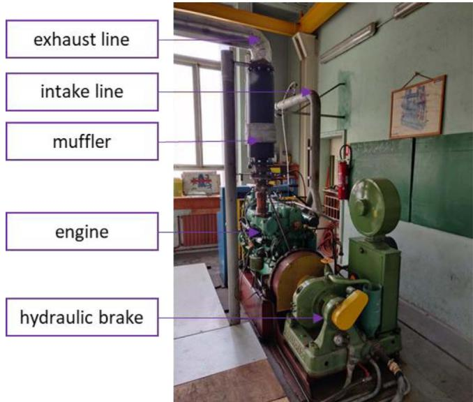
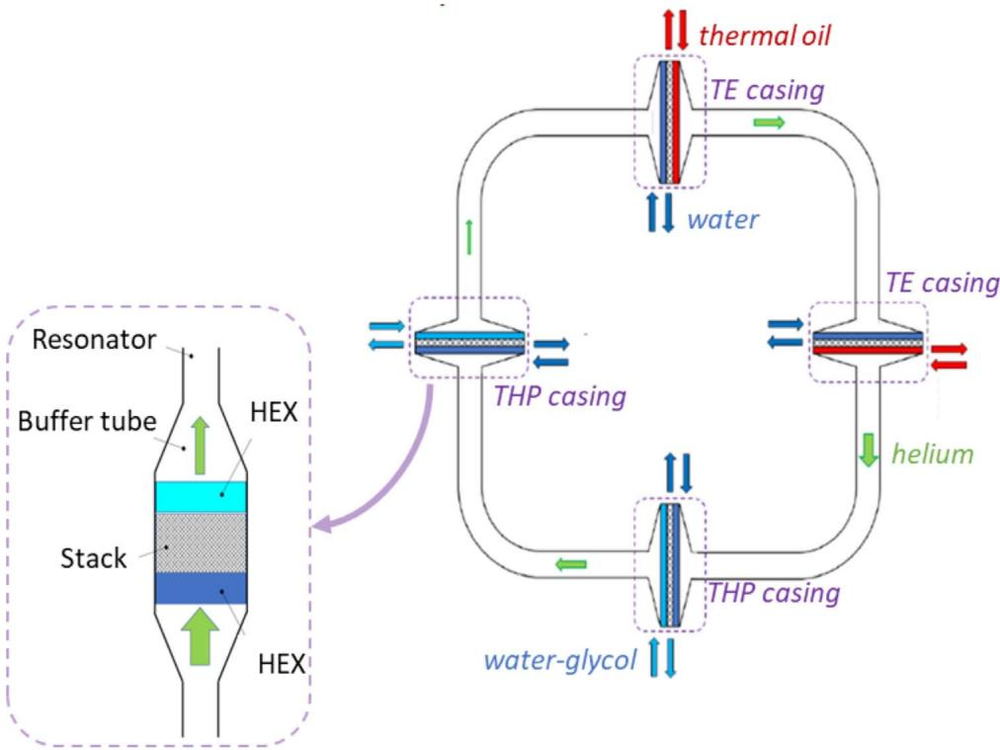
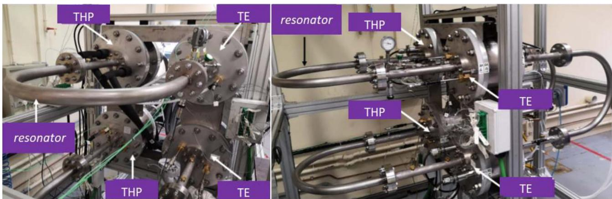
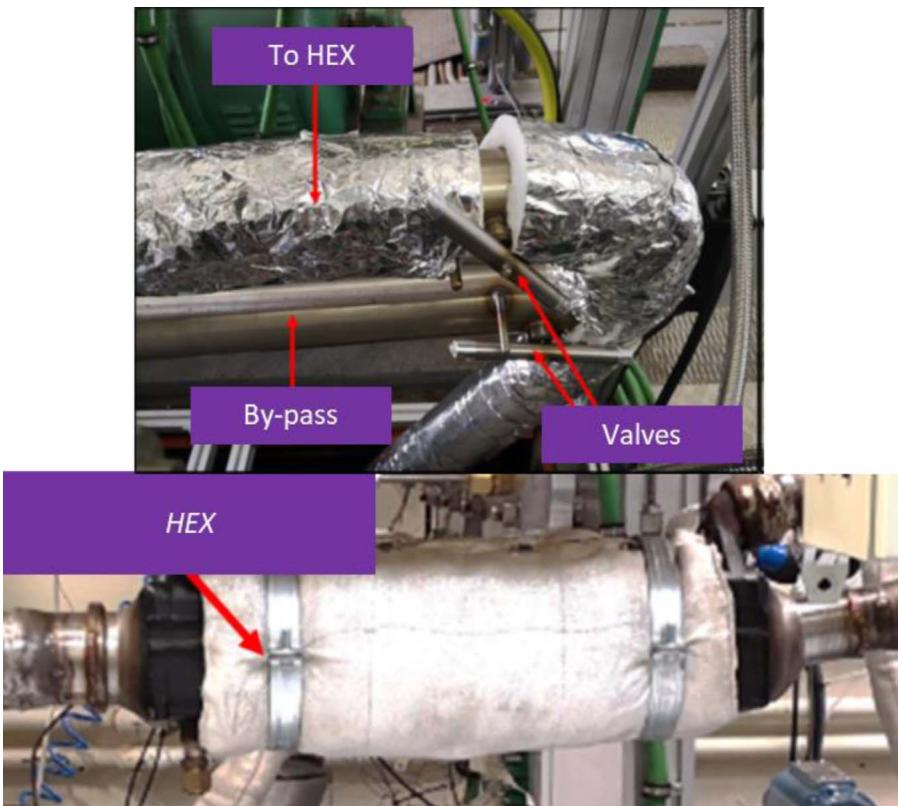
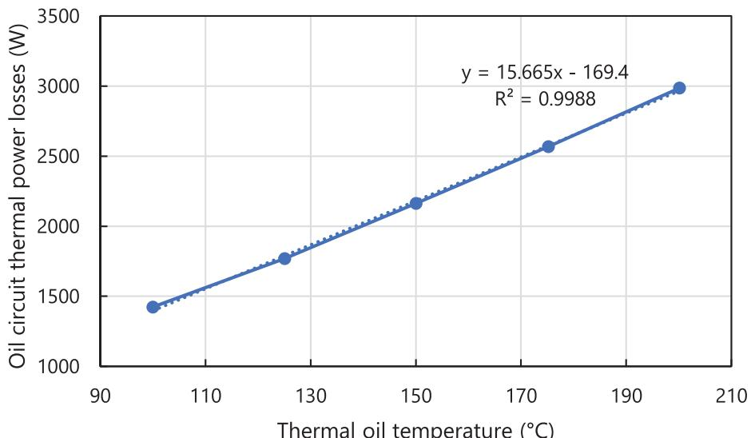
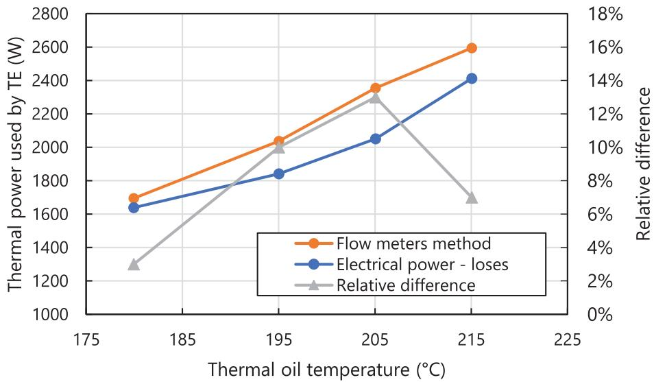
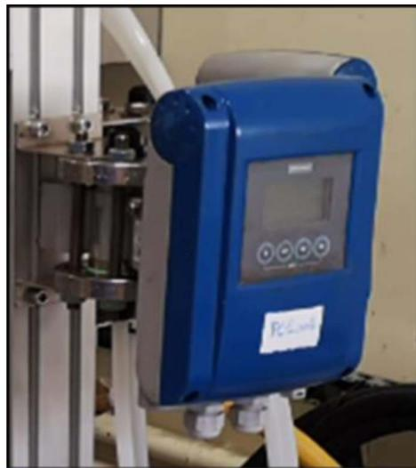
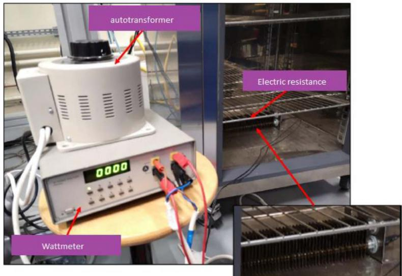
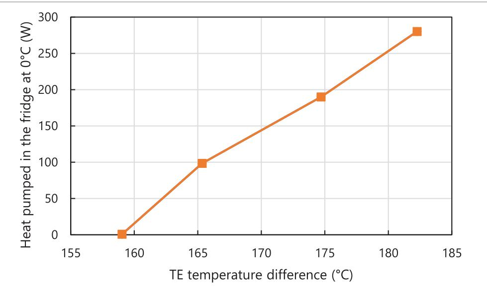
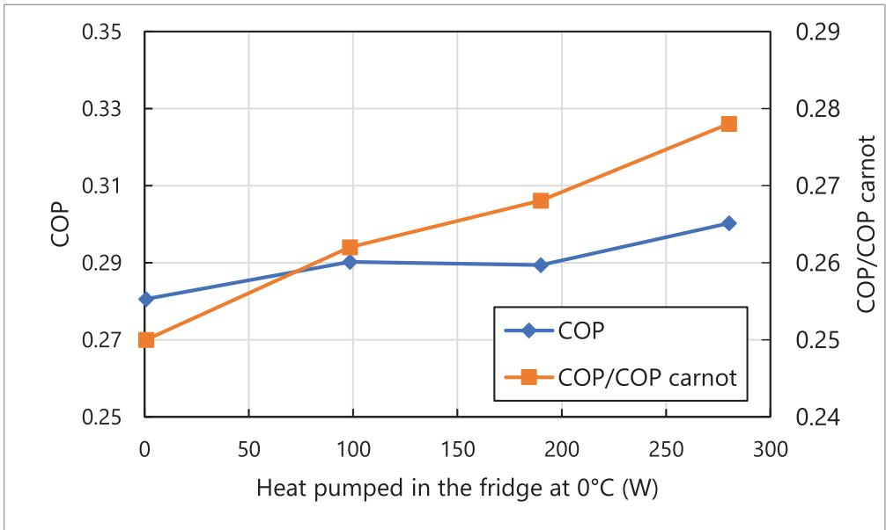

REGULAR ARTICLE

OPEN ∂ ACCESS

# Experimental results of a waste-heat powered thermoacoustic refrigeration system for ships

Jonas Thiaucourt1,2,\* , Pedro Merino Laso2,3, and Bruno Eon²

1 Decarbonization and Depollution of Energy Systems (D2SE), Ecole Centrale de Nantes, LHEEA Lab. (ECN/CNRS), 44000 Nantes, France

2 French Maritime Academy (ENSM), 44000 Nantes, France

3 French Naval Academy Research Institute, IRENav EA 3634, BRCM Brest, Ecole Navale C600, 29240 Brest cedex 9, France

Received: 6 January 2023 / Accepted: 10 August 2023

Abstract. Greenhouse gas emissions are a major concern for maritime transport. The International Maritime Organization (IMO) presents Waste Heat Recovery Systems (WHRS) from engine exhaust gas as a viable solution to improve energy utilization and reduce greenhouse gas emissions for marine power plants. In this paper, we present an original thermoacoustic WHRS and its associated experimental setup for validation. This WHRS aims to transport heat from a lower to a higher temperature reservoir (heat pump) and maintain a fridge at $0 ~ ^ { \circ } \mathrm { C }$ For the experimental setup, exhaust gases from a 4-stroke marine diesel engine are used to generate pressure waves (work) in thermoacoustic engines. The main result is the Coefficient of Performance (COP) of the system, around 0.3, assessed for various cold loads. The first results estimate that the system could substitute part of the chiller cold production onboard. Also, a preliminary economic analysis suggests that this system could perform 2% fuel savings that allow for a payback time below one year.

Keywords: Marine engineering thermoacoustics, Ship efficiency, Shipping decarbonization, Waste heat recovery systems.

## Nomenclature

## Abbreviations

COP Coefficient Of Performance   
F-gases Fluorinated gases   
HEX Heat Exchanger   
ICE Internal Combustion Engine   
IMO International Maritime Organization   
LHV Lower Heating Value   
TE Thermoacoustic Engine   
THP Thermoacoustic Heat Pump   
WHRS Waste Heat Recovery System

## Symbols

$c _ { p _ { \mathrm { t o } } }$ Thermal oil-specific heat capacity $c _ { p _ { \mathrm { w g } } }$ Water-glycol-specific heat capacity $\dot { m } _ { \mathrm { t o } }$ Thermal oil mass flow rate $\dot { m } _ { \mathrm { w g } }$ Water-glycol mass flow rate $Q _ { e }$ Electric power $\dot { Q } _ { t l _ { \mathrm { t o } } }$ Thermal power losses in the oil circuit

$\dot { Q } _ { \mathrm { t o } }$ Thermal power used by the thermoacoustic engines   
$\dot { Q } _ { \mathrm { w g } }$ Thermal power removed by the heat pumps   
$T _ { t o _ { \mathrm { i n } } } / T _ { t o _ { \mathrm { o u t } } }$ Thermal oil temperature at the thermoacoustic engine inlet/outlet   
$T _ { w g _ { \mathrm { i n } } } / T _ { w g _ { \mathrm { o u t } } }$ Water-glycol temperature at the heat exchanger inlet/outlet

## 1 Introduction

The International Maritime Organization's (IMO) greenhouse gas strategy aims to reduce the shipping industry's total carbon emissions by 50% according to the 2008 levels by the year 2050 [1]. To achieve this target, the IMO is considering technical and operational initiatives [2]. Some measures are long-term (beyond 2050) options such as switching to zero-carbon fuels. Others are short-term and mid-term candidates (before 2050) for existing ships.

A short-term and mid-term option is improving the marine diesel engine efficiency. Indeed, the diesel engine is by far the most widely used option for power production on a wide range of vessel types. It is expected that marine diesel engines will not replaced in a foreseeable period of time [3].

In a diesel engine, around 60% of the fuel heat energy is lost to the environment as waste heat, half of it in exhaust gas. Using waste heat for heating services or power production can enhance the ship's energy efficiency, reducing its fuel consumption and emissions [4].

At exhaust, the temperature is high enough so that the energy can be recovered by an economically viable solution (a common payback time is around 3 years) [5]. Several exhaust gas Waste Heat Recovery Systems (WHRS) are available, exploiting different thermodynamic cycles, notably:

• Rankine cycle [6];

• Kalina cycle [7];

• Stirling cycle [8];

and also:

• Exhaust gas turbine systems [9];

• Thermoelectric generation systems [10];

Onboard fuel saving estimations are in the range of 4–16% [11]. This study focuses on a Stirling cycle-based WHRS, a thermoacoustic device. More information about other WHRS can be found in Singh and Pedersen's work [12].

The thermoacoustic device is based on the thermoacoustic effect. A temperature gradient imposed on a solid material enables a compressible fluid to undergo Stirling thermodynamic cycle in the vicinity of the solid material [13]. This effect has been observed for centuries. For instance, glass blowers produced heat-generated sound when blowing a hot bulb at the end of a cold narrow tube. Thermoacoustic references were compiled by Garrett [14] and Swift [15], and are recommended for those seeking a wide range of information sources. The work in these sound waves can then be harnessed with a piston to drive a flywheel or a linear alternator, producing electricity.

In 2010, Kees de Blok presented a thermal 100 kW thermoacoustic power generator prototype to be installed at a paper manufacturing plant in the Netherlands for converting part of the flue gas at 150 °C from the paper drying process into electricity [19].

Alternatively, the pressure work can be used to transport heat from a lower to a higher temperature reservoir in what is known as a thermoacoustic heat pump or refrigerator [16]. This last option (heat pump or refrigerator) involves no moving mechanical parts and therefore low capital and operational expenditures.

According to the Fourth IMO 2020 GHG study R22, R134A, and R404 refrigerant fluids are used for chilling, freezing, air conditioning, or to maintain temperature inside a hold onboard. The total refrigerant emissions correspond to 18.2 million tons of CO2-equivalent emissions. Therefore, using a GWP neutral gas in a waste heat thermoacoustic engine in combination with a thermoacoustic heat pump is perceived as a promising way to substitute part of the high-impact chiller production with a cheap low-impact cold producer. To fully appreciate the solution potential, its Coefficient Of Performance (COP) must be quantified experimentally.

As far as the authors are aware, the only design and construction of a combined waste-heat driven thermoacoustic engine and heat-pump system directly powered (not simulated by electrical heater or gas burner) by exhaust gases from an Internal Combustion Engine (ICE) has been published by D. Gardner and C.Q. Howard in 2009 [18]. The system was described but the experimental results were not presented. ICEs have a pulsating behavior due to the opening and closing of the pistons, slightly impacting heat exchange. At this point, the present experiment differs from previous studies on the potential of cold production from thermoacoustic converters using waste heat such as H2020 European projects [20].

In this study, the authors present a slightly different setup and, to the best of the author's knowledge for the first time, some experimental results. This project searches for validating the proposed system that is currently in TRL (Technology Readiness Level) level 5, that is, this technology is validated in a relevant industrial environment. For this, the experimental setup looks to validate the pertinence and the economic interest of the solution. At a later stage, a commercial solution will be proposed, and a more accurate validation will be needed. The paper is organized as follows. First, the experimental setup and equipment are described. Then, the results are presented and discussed. Last, a preliminary economic analysis is exposed to assess fuel and CO2 savings. Finally, future works and perspectives are proposed.

## 2 Experimental setup

The experimental setup simulates the configuration of a vessel using a marine diesel propulsion system. The size of the propulsion system can correspond to different types of ships up to 30 m. Also, this motoring system can be used as a diesel generator.

The experimental platform is made of four main components:

• An Internal Combustion Engine (ICE);

• The thermoacoustic Waste Heat Recovery System (WHRS);

• À gas/liquid heat exchanger (noted HEX) to recover the exhaust gas thermal energy;

• A fridge.

These elements are described in the following subsections.

All these systems are equipped with a set of sensors to monitor the functioning of the whole platform. A computing server allows the gathering and orderly storage of pertinent data for further analysis. All sensors are adapted to the industrial environment with operational characteristics and with a pre-calibration in the factory to reduce errors. We have selected these sensors regarding their performances, i.e., errors and accuracy of the measured values keeping in mind that the aim of this work is to validate the prototype in industrial conditions. For validation of a system in TRL 5 and the commitments undertaken as not measuring radiation effects, we consider that all the errors related to sensors can be insignificant and then negligible. For this, they have no impact on the conclusions of this work.

As the thermoacoustic WHRS is a passive system, there is no need to control it. The validation procedure consists of modifying analyzed variables, such as different cold loads, to obtain the values that we present in the next sections. All the sensors are connected to a computer that saves all the historical data. Later, data can be exported into a CSV file to be analyzed.

## 2.1 The internal combustion engine

The engine is a BAUDOUIN 4-stroke, 4 cylinders, atmospheric marine diesel engine. Its main characteristics are given in the table below (Table 1). The engine is connected to a hydraulic dynamometer (hydraulic brake) to dissipate the produced mechanical work. The exhaust line is equipped with a muffler (see Fig. 1).

## 2.2 The thermoacoustic WHRS

The thermoacoustic WHRS is made of two low-temperature (below 210 °C) thermoacoustic engines (noted TE) that provide, via helium in a resonator, acoustic power to two thermoacoustic heat pumps (noted THP).

Each thermoacoustic engine and heat pump is made of two liquid/gas heat exchangers and a stack. Figure 2 is a diagram of the thermoacoustic WHRS. For the thermoacoustic engines, the heat source exchanger (in red) uses thermal oil while the heat sink uses water (in dark blue). For the thermoacoustic heat pumps, the heat is pumped from water-glycol (in light blue) and transferred to water (in dark blue).

All the heat exchangers are brazed plate-and-fin models and have the same geometry. The water heat exchangers are in aluminum, while the oil and water-glycol ones are made of stainless steel. The connection with the resonator tubes is made through a buffer tube. The buffer tube ensures a smooth acoustic impedance adaptation between the thermoacoustic engines or heat pumps and the resonator tubes.

The stack is a porous media with:

a large exchange surface with the working fluid (helium) for high thermal exchange rates;

\- an important porosity to reduce perturbations on the acoustic wave;

\- a hydraulic radius adapted to the thermal boundary layer to optimize the Stirling thermodynamic cycle.

The resonator allows the acoustic wave to circulate between the engines and the heat pumps. The helium is contained at a mean pressure of 25 bars to increase the power density. The resonator is made of two parts. Firstly, stainless tubes between the thermoacoustic engines and heat pumps. The tube's inner diameter is 35 mm. Secondly, casings containing the heat exchangers, thermal insulation, and fluid connections (water, water-glycol, oil). Figure 3 presents pictures of the thermoacoustic WHRS.

Table 1. Internal combustion engine main characteristics.
<table><tr><td>Description</td><td>Value</td><td>Unit</td></tr><tr><td>Bore</td><td>150</td><td>mm</td></tr><tr><td>Stroke</td><td>150</td><td>mm</td></tr><tr><td>Swept volume</td><td>10.6</td><td>L</td></tr><tr><td>Maximum continuous power</td><td>100</td><td>kW</td></tr><tr><td>Maximum rotational speed</td><td>1800</td><td>rpm</td></tr><tr><td>Volumetric ratio</td><td>18:1</td><td></td></tr></table>

  
Figure 1. Picture of the engine test bench.

## 2.3 The waste heat exchanger and the oil circuit

A bypass is installed on the exhaust line after the muffler to heat oil through a waste heat recovery Heat EXchanger (HEX). The by-pass valve is used to prevent heating the oil above the maximum allowable temperature of $2 1 0 ~ ^ { \circ } \mathrm { C } .$ Figure 4 presents pictures of the bypass system and the waste heat exchanger.

To compute the thermal power losses in the oil circuit $( \dot { Q } _ { t l _ { t o } } )$ at a given oil temperature, the helium is removed from the resonator to make sure the thermoacoustic process is not taking place. Then, the waste heat exchanger is replaced by an electrical resistance. The electrical power required to maintain the oil at a set temperature at the thermoacoustic engine inlet is measured using a wattmeter. At steady state, this power equals $\dot { Q } _ { t l _ { t o } }$

The results are given in the figure below (Fig. 5). The figure shows how the thermal power losses evolve linearly with the oil temperature. For an oil at $2 0 0 ~ ^ { \circ } \mathrm { C }$ at the thermoacoustic engine inlet, the thermal power losses in the circuit are measured to be 3 kW.

  
Figure 2. Diagram of the thermoacoustic WHRS, inspired by [19].

  
Figure 3. Pictures of the thermoacoustic WHRS.

The thermal power used by the thermoacoustic engines $( \dot { Q } _ { t o } )$ is computed using equation (1). Flow meters are used to measure the oil mass flow rate $( \dot { m } _ { t o } )$ and temperature sensors are used to measure the oil temperature at the thermoacoustic engine inlet $( T _ { t o _ { \mathrm { i n } } } )$ and outlet $( T _ { t o _ { \mathrm { o u t } } } )$ . The specific heat capacity $\left( c _ { p _ { \mathrm { t o } } } \right)$ is computed at the mean oil temperature. Vortex flow meters are used for the oil mass flow rate. The vortex sensor gives a volumetric flow rate but thanks to integrated temperature and pressure sensors, the density can be computed to end with an accurate mass flow rate.

To validate the instrumental setup, the results are compared to a second method to compute the thermal power used by the thermoacoustic engines $( \dot { Q } _ { \mathrm { t o } } )$ . In this second method, the waste heat exchanger is replaced by an electrical resistance to heat the oil. The electrical power $( { \dot { Q } } _ { e } )$ consumed by the resistance is measured using a wattmeter. It equals the heat received by the thermal oil. The thermal power used by the thermoacoustic engines is the difference between the electrical power $( { \dot { Q } } _ { e } )$ and the circuit thermal power losses $( \dot { Q } _ { t \mathrm { l _ { t o } } } )$ computed previously (Eq. (2)).

$$
\dot { Q } _ { \mathrm { t o } } = \dot { m } _ { \mathrm { t o } } \cdot c _ { p _ { \mathrm { t o } } } \cdot ( T _ { t o _ { \mathrm { i n } } } - T _ { t o _ { \mathrm { o u t } } } ) ,\tag{1}
$$

$$
\dot { Q } _ { \mathrm { t o } } = \dot { Q } _ { e } - \dot { Q } _ { t l _ { \mathrm { t o } } } .\tag{2}
$$

  
Figure 4. Top picture: the by-pass-piping. Bottom picture: the waste heat exchanger.

  
Thermal oil temperature (°C)  
Figure 5. The thermal power losses in the oil circuit as a function of the oil temperature measured at the thermoacoustic engine inlet.

The results of the two methods are shown in Figure 6. The mean relative difference between the two methods is 8% with a maximum value of 13%. This relative difference is acceptable for the present purpose. The instrumental setup to compute the thermal power used by the thermoacoustic engines $( \dot { Q } _ { \mathrm { t o } } )$ is validated.

## 2.4 The fridge

The water-glycol circuit is used to cool an industrial fridge maintaining $\mathrm { ~ \ i ~ } 0 \mathrm { { ^ \circ C } }$ in the fridge. The thermal power losses in the circuit between the thermoacoustic heat pumps and the fridge plus the fridge's thermal power losses at $\mathrm { ~ \bar { 0 } ~ ^ { \circ } C }$ equal the heat power removed by the heat pumps $( \dot { Q } _ { \mathrm { w g } } )$ from the water-glycol. The thermal power removed from the water-glycol is computed using equation (3). A flow meter is used to measure the water-glycol mass flow rate $( \dot { m } _ { \mathrm { w g } } )$ and temperature sensors are used to measure water glycol temperature at the heat exchanger inlet $( T _ { \mathrm { w g _ { \mathrm { i n } } } } )$ and outlet $( T _ { \mathrm { w g _ { o u t } } } )$ . A Krohne Optiflux 4100 electromagnetic flow meter is used (Fig. 7). The standard measurement accuracy of this sensor is ±0.3% or ±1 mm/s of Measured Value (MV) and it is factory-calibrated. Temperature sensors are type K thermocouples with an accuracy of $\pm 1 . 5 ~ ^ { \circ } \mathrm { C }$ and they are also factory calibrated. The specific heat capacity $( c _ { p _ { \mathrm { w g } } } )$ is computed at the mean water-glycol temperature. The thermal power losses computed are equal to 487 W:

  
Figure 6. The thermal power used by the TE at different thermal oil inlet temperature and computed using two methods with the relative difference (the flow meters method used as reference).

$$
\dot { Q } _ { \mathrm { w g } } = \dot { m } _ { \mathrm { w g } } \cdot c _ { p _ { \mathrm { w g } } } \cdot \left( T _ { \mathrm { w g _ { i n } } } - T _ { \mathrm { w g _ { o u t } } } \right) .\tag{3}
$$

## 3 Results

The aim is to compute the Coefficient Of Performance (COP) of the thermoacoustic WHRS. The COP is defined as the thermal power removed from the water glycol by the thermoacoustic heat pump $( \dot { Q } _ { \mathrm { w g } } )$ over the thermal power given by the oil to the thermoacoustic engine $( \dot { Q } _ { t o } )$ (Eq. (4)):

$$
\mathrm { C O P } = \frac { \dot { Q } _ { \mathrm { w g } } } { \dot { Q } _ { \mathrm { t o } } } = \frac { \dot { m } _ { \mathrm { w g } } \cdot c _ { p _ { \mathrm { w g } } } \cdot \left( T _ { \mathrm { w g _ { i n } } } - T _ { \mathrm { w g _ { o u t } } } \right) } { \dot { m } _ { \mathrm { t o } } \cdot c _ { p _ { \mathrm { t o } } } \cdot \left( T _ { \mathrm { t o _ { i n } } } - T _ { t o _ { o u t } } \right) } .\tag{4}
$$

To compute the COP at various cold loads, an electric resistance is installed in the fridge (Fig. 8). When the electrical load is increased, the ICE load is also increased via the hydraulic dynamometer. Consequently, the exhaust gas and thermal oil temperatures rise, the thermoacoustic engines produce more work, and the heat pumping effect increases to maintain the fridge at $0 ~ ^ { \circ } \mathrm { C }$ (Fig. 9). The accuracy of the wattmeter used to measure power consumption is 2%.

  
Figure 7. Electromagnetic mass flow meter Krohne Optiflux 4100.

Figure 10 shows the COP as a function of the amount of heat removed from the fridge. It is seen that the COP is almost constant, at 0.3. The maximum amount of heat pumped from the fridge is 258 W. It is to be noted that this value is not the cold produced by the thermoacoustic WHRS since 487 W is lost in the water-glycol circuit between the thermoacoustic heat pumps and the fridge.

The theoretical maximum global COP, named COP Carnot, is computed. It is the product of the thermoacoustic engines theoretical maximum efficiency by the heat pumps maximum theoretical COP. The ratio of the COP to the Carnot COP gives the ratio of the actual cooling effect to the theoretically maximum obtainable cooling effect (Fig. 10). Figure 10 shows that the ratio increases with the cold load. The ratio maximum value is 0.28. Since the COP is almost constant, this means that a higher proportion of work is lost in the resonator when the cold load increases. It is to be noted, that COP could be increased by further development on the resonator and heat exchangers' geometry.

  
Figure 8. Electrical resistance installed in the fridge.

  
Figure 9. Heat pumped in the fridge at $0 ~ ^ { \circ } \mathrm { C }$ (wattmeter recording) and thermoacoustic engine temperature difference.

## 3.1 Economic analysis

The thermoacoustic WHRS could substitute part of chiller production onboard. Following interviews with shipyards, the assumptions made to perform the economic analysis are presented in Table 2 and detailed below.

The engine energy conversion efficiency (4-stroke diesel marine engine) is around 40%. In other words, 40% of the fuel's chemical energy is converted into mechanical energy, the rest being transferred as thermal energy to the exhaust gas, the cooling water, the lubricating oil, and through radiation. The exhaust gas flow is usually used to drive the turbine for turbocharged engines. Also, the temperature in the exhaust pipe must remain above $2 0 0 ^ { \circ } \mathrm { C }$ to avoid corrosion. Therefore, only 20% of the exhaust gas thermal power is utilized for the WHRS. This is a conservative hypothesis. Further research is required for optimal sizing of the thermoacoustic WHRS with the engine turbocharger. The engine drives an alternator producing electricity with

  
Figure 10. The COP and the COP/COP Carnot as a function of the heat pumped in the fridge at $0 ~ ^ { \circ } \mathrm { C }$

Table 2. Economic analysis assumptions.
<table><tr><td>Engine energy conversion efficiency (%) Thermal power in exhaust gas (% fuel power) Utilized thermal power for the WHRS (% thermal power in exhaust gas) Alternator efficiency (%) Chiller COP WHRS COP Fuel LHV (MJ/kg) Annual operation time (%)  $\mathrm { C O _ { 2 } }$  emission factor 3.21 WHRS solution cost ($/kW cold power) 1000 Fuel cost  $( { \mathfrak { F } } / \mathrm { t } )$  600</td><td>40 33 20 95 4 0.4 42.7 80</td></tr></table>

95% efficiency. This electricity is then used by a chiller (cooling device) with a COP of 4. This means that 1 J of electric energy allows removing 4 J of thermal energy from the cooling fluid. At an industrial level, the thermoacoustic WHRS could likely reach a COP of 0.4. Here, the COP is the thermal power removed from the cooling fluid by the thermoacoustic heat pump over the thermal power given by the oil to the thermoacoustic engine. To compute annual fuel savings in tons, the marine diesel oil Low Heating Value (LHV) is used (42.7 MJ/kg) and it is assumed the engine runs 80% of the time over a year. To compute $\mathrm { C O _ { 2 } }$ savings, an emission factor of 3.21 is used [1]. At industrial maturity, the thermoacoustic WHRS will cost no more than 1000\$ per kW of cold power production. The size and mass of the thermoacoustic WHRS are comparable to a chiller of the same power.

Due to the difficulty of estimating fuel prices in the future, a conservative hypothesis of \$600/t has been chosen [18].

The economic analysis results are presented in Table 3. With the mentioned assumptions, producing 1.9 MW with chillers and the thermoacoustic system (case 2) compared to chillers solely (case 1) allows saving $2 \%$ on fuel consumption and CO2 emissions. The thermoacoustic WHRS will produce 30 kW. The payback time is less than a year.

Moreover, the thermoacoustic WHRS being a chiller substitute, lowers the amount of F-gases fugitive emissions. F-gas emissions are primarily fugitive emissions from refrigerant and air conditioning. For newer vessels, R404a is assumed to be the refrigerant for provisional cooling purposes with a warming potential relative to $\mathrm { C O _ { 2 } }$ (100-year horizon) of 3260 and an annual mass leakage of 30% [1].

## 4 Conclusion, discussion, and perspectives

This paper introduces a novel experimental setup with the objective of validating the pertinence of an innovative thermoacoustic WHRS. Exhaust gases from an internal combustion engine are used to generate pressure waves (work) through thermoacoustic engines. This work is used to transport heat from a lower to a higher temperature reservoir (heat pump) and maintain a fridge at $0 ~ { } ^ { \circ } \mathrm { C }$

The results of the experimentation present a Coefficient Of Performance (COP) of the thermoacoustic Waste Heat Recovery System (WHRS) near 0.3. A preliminary economic analysis of the system introduces the possibility that, if installed onboard to substitute part of the high-impact chiller production, the payback time will likely be below one year.

This is to note that the results of this study must be considered with the due understanding of the following limits:

• Uncertainty propagation analysis has not been performed.

Table 3. Economic analysis results.
<table><tr><td></td><td>Case 1 – Ship with chillers</td><td>Case 2 – Ship with chillers + waste heat thermoacoustic chiller</td></tr><tr><td>Fuel chemical power (MW)</td><td>1.25</td><td>1.23</td></tr><tr><td>Engine mechanical power (MW)</td><td>0.5</td><td>0.49</td></tr><tr><td>Electrical power (MW)</td><td>0.475</td><td>0.47</td></tr><tr><td>Cold power production from chillers (MW)</td><td>1.9</td><td>1.87</td></tr><tr><td>Utilized exhaust gas thermal power (MW)</td><td>0</td><td>0.081</td></tr><tr><td>Cold power production from thermacoustic WHRS (MW)</td><td>0</td><td>0.03</td></tr><tr><td>Total cold power production (MW)</td><td>1.9</td><td>1.9</td></tr><tr><td>Fuel savings (%) (compared to case 1)</td><td></td><td>2%</td></tr><tr><td>Annual fuel consumption (t)</td><td>73855</td><td>72594</td></tr><tr><td>Annual  $\mathrm { C O _ { 2 } }$  emissions (t)</td><td>237074</td><td>233026</td></tr><tr><td>Payback time (years)</td><td></td><td>0.04</td></tr></table>

• Radiation effects are not measured

• Optimization of the system has not been performed.

Those identified limits are to be investigated in future work.

Also, the experimental setup could be enhanced to assess another application for cold energy, engine inlet air cooling. Indeed, on a turbocharged engine, the inlet air is cooled after the turbocharger. Tropical conditions limit the cooling capacity (air is hot and humid while sea water is warm). Using the thermoacoustic WHRS for inlet air cooling could ensure optimum inlet air temperature and humidity at all times, improving fuel consumption and CO2 emissions. In this utilization, the cold production (exhaust gas flow) is linked to the need (intake airflow) keeping the system simple for onboard implementation.

Acknowledgments. This study was supported by the region Pays de la Loire in France (ANTARCTICA project). The authors would like to thank the industrial partners: Equium and Chantiers de l’Atlantique.

## References

1 IMO (2020) Fourth IMO Greenhouse Gas Study – Executive Summary.

2 Bouman E.A., Lindstad E., Rialland A.I., Strømman A.H. (2017) State-of-the-art technologies, measures, and potential for reducing GHG emissions from shipping – A review, Transp. Res. Part D Transp. Environ. 52, 408–421. https://doi.org/10.1016/j.trd.2017.03.022.

3 Eyring V. (Sep. 2005) Emissions from international shipping: 2. Impact of future technologies on scenarios until 2050, J. Geophys. Res. 110, D17, D17306. https://doi.org/10.1029/ 2004JD005620.

4 Baldi F., Johnson H., Gabrielii C., Andersson K. (2015) Energy and exergy analysis of ship energy systems – the case study of a chemical tanker, Int. J. Thermodyn. 18, 2, 82. https://doi.org/10.5541/ijot.5000070299.

5 Theotokatos G., Livanos G. (2013) Techno-economical analysis of single pressure exhaust gas waste heat recovery systems in marine propulsion plants, Proc. Inst. Mech. Eng. Part M J. Eng. Marit. Environ. 227, 2, 83–97. https://doi. org/10.1177/1475090212457894.

6 Akman M., Ergin S. (2019) An investigation of marine waste heat recovery system based on organic Rankine cycle under various engine operating conditions, Proc. Inst. Mech. Eng. Part M J. Eng. Marit. Environ. 233, 2, 586–601. https://doi. org/10.1177/1475090218770947.

7 Feng Y., Du Z., Shreka M., Zhu Y., Zhou S., Zhang W. (2020) Thermodynamic analysis and performance optimization of the supercritical carbon dioxide Brayton cycle combined with the Kalina cycle for waste heat recovery from a marine low-speed diesel engine, Energy Convers. Manag. 206, 112483. https://doi.org/10.1016/j.enconman.2020.112483.

8 Ramesh U., Kalyani T. (2012) Improving the efficiency of marine power plant using Stirling engine in waste heat recovery systems, Int. J. Innov. Res, 1, 10, 449–466.

9 Benvenuto G., Trucco A., Campora U. (2016) Optimization of waste heat recovery from the exhaust gas of marine diesel engines, Proc. Inst. Mech. Eng. Part M J. Eng. Marit. Environ. 230, 83–94. https://doi.org/10.1177/ 1475090214533320.

10 Kristiansen N.R., Nielsen H.K. (2010) Potential for usage of thermoelectric generators on ships, J. Electron. Mater. 39, 1746–1749. https://doi.org/10.1007/s11664-010-1189-1.

11 Balcombe P., et al. (2019) How to decarbonise international shipping: Options for fuels, technologies and policies, Energy Convers. Manag. 182, 72–88. https://doi.org/10.1016/J. ENCONMAN.2018.12.080.

12 Singh D.V., Pedersen E. (2016) A review of waste heat recovery technologies for maritime applications, Energy Convers. Manag. 111, 315–328. https://doi.org/10.1016/j enconman.2015.12.073.

13 Jaworski A.J. (2021) Introduction to Thermoacoustic Technologies. [Online]. Available: https://sites.google.com/site/ professorarturjjaworski/thermoacoustics. [Accessed: 03-Jun-2021].

14 Garrett S.L. (2004) Resource Letter: TA-1: Thermoacoustic engines and refrigerators, Am. J. Phys. 72, 1, 11–17. https://doi.org/10.1119/1.1621034.

15 Swift G.W. (2017) Thermoacoustics: A Unifying perspective for some engines and refrigerators, 2nd edn., Springer International Publishing.

16 Tiwatane T., Shivprakash B. (2014) Thermoacoustic effect: the power of conversion of sound energy & heat energy: review, Int. J. Res. Technol. Stud. 1, 4.

17 Gardner D.L., Hower C.Q. (2009) Waste-heat-driven thermoacoustic engine and refrigerator, in Proceedings of Acoustics, 23–25 November 2009, Adelaide, Australia.

18 Ship & Bunker Rotterdam Bunker Prices – Ship & Bunker. [Online]. Available: https://shipandbunker.com/prices/emea/ nwe/nl-rtm-rotterdam#MGO.

19 de Blok K. (2010) Novel 4-stage traveling wave thermoacoustic power generator, in Proceedings of the ASME 2010 3rd Joint US-European Fluids Engineering Summer Meeting and 8th International Conference on Nanochannels, Microchannels, and Minichannels, August 1–5, 2010, Montreal, Canada.

20 H2020 project – From heat to cold with THEAC-25®, the Thermo Acoustic Energy Converter. https://doi.org/10.3030/ 836780.