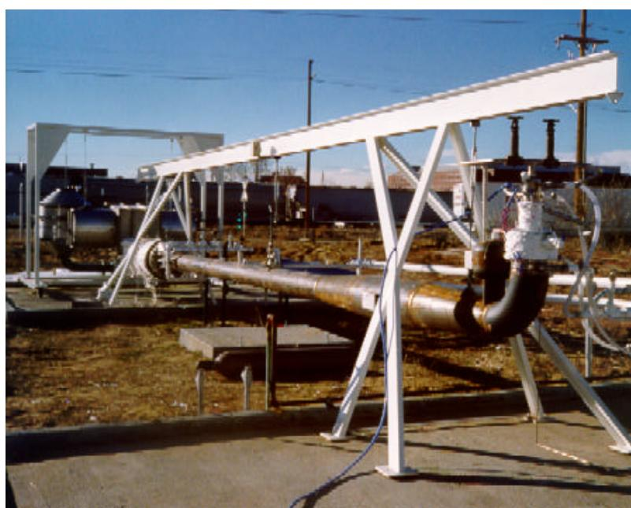
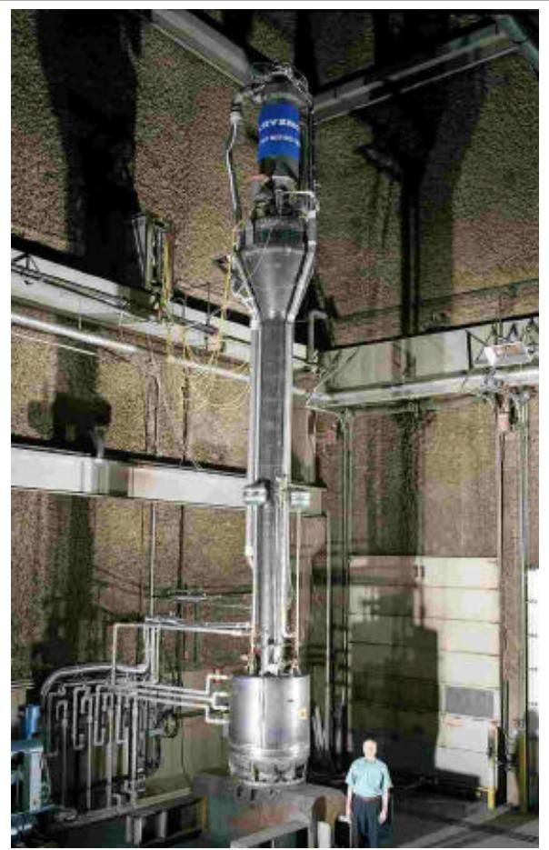
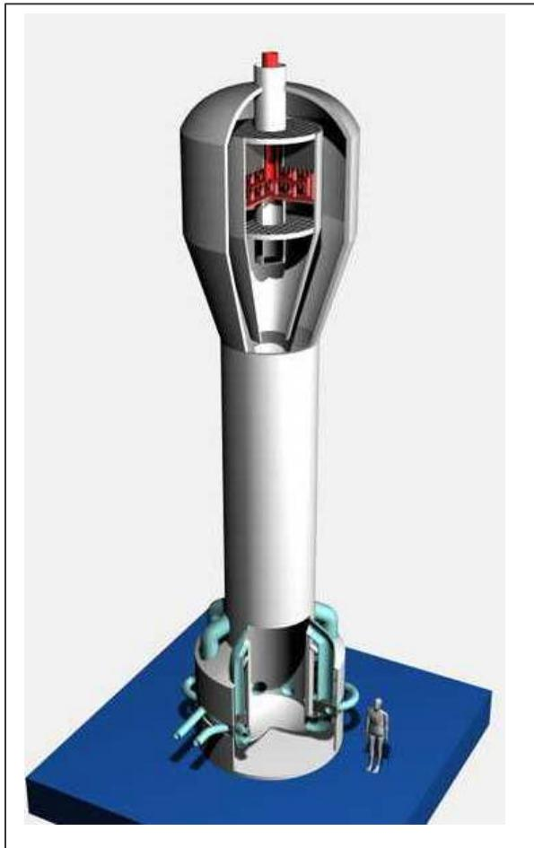
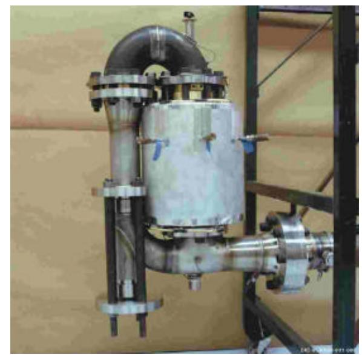
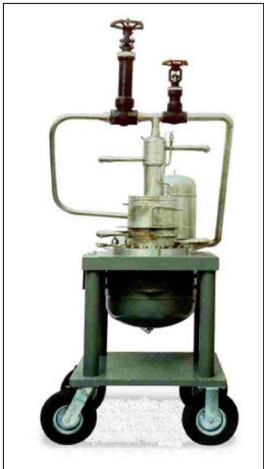

<table><tr><td>Title:</td><td>DEVELOPMENT OF A THERMOACOUSTIC NATURAL GAS LIQUEFIER John J. Wollan, Gregory W. Swift,</td></tr><tr><td>Author(s):</td><td>Scott Backhaus, David L. Gardner</td></tr><tr><td>Submitted to:</td><td>http://lib-www.lanl.gov/cgi-bin/getfile?00852323.pdf</td></tr></table>

# DEVELOPMENT OF A THERMOACOUSTIC NATURAL GAS LIQUEFIER

John J. Wollan, Praxair Inc., Denver, CO 80239

Gregory W. Swift, Los Alamos National Laboratory, Los Alamos, NM 87545   
Scott Backhaus, Los Alamos National Laboratory, Los Alamos, NM 87545   
David L. Gardner, Los Alamos National Laboratory, Los Alamos, NM 87545

Prepared for Presentation at 2002 AIChE New Orleans Meeting, New Orleans, LA March 11-14

AIChE shall not be responsible for statements or opinions contained in papers printed in its publications

## Abstract

Praxair, in conjunction with the Los Alamos National Laboratory, is developing a new technology, thermoacoustic heat engines and refrigerators, for liquefaction of natural gas. This is the only technology capable of producing refrigeration power at cryogenic temperatures with no moving parts. A prototype, with a projected natural gas liquefaction capacity of 500 gallons/day, has been built and tested. The power source is a natural gas burner. Systems will be developed with liquefaction capacities up to 10,000 to 20,000 gallons per day. The technology, the development project, accomplishments and applications are discussed.

## Introduction

In February 2001 Praxair, Inc. purchased the acoustic heat engine and refrigeration development program from Chart Industries. Chart (formerly Cryenco, which Chart purchased in 1997) and Los Alamos had been working on the technology development program since 1994. The purchase included assets and intellectual property rights for thermoacoustically driven orifice pulse tube refrigerators (TADOPTR), a new and revolutionary Thermoacoustic Stirling Heat Engine (TASHE) technology, aspects of Orifice Pulse Tube Refrigeration (OPTR) and linear motor compressors as OPTR drivers. Praxair, in cooperation with Los Alamos National Laboratory (LANL), the licensor of the TADOPTR and TASHE patents, is continuing the development of TASHE-OPTR natural gas powered, natural gas liquefiers.

The liquefaction of natural gas, which occurs at -161°C (-259°F) at atmospheric pressure, has previously required rather sophisticated refrigeration machinery. The 1990 TADOPTR invention by Drs. Greg Swift (LANL) and Ray Radebaugh (NIST) demonstrated the first technology to produce cryogenic refrigeration with no moving parts [1]. Thermoacoustic engines and refrigerators use acoustic phenomena to produce refrigeration from heat. The basic driver and refrigerator consist of nothing more than helium-filled heat exchangers and pipes, made of common materials, without exacting tolerances.

The liquefier development program is divided into two components: Thermoacoustically driven refrigerators and linear motor driven refrigerators (LOPTRs). LOPTR technology will, for the foreseeable future, be limited to natural gas liquefaction capacities on the order of hundreds of gallons per day. TASHE-OPTR technology is expected to achieve liquefaction capacities of tens of thousands of gallons per day. This paper will focus on the TASHE-OPTR technology because its natural gas liquefaction capacity has greater market opportunity. LOPTR development will be mentioned briefly.

The thermoacoustically driven refrigerator development program is now in the process of demonstrating the technology at a capacity of about 500 gallon/day (gpd) i.e., approximately 42,000 standard cubic feet/day, which requires about 7 kW of refrigeration power. This capacity is big enough to illuminate the issues of large-scale acoustic liquefaction at reasonable cost and to demonstrate the liquefaction of about 70% of an input gas stream, while burning about 30%. Subsequent to this demonstration a system with a capacity of approximately $1 0 ^ { 6 }$ standard cubic feet/day (scfd) = 10,000 gpd with a projected liquefaction rate of about 85% of the input gas stream will be developed.

When commercialized, the TASHE-OPTRs will be a totally new type of heat-driven cryogenic refrigerator, with projected low manufacturing cost, high reliability, long life, and low maintenance. A TASHE-OPTR will be able to liquefy a broad range of gases, one of the most important being natural gas (NG). Potential NG applications range from distributed liquefaction of pipeline gas as fuel for heavy-duty fleet and long haul vehicles to large-scale liquefaction at on-shore and offshore gas wellheads.

An alternative to the thermoacoustic driver, but with many similar technical and market advantages, is the linear motor compressor. Linear motors convert electrical power directly into oscillating linear, or axial, motion. Attachment of a piston to the oscillator results in a direct drive compressor. Such a compressor has two distinct advantages over rotary motor compressors. One, it is a completely dry system. Because there are no gearbox and roller bearings, there is no requirement for lubricants, which eliminates the cleanup issues associated with lubricants in cryogenic refrigerators driven by conventional compressors. Two, the oscillator is suspended by flexure bearings. Flexure bearings have no wearing parts and have essentially infinite lifetime. Linear motors can also be run in reverse as linear generators and can be driven by acoustic engines.

## Objective

Although most natural gas is still carried from well to user as gas in pipelines, the use of liquefied natural gas (LNG) has been increasing. A typical modern, large liquefaction plant costs a billion dollars, liquefies ${ 1 0 } ^ { 9 }$ scfd, uses 10-15% of its throughput to power itself, and has substantial operating and maintenance costs. There are, however, a number of market applications where there is a clear need for smaller, reliable, inexpensive liquefaction equipment. The primary objective of the acoustic liquefaction program is to develop a new natural gas liquefier with its inherent advantages – high reliability, low maintenance, natural gas burner powered, transportable – to address new and emerging LNG market opportunities.

## Technology Background

A Thermoacoustic Stirling Heat Engine (TASHE) converts thermal energy directly to acoustic energy in the form of a high amplitude, oscillating pressure wave - a sound wave. Orifice pulse tube refrigerators convert an oscillating pressure wave into refrigeration power, routinely at temperatures as low as -240°C. Combining these two technologies results in the only cryogenic refrigeration technology that requires no moving parts.

The TASHE technology is a very recent outgrowth of a more basic thermoacoustic engine called a Thermoacoustic Driver (TAD). The TASHE has demonstrated significantly higher efficiencies than the TAD, which will be very important in many commercial applications.

TASHE-OPTRs are “simply" a collection of heat exchangers arranged within a network of piping and all filled with pressurized helium gas. In the engine, one heat exchanger is heated to roughly 700°C (1300°F), a second heat exchanger is held at ambient temperature, and a third, between the other two, is thermally floating. The input heat sets up a temperature gradient across the heat exchangers that produces an oscillating pressure wave in the helium gas. (A process description is given in [2]). This oscillating wave drives the pulse tube refrigerator producing refrigeration power at cryogenic temperatures. The only thing moving in the system is the oscillating helium gas. The input heat can be supplied by virtually any source. A natural gas burner is used in the systems being developed in this program. The simplicity of these systems will result in low manufacturing cost and high reliability.

Although the basic hardware configuration of TASHE-OPTRs is simple, the underlying physics is very complex. Significant progress has been made at Los Alamos and at Denver in understanding and demonstrating the physics principles. Although the hardware is fundamentally simple, the combination of high temperatures and the acoustical phenomena introduce configurational constraints that result in challenging engineering issues that must be solved to reduce the concept to practice.

The technology background and basic principles of operation of thermoacoustic drivers and orifice pulse tube refrigerators were explained in the paper [3] presented at the 2000 AGA Operations Conference in Denver, CO and are not repeated here.

## Program Description

In 1994 Cryenco (which became part of Chart Industries in 1997) licensed the TADOPTR technology from LANL, formed Cooperative Research and Development Agreements (CRADA) with LANL and NIST-Boulder and began development on thermoacoustic engines and pulse-tube refrigerators. From the beginning of the Chart-LANL-NIST collaboration in 1994, the development of a practical acoustic liquefier appeared very challenging.

The development program has been divided into three phases. In Phase I in 1997, Chart, with major technical support from LANL, built and successfully operated the first natural gas fired TADOPTR (Fig. 1). It achieved a liquefaction capacity of 140 gpd (2 kW of refrigeration power at -140°C) and achieved record efficiencies for both the TAD and the OPTR. The refrigeration power was about 400 times larger than that of the first TADOPTR built by LANL and NIST in 1989.

Phase II, which began in mid 1999, is the development of a 500 gpd TASHE-OPTR (Fig. 2). The system has been built and has completed the first phase of testing. This only represents a factor of 3 scaleup in cooling power over the Phase I TADOPTR, but it represents a projected major improvement in efficiency. A number of engineering issues were identified during that testing and are in the process of being addressed. Full system testing is projected to be completed in 2001

  
Figure 1. The 140 gpd TADOPTR Prototype

The first TADOPTR built by LANL and NIST in 1989 used much simpler electric heater power for the engine and had an efficiency equivalent to liquefying only 9% of a natural-gas stream while burning the other 91%. The 140 gpd TADOPTR liquefied about 40% of the gas stream while burning 60%. The 500 gpd TASHE-OPTR is designed to liquefy 70%, burn 30%.

Phase III, the development of a 10-20,000 gpd system, should begin near the end of 2001 and is projected to take about 3.5 years. A conceptual drawing of the prototype is shown in Figure 3.

## Accomplishments

The Phase I, 140 gpd TADOPTR had one engine and one refrigerator on the resonator (Figure 1). Testing of this assembly with a burner heating the engine began in January 1997 and was completed in March 1998. This hardware achieved several record performance measurements.

1. Most powerful OPTR: 2070 Watts of cooling power at -140°C. (A factor of seven over the previous record, an early prototype built by Chart.). This represents a liquefaction rate of 140 gpd of methane.

2. Most efficient OPTR: 23% of Carnot Coefficient of Performance.

3. Most powerful TAD: 17 kW of acoustic power delivered past the middle of the resonator; approximately 12 kW delivered to the OPTR. (A factor of 12 over the previous record)

  
Figure 2. The 500 gpd TASHE-OPTR. The natural gas burner is at the very top. The TASHE is the large bulge below the burner and the OPTRs (not visible) are inside the vacuum jacket hear the bottom.

  
Figure 3. Conceptual configuration, 10,000 gpd TASHE-OPTR

This important milestone demonstrated for the first time that TADOPTR technology works at a capacity suitable for practical liquefaction of natural gas.

The first TASHE (Fig. 4) was built in 1999 by the Los Alamos team. It had an efficiency of 41% of Carnot! Drs. Greg Swift and Scott Backhaus received an R&D 100 Award for their achievement. With the successful demonstration of the Stirling heat engine, Chart decided to transition from the basic thermoacoustic driver to the thermoacoustic Stirling heat engine in the next prototype to achieve higher efficiency.

Design and construction of the Phase II 500 gpd TASHE-OPTR prototype (Figure 2) was completed in mid 2000. During the first test cycle a failure in an internal weld occurred. It took roughly 4 months to disassemble and complete the repair. During subsequent testing the TASHE was taken to about 60% of the design pressure amplitude and to about 12% of design acoustic power. The data obtained showed clearly that the engine's thermoacoustic performance was completely in line with expectations. Each of the three OPTRs was tested independently to about 25% of gross cooling power. Again, all the diagnostic measurements looked fine. During testing in January 2001 another internal weld failed which again is requiring extensive rework. Some additional changes in design will also be made. It is projected that testing will resume in the third quarter of 2001 and should be completed before yearend. The test results to date represent significant technical progress toward the goal of 500 gpd. Thus far the thermoacoustic aspects have behaved very well. The weld failures are engineering/design issues that can and are being addressed.

A number of conceptual designs for a 10,000 gpd TASHE-OPTR have been developed (e.g. Fig. 3). The major challenge in the scale up to this capacity will be the method and design of the TASHE heat transfer/hot heat exchanger. A tube-and-shell configuration, like those used in the 140 and 500 gpd prototypes is not a viable option in units this large, and has now proven to be very difficult even in the 500 gpd prototype. As part of the rework of the failed welds in that prototype, a new hot heat exchanger design will be incorporated.

## Applications

The TASHE-OPTR and associated technologies have the potential to radically change many areas of commercial cryogenic refrigeration and gas liquefaction, profoundly impacting oil importation, the environment and many industrial processes.

Figure 4. World's first TASHE

Table 1 lists a broad array of potential markets and applications where large-capacity TASHE-OPTR technology may be applied. A few comments on several of the applications from Table 1 follow.

1. Development of a liquefied natural gas (LNG) transportation infrastructure has great economic and associated environmental benefit. As a replacement for diesel fuel for heavy-duty buses and trucks it would significantly reduce oil imports. Transportation consumes roughly 65% of the oil use in the country and heavy-duty vehicles represent the majority of that use. Conversion to LNG would reduce oil import costs and the balance of payments by tens of billions of dollars per year. The National Energy Technology Laboratory of the Department of Energy has selected Appalachian-Pacific to develop a testbed system based on the TASHE-OPTR technology to convert coal bed methane to LNG for transportation fuel. The first installation will be in West Virginia.

2. A thermoacoustic refrigerator/liquefier, either as a principle system or an emergency system, can be used in conjunction with liquid-nitrogen and liquid-oxygen dewars found behind most hospitals. The system would have a gas-fired thermoacoustic engine driving several pulse tube refrigerators, which would provide the cooling necessary to liquefy and distill air to produce purified nitrogen and oxygen, and/or to reliquefy them for storage.

<table><tr><td>production</td><td>On and off-shore liquid natural gas</td></tr><tr><td></td><td>Liquefaction of natural gas from pipelines for transportation fuel</td></tr><tr><td></td><td>Natural gas liquids recovery from natural gas</td></tr><tr><td></td><td>Separation of carbon dioxide from natural gas and combustion gases</td></tr><tr><td></td><td>Recovery of volatile organic compounds from atmospheric storage tanks</td></tr><tr><td></td><td>Liquefaction of industrial gases including hydrogen</td></tr><tr><td></td><td>Refrigeration in petrochemical plants Boiloff reliquefaction from large cryogenic</td></tr><tr><td></td><td>storage tanks, particularly natural gas Coal mine vent gas processing and/or</td></tr><tr><td></td><td>liquefaction Local natural gas liquefaction for peak</td></tr><tr><td></td><td>shaving</td></tr><tr><td></td><td>Natural gas liquefaction at remote gas wells Landfill/water treatment gas processing</td></tr><tr><td></td><td>and/or liquefaction Large-scale food freezing and refrigeration</td></tr><tr><td></td><td>Cooling machines or heat pumps for building heating and air conditioning</td></tr></table>

3. Oil well testing, both offshore and onshore, is an extended process, ranging from months to a year or two. A moderate sized gas liquefaction facility, which for offshore operation could be barge mounted for ease of mobility, could eliminate the need for gas re-injection or flaring during the test period. At the completion of testing the liquefaction facility could be moved to the next test well.

## LOPTRs

Praxair is developing linear motor compressor driven orifice pulse tube refrigerators for a number

of applications and markets. Most of those applications are in industrial gas; however, there may be market opportunities in natural gas liquefaction. Boiloff reliquefaction in small LNG storage systems may be the most likely opportunity near term.

Figure 5. An early prototype linear compressor driven OPTR

An early prototype LOPTR is shown in Fig. 5. The linear motor compressor is in the housing under the top plate and the OPTR is above the plate. This unit was designed to liquefy about 100 gpd of natural gas. It did not reach its design objectives. Two other units are now under development and should be in test by mid 2001.

## Conclusions

The development of acoustic liquefaction technology has made significant progress over the last several years. The transfer of the program to Praxair will accelerate the development program and will open new market opportunities. The advantages of no-moving-parts cryogenic refrigeration will result in a major technology change over the next 10-20 years in many gas liquefaction applications.

## Acknowledgments

Part of the financial support for this program was provided by the National Energy Technology Laboratory of the Department of Energy, Morgantown, WV under Contract # DE-FC26-99FT40270, by Stork Engineers and Contractors, Schiedam, The Netherlands and by Chart Industries.

## References

[1] R. Radebaugh, K. M. McDermott, G. W. Swift and R. A. Martin. Development of a thermoacoustically driven orifice pulse tube refrigerator. In Proceedings of the Interagency Meeting on Cryocoolers, page 205. October 24, 1990, Plymouth, MA, David Taylor Research Center, publication 91/003, Bethesda, MD, 1990.

[2] A computer animation and short description of the essential thermodynamic and acoustic processes on the TADOPTR can be obtained from www.lanl.gov/thermoacoustics by selecting "Educational demonstrations".

[3] J. Wollan, G. Swift and W. Wijngaarden. Development of a Thermoacoustic Natural Gas Liquefier. Presented at the 2000 AGA Operations Conference, Denver, CO. May, 2000.

Los Alamos National Laboratory Approved for public release; distribution is unlimited. LA-UR-02-1623